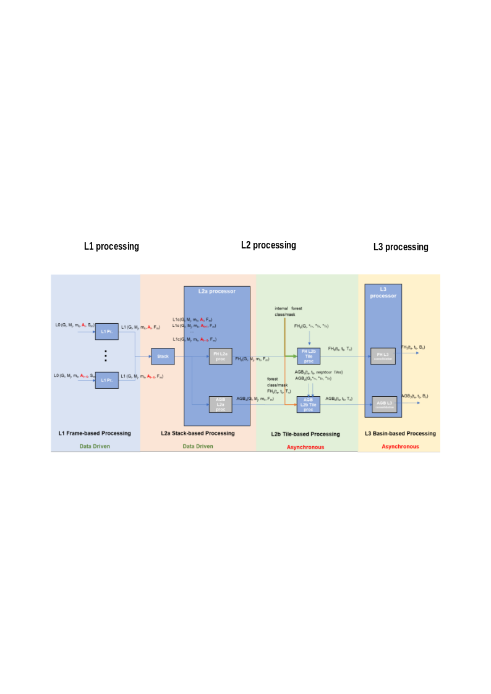
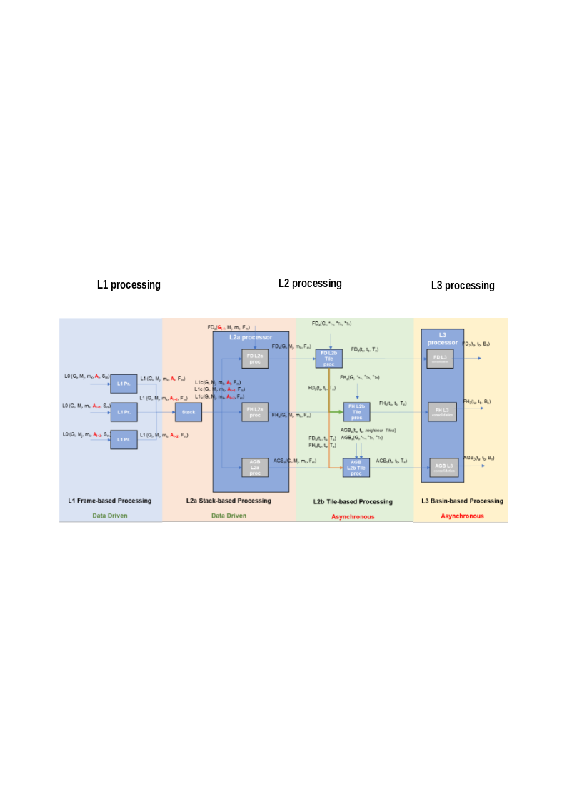
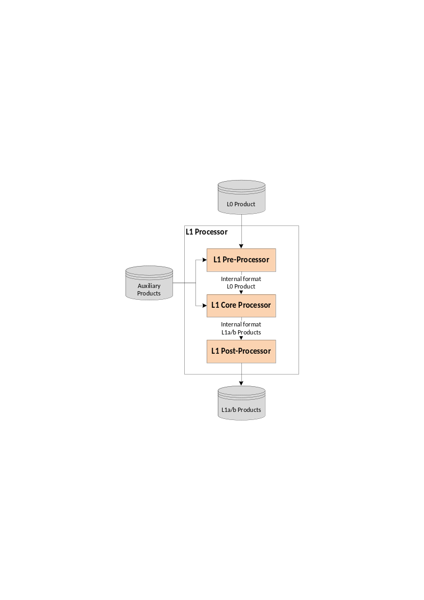
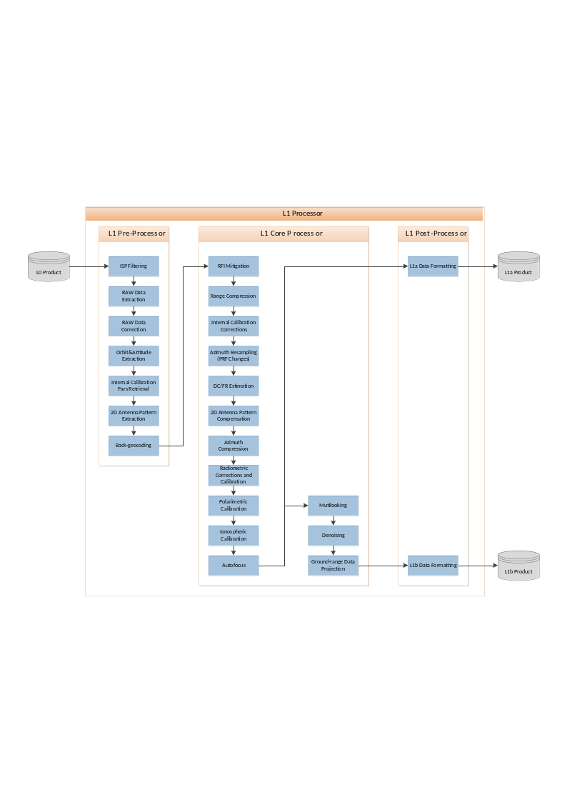

<!-- SPDX-FileCopyrightText: 2026 European Space Agency (ESA) -->
<!-- SPDX-License-Identifier: Apache-2.0 -->

:::{atbd-logo-banner}
:::


(sec:atbd-l1-sar-2)=
# 2. BPS and L1 Processor Overview

(sec:atbd-l1-sar-2-1)=
### 2.1 BPS Overview

The BIOMASS Processing Suite (BPS) is in charge of processing BIOMASS Level-0 data up to Level-3, generating a wide set of products. Product generation scheme is depicted in the following two figures respectively for TOM phase and for INT phase. The processing foresees the following steps:

- L1 processing: the BIOMASS image formation step, taking in input 1 L0 slice and generating in output N\>=1 L1 frames;
- Stack Processing: the coregistration and stacking processing step that will define the required 7-images Tomographic stacks or the 3-images Interferometric stacks. It includes stack phase calibration;
- L2a Processing: processing step for each stack that provides the inputs to the further products Tile Generation performed by the L2b processors. For one global cycle the number of stacks varies mainly with latitude, approximately from a minimum of two at the Equator (ascending/descending) to about six at higher latitudes (three ascending/descending pairs);
- L2b Processing: processing that aggregates all the stack-based L2a products insisting on the same location on ground (Tile) in the same time interval and generates a single BIOMASS L2b product. A different number of stacks may be available for each DGG tile, based on tile dimensions and swath coverage (which is not related to DGG tiling pattern);
- L3 Processing: consolidation processing removing discontinuities in L2b products.

(fig:atbd-l1-sar-1)=
::::{div} atbd-mermaid-figure atbd-drawn-figure

<div class="atbd-figure-content">

```{mermaid}
%%{init: {"class": {"useMaxWidth": false}, "theme": "default", "layout": "elk", "elk": {"nodePlacementStrategy": "NETWORK_SIMPLEX"}, "flowchart": {"useMaxWidth": false, "diagramPadding": 4, "subGraphTitleMargin": {"top": 2, "bottom": 2}}}}%%
flowchart TB
  accTitle: Biomass high-level processing scheme from L0 data to L3 products, TOM phase.
  accDescr: Three stages, L1, L2 and L3 processing, in four lanes drawn side by side from left to right in the original and here from top to bottom. L1 Frame-based Processing (Data Driven): each L0 frame (G_i, M_j, m_k, A_l, S_m) up to A_l+6 goes through an L1 Pr. step, giving L1 (G_i, M_j, m_k, A_l, F_m) to A_l+6. L2a Stack-based Processing (Data Driven): the L1 frames are stacked; the stack, L1c(G_i, M_j, m_k, A_l, F_m) to A_l+6, feeds the FH L2a proc and AGB L2a proc steps of the L2a processor. L2b Tile-based Processing (Asynchronous): FH_a(G_i, M_j, m_k, F_m) and FH_a(G_i, *Tn, *Tn, *Tn) feed the FH L2b Tile proc, which also takes the internal forest class/mask; AGB_a(G_i, M_j, m_k, F_m), AGB_b(t_a, t_b, neighbour Tiles), AGB_a(G_i, *Tn, *Tn, *Tn) and the forest class/mask with FH_b(t_a, t_b, T_n) feed the AGB L2b Tile proc. L3 Basin-based Processing (Asynchronous): FH_b(t_a, t_b, T_n) and AGB_b(t_a, t_b, T_n) go to the FH L3 and AGB L3 consolidation steps of the L3 processor, which output FH_3(t_a, t_b, B_n) and AGB_3(t_a, t_b, B_n).

  %% Colours of the original figure. Each class sets its text colour too, so it
  %% stays readable with the light and the dark site themes.
  %%   step:  processing step (blue box, white text)
  %%   proc:  step inside a processor (grey box, white text)
  %%   data:  input or output label (text only, on the lane colour)
  %%   red A: the acquisition index that changes from frame to frame
  classDef step fill:#8faadc,stroke:#1f1f1f,color:#ffffff,font-weight:bold
  classDef proc fill:#a6a6a6,stroke:#1f1f1f,color:#ffffff,font-weight:bold
  classDef data fill:none,stroke:none,color:#000000
  classDef dots fill:none,stroke:none,color:#000000,font-weight:bold

  subgraph L1["<b>L1 processing</b><br/>L1 Frame-based Processing<br/><span style='color:#548235'>Data Driven</span>"]
    in1["L0 (G<sub>i</sub>, M<sub>j</sub>, m<sub>k</sub>, <b style='color:#e00000'>A<sub>l</sub></b>, S<sub>m</sub>)"]:::data
    l1a["L1 Pr."]:::step
    more["⋮"]:::dots
    in2["L0 (G<sub>i</sub>, M<sub>j</sub>, m<sub>k</sub>, <b style='color:#e00000'>A<sub>l+ 6</sub></b>, S<sub>m</sub>)"]:::data
    l1b["L1 Pr."]:::step
  end

  subgraph L2P["<b>L2 processing</b>"]
    subgraph L2A["L2a Stack-based Processing<br/><span style='color:#548235'>Data Driven</span>"]
      stack["Stack"]:::step
      subgraph L2AP["L2a processor"]
        fha["FH L2a<br/>proc"]:::proc
        agba["AGB<br/>L2a<br/>proc"]:::proc
      end
    end
    subgraph L2B["L2b Tile-based Processing<br/><span style='color:#e00000'>Asynchronous</span>"]
      mask["internal forest<br/>class/mask"]:::data
      fhin["FH<sub>a</sub>(G<sub>i</sub>, *<sub>Tn</sub>, *<sub>Tn</sub>, *<sub>Tn</sub>)"]:::data
      agbinb["AGB<sub>b</sub>(t<sub>a</sub>, t<sub>b</sub>, <i>neighbour Tiles</i>)"]:::data
      agbina["AGB<sub>a</sub>(G<sub>i</sub>,*<sub>Tn</sub>, *<sub>Tn</sub>, *<sub>Tn</sub>)"]:::data
      fhb["FH L2b<br/>Tile<br/>proc"]:::step
      agbb["AGB<br/>L2b Tile<br/>proc"]:::step
    end
  end

  subgraph L3["<b>L3 processing</b><br/>L3 Basin-based Processing<br/><span style='color:#e00000'>Asynchronous</span>"]
    subgraph L3PR["L3<br/>processor"]
      fh3["FH L3<br/><small>consolidation</small>"]:::proc
      agb3["AGB L3<br/><small>consolidation</small>"]:::proc
    end
    fhout["FH<sub>3</sub>(t<sub>a</sub>, t<sub>b</sub>, B<sub>n</sub>)"]:::data
    agbout["AGB<sub>3</sub>(t<sub>a</sub>, t<sub>b</sub>, B<sub>n</sub>)"]:::data
  end

  in1 --> l1a
  in2 --> l1b
  in1 ~~~ more
  l1a -- "L1 (G<sub>i</sub>, M<sub>j</sub>, m<sub>k</sub>, <b style='color:#e00000'>A<sub>l</sub></b>, F<sub>m</sub>)" --> stack
  l1b -- "L1 (G<sub>i</sub>, M<sub>j</sub>, m<sub>k</sub>, <b style='color:#e00000'>A<sub>l+ 6</sub></b>, F<sub>m</sub>)" --> stack
  stack -- "L1c(G<sub>i</sub>, M<sub>j</sub>, m<sub>k</sub>, <b style='color:#e00000'>A<sub>l</sub></b>, F<sub>m</sub>)<br/>L1c (G<sub>i</sub>, M<sub>j</sub>, m<sub>k</sub>, <b style='color:#e00000'>A<sub>l+1</sub></b>, F<sub>m</sub>)<br/>…<br/>L1c(G<sub>i</sub>, M<sub>j</sub>, m<sub>k</sub>, <b style='color:#e00000'>A<sub>l+ 6</sub></b>, F<sub>m</sub>)" --> fha
  stack --> agba
  fha -- "FH<sub>a</sub>(G<sub>i</sub>, M<sub>j</sub>, m<sub>k</sub>, F<sub>m</sub>)" --> fhb
  agba -- "AGB<sub>a</sub>(G<sub>i</sub>, M<sub>j</sub>, m<sub>k</sub>, F<sub>m</sub>)" --> agbb
  fhin --> fhb
  agbinb --> agbb
  mask ==> fhb
  mask -- "forest<br/>class/mask<br/>FH<sub>b</sub>(t<sub>a</sub>, t<sub>b</sub>, T<sub>n</sub>)" --> agbb
  fhb -- "FH<sub>b</sub>(t<sub>a</sub>, t<sub>b</sub>, T<sub>n</sub>)" --> fh3
  agbb -- "AGB<sub>b</sub>(t<sub>a</sub>, t<sub>b</sub>, T<sub>n</sub>)" --> agb3
  fh3 --> fhout
  agb3 --> agbout
  agbina --> agbb

  %% lane colours (fill and text colour: readable in both site themes)
  style L2P fill:none,stroke:none,color:#000000
  style L1 fill:#dae3f3,stroke:#dae3f3,color:#000000
  style L2A fill:#fbe5d6,stroke:#fbe5d6,color:#000000
  style L2B fill:#e2f0d9,stroke:#e2f0d9,color:#000000
  style L3 fill:#fff2cc,stroke:#fff2cc,color:#000000
  style L2AP fill:#8faadc,stroke:#1f1f1f,color:#ffffff
  style L3PR fill:#8faadc,stroke:#1f1f1f,color:#ffffff
  %% links 11 and 12: internal forest class/mask (green, then orange)
  linkStyle 11 stroke:#70ad47,stroke-width:3px
  linkStyle 12 stroke:#ed7d31,stroke-width:2px
```

:::{dropdown} Original figure (DOCX)

:::

</div>

<p class="atbd-figure-caption"><span class="caption-number">Fig. 1</span><span class="caption-text"> — Biomass high-level processing scheme from L0 data to L3 products, TOM phase.</span></p>

::::

(fig:atbd-l1-sar-2)=
:::{div} atbd-mermaid-figure

<div class="atbd-figure-content">



</div>

<p class="atbd-figure-caption"><span class="caption-number">Fig. 2</span><span class="caption-text"> — Biomass high-level processing scheme from L0 data to L3 products, INT phase.</span></p>

:::

(sec:atbd-l1-sar-2-2)=
### 2.2 L1 Processor Overview

The BPS L1 Processor is able to ingest BIOMASS Level-0 products, acquired in Stripmap quad-pol mode, and to process them into Level-1a and Level-1b products.

The whole processing chain is organized into three main steps:

- L1 Pre-Processor, responsible of checking, ingesting and decoding the input L0 product and of analysing the dedicated Internal Calibration packets;
- L1 Core Processor, responsible of implementing the L1 processing chain kernel;
- L1 Post-Processor, responsible of formatting the processor outputs into official L1a (SCS) and L1b (DGM) products, depending on the performed processing chain.

(fig:atbd-l1-sar-3)=
::::{div} atbd-mermaid-figure atbd-drawn-figure

<div class="atbd-figure-content">

```{mermaid}
%%{init: {"flowchart": {"useMaxWidth": false}, "class": {"useMaxWidth": false}, "theme": "default"}}%%
flowchart TB
  accTitle: L1 Processor high-level workflow.
  accDescr: The L0 Product enters the L1 Processor, which chains the L1 Pre-Processor, the L1 Core Processor and the L1 Post-Processor. The Pre-Processor passes an internal format L0 Product to the Core Processor, which passes internal format L1a/b Products to the Post-Processor. Auxiliary Products feed the Pre-Processor and the Core Processor. The Post-Processor outputs the L1a/b Products.
  l0[("L0 Product")]
  aux[("Auxiliary Products")]
  subgraph proc ["L1 Processor"]
    direction TB
    pre["L1 Pre-Processor"]
    core["L1 Core Processor"]
    post["L1 Post-Processor"]
  end
  l1ab[("L1a/b Products")]
  l0 --> pre
  aux --> pre
  aux --> core
  pre -- "Internal format<br/>L0 Product" --> core
  core -- "Internal format<br/>L1a/b Products" --> post
  post --> l1ab
  style proc fill:none,stroke:#a6a6a6
  classDef step fill:#fbd5b5,stroke:#a6a6a6,color:#000,font-weight:bold
  classDef data fill:#d9d9d9,stroke:#7f7f7f,color:#000
  class pre,core,post step
  class l0,aux,l1ab data
```

:::{dropdown} Original figure (DOCX)

:::

</div>

<p class="atbd-figure-caption"><span class="caption-number">Fig. 3</span><span class="caption-text"> — L1 Processor high-level workflow.</span></p>

::::

(sec:atbd-l1-sar-2-3)=
### 2.3 L1 Processor Workflow and Algorithmic Overview

The main steps of the BPS L1 Processor workflow, from L0 to L1a/L1b products, is depicted in the following figure and described in detail in the following sub-sections.

(fig:atbd-l1-sar-4)=
::::{div} atbd-mermaid-figure atbd-drawn-figure

<div class="atbd-figure-content">

<p class="atbd-subfigure-label">(a)</p>

```{mermaid}
%%{init: {"flowchart": {"useMaxWidth": false}, "class": {"useMaxWidth": false}, "theme": "default", "layout": "elk"}}%%
flowchart LR
  accTitle: L1 Processor detailed workflow.
  accDescr: Overview of the figure, whose detail is in three sub-figures. The L0 Product enters the L1 Processor, where the L1 Pre-Processor feeds the L1 Core Processor. The L1 Core Processor feeds the L1 Post-Processor twice, from Autofocus and from Ground-range Data Projection, which outputs the L1a Product and the L1b Product.

  %% Colours of the original figure. Each class sets its text colour too.
  %%   blk:  processor block, detailed in its own sub-figure (orange, as the frame titles)
  %%   data: product (grey cylinder)
  classDef blk fill:#fbe5d6,stroke:#f4b183,color:#000000
  classDef data fill:#d9d9d9,stroke:#7f7f7f,color:#000000

  l0[("L0 Product")]:::data

  subgraph proc["L1 Processor&nbsp;"]
    direction LR
    pre["L1 Pre-Processor"]:::blk
    core["L1 Core Processor"]:::blk
    post["L1 Post-Processor"]:::blk
  end

  l1a[("L1a Product")]:::data
  l1b[("L1b Product")]:::data

  l0 --> pre
  pre --> core
  %% Two edges, as in the original: Autofocus feeds L1a Data Formatting (before the multilook),
  %% Ground-range Data Projection feeds L1b Data Formatting; detail in (c) and (d).
  core -- "from Autofocus" --> post
  core -- "from Ground-range<br/>Data Projection" --> post
  post --> l1a
  post --> l1b

  %% Frame of the original (orange outline)
  style proc fill:#ffffff,stroke:#f4b183,color:#000000
```

<p class="atbd-subfigure-label">(b)</p>

```{mermaid}
%%{init: {"flowchart": {"useMaxWidth": false}, "class": {"useMaxWidth": false}, "theme": "default", "layout": "elk"}}%%
flowchart TB
  accTitle: L1 Processor detailed workflow.
  accDescr: Detail of the L1 Pre-Processor, a chain of ISP Filtering, RAW Data Extraction, RAW Data Correction, Orbit&Attitude Extraction, Internal Calibration Pars Retrieval, 2D Antenna Pattern Extraction and Back-geocoding.

  %% Colours of the original figure. Each class sets its text colour too.
  %%   step: processing step (blue box)
  classDef step fill:#a9c4e0,stroke:#7f9fc4,color:#000000

  subgraph pre["L1 Pre-Processor&nbsp;"]
    direction TB
    isp["ISP Filtering"]:::step
    rawx["RAW Data<br/>Extraction"]:::step
    rawc["RAW Data<br/>Correction"]:::step
    oa["Orbit&amp;Attitude<br/>Extraction"]:::step
    icp["Internal Calibration<br/>Pars Retrieval"]:::step
    ape["2D Antenna Pattern<br/>Extraction"]:::step
    bg["Back-geocoding"]:::step
  end

  isp --> rawx --> rawc --> oa --> icp --> ape --> bg

  %% Frame of the original (orange outline)
  style pre fill:#ffffff,stroke:#f4b183,color:#000000
```

<p class="atbd-subfigure-label">(c)</p>

```{mermaid}
%%{init: {"flowchart": {"useMaxWidth": false}, "class": {"useMaxWidth": false}, "theme": "default", "layout": "elk"}}%%
flowchart TB
  accTitle: L1 Processor detailed workflow.
  accDescr: Detail of the L1 Core Processor, a chain of RFI Mitigation, Range Compression, Internal Calibration Corrections, Azimuth Resampling (PRF Changes), DC/FR Estimation, 2D Antenna Pattern Compensation, Azimuth Compression, Radiometric Corrections and Calibration, Polarimetric Calibration, Ionospheric Calibration and Autofocus. Autofocus feeds Mutilooking, followed by Denoising and Ground-range Data Projection. Autofocus also feeds the L1a Data Formatting, and Ground-range Data Projection feeds the L1b Data Formatting, both in sub-figure (d).

  %% Colours of the original figure. Each class sets its text colour too.
  %%   step: processing step (blue box)
  classDef step fill:#a9c4e0,stroke:#7f9fc4,color:#000000

  subgraph core["L1 Core Processor&nbsp;"]
    direction TB
    rfi["RFI Mitigation"]:::step
    rc["Range Compression"]:::step
    icc["Internal Calibration<br/>Corrections"]:::step
    ar["Azimuth Resampling<br/>(PRF Changes)"]:::step
    dc["DC/FR Estimation"]:::step
    apc["2D Antenna Pattern<br/>Compensation"]:::step
    ac["Azimuth<br/>Compression"]:::step
    rad["Radiometric<br/>Corrections and<br/>Calibration"]:::step
    pol["Polarimetric<br/>Calibration"]:::step
    ion["Ionospheric<br/>Calibration"]:::step
    af["Autofocus"]:::step
    ml["Mutilooking"]:::step
    dn["Denoising"]:::step
    grd["Ground-range Data<br/>Projection"]:::step
  end

  rfi --> rc --> icc --> ar --> dc --> apc --> ac --> rad --> pol --> ion --> af
  af --> ml
  ml --> dn --> grd

  %% Frame of the original (orange outline)
  style core fill:#ffffff,stroke:#f4b183,color:#000000
```

<p class="atbd-subfigure-label">(d)</p>

```{mermaid}
%%{init: {"flowchart": {"useMaxWidth": false}, "class": {"useMaxWidth": false}, "theme": "default", "layout": "elk"}}%%
flowchart TB
  accTitle: L1 Processor detailed workflow.
  accDescr: Detail of the L1 Post-Processor, with two separate steps. L1a Data Formatting receives its input from Autofocus, in sub-figure (c), and outputs the L1a Product. L1b Data Formatting receives its input from Ground-range Data Projection, in sub-figure (c), and outputs the L1b Product.

  %% Colours of the original figure. Each class sets its text colour too.
  %%   step: processing step (blue box)
  %%   ref:  cross-reference, NOT a step (white stadium, dashed outline): it points to a
  %%         step or product drawn in another sub-figure, so that no step is duplicated
  classDef step fill:#a9c4e0,stroke:#7f9fc4,color:#000000
  classDef ref fill:#ffffff,stroke:#7f7f7f,color:#000000,stroke-dasharray:4 3

  %% Links of the original figure that cross the parts. The original draws Autofocus
  %% (in the Core Processor) feeding L1a Data Formatting, before the multilook, and only
  %% Ground-range Data Projection feeding L1b Data Formatting. The split in four sub-figures
  %% would lose these links, so each is restored here by a cross-reference node.
  src1a(["from (c): Autofocus"]):::ref
  src1b(["from (c): Ground-range Data Projection"]):::ref
  out1a(["to (a): L1a Product"]):::ref
  out1b(["to (a): L1b Product"]):::ref

  subgraph post["L1 Post-Processor&nbsp;"]
    direction TB
    f1a["L1a Data Formatting"]:::step
    f1b["L1b Data Formatting"]:::step
  end

  src1a --> f1a
  src1b --> f1b
  f1a --> out1a
  f1b --> out1b

  %% Frame of the original (orange outline)
  style post fill:#ffffff,stroke:#f4b183,color:#000000
```

:::{dropdown} Original figure (DOCX)

:::

</div>

<p class="atbd-figure-caption"><span class="caption-number">Fig. 4</span><span class="caption-text"> — L1 Processor detailed workflow.</span></p>

::::

(sec:atbd-l1-sar-2-3-1)=
#### 2.3.1 L1 Pre-Processor

This module ingests the input L0 and auxiliary products and performs the following operations:

- ISP filtering and extraction;
- BAQ decoding;
- Raw data correction (I/Q bias, imbalance and orthogonality correction (the last two if required));
- SWL equalization;
- Internal calibration information retrieval, i.e.:
    - Drifts;
    - Replica;
    - Internal delays;
    - Internal channel imbalance between polarizations;
    - Transmit power tracking;
    - Instrument noise level;
- Orbit and attitude files ingestion;
- 2D antenna patterns ingestion;
- Back-geocoding (i.e., the retrieval of the X,Y,Z matrices of the external map in radar coordinates, necessary for the DC/FR estimation and the antenna pattern compensation steps).

(sec:atbd-l1-sar-2-3-2)=
#### 2.3.2 L1 Core Processor

(sec:atbd-l1-sar-2-3-2-1)=
##### 2.3.2.1 RFI Mitigation

This module performs the RFI detection and mitigation on the raw data in order to provide “clean” SAR data to the remaining processing steps. This is a critical processing step due to the expected occurrences of P-band interferences. The use of an external RFI map generated as input for the algorithm is currently not foreseen. Both the foreseen algorithms, the one operating in the Frequency domain (FD) and the one operating in the Time Domain (TD) include a detection step to generate RFI masks for the specific product being processed.

The outputs of this module are the filtered raw data images of each channel.

(sec:atbd-l1-sar-2-3-2-2)=
##### 2.3.2.2 Range Compression and Internal Calibration Corrections

This step applies to the raw data the correction factors (replica, gains, amplitude and phase drifts, delays), derived from internal calibration pulses in the L1 Pre-Processor step. For efficiency reasons, this step is carried out within the range compression one.

The output of this step is the partially calibrated range-compressed data.

(sec:atbd-l1-sar-2-3-2-3)=
##### 2.3.2.3 Doppler Centroid and Doppler Rate Estimation

This module is in charge of the retrieving a set of geometric parameters needed for the SAR focusing step, namely, the Doppler Centroid, the effective velocity and the Doppler Rate. The Doppler Centroid can be computed from the geometry (using the state vectors) or be estimated from the raw data. A combination of both is also possible. In any case, a configuration option will be available to force the processing around a specific Doppler Centroid value (e.g., 0 Hz) independently on the pointing of the acquisition. Please note that in any case the antenna pattern compensation is always performed using the estimated Doppler Centroid value.

This module makes use of the L1 Pre-Processor back-geocoding step outputs, in order to compute the effective velocity adapted to the topography.

The main inputs of this module are the range-compressed data (to estimate the Doppler Centroid), the navigation data and an external digital elevation model (DEM).

The main outputs of this module are:

- the Doppler Centroid of the data, which might be used for the focusing operation if selected by the user;
- the effective velocity and Doppler Rate for the focusing operation.

(sec:atbd-l1-sar-2-3-2-4)=
##### 2.3.2.4 Azimuth Compression and Calibrations

This module is in charge of the “SAR focusing” process, that shall transform the image from the acquisition domain to the 2D image domain (Zero-Doppler coordinates). A fast w-k approach, based on an approximation of the range migration correction that guarantees full accuracies in a limited range of bandwidths and Doppler Centroids, is proposed as the preferred solution for the BPS L1 Processor.

This step also includes the azimuth resampling (when required) and the relative and absolute calibration of the image, including spread losses, processor normalization, absolute calibration factor and topography-dependent antenna pattern compensation.

The step of instrument polarimetric calibration is also performed within this module, using the transmission and receive distortion matrices.

Lastly, the ionospheric calibration step is performed. This module is one of the core processing blocks specifically designed and developed for the BIOMASS mission. It contains advanced ionospheric compensation strategies and autofocus capabilities to guarantee the best SAR data quality even in the worst-case ionospheric conditions.

(sec:atbd-l1-sar-2-3-2-5)=
##### 2.3.2.5 Multilooking, Denoising and Ground-range Projection

In case the L1b part of the processing chain is activated too, the following additional processing steps are performed starting from L1a data:

- frequency multilooking with configurable central frequencies, bandwidths and weighting windows;
- time domain multilooking;
- thermal noise removal;
- ground range re-projection.

(sec:atbd-l1-sar-2-3-3)=
#### 2.3.3 L1 Post-Processor

The L1 Post-Processor performs the final L1a and L1b products data and meta-data formatting and acquisition quick-look generation, since note that during the processing an internal data format will be used.

(sec:atbd-l1-sar-2-4)=
### 2.4 Note on interpretation of inputs and outputs tables

Inputs and outputs for each processing sub-step are summarized in specific subsections (two sub-sections for each sub-step). A specific tabular format is defined to improve the access to the document. The meaning of each column is exemplified in the following table.

| Symbol | Name | Origin/ Destination | Size | Variability | Default | Description |
|---|---|---|---|---|---|---|
| Mathematical symbol of the quantity appearing in formulas | Name of the quantity as related to other BPS documentation (e.g., `AUX_FMT`, L1 ATBDs, …) | BPS document name describing the origin of the quantity or processing step of origin/destination or BPS product of destination | Dimensions of the quantity | Range of values or update rate of an internal resource | Default value for configuration parameters | Verbal description of the quantity and its characteristics (e.g., measure units, …) If the quantity is stored in an intermediate product, its name is indicated here too, in order to have a link with the complete list reported in {rd}`39` |
