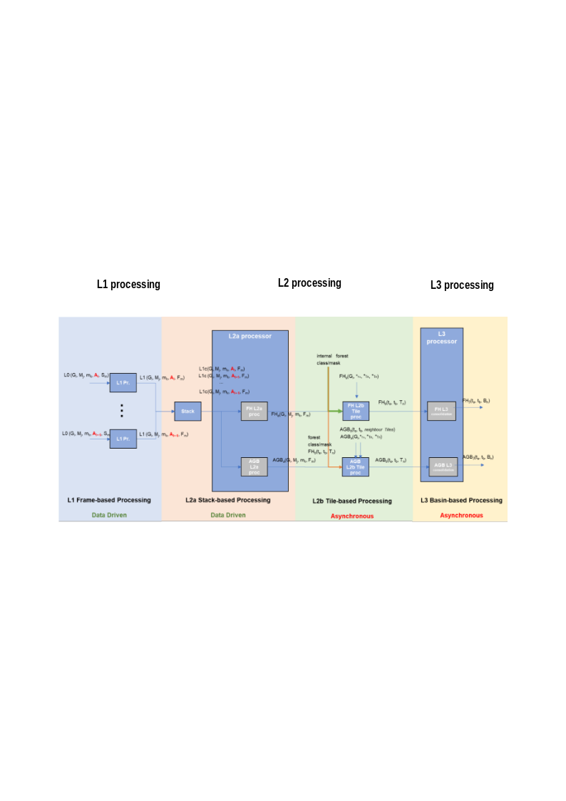
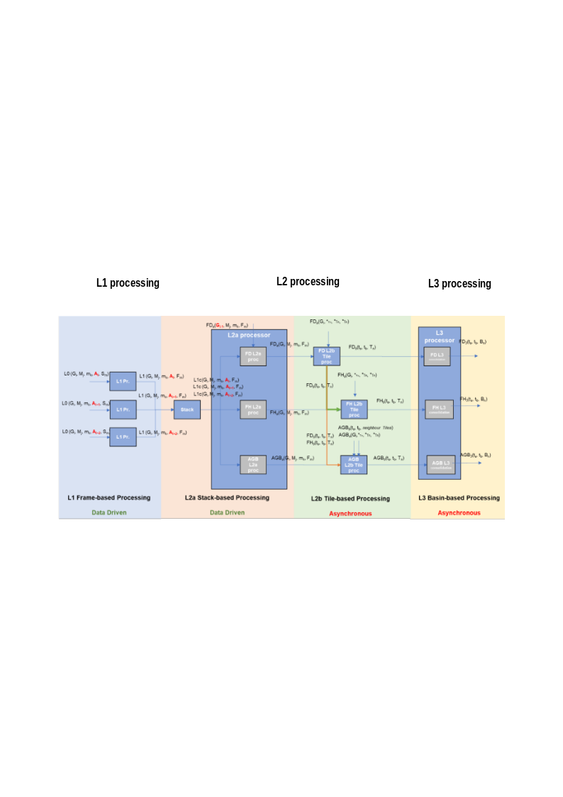
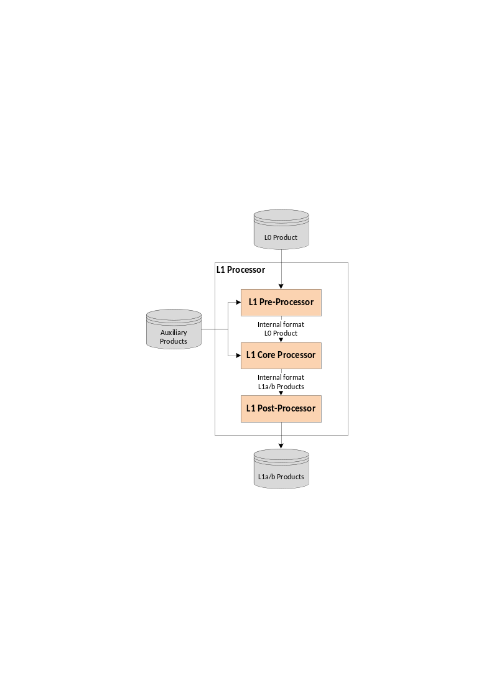
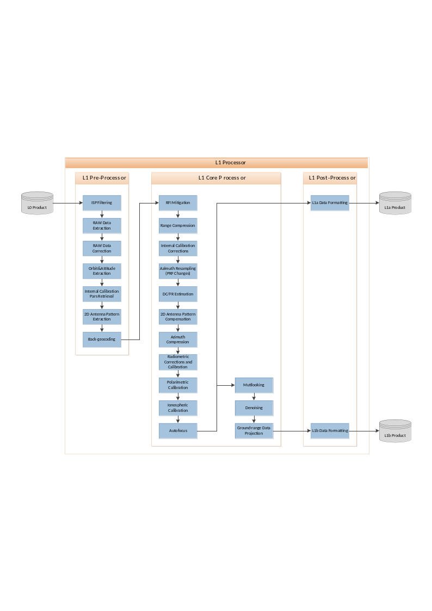

<!-- SPDX-FileCopyrightText: 2026 European Space Agency (ESA) -->
<!-- SPDX-License-Identifier: Apache-2.0 -->

:::{atbd-logo-banner}
:::

(sec:atbd-l1-sar-2)=
# 2. BPS and L1 Processor Overview

(sec:atbd-l1-sar-2-1)=
### 2.1 BPS Overview

The BIOMASS Processing Suite (BPS) is in charge of processing BIOMASS Level-0 data up to Level-3, generating a wide set of products. Product generation scheme is depicted in the following two figures respectively for TOM phase and for INT phase. The processing foresees the following steps:

- L1 processing: the BIOMASS image formation step, taking in input 1 L0 slice and generating in output N\>=1 L1 frames;
- Stack Processing: the coregistration and stacking processing step that will define the required 7-images Tomographic stacks or the 3-images Interferometric stacks. It includes stack phase calibration;
- L2a Processing: processing step for each stack that provides the inputs to the further products Tile Generation performed by the L2b processors. For one global cycle the number of stacks varies mainly with latitude, approximately from a minimum of two at the Equator (ascending/descending) to about six at higher latitudes (three ascending/descending pairs);
- L2b Processing: processing that aggregates all the stack-based L2a products insisting on the same location on ground (Tile) in the same time interval and generates a single BIOMASS L2b product. A different number of stacks may be available for each DGG tile, based on tile dimensions and swath coverage (which is not related to DGG tiling pattern);
- L3 Processing: consolidation processing removing discontinuities in L2b products.

(fig:atbd-l1-sar-1)=
:::{div} atbd-mermaid-figure

Fig. 1 — Biomass high-level processing scheme from L0 data to L3 products, TOM phase.

:::

(fig:atbd-l1-sar-2)=
:::{div} atbd-mermaid-figure

Fig. 2 — Biomass high-level processing scheme from L0 data to L3 products, INT phase.

:::

(sec:atbd-l1-sar-2-2)=
### 2.2 L1 Processor Overview

The BPS L1 Processor is able to ingest BIOMASS Level-0 products, acquired in Stripmap quad-pol mode, and to process them into Level-1a and Level-1b products.

The whole processing chain is organized into three main steps:

- L1 Pre-Processor, responsible of checking, ingesting and decoding the input L0 product and of analysing the dedicated Internal Calibration packets;
- L1 Core Processor, responsible of implementing the L1 processing chain kernel;
- L1 Post-Processor, responsible of formatting the processor outputs into official L1a (SCS) and L1b (DGM) products, depending on the performed processing chain.

(fig:atbd-l1-sar-3)=
:::{div} atbd-mermaid-figure

Fig. 3 — L1 Processor high-level workflow.

:::

(sec:atbd-l1-sar-2-3)=
### 2.3 L1 Processor Workflow and Algorithmic Overview

The main steps of the BPS L1 Processor workflow, from L0 to L1a/L1b products, is depicted in the following figure and described in detail in the following sub-sections.

(fig:atbd-l1-sar-4)=
:::{div} atbd-mermaid-figure

Fig. 4 — L1 Processor detailed workflow.

:::

(sec:atbd-l1-sar-2-3-1)=
#### 2.3.1 L1 Pre-Processor

This module ingests the input L0 and auxiliary products and performs the following operations:

- ISP filtering and extraction;
- BAQ decoding;
- Raw data correction (I/Q bias, imbalance and orthogonality correction (the last two if required));
- SWL equalization;
- Internal calibration information retrieval, i.e.:
    - Drifts;
    - Replica;
    - Internal delays;
    - Internal channel imbalance between polarizations;
    - Transmit power tracking;
    - Instrument noise level;
- Orbit and attitude files ingestion;
- 2D antenna patterns ingestion;
- Back-geocoding (i.e., the retrieval of the X,Y,Z matrices of the external map in radar coordinates, necessary for the DC/FR estimation and the antenna pattern compensation steps).

(sec:atbd-l1-sar-2-3-2)=
#### 2.3.2 L1 Core Processor

(sec:atbd-l1-sar-2-3-2-1)=
##### 2.3.2.1 RFI Mitigation

This module performs the RFI detection and mitigation on the raw data in order to provide “clean” SAR data to the remaining processing steps. This is a critical processing step due to the expected occurrences of P-band interferences. The use of an external RFI map generated as input for the algorithm is currently not foreseen. Both the foreseen algorithms, the one operating in the Frequency domain (FD) and the one operating in the Time Domain (TD) include a detection step to generate RFI masks for the specific product being processed.

The outputs of this module are the filtered raw data images of each channel.

(sec:atbd-l1-sar-2-3-2-2)=
##### 2.3.2.2 Range Compression and Internal Calibration Corrections

This step applies to the raw data the correction factors (replica, gains, amplitude and phase drifts, delays), derived from internal calibration pulses in the L1 Pre-Processor step. For efficiency reasons, this step is carried out within the range compression one.

The output of this step is the partially calibrated range-compressed data.

(sec:atbd-l1-sar-2-3-2-3)=
##### 2.3.2.3 Doppler Centroid and Doppler Rate Estimation

This module is in charge of the retrieving a set of geometric parameters needed for the SAR focusing step, namely, the Doppler Centroid, the effective velocity and the Doppler Rate. The Doppler Centroid can be computed from the geometry (using the state vectors) or be estimated from the raw data. A combination of both is also possible. In any case, a configuration option will be available to force the processing around a specific Doppler Centroid value (e.g., 0 Hz) independently on the pointing of the acquisition. Please note that in any case the antenna pattern compensation is always performed using the estimated Doppler Centroid value.

This module makes use of the L1 Pre-Processor back-geocoding step outputs, in order to compute the effective velocity adapted to the topography.

The main inputs of this module are the range-compressed data (to estimate the Doppler Centroid), the navigation data and an external digital elevation model (DEM).

The main outputs of this module are:

- the Doppler Centroid of the data, which might be used for the focusing operation if selected by the user;
- the effective velocity and Doppler Rate for the focusing operation.

(sec:atbd-l1-sar-2-3-2-4)=
##### 2.3.2.4 Azimuth Compression and Calibrations

This module is in charge of the “SAR focusing” process, that shall transform the image from the acquisition domain to the 2D image domain (Zero-Doppler coordinates). A fast w-k approach, based on an approximation of the range migration correction that guarantees full accuracies in a limited range of bandwidths and Doppler Centroids, is proposed as the preferred solution for the BPS L1 Processor.

This step also includes the azimuth resampling (when required) and the relative and absolute calibration of the image, including spread losses, processor normalization, absolute calibration factor and topography-dependent antenna pattern compensation.

The step of instrument polarimetric calibration is also performed within this module, using the transmission and receive distortion matrices.

Lastly, the ionospheric calibration step is performed. This module is one of the core processing blocks specifically designed and developed for the BIOMASS mission. It contains advanced ionospheric compensation strategies and autofocus capabilities to guarantee the best SAR data quality even in the worst-case ionospheric conditions.

(sec:atbd-l1-sar-2-3-2-5)=
##### 2.3.2.5 Multilooking, Denoising and Ground-range Projection

In case the L1b part of the processing chain is activated too, the following additional processing steps are performed starting from L1a data:

- frequency multilooking with configurable central frequencies, bandwidths and weighting windows;
- time domain multilooking;
- thermal noise removal;
- ground range re-projection.

(sec:atbd-l1-sar-2-3-3)=
#### 2.3.3 L1 Post-Processor

The L1 Post-Processor performs the final L1a and L1b products data and meta-data formatting and acquisition quick-look generation, since note that during the processing an internal data format will be used.

(sec:atbd-l1-sar-2-4)=
### 2.4 Note on interpretation of inputs and outputs tables

Inputs and outputs for each processing sub-step are summarized in specific subsections (two sub-sections for each sub-step). A specific tabular format is defined to improve the access to the document. The meaning of each column is exemplified in the following table.

| Symbol | Name | Origin/ Destination | Size | Variability | Default | Description |
|---|---|---|---|---|---|---|
| Mathematical symbol of the quantity appearing in formulas | Name of the quantity as related to other BPS documentation (e.g., `AUX_FMT`, L1 ATBDs, …) | BPS document name describing the origin of the quantity or processing step of origin/destination or BPS product of destination | Dimensions of the quantity | Range of values or update rate of an internal resource | Default value for configuration parameters | Verbal description of the quantity and its characteristics (e.g., measure units, …) If the quantity is stored in an intermediate product, its name is indicated here too, in order to have a link with the complete list reported in {rd}`39` |
