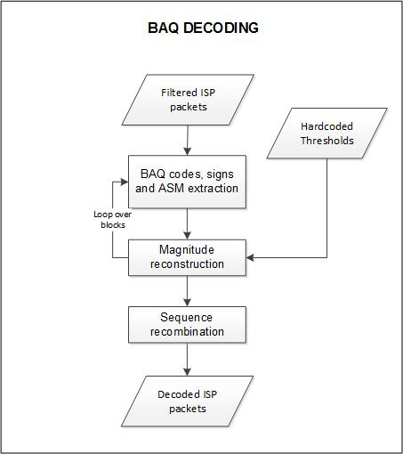
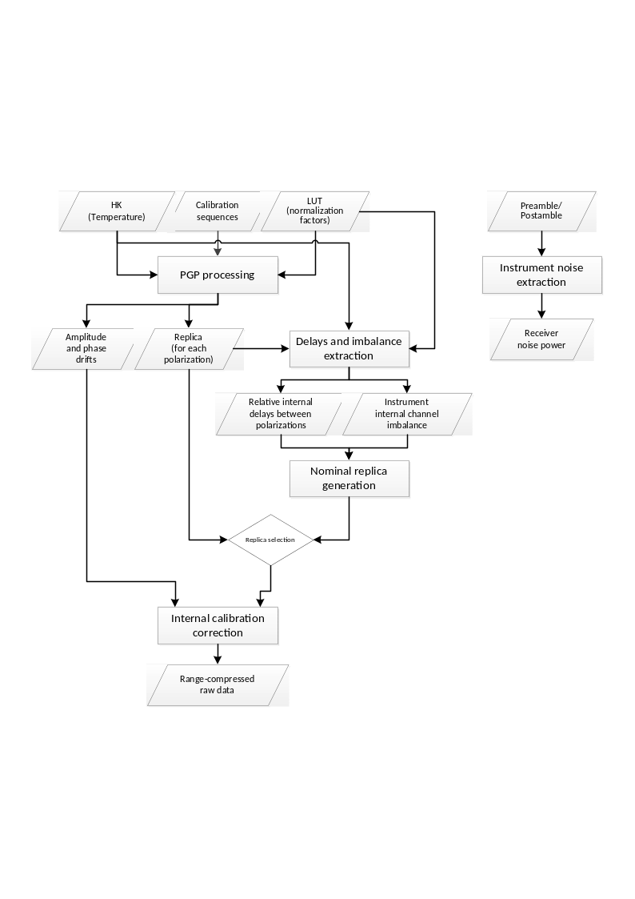

<!-- SPDX-FileCopyrightText: 2026 European Space Agency (ESA) -->
<!-- SPDX-License-Identifier: Apache-2.0 -->

:::{atbd-logo-banner}
:::


(sec:atbd-l1-sar-3)=
# 3. L1 Pre-Processing

(sec:atbd-l1-sar-3-1)=
### 3.1 ISP Filtering

**Algorithm overview and rationale**

The ISP Filtering step is in charge of filtering the input L0 product Instrument Source Packets (ISP) by performing the following checks for anomalies. The filtering is applied distinguishably for the SAR Packets and the Ancillary Packets, as follows:

- a. SAR Packets:
    - Corrupted packets (those ones for which the CRC check is failed) are detected and discarded. Duplicated packets are detected and discarded. The detection is based on the comparison of the Sequence Count and the APID with the same values of the previous ISP. If both values are the same the packet is discarded;
    - Missing packets are detected by checking the Sequence Count of each ISP. If the difference of the Sequence Count values of two successive packets for the same APID is not equal to 1 this means that one or more missing ISPs have been detected. The data of the missing packets are replaced by zeroes;
    - The number of consecutive missing packets per APID and the equivalent time gap are computed. If one of these two values exceeds the corresponding configuration thresholds MaxISPGap or MaxTimeGap, the processing will not continue;
- b. ANC Packets:
    - The instrument HK parameters are checked against configurable validity thresholds and any deviation is reported.

**Inputs**

| Symbol | Name | Origin | Size | Variability | Default | Description |
|---|---|---|---|---|---|---|
| - | L0S | L0 Processor (`L0_PFD`) | - (stream of ISPs) | - | - | L0 Standard Product |
| - | L0M | L0 Processor (`L0_PFD`) | - (stream of ISPs) | - | - | L0 Monitoring Product |
| - | `blockSize` | `AUX_PP1` (`AUX_FMT`) | scalar value | - | 30 | Number of ISPs read in block during import |
| - | maxISPGap | `AUX_PP1` (`AUX_FMT`) | scalar value | - | - | Maximum number of gaps between science data ISPs. If the number of consecutive missing packets for one APID exceeds this parameter, the processing will not continue. |
| - | `maxTimeGap` | `AUX_PP1` (`AUX_FMT`) | scalar value | - | - | Maximum time gap between science data ISPs. If the time equivalent to the number of consecutive missing packets for one APID exceeds this parameter, the processing will not continue. |

**Outputs**

| Symbol | Name | Destination | Size | Variability | Default | Description |
|---|---|---|---|---|---|---|
| - | ISP | RAW data extraction step | - (stream of ISPs) | - | - | RAW data (science and internal calibration) without corrupted/duplicated packets and with missing data replaced by zeroes |
| - | `rawDataAnalysis` \> `errorCounters` | L1a/L1b products main ADS (`L1_PFD`) | set of scalar values | - | - | Information on duplicated, corrupted and missing packets, as well as instrument HK parameters validity |

(sec:atbd-l1-sar-3-2)=
### 3.2 RAW Data Extraction

**Algorithm overview and rationale**

The RAW data extraction is in charge of extracting the science and internal calibration data from filtered ISP stream, together with all the metadata necessary for the rest of the processing chain.

This step includes:

- BAQ decoding;
- Extraction of the polarisation channels and internal calibration data;
- SWL equalization;
- RAW data correction;
- In/out-of-band power ratio computation.

Each sub-step is described in details in the following sub-sections.

**Inputs**

| Symbol | Name | Origin | Size | Variability | Default | Description |
|---|---|---|---|---|---|---|
| - | ISP | ISP filtering step | - (stream of ISPs) | - | - | RAW data (science and internal calibration) without corrupted/duplicated packets and with missing data replaced by zeroes |
| - | `blockSize` | `AUX_PP1` (`AUX_FMT`) | scalar value | - | 30 | Number of ISPs read in block during import |
| - | `rawDataDecodingParameters` | `AUX_INS` (`AUX_FMT`) | set of arrays (LUTs) | - | - | RAW data decoding parameters (LUT of normalized thresholds and ASM thresholds) |

**Outputs**

| Symbol | Name | Destination | Size | Variability | Default | Description |
|---|---|---|---|---|---|---|
| - | RAW decoded | RAW data correction step | Nrg x Naz array of complex values | - | - | RAW data (decoded) Intermediate product: iRAW |
| - | RAW DynCal decoded | Internal calibration parameters retrieval step | set of M Nrg,ic x Naz,ic arrays of complex values | - | - | RAW dynamic calibration data (decoded) Intermediate product: iRAWDynCal |
| - | `rawDataAnalysis` \> `errorCounters` | L1a/L1b products main ADS (`L1_PFD`) | set of scalar values | - | - | Information on measurements out of range |

(sec:atbd-l1-sar-3-2-1)=
#### 3.2.1 BAQ Decoding

**Algorithm overview and rationale**

The BAQ Decoding block operates on an echo basis and dividing each echo on blocks of samples. The dimension of each block within the echo depends on the BAQ Coding strategy implemented on-board, on the number of samples, as well as on the number of bits used to encode each sample in the block ({ad}`1`).

(fig:atbd-l1-sar-5)=
:::{div} atbd-mermaid-figure

<div class="atbd-figure-content">



</div>

<p class="atbd-figure-caption"><span class="caption-number">Fig. 5</span><span class="caption-text"> — Block diagram of the BAQ Decoding step.</span></p>

:::

**Mathematical description**

The algorithm for a given coded echo is organized in the following steps:

1. Check the BAQMODE value in the SAR Header of the SAR packet. This 3-bit parameter selects the BAQ Mode of the BAQ function: 4bit, 5bit, 6bit or bypass. If not “bypass”, go to step 2, otherwise go to step 4;
2. (BAQ not-Bypass case) Extract the normalized thresholds LUT;
3. (BAQ not-Bypass case) For each block:
    - a. Extract the ASM value;
    - b. In the case ASM is higher or equal than the given ASM small value limit for the selected BAQ mode:
        - i. Multiply the normalized thresholds LUT by the ASM and by a factor of $\sqrt{\frac{\pi}{2}}$ to to get the up-scaled thresholds LUT;
        - ii. For each echo in the block, for both I and Q values:
            1. Extract the BAQ code and sign;
            2. Use the code as an index to retrieve the magnitude in the up-scaled thresholds LUT;
            3. Multiply the magnitude by the sign to get the float echo value;
            4. Check the echo value against configurable validity thresholds and report any out-of-range value;
    - c. In the case ASM is lower than the given ASM small value limit for the selected BAQ mode:
        - i. For each echo in the block, for both I and Q values:
            1. Extract the BAQ code and sign;
            2. If the magnitude is lower than 7/15/31 for BAQ 4/5/6 respectively, the compressed I and Q values are already the final values;
            3. If the magnitude is 7/15/31 for BAQ 4/5/6 respectively, use the ASM value to retrieve the uncompressed I and Q values from small ASM LUT;
            4. Multiply the uncompressed values by the sign to get the final values;
            5. Check the echo value against configurable validity thresholds and report any out-of-range value;
4. (BAQ Bypass case) For each sample extract the sign and the magnitude, multiply the two to obtain the float echo value.

The algorithm follows the rationale described in {sec}`Section|5` in {ad}`1`.

It is worth mentioning that the internal calibration measurements are stored without data reduction (BAQ compression), as stated in {ad}`3`. So, the described procedure applies only to science data, while the decoding of calibration data consists simply in step 4 described above.

(sec:atbd-l1-sar-3-2-2)=
#### 3.2.2 Extraction of the Polarisation Channels and Internal Calibration Data

**Algorithm overview and rationale**

The streams generated by the L0 Processor related to the science data are stored as a function of the APID. This implies that the HH and VH (with the convention that the first letter indicates the transmit polarization and the second the receive one) are stored in the H-receive stream, and the VV and HV channels in the V-receive stream. In addition, the calibration sequences are also interlaced with the science data. In order to retrieve the different polarization channels (HH, HV, VH, VV) and the calibration sequences associated to each receive channel, the following strategy shall be followed (note that the evaluation can be done for the H-receive and the V-receive channels sequentially and that, according to RDB {rd}`37`, the first transmitted pulse of a Data Take is always TxV):

1. Evaluate whether the rank (which is annotated in the secondary header) is even or odd;
2. Evaluate the STYP of the packet currently being evaluated;
3. If the STYP code corresponds to an imaging pulse (see table below), evaluate the polarization of the pulse that was transmitted at the given PRI and proceed as follows:
    - If the rank is even and a V-polarized signal has been transmitted at the PRI being analysed, the H-receive channel will have a VH pulse, while the V-receive channel will have a VV pulse;
    - If the rank is odd and a V-polarized signal has been transmitted at the PRI being analysed, the H-receive channel will have an HH pulse and the V-receive channel an HV pulse;
    - If the rank is even and an H-polarized signal has been transmitted at the PRI being analysed, the H-receive channel will have an HH pulse, while the V-receive channel will have a HV pulse;
    - If the rank is odd and an H-polarized signal has been transmitted at the PRI being analysed, the H-receive channel will have a VH pulse and the V-receive channel a VV pulse;

The above is summarized in the following table, where note that the STYP 14 and 15 are equivalent to 0 and 1.

(tab:atbd-l1-sar-1)=
:::{div} atbd-table

<p class="atbd-table-caption"><span class="caption-number">Table 1</span><span class="caption-text"> — Rationale to identify the type of pulse being evaluated for the current PRI.</span></p>

|   |   | Even Rank Case | Odd Rank Case |
|---|---|---|---|
| STYP Code | STYP description | H-Chanel RX V-Chanel Rx | H-Chanel RX V-Chanel Rx |
| 0 | TxV&Rx | Cross-Polar (VH) Co-Polar (VV) | Co-Polar (HH) Cross-Polar (HV) |
| 1 | TxH&Rx | Co-Polar (HH) Cross-Polar (HV) | Cross-Polar (VH) Co-Polar (VV) |
| 14 | TxV&Rx\_S | Cross-Polar (VH) Co-Polar (VV) | Co-Polar (HH) Cross-Polar (HV) |
| 15 | TxH&Rx\_S | Co-Polar (HH) Cross-Polar (HV) | Cross-Polar (VH) Co-Polar (VV) |

:::

4. If the STYP corresponds to a calibration pulse (see table below), it shall be copied in the calibration stream related to the given receive polarization. Note that all pulses shall be stored with the same number of samples, which might require filling with zeroes some of them. Furthermore, a vector full of zeroes with the proper length shall be stored in the output stream related to the science data for the current receive channel. In order to know whether it belongs to the co- or cross-channel, it shall be necessary to keep track of what was done with the previous packet (i.e., the previous pulse polarization nature);

(tab:atbd-l1-sar-2)=
:::{div} atbd-table

<p class="atbd-table-caption"><span class="caption-number">Table 2</span><span class="caption-text"> — Pulses included in the raw internal calibration product. The last one is used in the preamble and the postamble for the instrument noise characterisation.</span></p>

| STYP code | STYP | Description |
|---|---|---|
| 5 | TxCal-V | Tx Calibration of PAS-V |
| 6 | TxCal-H | Tx Calibration of PAS-H |
| 7 | TxCal-V1 | Tx Calibration of SSPA1 in PAS-V |
| 8 | TxCal-V2 | Tx Calibration of SSPA2 in PAS-V |
| 9 | TxCal-H1 | Tx Calibration of SSPA1 in PAS-H |
| 10 | TxCal-H2 | Tx Calibration of SSPA2 in PAS-H |
| 11 | RxCal | Rx Calibration |
| 12 | ShCal | Short Loop Calibration in CDN |
| 16 | Noise | Noise measurement |

:::

5. Proceed to the next PRI.

The receive events after rank pulses corresponding to most of the transmit events of the calibration pulses will receive almost no energy from the scene and therefore it’s not necessary to handle these receive data in the image stream, i.e., they will be just stored as is. However, the single-doublet calibration pulses (TxV1Cal, TxV2Cal, TxH1Cal and TxH2Cal) will result in a distorted beamshape with a reduced power, which, if processed, might result in undesired effects. Therefore, these pulses shall be zeroed in the data stream.

(sec:atbd-l1-sar-3-2-3)=
#### 3.2.3 SWL Equalization

**Algorithm overview and rationale**

During the acquisition variations of the SWP and SWL are possible. In particular variations of the SWL correspond to a different number of samples in the echo lines. The purpose of this processing step is to equalize the number of samples in all echo lines in the product by a proper zero padding at the end of the echo. This step is performed as follows:

- a. the maximum SWL values (one for the standard pulses and one for the calibration pulses) are determined before the ISP Filtering processing of each input file (see {sec}`3.1`), by inspecting every packet in the input product. The separation between standard and calibration is done based on the STYP value (see {sec}`3.2.2`);
- b. after decoding (see {sec}`3.2.1`), each echo will be inserted in the output product after appending zero values to match the maximum SWL value (computed at step a).

**Mathematical description**

The number of samples of the output matrix is computed form the maximum SWL as follows:

$$
Nsamples=ceil(Max(SWL)\cdot{}f_r)
\tag{3.1}
$$ (eq:atbd-l1-sar-3-1)

where SWL and $f_r$ values are taken directly from input ISPs.

The number of zeros to be added to the end of each line is computed as follows:

$$
Npad=Nsamples-len(echo)
\tag{3.2}
$$ (eq:atbd-l1-sar-3-2)

(sec:atbd-l1-sar-3-2-4)=
#### 3.2.4 RAW Data Correction

**Algorithm overview and rationale**

The RAW data correction step includes {rd}`13`:

- Constant biases removal from the I and Q channels;
- Gain imbalance correction in the I and Q channels;
- Non-orthogonality correction between the I and Q channels.

This step is performed just after BAQ decoding one and on an echo basis, exploiting statistics (means, standard deviations, …) computed on the whole input data. The bias values are updated for each packet at the BAQ Decoding step. Note that because of the real sampling of the data and the digital conversion to I/Q, the last two corrections (imbalance and non-orthogonality) might not be required. They will be skipped by default and an option will be include in the L1 Processor to correct them.

**Inputs**

| Symbol | Name | Origin | Size | Variability | Default | Description |
|---|---|---|---|---|---|---|
| $I_0,Q_0$ (real and imaginary parts) | RAW decoded | RAW data extraction step | Nrg x Naz array of complex values | - | - | RAW data (decoded) Intermediate product: iRAW |
| - | `rawMeanExpected` | `AUX_PP1` (`AUX_FMT`) | scalar value | - | - | Expected mean of the samples in the extracted raw data |
| - | `rawMeanThreshold` | `AUX_PP1` (`AUX_FMT`) | scalar value | - | - | Threshold for setting the corresponding quality parameter in the L1 product annotations |
| - | `rawStdExpected` | `AUX_PP1` (`AUX_FMT`) | scalar value | - | - | Expected standard deviation of the samples in the extracted raw data |
| - | `rawStdThreshold` | `AUX_PP1` (`AUX_FMT`) | scalar value | - | - | Threshold for setting the corresponding quality parameter in the L1 product annotations |

**Outputs**

| Symbol | Name | Destination | Size | Variability | Default | Description |
|---|---|---|---|---|---|---|
| $I_3,Q_3$ (real and imaginary parts) | RAW corrected | Orbit and attitude extraction step | Nrg x Naz array of complex values | - | - | RAW data (corrected) Intermediate product: iRAW (updated raster) |
| $\mu_I,\ \mu_Q,\ \rho,\ \alpha$ | `rawDataAnalysis` \> `rawDataStatisticsList` | L1a/L1b products main ADS (`L1_PFD`) | set of scalar values | - | - | Statistical parameters computed on the whole input RAW data and used for the corrections (I bias, Q bias, I/Q gain imbalance, I/Q quadrature departure respectively) |

**Mathematical description**

Specific variables:

- $I_0,Q_0$: input data I and Q channels;
- $I_i,Q_i$: data I and Q channels after the application of the i-th correction;
- $\mu_I,\mu_Q$: I and Q channels mean values, computed on the whole input image;
- $\sigma_I,\sigma_Q$: I and Q channels standard deviation values, computed on the whole input image.

The different correction steps are performed in the following way:

- Bias correction:

(equation-eq-atbd-l1-sar-3-3)=
\begin{equation}
\begin{aligned}
I_1=I_0-\mu_I \\
Q_1=Q_0-\mu_Q
\end{aligned}
\tag{3.3}
\end{equation}

- Gain imbalance ($\rho$) correction:

(equation-eq-atbd-l1-sar-3-4)=
\begin{equation}
\begin{aligned}
I_2=I_1 \\
Q_2=\rho\bullet{}Q_1=\frac{\sigma_I}{\sigma_Q}\bullet{}Q_1
\end{aligned}
\tag{3.4}
\end{equation}

- Non-orthogonality correction:

(equation-eq-atbd-l1-sar-3-5)=
\begin{equation}
\begin{aligned}
I_3=I_2 \\
Q_3=\frac{Q_2}{\cos \alpha}-I_2\bullet\tan \alpha
\end{aligned}
\tag{3.5}
\end{equation}

where:

- $\alpha=\sin^{-1} (\tanh (\mu_Z))$
- $\mu_Z=E\left[ \frac{1}{2}\ln (\frac{1+C_k}{1-C_k}) \right]$ (mean value)
- $C_k=\frac{S_{IQ}}{\sqrt{\left\vert S_{II} \right\vert\bullet\left\vert S_{QQ} \right\vert}}$: correlation coefficient between I and Q channels for line k
- $S_{IQ}=\sum_{i=1}^N{(I_i\bullet{}Q_i)-(\frac{1}{N}\sum_{i=1}^N{I_i}\sum_{i=1}^N{Q_i})}$ and analogue for $S_{II}$ and $S_{QQ}$

Note that, before correction, raw data statistics are used to compute quality parameters to be stored in output L1 product annotations. $\mu_I,\mu_Q,\ \sigma_I,\sigma_Q$ are compared to input parameters:

- $rawMeanExpected-rawMeanThreshold<\mu_{[I/Q]}<rawMeanExpected+rawMeanThreshold$
- $rawStdExpected-rawStdThreshold<\sigma_{[I/Q]}<rawStdExpected+rawStdThreshold$

RAW data samples are considered invalid if their I or Q fall outside the interval:

- $(rawMeanExpected-rawMeanThreshold)-(rawStdExpected+rawStdThreshold)<I\ or\ Q<(rawMeanExpected-rawMeanThreshold)+(rawStdExpected+rawStdThreshold)$

(sec:atbd-l1-sar-3-2-5)=
#### 3.2.5 In/Out-of-band Power Ratio Computation

**Algorithm overview and rationale**

This step is performed on extracted and corrected RAW data and it is aimed at computing the power ratio between the in-band and the out-band range spectrum components. This information is then included in the output L1 products annotations.

**Inputs**

| Symbol | Name | Origin | Size | Variability | Default | Description |
|---|---|---|---|---|---|---|
| $RAW$ | RAW corrected | RAW data correction step | Nrg x Naz array of complex values | - | - | RAW data (corrected) Intermediate product: iRAW |
| $P_{filt}(f_r)$ | On-board filters | `AUX_INS` (`AUX_FMT`) | Nrg x Naz array of complex values (4 in total, i.e. 1 per polarization) | - | - | On-board filters |

**Outputs**

| Symbol | Name | Destination | Size | Variability | Default | Description |
|---|---|---|---|---|---|---|
| $P_{ratio}$ | `rawDataAnalysis` \> `inOutBandPowerRatioList` | L1a/L1b products main ADS (`L1_PFD`) | set of scalar values | - | - | In/out-of-band power ratio values computed on input RAW data |

**Mathematical description**

This algorithm is implemented according to the following steps:

1. For each polarization and for each azimuth block (one block is set equal to antenna footprint and includes $N_a$ lines), select input RAW data;
2. Compute average range spectrum:

$$
P_m(f_r)=\frac{1}{N_a}\sum_{n=0}^{N_a-1}{\left\vert FFT(RAW(\tau,n)) \right\vert^2}
\tag{3.6}
$$ (eq:atbd-l1-sar-3-6)

3. Equalize average range spectrum, dividing it by the spectrum of the on-board filter (provided via configuration):

$$
P_{eq}(f_r)=\frac{P_m(f_r)}{P_{filt}(f_r)}
\tag{3.7}
$$ (eq:atbd-l1-sar-3-7)

4. Compute the in/out-of-band power ratio as the ratio of the average power contained in the range bandwidth and the average power outside it:

$$
P_{ratio}=\frac{\frac{1}{N_{r,ib}}\sum_{n=0}^{N_{r,ib}-1}{P_{eq,\ ib}(f_r)}}{\frac{1}{N_{r,ob}}\sum_{n=0}^{N_{r,ob}-1}{P_{eq,ob}(f_r)}}
\tag{3.8}
$$ (eq:atbd-l1-sar-3-8)

where:

- $P_{eq,\ ib}(f_r)$ is the spectrum with only the in-band components;
- $N_{r,ib}$ is the number of samples of the spectrum contained in the bandwidth;
- $P_{eq,\ ob}(f_r)$ is the spectrum with only the out-band components;
- $N_{r,ob}$ is the number of samples of the spectrum outside the bandwidth.

(sec:atbd-l1-sar-3-3)=
### 3.3 Internal Calibration Parameters Retrieval

In the following sub-sections, the algorithms to retrieve the internal calibration information are presented based on the descriptions in {ad}`3` and in the additional details included in {ad}`4`. The internal calibration parameters to be derived are the power gain product (PGP), the amplitude and phase drifts, the replica, the internal delay between polarimetric channels and the instrument internal channel imbalance. In addition, also the transmit power tracking is derived, which is required for the computation of the 2-D antenna pattern.

The rationale of the internal calibration process is depicted in the figure below and described in the following:

- Computation of the Power Gain Product (PGP) for every calibration sequence. This product contains the transfer function of the internal transmit/receive chain for each polarization and is the basis to derive the amplitude and phase drifts, the replica, the relative internal delays between polarizations and the polarimetric channel imbalance;
- Estimation of the amplitude and phase drifts, which are derived from the PGP after compressing with the nominal replica and evaluating the amplitude and the phase at the peak of the compressed IRF. These drifts are to be corrected always, independent of whether a replica or a nominal chirp are used for range compression;
- Computation of the instrument replica, derived from the PGP after correcting the amplitude and phase drifts in order to properly average al the PGPs within the data take. It is assumed that one replica suffices for the complete data take and for each channel;
- Computation of the internal delays between polarizations based on the replicas estimated for each channel. These delays are to be applied only in the case a nominal chirp is used, but not when the PGP-derived replica or a chirp extracted from the internal chirp database are used;
- Computation of the channel imbalance between polarizations based on the replicas estimated for each channel. The channel imbalance is applied only in the case the drifts are not compensated;
- Computation of the transmit power tracking, which is required in order to compute the transmit antenna pattern based on the characterized 2D antenna patterns. This step should include not also the shape but also the transmit pattern gain;
- Computation of the receiver noise level, which is required to perform the denoising of the detected images and to compute the NESZ.

Some of the following sub-sections present the computation of a “normalization factor” based on a look-up table. This factor characterizes the passive elements within the calibration paths as a function of the temperature measured by the thermistors, whose impact (mainly attenuations and delays) need to be removed from the derived quantities (PGP, antenna complex coefficients, etc.). The detailed description of such computations is included in {ad}`6` and therefore omitted in the following sub-sections. Note that while the sections below refer to this information as a “LUT”, in practice the actual implementation is not a look-up table, but it follows the description as provided in {ad}`6`. Therefore, the computed factors are related to the instrument characterization data included in the instrument CCDB, such that the applied factors are updated in response to changes in temperature measured by the thermistors and stored in the instrument ancillary packets.

(fig:atbd-l1-sar-6)=
:::{div} atbd-mermaid-figure

<div class="atbd-figure-content">



</div>

<p class="atbd-figure-caption"><span class="caption-number">Fig. 6</span><span class="caption-text"> — Block diagram of the internal calibration approach.</span></p>

:::

Note that in case internal calibration parameters cannot be derived from input product internal calibration pulses, default values are taken from `AUX_INS` file (in particular, `modelDrift`, `internalDelay`, `txChannelImbalance`, `rxChannelImbalance` and `noisePower` parameters are used).

(sec:atbd-l1-sar-3-3-1)=
#### 3.3.1 Power Gain Product

**Algorithm overview and rationale**

The goal of the power gain product (PGP) algorithm is to derive the transfer function of the combined transmit/receive chain for the different polarizations combinations. The PGP is later used to derive the additional internal calibration parameters, as shown in the following sections.

**Inputs**

| Symbol | Name | Origin | Size | Variability | Default | Description |
|---|---|---|---|---|---|---|
| - | RAW DynCal decoded | RAW data extraction step | set of M Nrg,ic x Naz,ic arrays of complex values | - | - | RAW dynamic calibration data (decoded), organized as a set of M calibration sequences. Includes header information of the packets Intermediate product: iRAWDynCal |
| $T_{inst}[m]$ | Temperature | RAW data extraction step | set of M scalar values | - | - | Temperature extracted from the instrument ancillary data. It is assumed that the temperature is available for each calibration sequence, hence the use of the same index m. Otherwise it shall be interpolated to the time stamps of the calibration sequences |
| $LUT$ | `rawDataDecodingParameters` \> temperature LUT | `AUX_INS` (`AUX_FMT`) | set of arrays (LUTs) | - | - | LUTs for the complex scalar normalization factors (TxNormP1, RxNormP2, Sw NW Short P2 in {ad}`3`) as a function of the instrument temperature |

**Outputs**

| Symbol | Name | Destination | Size | Variability | Default | Description |
|---|---|---|---|---|---|---|
| $PGP_{IJ}(\tau,m]$ | PGP | Amplitude and phase drifts step, Instrument replica step | set of M Nrg,pg x 1 arrays of complex values | - | - | PGP for each combination of Tx-Rx polarizations for each polarization channel and as a function of azimuth, represented with the discrete variable m Intermediate product: iPGP |
| $t_{PGP}[m]$ | PGP time stamps | Amplitude and phase drifts step | set of M UTC times | - | - | Time stamps of the PGP product obtained from the packet header in the middle of the calibration sequence |
| $TXPIDX[m]$ | PGP pulse identifiers | Instrument replica step | set of M identifiers | - | - | Pulse identifier of the calibration pulses used to derive the PGP product |

**Mathematical description**

Useful variables:

- $S_I^{Tx}(\tau,m]$: Measurement of the Tx-loop for each polarization $I$;
- $S_J^{Rx}(\tau,m]$: Measurement of the Rx-loop for each polarization $J$;
- $S_J^{SCal}(\tau,m]$: Measurement of the short calibration loop for each polarization $J$.

The steps to derive the PGP are the following:

1. Extract the calibration sequences within the data take and perform, if applicable, the echo correction (see {sec}`3.2.2`);
2. Compute the normalization factors by accessing the LUTs as a function of the instrument temperature:

$$
\widehat{F}[m\mathcal{]=L}\left\{ LUT_i;T_{inst}[m] \right\}
\tag{3.9}
$$ (eq:atbd-l1-sar-3-9)

where the $\mathcal{L}\left\{ LUT;Idx \right\}$ accesses the given LUT at the given index $Idx$ including a linear interpolation;

3. For each calibration sequence, compute the PGP for each polarization combination $IJ$ as follows:

$$
PGP_{IJ}\left( \tau,m \right]=\frac{1}{\widehat{F}\left[ m \right]}\cdot\mathcal{F}^{-1}\left\{ \frac{\mathcal{F}\left\{ S_I^{Tx}(\tau,m] \right\}\mathcal{\cdot{}F}\left\{ S_J^{Rx}(\tau,m] \right\}}{\mathcal{F}\left\{ S_J^{Scal}(\tau,m] \right\}} \right\}
\tag{3.10}
$$ (eq:atbd-l1-sar-3-10)

being $\mathcal{F}\left\{ \cdot \right\}$ the Fourier transform;

4. Extract the associated time stamp in the middle of the calibration sequence from the packet header and store it in the variable $t_{PGP}[m]$;
5. Extract the associated pulse identifier in the middle of the calibration sequence from the packet header and store it in the variable $TXPIDX[m]$.

(sec:atbd-l1-sar-3-3-2)=
#### 3.3.2 Amplitude and Phase Drifts

**Algorithm overview and rationale**

The instrument phase and amplitude drifts can be derived from the PGP product by performing a compression with a nominal chirp signal and evaluating the amplitude and phase variation within the data take. The correction is presented in {sec}`4.2.3`.

It is worth remarking that the drifts include inherently the internal channel imbalance of the instrument, which obviously excludes the antenna.

**Inputs**

| Symbol | Name | Origin | Size | Variability | Default | Description |
|---|---|---|---|---|---|---|
| $PGP_{IJ}(\tau,m]$ | PGP | Power Gain Product step | set of M Nrg,pg x 1 arrays of complex values | - | - | PGP for each combination of Tx-Rx polarizations for each polarization channel and as a function of azimuth, represented with the discrete variable m Intermediate product: iPGP |
| $t_{PGP}[m]$ | PGP time stamps | Power Gain Product step | set of M UTC times | - | - | Time stamps of the PGP product obtained from the packet header in the middle of the calibration sequence |
| $t_{DT}[n]$ | RAW time stamps | RAW data extraction step | set of Naz UTC times | - | - | Time axis of the data take for each echo, derived from the time stamp in the packet header |
| $S_{ref}^{TXP}(\tau)$ | Nominal chirp | RAW data extraction step | Nr x 1 array of complex values | - | - | Chirp signal computed with the nominal parameters (see {sec}`4.2.1`) in order to derive the reference signal) for the given pulse type TXP |
| $\alpha_A^{User}$ | `maxDriftAmplitudeStdFraction` | `AUX_PP1` (`AUX_FMT`) | scalar value | - | - | Factor to be applied to the standard deviation of the amplitude values of the PGP after compression in order to filter out outliers |
| $\alpha_{\varphi}^{User}$ | `maxDriftPhaseStdFraction` | `AUX_PP1` (`AUX_FMT`) | scalar value | - | - | Factor to be applied to the standard deviation of the phase values of the PGP after compression in order to filter out outliers |
| - | `maxDriftAmplitudeError` | `AUX_PP1` (`AUX_FMT`) | scalar value | - | - | Maximum deviation allowed for a drift amplitude from the corresponding model value. Absolute drift validation shall fail if this value is exceeded |
| - | `maxDriftPhaseError` | `AUX_PP1` (`AUX_FMT`) | scalar value | - | - | Maximum deviation allowed for a drift phase from the corresponding model value [rad]. Absolute drift validation shall fail if this value is exceeded |
| - | `maxInvalidDriftFraction` | `AUX_PP1` (`AUX_FMT`) | scalar value | - | - | Maximum number of invalid drift values allowed, expressed as a normalized fraction of the total number of drifts. If the percentage of the invalid drifts does not exceed this value, then the invalid drifts will be discarded and only the valid ones will be further used in the processing. Otherwise, all the calculated drift values will be discarded and replaced with the corresponding model values |

**Outputs**

| Symbol | Name | Destination | Size | Variability | Default | Description |
|---|---|---|---|---|---|---|
| $PGP_{IJ}(\tau,m]$ | PGP filtered | - | set of M’ Nrg,pg x 1 arrays of complex values | - | - | PGP after outlier rejection for each polarization combination $IJ$Intermediate product: iPGP (updated raster) |
| $A_{drift}^{'}[m]$, $\varphi_{drift}^{'}[m]$ | Drift | Instrument replica step | set of M’ complex values | - | - | Amplitude and phase drift for each calibration sequence |
| $A_{drift}[n]$, $\varphi_{drift}[n]$ | Drift interpolated | Range compression step | Naz x 1 array of complex values | - | - | Amplitude and phase drift samples at the time instants defined by $t_{DT}[n]$Intermediate product: `iDrift` |

**Mathematical description**

The steps to derive the amplitude and phase drifts are the following:

1. Compress each PGP with the nominal chirp:

$$
PGP_{IJ}^{comp}(\tau,m]=\mathcal{F}_{\tau}^{-1}\left\{ \mathcal{F}_{\tau}\left\{ PGP_{IJ}(\tau,m] \right\}\cdot(\mathcal{F}_{\tau}\left\{ S_{ref}^{TXP}(\tau) \right\})^* \right\}
\tag{3.11}
$$ (eq:atbd-l1-sar-3-11)

2. Perform an up-sampling of the compressed pulses around the peak:

$$
{PGP}_{IJ}^{comp,int}(\tau,m\mathbb{]=Z}\left\{ {PGP}_{IJ}^{comp}(\tau,m]) \right\}
\tag{3.12}
$$ (eq:atbd-l1-sar-3-12)

where $\mathbb{Z}\left\{ s(\tau) \right\}$ represents a function that performs an interpolation around the maximum of the signal $s(\tau)$. The interpolation is efficiently implemented through a small zero-padding (factor 4) of a window (128 samples) around the peak, followed by a cubic interpolation;

3. Retrieve the location of the maximum:

$$
\tau_{max,IJ}^{}[m]=maxpos\left\{ \left\vert {PGP}_{IJ}^{comp,int}(\tau,m] \right\vert \right\}
\tag{3.13}
$$ (eq:atbd-l1-sar-3-13)

4. Extract the amplitude and the phase at the peak of the zero-padded compressed response:

(equation-eq-atbd-l1-sar-3-14)=
\begin{equation}
\begin{aligned}
A_{drift}^{'}\left[ m \right]=abs\left\{ PGP_{IJ}^{comp,ZP}(\tau_{\max,IJ}[m],m] \right\} \\
\varphi_{drift}^{'}\left[ m \right]=\arg \left\{ PGP_{IJ}^{comp,ZP}(\tau_{max,IJ}[m],m] \right\}
\end{aligned}
\tag{3.14}
\end{equation}

5. Compute mean and standard deviation of the amplitude and phase drifts:

(equation-eq-atbd-l1-sar-3-15)=
\begin{equation}
\begin{aligned}
\mu_A=mean\left\{ A_{drift}^{'} \right\} \\
\sigma_A=stddev\left\{ A_{drift}^{'} \right\} \\
\mu_{\varphi}=mean\left\{ \varphi_{drift}^{'} \right\} \\
\sigma_{\varphi}=stddev\left\{ \varphi_{drift}^{'} \right\}
\end{aligned}
\tag{3.15}
\end{equation}

6. Filter out outliers by evaluating both the amplitude and the phase based on a user parameter, so that after this step ${PGP}_{IJ}^{comp}$, $A_{drift}^{'}$ and $\varphi_{drift}^{'}$ vectors are updated accordingly. Each PGP product is kept only if:

(equation-eq-atbd-l1-sar-3-16)=
\begin{equation}
\begin{aligned}
\left\vert A_{drift}^{'}\left[ m \right]-\mu_A \right\vert<\alpha_A^{User}\cdot\sigma_A \\
\left\vert \varphi_{drift}^{'}\left[ m \right]-\mu_{\varphi} \right\vert<\alpha_{\varphi}^{User}\cdot\sigma_{\varphi}
\end{aligned}
\tag{3.16}
\end{equation}

7. Interpolate the drifts to the full PRF as provided by the time axis vector $t_{DT}[n]$:

(equation-eq-atbd-l1-sar-3-17)=
\begin{equation}
\begin{aligned}
A_{drift}\left[ n \right]=\ \Gamma\left\{ A_{drift}^{'}\left[ m \right];{t_{PGP}\left[ m \right]\rightarrow{}t}_{DT}\left[ n \right] \right\} \\
\varphi_{drift}\left[ n \right]=\arg \left\{ \Gamma\left\{ \exp \left[ j\cdot\varphi_{drift}^{'}[m] \right];{t_{PGP}\left[ m \right]\rightarrow{}t}_{DT}\left[ n \right] \right\} \right\}
\end{aligned}
\tag{3.17}
\end{equation}

where $\Gamma\left\{ \cdot \right\}$ represents a low order (e.g., cubic) interpolation operator. Note that the phase drift does not need to be unwrapped, since the correction will be performed in the complex domain.

(sec:atbd-l1-sar-3-3-3)=
#### 3.3.3 Instrument Replica

**Algorithm overview and rationale**

As described in {ad}`3`, the PGP product can be directly used to retrieve the replica to be used during range compression in order to ensure an ideal impulse response function.

```{note}
In {ad}`3` it is not mentioned whether all PGP products within the data take should be used to derive the replica or whether the replica should be generated from the PGP of each calibration sequence and then be applied and updated as a function of azimuth time by the processor. Therefore, in the following the replica will be obtained by averaging all PGPs within the data take corresponding to the same chirp parameters, i.e., in the case of a PRF change within a data take two different replicas will be derived.
```

**Inputs**

| Symbol | Name | Origin | Size | Variability | Default | Description |
|---|---|---|---|---|---|---|
| $PGP_{IJ}(\tau,m]$ | PGP | Power Gain Product step | set of M Nrg,pg x 1 arrays of complex values | - | - | PGP for each combination of Tx-Rx polarizations for each polarization channel and as a function of azimuth, represented with the discrete variable m Intermediate product: iPGP |
| $TXPIDX[m]$ | PGP pulse identifiers | Power Gain Product step | set of M identifiers | - | - | Pulse identifier of the calibration pulses used to derive the PGP product |
| $A_{drift}^{'}[m]$, $\varphi_{drift}^{'}[m]$ | Drift | Amplitude and phase drifts step | set of M’ complex values | - | - | Amplitude and phase drift for each calibration sequence Intermediate product: `iDrift` |

**Outputs**

| Symbol | Name | Destination | Size | Variability | Default | Description |
|---|---|---|---|---|---|---|
| $S_{rep,IJ}^{TXP}(\tau)$ | Chirp replica | Internal delays between polarizations step, Range compression step | Nr x 1 array of complex values | - | - | Derived chirp replica for the given pulse identifier $TXP$ and for each polarization combination $IJ$Intermediate product: `iChirp` |

**Mathematical description**

The steps to derive the chirp replica are the following:

1. Compute a mean PGP product for each pulse type by averaging all of them in the Fourier domain and after compensating the amplitude and phase drifts:

$$
\overline{PGP_{IJ}}(f_r)=\frac{1}{M}\sum_{TXPIDX[m]}^{}{\frac{1}{A_{drift}^{'}\left[ m \right]\cdot\exp (j\cdot\varphi_{drift}^{'}[m])}\mathcal{F}_{\tau}\left\{ PGP_{IJ}(\tau,m] \right\}}
\tag{3.18}
$$ (eq:atbd-l1-sar-3-18)

where $M$ represents the number of PGP estimates for each given pulse type;

2. The chirp replica is given by:

$$
S_{rep,IJ}^{TXP}(\tau)=\mathcal{F}_{\tau}^{-1}\left\{ {\overline{PGP_{IJ}}}^*(f_r) \right\}.
\tag{3.19}
$$ (eq:atbd-l1-sar-3-19)

3. Perform the replica normalization by applying the normalization factor $E_{factor}$:

(equation-eq-atbd-l1-sar-3-20)=
\begin{equation}
\begin{aligned}
E_{factor}=\sqrt{\sum_{\tau}^{}{\left\vert S_{rep,IJ}^{TXP}(\tau) \right\vert^2}\cdot\frac{f_s}{B_r}} \\
S_{rep,IJ}^{TXP}(\tau)=\frac{S_{rep,IJ}^{TXP}(\tau)}{E_{factor}}
\end{aligned}
\tag{3.20}
\end{equation}

where $f_s$ is the range sampling frequency, $B_r$ is the chirp bandwidth, and the summation term represents the energy of the signal. The above formula assumes that the normalization of the Fourier transform, i.e., the factor $1/N_{ft}$, is applied during the inverse Fourier transform operation. Otherwise, the $E_{factor}$ shall be multiplied by $N_{ft}$, ideally during the range compression step, since at the current stage the value of $N_{ft}$ is not necessarily known.

(sec:atbd-l1-sar-3-3-4)=
#### 3.3.4 Internal Delays Between Polarizations

**Algorithm overview and rationale**

If the processor uses the replica derived from the PGP product or from an internal chirp database, the internal delays between polarizations will be automatically corrected. However, in case a nominal chirp is used, the delays need to be compensated additionally. In this section, the differential delays between polarizations are estimated for that purpose.

**Inputs**

| Symbol | Name | Origin | Size | Variability | Default | Description |
|---|---|---|---|---|---|---|
| $S_{rep,IJ}^{TXP}(\tau)$ | Chirp replica | Instrument replica step | Nr x 1 array of complex values | - | - | Derived chirp replica for the given pulse identifier $TXP$ and for each polarization combination $IJ$Intermediate product: `iChirp` |
| $S_{ref}^{TXP}(\tau)$ | Nominal chirp | RAW data extraction step | Nr x 1 array of complex values | - | - | Chirp signal computed with the nominal parameters (see {sec}`4.2.1`) in order to derive the reference signal) for the given pulse type TXP |

**Outputs**

| Symbol | Name | Destination | Size | Variability | Default | Description |
|---|---|---|---|---|---|---|
| $\delta\tau_{IJ}^{TXP}$ | Internal delay | Range compression step | set of M scalar values | - | - | Delay between polarimetric channels for the given pulse type TXP and for each polarization combination $IJ$Intermediate product: `iDelays` |

**Mathematical description**

The steps to derive the differential delay between different polarimetric channels are:

1. Compress each derived replica with the nominal chirp signal:

$$
S_{comp,IJ}^{TXP}(\tau)=\mathcal{F}_{\tau}^{-1}\left\{ \mathcal{F}\left\{ S_{rep,IJ}^{TXP}(\tau) \right\}\mathcal{\cdot{}F}\left\{ S_{ref,IJ}^{TXP}(\tau) \right\} \right\}
\tag{3.21}
$$ (eq:atbd-l1-sar-3-21)

2. Estimate the sub-pixel position of the maximum in samples through a parabolic interpolation of the peak:

$$
p_{max,IJ}^{TXP}\mathbb{=Q}\left\{ S_{comp,IJ}^{TXP}(\tau) \right\}
\tag{3.22}
$$ (eq:atbd-l1-sar-3-22)

where $\mathbb{Q}\left\{ s(\tau) \right\}$ represents a function that estimates the sub-pixel location of the maximum performing a small zero-padding (e.g., factor 4) of a window around the peak (e.g., 128 samples), detecting the maximum, and then performing a parabolic interpolation over the positions in order to refine the location of the maximum;

3. Compute the differential delay in seconds with respect to a given polarization, i.e., VV:

$$
\delta\tau_{IJ}^{TXP}=\frac{p_{max,IJ}^{TXP}-p_{max,VV}^{TXP}}{f_s}
\tag{3.23}
$$ (eq:atbd-l1-sar-3-23)

(sec:atbd-l1-sar-3-3-5)=
#### 3.3.5 Instrument Internal Channel Imbalance

**Algorithm overview and rationale**

If the processor corrects for the amplitude and phase drifts the instrument internal channel imbalance between polarizations will be automatically corrected. However, in case the compensation of the drifts is skipped, the polarimetric channels will need to be compensated additionally. In this section, the channel imbalances between polarizations are estimated for that purpose.

```{note}
Since nothing is mentioned in {ad}`3`, it will be assumed that one single channel imbalance value per data take should be derived. Consequently, the different calibration pulses will be averaged to improve the estimation. It is also assumed that the channel imbalance is the same independent of the pulse type used.
```

**Inputs**

| Symbol | Name | Origin | Size | Variability | Default | Description |
|---|---|---|---|---|---|---|
| - | RAW DynCal decoded | RAW data extraction step | set of M Nrg,ic x Naz,ic arrays of complex values | - | - | RAW dynamic calibration data (decoded) Intermediate product: iRAWDynCal |
| $S_{ref}^{TXP}(\tau)$ | Nominal chirp | RAW data extraction step | Nr x 1 array of complex values | - | - | Chirp signal computed with the nominal parameters (see {sec}`4.2.1`) in order to derive the reference signal) for the given pulse type TXP |
| $T_{inst}[m]$ | Temperature | RAW data extraction step | set of M scalar values | - | - | Temperature extracted from the instrument ancillary data. It is assumed that the temperature is available for each calibration sequence, hence the use of the same index m. Otherwise it shall be interpolated to the time stamps of the calibration sequences |
| $LUT_{PAS}$ | `rawDataDecodingParameters` \> temperature LUT | `AUX_INS` (`AUX_FMT`) | set of arrays (LUTs) | - | - | LUT for the complex scalar normalization factor CINorm {ad}`3` as a function of the instrument temperature |

**Outputs**

| Symbol | Name | Destination | Size | Variability | Default | Description |
|---|---|---|---|---|---|---|
| $I_{Rx}$ | RX channel imbalance | Range compression step | scalar complex value | - | - | Receive channel imbalance (amplitude and phase) Intermediate product: `iChannelImbalance` |
| $I_{Tx}$ | TX channel imbalance | Range compression step | scalar complex value | - | - | Transmit channel imbalance (amplitude and phase) Intermediate product: `iChannelImbalance` |

**Mathematical description**

Useful variables:

- $S_H^{Tx}(\tau,m]$: Measurement of the Tx-loop for the H polarization.
- $S_V^{Tx}(\tau,m]$: Measurement of the Tx-loop for the V polarization.
- $S_H^{Rx}(\tau,m]$: Measurement of the Rx-loop for the H polarization.
- $S_V^{Rx}(\tau,m]$: Measurement of the Rx-loop for the V polarization.

The steps to derive the channel imbalance are the following:

1. Extract the required calibration measurements within the data take and perform, if applicable, the echo correction (see {sec}`3.2.2`)
2. Average the different transmit and receive calibration measurements for each polarization:

$$
{\widetilde{S}}_j^x(f_r)=\frac{1}{M}\sum_m^{}{\mathcal{F}_{\tau}\left\{ S_j^x(\tau,m] \right\}}
\tag{3.24}
$$ (eq:atbd-l1-sar-3-24)

where $x\in[Tx,Rx]$ and $j\in[H,V]$.

3. Compress each average measurement with the nominal chirp:

$$
S_j^{x,comp}(\tau)=\mathcal{F}^{-1}\left\{ {\widetilde{S}}_j^x(f_r)\cdot(\mathcal{F}\left\{ S_{ref}(\tau) \right\})^* \right\}
\tag{3.25}
$$ (eq:atbd-l1-sar-3-25)

4. Upsample the compressed signal around the peak (see {sec}`3.3.2` for the definition of $\mathbb{Z}\left\{ \cdot \right\})$

$$
S_j^{x,comp,int}(\tau\mathbb{)=Z}\left\{ S_j^{x,comp}(\tau) \right\}
\tag{3.26}
$$ (eq:atbd-l1-sar-3-26)

5. Retrieve the complex value at the maximum of the compressed signal for each combination:

$$
a_j^x=\max \left\{ S_j^{x,comp,int}(\tau) \right\}
\tag{3.27}
$$ (eq:atbd-l1-sar-3-27)

6. Compute the normalization factor by accessing the LUT as a function of the instrument temperature:

$$
CI_{Norm}[m\mathcal{]=L}\left\{ LUT_{PAS};T_{inst}[m] \right\}
\tag{3.28}
$$ (eq:atbd-l1-sar-3-28)

where the $\mathcal{L}\left\{ LUT;Idx \right\}$ accesses the LUT at the given index $Idx$ including a linear interpolation;

7. Compute the transmit and receive channel imbalances:

(equation-eq-atbd-l1-sar-3-29)=
\begin{equation}
\begin{aligned}
I_{Rx}=\frac{a_V^{Rx}}{a_H^{Rx}}\cdot\frac{1}{CI_{Norm}[m]} \\
I_{Tx}=\frac{a_V^{Tx}}{a_H^{Tx}}\ \cdot\frac{1}{CI_{Norm}[m]}
\end{aligned}
\tag{3.29}
\end{equation}

The procedure above should obviously consider the possibility to have different pulse types, but this has been omitted for the sake of simplicity.

(sec:atbd-l1-sar-3-3-6)=
#### 3.3.6 Transmit Power Tracking

**Algorithm overview and rationale**

The tracking of the transmit power for each polarization allows the characterization of the excitation imbalance on transmit. This information shall be used for the computation of the combined secondary transmit patterns from the individual doublet patterns. This approach assumes the current instrument architecture is retained.

**Inputs**

| Symbol | Name | Origin | Size | Variability | Default | Description |
|---|---|---|---|---|---|---|
| $S_{I,SSPA1}^{Tx}(\tau,m]$ | TX loop 1 | RAW data extraction step | set of M Nrg,ic x 1 arrays of complex values | - | - | Measurement of the TX-loop in polarization I with SSPA no. 1 operating |
| $S_{I,SSPA2}^{Tx}(\tau,m]$ | TX loop 2 | RAW data extraction step | set of M Nrg,ic x 1 arrays of complex values | - | - | Measurement of the TX-loop in polarization I with SSPA no. 2 operating |
| $S_{ref}^{TXP}(\tau)$ | Nominal chirp | RAW data extraction step | Nr x 1 array of complex values | - | - | Chirp signal computed with the nominal parameters (see {sec}`4.2.1`) in order to derive the reference signal) for the given pulse type TXP |
| $T_{inst}[m]$ | Temperature | RAW data extraction step | set of M scalar values | - | - | Temperature extracted from the instrument ancillary data. It is assumed that the temperature is available for each calibration sequence, hence the use of the same index m. Otherwise it shall be interpolated to the time stamps of the calibration sequences |
| $LUT_{PAS}$ | `rawDataDecodingParameters` \> temperature LUT | `AUX_INS` (`AUX_FMT`) | set of arrays (LUTs) | - | - | LUT for the complex scalar normalization factor for each SSPA temperature |

**Outputs**

| Symbol | Name | Destination | Size | Variability | Default | Description |
|---|---|---|---|---|---|---|
| $S_{I,TxPT}[m]$ | TX Power Tracking | Antenna pattern compensation step | set of M complex values | - | - | Transmit power tracking (complex number) for each calibration sequence m and each polarization Intermediate product: `iTxPT` |

**Mathematical Description**

The steps are the following:

1. Extract the required calibration measurements within the data take and perform, if applicable, the echo correction (see {sec}`3.2.2`)
2. Compress each signal with the nominal chirp for each SSPA ($n=[1,2]$):

$$
S_{I,SSPA_n}^{Tx,comp}(\tau,m)=\mathcal{F}^{-1}\left\{ \mathcal{F}\left\{ S_{I,SSPA_n}^{Tx}(\tau,m) \right\}\cdot(\mathcal{F}\left\{ S_{ref}(\tau,m) \right\})^* \right\}
\tag{3.30}
$$ (eq:atbd-l1-sar-3-30)

3. Upsample the compressed signal around the peak (see {sec}`3.3.2` for the definition of $\mathbb{Z}\left\{ \cdot \right\})$:

$$
S_{I,SSPA_n}^{Tx,comp,int}(\tau,m\mathbb{)=Z}\left\{ S_{I,SSPA_n}^{Tx,comp}(\tau,m) \right\}
\tag{3.31}
$$ (eq:atbd-l1-sar-3-31)

4. Retrieve the complex value at the maximum of the compressed signal:

(equation-eq-atbd-l1-sar-3-32)=
\begin{equation}
\begin{aligned}
\tau_{\max}=maxpos\left\{ \left\vert S_{I,SSPA_n}^{Tx,comp,int}(\tau,m) \right\vert \right\} \\
a_{I,SSPA_n}^{Tx}\left[ m \right]=\ S_{I,SSPA_n}^{Tx,comp,ZP}(\tau_{\max}\ ,m)
\end{aligned}
\tag{3.32}
\end{equation}

5. Compute the normalization factor by accessing the LUT as a function of the instrument temperature:

$$
TPT_{Norm}[m\mathcal{]=L}\left\{ LUT_{PAS};T_{inst}[m] \right\}
\tag{3.33}
$$ (eq:atbd-l1-sar-3-33)

where the $\mathcal{L}\left\{ LUT;Idx \right\}$ accesses the LUT at the given index $Idx$ including a linear interpolation;

6. Compute the Tx power tracking product for each SSPA:

$$
S_{I,TxPT}\left[ m \right]=\frac{a_{I,SSPA1}^{Tx}[m]}{a_{I,SSPA2}^{Tx}[m]}\cdot\frac{1}{{TPT}_{Norm}\left[ m \right]}
\tag{3.34}
$$ (eq:atbd-l1-sar-3-34)

(sec:atbd-l1-sar-3-3-7)=
#### 3.3.7 Instrument Noise Level

Noise measurements are performed at the preamble and postamble of each data take. By analysing these noise pulses it is possible to estimate the instrument noise level, necessary for the denoising step of the detected image (see {sec}`4.13`) and to compute the NESZ.

**Inputs**

| Symbol | Name | Origin | Size | Variability | Default | Description |
|---|---|---|---|---|---|---|
| $n_{I,X}[n,\ m]$ | Noise pulses | RAW data extraction step | set of Mnoise Nrg,ic x 1 arrays of complex values | - | - | Sequence of $M_{noise,I,X}$ complex noise pulses at the preamble and postamble for each receive polarization with length $n_{rg}$. $I\in[H,V]$, and $X\in[Pre,Post]$ |

**Outputs**

| Symbol | Name | Destination | Size | Variability | Default | Description |
|---|---|---|---|---|---|---|
| $\sigma_{noise,I,X}^2$ | Noise power | Denoising step | 2 Nrg,ic x 1 arrays of real values | - | - | Estimated noise power for the given receive polarization and preample/postamble Intermediate product: `iEstNoise` |

**Mathematical description**

The steps to compute the instrument noise power are the following:

1. Perform echo correction (see {sec}`3.2.2`) of the noise pulses, if applicable
2. Estimate the noise power for each noise echo and average the estimation:

$$
{\widetilde{\sigma}}_{noise,I,X}^2=\frac{1}{M_{noise,I,X}}\sum_{m=1}^{M_{noise,I,X}}{\left\vert n_{I,X}\left[ *,m \right] \right\vert^2}
\tag{3.35}
$$ (eq:atbd-l1-sar-3-35)

Optionally it will be possible to use for noise power derivation also the noise-equivalent echoes placed just after the interleaved internal calibration sequences present in the acquisition stream. After each sequence a number of noise-equivalent echoes equal to the rank are available and might be used to derive an additional noise measurement. The appropriateness of using the noise-equivalent echoes shall be assessed during the Commissioning Phase. Similarly, any power scaling to be applied to these measurements to align them to those derived from noise packets has to be characterized during Commissioning Phase operations.

(sec:atbd-l1-sar-3-4)=
### 3.4 Orbit and Attitude Extraction

**Algorithm overview and rationale**

The L1 Processor takes in input dedicated auxiliary products containing orbit and attitude information. It is assumed that the information annotated in these products are:

- for orbit, ECEF reference frame state vectors (position and velocity records) pointing to SAR reference frame origin;
- for attitude, quaternions describing the rotation from ECEF to SAR reference frame (then already converted from ECI reference frame).

This processing step is aimed at ingesting these files, extract the annotated information and apply the necessary processing to align them to L1 Core Processing internal conventions.

For more details on BIOMASS coordinates systems refer to {ad}`2`.

**Inputs**

| Symbol | Name | Origin | Size | Variability | Default | Description |
|---|---|---|---|---|---|---|
| $t$ | RAW data azimuth time axis | RAW data extraction step | set of Naz UTC times | - | - | Azimuth time axis of the RAW data Intermediate product: iRAW |
| - | Orbit | `AUX_ORB` (`AUX_FMT`) | set of state vectors | - | - | Orbit state vectors (satellite position and velocity) |
| - | Attitude | `AUX_ATT` (`AUX_FMT`) | set of quaternions | - | - | Attitude quaternions |

**Outputs**

| Symbol | Name | Destination | Size | Variability | Default | Description |
|---|---|---|---|---|---|---|
| $p_s{,\ v}_s$ | Orbit | RFI mitigation step | 2 Nsv x 3 arrays of real values | - | - | Updated orbit state vectors (satellite position and velocity) Note that these data are passed to next steps updating RAW data annotations Intermediate product: iRAW (updated annotations) |
| $yaw,\ pitch,$$roll$ | Attitude | RFI mitigation step | Nsv x 3 array of real values | - | - | Attitude Euler angles Note that these data are passed to next steps updating RAW data annotations Intermediate product: iRAW (updated annotations) |

**Mathematical description**

For what concern orbit, input state vectors are already in the format and with the convention supported by L1 Core Processing kernel. Before adding them to the RAW data product annotation, the only operations applied are:

- orbit cut on data temporal extension, with opportune margins (if possible, considering orbit duration);
- orbit sampling increase (if needed, to have one state vector per second);
- (activable in the future, if needed) orbit fitting, aimed at reducing noise that affects input state vectors.

All these operations are performed by using the EO CFI {rd}`24`. Note that EO CFI are initialized (both time id and orbit id) using directly orbit file. It is not needed to have in input an IERS bulletin, as no reference frame conversions are performed (state vectors are kept in ECEF reference frame). It is also not needed to perform any conversion on time reference frame: input orbit contains for each state vector the corresponding time in UTC, UT1 and TAI; UTC is read and used for the processing.

For what concern attitude, on the other hand some more operations are required. In particular, starting from the input quaternions the operations applied before adding them to the RAW data product annotation are:

1. conversion of quaternions to the corresponding rotation matrix representing the SAR reference frame at the time of the quaternion;
2. computation of Zero Doppler reference frame from position and velocity at the time of the quaternion:

(equation-eq-atbd-l1-sar-3-36)=
\begin{equation}
\begin{aligned}
{Z2S}_{1,:}=\frac{v_{s,:}}{norm(v_s)} \\
{Z2S}_{2,:}=cross({Z2S}_{1,i},\ \widehat{p_s}) \\
\widehat{p_{s,1}}=p_{s,1} \\
\widehat{p_{s,2}}=p_{s,2} \\
\widehat{p_{s,3}}=p_{s,3}\bullet1.0060611 \\
{Z2S}_{3,:}=cross({Z2S}_{1,:},\ {Z2S}_{2,:})
\end{aligned}
\tag{3.36}
\end{equation}

3. from 1 and 2, computation of Euler angles to go from 2 to 1:

(equation-eq-atbd-l1-sar-3-37)=
\begin{equation}
\begin{aligned}
yaw=\tan^{-1} ({-Z2S}_{1,2},{-Z2S}_{2,2}) \\
pitch=\tan^{-1} ({Z2S}_{3,1},{Z2S}_{3,3}) \\
roll=\tan^{-1} ({-Z2S}_{3,2},\sqrt{{Z2S}_{3,1}^2+{Z2S}_{3,3}^2})
\end{aligned}
\tag{3.37}
\end{equation}

where ${Z2S}_{i,j}$ is the element in position (i,j) of the 3x3 matrix representing the Zero Doppler to SAR rotation. The sign convention used is: roll à clock-wise rotation around +X axis, pitch à clock-wise rotation around +Y axis, yaw à clock-wise rotation around +Z axis.

Being the input quaternions already converted from ECI to ECEF reference frame, there is no need to use EO CFI to perform these operations.

Once that the input orbit and attitude files have been ingested and pre-processed as described, all the other operations performed in the L1 Core Processing kernel (e.g., orbit and attitude interpolation at a given time) are performed using internal geometric libraries (see, e.g., {sec}`6.3` and {sec}`6.4`).

(sec:atbd-l1-sar-3-5)=
### 3.5 2D antenna patterns extraction

The L1 Processor takes in input a dedicated auxiliary product (`AUX_INS`) containing, between the other things, the 2D two-way antenna patterns for both the doublets expressed as function of elevation and azimuth angles.

This processing step is simply aimed at ingesting this auxiliary product, extract the antenna patterns and generate an intermediated product (`iPatt2D`) to be used by the processing chain (in particular by Antenna Pattern Correction step).

(sec:atbd-l1-sar-3-6)=
### 3.6 Back-geocoding

**Inputs**

| Symbol | Name | Origin | Size | Variability | Default | Description |
|---|---|---|---|---|---|---|
| $\tau,\ t$ | RAW data slant range and azimuth time axes | RAW data extraction step | set of Nrg real values and set of Naz UTC times respectively | - | - | Slant range and azimuth time axes of the RAW data Intermediate product: iRAW |
| - | DEM | DEM (`BPS_IODD`) | set of DEM tiles | yearly updates potentially available | - | Digital Elevation Model (internal resource), organized in a set of latitude/longitude tiles |
| - | `heightModelMargin` | `AUX_PP1` (`AUX_FMT`) | scalar value | - | 2 | Margin kept during the extraction of Digital Elevation Model (DEM) to be used during processing [deg] |

**Outputs**

| Symbol | Name | Destination | Size | Variability | Default | Description |
|---|---|---|---|---|---|---|
| $lat,\ lon,\ h$ | Latitude, longitude, height | L1 post-processing step | 3 N’rg x N’az arrays of real values | - | - | Latitude, longitude and height information, stored as sub-sampled grids w.r.t. input RAW data one Intermediate product: `iSlantDem` |
| $x,\ y,\ z$ | X, Y, Z | Various L1 core processing steps (see next sections) | 3 N’rg x N’az arrays of real values | - | - | X, Y and Z information, stored as sub-sampled grids w.r.t. input RAW data one Intermediate product: `iSlantDem` |
| $\theta$ | Incidence angle | Various L1 core processing steps (see next sections) + L1 post-processing step | N’rg x N’az array of real values | - | - | Incidence angle, stored as sub-sampled grid w.r.t. input RAW data one Intermediate product: `iSlantDem` |
| $\theta_l$ | Look angle | Various L1 core processing steps (see next sections) + L1 post-processing step | N’rg x N’az array of real values | - | - | Look angle, stored as sub-sampled grid w.r.t. input RAW data one Intermediate product: `iSlantDem` |
| $r^n$ | Orbit-target distance | - | N’rg x N’az array of real values | - | - | Orbit-target distance, stored as sub-sampled grid w.r.t. input RAW data one Intermediate product: `iSlantDem` |
| $\alpha$ | Terrain slope | L1 post-processing step | N’rg x N’az array of real values | - | - | Terrain slope, stored as sub-sampled grid w.r.t. input RAW data one Intermediate product: `iSlantDem` |

(sec:atbd-l1-sar-3-6-1)=
#### 3.6.1 Direct Geocoding

Direct geocoding exploiting a Digital Elevation Model allows to retrieve the coordinates of a point on the Earth $P(x_p,y_p,z_p)$, given the azimuth and range times at which the sensor imaged it. The obtained point will belong to the given DEM.

The first step consists in the definition of the sensor pointing plane. If no azimuth steering of the beam is applied, it can be geometrically defined as the plane containing the sensor center of phase and normal to the antenna panel surface. Particularly if a zero Doppler acquisition is considered (as usually is for focused SAR data) the pointing plane $ax+by+cz+d=0$ can be defined as follows:

(equation-eq-atbd-l1-sar-3-38)=
\begin{equation}
\begin{aligned}
a=\ V_x \\
b=V_y \\
c=V_z \\
d=\ -\boldsymbol{V}\cdot\boldsymbol{S}\ ,
\end{aligned}
\tag{3.38}
\end{equation}

where V is the non-inertial sensor velocity vector and S the sensor position vector.

Direct geocoding consists in finding the intersection between such plane and the Earth surface defined by the DEM. This can be performed only numerically since the Earth surface defined by the DEM cannot be expressed analytically.

The second step consists in the computation of the distance of each DEM point from the pointing plane defined at the previous step. The distance $D$ is computed according to:

$$
D=\ \frac{ax_0+by_0+cz_0+d}{\sqrt{a^2+b^2+c^2}}
\tag{3.39}
$$ (eq:atbd-l1-sar-3-39)

where $x_0$, $y_0$ and $z_0$ are the Cartesian coordinates of each DEM point.

The third step consists in the interpolation of the DEM points at minimum distance from the pointing plane along the latitude direction. For each longitude of the DEM, the two points at minimum distance are searched and then they are linearly interpolated to find a point belonging exactly to the given pointing plane. At the end of this step the X, Y and Z coordinates of the interpolated points and the corresponding slant-ranges and look angles are obtained as a function of the longitude.

The last step is the interpolation of the points along the pointing plane direction. Since the slant-range vs. longitude is usually a non-monotonic function, the interpolation has to be performed carefully, in order to avoid finding multiple points for the same slant-range. Practically a rule for the selection among multiple points has to be decided before the interpolation step. The default rule is the selection of the point with the minimum look angle.

(sec:atbd-l1-sar-3-6-2)=
#### 3.6.2 Inverse Geocoding

Inverse geocoding is the procedure that allows to retrieve the azimuth time $t$ and range time $\tau$ at which a target point on the Earth is imaged by the sensor, given:

- the ground point location $P(x_p,y_p,z_p)$ in Cartesian ECEF coordinates;
- the sensor position $S(t)$ expressed as a function of the azimuth time in the Cartesian ECEF reference system;
- the sensor velocity $V(t)$ expressed as a function of the azimuth time in the Cartesian ECEF reference system.

The actual inverse geocoding procedure is the solution for $t$of the following equation:

$$
\left[ P\ -S(t) \right]\cdot\ V(t)=0
\tag{3.40}
$$ (eq:atbd-l1-sar-3-40)

Range time $\tau$ derivation is than straightforward from the distance between S and P. The non-linear equation above is solved numerically via the Newton-Raphson method. Since the equation has usually multiple solutions, the method requires to be initialized with a rough estimate of the expected solution, i.e., the $t$ of the state and velocity vectors where the sign of $\left[ P\ -S(t) \right]\cdot\ V(t)$ change from positive to negative.

(sec:atbd-l1-sar-3-6-3)=
#### 3.6.3 Sampling Grid Definition

An essential step for guaranteeing the efficiency of the algorithm lies in the selection of the output sampling of the back-geocoded matrices.

Two options have been considered:

1. compute the DEM coordinates in the output grid of the radar image, typically showing a much better resolution than that of the available DEM. This simplifies the usage of back-geocoding matrices in the following steps of the L1 chain; a potential drawback is represented by the increased computational burden;
2. compute the DEM coordinates choosing a sampling corresponding to the posting of the input DEM (i.e., ~90m for Copernicus DEM) in the radar observation geometry, which can be typically computed numerically with a few operations, and then interpolate these coordinates on the grid of the radar image.

For implementation reasons (back-geocoding step is executed by a reused software library already working in this way) and considering that the impact on computational performances has been observed to be negligible, option #1 has been adopted and implemented.

(sec:atbd-l1-sar-3-6-4)=
#### 3.6.4 Geometric Parameters List

Exploiting the just described direct and inverse geocoding algorithms, the BPS geometric library computes a set of geometric parameters that are used by the various BPS processors, which share this library. For the sake of completeness, the main ones are described in the following subsections, even if they are not used directly by the L1 Processor. For those really specific of a certain processor, the description is demanded to the corresponding ATBD document.

This list includes, for each point of the grid:

- its latitude, longitude and height (LLH) values;
- its XYZ ECEF coordinates;
- the look (or off-nadir) and incidence angles under which the point is seen by the satellite;
- the orbit-target distance;
- the terrain slope.

(A subset of) these parameters (LLH, look and incidence angles, terrain slope) are also added by L1 Processor to L1a and L1b output products annotations.

(sec:atbd-l1-sar-3-6-4-1)=
##### 3.6.4.1 Orbit-Target Distance

The purpose of this step is to compute the distances between the orbit of the n-th acquisition and the DEM on the grid of the reference image.

Each pixel of the reference image is associated with its azimuth and range time coordinates:

$$
\left[ t,\ \tau \right]^r(i,\ j)
\tag{3.41}
$$ (eq:atbd-l1-sar-3-41)

that represents the (i-th, j-th) element of the reference data matrix. Using reference orbit data and the DEM for direct geocoding, the time coordinates of each pixel is associated to a target point $\boldsymbol{P}(i,j)$ on the DEM surface. This target location is then inverse geocoded using orbit data of n-th image obtaining:

$$
\left[ t,\ \tau \right]^n(i,\ j)
\tag{3.42}
$$ (eq:atbd-l1-sar-3-42)

Finally, from range time coordinates $\tau_{}^r$ and $\tau_{}^n$ it is straightforward to compute the distance between the orbit of n-th image and the targets:

$$
r^n(i,j)=\frac{c}{2}\cdot\tau_{}^n(i.j)
\tag{3.43}
$$ (eq:atbd-l1-sar-3-43)

where $c$ is the speed of light.

(sec:atbd-l1-sar-3-6-4-2)=
##### 3.6.4.2 Look (or Off-nadir) Angle

The purpose of this step is to compute the angle between the nadir and the line-of-sight (LOS) direction for an acquisition on the grid of a refence acquisition. After the direct and the inverse geocoding we assume to have the position of the targets $\boldsymbol{P}(i,j)$ and the corresponding times coordinates of the n-th image $\left[ t,\ \tau \right]^n(i,\ j)$ on the grid of the reference image (see previous sub-section) than we can compute the position of the sensor for each azimuth time by an orbit interpolation $\boldsymbol{P}_{sat}^n(i,j)=\boldsymbol{S}^n(t_{}^n(i,j))$, where $\boldsymbol{S}^n$ is the orbit position of n-th acquisition as function of the azimuth time.

In the following the procedure to compute the off-nadir angles $\theta^n(i,j)$ exploiting the sensor and target position:

- computation of the nadir direction:

$$
{\widehat{\boldsymbol{v}}}_{nadir}(i,j)=\frac{(\boldsymbol{P}_{sat}^{\boldsymbol{n}}(i,j)-\boldsymbol{P}_{sat,gr}^{\boldsymbol{n}}(i,j))}{\left\Vert \boldsymbol{P}_{sat}^{\boldsymbol{n}}(i,j)-\boldsymbol{P}_{sat,gr}^{\boldsymbol{n}}(i,j) \right\Vert}
\tag{3.44}
$$ (eq:atbd-l1-sar-3-44)

where $\boldsymbol{P}_{sat,gr}^{\boldsymbol{n}}(i,j)$ is the point with the same latitude and longitude of $\boldsymbol{P}_{sat}^{\boldsymbol{n}}(i,j)$, but with zero altitude;

- computation of the LOS direction:

$$
{\widehat{\boldsymbol{v}}}_{los}(i,j)=\frac{(\boldsymbol{P}_{sat}^n(i,j)-\ \boldsymbol{P}(i,j))}{\left\Vert \boldsymbol{P}_{sat}^n(i,j)-\ \boldsymbol{P}(i,j) \right\Vert}
\tag{3.45}
$$ (eq:atbd-l1-sar-3-45)

- computation of the angles between nadir and LOS:

$$
\theta^n(i,j)=\operatorname{acos} ({\widehat{\boldsymbol{v}}}_{los}(i,j)\cdot{\widehat{\boldsymbol{v}}}_{nadir}(i,j))
\tag{3.46}
$$ (eq:atbd-l1-sar-3-46)

where $\cdot$ is the scalar product.

(sec:atbd-l1-sar-3-6-4-3)=
##### 3.6.4.3 Terrain Slope

The purpose of this step is the computation of the angle between the nadir direction and the across-track component of the direction perpendicular to the DEM surface. After the direct and the inverse geocoding, we assume to have the position of the targets $\boldsymbol{P}(i,j)$ and the sensor position $\boldsymbol{P}_{sat}^n(i,j)$ (see previous sub-section). In the following we report the procedure to compute the slope of the terrain in the grid of the reference image:

- computation of the nadir direction ${\widehat{\boldsymbol{v}}}_{nadir}(i,j)$;
- computation of the ground range direction:

$$
{\widehat{\boldsymbol{v}}}_{ground}(i,j)=\ {\widehat{\boldsymbol{v}}}_{nadir}(i,j)*\ {\widehat{\boldsymbol{v}}}_{vel}(i,j)
\tag{3.47}
$$ (eq:atbd-l1-sar-3-47)

where $*$ is the vector product and ${\widehat{\boldsymbol{v}}}_{vel}(i,j)$ is versor of the satellite velocity;

- computation of the normal direction to the DEM:

$$
{\widehat{\boldsymbol{v}}}_{terrain}(i,j)=\frac{(\boldsymbol{P}(i,\ j+1)-\ \boldsymbol{P}(i,\ j))}{\left\Vert \boldsymbol{P}(i,\ j+1)-\ \boldsymbol{P}(i,\ j) \right\Vert}*\ {\widehat{\boldsymbol{v}}}_{vel}(i,j)
\tag{3.48}
$$ (eq:atbd-l1-sar-3-48)

- computation of the angle between the nadir and the normal direction to the DEM:

$$
\alpha(i,j)=\operatorname{asin} ({\widehat{\boldsymbol{v}}}_{terrain}(i,j)\cdot{\widehat{\boldsymbol{v}}}_{ground}(i,j))
\tag{3.49}
$$ (eq:atbd-l1-sar-3-49)

where $\cdot$ is the scalar product.
