<!-- SPDX-FileCopyrightText: 2026 European Space Agency (ESA) -->
<!-- SPDX-License-Identifier: Apache-2.0 -->

:::{atbd-logo-banner}
:::


(sec:atbd-l1-sar-4)=
# 4. L1 Core Processing

(sec:atbd-l1-sar-4-1)=
### 4.1 RFI Mitigation

The RFI Mitigation step strategy is based on two main steps to be applied at ground processing level in case of interference, i.e. detection and removal. Depending on the characteristics of the interfering signals, the detection and mitigation steps are more effective in frequency domain or in time domain, depending on where the interference is most localized. In addition, the removal step is designed in order to minimize the impact of the interference on the data quality, with particular attention to the minimization of the radiometric stability degradation.

The time and frequency domain approaches are described in the following sub-sections. In the L1 Processor the possibility to apply one or the other method is made available at configuration level, as well as the possibility to apply both of them (in the desired order).

It is assumed that the RFI mitigation algorithm is applied independently to each of the four BIOMASS data polarizations (i.e. HH, HV, VH and VV), due to the fact that the RFI signature is linked to the polarization of the receive channel and is usually different in vertical- and horizontal-receive polarizations, depending on the transmission characteristics of the RFI source. In any case the possibility to use the same RFI mask for all the polarizations is made available too in the processor. If this configuration option is selected, prior to mitigation step (see following subsections) the RFI masks computed for all the polarizations are combined together through a selectable logic operator (AND or OR) and then the resulting mask is used.

It is assumed that the baseline configuration of this processing step will be the following:

- application of time-domain approach, followed by frequency-domain one;
- detection and mitigation on all the four polarizations;
- mitigation with one single mask for all the polarizations (combined with OR approach, to be conservative).

For the sake of flexibility, in the L1 Processor it is made available the possibility to activate only detection step (to generate RFI masks and statistics to be annotated for monitoring purposes) and to activate mitigation basing on a configurable geographical map (mitigation is activated if image footprint overlaps activation areas for a percentage above a certain threshold).

(sec:atbd-l1-sar-4-1-1)=
#### 4.1.1 RFI Mitigation in Time Domain

**Algorithm overview and rationale**

The approach described here is relevant for interference signals that are well localized in the range-azimuth time domain. The main steps of the detection and mitigation algorithm are represented in the following figure and described in detail below.

(fig:atbd-l1-sar-7)=
:::{div} atbd-mermaid-figure

<div class="atbd-figure-content">

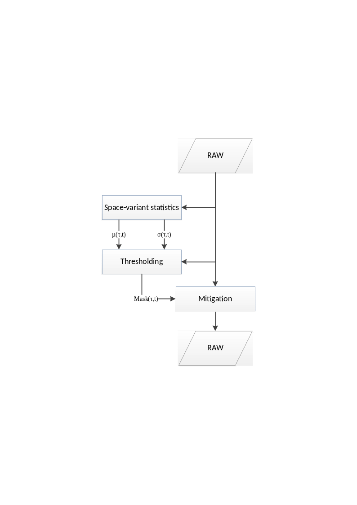

</div>

<p class="atbd-figure-caption"><span class="caption-number">Fig. 7</span><span class="caption-text"> — Block diagram of the RFI Mitigation in time domain.</span></p>

:::

**Inputs**

| Symbol | Name | Origin | Size | Variability | Default | Description |
|---|---|---|---|---|---|---|
| $RAW$ | RAW | Orbit and attitude extraction step | Nrg x Naz array of complex values | - | - | RAW data Intermediate product: iRAW |
| - | `blockLines` | `AUX_PP1` (`AUX_FMT`) | scalar value | - | 256 | Number of lines in the processing block |
| $L$ | `medianFilterLength` | `AUX_PP1` (`AUX_FMT`) | scalar value | - | 5 | Median filter length |
| $N,\ M$ | `boxSamples`, `boxLines` | `AUX_PP1` (`AUX_FMT`) | 2 scalar values | - | 19, 19 | Number of samples and lines in the boxes used to compute space-variant statistics |
| $k$ | `percentileThreshold` | `AUX_PP1` (`AUX_FMT`) | scalar value | - | 0.99 | Normalized threshold on percentile of the signal distribution model |
| - | `morphologicalOpenOperatorSamples`, `morphologicalOpenOperatorLines`, `morphologicalCloseOperatorSamples`, `morphologicalCloseOperatorLines` | `AUX_PP1` (`AUX_FMT`) | 4 scalar values | - | 1, 3, 1, 9 | Sizes of the morphological open and close operators |
| - | maxRFITMPercentage | `AUX_PP1` (`AUX_FMT`) | scalar value | - | - | Maximum normalized percentage of image pixels impacted by time-domain RFI. If the percentage exceeds this parameter, the processing will not continue. |

**Outputs**

| Symbol | Name | Destination | Size | Variability | Default | Description |
|---|---|---|---|---|---|---|
| $RAW$ | RAW | RFI mitigation in frequency domain | Nrg x Naz array of complex values | - | - | RAW data after time-domain RFI mitigation Intermediate product: iRAW\_rfi\_corrected |
| $Mask$ | RFI mask | L1 post-processing step | Nrg x Naz array of Boolean values | - | - | Time-domain RFI mask Intermediate product: iRFI\_time\_domain\_mask |

**Mathematical description**

RFI detection in time-domain is performed independently on blocks of full range extension and configurable number of lines B. Overlap between adjacent blocks is automatically computed to avoid border effects due to application of median filter.

The main steps of the algorithm are:

1. starting from the input raw data amplitudes, a 1D median filter of length L is applied along azimuth direction to each range line, where L is a configurable value chosen considering the trade-off between the capability to identify close RFI contributions along azimuth direction and the capability of median filter output to represent the raw data pixels expected amplitude:

$$
{RAW}_{median}(\tau,t)=Median(\vert{}RAW(\tau,t)\vert,L)
\tag{4.1}
$$ (eq:atbd-l1-sar-4-1)

2. the space-variant statistics (average $\mu$ and standard deviation $\sigma$) of the raw data median amplitudes are computed over boxes of configurable number of samples and lines (NxM, here assumed odd). These statistics are calculated to have a local estimation of the mean signal amplitude without interferences and of its standard deviation. The size of the boxes is chosen as a trade-off between a too small box, which would closely follow the space varying reflectivity but considering a statistical-insufficient number of samples, and a too big box, having opposite features:

(equation-eq-atbd-l1-sar-4-2)=
\begin{equation}
\begin{aligned}
\mu(\tau,t)=\frac{1}{NM}\sum_{i=-(N-1)/2}^{(N-1)/2}{\sum_{j=-(M-1)/2}^{(M-1)/2}{{RAW}_{median}(\tau+i,t+j)}} \\
\sigma(\tau,t)=\sqrt{{(\frac{1}{NM}\sum_{i=-(N-1)/2}^{(N-1)/2}{\sum_{j=-(M-1)/2}^{(M-1)/2}{{RAW}_{median}^2(\tau+i,t+j)}})^{}-(\mu(\tau,t))}^2}
\end{aligned}
\tag{4.2}
\end{equation}

3. a space-variant threshold is computed as the sum between the local mean plus the local standard deviation, all scaled by a configurable threshold factor $k$, to be tuned in order to have a proper trade-off between missing detections and false positives. Such space-variant threshold allows the detection to be space-adaptive;
4. the input raw data amplitudes are then compared with this threshold, generating a RFI binary mask having value equal to 1 where samples have absolute value greater than the threshold and value 0 in other positions:

(equation-eq-atbd-l1-sar-4-3)=
\begin{equation}
Mask(\tau,t)=\begin{Bmatrix} 1,\ if\ \left\vert RAW(\tau,t) \right\vert>k\bullet(\mu(\tau,t)+\sigma(\tau,t)) \\ 0,\ if\ \left\vert RAW(\tau,t) \right\vert\leq{}k\bullet(\mu(\tau,t)+\sigma(\tau,t)) \end{Bmatrix}
\tag{4.3}
\end{equation}

5. morphological open and close operators (with configurable sizes) are applied to the detection mask: open operator reduces the ratio of false positives (reduce salt and pepper noise in the mask), while close one fills the holes in the RFI detection map;
6. the mitigation of the RFI signal on the input raw data is performed replacing those samples indexed by the RFI mask with the nearest not-indexed samples, selected moving along the azimuth direction ($t$ is replaced by $\widetilde{t}$) while keeping fixed the range position ($\tau$):

(equation-eq-atbd-l1-sar-4-4)=
\begin{equation}
RAW(\tau,t)=\begin{Bmatrix} RAW(\tau,\widetilde{t}),\ if\ Mask(\tau,t)=1 \\ RAW(\tau,t),\ if\ Mask(\tau,t)=0 \end{Bmatrix}
\tag{4.4}
\end{equation}

The following statistics are annotated in L1 products for detected time-domain RFI starting from computed masks:

- Percentage of input RAW data lines affected by RFI: number of azimuth lines containing at least one RFI-affected pixel $N_{a,affected}$ divided by the total number of azimuth lines $N_a$:

$$
{p\_time}_{a,affected}=\frac{N_{a,affected}}{N_a}
\tag{4.5}
$$ (eq:atbd-l1-sar-4-5)

- Average percentage of affected input RAW data samples in the lines containing RFI: average number of RFI-affected samples $N_{r,affected}(n)$ divided by the number of samples in a line $N_r$:

$$
{p\_time}_{r,avg\_affected}=\frac{1}{N_a}\sum_{n=0}^{N_a-1}{\frac{N_{r,affected}(n)}{N_r}}
\tag{4.6}
$$ (eq:atbd-l1-sar-4-6)

- Maximum percentage of input RAW data samples affected by RFI in the same line: maximum number of RFI-affected samples $N_{r,affected}(n)$ divided by the number of samples in a line $N_r$:

$$
{p\_time}_{r,\max\_affected}=\max(\frac{N_{r,affected}(n)}{N_r})
\tag{4.7}
$$ (eq:atbd-l1-sar-4-7)

This is done for each polarization.

(sec:atbd-l1-sar-4-1-2)=
#### 4.1.2 RFI Mitigation in Frequency Domain

**Algorithm overview and rationale**

The approach described here is relevant for interference signals that are not well localized in the range-azimuth time domain and are instead well localized in the range frequency domain (e.g., a single interfering “tone”). Two different types of RFIs can be identified:

- Persistent RFIs, i.e., tones affecting several consecutive azimuth lines;
- Isolated RFIs, i.e., tones affecting few isolated azimuth lines.

Both interferences types are easily detectable in the range frequency domain, where they appear like single-tone or narrow-band disturbances. In the two cases the detection and mitigation steps are performed in similar ways, as represented in the following figure and described in detail below.

(fig:atbd-l1-sar-8)=
:::{div} atbd-mermaid-figure

<div class="atbd-figure-content">

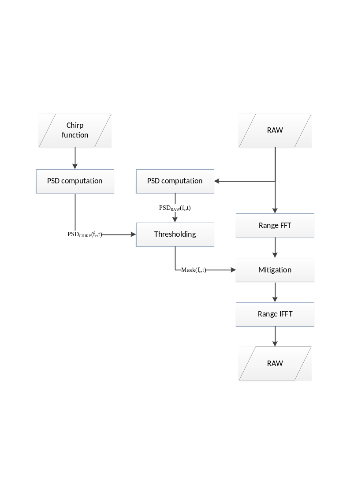

</div>

<p class="atbd-figure-caption"><span class="caption-number">Fig. 8</span><span class="caption-text"> — Block diagram of the RFI Mitigation in frequency domain.</span></p>

:::

**Inputs**

| Symbol | Name | Origin | Size | Variability | Default | Description |
|---|---|---|---|---|---|---|
| $RAW$ | RAW | RFI mitigation in time domain | Nrg x Naz array of complex values | - | - | RAW data Intermediate product: iRAW |
| $chirp$ | Chirp replica | RAW data extraction step / Internal calibration pars retrieval step / `AUX_INS` (`AUX_FMT`) | Nchirp x 1 array of complex values | - | - | Chirp function Can be the nominal chirp, the internal calibration chirp replica or the internal chirp taken from `AUX_INS` file (as per configuration). It can be different from the one used during range compression step |
| $M$ | `blockLines` | `AUX_PP1` (`AUX_FMT`) | scalar value | - | 512 | Number of lines in the blocks used to compute Power Spectral Density |
| - | `blockOverlap` | `AUX_PP1` (`AUX_FMT`) | scalar value | - | 0 | Overlap between blocks |
| $k_p,\ k_i$ | persistentRFIThreshold, isolatedRFIThreshold | `AUX_PP1` (`AUX_FMT`) | 2 scalar values | - | 2, 4 | Thresholds for the detection of persistent and isolated RFI |
| $k_{std}$ | isolatedRFIPSDStdThreshold | `AUX_PP1` (`AUX_FMT`) | scalar value | - | 7 | Threshold on PSD standard deviation for isolated RFI |
| - | maxRFIFMPercentage | `AUX_PP1` (`AUX_FMT`) | scalar value | - | - | Maximum normalized percentage of image spectrum impacted by frequency-domain RFI. If the percentage exceeds this parameter, the processing will not continue. |

**Outputs**

| Symbol | Name | Destination | Size | Variability | Default | Description |
|---|---|---|---|---|---|---|
| $RAW$ | RAW | Range compression step | Nrg x Naz array of complex values | - | - | RAW data after frequency-domain RFI mitigation Intermediate product: iRAW\_rfi\_corrected |
| $Mask$ | RFI mask | L1 post-processing step | Nrg x Naz array of Boolean values | - | - | Frequency-domain RFI mask Intermediate product: iRFI\_freq\_domain\_mask |

**Mathematical description**

Specific variables:

- $F_r$: Fast Fourier Transform (r: along range direction)
- $PSD$: Power Spectral Density
- $P_m$: data power (m: mean)

RFI detection in frequency-domain is performed independently on blocks of full range extension and configurable number of lines M. It is also possible to set an adjustable overlap O between adjacent blocks.

Persistent RFI detection is based on the comparison between the average range PSD of the raw data block with a scaled version of the nominal replica. The main steps of the algorithm are:

1. starting from the input raw data and dividing it into stripes of full range and configurable number of lines (NrxM), the power of each range line in the block is computed:

$$
P_m(t)=\frac{1}{N_r}\sum_{n=0}^{N_r-1}{\left\vert RAW(n,t) \right\vert^2}
\tag{4.8}
$$ (eq:atbd-l1-sar-4-8)

2. a polynomial fitting of $P_m(t)$ is performed, in a least squares sense, obtaining $\widehat{P_m}(t)$. Before fitting, the values of $P_m(t)$ outside a predefined quantile interval are discarded. This is done to prevent the polynomial to be influenced from RFI-corrupted lines or black lines;
3. the full-length mean Power Spectral Density (PSD) over the entire processing block is estimated by means of its periodogram:

$$
{PSD}_{RAW}(f_r,t)=\frac{1}{M}\sum_{j=0}^{M-1}{\frac{\left\vert F_r(RAW(\tau,t+j)) \right\vert^2}{N_r}}
\tag{4.9}
$$ (eq:atbd-l1-sar-4-9)

4. the chirp function is transformed in frequency domain and then normalized with the mean power of the raw data in the box:

$$
{PSD}_{CHIRP}(f_r,t)=\frac{\left\vert F_r(chirp(\tau)) \right\vert^2}{N_{chirp}}\sum_{j=-(M-1)/2}^{(M-1)/2}{\widehat{P_m}(t+j)}
\tag{4.10}
$$ (eq:atbd-l1-sar-4-10)

5. the persistent interferences mask generation is performed by a thresholding step: the normalized nominal range spectrum is subtracted (in dB) from the mean block range spectrum and the frequency bins where the residual is greater than a configurable threshold $k_p$ are considered affected by persistent RFIs:

(equation-eq-atbd-l1-sar-4-11)=
\begin{equation}
Mask(f_r,t)=\begin{Bmatrix} 1,\ if\ 10\log_{10}({PSD}_{RAW}(f_r,t)/{PSD}_{CHIRP}(f_r,t))>k_p \\ 0,\ if\ 10\log_{10}({PSD}_{RAW}(f_r,t)/{PSD}_{CHIRP}(f_r,t))\leq{}k_p \end{Bmatrix}
\tag{4.11}
\end{equation}

Similarly, the isolated RFI detection algorithm is based on the comparison between the PSD of each line in the processing block with the nominal replica. In this case the main steps of the algorithm are:

1. the PSD of each line is estimated using Welch’s method ({rd}`36`). The resulting PSD estimate has length W\<Nr (by default, W=512);
2. the nominal replica PSD associated to each line in the block is computed:

$$
{PSD}_{CHIRP}(f_r,t)=\frac{\left\vert F_r(chirp(\tau)) \right\vert^2}{N_{chirp}}\widehat{P_m}(t)
\tag{4.12}
$$ (eq:atbd-l1-sar-4-12)

3. the line PSD is normalized so that it has the same power of the replica PSD:

$$
{PSD}_{RAW}(f_r,t)=\frac{{PSD}_{RAW}(f_r,t)}{\frac{1}{N_r}\sum_{f_r=0}^{W-1}{\frac{{PSD}_{RAW}(f_r,t)}{{PSD}_{CHIRP}(f_r,t)}}}
\tag{4.13}
$$ (eq:atbd-l1-sar-4-13)

In addition to the mean value put at the denominator of the previous equation, the standard deviation of the same quantity is computed. In case it exceeds a configurable threshold $k_{std}$, the whole line is marked as affected by RFI;

4. the isolated interferences mask generation is similar to the persistent one, with a configurable threshold $k_i$.

The two obtained masks are then merged using an ‘OR’ operator, in order to have a unique one provided in output and used for the RFI mitigation.

The mitigation step is performed operating line by line on the input raw data:

1. the RAW data are transformed in range direction;
2. the frequency samples that are indexed by the RFI mask are
    - a. forced to zero (notch filter):

(equation-eq-atbd-l1-sar-4-14)=
\begin{equation}
F_r(RAW(\tau,t))=\begin{Bmatrix} 0,\ if\ Mask(f_r,t)=1 \\ F(RAW(\tau,t)),\ if\ Mask(f_r,t)=0 \end{Bmatrix}
\tag{4.14}
\end{equation}

    - b. or, interpolated using a nearest neighbour approach;
3. the data are then inverse transformed in range direction.

The following statistics are annotated in L1 products for detected frequency-domain RFI (separately for isolated and persistent ones) starting from computed masks:

- Percentage of input RAW data lines affected by RFI: number of azimuth lines containing at least one RFI-affected frequency bin $N_{a,affected}$ divided by the total number of azimuth lines $N_a$:

$$
{p\_freq}_{a,affected}=\frac{N_{a,affected}}{N_a}
\tag{4.15}
$$ (eq:atbd-l1-sar-4-15)

- Average percentage of bandwidth affected by RFI: average number of RFI-affected frequency bins $N_{r,affected}(n)$ divided by the number of frequency bins in a line $N_r$:

$$
{p\_freq}_{r,avg\_affected}=\frac{1}{N_a}\sum_{n=0}^{N_a-1}{\frac{N_{r,affected}(n)}{N_r}}
\tag{4.16}
$$ (eq:atbd-l1-sar-4-16)

- Maximum percentage of bandwidth affected by RFI: maximum number of RFI-affected frequency bins $N_{r,affected}(n)$ divided by the number of frequency bins in a line $N_r$:

$$
{p\_freq}_{r,\max\_affected}=\max(\frac{N_{r,affected}(n)}{N_r})
\tag{4.17}
$$ (eq:atbd-l1-sar-4-17)

This is done for each polarization.

(sec:atbd-l1-sar-4-1-3)=
#### 4.1.3 General considerations

In a previous work performed by ARESYS in the frame of the BIOMASS mission (see {rd}`11`) a detailed analysis of the impacts of the described RFI mitigation algorithms (and of potential alternatives) on data quality has been performed, showing and quantifying the degradation effects on IRF parameters and data radiometry using both simulated and real L-band SAR data readapted by other similar missions like ALOS PALSAR one. Refer to this document for the complete analysis outcome.

In addition, as described in the previous sections, the RFI mitigation algorithms depend on a set of configuration parameters (e.g. and in particular, the threshold factor $k$) that shall be properly tuned in order to have a proper trade-off between missing detections and false positives. Default values for such parameters will be defined basing on simulated data and expertise, but their fine tuning will be in the scope of the Commissioning Phase. It will be important then to have a good sample of data acquired over different P-band RFI sources.

No specific dependency of thresholds on geographical area is expected, but just on their domain of impact (time or frequency). For this reason, the two mitigation methods described above have different parameters to be tuned in an independent way.

In order to ease the identification of their location and to characterize them, the instrument RX-Only acquisition mode can be exploited: when this mode is activated, no signal is transmitted by the instrument, which operates as a passive one. In this way it will be easier to detect and characterize RFI sources contributions to the received signal, as they will be the only ones above the noise floor. Periodic RX-Only mode acquisitions, during Commissioning Phase and after it, could be useful to have a continuous monitoring of RFI sources and impact on BIOMASS system. In addition, in this way it will be easier to identify the areas more impacted by RFI and then to collect the data to be used for the configuration parameters tuning, once that the instrument will be set back to the nominal mode.

(sec:atbd-l1-sar-4-2)=
### 4.2 Range Compression and Internal Calibration Corrections

(sec:atbd-l1-sar-4-2-1)=
#### 4.2.1 Range Compression

**Algorithm overview and rationale**

The Range Compression step is performed on RAW data and, due to its specific algorithm operating in the frequency domain and on an echo basis, together with the application of Internal Calibration corrections.

The main steps of the algorithm are represented in the following figure and described in detail below.

(fig:atbd-l1-sar-9)=
:::{div} atbd-mermaid-figure

<div class="atbd-figure-content">

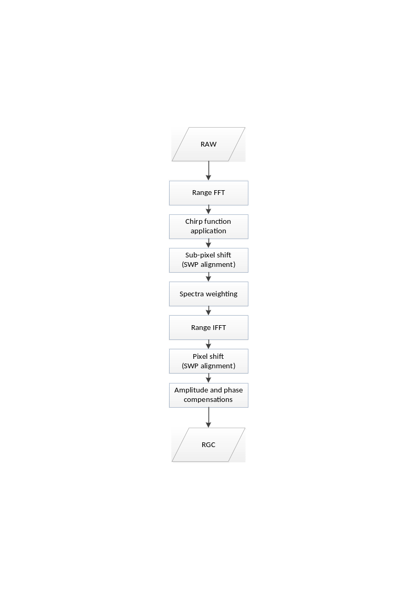

</div>

<p class="atbd-figure-caption"><span class="caption-number">Fig. 9</span><span class="caption-text"> — Block diagram of the Range Compression and Internal Calibration Corrections step.</span></p>

:::

**Inputs**

| Symbol | Name | Origin | Size | Variability | Default | Description |
|---|---|---|---|---|---|---|
| $RAW$ | RAW | RFI mitigation in frequency-domain step | Nrg x Naz array of complex values | - | - | RAW data after RFI mitigation Intermediate product: iRAW\_rfi\_corrected |
| $chirp$ | Chirp replica | RAW data extraction step / Internal calibration pars retrieval step / `AUX_INS` (`AUX_FMT`) | Nchirp x 1 array of complex values | - | - | Chirp function Can be the nominal chirp, the internal calibration chirp replica or the internal chirp taken from `AUX_INS` file (as per configuration) Intermediate product: `iChirp` (in case of internal calibration chirp replica) |
| $A_{drift}$, $\varphi_{drift}$ | Drift interpolated | Internal calibration pars retrieval step | Naz x 1 array of complex values | - | - | Amplitude and phase drift samples at the time instants defined by $t_{DT}[n]$Intermediate product: `iDrift` |
| $A_{drift}^{ref},\ \varphi_{drift}^{ref}$ | `referenceDrift` | `AUX_INS` (`AUX_FMT`) | complex value | - | - | Reference amplitude and phase drift |
| $\delta\tau_{IJ}^{TXP}$ | Internal delay | Internal calibration pars retrieval step | scalar value | - | - | Delay between polarimetric channels for the given pulse type TXP and for each polarization combination $IJ$Intermediate product: `iDelays` |
| $I_{Rx}$ | RX channel imbalance | Internal calibration pars retrieval step | scalar complex value | - | - | Receive channel imbalance (amplitude and phase) Intermediate product: `iChannelImbalance` |
| $I_{Tx}$ | TX channel imbalance | Internal calibration pars retrieval step | scalar complex value | - | - | Transmit channel imbalance (amplitude and phase) Intermediate product: `iChannelImbalance` |
| $\mathrm{\Delta}\tau$ | PARC delays | `PARC_INFO` (`AUX_FMT`) | 4 scalar values | - | - | PARC delays |
| - | `rangeProcessingParametersList` \> `windowType`, `windowCoefficient`, `processingBandwidth`, `timeBias` | `AUX_PP1` (`AUX_FMT`) | string + 3 scalar values | - | depends on swath | Range spectrum windowing parameters (window type, window coefficient and processing bandwidth) + time bias to be applied during processing |
| - | `calibrationSignalsSWP` | AUX INS (`AUX_FMT`) | scalar value | - | 0.0000030137930999841456 | Calibration signals Sampling Window Position (SWP) [s] |

**Outputs**

| Symbol | Name | Destination | Size | Variability | Default | Description |
|---|---|---|---|---|---|---|
| $RGC$ | RGC | Doppler Centroid estimation step, Azimuth data resampling step | (Nrg-Nchirp+1) x Naz array of complex values | - | - | Range compressed data Intermediate product: iRGC |

**Mathematical description**

Specific variables:

- $f_r\left[ 1 \right]$: chirp start frequency;
- $\varphi_r\left[ 1 \right]$: chirp start phase.

The main steps of the algorithm are:

1. the RAW data are transformed in range direction;
2. the range compression is achieved multiplying each echo with the inverse matched filter of the chirp function. The chirp used can be selected at configuration level between one of the following:
    - ideal chirp:

$$
chirp(\tau)=\frac{1}{\sqrt{N_r\bullet\frac{f_s}{B_r}}}\bullet\exp (j\pi{}K_r\tau^2+j2\pi{}f_r\left[ 1 \right]\tau+{j\varphi}_r\left[ 1 \right]),\ \ \ \tau\in\left[ 0,\tau_r \right]
\tag{4.18}
$$ (eq:atbd-l1-sar-4-18)

    - chirp replica, derived from internal calibration pulses;
    - internal chirp database, populated, e.g., with on-ground characterized replica;
3. all the echoes are aligned along range direction to compensate for timing variations along azimuth (SWP changes) (see next section) and for internal delays between polarizations coming from Internal Calibration measurements;
4. the weighting window (e.g., Hamming) is applied (or not) on the data spectrum, according to the specific configuration parameters;
5. the data are inverse transformed in range direction, cutting from far range a portion of data corresponding to the chirp length;
6. finally, amplitude and phase corrections coming from Internal Calibration measurements are applied to compensate for drifts along azimuth direction and imbalances between polarizations.

**Error analysis**

For performances analyses, in particular those related to the choice of using inverse filter for range compression, refer to {rd}`1` and {rd}`22`.

(sec:atbd-l1-sar-4-2-2)=
#### 4.2.2 SWP Alignment

**Algorithm overview and rationale**

The SWP (Sampling Window Position) alignment step is required by the fact that it is possible to have changes of the instrument timing along the satellite orbit, mainly due to variations on the altitude, even during the single data-take. Before proceeding with the other processing steps, it is then mandatory to align all the echoes on the same sampling grid with a common range start time. A schematic representation of the SWP alignment strategy is represented by the following figure.

(fig:atbd-l1-sar-10)=
:::{div} atbd-mermaid-figure

<div class="atbd-figure-content">

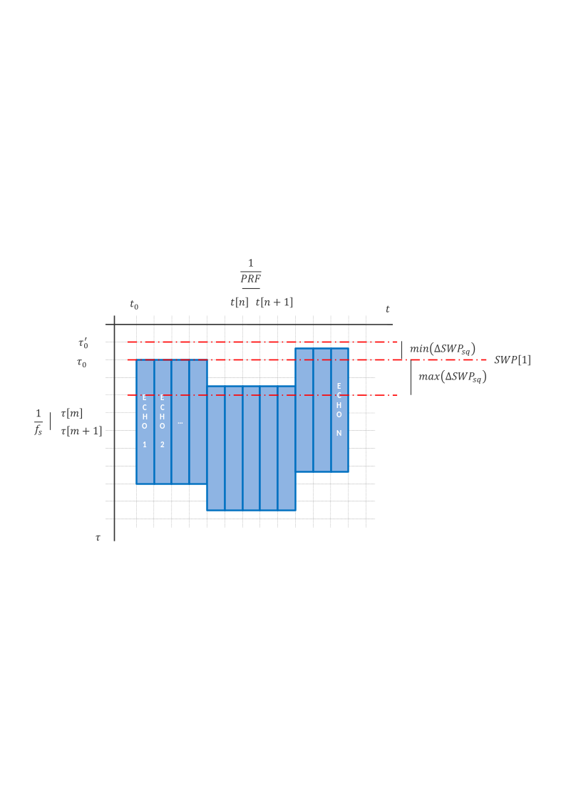

</div>

<p class="atbd-figure-caption"><span class="caption-number">Fig. 10</span><span class="caption-text"> — Schematic representation of the SWP alignment strategy implemented during the Range Compression step.</span></p>

:::

**Mathematical description**

Specific variables:

- ${SWP}_{sq}\left[ n \right]$: SWP value associated to the n-th echo (s: expressed in samples, q: rounded to the nearest greater integer value).

Considering that the SWP changes are typically not integer multiples of the range sampling frequency, the alignment is performed in two steps:

- the fractional part of the shift expressed in pixels is corrected applying a phase ramp in the spectral domain;
- the integer part is corrected through a proper zero padding of each echo once back in the time domain.

For each echo the delta SWP w.r.t. the first echo one is computed and converted in samples, then rounded up to the nearest greater integer value:

$$
\mathrm{\Delta}{SWP}_{sq}\left[ n \right]=\left\lceil (SWP\left[ n \right]-SWP\left[ 1 \right])\bullet{}f_s \right\rceil
\tag{4.19}
$$ (eq:atbd-l1-sar-4-19)

Between all these values, the minimum and the maximum ones are computed, as shown in figure. Their difference indicates the amount of zero-padding samples to be applied on input data echoes in order to perform the SWP alignment.

The shift to be applied to the n-th echo, expressed in samples, is computed as:

$$
\mathrm{\Delta}\tau\left[ n \right]=(SWP\left[ n \right]-SWP\left[ 1 \right])\bullet{}f_s-min(\mathrm{\Delta}{SWP}_{sq})
\tag{4.20}
$$ (eq:atbd-l1-sar-4-20)

and applied on the data through an opportune phase ramp in the frequency domain:

$$
F(RAW\left[ n \right])'=F(RAW\left[ n \right])\bullet{}exp(-j2\pi\frac{f_r}{f_s}\mathrm{\Delta}\tau\left[ n \right])
\tag{4.21}
$$ (eq:atbd-l1-sar-4-21)

The new range start time becomes:

$$
\tau_0^{'}=\tau_0-\mathrm{\Delta}\tau\left[ 1 \right]
\tag{4.22}
$$ (eq:atbd-l1-sar-4-22)

It shall be noted that this operation is computed considering all the SWP variations inside the portion of data passed to the processor, i.e., not necessarily the full data-take. Given the fact that the SWP changes are not integer of $f_s$, this means that products belonging to the same data-take and processed separately won't lie on the same sampling grid.

In addition to SWP variations, in this step are taken into account and corrected also:

- a generic range time bias, that may be provided by the user via `AUX_PP1` file;
- an instrument time bias, represented by the calibration signals SWP and configured via `AUX_INS` file, that is an additional one w.r.t. the one derived from internal calibration pulses (see {sec}`4.2.3.3`).

(sec:atbd-l1-sar-4-2-3)=
#### 4.2.3 Internal Calibration Corrections

As described in {sec}`3.3`, several parameters are derived from the internal calibration measurements. Between these, the following are compensated during the processing:

- the amplitude and phase drifts;
- the instrument replica;
- the internal delays between polarizations;
- the instrument internal channel imbalance between polarizations.

As briefly described in {sec}`3.3`, these compensations are performed during the Range Compression step. In addition, the way they are implemented strictly depends on the chirp function source (nominal, derived from internal calibration measurements or taken from an internal database). The algorithms of this section are presented based on the descriptions in {ad}`3`.

(sec:atbd-l1-sar-4-2-3-1)=
##### 4.2.3.1 Compensation of the Amplitude and Phase Drifts

As stated in {sec}`3.3`, these drifts are to be corrected always, independently of the adopted chirp function source. According to the description in {sec}`3.3.2`, a complex value is derived for each echo of the RAW data starting from internal calibration measurements. Its compensation is performed at the end of the Range Compression step (${RGC}_{nc}$, where nc stands for “not compensated”) according to the following formula:

$$
RGC(\tau,t)={RGC}_{nc}(\tau,t)\bullet\frac{A_{drift}^{ref}\cdot\exp (j\varphi_{drift}^{ref})}{A_{drift}(t)\bullet\exp(j\varphi_{drift}(t))}
\tag{4.23}
$$ (eq:atbd-l1-sar-4-23)

where $A_{drift}^{ref}$ and $\varphi_{drift}^{ref}$ are the reference values for the normalization of the amplitude and phase drifts, respectively.

(sec:atbd-l1-sar-4-2-3-2)=
##### 4.2.3.2 Selection of the Chirp Function

As described in previous section, the chirp function used during the Range Compression step can come from different sources. Two main cases can be identified:

- a. the chirp function comes from the internal calibration measurements (see {sec}`3.3.3`) or from an internal database: in this case it is assumed that the compensation of the internal delays is implicitly achieved when this chirp function is used for the Range Compression step;
- b. the chirp function is the ideal one (computed according to the formula in {sec}`4.2.1`): in this case it is assumed that the compensation of the internal delays shall be performed independently. For this purpose, refer to the following sub-section.

(sec:atbd-l1-sar-4-2-3-3)=
##### 4.2.3.3 Compensation of the Internal Delays Between Polarizations

This step is valid only for case “b” described above (i.e. usage of an ideal chirp function).

The internal delays correction is performed using the same strategy described for the SWP alignment in {sec}`4.2.2`.

(sec:atbd-l1-sar-4-2-3-4)=
##### 4.2.3.4 Compensation of the Instrument Internal Channel Imbalance Between Polarizations

This step is valid only in the case the amplitude and phase drifts are not corrected.

The channel imbalance correction is performed at the end of the Range Compression step. In particular, data are corrected in the following way:

$$
RGC(\tau,t)={RGC}_{nc}(\tau,t)\bullet\frac{1}{I_{Tx}\bullet{}I_{Rx}}
\tag{4.24}
$$ (eq:atbd-l1-sar-4-24)

where $I_{Tx}$ and $I_{Rx}$ are computed following the procedure described in {sec}`3.3.5`. Please note that this formula is an updated version of the one in {sec}`4.2.3.1`, to be used in place of that one in case the channel imbalance shall be compensated without the correction of the amplitude and phase drifts.

Note that since the baseline is to correct always for the amplitude and phase drifts, the explicit correction of the instrument polarimetric channel imbalance as described in this section will be seldomly used.

(sec:atbd-l1-sar-4-2-4)=
#### 4.2.4 Active Calibrators (PARC) Delays

**Algorithm overview and rationale**

In addition to the internal delays coming from the internal calibration measurements, other delays compensated at this stage are those of active calibrators (PARC).

In case a PARC is present in the scene, a dedicated processing mode can be activated at configuration level allowing L1 Processor to process data in the following way:

1. a first time considering the whole data and processing it in the “standard” way in this case the whole data results properly focused, while PARC appears (partially) unfocused;
2. then, for each of the PARC four scattering responses (Gt1, Gt2, X and Y):
    - a. cutting just a portion of data around PARC (cut is performed after L1 Pre-Processing, i.e., on extracted raw data, and dimensions are configurable);
    - b. processing it applying the scattering response corresponding delay through an opportune update of the data range start time (note: all the parameters estimated on data, e.g., Doppler Centroid, ionosphere height, …, are re-estimated over the selected data portion. A discussion is on-going at BIOMASS L1 GPP level to confirm or update this approach).

in this case the whole data results (partially) unfocused, while PARC appears properly focused.

In this way a total of 1+4 L1 products are generated.

It shall be noted that the delay mentioned above (bullet 2b) is applied in a different way w.r.t. the one described in {sec}`4.2.2` for SWP alignment. In this case in fact the data itself is not modified (through zero padding and/or application of opportune phase ramps), but just the metadata is updated. In particular, the range start time is modified in the following way:

$$
\tau_0^{'}=\tau_0-\mathrm{\Delta}\tau
\tag{4.25}
$$ (eq:atbd-l1-sar-4-25)

where $\tau_0$ is the data portion slant range start time, $\mathrm{\Delta}\tau$ is the scattering response corresponding delay and $\tau_0^{'}$ is the updated data portion slant range start time.

It shall be noted as well that PARC delays can even exceed the PRI (Pulse Repetition Interval, inverse of PRF). In this case the azimuth start time is modified too:

(equation-eq-atbd-l1-sar-4-26)=
\begin{equation}
\begin{aligned}
t_0^{'}=t_0-\left\lfloor \mathrm{\Delta}\tau\bullet{}PRF \right\rfloor/PRF \\
\tau_0^{'}=\tau_0-(\mathrm{\Delta}\tau-\left\lfloor \mathrm{\Delta}\tau\bullet{}PRF \right\rfloor/PRF)
\end{aligned}
\tag{4.26}
\end{equation}

where $t_0$ and $t_0^{'}$ are, respectively, the data portion azimuth start times before and after the update. As visible, a part of the delay (multiple of the PRI) is applied along azimuth direction, while the residual one is applied along slant range direction.

For more detailed analyses on the effects of active calibrators delays on data quality, in particular on target IRF, refer to {rd}`23`.

**Inputs**

| Symbol | Name | Origin | Size | Variability | Default | Description |
|---|---|---|---|---|---|---|
| - | parcROISamples | `AUX_PP1` (`AUX_FMT`) | scalar value | - | 256 | Number of samples of the ROI selected around PARC position in the image |
| - | parcROILines | `AUX_PP1` (`AUX_FMT`) | scalar value | - | 256 | Number of lines of the ROI selected around PARC position in the image |

(sec:atbd-l1-sar-4-3)=
### 4.3 Doppler Centroid Estimation

The Doppler Centroid information can be estimated exploiting two different algorithms:

- using only timing and geometrical (satellite orbit and attitude) information (Geometry Mode);
- using both timing and geometrical information and data to have a refined estimation (Combined Mode).

These algorithms are described in the following sub-sections. The choice of the algorithm to be used during processing is made through a dedicated configuration parameter.

A third option is available to force the Doppler Centroid value to be used. This can be configured via `AUX_PP1` file using the `dcValue` parameter.

(sec:atbd-l1-sar-4-3-1)=
#### 4.3.1 Doppler Centroid Estimation from Geometry

**Algorithm overview and rationale**

The Doppler Centroid Estimation from Geometry uses only the satellite position, velocity and attitude information and the data timing in order to derive the Doppler Centroid information.

The main steps of the algorithm are represented in the following figure and described in detail below.

(fig:atbd-l1-sar-11)=
:::{div} atbd-mermaid-figure

<div class="atbd-figure-content">

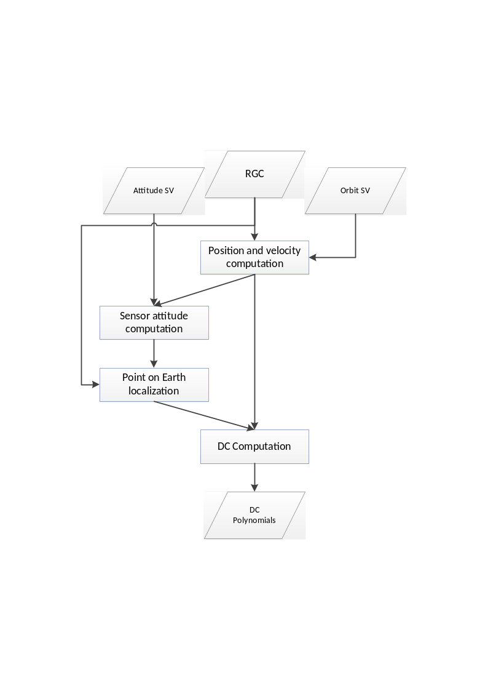

</div>

<p class="atbd-figure-caption"><span class="caption-number">Fig. 11</span><span class="caption-text"> — Block diagram of the Doppler Centroid estimation step (Geometry Mode).</span></p>

:::

**Inputs**

| Symbol | Name | Origin | Size | Variability | Default | Description |
|---|---|---|---|---|---|---|
| $\tau,\ t$ | RGC data slant range and azimuth time axes | Azimuth data resampling step | set of Nrg-Nchirp+1 real values and set of Naz UTC times respectively | - | - | Range compressed data slant range and azimuth time axes Intermediate product: iRGC |
| $p_s{,\ v}_s$ | Orbit | Orbit and attitude extraction step | 2 Nsv x 3 arrays of real values | - | - | Orbit state vectors (satellite position and velocity) |
| $yaw,\ pitch,$$roll$ | Attitude | Orbit and attitude extraction step | Nsv x 3 array of real values | - | - | Attitude Euler angles |
| $x,\ y,\ z$ | X, Y, Z | Back-geocoding step | 3 N’rg x N’az arrays of real values | - | - | Back-geocoded DEM X, Y and Z information Intermediate product: `iSlantDem` |
| $\mathrm{\Delta}t$ | `polynomialUpdateRate` | `AUX_PP1` (`AUX_FMT`) | scalar value | - | 5 | Estimated Doppler polynomials update rate [s]. Default value is 5s. |

**Outputs**

| Symbol | Name | Destination | Size | Variability | Default | Description |
|---|---|---|---|---|---|---|
| $f_{DC}$ | Doppler Centroid | Azimuth compression step, Antenna pattern compensation step, Multilooking step | set of polynomials | - | - | Doppler Centroid polynomials Intermediate product: iRGC (updated annotations) |

**Mathematical description**

Specific variables:

- ${\overrightarrow{p}}_s$: satellite position in ECEF;
- ${\overrightarrow{v}}_s$: satellite velocity in ECEF;
- ${\overrightarrow{p}}_e$: point on Earth in ECEF;
- $R_e,\ R_p$: equatorial and polar radius of the reference ellipsoid (including the mean reference topographic height);
- ${\overrightarrow{n}}_{pp}$: unit vector normal to the current pointing plane.

The Doppler Centroid computation is performed over a grid of regularly spaced azimuth and range times, which is inferred from the RGC data time information opportunely subsampled (i.e., 10 points along range direction, 1 point each $\mathrm{\Delta}t$ seconds along azimuth direction).

The processing is repeated for every azimuth time: the position and the velocity of the sensor are computed from the orbit state vectors, while the sensor attitude is computed from the attitude state vectors. This information is exploited to solve a direct geocoding equation system to find the position on Earth for each point of the grid. The direct geocoding system contains three equations, i.e.:

- the range equation;
- the pointing equation;
- the earth ellipsoid equation (WGS84 ellipsoidal model);

and can be expressed as:

(equation-eq-atbd-l1-sar-4-27)=
\begin{equation}
\left\{ \begin{matrix} \left\vert {\overrightarrow{p}}_s-{\overrightarrow{p}}_e \right\vert=r \\ {\overrightarrow{n}}_{pp}\bullet({\overrightarrow{p}}_s-{\overrightarrow{p}}_e)=0 \\ \frac{p_{e,x}^2+p_{e,y}^2}{R_e}+\frac{p_{e,z}^2}{R_p}=1 \end{matrix} \right.
\tag{4.27}
\end{equation}

where ${\overrightarrow{n}}_{pp}$ is the unit vector normal to the current pointing plane. Considering that the input quaternions already describe the orientation of the SAR reference frame (depicted in the following figure), ${\overrightarrow{n}}_{pp}$ unit vector is computed normalizing the X-axis of the rotation matrix obtained from such quaternions. For more details on BIOMASS coordinates systems refer to {ad}`2`.

(fig:atbd-l1-sar-12)=
:::{div} atbd-mermaid-figure

<div class="atbd-figure-content">

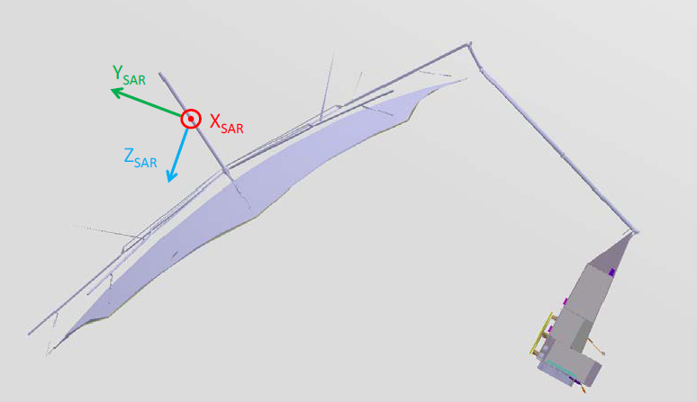

</div>

<p class="atbd-figure-caption"><span class="caption-number">Fig. 12</span><span class="caption-text"> — SAR Reference Frame for BIOMASS sensor (image taken from [AD2]).</span></p>

:::

The two solutions of the direct geocoding equation system, one for each looking direction, are achieved by the numeric technique known as Newton-Raphson method {rd}`28`. For the BIOMASS case, the solution corresponding to the left looking direction is then selected.

The Doppler Centroid frequency is then obtained combining the velocity vectors and the satellite-Earth vectors:

$$
f_{DC}=\frac{2{\overrightarrow{v}}_s\bullet({\overrightarrow{p}}_e-{\overrightarrow{p}}_s)}{\lambda{}r}
\tag{4.28}
$$ (eq:atbd-l1-sar-4-28)

The resulting frequency grid, corresponding to the input times grid, is fitted using 2D polynomials (one each $\mathrm{\Delta}t$ seconds of data, where $\mathrm{\Delta}t$ is a configurable number; as reference, input data slant range and azimuth start times are taken). This operation is performed only once for all the polarizations of the input data, being the geometry and timing information identical for all of them. It has been in fact confirmed by instrument team that:

- due to the asymmetry of the offset parabolic reflector in elevation, a difference in pointing between H and V can occur. This is driven by the excitation uncertainty on combination of the doublet level patterns. A worst case analysis using worst case excitations shows the maximum difference in H and V pointing will be \<0.1 degree. Note the excitations are variable and therefore the difference in H and V pointing can change on an acquisition to acquisition basis;
- due to symmetry of the reflector in azimuth, there is no difference in the pointing in H and V, therefore there is no impact on the Doppler Centroid between polarisations.

(sec:atbd-l1-sar-4-3-2)=
#### 4.3.2 Doppler Centroid Estimation from Geometry and Data (Combined)

**Algorithm overview and rationale**

The Doppler Centroid Estimation from Geometry and Data uses information derived both from geometry and from data to perform a refined Doppler Centroid estimation.

The main steps of the algorithm are represented in the following figure and described in detail below.

(fig:atbd-l1-sar-13)=
:::{div} atbd-mermaid-figure

<div class="atbd-figure-content">

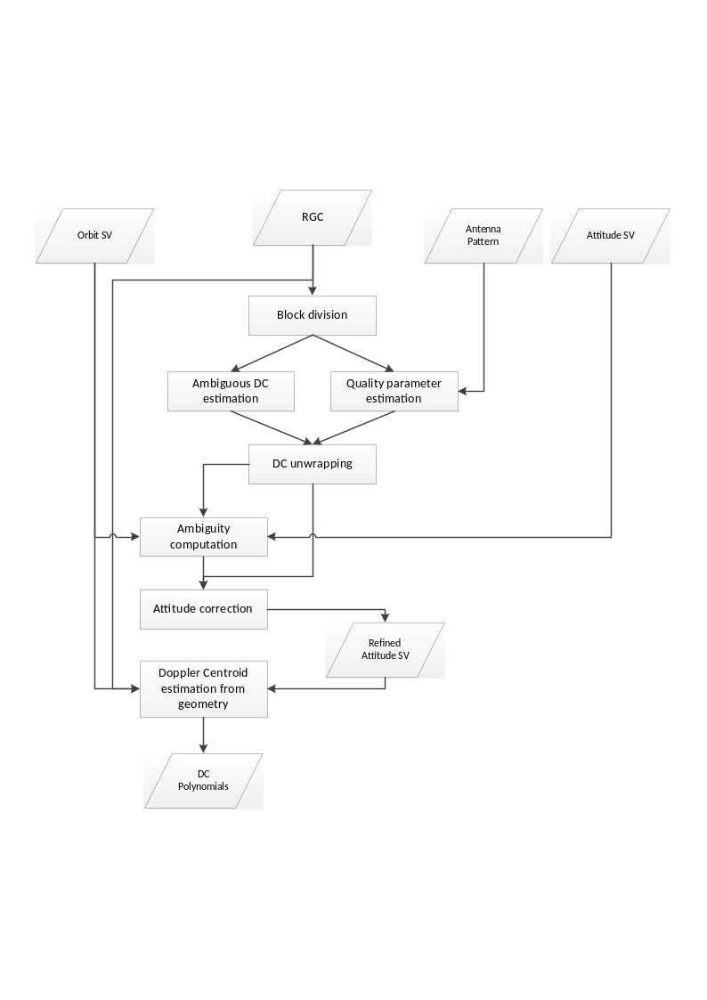

</div>

<p class="atbd-figure-caption"><span class="caption-number">Fig. 13</span><span class="caption-text"> — Block diagram of the Doppler Centroid estimation step (Combined Mode).</span></p>

:::

**Inputs**

| Symbol | Name | Origin | Size | Variability | Default | Description |
|---|---|---|---|---|---|---|
| $RGC$ | RGC data | Azimuth data resampling step | Nrg-Nchirp+1 x Naz array of complex values | - | - | Range compressed data Intermediate product: iRGC |
| $\tau,\ t$ | RGC data slant range and azimuth time axes | Azimuth data resampling step | set of Nrg-Nchirp+1 real values and set of Naz UTC times respectively | - | - | Range compressed data slant range and azimuth time axes |
| $p_s{,\ v}_s$ | Orbit | Orbit and attitude extraction step | 2 Nsv x 3 array of real values | - | - | Orbit state vectors (satellite position and velocity) |
| $yaw,\ pitch,$$roll$ | Attitude | Orbit and attitude extraction step | Nsv x 3 array of real values | - | - | Attitude Euler angles |
| $N,\ M$ | `blockSamples`, `blockLines` | `AUX_PP1` (`AUX_FMT`) | 2 scalar values | - | 128, 8192 | Number of samples and lines in the blocks used to estimate Doppler Centroid from data |
| $\mathrm{\Delta}t$ | `polynomialUpdateRate` | `AUX_PP1` (`AUX_FMT`) | scalar value | - | 5 | Estimated Doppler polynomials update rate [s]. Default value is 5s. |
| - | dcRMSErrorThreshold | `AUX_PP1` (`AUX_FMT`) | scalar value | - | - | Doppler Centroid estimation root mean squared (RMS) error threshold [Hz] |
| - | Antenna patterns | 2D antenna patterns extraction step | arrays of complex values | - | - | 2D antenna patterns (two-way, for both the doublets) |

**Outputs**

| Symbol | Name | Destination | Size | Variability | Default | Description |
|---|---|---|---|---|---|---|
| $f_{DC}$ | Doppler Centroid | Azimuth compression step, Antenna pattern compensation step, Multilooking step | set of polynomials + set of arrays of real values | - | - | Doppler Centroid polynomials, estimates grids and estimates quality Intermediate product: iRGC (updated annotations), iDC, iDC\_std |
| $yaw,\ pitch,$$roll$ | Attitude refined | - | Nsv x 3 array of real values | - | - | Refined attitude Euler angles Intermediate product: iRGC (updated annotations) |

**Mathematical description**

Specific variables:

- $f_{DC}$: absolute Doppler Centroid frequency estimated from geometry;
- ${\widehat{f}}_{DC}$: ambiguous Doppler Centroid frequency estimated from a block of data;
- $s$: autocorrelation function of the SAR signal ($s\left[ 1 \right]$ is the first sample);
- $i,j$: generic range and azimuth blocks, respectively;
- $N,\ M$: range and azimuth dimensions of the generic block, respectively (baseline values: N=128, M=8192).

This method exploits:

- the attitude information and the ambiguous Doppler Centroid estimates grid derived from data to perform ambiguity computation;
- the ambiguity and the ambiguous Doppler Centroid estimates grid to perform an attitude refinement procedure;
- the refined attitude information to perform a geometrical Doppler Centroid estimation, as per {sec}`4.3.1`.

The Doppler Centroid estimation from data is performed dividing the RGC data in blocks along both range and azimuth directions. On each block the algorithm implemented is the Adjacent Cross Correlation Coefficient Doppler Centroid Estimator proposed by Madsen {rd}`14`: this estimator is based on the properties of azimuth power spectral density of a SAR signal, i.e. the phase gradient of the auto-correlation around zero lag proves to be proportional to the frequency location of the maximum of the spectral density function (i.e.: the Doppler Centroid frequency). This gradient can be estimated by calculating the phase of the first sample of the auto-correlation function of SAR signal, which has the highest signal-to-noise ratio (SNR):

$$
{\widehat{f}}_{DC}=\frac{\angle{}s_{i,j}\left[ 1 \right]}{2\pi}\bullet{}PRF
\tag{4.29}
$$ (eq:atbd-l1-sar-4-29)

where the first sample of auto-correlation for the generic block $(i,j)$ is computed as:

(equation-eq-atbd-l1-sar-4-30)=
\begin{equation}
\begin{aligned}
s_{i,j}\left[ 1 \right]=\sum_{n=1}^N{s_{i,j}(n)\left[ 1 \right]} \\
s_{i,j}(n)\left[ 1 \right]=\ \sum_{m=1}^{M-1}{RGC(n,m)\bullet}{RGC(n,m+1)}^*
\end{aligned}
\tag{4.30}
\end{equation}

The quality of each Doppler Centroid estimate depends mainly on two factors: the (just mentioned) SNR and the contrast, i.e., the ratio between the mean value squared and the mean square value of the block pixels intensities. These two factors are used to compute the variance of the estimated Doppler Centroid in each block, which is then used as a quality indicator of the estimate itself.

An estimate of the SNR can be made by comparison of the (Doppler) power spectrum of the data and the (2-way) azimuth antenna power, under the assumption that both of them can be approximated by a sine wave on a pedestal. This way, the level of the thermal noise can be estimated by comparing the first two samples of the theoretical autocorrelation function and those of the real autocorrelation function computed from the SAR data $s(m,n)$ along the azimuth direction.

The theoretical autocorrelation function can be derived as the inverse Fourier transformation of the (2-way) Azimuth Antenna Pattern (AAP), $G_{aap}(f_{\eta})$:

$$
\boldsymbol{r(\eta)=IFFT(}\boldsymbol{G}_{\boldsymbol{aap}}\boldsymbol{(}\boldsymbol{f}_{\boldsymbol{\eta}}\boldsymbol{)}{\boldsymbol{G}_{\boldsymbol{aap}}}^{\boldsymbol{*}}\boldsymbol{(}\boldsymbol{f}_{\boldsymbol{\eta}}\boldsymbol{))}
\tag{4.31}
$$ (eq:atbd-l1-sar-4-31)

where $G_{aap}(f_{\eta})$ can be known by measures or it can be theoretically derived. The theoretical autocorrelation function is then evaluated at two different times that correspond to the origin and to the time of the first sample. Then $r(\eta_0)$ and $r(\eta_1)$ represent the average power and the sine wave amplitude of the 2-way azimuth antenna power, respectively.

The first two coefficients of the estimated autocorrelation function are derived from the SAR data for each block. The obtained values $R_0$ and $R_1$, computed for the current block, represent the average power and the sine wave amplitude of the azimuth power spectrum. Since the signal spectrum and the 2-way antenna power have the same shape, the noise level $\sigma_N^2$ of each block can finally be calculated as:

$$
\boldsymbol{\sigma}_{\boldsymbol{N}}^{\boldsymbol{2}}\boldsymbol{=}\boldsymbol{R}_{\boldsymbol{0}}\boldsymbol{-}\frac{\boldsymbol{r(}\boldsymbol{\eta}_{\boldsymbol{0}}\boldsymbol{)}}{\boldsymbol{r(}\boldsymbol{\eta}_{\boldsymbol{1}}\boldsymbol{)}}\left\vert \boldsymbol{R}_{\boldsymbol{1}} \right\vert
\tag{4.32}
$$ (eq:atbd-l1-sar-4-32)

From this, the SNR is immediately calculated as:

$$
SNR=\frac{R_0-\sigma_N^2}{\sigma_N^2}
\tag{4.33}
$$ (eq:atbd-l1-sar-4-33)

The block SNR and contrast values can be converted into a measure of the confidence of the estimated DC frequency. Assuming the following spectral shape:

$$
A(f)=\ 1+m\ \cos (\frac{2\pi{}f}{PRF})
\tag{4.34}
$$ (eq:atbd-l1-sar-4-34)

the variance of the estimated DC value is given by:

$$
var(\varphi)=\frac{PRF^2}{2\pi^2N}(\frac{1}{\left[ m(SNR) \right]^2}+\frac{1}{4})
\tag{4.35}
$$ (eq:atbd-l1-sar-4-35)

where N is the number of samples considered in the estimation block and it results in $N=N_{RG}\cdot{}N_{AZ}$.

The number N shall be multiplied by the contrast dependent factor k. The factor m(SNR) depends on the spectral shape and on the SNR in the estimation block measured as described above.

Thus, the value of $var(\varphi)$ can be computed for each block and it represents the DC estimate quality, that measures the accuracy of the estimated DC for each block.

The estimation is performed for every block and finally a Doppler Centroid and a quality grid are obtained.

The following figure shows an example of a quality grid calculated for an ASAR Stripmap image acquired over Flevoland: it is clear the correspondence between the non-reflecting still sea area and the very low-quality area in the quality map.

(fig:atbd-l1-sar-14)=
:::{div} atbd-mermaid-figure

<div class="atbd-figure-content">

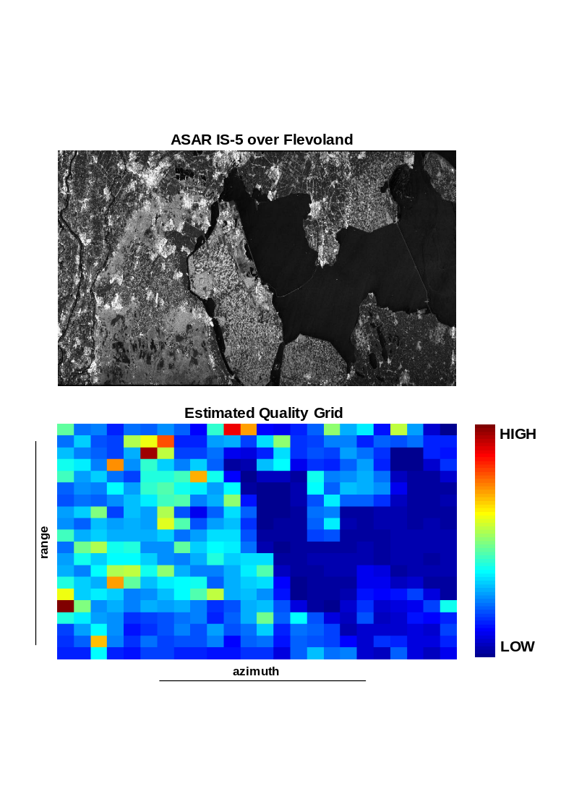

</div>

<p class="atbd-figure-caption"><span class="caption-number">Fig. 14</span><span class="caption-text"> — Doppler Centroid quality map for a sample ASAR Stripmap data.</span></p>

:::

The estimated Doppler Centroid values are ambiguous (i.e., they cannot consider Doppler Centroid values greater than the Nyquist frequency) and they are furthermore wrapped by the azimuth sampling frequency (PRF). An unwrapping step is then required, exploiting Fourier transforms technique to estimate the constant and the linear terms of DC estimates and using quality parameters as weighting factors.

The number of Doppler Centroid ambiguities is computed as:

$$
k=round(\frac{f_{DC}-{\widehat{f}}_{DC}}{PRF})
\tag{4.36}
$$ (eq:atbd-l1-sar-4-36)

for each block of data, assigning to it a weight that corresponds to the inverse variance of the block. The ambiguity number with the highest total weight (sum of weights related to the current ambiguity number over the entire grid) is chosen as final Doppler Centroid ambiguity number of the acquisition.

The attitude refinement is performed inverting the attitude model described in {sec}`4.3.1`. If the sensor attitude is known with good accuracy the inversion can give the pointing errors due to imperfections in piloting mode. Otherwise, it can be used to find the true satellite attitude starting from the nominal attitude.

The algorithm is performed on a grid of Doppler Centroid values function of range and azimuth time. Two steps are envisaged:

- for every azimuth line the Doppler Centroid evolution along range is considered and the sensor attitude is estimated by an iterative non-linear weighted least square optimization (Gauss-Newton, {rd}`28`) which minimizes the residual (square error function) between the Doppler Centroid estimates from data and the Doppler Centroid frequency computed from attitude. It is worth noticing that the DC estimates quality parameters are used as weights during the optimization step;
- then, a polynomial fitting is performed to ensure a slow variation of the attitude along azimuth time. Also this fitting is weighted according to the computed quality parameters. Since the model works optimizing the pointing plane only yaw and pitch angle can be directly computed, while the roll angle has to be computed by considering the antenna electronic steering.

The RMS error of the Doppler Centroid estimate is calculated as the average of the individual RMS residual errors between input fine Doppler Centroid estimates and the fitted polynomial. If the RMS error is above a configurable threshold they are not used during processing; instead, the Doppler Centroid calculated from geometry is used.

This fallback strategy is adopted also in case the combined Doppler Centroid estimation fails to converge to a reliable refined attitude.

(fig:atbd-l1-sar-15)=
:::{div} atbd-mermaid-figure

<div class="atbd-figure-content">

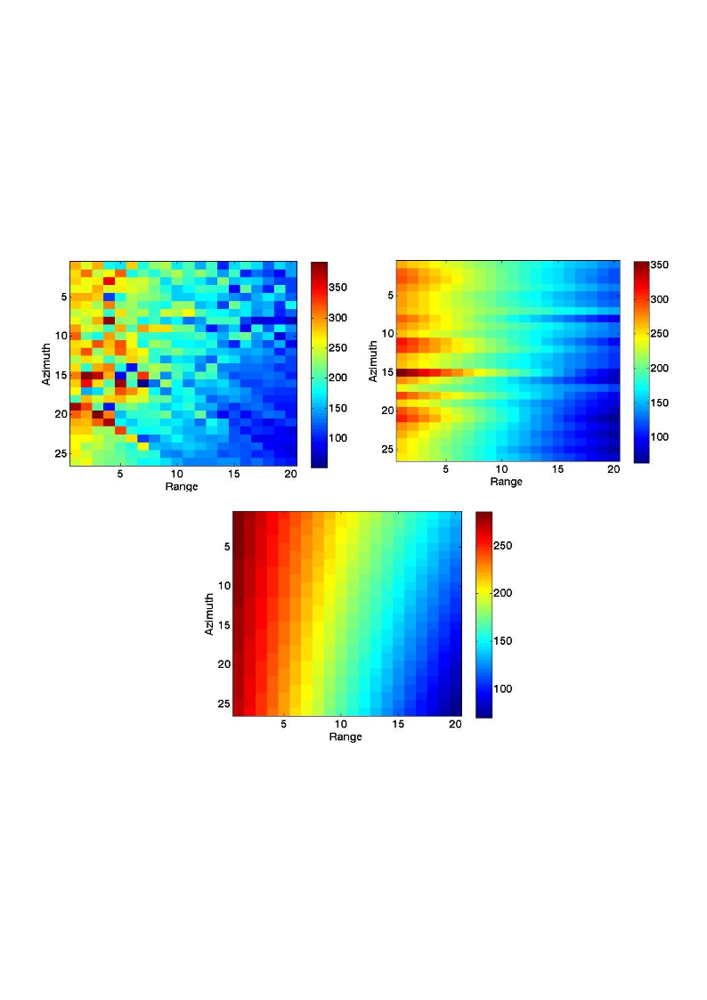

</div>

<p class="atbd-figure-caption"><span class="caption-number">Fig. 15</span><span class="caption-text"> — Processing steps for the Attitude Refinement procedure (top left: starting Doppler Centroid grid, top right: refined grid after first step, bottom: final refined grid).</span></p>

:::

For the specific case of BIOMASS, it is possible to improve the accuracy of the refined attitude using all the polarizations included in the input data. This is done performing an independent Doppler Centroid estimation on each of the two co-polarizations, obtaining two Doppler Centroid grids, each one with its own quality map, and two refined attitudes and then average them together. In this way the noisy measurements have a very low influence on the final grid and the overall result is improved. This merged grid, and the associated merged quality map, are then provided in input to the refinement step to achieve the final Doppler Centroid estimation.

**Error analysis**

For performances analyses, refer to {rd}`1`.

(sec:atbd-l1-sar-4-4)=
### 4.4 Effective Velocity and Doppler Rate Computation

**Algorithm overview and rationale**

The effective velocity is the one best matching the true range history of the targets to the hyperbolical model, i.e.,

$$
r(t_a;\ r_0,\ t_0)\approx\sqrt{r_0^2+v_e(r_0)\cdot(t_a-t_0)^2},
\tag{4.37}
$$ (eq:atbd-l1-sar-4-37)

where the coordinates of the point of analysis are $(r_0,t_0)$. The use of a hyperbolical model allows the generation of the reference functions of the SAR image formation kernel analytically, which involves a slight gain in run times with respect to numerical kernels, typically used for very high resolution or bistatic spaceborne surveys. The hyperbolical model suits well the purpose of the L1 Processor. The computation is performed for a set of point targets located at the same azimuth zero-Doppler position but spread along the swath in order to compute the range dependency of the effective velocity.

**Inputs**

| Symbol | Name | Origin | Size | Variability | Default | Description |
|---|---|---|---|---|---|---|
| $\tau,\ t$ | RGC data slant range and azimuth time axes | Azimuth data resampling step | set of Nrg-Nchirp+1 real values and set of Naz UTC times respectively | - | - | Range compressed data slant range and azimuth time axes Intermediate product: iRGC |
| $p_s{,\ v}_s$ | Orbit | Orbit and attitude extraction step | 2 Nsv x 3 arrays of real values | - | - | Orbit state vectors (satellite position and velocity) |
| $f_{DC}$ | Doppler Centroid | Doppler Centroid estimation step | set of polynomials | - | - | Doppler Centroid polynomials |
| $x,\ y,\ z$ | X, Y, Z | Back-geocoding step | 3 N’rg x N’az arrays of real values | - | - | Back-geocoded DEM X, Y and Z information Intermediate product: `iSlantDem` |
| $\mathrm{\Delta}t$ | `polynomialUpdateRate` | `AUX_PP1` (`AUX_FMT`) | scalar value | - | 5 | Estimated Doppler polynomials update rate [s]. Default value is 5s. |

**Outputs**

| Symbol | Name | Destination | Size | Variability | Default | Description |
|---|---|---|---|---|---|---|
| $K_a$ | Doppler Rate | Azimuth compression step | set of polynomials | - | - | Doppler Rate polynomials Intermediate product: iRGC (updated annotations) |
| $v_e$ | Effective velocity | Azimuth compression step | set of polynomials | - | - | Effective velocity polynomials |

**Mathematical description**

Specific variables:

- see also {sec}`4.3.1`.
- ${\overrightarrow{a}}_s$: acceleration vector of the satellite in ECEF (computed by deriving the velocity vector)

The main steps are:

1. Compute of the mean height of the azimuth block being processed ($\mathrm{\Delta}t$ seconds long in azimuth direction) using the external DEM;
2. Update the equatorial and polar radius of the reference ellipsoid using the mean height computed previously;
3. Compute for a set of point targets (i.e., 10) on the ellipsoid spread along the range swath and at the same zero-Doppler position. A system of equations similar to the one in {sec}`4.3.1` is used but modified in order to compute the targets at their zero-Doppler position and not at beam centre. Given a particular azimuth time $t_0$, e.g., in the middle of the azimuth block being processed, and a set of different ranges, $r_0$, for each of these ranges the following system of equations is solved (e.g., using the Newton-Raphson technique {rd}`28`) for ${\overrightarrow{p}}_e$:

(equation-eq-atbd-l1-sar-4-38)=
\begin{equation}
\left\{ \begin{matrix} \left\vert {\overrightarrow{p}}_s(t_0)-{\overrightarrow{p}}_e \right\vert=r_0 \\ ({\overrightarrow{p}}_s(t_0)-{\overrightarrow{p}}_e)\cdot{\overrightarrow{v}}_s(t_0)=0 \\ \frac{p_{e,x}^2+p_{e,y}^2}{R_e}+\frac{p_{e,z}^2}{R_p}=1 \end{matrix} \right.
\tag{4.38}
\end{equation}

4. Once the coordinates of the points have been computed, ${\overrightarrow{p}}_{e,i}$, the effective velocity for the given range is simply computed using:

$$
v_{e,i}(r_{0,i},t_0)\approx\sqrt{\left\vert {\overrightarrow{v}}_s(t_0) \right\vert^2+({\overrightarrow{p}}_s(t_0)-{\overrightarrow{p}}_{e,i})\cdot{\overrightarrow{a}}_s(t_0)},
\tag{4.39}
$$ (eq:atbd-l1-sar-4-39)

5. A low order polynomial as a function of range is fit to the effective velocity;
6. Finally, having the effective velocity, the Doppler Rate is computed as:

$$
K_{a,i}=-\frac{2v_{e,i}^2\bullet\cos{(\beta)^3}}{\lambda\bullet{}r_{0,i}}
\tag{4.40}
$$ (eq:atbd-l1-sar-4-40)

where $\beta$ is the squint computed and/or estimated in {sec}`4.3`. Similarly, a low order polynomial is computed (as reference, input data slant range and azimuth start times are taken).

In practical terms, the effective velocity is computed for a whole azimuth processing block, which leaves the azimuth dependence of the effective velocity only changing from block to block (see {sec}`6.1`).

(sec:atbd-l1-sar-4-5)=
### 4.5 Azimuth Data Resampling

**Algorithm overview and rationale**

The purpose of Azimuth Data Resampling step is twofold:

- remove PRF changes that may occur during the dataset acquisition, to have a uniformly sampled data and ease the work of following processing steps;
- (optionally, by default activated) reduce sampling, profiting of BIOMASS data sampling frequency/bandwidth ratio close to a factor of 2, to gain both in terms of performance of following processing steps and of storage required.

This is achieved by resampling the input Range Compressed data to the higher PRF (if down-sampling is deactivated) or to the desired (configurable) azimuth sampling frequency (if down-sampling is activated).

Note that this step is executed after Range Compression one, but before Doppler Centroid estimation one, so the data is already resampled over an homogeneous grid before performing the combined Doppler Centroid estimation. In order to do the resampling a quick Doppler Centroid estimation from geometry is performed and the changes on PRF are kept into account.

**Inputs**

| Symbol | Name | Origin | Size | Variability | Default | Description |
|---|---|---|---|---|---|---|
| - | RGC | Range compression step | (Nrg-Nchirp+1) x Naz array of complex values | - | - | Range compressed data Intermediate product: iRGC |
| $\tau,\ t$ | RGC data slant range and azimuth time axes | Range compression step | set of Nrg-Nchirp+1 real values and set of Naz UTC times respectively | - | - | Range compressed data slant range and azimuth time axes |
| $p_s{,\ v}_s$ | Orbit | Orbit and attitude extraction step | 2 Nsv x 3 arrays of real values | - | - | Orbit state vectors (satellite position and velocity) |
| $yaw,\ pitch,$$roll$ | Attitude | Orbit and attitude extraction step | Nsv x 3 array of real values | - | - | Attitude Euler angles |
| - | `azimuthResamplingFrequency` | `AUX_PP1` (`AUX_FMT`) | scalar value | - | 1018.80 | Azimuth resampling frequency [Hz] |
| - | `filterType` | `AUX_PP1` (`AUX_FMT`) | string | - | FIR / SINC \* | Type of filters used for azimuth resampling (FIR, SINC, GLS) |
| - | `filterBandwidth` | `AUX_PP1` (`AUX_FMT`) | scalar value | - | 1500 / 1018.80 \* | Filter cut-off frequency [Hz] |
| - | `filterLength` | `AUX_PP1` (`AUX_FMT`) | scalar value | - | 21 / 61 \* | Filter length (in samples) |
| - | `numberOfFilters` | `AUX_PP1` (`AUX_FMT`) | scalar value | - | 500 | Number of filters in the bank |

\*: first value is in case down-sampling is deactivated, while second value is in case down-sampling is activated

**Outputs**

| Symbol | Name | Destination | Size | Variability | Default | Description |
|---|---|---|---|---|---|---|
| - | RGC resampled | Doppler Centroid estimation step, Doppler Rate estimation step, Antenna pattern compensation step | (Nrg-Nchirp+1) x N’az array of complex values | - | - | Range compressed data (resampled) Intermediate product: iRGC (updated both raster and annotations) |

**Mathematical description**

In order to support all the possible PRF changes configurations (e.g. with sudden transition, with smooth transition, with a generic ratio between different PRF values, …) and all the possible input/output sampling frequency ratios, a generic interpolation approach based on a bank of filters is used. As described in detail in {sec}`6.2`, this approach allows to manage cases where the input data is generically sampled and shall be resampled to a generic sampling frequency and/or on a generic axis. For the specific purpose of azimuth resampling step, the user can specify via configurations the characteristics of the bank of filters to be created at runtime and used. The following default configurations are suggested:

- in case down-sampling is deactivated (then only PRF changes are to be managed), a bank of equi-ripple lowpass FIR filters ({rd}`30`) with default configuration at 500 filters of 21 samples each, cutoff frequency at 1500Hz. In this way, considering that:
    - a. PRF changes are typically of few Hz;
    - b. PRF average values are around 1500Hz;
    - c. an up-sampling of a factor of 2 is applied before resampling;

the filters are all-pass ones and the entire spectrum of the input signal is preserved;

- in case down-sampling is activated (to an azimuth sampling frequency typically much lower than input PRF, default 1018.8Hz), a bank of SINC filters with default configuration at 500 filters of 61 samples each, cutoff frequency at 1018.8Hz. In this way, the data is low-passed before resampling ensuring that the default processing bandwidth (849Hz) is preserved and no aliasing is introduced.

The resampling is applied to the data after Range Compression. A (quick) Doppler Centroid Estimation from geometry is performed, in order to have all the information required to apply the proper azimuth spectra demodulation. Steps after Azimuth Resampling one work then unaffected by PRF changes and with a not oversampled data.

The algorithm consists in the following main steps, applied independently on each range line of the input data:

- the range line is demodulated using the local Doppler Centroid information and an opportune phase ramp applied in azimuth time domain;
- the output sampling frequency is taken from configuration (if provided, which is the baseline) or it is selected as the highest PRF between those of the input data;
- (only if down-sampling is deactivated, then input and output sampling frequencies are really close to each other as due just to PRF changes) the range line is up-sampled of a factor of 2 using FFT method;
- the range line is interpolated using the precomputed (i.e., before starting the loop on range lines) filter bank;
- the range line is remodulated after interpolation.

For more details on interpolation algorithm refer to {sec}`6.2`.

(sec:atbd-l1-sar-4-6)=
### 4.6 Antenna Pattern Compensation

(sec:atbd-l1-sar-4-6-1)=
#### 4.6.1 Compensation of the Co-Antenna Patterns

**Algorithm overview and rationale**

BIOMASS operates with a reflector antenna. Therefore, azimuth and elevation antenna patterns are not fully separable, as is the case for rectangular antenna apertures. In consequence, the assumption of ellipsoidal Earth at a reference height is not sufficient to perform accurate radiometric calibration of the antenna pattern and the topography must be considered.

The selected approach outlined in the figure below assumes locally separable azimuth and range antenna patterns. (Investigations justifying this assumption are included at the end of this section.) The first step performs precise compensation of the 2D antenna pattern for a reference off-nadir angle profile in the range-Doppler domain, after range compression and prior to azimuth focusing, whereas a second step compensates a topography dependent residual radiometric bias at focused image level. For each block of range compressed data, the processing steps involved are outlined in the following figure and are presented in detail below.

(fig:atbd-l1-sar-16)=
:::{div} atbd-mermaid-figure

<div class="atbd-figure-content">


</div>

<p class="atbd-figure-caption"><span class="caption-number">Fig. 16</span><span class="caption-text"> — Outline of the processing steps for topography adaptive antenna pattern correction. The operations for the reference height (APC1) are embedded into the SAR focusing kernel. All operations related to AP correction are marked in green. The optional compensation of the antenna cross-talk is performed at the end of the SAR focussing and involves all polarisations (see Sec. 4.6.2).</span></p>

:::

It is worth noting that in case no external DEM were available, or the user selects not to use it, the antenna pattern compensation would be done based on a constant ellipsoidal height, which reduces the correction approach to just the step APC1. Such approach can result in large radiometric biases (as investigated later in this section).

Note also, that not using the external DEM for the geocoding of the L1b product can result in large geolocation errors, which can be in the order of tens or hundreds of meters depending on the topographic variations w.r.t. to the assumed ellipsoidal height.

The following description is based on the assumption, confirmed by manufacturer, that the pointing direction is the same for the H and V antenna patterns, and therefore no additional steps need to be taken to consider any possible pointing mis-match when considering the Doppler centroid as part of the antenna pattern compensation.

**Inputs**

| Symbol | Name | Origin | Size | Variability | Default | Description |
|---|---|---|---|---|---|---|
| $B_{RGC}$ | RGC resampled | Azimuth data resampling step | (Nrg-Nchirp+1) x N’az array of complex values | - | - | Range compressed data (resampled) Intermediate product: iRGC |
| $\overrightarrow{p_S}$ | Orbit | Orbit and attitude extraction step | Nsv x 3 array of real values | - | - | Orbit state vectors (satellite position in Cartesian ECEF coordinates) |
| $\overrightarrow{a_{YPR}}$ | Attitude | Orbit and attitude extraction step | Nsv x 3 array of real values | - | - | Attitude Euler angles relative to the Zero Doppler reference frame {ad}`2` |
| $P_D$ | Antenna patterns | 2D antenna patterns extraction step | Nθ x Nβ arrays of complex values (8 in total, i.e. 4 pols combinations for both the doublets, function of elevation and azimuth angles) | - | - | 2D antenna patterns (two-way, for both the doublets) Intermediate product: `iPatt2D` |
| $T_{Tx},\ T_{Rx}$ | TX Power Tracking | Internal calibration parameters retrieval step | set of M complex values | - | - | Transmit power tracking (complex number) for each calibration sequence m and each polarization Intermediate product: `iTxPT` |
| ${\overrightarrow{G}}_{topo}$ | X, Y, Z | Back-geocoding step | 3 N’rg x N’az arrays of real values | - | - | Back-geocoded DEM X, Y and Z information Intermediate product: `iSlantDem` |
| $f_{DC}$ | Doppler Centroid | Doppler Centroid estimation step | set of polynomials | - | - | Doppler Centroid polynomials |
| - | `elevationMispointingBias` | `AUX_PP1` (`AUX_FMT`) | scalar value | - | - | Mis-pointing bias in elevation to be applied during antenna pattern compensation [rad] |
| - | `azimuthMispointingBias` | `AUX_PP1` (`AUX_FMT`) | scalar value | - | - | Mis-pointing bias in azimuth to be applied during antenna pattern compensation [rad] |

**Outputs**

| Symbol | Name | Destination | Size | Variability | Default | Description |
|---|---|---|---|---|---|---|
| $B_{RGC}^{comp}$ | RGC compensated | Azimuth compression step | (Nrg-Nchirp+1) x N’az array of complex values | - | - | Range-compressed SAR data, compensated for the 2D antenna illumination pattern for an average off-nadir angle profile Intermediate product: iRGC (updated raster) |
| $B_{SCS}$ | SLC | Cross-antenna patterns compensation step | (Nrg-Nchirp+1) x N’az array of complex values | - | - | Focused single-look complex SAR data, additionally compensated for topography-dependent radiometric bias Intermediate product: iSLC |
| - | Antenna pattern combined | Denoising step | arrays of complex values | - | - | 2D antenna pattern after combination |

**Mathematical description**

Specific variables:

- $\theta_{el,avg}(\tau)$: average off-nadir angle for the entire scene as a function of range.
- $\theta_{el,topo}(\tau,t):$ antenna off-nadir angle on the slant range grid for the true topography.
- $\overrightarrow{p_S}(t)$: sensor position in ECEF coordinates.
- $\boldsymbol{R}_{ECEF\rightarrow{}zD}\left[ \overrightarrow{p_s}\boldsymbol{(}t\boldsymbol{)} \right]$: azimuth variant Rotation matrix from ECEF coordinates into the zero-Doppler reference frame
- $\overrightarrow{a_{YPR}}\boldsymbol{(}t\boldsymbol{)}$: Yaw, pitch and roll Euler angles (attitude product).
- $\boldsymbol{R}_{zD\rightarrow{}PF}\left[ \overrightarrow{a_{YPR}}\boldsymbol{(}t\boldsymbol{)} \right]$: azimuth variant Rotation matrix from the zero-Doppler reference frame into the antenna pointing reference frame
- $\overrightarrow{p_{LOS}},\ \overrightarrow{p_{LOS,PF}}$: Radar pointing vector in ECEF coordinate system and in the pointing reference frame.
- $v_s$: Scalar satellite velocity in ECEF coordinate system.
- ${\overrightarrow{G}}_{topo}(\tau,t)$: DEM information, backgeocoded to obtain 3D global Cartesian coordinates on the slant range grid (see {sec}`3.5`).
- $f_{DC}(\tau,t)$: Doppler centroid, as derived from the polynomials estimated in {sec}`Section|4.3`.
- $a_D^C(t)$: Azimuth variant transmit and receive antenna excitation coefficients for doublet $D\in{D1,D2}$ on transmit ($C=Tx)$ and receive ($C=Rx$).
- $P_D^C(\theta,\beta)$: 2D complex antenna doublet pattern for transmit ($C=Tx)$ and receive ($C=Rx$) defined for elevation angles $\theta$ and antenna azimuth angles $\beta$. Two patterns, for doublets $D\in{D1,D2}$ are used. These, combined with the antenna excitation coefficients, define the azimuth time variant transmit and receive diagrams antenna diagrams {rd}`27`:

$$
P^C(\theta,\beta,t)=\ \frac{\sum_{D\in{D1,D2}}^{}{a_D^C(t)P_D^C(\theta,\beta)}}{\sqrt{\sum_{D\in{D1,D2}}^{}{\left\vert a_D^C(t) \right\vert^2}}}
\tag{4.41}
$$ (eq:atbd-l1-sar-4-41)

The two-way diagram $P^{2way}(\theta,\beta,t)=\prod_{C\in{Tx,Rx}}^{}{P^C(\theta,\beta,t)}$ is in in linear units, such that the corresponding gain in `dBi` is given by $20\ \log_{10}\left\vert P^{2way}(\theta,\beta,t) \right\vert$.

Pre-computation of 1D and 2D off-nadir angles (APC0):

As a pre-processing step to the two-stage antenna pattern correction, the back-geocoded slant-range DEM is combined with the orbit and attitudes to yield a 2D map of off-nadir angles $\theta_{el,topo}(\tau,t)$ as well as an average profile $\theta_{el,avg}(\tau)$:

1. The line-of-sight (LOS) vector $\overrightarrow{p_{LOS}}(\tau,t)$ in ECEF coordinates is computed from the difference of the S/C coordinates $\overrightarrow{p_S}(t)$ and the 3D reference terrain ${\overrightarrow{G}}_{topo}(\tau,t)$.

$$
\overrightarrow{p_{LOS}}(\tau,t)={\overrightarrow{G}}_{topo}(\tau,t)-\overrightarrow{p_s}(t),
\tag{4.42}
$$ (eq:atbd-l1-sar-4-42)

2. The LOS vector is transformed to the zero-Doppler reference frame and then into the pointing reference frame using the Euler angles $\overrightarrow{a_{YPR}}\boldsymbol{(}t\boldsymbol{)}$ of the AOCS product as defined in {ad}`2`.

$$
\overrightarrow{p_{LOS,PF}}(\tau,t)=\boldsymbol{R}_{zD\rightarrow{}PF}\left[ \overrightarrow{a_{YPR}}\boldsymbol{(}t\boldsymbol{)} \right]\ \boldsymbol{R}_{ECEF\rightarrow{}zD}\left[ \overrightarrow{p_s}\boldsymbol{(}t\boldsymbol{)} \right]\ \overrightarrow{p_{LOS}}(\tau,t)
\tag{4.43}
$$ (eq:atbd-l1-sar-4-43)

3. The elevation angle for each sample is computed from vector components of $\overrightarrow{p_{LOS,RF}}$:

$$
\theta_{el,topo}(\tau,t)=\tan^{-1}{({\overrightarrow{p_{LOS,PF}}}_Y,{\overrightarrow{p_{LOS,\ PF}}}_Z)}
\tag{4.44}
$$ (eq:atbd-l1-sar-4-44)

where the subscripts Y and Z denote the across-track and vertical components of the LOS vectors, respectively.

4. An average off-nadir angle profile is derived by computing the mean over all $N_{az}$ range lines comprising the acquisition:

$$
\theta_{el,avg}(\tau)=\frac{1}{N_{az}}\sum_t^{}{\theta_{el,topo}(\tau,t)}
\tag{4.45}
$$ (eq:atbd-l1-sar-4-45)

AP compensation for an average off-nadir profile (APC1):

The antenna pattern correction operates on blocks of range-compressed SAR data $B_{RGC}$. It corrects the shape of the azimuth pattern for the reference off-nadir variation $\theta_{el,avg}(\tau)$ as a function of azimuth frequency.

1. The process begins with the transformation of the input data block into the range-Doppler domain:

$$
B_{RGC}(\tau,\ f)=FFT_{t\rightarrow{}f_a}\left[ {e^{-2\pi{}j\ f_{DC}(\tau,t_{mid})\ t}B}_{RGC}(\tau,t) \right],
\tag{4.46}
$$ (eq:atbd-l1-sar-4-46)

where the exponential term compensates for the Doppler Centroid in the middle of the block (at $t=t_{mid}$) and $f_a$ takes values in the interval $\left[ \frac{-PRF}{2},\frac{PRF}{2} \right]$. The Doppler frequency is related to the squint angle $\beta$ by the relation:

$$
\beta(f_a,\tau)=\sin^{-1} (\frac{\lambda\cdot{}f_a}{2\ v_s}),
\tag{4.47}
$$ (eq:atbd-l1-sar-4-47)

2. The reference off-nadir angle profile is interpolated onto a two-dimensional range-Doppler grid, where each bin is associated with the off-nadir angle corresponding to $\theta_{el,avg}(\tau)$ after range cell migration.

$$
\theta_{el,RCM}(\tau,f_a)=\theta_{el,avg}(\tau\cos (\beta(f_a,\tau)))
\tag{4.48}
$$ (eq:atbd-l1-sar-4-48)

3. The 2D complex antenna patterns for the two doublets for transmit and receive are interpolated onto the range-Doppler grid.

$$
P_{D,int}^C(\tau,f_a)=P_D^C(\theta_{el,RCM}(\tau,f_a),\ \beta(f_a)) \text{for } C\in\left\{ Tx,Rx \right\},\ D\in{D1,D2}
\tag{4.49}
$$ (eq:atbd-l1-sar-4-49)

Note that these interpolated doublet patterns can be pre-computed, they are the same for all azimuth blocks.

4. The effective two-way complex gain is obtained combining transmit and receive contributions that take into account the mean transmit and receive power tracking coefficients

$$
P_{int}^C(\tau,f_a)=\ \frac{\sum_{D\in{D1,D2}}^{}{\left\langle a_D^C \right\rangle_t\ P_{D,int}^C(\tau,f_a)}}{\sqrt{\sum_{D\in{D1,D2}}^{}{\left\vert \left\langle a_D^C \right\rangle_t \right\vert^2}}}
\tag{4.50}
$$ (eq:atbd-l1-sar-4-50)

where $\left\langle \ldots \right\rangle_t$ denotes averaging over the azimuth extent of the current block.

5. The two-way antenna pattern correction for a reference off-nadir angle profile is applied to the data:

$$
B_{RGC}({\tau,\ f}_a)=\frac{B_{RGC}(\tau,\ f_a)}{P_{int}^{Tx}(\tau,f_a)\ P_{int}^{Rx}(\tau,f_a)}
\tag{4.51}
$$ (eq:atbd-l1-sar-4-51)

6. An inverse azimuth Fourier transform is performed to bring the compensated data to the range- and azimuth-time domain:

$$
B_{RGC}^{comp}(\ \tau,t)=FFT_{f_a\ \rightarrow{}t_a}\left[ e^{2\pi{}j\ f_{DC}(\tau,t_{mid})\ t}B_{RGC}({\tau,\ f}_a) \right],
\tag{4.52}
$$ (eq:atbd-l1-sar-4-52)

At this step, the processor continues with the azimuth compression (see next Section), and afterwards, once the image is focused, the second step takes place, which is described in the following.

Topography adaptive compensation of radiometric bias (APC2):

In order to accommodate the topography, a residual radiometric correction after image focusing (i.e., together with the corrections presented in {sec}`4.8`) is performed. The steps are the following:

1. The effective elevation pattern in each azimuth block is computed as follows:

$$
P^{APC2}(\theta)=\ BC\left[ \prod_{C\in{Tx,Rx}}^{}{\frac{\sum_{D\in{D1,D2}}^{}{\left\langle a_D^C \right\rangle_t\ P_D^C(\theta,\beta(f_a))}}{\sqrt{\sum_{D\in{D1,D2}}^{}{\left\vert \left\langle a_D^C \right\rangle_t \right\vert^2}}}} \right]
\tag{4.53}
$$ (eq:atbd-l1-sar-4-53)

where $BC\left[ \ldots \right]$ denotes the operator that reduces a two-dimensional antenna pattern to the corresponding effective azimuth beam-center pattern over elevation, taking into account the weighting function $W(f_a)$ applied for sidelobe suppression:

$$
BC\left[ P(X,f_a) \right]=\ \frac{\exp\left[ j\cdot\arg \left\{ P(X,\ 0) \right\} \right]}{\sqrt{\sum_{f_a}^{}{{W(f_a)}^2}}}\sqrt{\sum_{f_a}^{}{\left\vert W(f_a)\cdot{}P(X,f_a) \right\vert^2}}
\tag{4.54}
$$ (eq:atbd-l1-sar-4-54)

2. The overall complex amplification of the APC1 correction is obtained from the range-Doppler patterns $P_{int}^C(\tau,f_a)$ of equation above in a similar fashion:

$$
P^{APC1}(\tau)=BC\left[ \prod_{C\in{Tx,Rx}}^{}{P_{int}^C(\tau,f_a)} \right]
\tag{4.55}
$$ (eq:atbd-l1-sar-4-55)

3. Interpolate $P^{APC2}(\theta)$ to obtain the complex amplification corresponding to the precise, local topography of a given azimuth block:

(equation-eq-atbd-l1-sar-4-56)=
\begin{equation}
\begin{aligned}
P_{topo}^{APC2}(\tau,t)= \\
P^{APC2}(\theta_{el,topo}(\tau,t))
\end{aligned}
\tag{4.56}
\end{equation}

4. Finally, the focused SAR data block $B_{SCS}$ is corrected for the radiometric and phase bias according to:

$$
B_{SCS}(\tau,t)=B_{SCS}(\tau,t)\cdot\frac{P^{APC1}(\tau)}{P_{topo}^{APC2}(\tau,t)}
\tag{4.57}
$$ (eq:atbd-l1-sar-4-57)

**Error analysis**

For performances analyses, refer to {rd}`1`.

(sec:atbd-l1-sar-4-6-2)=
#### 4.6.2 Compensation of the Cross-Antenna Patterns

**Algorithm overview and rationale**

The goal of this compensation is to correct for the cross-talk introduced by the antennas. The reference antenna patterns (RASP) provided by the Customer show a clear Doppler-dependent cross-talk (with a maximum value of $-32\ dB$ in the H polarization), which implies the correction, if required, should be performed as a function of range in the range-Doppler domain, i.e. after range compression or at focused image level. The current scheme shown and presented in the figure below makes the correction of the cross-talk for a reference height only. The correction is deemed optional as the present performance of the antenna cross-talk is better than the specification of $-30\ dB.$ In the very unlikely case that a topography-dependent correction of the cross-talk is necessary, a second residual bias correction should be applied at the image focused level in space domain, similar as the APC2 step (not detailed in this ATBD).

The compensation of the cross-talk should be applied at focused image level to allow independent SAR focusing of the polarimetric channels. For efficiency reasons, the operation shall be performed in azimuth blocks of same size as the SAR focusing and using the same reference height as for the APC1 correction in the previous section.

(fig:atbd-l1-sar-17)=
:::{div} atbd-mermaid-figure

<div class="atbd-figure-content">

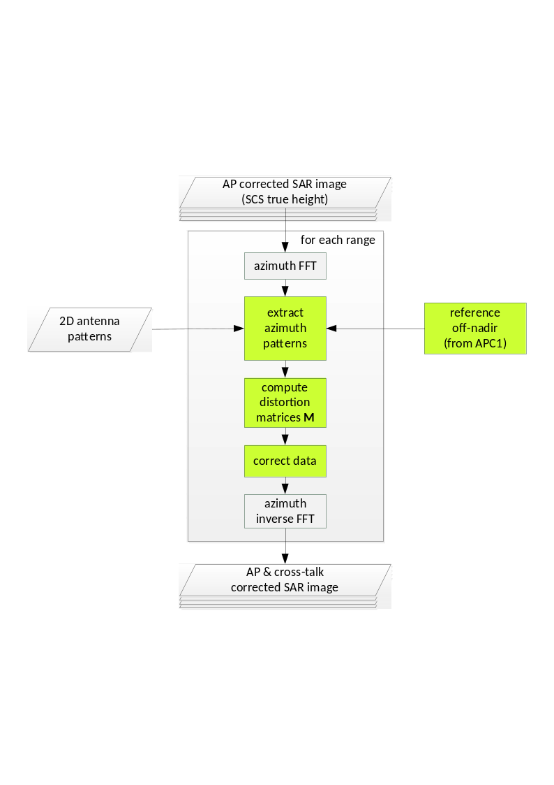

</div>

<p class="atbd-figure-caption"><span class="caption-number">Fig. 17</span><span class="caption-text"> — Block diagram showing the operations for the antenna cross-talk compensation. The extraction of reference off-nadir and antenna patterns is analogous to the APC1 correction step (see first figure in Sec. 4.6.1).</span></p>

:::

**Inputs**

| Symbol | Name | Origin | Size | Variability | Default | Description |
|---|---|---|---|---|---|---|
| - | SLC | Co-antenna patterns compensation step | (Nrg-Nchirp+1) x N’az array of complex values | - | - | AP-corrected focused SAR data Intermediate product: iSLC |
| $P_D$ | Antenna patterns | 2D antenna patterns extraction step | Nθ x Nβ arrays of complex values (8 in total, i.e. 4 pols combinations for both the doublets, function of elevation and azimuth angles) | - | - | 2D antenna patterns (two-way, for both the doublets) Intermediate product: `iPatt2D` |
| $T_{Tx},\ T_{Rx}$ | TX Power Tracking | Internal calibration parameters retrieval step | set of M complex values | - | - | Transmit power tracking (complex number) for each calibration sequence m and each polarization Intermediate product: `iTxPT` |
| $\theta_{el,avg}(\tau)$ | Off-nadir angle | Co-antenna patterns compensation step | (Nrg-Nchirp+1) x 1 array of real values | - | - | Average off-nadir angle for the entire scene as a function of range |

**Outputs**

| Symbol | Name | Destination | Size | Variability | Default | Description |
|---|---|---|---|---|---|---|
| - | SLC | Radiometric corrections step | (Nrg-Nchirp+1) x N’az array of complex values | - | - | AP-corrected focused SAR data compensated for the antenna cross-talk for a constant reference height Intermediate product: iSLC (updated raster) |

**Mathematical description**

The steps are very similar to those presented in {sec}`4.6.1`, so the specific variables and those equations that are the same are omitted in the following. The steps for the correction of the antenna cross-talk are:

1. Perform an azimuth Fourier transform to bring the data to the range-Doppler domain. For efficiency reasons, when processing the same blocks, the last inverse 2D Fourier transform of the azimuth compression step can be performed in range only, in which case this step can be omitted;
2. Compute the distortion matrices for the transmit and receive patterns based on the cross-patterns as a function of Doppler frequency and range. The co- and cross-azimuth antenna pattern intensities, $P$ and $X$, for the off-nadir angle profile $\theta_{el,avg}(\tau)$ are extracted from the 2D complex antenna pattern as follows:

(equation-eq-atbd-l1-sar-4-58)=
\begin{equation}
\begin{aligned}
P_{\left[ R,T \right]}(f_a;\tau)=P_{1way}(\ \ \ \theta={\ \theta}_{el,avg}(\tau),\ \ \ \ \phi=\beta(f_a,\tau)), \\
X_{\left[ R,T \right]}(f_a;\tau)=X_{1way}(\ \ \ \theta={\ \theta}_{el,avg}(\tau),\ \ \ \ \phi=\beta(f_a,\tau)),
\end{aligned}
\tag{4.58}
\end{equation}

where $\beta(f_a,\tau)$ is computed with {eq}`equation|4.38`. The co- and cross-antenna patterns are evaluated / interpolated for the required azimuth frequency positions. As in APC1, two-way patterns are obtained from doublet patterns combined with power tracking coefficients that are averaged over each azimuth block;

3. Compute the distortion matrices $\mathbf{X}_{\mathbf{R}}^{\mathbf{P}}$ and $\mathbf{X}_{\mathbf{T}}^{\mathbf{P}}$ representing the antenna cross-talk:

(equation-eq-atbd-l1-sar-4-59)=
\begin{equation}
\begin{aligned}
\left[ \mathbf{X}_{\mathbf{R}}^{\mathbf{P}} \right]=\begin{bmatrix}
1 & \delta_1 \\
\delta_2 & f_1
\end{bmatrix}\ ;\ \left[ \mathbf{X}_{\mathbf{T}}^{\mathbf{P}} \right]=\begin{bmatrix}
1 & \delta_3 \\
\delta_4 & f_2
\end{bmatrix}, \\
\text{with } \delta_1={\delta_3=\frac{X_H}{P_H},\delta}_2=\delta_4=\frac{X_V}{P_H},\ f_1=f_2=1.
\end{aligned}
\tag{4.59}
\end{equation}

with R the receive and T the transmit polarization. Here, it is considered that the antenna pattern correction has already been performed ($f_1=f_2=1$) and cross-talk is identical in receive and transmit (only the antenna is considered as a relevant source of cross-talk);

4. Retrieve the scattering matrix, $\left[ \mathbf{S} \right]$, by multiply the inverses of the distortion matrices for each image pixel as:

$$
\left[ \mathbf{S} \right]=\left[ \mathbf{X}_{\mathbf{R}}^{\mathbf{P}} \right]^{-1}\left[ \mathbf{M}^{\mathbf{P}} \right]\left[ \mathbf{X}_{\mathbf{T}}^{\mathbf{P}} \right]^{-1}.
\tag{4.60}
$$ (eq:atbd-l1-sar-4-60)

where $\mathbf{M}^{\mathbf{P}}$ represents the scattering matrix subject to the antenna cross-talk. For simplicity, the dependency of the matrices with Doppler frequency and range has been omitted in step 3 and 4 and not considered in computations;

5. Perform the inverse azimuth Fourier transform to bring the data back to range- and azimuth-time domain.

(sec:atbd-l1-sar-4-7)=
### 4.7 Azimuth Compression

**Algorithm overview and rationale**

The azimuth compression step is performed applying a simplified w-k algorithm {rd}`15` {rd}`16` {rd}`17` {rd}`18`, called Fast w-k, based on an approximation of the range migration correction. This approximation is made possible by the specific characteristics of the BIOMASS mission, i.e., a low bandwidth-frequency ratio and an expected zero bias, small standard deviation Doppler Centroid, and it is identified as the perfect trade-off between results accuracy and throughput.

The main steps of the algorithm are represented in the following figure and described in detail below.

(fig:atbd-l1-sar-18)=
:::{div} atbd-mermaid-figure

<div class="atbd-figure-content">

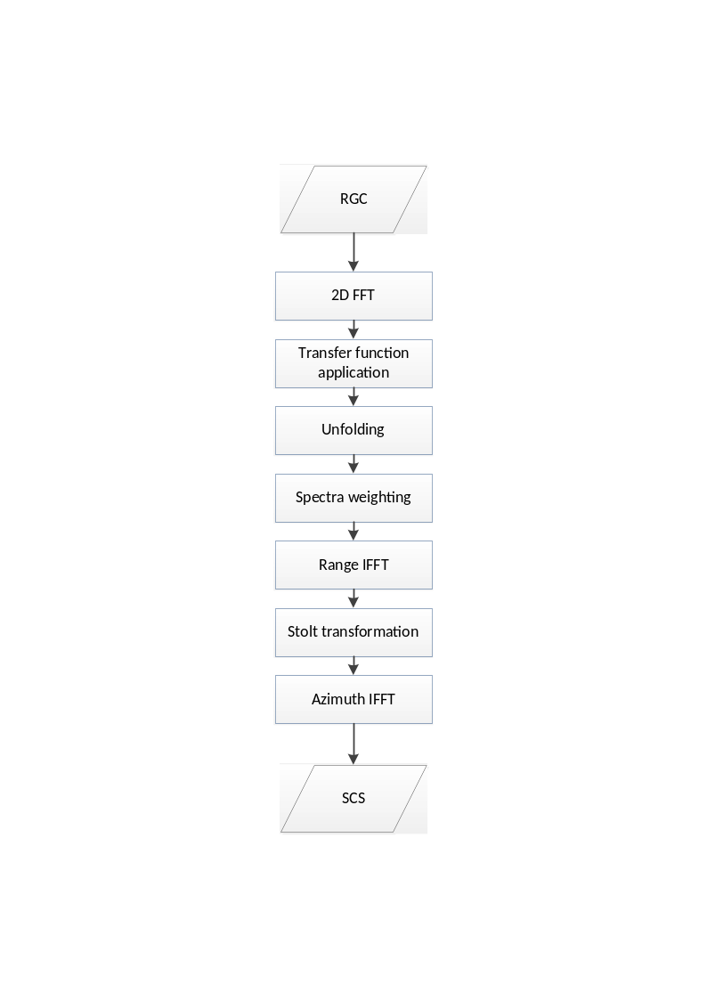

</div>

<p class="atbd-figure-caption"><span class="caption-number">Fig. 18</span><span class="caption-text"> — Block diagram of the azimuth compression step.</span></p>

:::

**Inputs**

| Symbol | Name | Origin | Size | Variability | Default | Description |
|---|---|---|---|---|---|---|
| - | RGC compensated | Antenna pattern compensation step | (Nrg-Nchirp+1) x N’az array of complex values | - | - | Range-compressed SAR data, compensated for the 2D antenna illumination pattern for an average off-nadir angle profile Intermediate product: iRGC |
| $\tau,\ t$ | RGC data slant range and azimuth time axes | Antenna pattern compensation step | set of Nrg-Nchirp+1 real values and set of Naz UTC times respectively | - | - | Range compressed data slant range and azimuth time axes |
| $p_s{,\ v}_s$ | Orbit | Orbit and attitude extraction step | 2 Nsv x 3 arrays of real values | - | - | Orbit state vectors (satellite position and velocity) |
| $f_{DC}$ | Doppler Centroid | Doppler Centroid estimation step | set of polynomials | - | - | Doppler Centroid polynomials |
| $K_a$ | Doppler Rate | Doppler Rate estimation step | set of polynomials | - | - | Doppler Rate polynomials |
| $v_e$ | Effective velocity | Doppler Rate estimation step | set of polynomials | - | - | Effective velocity polynomials |
| - | `blockSamples`, `blockLines`, `blockOverlapSamples`, `blockOverlapLines` | `AUX_PP1` (`AUX_FMT`) | 4 scalar values | - | 256, 25000, 46, 10888 | Number of samples and lines in the processing blocks and in the overlap between blocks |
| - | `azimuthProcessingParametersList` \> `windowType`, `windowCoefficient`, `processingBandwidth`, `timeBias` | `AUX_PP1` (`AUX_FMT`) | string + 3 scalar values | - | depends on swath | Azimuth spectrum windowing parameters (window type, window coefficient and processing bandwidth) + time bias to be applied during processing |

**Outputs**

| Symbol | Name | Destination | Size | Variability | Default | Description |
|---|---|---|---|---|---|---|
| - | SLC | Antenna pattern compensation step | (Nrg-Nchirp+1) x N’az array of complex values | - | - | Focused single-look complex SAR data Intermediate product: iSLC |

**Mathematical description**

Processing is executed per blocks, with configurable dimensions and overlaps both in range and in azimuth directions.

For each block, the main steps of the Fast w-k algorithm are:

1. the Range Compressed (RGC) data are transformed both in range and in azimuth directions;
2. in the spectral domain the data is corrected applying:
    - a. the phase transfer function, allowing to have a data focused in $(\omega_r,k_a)$ the domain:

$$
H_f(\omega_r,k_a)=exp\left\{ jr_0\left[ \sqrt{(\frac{\omega_r+\omega_{r0}}{c_0/2})^2-k_a^2}-(\frac{\omega_r}{c_0/2}+k_{r0C}) \right] \right\}
\tag{4.61}
$$ (eq:atbd-l1-sar-4-61)

where:

    - $k_{r0C}=\sqrt{(\frac{\omega_{r0}}{c_0/2})^2-k_{a0C}^2}$
    - $k_a=\frac{2\pi{}f_a}{v_{e0C}}$
    - $k_{a0C}=\frac{2\pi}{v_{e0C}}floor(\frac{f_{DC}}{PRF})PRF$
- b. the unfolding phase, aimed at moving the scene to the Zero-Doppler position:

$$
H_u(\omega_r,k_a)=exp(-j\frac{\omega_r}{c_0/2}r_u+j(k_a-k_{a0C})x_u)
\tag{4.62}
$$ (eq:atbd-l1-sar-4-62)

where:

    - $x_u=(r_0+M\frac{c_0}{4f_s}\cos{\beta_a})\tan \beta$
    - $r_u=r_0(1-\frac{1}{\cos \beta})$
- c. the weighting window (e.g. Hamming) in azimuth direction;

```{note}
The azimuth antenna gain compensation is performed in a dedicated step described in {sec}`4.6`, while the range weighting window is applied during the Range Compression step described in {sec}`4.2.1`;
```

3. the data are inverse transformed along range direction;
4. the Stolt transformation is applied through a first order approximation, i.e. as a simple $k_a$-variant shift of the spectrum, applied in the range-doppler domain and aimed at aligning the spectrum along a reference $k_{r0}$ coordinate:

$$
H_s(\tau,k_a)=exp\left[ -j\tau\omega_{rs}(k_a(\tau)) \right]
\tag{4.63}
$$ (eq:atbd-l1-sar-4-63)

where:

    - $\omega_{rs}(k_a)=\frac{c_0}{2}\sqrt{k_{r0}^2+k_a^2(\tau)}-\omega_{r0C}$
    - $k_a(\tau)=\frac{2\pi{}f_a}{v_e(\tau)}$
    - $\omega_{r0C}=\frac{c_0}{2}\sqrt{k_{r0}^2+k_{a0C}^2}$
5. the focused data are then obtained through an inverse transformation along azimuth direction.

**Error analysis**

For performances analyses, in particular those related to the choice of the proper w-k kernel (i.e., Fast w-k) for azimuth compression, refer to {rd}`1`.

(sec:atbd-l1-sar-4-7-1)=
#### 4.7.1 Bistatic Delay Correction

**Algorithm overview and rationale**

For BIOMASS the azimuth time assigned to downlinked SAR echo data is the receive time of the pulses. This time is different from the one at which the imaging of the ground occurs, i.e. halfway between the transmission and reception of the pulses. This effect is called the “bistatic delay” and shall be compensated during processing in order to improve the geolocation of the SAR image.

**Mathematical description**

The bistatic delay correction is range variant, as it shall be kept into account that the satellite is moving while the receive window is open and then each range sample of a given echo is received at a different time. Moreover, it shall be kept into account that the instrument assigns to all the range samples of a received echo the time of the receipt of the first sample, i.e. the near range one. For these reasons the bistatic delay correction can’t be applied simply as a rigid time shift to the whole image, but each range line shall be managed separately.

The correction is then applied in two steps:

- coarse correction: the near range sample is taken as reference and the corresponding bistatic delay correction applied to the whole image as a rigid time shift. This is performed simply subtracting from the focused data azimuth time the following quantity:

$$
\mathrm{\Delta}t_{coarse}=\frac{\tau_0}{2}
\tag{4.64}
$$ (eq:atbd-l1-sar-4-64)

In this way the greatest part of the bistatic delay effect is compensated.

```{note}
In case the time tag annotated in the input raw data packets and used for processing is not referred to the opening of the receive window and then to the exact time when the pulse is started being received, this delta time shall be compensated too at this stage adding it to the focused data azimuth time;
```

- fine correction: after the application of the coarse correction, each data range line is shifted of the proper residual correction, corresponding to:

$$
\mathrm{\Delta}t_{fine}(\tau)=\frac{\tau}{2}-\mathrm{\Delta}t_{coarse}
\tag{4.65}
$$ (eq:atbd-l1-sar-4-65)

In this way the remaining part of the bistatic delay effect is compensated. This shift along the azimuth direction is applied in the azimuth focusing kernel when the data is in the range time - azimuth frequency domain (i.e., before the last azimuth inverse transform) multiplying each range line by the following phase ramp:

$$
H_{bistatic}(\tau,\ f_a)=\exp (-j2\pi{}f_a\mathrm{\Delta}t_{fine}(\tau))
\tag{4.66}
$$ (eq:atbd-l1-sar-4-66)

(sec:atbd-l1-sar-4-8)=
### 4.8 Radiometric Corrections and Calibrations

**Algorithm overview and rationale**

This step is aimed at compensating all those undesired components that affect the amplitude of a focused data, multiplying it by opportune gain factors.

**Inputs**

| Symbol | Name | Origin | Size | Variability | Default | Description |
|---|---|---|---|---|---|---|
| ${SCS}_{nc}$ | SLC | Antenna pattern compensation step | (Nrg-Nchirp+1) x N’az array of complex values | - | - | AP-corrected focused SAR data compensated for the antenna cross-talk for a constant reference height Intermediate product: iSLC |
| $r_{ref}$ | `referenceRange` | `AUX_PP1` (`AUX_FMT`) | scalar value | - | 800000 | Range spreading loss reference slant range [m] |
| ${\mathrm{\Delta}G}_{SF}$ | `processingGainList` | `AUX_PP1` (`AUX_FMT`) | scalar value | - | - | Processing gain to be applied multiplicatively to the image during processing (one value per polarization) |
| $G_{AC}$ | `absoluteCalibrationConstantList` | `AUX_PP1` (`AUX_FMT`) | scalar value | - | - | Absolute calibration constant to be applied multiplicatively to the image during processing (one value per polarization) |

**Outputs**

| Symbol | Name | Destination | Size | Variability | Default | Description |
|---|---|---|---|---|---|---|
| $SCS$ | SLC radiometrically calibrated | Polarimetric calibration step | (Nrg-Nchirp+1) x N’az array of complex values | - | - | Radiometrically corrected and calibrated azimuth compressed data Intermediate product: iSLC (updated raster) |
| $\frac{G_{SF}\bullet{}G_{AC}}{G_{SL}}$ | Radiometric correction factors | Denoising step | (Nrg-Nchirp+1) x N’az array of real values | - | - | Radiometric correction factors |

**Mathematical description**

The L1a (Single-look Complex Slant, $SCS$) data is obtained starting from the data in output from the Azimuth Compression step (${SCS}_{nc}$, where nc stands for “not calibrated”) applying the following corrections:

$$
SCS(\tau,t)={SCS}_{nc}(\tau,t)\bullet\frac{G_{SF}\bullet{}G_{AC}}{G_{SL}(\tau,t)}
\tag{4.67}
$$ (eq:atbd-l1-sar-4-67)

where:

- $G_{SL}(\tau,t)=(\frac{r_{ref}}{r(\tau,t)})^{\frac{3}{2}}$ is the spread-loss range-dependent gain compensation factor ($r_{ref}$ is a configurable slant-range distance used as reference, default value equal to 671km, while $r=\tau\bullet\frac{c}{2}$);
- $G_{SF}=G_{SF0}\bullet{\mathrm{\Delta}G}_{SF}$ is the scaling factor aimed at compensating the radiometric bias introduced by the processor. This factor includes two components: $G_{SF0}$, automatically computed by the processor (see also {sec}`4.15`), and ${\mathrm{\Delta}G}_{SF}$, provided via configuration and polarization dependent;
- $G_{AC}$ is the absolute calibration constant, provided via configuration and polarization dependent.

It shall be noted that:

- the range antenna gain compensation is performed in a dedicated step described in {sec}`4.6`;
- the signal provided in output by L1 Processor is expressed as Beta-Nought value. Look-up tables for the conversion into Sigma-Nought or Gamma-Nought values are derived from incidence angle map (see {sec}`4.6`) and included in L1 product annotations;
- it is proposed to use the same reference range value, $r_{ref}$, for all the swaths to avoid introducing radiometric biases between them.

(sec:atbd-l1-sar-4-9)=
### 4.9 Polarimetric Calibration

**Algorithm overview and rationale**

The goal of the polarimetric calibration is to correct for the instrument distortions using static CAL data. The measured scattering matrix $\left[ \mathbf{M} \right]$ subjected to the system distortions is given by

$$
\left[ \mathbf{M} \right]=\left[ \mathbf{T}_{\mathbf{R}} \right]\left[ \mathbf{S} \right]\left[ \mathbf{T}_{\mathbf{T}} \right],
\tag{4.68}
$$ (eq:atbd-l1-sar-4-68)

where $\left[ \mathbf{T}_{\mathbf{R}} \right]$ and $\left[ \mathbf{T}_{\mathbf{T}} \right]$ are the receiving and transmission polarimetric distortion matrices, and $\left[ \mathbf{S} \right]$ is the target scattering matrix.

**Inputs**

| Symbol | Name | Origin | Size | Variability | Default | Description |
|---|---|---|---|---|---|---|
| - | SLC radiometrically calibrated | Radiometric calibration step | (Nrg-Nchirp+1) x N’az array of complex values | - | - | Radiometrically corrected and calibrated azimuth compressed data Intermediate product: iSLC |
| δ1, δ2, δ3, δ4 | `crossTalkHVTx`, `crossTalkVHTx`, `crossTalkHVRx`, `crossTalkVHRx` | `AUX_PP1` (`AUX_FMT`) | 4 complex values | - | - | H to V/V to H system cross-talk on transmit/receive values |
| f1, f2 | `channelImbalanceHVTx`, `channelImbalanceHVRx` | `AUX_PP1` (`AUX_FMT`) | 2 complex values | - | - | H to V system channel imbalance on transmit/receive values |

**Outputs**

| Symbol | Name | Destination | Size | Variability | Default | Description |
|---|---|---|---|---|---|---|
| - | SLC polarimetrically calibrated | Ionospheric calibration step | (Nrg-Nchirp+1) x N’az array of complex values | - | - | Polarimetrically calibrated azimuth compressed data Intermediate product: iSLC\_iono\_corrected |

**Mathematical description**

1. Retrieve the matrix $\left[ \mathbf{S} \right]$ by multiplying the inverses of the polarimetric distortion matrices for each image pixel:

$$
\left[ \mathbf{S} \right]=\left[ \mathbf{T}_{\mathbf{R}} \right]^{-1}\left[ \mathbf{M} \right]\left[ \mathbf{T}_{\mathbf{T}} \right]^{-1}.
\tag{4.69}
$$ (eq:atbd-l1-sar-4-69)

where:

- $\left[ \mathbf{S} \right]$ is the target scattering matrix $\begin{bmatrix}
S_{HH} & S_{VH} \\
S_{HV} & S_{VV}
\end{bmatrix}$;
- $\left[ \mathbf{T}_{\mathbf{R}} \right]$ is the receiving distortion matrix $\begin{bmatrix}
1 & \delta_2 \\
\delta_1 & f_1
\end{bmatrix}$;
- $\left[ \mathbf{M} \right]$ is the measured scattering matrix $\begin{bmatrix}
M_{HH} & M_{VH} \\
M_{HV} & M_{VV}
\end{bmatrix}$;
- $\left[ \mathbf{T}_{\mathbf{T}} \right]$ is the transmission distortion matrix $\begin{bmatrix}
1 & \delta_3 \\
\delta_4 & f_2
\end{bmatrix}$;
- δ1 is the cross-talk from H to V on receive;
- δ2 is the cross-talk from V to H on receive;
- δ3 is the cross-talk from V to H on transmit;
- δ4 is the cross-talk from H to V on transmit;
- f1 is the receive H-V amplitude and phase imbalance;
- f2 is the transmit H-V amplitude and phase imbalance.

(sec:atbd-l1-sar-4-10)=
### 4.10 Ionospheric Calibration

(sec:atbd-l1-sar-4-10-1)=
#### 4.10.1 Overview

Ionospheric correction aims at compensating and/or minimizing the distortions on the Level 1 image data induced by the ionosphere. Two kinds of corrections are foreseen in the L1 Processor framework: i) the correction of Faraday Rotation (FR) and ii) the correction of ionospheric induced phase distortion. The FR correction can be seen as a reweighting of the polarimetric channels according to the estimated FR. The ionospheric phase correction compensates for the degrading effects caused by the spatially varying ionospheric phase especially at scale on the order of the synthetic aperture or even smaller. The ionosphere phase correction is based on the ionospheric phase screen correction proposed/described in {rd}`12`, in which the ionospheric phase screen and the vertical position of the ionosphere (ionospheric height) need to be known. These parameters are estimated from the SAR data themselves, and the external ionospheric model when data-driven parameters are not available.

In the L1 Processor, the ionospheric phase screen and its altitude are estimated in two different ways: a) in terms of FR and b) in terms of azimuth sub-band shift. FR allows the only robust and high-resolution estimation of TEC from a single (polarimetric) SAR acquisition. However, the applicability of this approach is limited to high latitudes and requires a rather large number of looks. On the other side, the azimuth sub-band shift is highly sensitive to spatial TEC gradients but cannot retrieve directly the absolute TEC level.

The ionospheric correction is comprised of three steps. In the first step, FR and the associated ionospheric height are estimated. The FR estimates are then used to correct the polarimetric scattering matrix. In the second step, from the already-estimated FR values the ionospheric phase screen is derived and compensated by means of a phase correction performed at the FR-derived height of the ionosphere. Finally, in the third step, the azimuth sub-band shifts and the associated ionospheric height are estimated and converted first to a residual TEC and then to a residual phase screen compensation performed at the height of the ionosphere. The following figure shows the overview flow chart.

The strong dependency of the polarimetric calibration performance on the FR residuals is one of the main drivers for the FR estimation performance requirements. This section assumes an accurate instrument polarimetric calibration has been performed before applying the algorithms to be presented. The performance analysis based on WBMOD model shows a clear geographic dependency of the ionospheric impact on BIOMASS acquisitions. For this, only the acquisitions at high geomagnetic latitude, the ionospheric correction by means of autofocus will be applied. Which ionospheric correction methodology will be applied is selected based on geographic criteria for the time being.

Note that ionospheric calibration step operates on data through an azimuth blocketization strategy. Dimensions of blocks and overlaps is configurable. The possibility to make this more flexible (e.g., to make the blocks size and overlap driven by the gaussian filter size in the azimuth direction and then in general by latitude, finding the best trade-off between accuracy and performances improvement through blocks parallelization) is left to future enhancements.

(fig:atbd-l1-sar-19)=
:::{div} atbd-mermaid-figure

<div class="atbd-figure-content">

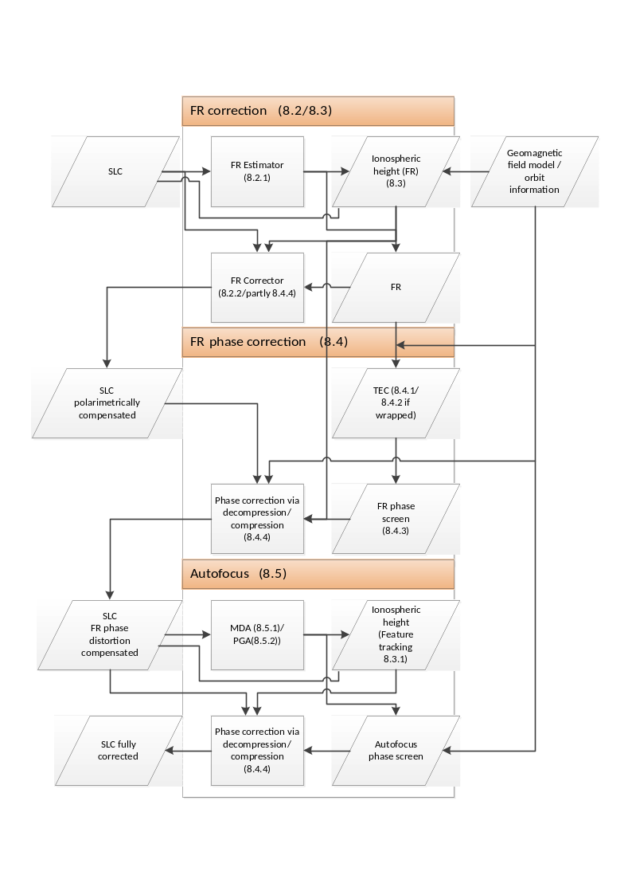

</div>

<p class="atbd-figure-caption"><span class="caption-number">Fig. 19</span><span class="caption-text"> — Overview flow chart.</span></p>

:::

(sec:atbd-l1-sar-4-10-2)=
#### 4.10.2 Estimation and Correction of Faraday Rotation

(sec:atbd-l1-sar-4-10-2-1)=
##### 4.10.2.1 Bickel & Bates Estimator

**Inputs**

| Symbol | Name | Origin | Size | Variability | Default | Description |
|---|---|---|---|---|---|---|
| - | SLC polarimetrically calibrated | Polarimetric calibration step | (Nrg-Nchirp+1) x N’az array of complex values | - | - | Polarimetrically calibrated azimuth compressed data defocused at ionosphere height Intermediate product: iSLC\_iono\_corrected |
| - | `gaussianFilterMaximumMajorAxisLength` | `AUX_PP1` (`AUX_FMT`) | scalar value | - | - | Gaussian filter maximum length of major axis |
| - | `gaussianFilterMaximumMinorAxisLength` | `AUX_PP1` (`AUX_FMT`) | scalar value | - | - | Gaussian filter maximum length of minor axis |
| - | `gaussianFilterMajorAxisLength` | `AUX_PP1` (`AUX_FMT`) | scalar value | - | - | Gaussian filter length of major axis. Used in case computed filter dimensions exceed above reported values |
| - | `gaussianFilterMinorAxisLength` | `AUX_PP1` (`AUX_FMT`) | scalar value | - | - | Gaussian filter length of minor axis. Used in case computed filter dimensions exceed above reported values |
| - | `gaussianFilterSlope` | `AUX_PP1` (`AUX_FMT`) | scalar value | - | - | Gaussian filter slope. Used in case computed filter dimensions exceed above reported values |

**Outputs**

| Symbol | Name | Destination | Size | Variability | Default | Description |
|---|---|---|---|---|---|---|
| $\Omega$ | FR | Correction of FR on polarimetry step, L1 post-processing step | (Nrg-Nchirp+1) x N’az array of real values | - | - | FR map Intermediate product: iFR |

**Mathematical description**

The Faraday rotation (FR) distorts an underlying scattering matrix $\left[ \mathbf{S} \right]$ by

$$
\left[ \mathbf{S}(\Omega) \right]=\left[ \mathbf{R}_{\mathbf{2}}(\Omega) \right]\left[ \mathbf{S} \right]\left[ \mathbf{R}_{\mathbf{2}}(\Omega) \right]
\tag{4.70}
$$ (eq:atbd-l1-sar-4-70)

where $\left[ \mathbf{S}(\Omega) \right]$ is the measured (distorted) scattering matrix, $\left[ \mathbf{R}_{\mathbf{2}}(\Omega) \right]$ the (real) line-of-sight rotation matrix:

(equation-eq-atbd-l1-sar-4-71)=
\begin{equation}
\left[ \mathbf{R}_{\mathbf{2}}(\Omega) \right]=\begin{pmatrix} \cos \Omega & \sin \Omega \\ -\sin \Omega & \cos \Omega \end{pmatrix}
\tag{4.71}
\end{equation}

where $\Omega$ is the one-way FR rotation angle. FR is invariant to the direction of wave propagation but depends on the TEC level and on the orientation of LOS relative to the Earth’s magnetic field vector $\overrightarrow{B}$. It reaches its maximum at mid-latitudes and decreases towards high (due to the low TEC) and low (due to the disadvantageous orientation of LOS) latitudes. From {eq}`equation|4.59` follows:

(equation-eq-atbd-l1-sar-4-72)=
\begin{equation}
\begin{aligned}
S_{hh}(\Omega)=+\cos^2 (\Omega)S_{hh}-\sin^2 (\Omega)S_{vv} \\
S_{hv}(\Omega)=+\cos (\Omega)\sin (\Omega)\ (S_{hh}+S_{vv})+S_{xx} \\
S_{vh}(\Omega)=-\cos (\Omega)sin(\Omega)\ (S_{hh}+S_{vv})+S_{xx} \\
S_{vv}(\Omega)=-\sin^2 (\Omega)S_{hh}+\cos^2 (\Omega)S_{vv}.
\end{aligned}
\tag{4.72}
\end{equation}

Note that in the presence of FR the measured scattering matrix $\left[ \mathbf{S}(\Omega) \right]$ is no longer reciprocal, i.e., $S_{hv}(\Omega)\neq{}S_{vh}(\Omega)$ even if the underlying scattering matrix $\left[ \mathbf{S} \right]$ has $S_{hv}=S_{vh}=S_{xx}$.

The best FR estimation method is the one proposed by Bickel & Bates {rd}`10`. The Bickel & Bates FR Estimator takes advantage of the fact that the eigenstates of the ionosphere are circular polarized waves that propagate with different velocities through the ionosphere. Accordingly, the measured scattering matrix (in the linear H-V basis) is transformed into the L-R circular basis:

(equation-eq-atbd-l1-sar-4-73)=
\begin{equation}
\left[ \mathbf{S}_{LR}(\Omega) \right]=\begin{pmatrix} 1 & i \\ i & 1 \end{pmatrix}\left[ \mathbf{S}(\Omega) \right]\begin{pmatrix} 1 & i \\ i & 1 \end{pmatrix}
\tag{4.73}
\end{equation}

where FR is estimated from the phase difference between the (off-diagonal) LR and RL channels. The Faraday rotation can be achieved simply by

$$
\Omega=\frac{1}{4}\arg (S_{LR}S_{RL}^*).
\tag{4.74}
$$ (eq:atbd-l1-sar-4-74)

By the transformation in {eq}`equation|4.64` the powerful co-pol channels (HH and VV) are moved into $S_{LR}$ and $S_{RL}$ to yield a high SNR that also contributes to the performance of the Bickel & Bates estimator. Spatial averaging of $S_{LR}S_{RL}^*$ can reduce the deviation of FR estimates.

Because of the deviation of the FR estimation, it is required to apply multilooking. In order to minimize the deviation, $\Omega=\frac{1}{4}\arg (\left\langle S_{LR}S_{RL}^* \right\rangle)$ is applied. The performance of the FR estimation depends on the SNR of cross-pol channel of circular basis scattering matrix and the number of looks. The standard deviation of FR estimate is:

$$
\sigma_{\Omega}=\frac{1}{4}\frac{\sqrt{1-\gamma_{pol}^2}}{\sqrt{2N\gamma_{pol}^2}},
\tag{4.75}
$$ (eq:atbd-l1-sar-4-75)

where $\gamma_{pol}$ is the polarimetric decorrelation determined by only SNR.

The sequence of operations is then:

- SNR is computed from data, then $\gamma_{pol}$ is derived as $\gamma_{pol}=\frac{SNR}{1+SNR}$;
- $\sigma_{\Omega}$ is computed starting from geomagnetic latitude, which in turn is derived from input geomagnetic field $\overrightarrow{B}$, and from the desired accuracy of the ionospheric phase estimation $\sigma_{\phi}$:

$$
\sigma_{\Omega}=\frac{\sigma_{\phi}}{\frac{4\pi{}mf}{e\overrightarrow{B}\cdot\widehat{\kappa}}}
\tag{4.76}
$$ (eq:atbd-l1-sar-4-76)

- number of looks is computed from SNR and desired FR estimation quality inverting the formula above:

$$
N=\frac{1}{16}\frac{1-\gamma_{pol}^2}{2\gamma_{pol}^2\sigma_{\Omega}^2},
\tag{4.77}
$$ (eq:atbd-l1-sar-4-77)

The number of looks is then used to compute the gaussian filter used to smooth FR before correcting it on data. The larger the number of looks, the larger the filter dimensions.

The required FR estimation accuracy is not difficult to be achieved, because FR can be estimated very accurately. The backscatter at P-band from bare-surface can be very small. The required numbers of looks to reach 0.05˚-accuracy (as 1- and 3-sigma) of FR are calculated for three different levels of SNR, 3, 8, and 13 dB:

| SNR | $\boldsymbol{\gamma}_{\boldsymbol{pol}}$ | 1 sigma | 3-sigma |
|---|---|---|---|
|   |   | N Size of Est. Window [km2] | N Size of Est. Window [km2] |
| 3 dB | 0.666 | 51.44 K 4.47 x 4.47 | 462.96 K 13.41 x 13.41 |
| 8 dB | 0.863 | 14.038 K 2.33 x 2.33 | 126.342 K 7.01 x 7.01 |
| 13 dB | 0.952 | 4.216K 1.28 x 1.28 | 37.947 K 3.84 x 3.84 |

(The conversion of number of looks to the length of side, the range and the azimuth postings of independent samplings are set to be 51.63 m and 7.53 m, respectively.)

It can be seen that FR can be estimated with high accuracy using window sizes of km-level. For the FR correction, an estimation window size of 5 km covers most of the conditions (1-sigma). The variation of the FR within the window leads to an ignorable error for the FR correction. The requirement for smaller estimation windows arises only for the aurora oval and the polar cap(s).

Spatial averaging of 2.3 km x 2.3 km yields to a FR estimation accuracy of around 0.05˚ for a SNR of 8 dB. This is sufficient for the correction of FR on polarimetry. However, for the conversion to an ionospheric phase screen, 0.05˚ of FR corresponds at high latitudes to 40˚ and increase as the latitude lowers. The effect of number of looks and the ionospheric phase is discussed further in {sec}`4.10.3`.

At low latitudes, as the $\overrightarrow{B}\cdot\widehat{\kappa}$ approaches to zero, the required number of looks explodes causing the known equatorial gap in the ionospheric correction proposed in the BIOMASS L1 GPP project. Improved techniques (like the re-use of the azimuth sub-aperture TEC & ionospheric height estimation approach) allows to close this performance gap. Such techniques are under evaluation (see {rd}`29`).

In order to consider the focusing geometry of SAR, the correction of the FR is performed at the ionospheric altitude. For this, the SLC images are defocused to the given (either estimated or modelled) ionospheric altitude, before the FR is estimated. The mathematics for the focusing and defocusing is explained in {sec}`4.10.3.5`.

(sec:atbd-l1-sar-4-10-2-2)=
##### 4.10.2.2 Correction of FR on polarimetry

**Algorithm overview and rationale**

Once FR is estimated, the correction of FR is performed exactly in the opposite way of {eq}`equation|4.61`. The geomagnetic field and the ionospheric height alone cannot represent the direction of the anisotropy of FR distribution correctly especially around the auroral oval, where the requirement of the FR correction is high.

Once each polarimetric channel is corrected, the SLC’s are focused back to the ground.

The FR correction process is summarized in the figure below.

(fig:atbd-l1-sar-20)=
:::{div} atbd-mermaid-figure

<div class="atbd-figure-content">

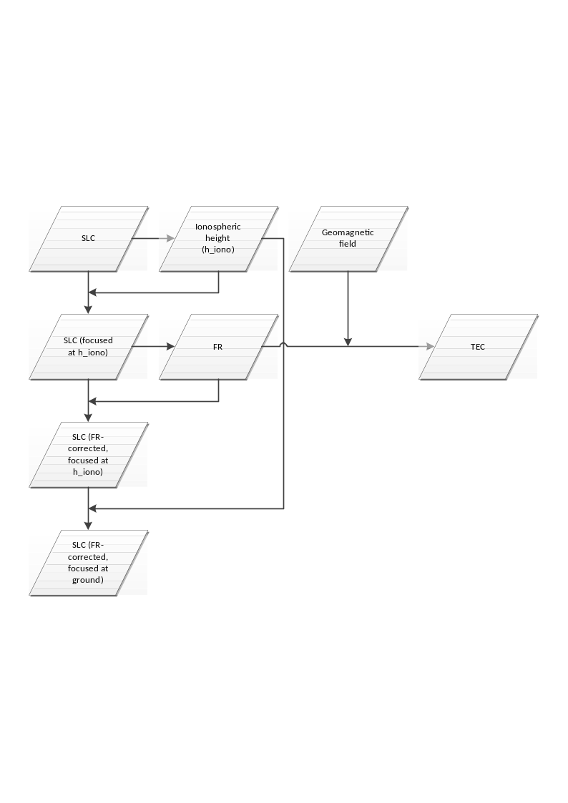

</div>

<p class="atbd-figure-caption"><span class="caption-number">Fig. 20</span><span class="caption-text"> — Summary of FR correction on polarimetry</span></p>

:::

The figure above summarizes the FR correction on polarimetry. The key parameter of the whole process chain is the ionospheric height. The focused SLC is defocused to ionospheric altitude by means of the defocusing methods presented in {sec}`4.10.3.5` and focused back to the ground after FR correction. Estimated FR is converted to TEC using the geomagnetic field and the estimated ionospheric altitude.

**Inputs**

| Symbol | Name | Origin | Size | Variability | Default | Description |
|---|---|---|---|---|---|---|
| - | SLC polarimetrically calibrated | Polarimetric calibration step | (Nrg-Nchirp+1) x N’az array of complex values | - | - | Polarimetrically calibrated azimuth compressed data Intermediate product: iSLC\_iono\_corrected |
| - | Ionosphere height / `ionosphereHeightValue` | Ionosphere height estimation step / `AUX_PP1` (`AUX_FMT`) | scalar value | - | 350000 | Ionosphere height. Can be estimated, computed from model or taken in input from `AUX_PP1` file (as per configuration) |

**Outputs**

| Symbol | Name | Destination | Size | Variability | Default | Description |
|---|---|---|---|---|---|---|
| - | SLC FR corrected | Ionospheric phase screen correction step | (Nrg-Nchirp+1) x N’az array of complex values | - | - | FR-corrected azimuth compressed data Intermediate product: iSLC\_iono\_corrected (updated raster) |

(sec:atbd-l1-sar-4-10-2-3)=
##### 4.10.2.3 Ionosphere Height Estimation

**Algorithm overview and rationale**

Here two methods estimating ionospheric height from full-polarimetric SAR data are introduced. One relies on the spatial variation of ionospheric features on the SAR image. The ionospheric height is estimated from the parallax effect of the ionospheric features detected on two azimuth sub-band images. This method performs best when the spatial variation of the ionosphere is significant. The other exploits the squint-dependency of FR. Because of the geometric variability of the look direction and the geomagnetic field, the FR also varies across the squint angle. The estimation error of this method is minimized for spatially constant ionosphere.

The sensitivity of FR to TEC increases with geomagnetic latitude, while its squint angle dependency is stronger around the equator and minimised at high latitudes. Depending on the geomagnetic latitude, one of the two ionospheric height estimators proposed would be selected. In particular, if latitude is below a certain threshold (defined as a configuration parameter) the squint sensitivity method is used, otherwise the feature tracking one is selected.

The estimation of the ionospheric heights based on the SAR data is subjected to many constraints and performance dependency on the characteristics of the data itself. In cases the height estimation from data fails, e.g., not in a reasonable range of the ionospheric height (smaller than 200 km or larger than 450 km, where these are empirical values that should be consolidated with actual BIOMASS measurements), the ionospheric height estimated from the external model, e.g., international reference ionosphere (IRI), is applied to evaluate the ionospheric height. The position and time are required for the evaluation. Nearest neighbour interpolation is applied to derive information at the desired position.

At processor configuration level, it will be possible to choose between the various available options: automatic selection of the method (based on latitude, as explained above) or explicit selection, usage of the model or usage of a fixed height value provided in input via configuration.

The figure below summarises ionospheric height estimation methods.

(fig:atbd-l1-sar-21)=
:::{div} atbd-mermaid-figure

<div class="atbd-figure-content">

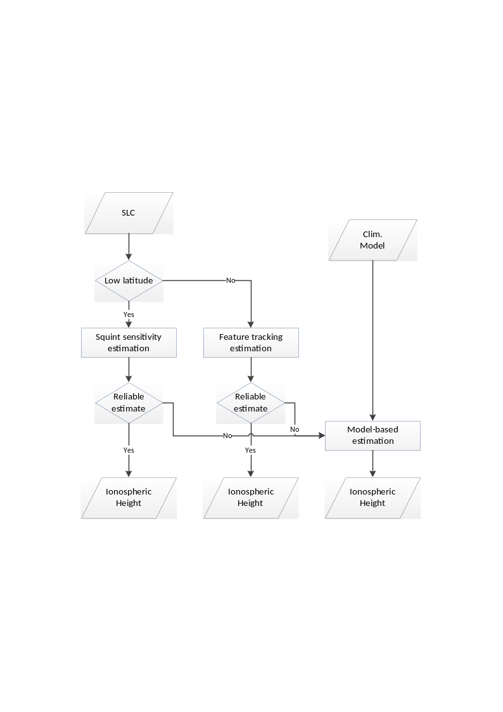

</div>

<p class="atbd-figure-caption"><span class="caption-number">Fig. 21</span><span class="caption-text"> — Summary of ionosphere height estimation methods</span></p>

:::

**Inputs**

| Symbol | Name | Origin | Size | Variability | Default | Description |
|---|---|---|---|---|---|---|
| - | SLC polarimetrically calibrated | Polarimetric calibration step | (Nrg-Nchirp+1) x N’az array of complex values | - | - | Polarimetrically calibrated azimuth compressed data Intermediate product: iSLC\_iono\_corrected |
| $p_s{,\ v}_s$ | Orbit | Orbit and attitude extraction step | 2 Nsv x 3 arrays of real values | - | - | Orbit state vectors (satellite position and velocity) |
| $\overrightarrow{B}$ | Geomagnetic field | `AUX_GMF` (`AUX_FMT`) | 2D array of real values | updated regularly (several years between updates) | - | Geomagnetic field model |
| - | `ionosphereHeightEstimationMethodLatitudeThreshold` | `AUX_PP1` (`AUX_FMT`) | scalar value | - | 10 | Latitude threshold for ionosphere height estimation method selection [deg]. If latitude is below this threshold the squint sensitivity method is used, otherwise the feature tracking one is selected |
| - | `ionosphereHeightMinimumValue` | `AUX_PP1` (`AUX_FMT`) | scalar value | - | 200000 | Minimum value for ionosphere height estimation. If ionosphere height is estimated and estimated value is lower than this value, it is discarded and input model is used instead |
| - | `ionosphereHeightMaximumValue` | `AUX_PP1` (`AUX_FMT`) | scalar value | - | 450000 | Maximum value for ionosphere height estimation. If ionosphere height is estimated and estimated value is higher than this value, it is discarded and input model is used instead |
| - | `squintSensitivityNumberOfLooks` | `AUX_PP1` (`AUX_FMT`) | scalar value | - | 8 | Number of looks used for ionosphere height estimation through squint sensitivity method |
| - | `squintSensitivityNumberOfTicks` | `AUX_PP1` (`AUX_FMT`) | scalar value | - | 10000 | Number of height ticks to be processed for ionosphere height estimation through squint sensitivity method |
| - | `squintSensitivityFittingError` | `AUX_PP1` (`AUX_FMT`) | 2 scalar values | - | 1 1 | Fitting error for TEC and ionosphere height estimates through squint sensitivity method [(rad/nT)^2] |

**Outputs**

| Symbol | Name | Destination | Size | Variability | Default | Description |
|---|---|---|---|---|---|---|
| $h_{iono}$ | Ionosphere height | Correction of FR on polarimetry step | scalar value | - | 350000 | Ionosphere height |

(sec:atbd-l1-sar-4-10-2-3-1)=
###### 4.10.2.3.1 Based on feature tracking

The estimation of the ionospheric height using SAR relies on parallax estimation within in the synthetic aperture. The variation of the look direction (squint) in the synthetic aperture can be resolved in the Doppler frequency domain. The vertical location of the ionosphere can be retrieved from a single SAR image by means of analysing the ionospheric signatures in azimuth sub-bands.

In the Doppler frequency domain, the higher frequencies correspond to the approaching geometry, and look “forward” with respect to the zero-Doppler plane. Similarly, the lower frequencies correspond to the departing geometry and look “backwards”. The geometry of the problem is shown in the figure below. Note that ellipsoid is used as terrain height model. The altitude of the ionosphere and of the orbit of SAR are $h_{iono}$ and $h_{sat}$, and correspond to range distances $R_{iono}$ and $R$, respectively. For an incidence angle of $\theta$, $h_{sat}=R\cos \theta$, and $R_{iono}=(h_{sat}-h_{iono})\cos \theta$ hold. Here the geometry is simplified to a Cartesian coordinate system, and the effect of Earth’s curvature is not considered because its effect is assumed to be negligible. The spatial separation of the ionospheric features on the two sub-band images are $L_{sep}$, and it is proportional to the ionospheric altitude $h_{iono}$ as

$$
h_{iono}=2R\cos \theta\cdot\frac{L_{sep}}{L_{SA}},
\tag{4.78}
$$ (eq:atbd-l1-sar-4-78)

where $L_{SA}$ is the length of the synthetic aperture. $L_{sep}$ is estimated from the data by means of (incoherent) correlation between two azimuth sub-band FR estimates is applied. This height estimation method is based on the fact that the look direction of each approaching and departing sub-bands are constant. The spatial separation $L_{sep}$ is estimated by the estimating the offset of ionospheric features appearing on two sub-band images.

(fig:atbd-l1-sar-22)=
:::{div} atbd-mermaid-figure

<div class="atbd-figure-content">

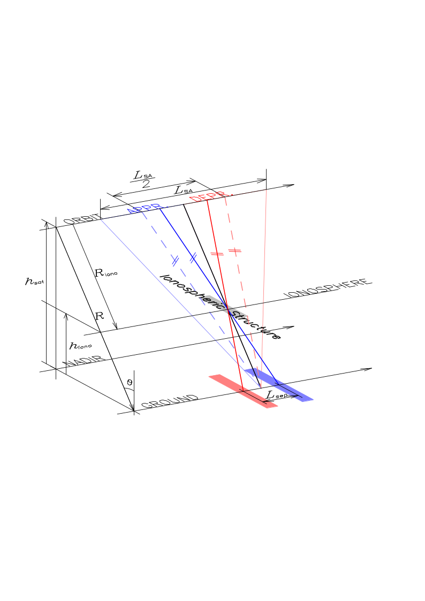

</div>

<p class="atbd-figure-caption"><span class="caption-number">Fig. 22</span><span class="caption-text"> — Geometry of the ionospheric altitude estimation problem.</span></p>

:::

It is expected that the estimation of $L_{sep}$ from the cross-correlation between two sub-band FR estimates would fail in many cases, as the spatial variations of FR varies in wide range of magnitude. At first place, the lack of prominent peak in the cross-correlation function is considered as height estimation failure. The power ratio of the primary peak to the secondary should be higher than a certain threshold. The threshold should be determined by heuristic approach.

It is also possible that the estimated ionospheric altitude is not physically available. In cases, for example, when the estimated height is lower than 150 km and higher than 400 km would be rejected and nominal or model derived values would be applied in further correction process.

(sec:atbd-l1-sar-4-10-2-3-2)=
###### 4.10.2.3.2 Based on squint sensitivity of FR

The Faraday rotation and the TEC are related as

$$
\Omega=\frac{\zeta{}e\overrightarrow{B}\cdot{\widehat{\kappa}}_0}{cmf^2}TEC.
\tag{4.79}
$$ (eq:atbd-l1-sar-4-79)

At P-band 1 TECU (=1016 electrons per square meter) induces around 3° of FR assuming $\overrightarrow{B}\cdot\widehat{\kappa}=$40,000 nT. In equation above, ${\widehat{\kappa}}_0$ is the propagation vector in zero-Doppler geometry. Normally, the zero-Doppler geometry is already understood and symbolized without subscript 0. In this section, however, because the propagation vector is dealt as a function of squint, the zero-Doppler version is named for distinction purpose. Equation above is derived with respect to $\overrightarrow{B}\cdot\widehat{\kappa}$ to become:

$$
\frac{d\Omega}{d(\overrightarrow{B}\cdot\widehat{\kappa})}=\frac{\frac{d\Omega}{d\beta}}{\frac{d(\overrightarrow{B}\cdot\widehat{\kappa})}{d\beta}}=\frac{\zeta{}e}{cmf^2}TEC,
\tag{4.80}
$$ (eq:atbd-l1-sar-4-80)

where $\beta$ is the squint angle. The look direction $\widehat{\kappa}$ varies with respect to $\beta$. The plane on that $\widehat{\kappa}$ varies is defined by ${\widehat{\kappa}}_0$ and the sensor forwarding direction $\widehat{v}={\overrightarrow{v}}_{sat}/\left\vert {\overrightarrow{v}}_{sat} \right\vert$. For a squint angle $\beta$, the propagation vector is simply calculated by $\widehat{\kappa}={\widehat{\kappa}}_0\cos \beta+{\widehat{v}}_{sat}\sin \beta$. $\overrightarrow{B}\cdot\widehat{\kappa}$ and $\frac{d(\overrightarrow{B}\cdot\widehat{\kappa})}{d\beta}$ can be estimated by using the International Geomagnetic Reference Field (IGRF). The geomagnetic field $\overrightarrow{B}$ is a function of position and height. The IGRF model provides series of coefficients of spherical harmonics for the description of the geomagnetic field. By their serial summation, $\overrightarrow{B}$ at the given position is calculated. For a given location, both the equations above become functions of two unknowns: TEC and the ionospheric height $h_{iono}$. Note that as the geomagnetic field $\overrightarrow{B}$ is not linear with height, the solution of equations above for TEC and $h_{iono}$ becomes a nonlinear problem. Note also that ellipsoid is used as terrain height model.

(fig:atbd-l1-sar-23)=
:::{div} atbd-mermaid-figure

<div class="atbd-figure-content">

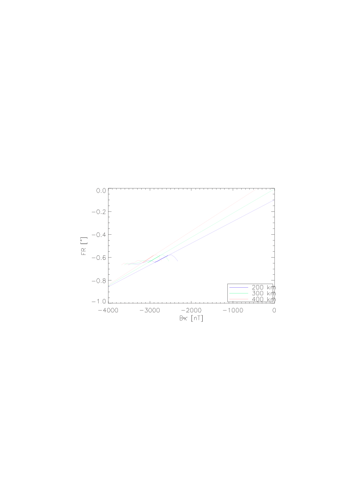

</div>

<p class="atbd-figure-caption"><span class="caption-number">Fig. 23</span><span class="caption-text"> — FR-Bk diagram and the estimation of ionospheric height and TEC</span></p>

:::

The figure above depicts an example of estimating the ionospheric height and TEC using ALOS-2 PALSAR-2 data acquried over Kalimantan Island. The x-axis is the $\overrightarrow{B}\cdot\widehat{\kappa}$ at given acquisition geometry (squint and ionospheric altitude), and the y-axis is the estimated Faraday rotation. In the figure, the analyses of three ionospheric altitudes of 200, 300 and 400 km are demonstrated using different colours. Depending on the squint, both of the FR estimates and $\overrightarrow{B}\cdot\widehat{\kappa}$ change, and depending on the altitude, the $\overrightarrow{B}\cdot\widehat{\kappa}$ varies. Because both FR and its derivative with respect to squint are proportional to TEC (see the two formulas above),

1. the FR-Bk diagram of any acquisition should be on a line, and
2. the extension of that line should pass the origin.

Unfortunately, only for a part of the spectra, the FR-Bk relation places on a line, and that interval is highlighted in the figure above. In addition, the condition on the FR-Bk line to pass through the origin is fulfilled only when the assumed ionospheric altitude for estimating $\overrightarrow{B}\cdot\widehat{\kappa}$ coincides with the true ionospheric altitude. On the given dataset, that altitude is 300 km. In practice, the height could be found by calculating the $\overrightarrow{B}\cdot\widehat{\kappa}$ values for all height levels to check if the Bk-FR line passes the origin. The TEC level is then given by the slope of the extended line passing the origin.

The key advantage of this approach is that its application does not rely on the presence of spatial variation of ionosphere but can be applied on a “flat” and homogeneous ionosphere; and second that it performs also very close to the geomagnetic equator as indicated by the Kalimantan example. On the other hand, the performance of the proposed approach is limited by the accuracy of the polarimetric calibration. Residual system distortions bias the FR estimates and make an accurate estimation of $\frac{d\Omega}{d\beta}$ difficult.

(sec:atbd-l1-sar-4-10-2-3-3)=
###### 4.10.2.3.3 Criterion for Ionospheric Height Estimation Method

Here two methods of estimating ionospheric height from the SAR data themselves are addressed, and when these methods are not successful (i.e., estimated ionosphere height is outside the min/max boundaries defined by input configuration parameters), the IRI model ionospheric height is applied. In the following, the rationale on the usage of the different estimation methods is given:

- The 2 sub-look approach will only work in scenarios where the spatial variability of the ionosphere is sufficiently strong, i.e., in the presence of strong scintillations. Such scenario is expected to occur only at high latitude at the polar auroral oval, which is associated with high-latitude scintillation events. Because this area is within the masked-out zone associated with space-object tracking, the chances that the 2 sub-look approach retrieves the proper height are small.
- The multi-squint approach will only work at low latitudes close to the geomagnetic equator, where the squint sensitivity to Faraday rotation is higher. The usage of this method is not expected to overlap with the other one.
- For most of the ionospheric conditions and in wide range of the geomagnetic latitudes, the data-derived ionospheric height estimation method is not applicable. Therefore, in most cases the processor will tend to use the IRI model.

Currently, the L1 Processor selects one of the three methods based on the user configuration. In particular, the user can select:

- the feature tracking method (in case of failure, fallback to IRI model);
- the squint sensitivity method (in case of failure, fallback to IRI model);
- the automatic method, which switch between the previous two according to a configurable latitude threshold (in case of failure, fallback to IRI model);
- the IRI model;
- a fixed height given as input in the configuration file (`AUX_PP1`).

Based on the above considerations, it is expected that the 2 sub-look method will work well only at latitudes larger than 61.8º. This value is based on the WBMOD model where the high-latitude irregularity starts {rd}`35`. On the other hand, the multi-squint method is expected to work well at latitudes close to the geomagnetic equator, namely, latitudes smaller than 10º. For the intermediate latitudes (between 10º and 61.8º), the most accurate option is expected to be the IRI model.

(sec:atbd-l1-sar-4-10-3)=
#### 4.10.3 FR-Derived Ionospheric Phase Screen Correction

(sec:atbd-l1-sar-4-10-3-1)=
##### 4.10.3.1 TEC estimation from FR

**Inputs**

| Symbol | Name | Origin | Size | Variability | Default | Description |
|---|---|---|---|---|---|---|
| $\Omega$ | FR | Bickel & Bates estimator step | (Nrg-Nchirp+1) x N’az array of real values | - | - | FR map Intermediate product: iFR |
| $\overrightarrow{B}$ | Geomagnetic field | `AUX_GMF` (`AUX_FMT`) | 2D array of real values | updated regularly (several years between updates) | - | Geomagnetic field model |
| $p_s{,\ v}_s$ | Orbit | Orbit and attitude extraction step | 2 Nsv x 3 arrays of real values | - | - | Orbit state vectors (satellite position and velocity) |
| $h_{iono}$ | Ionosphere height | Ionosphere height estimation step | scalar value | - | 350000 | Ionosphere height |

**Outputs**

| Symbol | Name | Destination | Size | Variability | Default | Description |
|---|---|---|---|---|---|---|
| $TEC$ | TEC | TEC to ionospheric phase step, L1 post-processing step | (Nrg-Nchirp+1) x N’az array of real values | - | - | TEC map |

**Mathematical description**

FR is proportional to TEC and the component of geomagnetic field parallel to the line of sight (LOS). Conventional definitions of TEC is the integrated volume electron density along a vertical path, i.e. $TEC_V=\int_r^{}{Ndr}$, where $r$ runs radially from the Earth’s surface to the altitude where the measurements are performed. For spaceborne SAR geometries, it is convenient to define TEC along the LOS. Using the thin layer approximation, the conventional vertical TEC and the LOS TEC are related by $TEC=TEC_V/\cos \theta$, where $\theta$ is the incidence angle at the effective altitude of the thin ionospheric layer.

Faraday rotation is caused by the birefringent characteristics of the ionosphere in the Earth’s magnetic field. At the microwave spectra two refractive indices are defined in the ionosphere, each of which is associated with characteristic wave, or eigenwave, whose polarimetric state does not change during propagation through the ionosphere. The difference between these refractive indices is

$$
\Delta{}n=n_+-n_-=\frac{N\zeta\overrightarrow{B}\cdot{}\zeta}{\pi{}mf^3}.
\tag{4.81}
$$ (eq:atbd-l1-sar-4-81)

where $\zeta=\frac{e^2c^2}{2\pi{}m}\times10^{-7}=$40.31 m3/s2, $e$ and $m$ are charge and mass of an electron, $f$ is the center frequency, $\widehat{\kappa}$ is the unit propagation vector of transmitted wave. The corresponding phase difference after one-way propagation is given by

$$
2\Omega=\frac{2\pi{}f}{c_0}\int_C^{}{\Delta{}ndl}.
\tag{4.82}
$$ (eq:atbd-l1-sar-4-82)

When the plane of polarization rotates by $\Omega$ around $\widehat{\kappa}$, the phase of the $n_+$-characteristic wave is $2M\pi+\Omega$, while that of the $n-$characteristic wave is $2M\pi-\Omega$, for some integer $M$. This explains the factor 2 appearing in the left-hand side of previous equation. Treating $\overrightarrow{B}\cdot\widehat{\kappa}$ as constant along the integration path $C$ yields the relation between FR and TEC

$$
\Omega=\frac{\zeta{}e\overrightarrow{B}\cdot\widehat{\kappa}}{cmf^2}TEC.
\tag{4.83}
$$ (eq:atbd-l1-sar-4-83)

From {eq}`equation|4.71` follows that an accurate FR estimate obtained from $\int_C^{}{(\overrightarrow{B}\cdot\widehat{\kappa})Ndl}$ requires knowledge of both the electron density and the geomagnetic field $\overrightarrow{B}$ along the integration path $C$. As the function $\overrightarrow{B}\cdot\widehat{\kappa}$ is continuous and $N(l)$ is always positive, $\min (\overrightarrow{B}\cdot\widehat{\kappa})TEC\leq\int_C^{}{\overrightarrow{B}(l)\cdot\widehat{\kappa}N(l)dl\ \leq\max{(\overrightarrow{B}\cdot\widehat{\kappa})TEC}}$. As well, because $\overrightarrow{B}\cdot\widehat{\kappa}$ is monotonic in the integration interval, its extremes always appear at both ends of $C(l)$. When the FR refers to a simplified thin ionospheric layer at the altitude of $h_{iono}$, the magnetic field is also corresponds to $h_{iono}\ (={\overrightarrow{B}}_{iono})$. According to the intermediate value theorem, there exists an $h_{iono}$ in the interval $\left[ 0.\ h_{sat} \right]$ that satisfies $({\overrightarrow{B}}_{iono}\cdot\widehat{\kappa})\int_C^{}{Ndl\ }=\int_C^{}{\overrightarrow{B}(l)\cdot\widehat{\kappa}N(l)dl}$.

Once ionospheric height is known, it is possible to calculate TEC from FR by means of previous equation. The method to determine the ionospheric altitude using SAR data has been described in {sec}`4.10.2.3`.

(sec:atbd-l1-sar-4-10-3-2)=
##### 4.10.3.2 Use of External TEC Maps for Resolving FR Wrapping

**Inputs**

| Symbol | Name | Origin | Size | Variability | Default | Description |
|---|---|---|---|---|---|---|
| $\Omega$ | FR | Bickel & Bates estimator step | (Nrg-Nchirp+1) x N’az array of real values | - | - | FR map (wrapped) Intermediate product: iFR |
| $TEC\text{GPS}$ | External TEC | `AUX_TEC` (`AUX_FMT`) | (Nrg-Nchirp+1) x N’az array of real values | IONEX maps are issued daily by the IGS associated analysis centres | - | External TEC map |

**Outputs**

| Symbol | Name | Destination | Size | Variability | Default | Description |
|---|---|---|---|---|---|---|
| $\Omega$ | FR | Correction of FR on polarimetry step | (Nrg-Nchirp+1) x N’az array of real values | - | - | FR map (unwrapped) Intermediate product: iFR (updated raster) |
| - | TEC | - | (Nrg-Nchirp+1) x N’az array of real values | - | - | Absolute TEC |

**Mathematical description**

The estimation of Faraday rotation (FR) by means of the Bickel and Bates algorithm is modulo $\frac{\pi}{2}$. Since at P-band the absolute value of (one-way) will rather frequently exceed $\frac{\pi}{4}$ (half of $\frac{\pi}{2}$), for an absolute TEC estimation the unwrapping of the estimated FR is required. This task can be supported by external global or regional – GPS-derived – TEC maps. For the determination of the unwrapping integer, the rather low (with respect to the SAR calibration requirements) accuracy and the low spatio-temporal resolution of the GPS derived maps as well as the difference in the ionospheric height seen by the GPS and the BIOMASS configurations mismatch of the integration interval, are not so critical. In the worst case, at high latitudes, around 12 TECU corresponds to a (one-way) FR of $\frac{\pi}{4}$. These figures are well above the TEC estimation accuracy of the global TEC maps. At lower latitudes the ambiguity TEC level (TEC corresponding to $\frac{\pi}{4}$ of FR) is higher (it reaches infinity where $\overrightarrow{B}\cdot\widehat{\kappa}=\ 0$). Their global distribution in ascending orbit is shown in the following figure. The GPS derived TEC, TECGPS, is converted to Faraday rotation ΩGPS,

$$
\Omega\text{GPS}=\frac{\zeta{}e(\overrightarrow{B}\cdot\widehat{\kappa})}{cmf_0^2}TEC\text{GPS}
$$

where $c$ is the speed of light, $m$ and $e$ are the electron mass and charge, $f_0$ is the center carrier frequency, $\zeta=40.31$ m3/s2, $\overrightarrow{B}$ is geomagnetic field, and $\widehat{\kappa}$ is the unit propagation vector. Once ΩGPS has been computed, it is straightforward to directly “unwrap” the estimated FR Ω.

It is worth remarking that the external TEC map (which is derived from GNSS measurements) is only used for the unwrapping of the estimated FR angle. The accuracy of the external TEC map is about 1-2 TEC units, while the unwrapping occurs in the worst case (high latitudes) at 15 TEC units. Therefore, the accuracy of the external TEC map suffices for the purpose of unwrapping the estimated FR angle with the Bickel & Bates algorithm presented in the previous section.

The external TEC maps are provided in IONEX format, i.e., an ASCII format annotating the maps with an hourly rate on a coarse latitude/longitude grid. These maps are interpolated bilinearly in space and linearly in time to get the desired values. Note that this operation is performed in an approximated way, i.e. without correcting longitude for Earth rotation (as per {rd}`40`), as this is considered acceptable for the current usage of TEC maps in the processing chain.

(fig:atbd-l1-sar-24)=
:::{div} atbd-mermaid-figure

<div class="atbd-figure-content">

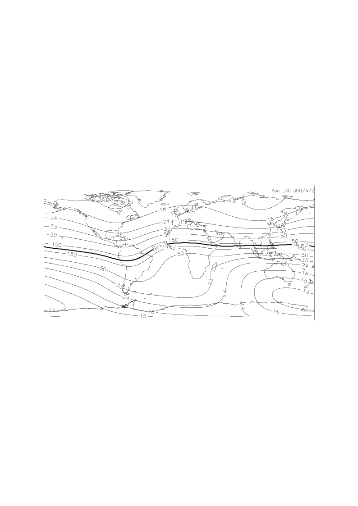

</div>

<p class="atbd-figure-caption"><span class="caption-number">Fig. 24</span><span class="caption-text"> — The TEC corresponding to one-way FR of <span class="math notranslate nohighlight">\(\pi/4\)</span>. The thick curve at equator indicates where the <span class="math notranslate nohighlight">\(\overrightarrow{B}\cdot\widehat{\kappa}=0\)</span>.</span></p>

:::

(sec:atbd-l1-sar-4-10-3-3)=
##### 4.10.3.3 Management of geomagnetic equator crossing

The conversion from FR to TEC described in previous sections cannot be used as is for images crossing geomagnetic equator, as both FR and geomagnetic field are null. In this case a dedicated algorithm is used.

First of all, detection of geomagnetic equator crossing condition is performed checking for sign changes in the geomagnetic field.

In case of crossing, TEC is estimated as proportional to the ratio between FR plane and geomagnetic field. In this case the geomagnetic field is evaluated at a different ionospheric height for each range bin.

**Mathematical description**

The algorithm is described below:

1. FR zero-crossing in azimuth are identified
    - a. for each range sample:
        - i. read the FR plane values along the azimuth dimension;
        - ii. detect where FR changes sign (i.e., where it crosses zero);
        - iii. interpolate between neighbouring azimuth samples to estimate the exact zero-crossing azimuth time;

Note that this step is done on FR plane which is defined on the same SAR coordinates grid as the data;

2. Range-dependent ionospheric height is determined:
    - a. for each range sample:
        - i. consider the previously computed azimuth zero-crossing time and the sample’s range time;
        - ii. evaluate the geomagnetic field component Bk in this SAR coordinate point and over a set of different heights (e.g., from 0 to 600km with a step of 1km);
        - iii. detect the height where Bk changes sign and interpolate the neighbours linearly to obtain the exact height for which Bk changes sign:

Note that this step is done on range time axis of the data;

3. Geomagnetic field is evaluated on a sampled SAR coordinates grid and with range-variant ionospheric height:
    - a. build a coarsely subsampled azimuth–range grid (e.g., every 1000 lines and 100 samples;
    - b. add to the grid a last sample in both directions to make sure all the data corners are properly considered;
    - c. for each node of this coarse grid:
        - i. retrieve the ionospheric height for the current range time;
        - ii. evaluate the geomagnetic field component Bk at the current point with the proper ionospheric height;
4. Bk is interpolated onto the original SAR coordinates grid:
    - a. for each azimuth, range times in the data grid:
        - i. retrieve Bk value by using bilinear interpolation

Note that the grid is evenly spaced except for the last sample in both directions;

5. Compute the TEC:
    - a. divide FR plane by the component Bk

Note that, by construction, they cross zero in the same points;

Note that FR plane and Bk are not exactly zero and that their ratio is proportional to the TEC

If for some pixels Bk is exactly zero, Nan or infinite value in the TEC field are replaced by linear interpolation along the range axis.

(sec:atbd-l1-sar-4-10-3-4)=
##### 4.10.3.4 TEC to ionospheric phase

**Inputs**

| Symbol | Name | Origin | Size | Variability | Default | Description |
|---|---|---|---|---|---|---|
| $TEC$ | TEC | TEC estimation from FR step | (Nrg-Nchirp+1) x N’az array of real values | - | - | TEC map |

**Outputs**

| Symbol | Name | Destination | Size | Variability | Default | Description |
|---|---|---|---|---|---|---|
| $\phi_{iono}$ | Ionospheric phase | Ionospheric phase screen correction, L1 post-processing step step | (Nrg-Nchirp+1) x N’az array of real values | - | - | Ionospheric phase screen map Intermediate product: `iPhaseScreenBB` |

**Mathematical description**

The ionospheric phase advance in a two-way propagation is:

$$
\phi_{iono}=-\frac{4\pi{}\zeta}{cf}TEC.
\tag{4.84}
$$ (eq:atbd-l1-sar-4-84)

The conversion from TEC to phase advance is straight forward and no other information than the centre frequency is required. One tackle is the proportionality factor. At P-band 1 TECU induces 2224˚ of phase advance. In order to achieve realistic phase advance applicable to SAR image correction, a strong spatial averaging is required.

Number of looks required to phase estimation depends on the SNR and latitude (more accurately, $\overrightarrow{B}\cdot\widehat{\kappa}$). At high latitude, e.g., $\overrightarrow{B}\cdot\widehat{\kappa}=$ 40,000 nT, scatterers of 8 dB of SNR and 10K multilook leads to 38.85˚ (1-sigma) phase advance estimation accuracy. As discussed in {sec}`4.10.2.1`, a much larger estimation window is required.

(sec:atbd-l1-sar-4-10-3-5)=
##### 4.10.3.5 Ionospheric Phase Screen Correction

**Algorithm overview and rationale**

Because the ionosphere is located between the ground and the orbit, each point at the ionosphere is “mapped” on a wider azimuth interval on the ground. Inversely, the distortion in a resolution cell is the integrated effect of the ionospheric phase screen along the synthetic aperture projected onto the ionospheric height. Therefore, the estimation and correction of the ionosphere should be performed at the ionospheric altitude {rd}`12`.

The correction of the ionospheric phase screen is summarized in the following figure.

(fig:atbd-l1-sar-25)=
:::{div} atbd-mermaid-figure

<div class="atbd-figure-content">

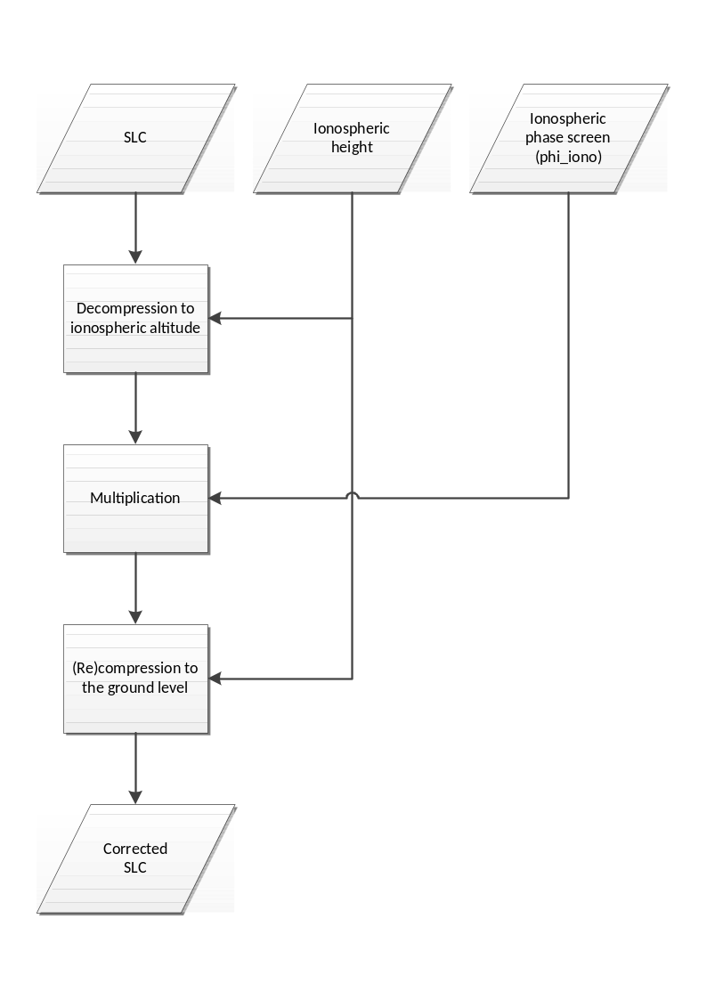

</div>

<p class="atbd-figure-caption"><span class="caption-number">Fig. 25</span><span class="caption-text"> — Summary of ionospheric phase screen correction approach.</span></p>

:::

**Inputs**

| Symbol | Name | Origin | Size | Variability | Default | Description |
|---|---|---|---|---|---|---|
| $SLC$ | SLC FR corrected | Correction of FR on polarimetry step | (Nrg-Nchirp+1) x N’az array of complex values | - | - | FR-corrected azimuth compressed data Intermediate product: iSLC\_iono\_corrected |
| $h_{iono}$ | Ionosphere height | Ionosphere height estimation step | scalar value | - | 350000 | Ionosphere height |
| $\phi_{iono}$ | Ionospheric phase | TEC to ionospheric phase step | (Nrg-Nchirp+1) x N’az array of real values | - | - | Ionospheric phase screen map Intermediate product: `iPhaseScreenBB` |

**Outputs**

| Symbol | Name | Destination | Size | Variability | Default | Description |
|---|---|---|---|---|---|---|
| $SLC^{'}$ | SLC phase screen corrected | Group delay correction step | (Nrg-Nchirp+1) x N’az array of complex values | - | - | FR-corrected and phase screen corrected azimuth compressed data Intermediate product: iSLC\_iono\_corrected (updated raster) |

**Mathematical Description**

The azimuth phase history of a point-like scatterer can be approximated by a quadratic function.

$$
\phi(t)=\frac{4\pi{}f}{c}\sqrt{R_0^2+(vt)^2}\sim\frac{4\pi{}R_0f}{c}+\frac{2\pi{}f}{cR_0}v^2t^2,
\tag{4.85}
$$ (eq:atbd-l1-sar-4-85)

where $R_0$ is the shortest range between the sensor and the scatterer (i.e. the zero-Doppler distance). The first time derivative of the phase $\phi$ is

$$
f_a(t)=\frac{2v^2f}{cR_0}t=K_at,
\tag{4.86}
$$ (eq:atbd-l1-sar-4-86)

which is time-Doppler relation. Substituting {eq}`equation|4.75` into 4.74,

$$
\phi(f_a,\ R_0)=\frac{4\pi{}f}{c}R_0\sqrt{1+(\frac{f_ac}{2vf})^2}
\tag{4.87}
$$ (eq:atbd-l1-sar-4-87)

By substituting $R_0$ by some arbitrary distance $R$ in previous equation, it is possible to vary the altitude of the focusing plane, as only the contributions with a phase history matching previous equation are properly focused in the azimuth direction.

The steps to perform the correction are the following:

1. Starting from the SLC image focused with respect to the distance $R=R_0$, it is possible to obtain an image focused at the ionospheric altitude ($SLC_{iono}$) by performing the following sequential steps:
- a. Fourier transforming the SLC image into the frequency domain,
- b. Decompressing in the azimuth direction by multiplying by $\exp (-i\phi(f_a,R_0))$,
- c. Partially focusing back to the ionospheric altitude by multiplying $\exp (i\phi(f_a,R_{iono}))$, where $R=R_{iono}$ is the range to the ionospheric layer (after range focusing and range migration compensation), and finally,
- d. using an inverse Fourier transform to get back to the image domain.

Points a) to d) are mathematically expressed as:

$$
SLC_{iono}=FT_{az}^{-1}\left\{ FT_{az}\left\{ SLC \right\}\cdot\exp (-i\phi(f_a,R_{iono}))\cdot\exp (i\phi(f_a,R_0)) \right\}.
\tag{4.88}
$$ (eq:atbd-l1-sar-4-88)

2. Once the SLC is focused at the ionospheric altitude, the ionospheric phase screen can be compensated by multiplying $\exp (-i\phi_{iono})$, where $\phi_{iono}$ is obtained by any means of FR (see {sec}`4.10.3.1`) or autofocus (see {sec}`4.11`):

$$
SLC_{iono}^{'}=SLC_{iono}\cdot\exp (-i\phi_{iono}).
\tag{4.89}
$$ (eq:atbd-l1-sar-4-89)

3. Finally, the corrected SLC image focused at ground level is obtained by reversing the operation in {eq}`equation|4.77`, i.e.,

$$
SLC^{'}=FT_{az}^{-1}\left\{ FT_{az}\left\{ SLC_{iono}^{'} \right\}\cdot\exp (-i\phi(f_a,R_{iono}))\cdot\exp (i\phi(f_a,R_0)) \right\}
\tag{4.90}
$$ (eq:atbd-l1-sar-4-90)

This process corrects for

1. the ionospheric phase advance, and
2. the ionospheric azimuth shift. The phases from the TEC gradient inducing (azimuth) shifts are compensated by {eq}`equation|4.78`.

Its performance is determined by the accuracy of the estimated phase screen $\phi_{iono}$. Note that the FR can be estimated from the defocused SLC. This not only ensures consistency between the SLC and FR estimates, but also enhances the spatial resolution of the FR estimates.

(sec:atbd-l1-sar-4-10-3-6)=
##### 4.10.3.6 Group delay correction

**Algorithm overview and rationale**

Due to the group delay of the ionosphere, the SAR images taken through the ionosphere images nearer range. The group delay in the ionosphere is

$$
\Delta{}r=\frac{\zeta}{f_0^2}TEC.
\tag{4.91}
$$ (eq:atbd-l1-sar-4-91)

At P-band 1 TECU induces 2.13 m of range delay, thus half to a pixel of range shift is expected on average levels of TEC.

**Inputs**

| Symbol | Name | Origin | Size | Variability | Default | Description |
|---|---|---|---|---|---|---|
| - | SLC phase screen corrected | Ionospheric phase screen correction step | (Nrg-Nchirp+1) x N’az array of complex values | - | - | FR-corrected and phase screen corrected azimuth compressed data Intermediate product: iSLC\_iono\_corrected |
| $TEC$ | TEC | TEC estimation from FR step | (Nrg-Nchirp+1) x N’az array of real values | - | - | TEC map |

**Outputs**

| Symbol | Name | Destination | Size | Variability | Default | Description |
|---|---|---|---|---|---|---|
| - | SLC group delay corrected | Autofocus step | (Nrg-Nchirp+1) x N’az array of complex values | - | - | FR-corrected, phase screen corrected and group delay corrected azimuth compressed data Intermediate product: iSLC\_iono\_corrected (updated raster) |
| $\Delta{}r$ | Range shifts | L1 post-processing step | (Nrg-Nchirp+1) x N’az array of real values | - | - | Range shifts map |

**Mathematical description**

1. Convert the TEC map to range samples using previous equation.
2. Interpolate the SLCs in the range dimension (1D sinc interpolation, see 6.2) using the shifts computed in step 1.

```{note}
In the current implementation of this algorithm a constant group delay across the entire image is corrected. In future version this will be fixed applying a range and azimuth variant correction.
```

(sec:atbd-l1-sar-4-10-3-7)=
##### 4.10.3.7 Azimuth shift computation

**Inputs**

| Symbol | Name | Origin | Size | Variability | Default | Description |
|---|---|---|---|---|---|---|
| $TEC$ | TEC | TEC estimation from FR step | (Nrg-Nchirp+1) x N’az array of real values | - | - | TEC map |
| $h_{iono}$ | Ionosphere height | Ionosphere height estimation step | scalar value | - | 350000 | Ionosphere height |

**Outputs**

| Symbol | Name | Destination | Size | Variability | Default | Description |
|---|---|---|---|---|---|---|
| $\Delta{}a$ | Azimuth shifts | L1 post-processing step | (Nrg-Nchirp+1) x N’az array of real values | - | - | Azimuth shifts map |

**Mathematical description**

The TEC gradient in azimuth direction causes a shift of the time-Doppler relation, and thus the shift of azimuth focusing position. As an auxiliary product for the user, the azimuth shifts will be also computed and provided. Note that they are not explicitly corrected using an interpolation, as they are already properly taken into account when compensating the phase screen in {sec}`4.10.3`.

The Ideal time-Doppler relation without propagation disturbance is

$$
\frac{f_a(t)}{f}=\frac{2v_{rel}}{c}=\frac{2v^2t}{R_0c}=\frac{K_a}{f}t,
\tag{4.92}
$$ (eq:atbd-l1-sar-4-92)

where $f_a$ is Doppler frequency, $v_{rel}$ is the relative velocity between the sensor and the scatterer, and $K_a$ is the Doppler rate. A linear TEC gradient in azimuth direction adds a linear ionospheric phase component of

$$
\frac{f_a(t)}{f}=\frac{1}{2\pi{}f}\frac{\partial{}\phi}{\partial{}t}=-\frac{2\zeta}{cf^2}\frac{\partial{}TEC}{\partial{}t}=-\frac{2\zeta{}v_{piercing}}{cf^2}\frac{\partial{}TEC}{\partial{}x}
\tag{4.93}
$$ (eq:atbd-l1-sar-4-93)

It should be noted that $\frac{dx}{dt}=v_{piercing}$, not $v$. The negative sign indicates the phase advance. Assuming zero-squint geometry, a scatterer is focused at the azimuth time when the Doppler frequency becomes zero. When imaged through an ionosphere with a linear TEC gradient, it will be focused at a (shifted) position given by

$$
\Delta{}a=\frac{2\zeta{}v\cdot{}v_{piercing}}{cfK_a}\frac{\partial{}TEC}{\partial{}x}\ \ \ \ \ \ \ or\ \ \ \ \ \ \ \Delta{}a=\frac{\zeta{}R_0}{f^2\cos \alpha}\frac{h_{iono}}{h_{sat}}\frac{\partial{}TEC}{\partial{}x}
\tag{4.94}
$$ (eq:atbd-l1-sar-4-94)

A gentle gradient of TEC of 1 TECU/ 100 km, or 10 mTECU/km, in the ionosphere placed at the half altitude of orbit results in an azimuth focusing position shift of 8.5 m. The second line of previous equation is identical to the first line, where $\alpha$ is the geocentric angle between the SAR and the scatterer.

(sec:atbd-l1-sar-4-10-4)=
#### 4.10.4 FR Filtering Implementation

**Algorithm overview and rationale**

This section addresses the actual implementation of the filtering of the FR signal, including the unwrapping with the external TEC map, as well as the FR-to-TEC-to-phase the conversion.

Note that the FR filtering is performed only when retrieving the ionospheric phase screen from the FR measurement, and therefore it is not used in order to estimate the ionospheric height.

The detailed computation of the Gaussian filter is included in the next section.

**Inputs**

| Symbol | Name | Origin | Size | Variability | Default | Description |
|---|---|---|---|---|---|---|
| - | SLC polarimetrically calibrated | Polarimetric calibration step | (Nrg-Nchirp+1) x N’az array of complex values | - | - | Polarimetrically calibrated azimuth compressed data Intermediate product: iSLC\_iono\_corrected |
| $\Omega_{ext}$ | External TEC | `AUX_TEC` (`AUX_FMT`) | (Nrg-Nchirp+1) x N’az array of real values | IONEX maps are issued daily by the IGS associated analysis centres | - | External TEC map |
| $\overrightarrow{B}$ | Geomagnetic field | `AUX_GMF` (`AUX_FMT`) | 2D array of real values | updated regularly (several years between updates) | - | Geomagnetic field model |
| $h_{iono}$ | Ionosphere height | Ionosphere height estimation step | scalar value | - | 350000 | Ionosphere height |
| $\phi_{\max}$ | Maximum allowed phase error after estimation | `AUX_PP1` (`AUX_FMT`) | scalar values | - | - | Maximum allowed phase error after estimation (in order to set the size of the Gaussian filter) |

**Outputs**

| Symbol | Name | Destination | Size | Variability | Default | Description |
|---|---|---|---|---|---|---|
| - | Ionosphere multi-look RL-LR phase | - | (Nrg-Nchirp+1) x N’az array of real values | - | - | Ionosphere multi-look RL-LR phase Intermediate product: iMLKRLLRPhase |
| $\gamma_{LR-RL}$ | Ionosphere multi-look coherence | - | (Nrg-Nchirp+1)/256 x N’az/256 array of real values | - | - | Ionosphere multi-look coherence Intermediate product: iMLKCoherence |
| ${\widehat{\Omega}}_{plane}$ | FR plane | L1 post- processing step | (Nrg-Nchirp+1) x N’az array of real values | - | - | Estimated FR plane (second order polynomial) Intermediate product: iFRPlane |
| ${\widehat{\Omega}}_f$ | FR angle | Correction of FR on polarimetry step | (Nrg-Nchirp+1) x N’az array of real values | - | - | Filtered FR angle |
| - | Ionospheric phase | Ionospheric phase screen correction step | (Nrg-Nchirp+1) x N’az array of real values | - | - | Estimated ionospheric phase screen |

**Mathematical description**

The proposed filtering approach includes the following steps.

1. Focus all polarimetric channels to the ionospheric height as described in {sec}`4.10.3.5`;
2. Estimate a smooth surface on the FR phase:
    - a. Compute the LR and RL images based on the images computed in the previous step. The LR and RL images are retrieved as described in {sec}`4.10.2.1`;
    - b. Estimate the complex coherence between the LR/RL images, $\boldsymbol{\gamma}_{\boldsymbol{LR}\mathbf{-}\boldsymbol{RL}}$ by using a large window, e.g., 256x256 samples:

$$
\gamma_{LR-RL}(m,n)=\frac{\sum_{i=m}^{m+M-1}{\sum_{j=n}^{n+N-1}{I_{LR}(i,j)\cdot{}I_{RL}^*}(i,j)}}{\sqrt{\sum_{i=m}^{m+M-1}{\sum_{j=n}^{n+N-1}{\left\vert I_{LR}(i,j) \right\vert^2}}}\cdot\sqrt{\sum_{i=m}^{m+M-1}{\sum_{j=n}^{n+N-1}{\left\vert I_{RL}(i,j) \right\vert^2}}}}
\tag{4.95}
$$ (eq:atbd-l1-sar-4-95)

where $M$ and $N$ refer to the window size. Note that the output matrix is accordingly smaller and therefore the next steps to estimate the 2nd order polynomial surface fit do not work at full resolution;

- c. Retrieve the external TEC map, $\Omega_{ext}$:
    - i. Back-geocode the external vertical TEC map to the slant-range plane.
    - ii. Convert the vertical TEC map to slant TEC using the mapping function:

$$
sTEC=\ \frac{vTEC}{\cos{\theta_l}}
\tag{4.96}
$$ (eq:atbd-l1-sar-4-96)

where $\theta_l$ is the look angle computed for the points at the ionospheric height. Since at this stage the ionospheric height has not been estimated yet, it suffices to assume a reference value, which is currently set to 350 km. This is not an issue since the external TEC is only used for the unwrapping, and any error in the ionospheric height is in practice negligible for that purpose.

    - iii. Convert the slant TEC map to FR angle using equation in {sec}`4.10.3.2`;
- d. Remove the FR derived from the external map in the complex domain and take the argument:

$$
\phi_{\Omega}^{'}=\arg \left\{ \gamma_{LR-RL}\cdot\exp \left[ -j\ 4\cdot\Omega_{ext} \right] \right\}
\tag{4.97}
$$ (eq:atbd-l1-sar-4-97)

- e. Compute the mean offset and take the argument:

$$
\phi_{mean}=\arg \left\{ \sum_{}^{}{\exp \left[ {j\cdot{}\phi}_{\Omega}^{'} \right]\cdot\left\vert \gamma_{LR-RL} \right\vert} \right\}
\tag{4.98}
$$ (eq:atbd-l1-sar-4-98)

- f. Remove the offset in the complex domain, take the argument (hence assuming no wrapping is occurring) and add again the mean offset and the FR phase derived from the external TEC map:

$$
\widehat{\Omega}=\frac{1}{4}\cdot\arg{\left\{ \exp \left[ j\cdot(\phi_{\Omega}^{'}-\phi_{mean}) \right] \right\}+\frac{\phi_{mean}}{4}+\Omega_{ext}}
\tag{4.99}
$$ (eq:atbd-l1-sar-4-99)

- g. Perform a weighted least squares estimation to retrieve a plane. The following model is being used:

$$
{\widehat{\Omega}}_{surface}(r,x)=a_{00}+a_{10}\cdot{}x+a_{01}\cdot{}r+a_{11}\cdot{}x\cdot{}r+a_{20}\cdot{}x^2+a_{02}\cdot{}r^2
\tag{4.100}
$$ (eq:atbd-l1-sar-4-100)

where the WLS solution is given by

$$
\boldsymbol{a}=\ (A^TWA)^{-1}A^TW\boldsymbol{b}
\tag{4.101}
$$ (eq:atbd-l1-sar-4-101)

where the vector $\boldsymbol{a}$ contains the desired surface coefficients and the vector $\boldsymbol{b}$ contains the measurements of the multilooked image, $\widehat{\Omega}$, sorted in a one-dimensional vector. The $A$ matrix defines the relation between each sample in the 2-D matrix and the surface to be fit as follows

(equation-eq-atbd-l1-sar-4-102)=
\begin{equation}
A=\left[ \begin{aligned} \begin{matrix} 1 & x_1 & r_1 \end{matrix}\ \ \ \ \ \begin{matrix} x_1\cdot{}r_1 & x_1^2 & r_1^2 \end{matrix} \\ \begin{matrix} 1 & x_2 & r_2 \end{matrix}\ \ \ \ \ \begin{matrix} x_2\cdot{}r_2 & x_2^2 & r_2^2 \end{matrix} \\ \vdots \\ \begin{matrix} 1 & x_p & r_p \end{matrix}\ \ \ \ \ \begin{matrix} x_p\cdot{}r_p & x_p^2 & r_p^2 \end{matrix} \end{aligned} \right]
\tag{4.102}
\end{equation}

with the subscripts $x,r$ indicating the azimuth and range position in seconds of a particular sample $p$ within the multilooked 2D matrix. The $W$weighting matrix is diagonal with the weights given by the square of the absolute coherence value estimated in the previous step and given by (4.95)

(equation-eq-atbd-l1-sar-4-103)=
\begin{equation}
W=\begin{bmatrix} \left\vert \gamma_1 \right\vert^2 & \cdots & 0 \\ \vdots & \ddots & \vdots \\ 0 & \cdots & \left\vert \gamma_p \right\vert^2 \end{bmatrix}
\tag{4.103}
\end{equation}

    - h. Once the plane coefficients are estimated, the corresponding FR angle surface is computed to the same sampling as the image, i.e., at full resolution, and used it in the following steps;
3. Apply a weighted Gaussian filter to the data in order to mitigate scintillations as follows:
    - a. Similar as before, compute the LR and RL images based on the images computed in the previous step and estimate the complex coherence between the LR/RL images, $\gamma_{LR-RL}$. In this case, a smaller window of 16x16 is used. Note that this resolution loss does not have a relevant impact in the estimation of the scintillations, since the Gaussian filter is anyway always larger than this value. Prior to the multilooking, the FR plane, ${\widehat{\Omega}}_{plane}$, estimated in step 2 is subtracted. Note that the $\gamma_{LR-RL}$ image is multilooked and therefore smaller in size than the full resolution image;
    - b. Compute the weight based on the estimated coherence and the window size:

$$
w=\frac{2\cdot{}N\cdot\left\vert \gamma_{LR-RL} \right\vert}{1-\left\vert \gamma_{LR-RL} \right\vert^2}
\tag{4.104}
$$ (eq:atbd-l1-sar-4-104)

where $N$ is the number of samples used to compute the coherence;

- c. Retrieve the Gaussian filter $g$. If the size of the filter, which depends on the sensitivity to FR and therefore increases toward lower latitudes, is larger than input configuration parameters (i.e., max size of minor and major axes), then the size of the Gaussian filter is clipped to those values. Note in addition that the orientation of the Gaussian filter is computed based on the projection of the geomagnetic field unto the slant-range plane {rd}`34`, while the anisotropy of the filter is computed as described in {rd}`35`.
- d. Perform the weighted Gaussian filter as follows {rd}`31`:

$$
{\widehat{\Omega}}_g=\frac{1}{4}\cdot\arg \left\{ \frac{\exp{\left[ j\cdot\arg \left\{ \gamma_{LR-RL} \right\} \right]\cdot{}w*g}}{w*g} \right\}
\tag{4.105}
$$ (eq:atbd-l1-sar-4-105)

where $*$ represents the convolution operator (in practice implemented in the Fourier domain), and $g$ is the Gaussian filter;

- e. Add again the previously removed FR plane in order to retrieve the final estimated FR angle, ${\widehat{\Omega}}_f$;
- f. Convert the Faraday rotation angle to TEC, and this to phase using equations in {sec}`4.10.3.1` and {sec}`4.10.3.6`, respectively;
- g. Upsample the phase to the full resolution matrix size. The phase is used in the correction step as described in {sec}`4.10.3.5`.

(sec:atbd-l1-sar-4-10-5)=
#### 4.10.5 Computation of the Gaussian filter

**Mathematical description**

The calculation of Gaussian filter is comprised of 4 fairly heterogeneous steps. They associate with many coordinate conversion and calculation of ellipse in each coordinate system. The coordinates are determined by the direction of the geomagnetic field, and the radar coordinates, i.e., the directions of range and azimuth. The size of the ellipse filter is dependent on the SNR level of the BIOMASS acquisition and the allowed phase error level.

These are the goal of the four steps:

- First step sets the coordinate system from the position of the satellite and the Geomagnetic field.
- Second step calculates the elongation parameters.
- Third step projects the ellipsoid onto ellipse onto the SAR image coordinate.
- Fourth step adjusts the size of the projected ellipse.

The details follow.

1. Step 2: Set elongation parameters $a$ and $b$.
    - a. Geomagnetic latitude $\phi_m$ is calculated by

$$
\tan{\phi_m}=\frac{1}{2}\tan I,\ and\sin I=\frac{\overrightarrow{B}\cdot\widehat{n}}{\sqrt{\overrightarrow{B}\cdot\overrightarrow{B}}},
\tag{4.106}
$$ (eq:atbd-l1-sar-4-106)

where $\widehat{n}$ is vertical upward unit vector calculated at Step 1.b and $I$ is geomagnetic inclination angle. The global distribution of parameter $a$ is shown in figure below.

(fig:atbd-l1-sar-26)=
:::{div} atbd-mermaid-figure

<div class="atbd-figure-content">

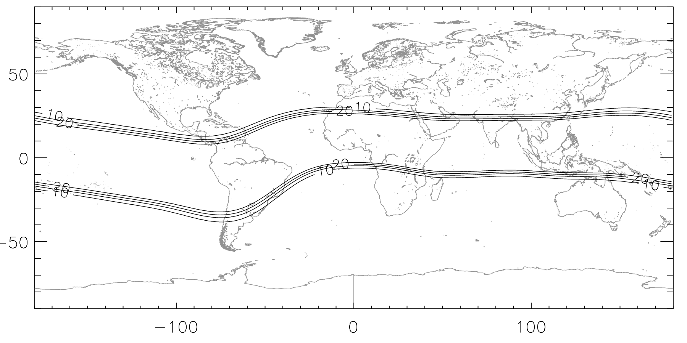

</div>

<p class="atbd-figure-caption"><span class="caption-number">Fig. 26</span><span class="caption-text"> — Global distribution of elongation parameter a. At low latitude its value is 30 and mid and high latitudes, its value is 8.</span></p>

:::

- b. Elongation parameter $a$ is calculated from its geomagnetic latitude by

$$
a=30-11(1+\operatorname{erf} (\frac{(\left\vert \phi_m \right\vert-\frac{\pi}{9})}{3})).
\tag{4.107}
$$ (eq:atbd-l1-sar-4-107)

- c. The elongation parameter $b$ is required near geomagnetic poles.
    - i. Geomagnetic poles are calculated by interpolating the pre-calculated geomagnetic pole positions provided through URL http://www.ngdc.noaa.gov/geomag/data/poles/WMM2020\_NP.xy and http://www.ngdc.noaa.gov/geomag/data/poles/WMM2020\_SP.xy
    - ii. Geomagnetic time $t_m$ is calculated from the subsolar point, satellite and pole positions. As the apparent time represents the angle at pole between sun and the location of interest, the geomagnetic time is the angle at geomagnetic pole. The longitude of the subsolar point is calculated from local time, and the latitude of that is approximated to be on equator. The angle between two planes indicates the geomagnetic time. The first plane bears the center of Earth and passes geomagnetic pole, scene center, with normal vector

$$
{\overrightarrow{n}}_1=\begin{pmatrix}
\sin{\lambda_m}\cos{\phi_m}\sin \phi-\sin{\phi_m}\sin \lambda\cos \phi \\
\sin{\phi_m}\cos \lambda\cos \phi-\cos{\lambda_m}\cos{\phi_m}\sin \phi \\
\cos \phi\cos{\phi_m}\sin (\lambda-\lambda_m)
\end{pmatrix}^T,
$$

and the second plane bears the subsolar point, geomagnetic pole, and the center of the Earth, with normal vector

$$
{\overrightarrow{n}}_2=\begin{pmatrix}
\sin{\lambda_m}\cos{\phi_m}\sin{\delta_{\text{☉}}}-\sin{\phi_m}\sin{\lambda_t}\cos{\delta_{\text{☉}}} \\
\sin{\phi_m}\cos{\lambda_t}\cos{\delta_{\text{☉}}}-\cos{\lambda_m}\cos{\phi_m}\sin{\delta_{\text{☉}}} \\
\cos{\delta_{\text{☉}}}\cos{\phi_m}\sin (\lambda_t-\lambda_m)
\end{pmatrix}^T,
$$

where $\lambda$ and $\lambda_m$ are the longitudes of point of interest and the geomagnetic pole, and $\phi$ and $\phi_m$ are the latitude of them, respectively. $\lambda_t=-\frac{\pi}{12}T_{GMT}+\pi$ is the longitude of the subsolar point and $\delta_{\text{☉}}$ is the latitude of subsolar point, or solar declination. Here $T_{GMT}$ is GMT time in unit of hour.

The sign of the inner-product between normal vector ${\overrightarrow{n}}_1$ and the subsolar point determines whether the geomagnetic time is before or after noon. The geomagnetic time becomes

$$
T_M=\angle({\overrightarrow{n}}_1\cdot{\widehat{n}}_2-i({\widehat{n}}_1\cdot\begin{pmatrix} \cos{\lambda_t}\cos{\delta_{\text{☉}}} & \sin{\lambda_t}\cos{\delta_{\text{☉}}} & \sin{\delta_{\text{☉}}} \end{pmatrix}^T))+\pi,.
\tag{4.108}
$$ (eq:atbd-l1-sar-4-108)

where ${\widehat{n}}_2=\frac{{\overrightarrow{n}}_2}{\left\vert {\overrightarrow{n}}_2 \right\vert}$ is unit vector of ${\overrightarrow{n}}_2$. The normalisation of ${\overrightarrow{n}}_1$ is optional, as its amplitude does not affect to the determination of geomagnetic time. $T_M$ varies between 0 and $2\pi$. To convert $T_M$ to 24-hour system, $12/\pi$ is multiplied.

The geometry of the equations is shown in figure below.

(fig:atbd-l1-sar-27)=
:::{div} atbd-mermaid-figure

<div class="atbd-figure-content">


</div>

<p class="atbd-figure-caption"><span class="caption-number">Fig. 27</span><span class="caption-text"> — The definition of geomagnetic time. It is defined by the angle between two planes, one defined by geomagnetic pole, point of interest and Earth’s center and the second by the geomagnetic pole, subsolar point and the Earth’s center. <span class="math notranslate nohighlight">\(t_s\)</span> is conventional solar time, and <span class="math notranslate nohighlight">\(t_m\)</span> is geomagnetic time.</span></p>

:::

- iii. As an intermediate parameter, the average invariant latitude $\phi_b$ is calculated.

$$
\phi_b=\frac{\pi}{180}(71.8-\frac{3}{2}K_p-\frac{11}{2}\cos (\frac{t_m-2}{12}\pi)).
\tag{4.109}
$$ (eq:atbd-l1-sar-4-109)

$K_p$ value of 3 is applied in the code. It determines where from which latitude the polar region starts.

- iv. Elongation parameter $b$ is calculated by

$$
b=1+\frac{3}{4}(1+\cos (\frac{t_m-2}{12}\pi))(1+\operatorname{erf} \frac{\phi_m-\phi_b}{\phi_h}),
\tag{4.110}
$$ (eq:atbd-l1-sar-4-110)

where $\phi_m$ is geomagnetic latitude, $\phi_h$ is standard deviation of the invariant boundary latitude of which value is set to be $\frac{\pi}{30}$.

Example of $b$ distribution is shown in figure below.

(fig:atbd-l1-sar-28)=
:::{div} atbd-mermaid-figure

<div class="atbd-figure-content">

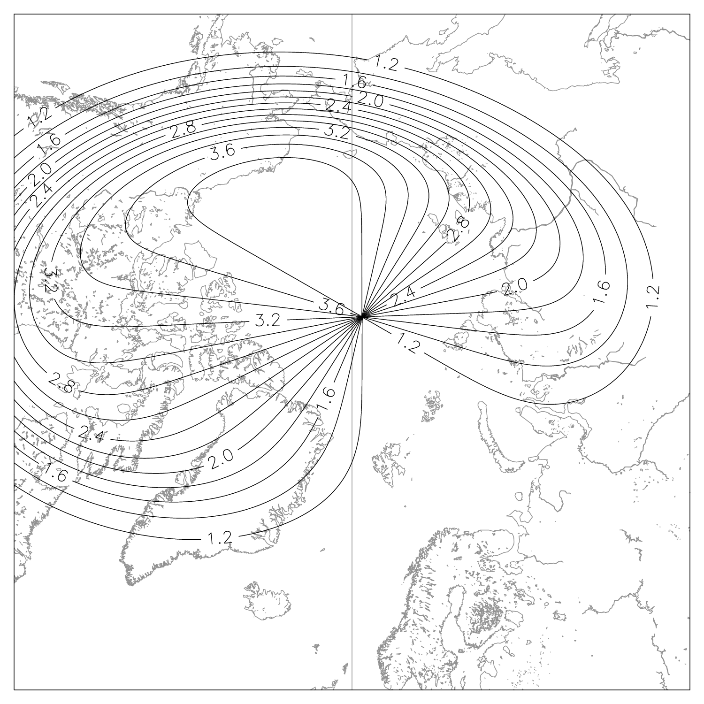

</div>

<p class="atbd-figure-caption"><span class="caption-number">Fig. 28</span><span class="caption-text"> — Distribution of elongation parameter <span class="math notranslate nohighlight">\(b\)</span> around the North Pole. The subsolar point is at the crossing point of the prime meridian and equator. The value of <span class="math notranslate nohighlight">\(b\)</span> is one, except for the polar night side where the value is four.</span></p>

:::

    - d. References for Step 2.b and 2.c are found at E.J.Fremouw and J.A.Secan, “Modeling and scientific application of Scintillation Results,” Radio Science, Vol. 19, No. 3, pp. 687—694, 1984.
2. Step 3: Calculation of directions of ellipse for the gaussian filter
    - a. The ellipsoid is defined on B-aligned coordinate, where the $x$-direction to be the vertical projection of the geomagnetic field onto horizontal plane, the $z$-direction to be vertical downward direction, and $y$-direction to cross-product of $z$- and $x$-direction. The ellipsoid is expressed as

(equation-eq-atbd-l1-sar-4-111)=
\begin{equation}
\left[ C \right]=\begin{pmatrix} \cos I & 0 & -\sin I \\ 0 & 1 & 0 \\ \sin I & 0 & \cos I \end{pmatrix}\begin{pmatrix} a^2 & 0 & 0 \\ 0 & b^2 & 0 \\ 0 & 0 & 1 \end{pmatrix}\begin{pmatrix} \cos I & 0 & \sin I \\ 0 & 1 & 0 \\ -\sin I & 0 & \cos I \end{pmatrix}=\begin{pmatrix} a^2\cos^2 I+\sin^2 I & 0 & a^2\sin^2 I+\cos^2 I \\ 0 & b^2 & 0 \\ a^2\sin^2 I+\cos^2 I & 0 & a^2\sin^2 I+\cos^2 I \end{pmatrix}.
\tag{4.111}
\end{equation}

Note here that the $y$-direction is opposite to the satellite forwarding direction in left-looking systems.

A scalar potential $f(x,\ y,\ z)$ defined as

$$
f(x,\ y,\ z)=\begin{pmatrix}
x & y & z
\end{pmatrix}\left[ C \right]\begin{pmatrix}
x & y & z
\end{pmatrix}^T=1
$$

has an ellipse of which major axis $\frac{1}{a}$, minor axis $\frac{1}{b}$, and the third axis length of 1. Its major axis is tilted as much as the geomagnetic dip angle $I$ on xz-plane from the horizontal direction. Note here that he minor axis is shorter than the major axis, i.e., $\frac{1}{a}<\frac{1}{b}$. It is because the ellipsoid in formula above describes the spectrum of the ellipsoids. They will be converted to the distance domain (Step 2.d) after its projection onto the horizontal plane (Step 2.b).

The geometry of the B-aligned coordinate is shown in figure below. The geomagnetic field $\overrightarrow{B}$, and its projection onto horizontal plane which aligns with the $x$-direction are demonstrated.

(fig:atbd-l1-sar-29)=
:::{div} atbd-mermaid-figure

<div class="atbd-figure-content">


</div>

<p class="atbd-figure-caption"><span class="caption-number">Fig. 29</span><span class="caption-text"> — Relation between the east-north and vertical coordinate and the B-aligned coordinate Here the geomagnetic field <span class="math notranslate nohighlight">\(\overrightarrow{B}\)</span> is assigned with declination <span class="math notranslate nohighlight">\(Dec\)</span> and inclination, or geomagnetic dip angle <span class="math notranslate nohighlight">\(I\)</span>. The direction of <span class="math notranslate nohighlight">\(x\)</span>-axis in the B-aligned coordinate is parallel to the projection of <span class="math notranslate nohighlight">\(\overrightarrow{B}\)</span> on the horizontal plane.</span></p>

:::

- b. The projection of ellipsoid along the propagation vector $\widehat{\kappa}$ onto horizontal plane is calculated as

(equation-eq-atbd-l1-sar-4-112)=
\begin{equation}
\begin{pmatrix} A & B/2 \\ B/2 & C \end{pmatrix}
\tag{4.112}
\end{equation}

where $A=C_{11}+C_{33}(\tan \theta\cos \phi)^2-2C_{13}\tan \theta\cos \phi$, $B/2=\ C_{12}+C_{33}(\tan \theta)^2\sin \phi\cos \phi-(C_{13}\sin \phi+C_{23}\cos \phi)\tan \theta$ and $C=C_{22}+C_{33}(\tan \theta\sin \phi)^2-2C_{23}\tan \theta\sin \phi$ .Here $\theta$ is incidence angle at the ionospheric altitude, and $\phi$ is the angle where the projection of the propagation vector $\widehat{\kappa}$ onto the horizontal plane forms with $x$-axis of B-aligned coordinate. Here the angle $\phi$ is irrelevant with that appears in Step 2. The angle $\theta$ is incidence angle. The projection of $\overrightarrow{B}$ along $\widehat{\kappa}$ is shown in figure above with red arrow, where $\widehat{\kappa}$ is plotted with downward green arrow.

- c. A rotated ellipse is expressed in a quadratic form.

(equation-eq-atbd-l1-sar-4-113)=
\begin{equation}
f(x,\ y)=\begin{pmatrix} x & y \end{pmatrix}\begin{pmatrix} A & B/2 \\ B/2 & C \end{pmatrix}\begin{pmatrix} x \\ y \end{pmatrix}=Ax^2+Bxy+Cy^2=1.
\tag{4.113}
\end{equation}

The major and minor axes of the ellipse and its orientation can be found by rotating the axes so that the off-diagonal term of the square matrix to be zero.

(equation-eq-atbd-l1-sar-4-114)=
\begin{equation}
f(x^{'},\ y^{'})=\begin{pmatrix} x^{'} & y^{'} \end{pmatrix}\begin{pmatrix} \cos \alpha & -\sin \alpha \\ \sin \alpha & \cos \alpha \end{pmatrix}\begin{pmatrix} A & \frac{B}{2} \\ \frac{B}{2} & C \end{pmatrix}\begin{pmatrix} \cos \alpha & \sin \alpha \\ -\sin \alpha & \cos \alpha \end{pmatrix}\begin{pmatrix} x^{'} \\ y^{'} \end{pmatrix}=1.
\tag{4.114}
\end{equation}

where the primed coordinates represent after rotation, so that the coordinate axes are aligned with the principal axes of the ellipse. The major and minor axis are found when the off-diagonal elements of the 2x2 square matrix becomes zeros.

(equation-eq-atbd-l1-sar-4-115)=
\begin{equation}
\begin{pmatrix} A\cos^2 \alpha+C\sin^2 \alpha+B\cos \alpha\sin \alpha & (A-C)\cos \alpha\sin \alpha+B(\cos^2 \alpha-\sin^2 \alpha)/2 \\ (A-C)\cos \alpha\sin \alpha+B(\cos^2 \alpha-\sin^2 \alpha)/2 & A\sin^2 \alpha+C\cos^2 \alpha+B\cos \alpha\sin \alpha \end{pmatrix}.
\tag{4.115}
\end{equation}

Applying trigonometric identities, the (1, 2)- and (2, 1)-element are

$$
(A-C)\sin{2\alpha}+B\cos{2\alpha}=\rho\sin (2\alpha+\delta),
\tag{4.116}
$$ (eq:atbd-l1-sar-4-116)

where $\rho\cos \delta=A-C$, $\rho\sin \delta=B$, for $\rho^2=(A-C)^2+B^2$. The off-diagonal term becomes zero when $\alpha=-\delta/2$.

Under such condition, the diagonal elements become

$$
\lambda_{\pm}=\frac{(A+C)\pm{}D}{2}
\tag{4.117}
$$ (eq:atbd-l1-sar-4-117)

where $D=\sqrt{(A-C)^2+B^2}$, and they are identical to the eigenvalues of the matrix $\begin{pmatrix}
A & B/2 \\
B/2 & C
\end{pmatrix}.$

The geometry of the rotated ellipse is shown in figure below.

(fig:atbd-l1-sar-30)=
:::{div} atbd-mermaid-figure

<div class="atbd-figure-content">

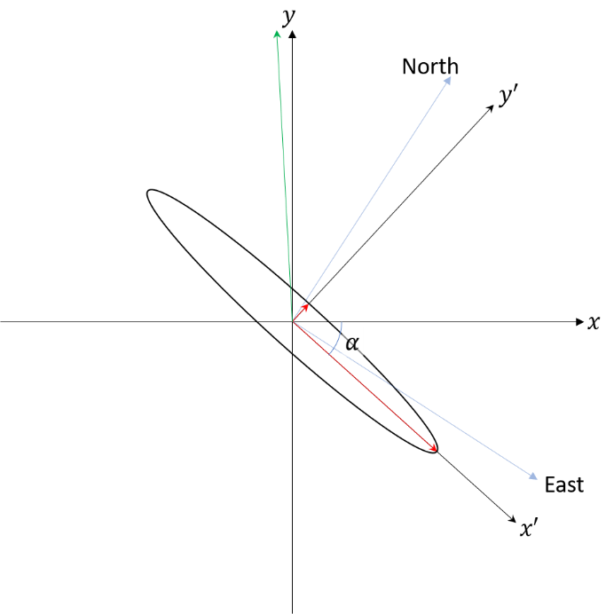

</div>

<p class="atbd-figure-caption"><span class="caption-number">Fig. 30</span><span class="caption-text"> — B-aligned axes <span class="math notranslate nohighlight">\(x\)</span> and <span class="math notranslate nohighlight">\(y\)</span>, and ellipse aligned axes <span class="math notranslate nohighlight">\(x'\)</span> and <span class="math notranslate nohighlight">\(y'\)</span>. The latter is acquired by rotating the former coordinate as much as <span class="math notranslate nohighlight">\(-\theta\)</span>. For information, east and north directions are shown. The green arrow indicates the range direction, or LOS.</span></p>

:::

- d. As these axes are calculated in the wavenumber domain, they are converted to distance domain by replacing the major and minor axes with their inverses. The resulting matrix is

(equation-eq-atbd-l1-sar-4-118)=
\begin{equation}
\begin{pmatrix} \cos \alpha & \sin \alpha \\ -\sin \alpha & \cos \alpha \end{pmatrix}\begin{pmatrix} \lambda_1^{-1} & 0 \\ 0 & \lambda_2^{-1} \end{pmatrix}\begin{pmatrix} \cos \alpha & -\sin \alpha \\ \sin \alpha & \cos \alpha \end{pmatrix}=\begin{pmatrix} \lambda_1^{-1}\cos^2 \alpha+\lambda_2^{-1}\sin^2 \alpha & -(\lambda_1^{-1}-\lambda_2^{-1})\cos \alpha\sin \alpha \\ -(\lambda_1^{-1}-\lambda_2^{-1})\cos \alpha\sin \alpha & \lambda_2^{-1}\cos^2 \alpha+\lambda_1^{-1}\sin^2 \alpha \end{pmatrix}.
\tag{4.118}
\end{equation}

Because $\alpha=-\delta/2$ and $\rho\cos \delta=A-C$, $\rho\sin \delta=B$, we have the replacements of $\cos^2 \alpha=\frac{1}{2}(1+\cos \delta)=\frac{1}{2}(1+\frac{A-C}{D})$, $\sin^2 \theta=\frac{1}{2}(1-\cos \delta)=\frac{1}{2}(1-\frac{A-C}{D})$, and $\sin \alpha\cos \alpha=\frac{1}{2}\sin{2\alpha}=-\frac{1}{2}\sin \delta=-\frac{B}{2D}$.

The quadratic form of matrix in distance domain becomes

(equation-eq-atbd-l1-sar-4-119)=
\begin{equation}
\begin{pmatrix} A' & B'/2 \\ B'/2 & C' \end{pmatrix}=\begin{pmatrix} \frac{\lambda_1^{-1}+\lambda_1^{-1}}{2}+\frac{\lambda_1^{-1}-\lambda_1^{-1}}{2}\ \frac{A-C}{D} & (\lambda_1^{-1}-\lambda_2^{-1})\frac{B}{2D} \\ (\lambda_1^{-1}-\lambda_2^{-1})\frac{B}{2D} & \frac{\lambda_1^{-1}+\lambda_1^{-1}}{2}-\frac{\lambda_1^{-1}-\lambda_1^{-1}}{2}\ \frac{A-C}{D} \end{pmatrix}
\tag{4.119}
\end{equation}

- e. The quadratic form is rotated into the range-azimuth coordinate. The range direction component of the geomagnetic field is $\overrightarrow{B}\cdot{\widehat{e}}_{rg}$, and the azimuth direction component is $\overrightarrow{B}\cdot{\widehat{e}}_{az}$, where ${\widehat{e}}_{rg}$ and ${\widehat{e}}_{az}$ are the unit vectors parallel to the LOS direction projected onto the horizontal plane, and the azimuth direction unit vector, respectively. The rotation angle is calculated by $\theta_r=\angle(\overrightarrow{B}\cdot{\widehat{e}}_{rg}+i\overrightarrow{B}\cdot{\widehat{e}}_{az})$. Once rotation angle is calculated, the quadratic form on the range-azimuth coordinate becomes

(equation-eq-atbd-l1-sar-4-120)=
\begin{equation}
\begin{pmatrix} A^{'}\cos^2{\theta_r}+B^{'}\cos{\theta_r}\sin{\theta_r}+C'\sin^2{\theta_r} & (A^{'}-C')\sin{2\theta_r}-B^{'}\cos{2\theta_r} \\ (A^{'}-C')\sin{2\theta_r}-B^{'}\cos{2\theta_r} & A^{'}\sin^2{\theta_r}+B^{'}\cos{\theta_r}\sin{\theta_r}+C'\cos^2{\theta_r} \end{pmatrix}
\tag{4.120}
\end{equation}

- f. The quadratic form is rescaled to the ground. The scaling factor is a function of the ionospheric height. At first, the satellite height $h_{sat}$ is calculated from the satellite position. The scaling factor is $r=\frac{h_{sat}}{(h_{sat}-h_{iono})}$. The quadratic form is updated to

(equation-eq-atbd-l1-sar-4-121)=
\begin{equation}
\begin{pmatrix} (\frac{A^{'}}{r^2})\cos^2{\theta_r}+(\frac{B^{'}}{r})\cos{\theta_r}\sin{\theta_r}+C\sin^2{\theta_r} & ((\frac{A^{'}}{r^2})-C')\sin{2\theta_r}-(\frac{B^{'}}{r})\cos{2\theta_r} \\ ((\frac{A^{'}}{r^2})-C')\sin{2\theta_r}-(\frac{B^{'}}{r})\cos{2\theta_r} & (\frac{A^{'}}{r^2})\sin^2{\theta_r}+(\frac{B^{'}}{r})\cos{\theta_r}\sin{\theta_r}+C\cos^2{\theta_r} \end{pmatrix}
\tag{4.121}
\end{equation}

The geometry of rescaling onto the ground is shown in figure below.

(fig:atbd-l1-sar-31)=
:::{div} atbd-mermaid-figure

<div class="atbd-figure-content">


</div>

<p class="atbd-figure-caption"><span class="caption-number">Fig. 31</span><span class="caption-text"> — Geometry of rescaling to the ground. Due to the imaging geometry of SAR, the misalignments of the ionospheric feature at the ionospheric height exaggerated on SAR image (left side). Its effect on the ellipse is shown on the right side. The rescaling is associated also with additional rotation.</span></p>

:::

- g. Finally, the quadratic form is rescaled one more time to be ready applied on the SAR data. For that the quadratic form is rescaled in accordance with range and azimuth sampling. The range and azimuth pixel spacings are $\delta_{rg}$ and $\delta_{az}$. The quadratic form becomes

(equation-eq-atbd-l1-sar-4-122)=
\begin{equation}
\begin{pmatrix}
A'' & \frac{B''}{2} \\
\frac{B''}{2} & C''
\end{pmatrix},
\tag{4.122}
\end{equation}

where

$$
\begin{aligned}
A^{''}=(\frac{A^{'}\delta_{rg}^2}{r^2})\cos^2{\theta_r}+(\frac{B^{'}\delta_{rg}\delta_{az}}{r})\cos{\theta_r}\sin{\theta_r}+C\delta_{az}^2\sin^2{\theta_r} \\
\frac{B^{''}}{2}=((\frac{A^{'}\delta_{rg}^2}{r^2})-C'\delta_{az}^2)\sin{2\theta_r}-(\frac{B^{'}\delta_{rg}\delta_{az}}{r})\cos{2\theta_r} \\
C^{''}=(\frac{A^{'}\delta_{rg}^2}{r^2})\sin^2{\theta_r}+(\frac{B^{'}\delta_{rg}\delta_{az}}{r})\cos{\theta_r}\sin{\theta_r}+C\delta_{az}^2\cos^2{\theta_r}
\end{aligned}
$$

- h. Now the major and the minor axis, as well as, the rotation angle of the ellipse is calculated. It is similar process as Step 3.c. The major and the minor axes, $m_j$ and $m_n$, respectively, are

$$
m_j,\ m_n=\frac{\sqrt{2}}{\sqrt{(A^{''}+C'')\mp\sqrt{(A^{''}-C'')^2-B^{''2}}}}
\tag{4.123}
$$ (eq:atbd-l1-sar-4-123)

and the rotation angle is

$$
\theta^{'}=\frac{\pi}{2}+\frac{1}{2}\angle((A^{''}-C'')+iB'')
\tag{4.124}
$$ (eq:atbd-l1-sar-4-124)

3. Step 4: Determination of size of filter
    - a. SNR is calculated from the polarimetric coherence. It is calculated from the SAR data.

$$
\gamma_{pol}=\frac{\left\langle S_{lr}\cdot{}S_{rl}^* \right\rangle}{\sqrt{\left\langle S_{lr}\cdot{}S_{lr}^* \right\rangle}\sqrt{\left\langle S_{rl}\cdot{}S_{rl}^* \right\rangle}}
\tag{4.125}
$$ (eq:atbd-l1-sar-4-125)

for this calculation, one does not need to compensate for the Faraday rotation. In the estimation window size of a few hundreds to thousands looks, FR is safe to be regarded invariant. $S_{lr}$ and $S_{rl}$ are calculated from four linear basis SLCs by

(equation-eq-atbd-l1-sar-4-126)=
\begin{equation}
\begin{aligned}
S_{lr}=\frac{1}{2}(-(S_{hv}-S_{vh})+i(S_{hh}+S_{vv})) \\
S_{rl}=\frac{1}{2}((S_{hv}-S_{vh})+i(S_{hh}+S_{vv})).
\end{aligned}
\tag{4.126}
\end{equation}

The SNR is

$$
SNR=\frac{\gamma_{pol}}{1-\gamma_{pol}}
\tag{4.127}
$$ (eq:atbd-l1-sar-4-127)

SNR is calculated for down-sampled SLC. Resolution can be adjusted on demand.

- b. FR-to-phase conversion factor $k$ is calculated.

$$
k=\frac{4\pi{}mf}{e\overrightarrow{B}\cdot\widehat{\kappa}},
\tag{4.128}
$$ (eq:atbd-l1-sar-4-128)

where $m$ and $e$ are electron mass and charge, respectively, $f$ is carrier frequency. The allowed maximal ionospheric phase $\phi_{\max}$ is

$$
\phi_{\max}=k\Omega_{\max}.
\tag{4.129}
$$ (eq:atbd-l1-sar-4-129)

- c. Required number of looks is calculated from the Cramer-Rao bound.

$$
\sigma_{\Omega}=\frac{1}{4}\frac{\sqrt{1-\gamma_{pol}^2}}{\sqrt{2\gamma_{pol}^2N}}.
\tag{4.130}
$$ (eq:atbd-l1-sar-4-130)

The number of look required is determined by setting the deviation of the FR does not go over the required phase deviation, i.e., $\sigma_{\Omega}\geq\Omega_{\max}=\frac{\phi_{\max}}{k}$. Required number of looks is

$$
N_{req}=\frac{1-\gamma_{pol}^2}{32\gamma^2\sigma_{\Omega}^2}\geq\frac{1-\gamma_{pol}^2}{32\gamma^2\phi_{\max}^2}k^2.
\tag{4.131}
$$ (eq:atbd-l1-sar-4-131)

Here $\gamma_{pol}$ is a mean value through the scene, and calculated from the SNR by

$$
\gamma_{pol}=\frac{SNR}{1+SNR}.
\tag{4.132}
$$ (eq:atbd-l1-sar-4-132)

- d. The major axis and minor axis are rescaled to the required number of looks. The area of the ellipse should be the same with $N_{req}$, i.e.,

$$
\pi{}m_j^{'}m_n^{'}=N_{req},
\tag{4.133}
$$ (eq:atbd-l1-sar-4-133)

where $m_j^{'}=Rm_j$ and $m_n^{'}=Rm_n$ for a constant $R$. Such $R$ is

$$
R=\sqrt{\frac{N_{req}}{\pi{}m_jm_n}}.
\tag{4.134}
$$ (eq:atbd-l1-sar-4-134)

- e. Quadratic form is updated to

(equation-eq-atbd-l1-sar-4-135)=
\begin{equation}
\begin{pmatrix} \mathcal{A} & \mathcal{B}/2 \\ \mathcal{B}/2 & \mathcal{C} \end{pmatrix}=\begin{pmatrix} (\frac{\cos{\theta'}}{m_j^{'}})^2+(\frac{\sin{\theta'}}{m_n^{'}})^2 & {\sin{2\theta}}^{'}(\frac{1}{m_j^{'2}}+\frac{1}{m_n^{'2}}) \\ {\sin{2\theta}}^{'}(\frac{1}{m_j^{'2}}+\frac{1}{m_n^{'2}}) & (\frac{\sin{\theta'}}{m_j^{'}})^2+(\frac{\cos{\theta'}}{m_n^{'}})^2 \end{pmatrix}.
\tag{4.135}
\end{equation}

- f. In order to add further space where the Gaussian filter to damp, a buffer is added. Its range direction buffer is calculated by

$$
B_{rg}=3\sqrt{(m_j^{'}\cos{\theta^{'}})^2+(m_n^{'}\sin{\theta'})^2},
\tag{4.136}
$$ (eq:atbd-l1-sar-4-136)

and azimuth direction buffer is

$$
B_{az}=3\sqrt{(m_j^{'}\sin{\theta'})^2+(m_n^{'}\cos{\theta^{'}})^2},
\tag{4.137}
$$ (eq:atbd-l1-sar-4-137)

- g. Build kernel for gaussian filter. A 2-D array size of $2B_{rg}$×$2B_{az}$ is generated. Its x-axis is indexed from $-B_{rg}$ to $B_{rg}$ and y-axis from $-B_{az}$ to $B_{az}$. The filter kernel is

$$
Q'=\exp (-(\mathcal{A}x^2\mathcal{+B}xy+\mathcal{C}y^2))
\tag{4.138}
$$ (eq:atbd-l1-sar-4-138)

- h. Nest $Q'$ into a wider 2-D array of which range and azimuth extents are the smallest power of 2 larger than the sum of number of range pixels in scene and $2B_{rg}$, and the sum of the number of azimuth pixels of the scene and $2B_{az}$, respectively.

```{note}
When the number of looks needed to achieve the requested phase accuracy performance is larger than the number of samples of the input image, the size of the filter is limited to the one of the image.
```

(sec:atbd-l1-sar-4-10-6)=
#### 4.10.6 The IRI Model

**Algorithm overview and rationale**

The IRI model is used as a back-up solution to retrieve the ionospheric height when the data-based algorithms failed to retrieve it.

Since April 2005 International Reference Ionosphere (IRI) is the official International Standardization Organization (ISO) standard of the ionospheric model. Among its wide applications, the BPS L1 Processor uses IRI for the estimation of ionospheric height whenever the data-based algorithms implemented failed to retrieve it (see {sec}`4.10.2.3`). Note that the ionospheric height is one of the most difficult ionospheric parameters to be retrieved from the SAR data.

There are three models for the global evaluation of the ionospheric height, `hmF2`: AMTB2013, SHU-2015, and BSE-1979. The default `hmF2` estimator of IRI is AMTB-2013 model {rd}`32`. The Fortran 77 code IRISUB.FOR calls the ionospheric height estimation SHAMDHM2() subroutine at line 1383. The subroutine SHAMDHMF2() is defined in IRIFUN.FOR from line 5214 to 5413. The coefficients for the calculation are hardcoded in the routine. The ionospheric height is calculated from latitude, longitude, month of year, and the 12-month running mean of sun spot number, Rz12.

The SHAMDHMF2() estimates `hmF2` by the sum of two components: the Rz12-dependent and the independent components. Both are calculated from their own set of spherical harmonic coefficients. The Rz12 dependent part is responsible for the modeling the change of `hmF2` depending on the solar cycle. The seasonal dependency of the `fmF2` is realized in the subroutine SCHNEVPDH(), which is called at the last step of SHAMDHMF2 routine.

The current implementation in the BPS L1 Processor wraps the Fortran code. The Fortran core part reads the Rz12 index the from `ig_rz.dat` file. This file is read by calling the subroutine read\_ig\_rz() defined in IRFUN.FOR. File can be found at http://irimodel.org/indices/ig\_rz.dat (latest update: Sep. 30th, 2021).

The `ig_rz.dat` is comprised of four parts. The first line indicates the time of update. The second line indicates the time of the first and last month in the table. The following two blocks as number arrays are ionospheric index (IG) and Rz. The time span presented includes also the projections into the future. Because the estimation of Rz12 for the current moment requires the prediction of nearest future 6 months, the `ig_rz.dat` provides not only the provisional Rz of recent past months, but also the future values. In a very lazy sense, the update of the `ig_rz.dat` should be no later than the final moment of the data interval shown in the second part of the file.

In the IRI homepage (https://irimodel.org/), two sources of `ig_rz.dat` are presented. Another source that the `get_model.py` accesses (twice-a-year update period), is the Radio and Space Physics Laboratory, Canada, that provides daily update of monthly Rz values under URL https://chain-new.chain-project.net/echaim\_downloads/ig\_rz.dat. The comparison with IRI version, the disagreement of Rz values start from 2021 January.

The computation of the ionosphere height through the IRI model is performed by L1 Processor evaluating it in correspondence of the scene centre. The scene centre is computed starting from extracted RAW data, i.e. output of L1 Pre-Processing step, and computing its mid-range mid azimuth position (NOTE: before computing mid-range position, chirp length is subtracted from range extent). Note that, even if the implementation of the IRI model wrapper is performed in a different way in BIOMASS L1 GPP, the same approach for the ionosphere height computation is used, ensuring results equivalence.

(sec:atbd-l1-sar-4-11)=
### 4.11 Autofocus

Due to its dispersive character, the background ionosphere does not introduce defocussing in the SAR images, i.e., exploiting defocusing we will only be sensitive to the spatial gradients of the phase delays within the synthetic aperture, the so-called scintillations, but not to the bulk ones. Autofocus algorithms estimate residual phase errors by optimising the apparent contrast of point-like and extended targets in SAR images.

Autofocus has been extensively used in the past for the refinement of orbit ephemeris, the estimation of residual motion errors of airborne platforms, or any other kind of phase errors {rd}`1` {rd}`3` {rd}`4` {rd}`5` {rd}`6` {rd}`7` {rd}`8` {rd}`9`. Depending on the nature of targets on which they operate, autofocus algorithms can be separated in two main classes: a) the phase gradient approaches use point-like targets of opportunity, and b) the map-drift approaches use the contrast of extended areas.

Autofocus algorithms have been mainly used for the recovery of 1-D errors, and far less experience is available for the recovery from defocussing maps of 2-D phase errors as the ones expected from scintillations. Hence, the implementation and tuning of the algorithms in a robust manner is expected to pose a major challenge on the BIOMASS ground segment. The proposed, consolidated approach is based on the usage of the map-drift autofocus, which can be exploited with both point targets and distributed scatterers, where in the latter case the contrast in the scene plays a critical role. The approach is expounded in detail in the following section.

(sec:atbd-l1-sar-4-11-1)=
#### 4.11.1 Map drift autofocus

**Algorithm overview and rationale**

MDA does not only exploit the availability of point-like targets in the image, but also extended areas showing better contrast with improving focusing, which implies an improvement of MDA with respect to PGA in terms of robustness, and suggests a better suitability for the incorporation in an operational environment. The MDA works block-wise across the image and the rationale is based on measuring 2D second derivatives maps of the local variation of the phase error along the azimuth direction, and globally integrating them into high resolution phase screen maps. The azimuth and range step of the grid will be given by the block dimensions and an overlapping factor.

For each block, two azimuth sub-looks are generated by applying two non-overlapping low and high pass filters in the frequency domain. In the absence of a quadratic phase error, the two amplitude images of the two sub-looks would be aligned on top of each other but if a quadratic phase error the two sub-looks will be shifted in azimuth. The shifting in azimuth, $\Delta{}a$, can be directly related to the second derivative of the local phase error. This is consistent with the idea that block size is chosen so that it can be assumed that the second derivative is constant across the block (that acts as an averaging filter). The efficiency of the MDA depends on the accuracy of the $\Delta{}a$ measurements. $\Delta{}a$ is calculated at sub-pixel level by means of incoherent cross-correlation of the two amplitude images of the sub-looks, and a fine but efficient zero-padding interpolation around the cross-correlation peak.

Errors in the measurement of $\Delta{}a$ develop into random walks during the integration that might introduce unwanted defocusing during the correction step. We try to damp the random walks by performing the integration in a WLS framework. We combine the second derivative maps from the four SLCs given from the polarimetric channels with external information available, like the lower resolution absolute estimation of the FR. Like this the integration is better bounded.

The accuracy of the $\Delta{}a$ estimation depends not only on the contrast in the amplitude images but in the content inside the blocks. For example, it has been seen around cities and mountainous areas, “elongated” or periodic structures produce multiple and/or degraded (less sharp) cross-correlation peaks. Designing a reliable outlier rejection approach that would work in all possible scenarios is not a trivial task. That is why it is decided to work with an WLS integrator that combines all information available and gives less weight to less reliable measurements. The weights are defined as follow:

- The variance of the absolute phase estimated from the FR angle, $\phi_{FR}$.
- The variance of the second derivative at each block is the variance in a 3x3 window around it (assuming that the errors in each block the blocks are uncorrelated with respect to the surrounding ones).

The correction of the ionospheric phase screen estimated by autofocus is performed as described in {sec}`Section|4.10.3.5`, i.e., by compressing to the ionospheric height estimated with feature tracking (see {sec}`Section|4.10.2.3.1`), applying the correction as a phase multiplication, and then compressing again. All this can be done iteratively. In our case we (i) accumulate the measured shifts $\Delta{}a$ during the iterations (to keep the consistency with the absolute phase extracted from the FR) and (ii) always correct the original image to avoid introducing errors due to integrated random walks in the correction step.

As quality indicators of the estimator and convergence we propose:

- The covariance of the error derived from the WLS system.
- With the reasonable assumption that the phase screen is stationary, the variance is a characteristic of the power spectrum. Experience has shown that if convergent solution is to be found, the variance of the integrated phase screen converges. Divergence of this value with iterations hints to a non-convergent solution.

**Inputs**

| Symbol | Name | Origin | Size | Variability | Default | Description |
|---|---|---|---|---|---|---|
| - | SLC ionospheric corrected | Ionospheric calibration step | (Nrg-Nchirp+1) x N’az array of complex values | - | - | Ionospheric corrected azimuth compressed data Intermediate product: iSLC\_iono\_corrected |
| $\overrightarrow{B}$ | Geomagnetic field | `AUX_GMF` (`AUX_FMT`) | 2D array of real values | updated regularly (several years between updates) | - | Geomagnetic field model |
| $N$ | `mapDriftAzimuthSubBands` | `AUX_PP1` (`AUX_FMT`) | scalar value | - | - | Number of azimuth sub-bands for map-drift autofocus |
| - | `mapDriftCorrelationWindowWidth` | `AUX_PP1` (`AUX_FMT`) | scalar value | - | - | Width of amplitude correlation window for map-drift autofocus |
| - | `mapDriftCorrelationWindowHeight` | `AUX_PP1` (`AUX_FMT`) | scalar value | - | - | Height of amplitude correlation window for map-drift autofocus |
| - | `mapDriftRangeCorrelationWindows` | `AUX_PP1` (`AUX_FMT`) | scalar value | - | - | Number of amplitude correlation windows in range for map-drift autofocus |
| - | `mapDriftAzimuthCorrelationWindows` | `AUX_PP1` (`AUX_FMT`) | scalar value | - | - | Number of amplitude correlation windows in azimuth for map-drift autofocus |
| - | `maxValidShift` | `AUX_PP1` (`AUX_FMT`) | scalar value | - | - | Maximum allowed shift between sub-looks (map-drift autofocus) in order to consider the measurement as valid. If the measurement is larger than the threshold, the estimation for that block will be considered invalid |
| - | `validBlocksPercentage` | `AUX_PP1` (`AUX_FMT`) | scalar value | - | - | Minimum normalized percentage of blocks within the image that need to have estimated an azimuth shift smaller than the `maxValidShift` threshold. If the minimum percentage is not met, no correction based on the azimuth shift estimates will be applied |

**Outputs**

| Symbol | Name | Destination | Size | Variability | Default | Description |
|---|---|---|---|---|---|---|
| - | SLC autofocused | Multilooking step | (Nrg-Nchirp+1) x N’az array of complex values | - | - | Azimuth compressed data after autofocus Intermediate product: iSLC\_af\_corrected |
| $\phi_k$ | Ionospheric phase | L1 post-processing step | (Nrg-Nchirp+1) x N’az array of real values | - | - | Autofocus phase error estimates (or second derivative) Intermediate product: `iPhaseScreenAF` |
| $M$ | Covariance matrix | L1 post-processing step | (Nrg-Nchirp+1) x N’az array of real values | - | - | Covariance matrix of WLS system |

**Algorithm description**

The figure below depicts the processing steps for the estimation of the phase screen due to scintillations using the MDA approach.

(fig:atbd-l1-sar-32)=
:::{div} atbd-mermaid-figure

<div class="atbd-figure-content">

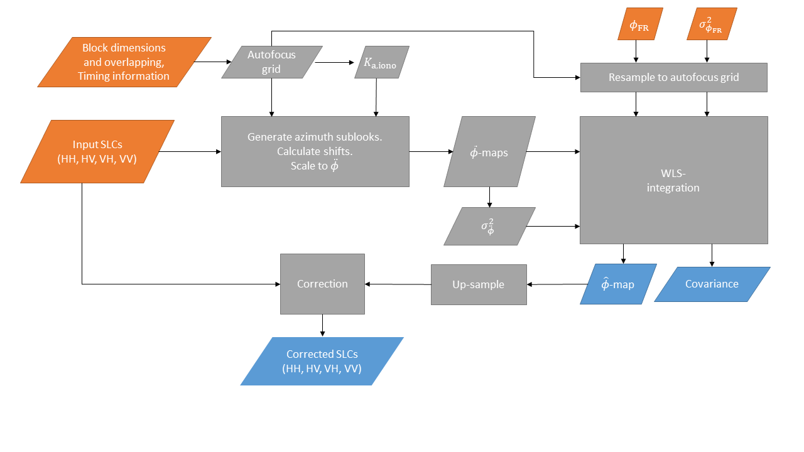

</div>

<p class="atbd-figure-caption"><span class="caption-number">Fig. 32</span><span class="caption-text"> — Block diagram of MDA to estimate the phase screen due to ionospheric scintillations.</span></p>

:::

To build the WLS system that integrates the 2D phase screen different elements are needed. Note that for this global integration to be possible, all 2D measurement maps are first flattened and the results is reshaped to the original autofocus grid shape.

A weight matrix

$$
\overline{\overline{W}}=\mathbf{diag}(\frac{1}{{\overrightarrow{\sigma}}^2}),
\tag{4.139}
$$ (eq:atbd-l1-sar-4-139)

which is a diagonal matrix with

$$
{\overrightarrow{\sigma}}^2=\left[ {\overrightarrow{\sigma}}_{\ddot{\phi},\ HH}^2,\ {\overrightarrow{\sigma}}_{\ddot{\phi},\ HV}^2,\ {\overrightarrow{\sigma}}_{\ddot{\phi},\ VH}^2,\ {\overrightarrow{\sigma}}_{\ddot{\phi},\ VV}^2,{\overrightarrow{\sigma}}_{\phi,\ FR}^2\ \right]^T
\tag{4.140}
$$ (eq:atbd-l1-sar-4-140)

contains the variances of all measurements put into the system.

A matrix $\overline{\overline{L}}$ with the derivative operator is used to generate the matrix $\overline{\overline{LL}}=\ \overline{\overline{L}}\cdot\overline{\overline{L}}$ which corresponds to the second derivative.

Since the WLS system combines independent measurements, a matrix $\overline{\overline{A}}$ is built by stacking the different linear transformation operators: one $\overline{\overline{LL}}$ for each polarisation and one identity matrix since the low-resolution estimate of $\phi_{FR}$ is already absolute:

(equation-eq-atbd-l1-sar-4-141)=
\begin{equation}
\overline{\overline{A}}=\left[ \begin{aligned} \overline{\overline{LL}} \\ \overline{\overline{LL}} \\ \overline{\overline{LL}} \\ \overline{\overline{LL}} \\ \overline{\overline{I}} \end{aligned} \right]
\tag{4.141}
\end{equation}

Now it is possible to build a WLS system that from the observations,

$$
\overrightarrow{b}=\left[ {\ddot{\overrightarrow{\phi}}}_{HH},\ {\ddot{\overrightarrow{\phi}}}_{HV},\ {\ddot{\overrightarrow{\phi}}}_{VH},\ {\ddot{\overrightarrow{\phi}}}_{VV},\ {\overrightarrow{\phi}}_{FR} \right]^T,
\tag{4.142}
$$ (eq:atbd-l1-sar-4-142)

gets an estimate of the phase,  $\widehat{\overrightarrow{\phi}}$, as:

$$
\widehat{\overrightarrow{\phi}}=({\overline{\overline{A}}}^T\overline{\overline{W}}\overline{\overline{A}})^{-1}{\overline{\overline{A}}}^T\overline{\overline{W}}\overrightarrow{b}
\tag{4.143}
$$ (eq:atbd-l1-sar-4-143)

$\widehat{\overrightarrow{\phi}}$ has to be reshaped to the size of the autofocus grid. The covariance of error is the reshaped diagonal of

$$
M=\ ({\overline{\overline{A}}}^T\overline{\overline{W}}\overline{\overline{A}})^{-1}
\tag{4.144}
$$ (eq:atbd-l1-sar-4-144)

Block diagram above depicts the processing steps for the estimation of the phase screen due to scintillations using the MDA approach and image correction. The steps of the algorithm are listed below:

1. With the block dimensions and overlap calculate the block centres (autofocus grid)
2. Use the timing and geometry information to calculate the Doppler rate at ionospheric height.
3. Import the low-resolution phase screen estimated from the FR,$\ \phi_{FR}$, and calculate the corresponding scaled to phase accuracy, $\sigma_{\phi_{FR}}^2$, and resample it to the autofocus grid to be used in  ${\overrightarrow{\sigma}}^2$. The variance of the FR angle is extracted as the square of {eq}`4.69` and the scaling factor between FR angle and phase is

$$
C_{\Omega\ }^{\phi}=\ \frac{4\cdot{}\pi\cdot{}m\cdot{}f}{e\cdot(\overrightarrow{B}\cdot\widehat{k})}.
\tag{4.145}
$$ (eq:atbd-l1-sar-4-145)

4. For each SLC block-wise generate azimuth sub-looks and calculate shift between them. The shift is compared to maximum allowed one (configurable parameter) to check its validity. If the number of invalid shifts computed exceed the given threshold (configurable parameters), no correction based on azimuth shift estimates is applied.
5. Use the Doppler rate at ionospheric height to scale the shifts to second derivative maps with

$$
\ddot{\phi}(t_{\widehat{a}})=\ \frac{4\cdot{}\pi\cdot{}K_{a,iono}^2}{B_a^2\cdot(1+aosf)}\cdot\Delta{}a,
\tag{4.146}
$$ (eq:atbd-l1-sar-4-146)

where $K_{a,iono}$ is the Doppler rate at the ionospheric layer and $aosf$ is the oversampling factor in azimuth. The sampling of new azimuth time vector $t_{\widehat{a}}$ corresponds to the step of the autofocus grid in the azimuth direction. The flattened second derivative maps can be put into (4.142).

6. Apply a variance running window (3x3) to estimate the accuracy of the second derivative maps, $\sigma_{\ddot{\phi},\ (HH,\ HV,\ VH,\ VV)}^2$ to be used in  ${\overrightarrow{\sigma}}^2$.
7. Integrate altogether with a WLS using {eq}`4.143` to obtain the estimated phase screen,  $\widehat{\phi}$ (sampled at the autofocus grid).
8. Extract the covariance of the error with (4.144).
9. Upsample the estimated phase screen to the SLC sampling with a linear interpolation.
10. Correct the SLC as described in {sec}`Section|4.10.3.5`.

For an iterative operation repeat from step 4, with the modifications described in the “Algorithm Overview and Rationale”.

**ALOS-2 Example**

The figure in {sec}`4.11.2` shows the example of azimuth sub-band estimates to the reconstruction of TEC performed on an ALOS-2 PALSAR-2 data. On the left, the azimuth sub-band shifts after weighted average of different degrees is shown. The azimuth sub-band estimates are aligned to the geomagnetic field line, and the outliers and the deviations of individual estimates supresses after averaging. The profile of azimuth shift is averaged along the geomagnetic field line and shown at right top, and at the right bottom, the TEC calculated by integrating the azimuth sub-band shift is shown. It is possible to generate 2D phase screen from the TEC profile and correct the residual phase and error of focusing position.

(sec:atbd-l1-sar-4-11-2)=
#### 4.11.2 Correction

The correction of the ionospheric phase screen estimated by autofocus is performed as described in {sec}`4.10.3.5`, i.e., by compressing to the ionospheric height estimated with feature tracking (see {sec}`4.10.2.3.1`), applying the correction as a phase multiplication, and then compressing again.

(fig:atbd-l1-sar-33)=
:::{div} atbd-mermaid-figure

<div class="atbd-figure-content">


</div>

<p class="atbd-figure-caption"><span class="caption-number">Fig. 33</span><span class="caption-text"> — (Left) Example of azimuth sub-band shift estimation (after weighted averaging of different degrees) estimated from ALOS-2 data overlaid with the geomagnetic field line calculated at 300 km. (Right top) Averaged profile along the geomagnetic field line. (Right bottom) TEC profile acquired by integrating azimuth sub-band shifts</span></p>

:::

(sec:atbd-l1-sar-4-12)=
### 4.12 Multilooking

**Algorithm overview and rationale**

The Multilooking step is performed on single look complex data, both in range and azimuth directions, exploiting a frequency domain approach.

The main steps of the algorithm are represented in the following figure and described in detail below.

(fig:atbd-l1-sar-34)=
:::{div} atbd-mermaid-figure

<div class="atbd-figure-content">

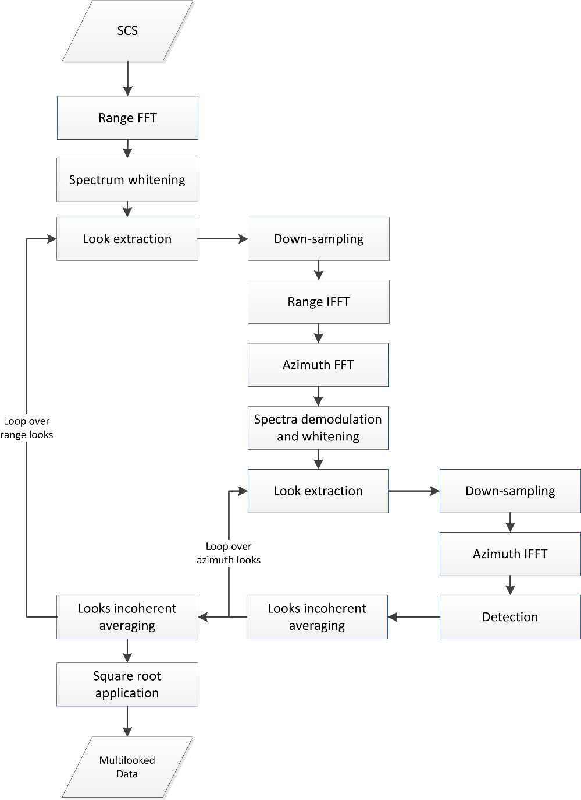

</div>

<p class="atbd-figure-caption"><span class="caption-number">Fig. 34</span><span class="caption-text"> — Block diagram of the Multilook step.</span></p>

:::

**Inputs**

| Symbol | Name | Origin | Size | Variability | Default | Description |
|---|---|---|---|---|---|---|
| $SCS$ | SLC | Autofocus step | (Nrg-Nchirp+1) x N’az array of complex values | - | - | Single-look complex azimuth compressed and calibrated data Intermediate product: iSLC\_iono\_corrected |
| - | `rangeProcessingParametersList` \> `windowType`, `windowCoefficient`, `lookBandwidth`, `numberOfLooks`, `lookCentralFrequencies`, `upsamplingFactor`, `downsamplingFactor` | `AUX_PP1` (`AUX_FMT`) | string + 5 scalar values + array of real values | - | depends on swath | Range multi-looking parameters (window type, window coefficient, look bandwidth, number of looks, looks central frequencies, upsampling and downsampling factors) |
| - | `azimuthProcessingParametersList` \> `windowType`, `windowCoefficient`, `lookBandwidth`, `numberOfLooks`, `lookCentralFrequencies`, `upsamplingFactor`, `downsamplingFactor` | `AUX_PP1` (`AUX_FMT`) | string + 5 scalar values + array of real values | - | depends on swath | Azimuth multi-looking parameters (window type, window coefficient, look bandwidth, number of looks, looks central frequencies, upsampling and downsampling factors) |

**Outputs**

| Symbol | Name | Destination | Size | Variability | Default | Description |
|---|---|---|---|---|---|---|
| $ML$ | ML | Denoising step | N’’rg x N’’az array of real values | - | - | Multi-look detected data Intermediate product: iSRD |

**Mathematical description**

Specific variables:

- $l_r,l_a$: generic range and azimuth looks (respectively);
- $L_r,\ L_a$: number of range and azimuth looks (respectively).

The main steps of the algorithm are:

1. the input data is transformed in range direction;
2. the range spectrum is flattened, removing any shaping applied during previous processing steps (i.e. the weighting window applied during the range compression step), in order to obtain looks all with the same energy;
3. range looks are extracted through opportune sub-bands filtering, implemented as multiplication of the spectrum by pre-defined overlapping windows (e.g. Hamming), as depicted in the following figure. Through dedicated configuration parameters it is possible to define the desired number of looks, look bandwidths and look central frequencies, determining in this way the amount of overlap between them. The produced looks are uncorrelated if the spectral bands do not overlap, otherwise the looks are partially correlated;

(fig:atbd-l1-sar-35)=
:::{div} atbd-mermaid-figure

<div class="atbd-figure-content">

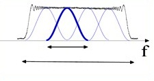

</div>

<p class="atbd-figure-caption"><span class="caption-number">Fig. 35</span><span class="caption-text"> — Spectrum partition into 4 overlapping looks shaped with Hamming windows.</span></p>

:::

4. for each range look:
    - a. the data is down-sampled directly in frequency domain by shortening the filtered spectrum vector according to the desired output sampling frequency, ensuring that a minimum up-sampling factor of 2 is present to avoid aliasing when performing the detection operation;
    - b. the data is then inverse transformed along range direction;
    - c. the data is transformed in azimuth direction;
    - d. the azimuth spectrum is demodulated for the Doppler Centroid frequency and flattened, removing any shaping applied during previous processing steps (i.e. the weighting window applied during the azimuth compression step), in order to obtain looks all with the same energy;
    - e. azimuth looks are extracted and down-sampled, as already done for range direction;
    - f. the data is then inverse transformed along azimuth direction;
    - g. the intensity values of each look are extracted and averaged:

$$
ML(l_r)=\sqrt{\frac{\sum_{l_a=1}^{L_a}{\left\vert SCS(l_r,l_a) \right\vert^2}}{L_a}}
\tag{4.147}
$$ (eq:atbd-l1-sar-4-147)

5. the same averaging is performed also on all the range looks. Then, the square root of the data is computed in order to obtain the final amplitude values:

$$
ML=\sqrt{\frac{\sum_{l_r=1}^{L_r}{ML^2(l_r)}}{L_r}}
\tag{4.148}
$$ (eq:atbd-l1-sar-4-148)

(sec:atbd-l1-sar-4-13)=
### 4.13 Denoising

**Algorithm overview and rationale**

The denoising step is aimed at removing from the SAR data the undesired additive contribution due to thermal noise, which during the processing chain is shaped by all the radiometric corrections applied by the processor.

The main steps of the algorithm are represented in the following figure and described in detail below.

(fig:atbd-l1-sar-36)=
:::{div} atbd-mermaid-figure

<div class="atbd-figure-content">

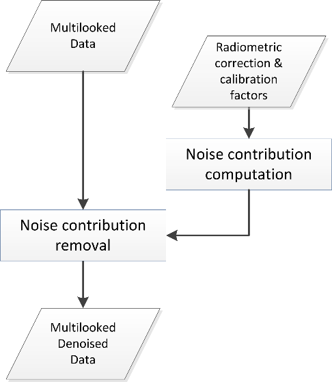

</div>

<p class="atbd-figure-caption"><span class="caption-number">Fig. 36</span><span class="caption-text"> — Block diagram of the Denoising step.</span></p>

:::

**Inputs**

| Symbol | Name | Origin | Size | Variability | Default | Description |
|---|---|---|---|---|---|---|
| ${ML}_n$ | ML | Multilooking step | N’’rg x N’’az array of real values | - | - | Multi-look detected data Intermediate product: iSRD |
| $\sigma_{noise}^2$ | Noise power | Internal calibration parameters retrieval step | 2 Nrg,ic x 1 arrays of real values | - | - | Estimated noise power for the given receive polarization and preample/postamble Intermediate product: `iEstNoise` |
| $G_{CH}$ | Chirp replica | RAW data extraction step / Internal calibration pars retrieval step / `AUX_INS` (`AUX_FMT`) | Nchirp x 1 array of complex values | - | - | Chirp function used in range compression step Intermediate product: `iChirp` (if derived from internal calibration) |
| $G_{AP}$ | Antenna pattern combined | Antenna patter compensation step | arrays of complex values | - | - | 2D antenna pattern after combination |
| $\frac{G_{SF}\bullet{}G_{AC}}{G_{SL}}$ | Radiometric correction factors | Radiometric corrections and calibration step | (Nrg-Nchirp+1) x N’az array of real values | - | - | Radiometric corrections applied during processing (i.e., spread-loss factor, processing scaling factor and absolute calibration constant) |
| $k_{noise}$ | `noiseGainList` | `AUX_PP1` (`AUX_FMT`) | scalar value | - | - | Noise calibration factor to be applied multiplicatively to the denoising vectors (one value per polarization) |

**Outputs**

| Symbol | Name | Destination | Size | Variability | Default | Description |
|---|---|---|---|---|---|---|
| ${ML}_d$ | ML denoised | Ground projection step | N’’rg x N’’az array of real values | - | - | Multi-look detected and denoised data Intermediate product: iSRD\_denoised |
| $I_{noise}$ | Denoising vectors | L1 post-processing step | N’’rg x N’’az array of real values | - | - | Denoising vectors Intermediate product: iSLC\_nesz\_map |

**Mathematical description**

The algorithm is organized in two main steps:

1. the derivation of the noise contribution, starting from the noise power measurements performed during Internal Calibration Parameters Computation step (see {sec}`3.3.7`) and from the radiometric correction and calibration factors applied by the processor (see {sec}`4.6` and {sec}`4.8`);
2. the subtraction of the noise contribution from the SAR detected image.

Moreover, it is based on the following model of the SAR signal after L1a processing:

$$
SCS(\tau,t)=\left[ signal(\tau,t)+noise(\tau,t) \right]\bullet\frac{G_{CH}(t)}{G_{AP}(\tau,t)\bullet{}G_{SL}(\tau,t)}\bullet{}G_{SF}\bullet{}G_{AC}
\tag{4.149}
$$ (eq:atbd-l1-sar-4-149)

where:

- $G_{CH}$ is the calibrated chirp amplitude used during Range Compression step (see {sec}`4.2.1`);
- $G_{AP}$ is the elevation antenna pattern gain at Doppler zero, provided in output by the antenna patter compensation step (see {sec}`4.6`);
- $G_{SL}$ is the spread-loss factor (see {sec}`4.8`);
- $G_{SF}$ is the processing scaling factor (see {sec}`4.8` and {sec}`4.15`);
- $G_{AC}$ is the absolute calibration constant (see {sec}`4.8`).

With these assumptions, the noise contribution (intensity) is computed as:

$$
I_{noise}(\tau,t)=k_{noise}\bullet\sigma_{noise}^2(t)\bullet\left\vert \frac{G_{CH}(t)}{G_{AP}(\tau,t)\bullet{}G_{SL}(\tau,t)}\bullet{}G_{SF}\bullet{}G_{AC} \right\vert^2
\tag{4.150}
$$ (eq:atbd-l1-sar-4-150)

where $\sigma_{noise}^2$ is the noise power measurement derived from internal calibration packets (see {sec}`3.3.7`), linearly interpolated along azimuth direction and then shaped by all the radiometric corrections applied during processing, while $k_{noise}$ is the calibration factor, provided via configuration and polarization dependent. This value compensates for both the difference in the processing scaling factor for signal and noise components (see {sec}`4.15`) and for any other scale factor to perform noise power bit-to-Watt conversion.

The denoised data (${ML}_d$, where d stands for “denoised”) is then obtained starting from the data in output from the multilooking step applying the following correction:

$$
{ML}_d(\tau,t)=\sqrt{{{ML}_n(\tau,t)}^2-I_{noise}(\tau,t)}
\tag{4.151}
$$ (eq:atbd-l1-sar-4-151)

Ideally, the denoising step applied to images where the backscatter contribution is negligible w.r.t. noise one (e.g., calm sea) results in null images. Due to several inaccuracies (not perfect knowledge of noise power, processing non idealities, non-perfect calibration, etc.) it is possible to have negative values. In these cases, the approach is to apply a clipping to 0 (zero) of negative values after noise subtraction and before taking the square root.

(sec:atbd-l1-sar-4-14)=
### 4.14 Ground Projection

**Algorithm overview and rationale**

The Ground-range Projection step performs a mono-dimensional interpolation of the input multilooked data in order to get an image equally spaced in ground-range position over the WGS84 ellipsoid.

**Inputs**

| Symbol | Name | Origin | Size | Variability | Default | Description |
|---|---|---|---|---|---|---|
| - | ML denoised | Denoising step | N’’rg x N’’az array of real values | - | - | Multi-look detected and denoised data Intermediate product: iSRD\_denoised |
| - | `rangePixelSpacing` | `AUX_PP1` (`AUX_FMT`) | scalar value | - | 25 | Pixel spacing between ground range samples [m] |
| - | `filterType` | `AUX_PP1` (`AUX_FMT`) | string | - | GLS | Type of filters used for ground range projection (FIR, SINC, GLS) |
| - | `filterBandwidth` | `AUX_PP1` (`AUX_FMT`) | scalar value | - | 6000000 | Filter bandwidth [Hz] |
| - | `filterLength` | `AUX_PP1` (`AUX_FMT`) | scalar value | - | 21 | Filter length (in samples) |
| - | `numberOfFilters` | `AUX_PP1` (`AUX_FMT`) | scalar value | - | 101 | Number of filters in the bank |

**Outputs**

| Symbol | Name | Destination | Size | Variability | Default | Description |
|---|---|---|---|---|---|---|
| - | GRD | L1 post-processing step | N’’’rg x N’’az array of real values | - | - | Multi-look detected, denoised and ground-projected data Intermediate product: iGRD |

**Mathematical description**

The algorithm is composed of three main steps:

1. ground-to-slant polynomials retrieval:
    - a. the input regular slant range time axis ($\tau$) is converted into ground coordinates axis ($x,y,z$) through a direct geocoding operation over the WGS84 ellipsoid (see {sec}`3.5`);
    - b. an irregular distances axis ($d$) is derived from ground coordinates axis computing the distances between consecutive ground points ($\overrightarrow{p_i}$) and conventionally setting the first sample to 0[m]:

$$
d_i=d_{i-1}+\left\Vert \overrightarrow{p_i}-\overrightarrow{p_{i-1}} \right\Vert
\tag{4.152}
$$ (eq:atbd-l1-sar-4-152)

- c. a regular ground range distances axis is computed, going from 0[m] to the last value of the axis computed at step b;
- d. step c axis is converted into ground coordinates through step a axis coordinates linear interpolation. This is is equivalent to approximate the observed Earth surface curve to a broken line, inducing a negligible error if the considered ground step is small;
- e. an irregular slant range time axis is computed through an inverse geocoding operation applied on the step d axis (see {sec}`3.5`);
- f. using regular ground range and irregular slant range axes a polynomial fitting is performed to retrieve the ground-to-slant polynomial coefficients. The polynomial fitting allows to invert the ground range projection procedure. In the output L1b products both slant-to-ground and ground-to-slant polynomials are annotated;

(fig:atbd-l1-sar-37)=
:::{div} atbd-mermaid-figure

<div class="atbd-figure-content">

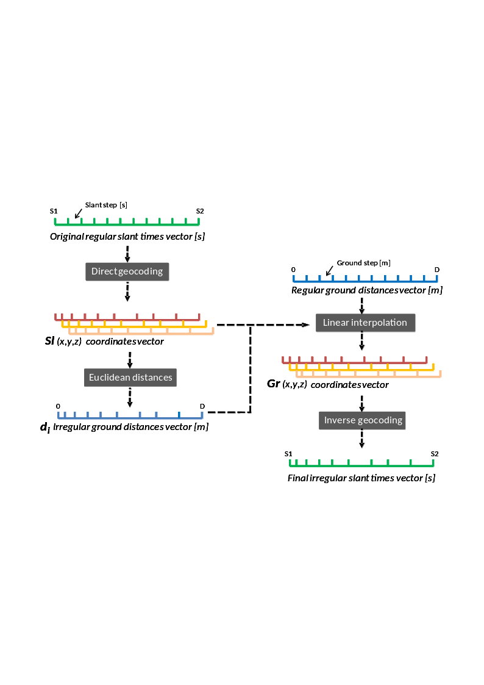

</div>

<p class="atbd-figure-caption"><span class="caption-number">Fig. 37</span><span class="caption-text"> — Ground-to-slant polynomials retrieval.</span></p>

:::

2. irregular slant range time axis re-definition, applying the previously computed polynomial to the regular ground range distance axis;
3. data interpolation from the original regular slant range time axis onto the newly re-defined irregular slant range axis, exploiting a configurable filter bank (e.g., Generalized Least Square (GLS) filters) (see {sec}`6.2`).

(sec:atbd-l1-sar-4-15)=
### 4.15 Processor Normalization

**Algorithm overview and rationale**

The proper processor normalization is a mandatory step to ensure that no undesired gains are introduced during SAR data processing and that the focused data can be correctly calibrated. L1 Processor proper normalization is ensured also in the case that configuration parameters are updated by the end user. The way this process is implemented and the opportune limitations to be taken into account are described in this section.

**Mathematical description**

The radiometric normalization process implemented in the L1 Processor is based on two main assumptions, i.e.:

- the spectral characteristics (sampling frequency, bandwidth and shape, white noise added) of the input SAR RAW data are known;
- the processing transfer function (processing bandwidth, windowing parameters, …) is known.

At real time, the processor uses all these parameters to compute the gain introduced by each processing step and compensate for it, allowing the preservation at the output the same power level of the input (power balance). This operation for a generic processing step is depicted in the following figure and formula: the compensated gain is equal to the input/output power ratio, computed exploiting the power spectral density models of the input signal and of the step transfer function. It is important to note that the normalization process is not based on measures performed on the processed data, in order to avoid any data-dependency. In addition, it is in any case possible to set through configuration an additional delta factor to compensate for, e.g., calibration and characterization gains.

(fig:atbd-l1-sar-38)=
:::{div} atbd-mermaid-figure

<div class="atbd-figure-content">

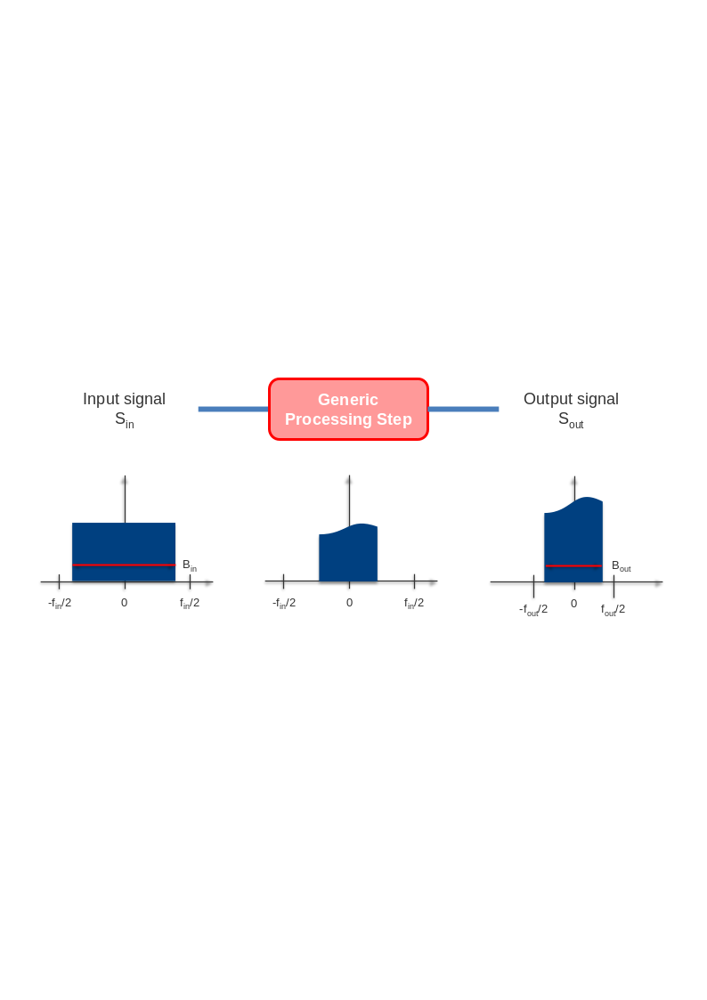

</div>

<p class="atbd-figure-caption"><span class="caption-number">Fig. 38</span><span class="caption-text"> — Generic processing step radiometric normalization process.</span></p>

:::

$$
G=\frac{\int_{-B_{out}/2}^{+B_{out}/2}{(S_{in}(f)\bullet{}H(f))^2df}}{\int_{-B_{in}/2}^{+B_{in}/2}{{S_{in}(f)}^2df}}
\tag{4.153}
$$ (eq:atbd-l1-sar-4-153)

The proper normalization is ensured also if the processing parameters are updated by the end user, with some limitations. In particular:

- the configuration parameters that can be changed without impacting the processor overall normalization are:
    - range and azimuth processing bandwidths;
    - range and azimuth spectral windows parameters (coefficient, bandwidth);
    - azimuth spectrum whitening;
- the configuration parameters that cannot be changed without impacting the processor overall normalization are:
    - Internal Calibration parameters, supposed activated to remove anomalies present in the data;
    - Antenna Patterns, supposed to be the ones with which the data has been acquired (it is assumed that the input data is shaped by the antenna patterns provided in configuration);
    - radiometric correction factors (Range Spread Loss, …), supposed activated to compensate for radiometric effects due to instrument or geometry.

In addition, considering that the SAR RAW data has two main components, i.e., signal and thermal noise ones, and that these present different spectral characteristics, two different processing gains are needed, as shown in the following figure. While the gains computed for the signal component are applied throughout the processing chain, the ones for the noise component are used by the processor during the denoising step in order to properly calibrate the correction applied to the data.

(fig:atbd-l1-sar-39)=
:::{div} atbd-mermaid-figure

<div class="atbd-figure-content">

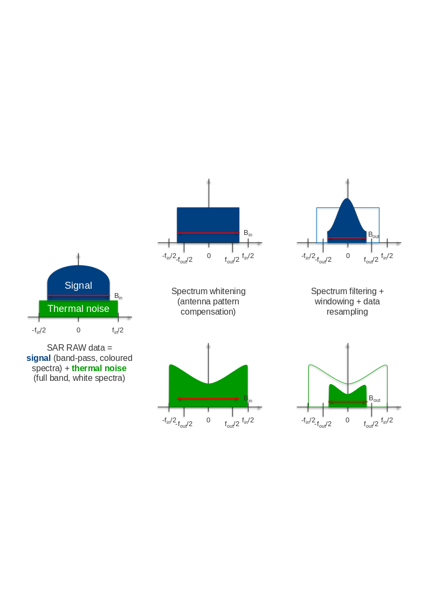

</div>

<p class="atbd-figure-caption"><span class="caption-number">Fig. 39</span><span class="caption-text"> — Impacts on SAR data signal and noise components of the processing transfer function.</span></p>

:::
