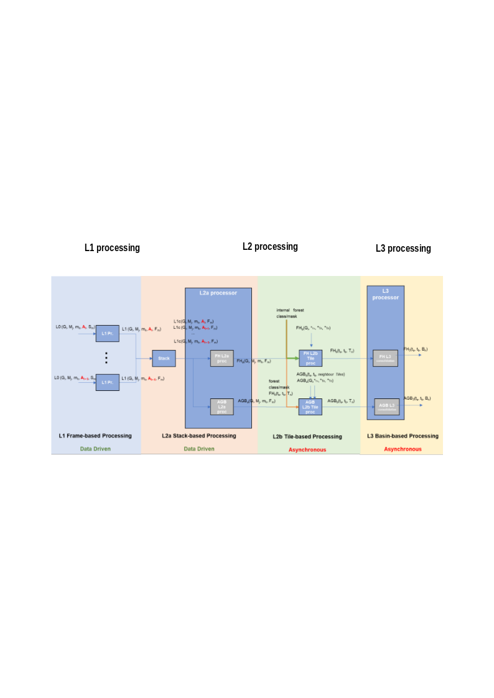
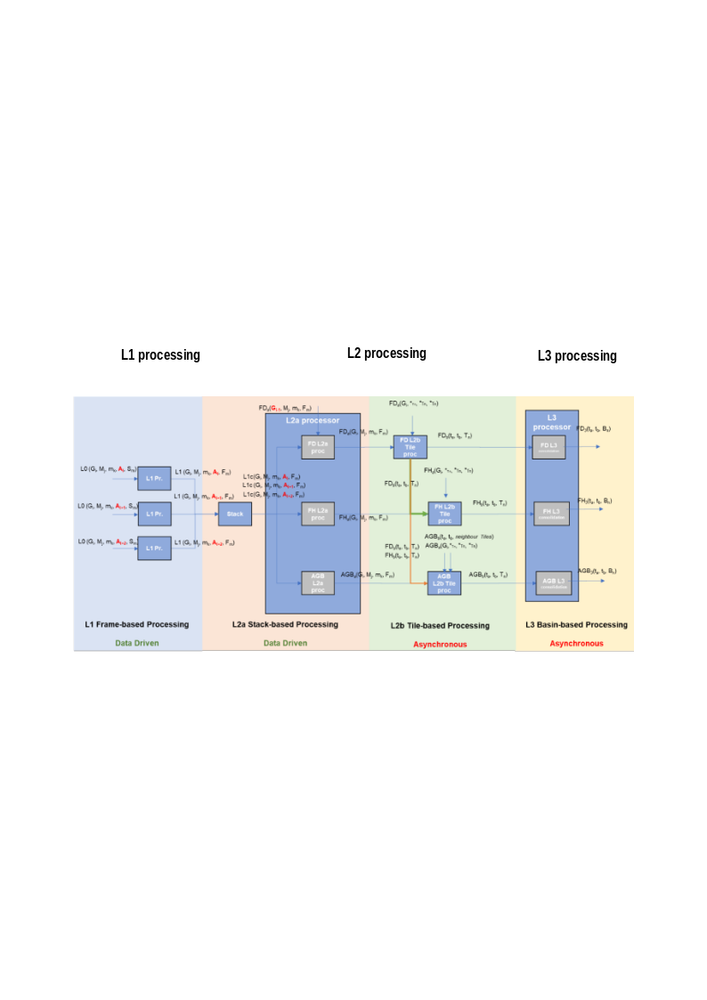
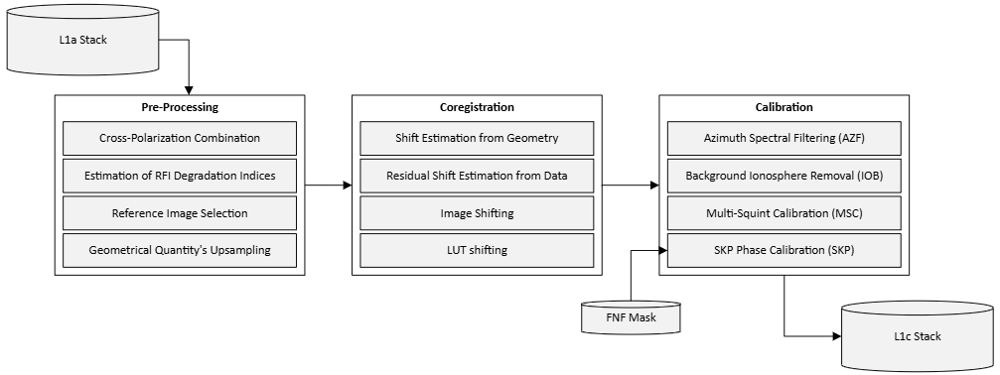

<!-- SPDX-FileCopyrightText: 2026 European Space Agency (ESA) -->
<!-- SPDX-License-Identifier: Apache-2.0 -->

:::{atbd-logo-banner}
:::

(sec:atbd-l1-stack-2)=
# 2. BPS and Stack Processor Overview

(sec:atbd-l1-stack-2-1)=
### 2.1 BPS Overview

The BIOMASS Processing Suite (BPS) is in charge of processing BIOMASS Level-0 data up to Level-3, generating a wide set of products. Product generation scheme is depicted in the following two figures respectively for TOM phase and for INT phase. The processing foresees the following steps:

- L1 processing: the BIOMASS image formation step, taking in input 1 L0 slice and generating in output $N\geq1$ L1 frames;
- Stack Processing: the coregistration and stacking processing step that will define the required 7-images Tomographic stacks or the 3-images Interferometric stacks. It includes the stack calibration phase;
- L2a Processing: processing step for each stack that provides the inputs to the further products Tile Generation performed by the L2b processors. For one global cycle the number of stacks varies mainly with latitude, approximately from a minimum of two at the Equator (ascending/descending) to about six at higher latitudes (three ascending/descending pairs);
- L2b Processing: processing that aggregates all the stack-based L2a products insisting on the same location on ground (Tile) in the same time interval and generates a single BIOMASS L2b product. A different number of stacks may be available for each DGG tile, based on tile dimensions and swath coverage (which is not related to DGG tiling pattern);
- L3 Processing: consolidation processing removing discontinuities in L2b products.

(fig:atbd-l1-stack-1)=
:::{div} atbd-mermaid-figure

Fig. 1 — Biomass high-level processing scheme from L0 data to L3 products, TOM phase.

:::

(fig:atbd-l1-stack-2)=
:::{div} atbd-mermaid-figure

Fig. 2 — Biomass high-level processing scheme from L0 data to L3 products, INT phase.

:::

(sec:atbd-l1-stack-2-2)=
### 2.2 Overview

The Stack Processor has as its main goal the generation of stacks ready to be used by the L2 Processor. It receives as input a stack of BIOMASS Level-1a images (SCS stack), including its relevant annotated data (e.g., the ionosphere screen estimated exploring Faraday Rotation). The Stack Processor performs the coregistration of the stack, as well as its calibration:

- stacking, i.e., the alignment of the individual images, which will be done via a two-step approach for coregistration;
- calibration, i.e., the coregistered stack and input ionospheric phase screens delivered by the L1 Processor are fed to the calibration module which will use multi-baseline techniques to compute refined ionospheric screens and baseline errors. The stack is calibrated by removing the estimated errors. The block can also perform the Sum of Kronecker Products (SKP) calibration to deliver information required for the generation of tomography-ready stacks to the L2 Processor {rd}`3`.

Other operations, like the generation of Digital Elevation Model (DEM) and Digital Terrain Model (DTM) are outside the scope of BPS.

(sec:atbd-l1-stack-2-3)=
### 2.3 Stack Processor’s Workflow and Algorithmic Overview

The main steps of the BPS Stack Processor workflow are depicted in the following figure and described in detail in the following sub-sections.

(fig:atbd-l1-stack-3)=
:::{div} atbd-mermaid-figure

Fig. 3 — Stack Processor detailed workflow. The AUX_PPS is omitted from the figure since it is an input to each step of the Stack Processor.

:::

(sec:atbd-l1-stack-2-3-1)=
#### 2.3.1 Pre-processing

The Pre-processing block prepares and packs the data needed by the next blocks (Stacking and Calibration). The main steps of the Pre-processor are the following:

- Computation of RFI coherence degradation: Computation of the RFI masking impact on the InSAR coherence.
- Polarization combination (if enabled): The cross-polarizations of the L1a product are possibly averaged (cross-pol merging) or selectively dropped (i.e. keep only HV or VH) in a single image, the associated LUTs are respectively merged or dropped.
- Coregistration primary image selection: Selection of the most appropriate image for being utilized as reference image for coregistration . For this, the Pre-processor will employ quality indicators of the L1 stack and/or coverage information.
- Upsampling of geometric quantities stored in the L1a input products’s LUTs to match the resolution of the SCS.

(sec:atbd-l1-stack-2-3-2)=
#### 2.3.2 Stacking

The main steps of the Stacking block are:

- Geometry-based estimation of coregistration shifts.
- Residual offset estimation: Further estimation of residual coregistration shifts that may be due to imprecise information on the satellite’s orbit, as well as ionospheric artefacts that affect the input data;
- Image and LUT interpolation: Coregistration shifts are applied to input data and LUTs to align them to the primary image grid.

(sec:atbd-l1-stack-2-3-3)=
#### 2.3.3 Calibration

The Calibration block consists of the following steps:

- Azimuth spectral filtering: Apply a common band filtering in azimuth direction to crop the data spectrum to the azimuth common bandwidth.
- Slow-varying ionosphere estimation: A Multi-baseline split-spectrum-based method that estimates and removes from data low-pass ionospheric artefacts
- Baseline and residual fast-varying ionosphere correction: A Multi-Squint-based (MS) approach that estimates and corrects baseline errors and residual high-pass ionospheric artefacts from the image.
- Phase calibration by SKP: A module for estimating and possibly removing ground steering phase-screens required to generate tomography-ready stacks {rd}`3`. By default, the SKP phases will be estimated but not applied. The SKP phase removal can be activated by configuration.
