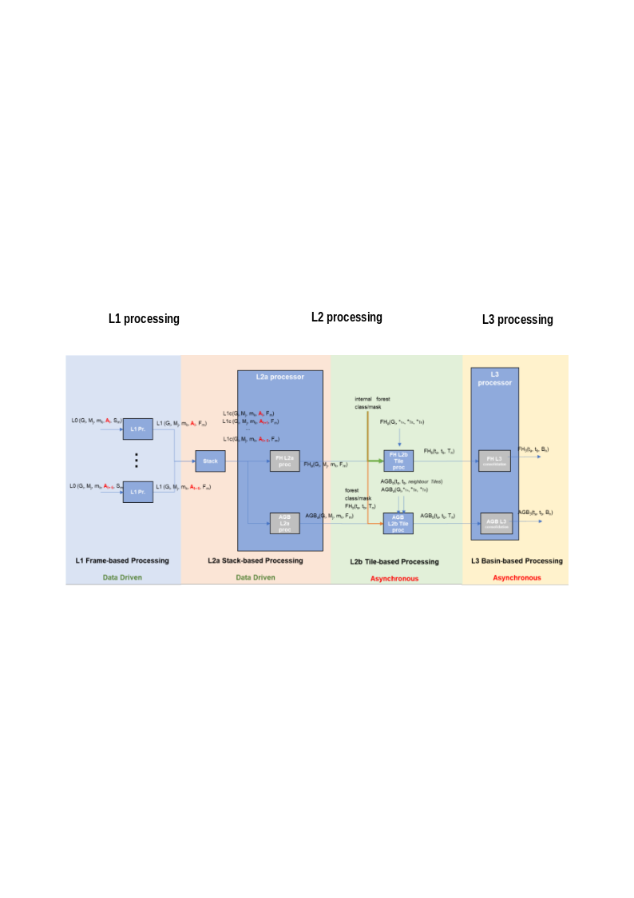
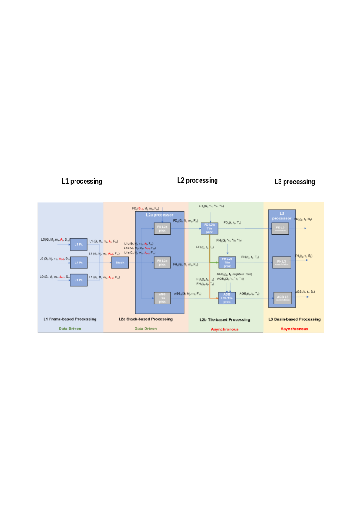
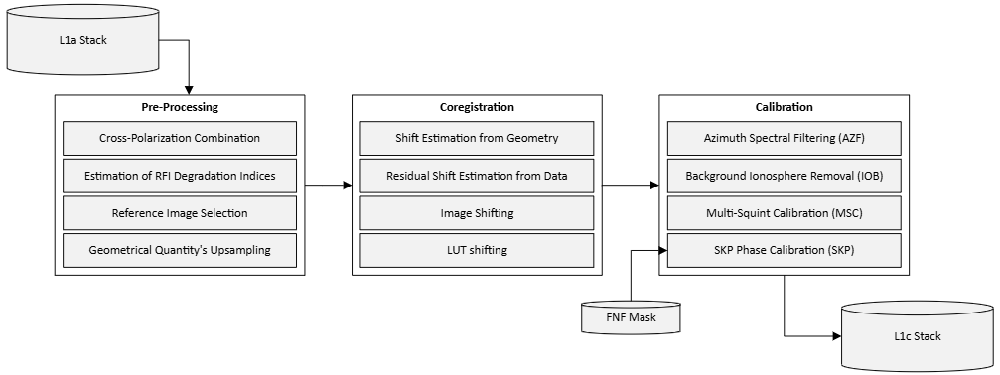

<!-- SPDX-FileCopyrightText: 2026 European Space Agency (ESA) -->
<!-- SPDX-License-Identifier: Apache-2.0 -->

:::{atbd-logo-banner}
:::


(sec:atbd-l1-stack-2)=
# 2. BPS and Stack Processor Overview

(sec:atbd-l1-stack-2-1)=
### 2.1 BPS Overview

The BIOMASS Processing Suite (BPS) is in charge of processing BIOMASS Level-0 data up to Level-3, generating a wide set of products. Product generation scheme is depicted in the following two figures respectively for TOM phase and for INT phase. The processing foresees the following steps:

- L1 processing: the BIOMASS image formation step, taking in input 1 L0 slice and generating in output $N\geq1$ L1 frames;
- Stack Processing: the coregistration and stacking processing step that will define the required 7-images Tomographic stacks or the 3-images Interferometric stacks. It includes the stack calibration phase;
- L2a Processing: processing step for each stack that provides the inputs to the further products Tile Generation performed by the L2b processors. For one global cycle the number of stacks varies mainly with latitude, approximately from a minimum of two at the Equator (ascending/descending) to about six at higher latitudes (three ascending/descending pairs);
- L2b Processing: processing that aggregates all the stack-based L2a products insisting on the same location on ground (Tile) in the same time interval and generates a single BIOMASS L2b product. A different number of stacks may be available for each DGG tile, based on tile dimensions and swath coverage (which is not related to DGG tiling pattern);
- L3 Processing: consolidation processing removing discontinuities in L2b products.

(fig:atbd-l1-stack-1)=
::::{div} atbd-mermaid-figure atbd-drawn-figure

<div class="atbd-figure-content">

```{mermaid}
%%{init: {"theme": "default", "layout": "elk", "elk": {"nodePlacementStrategy": "NETWORK_SIMPLEX"}, "flowchart": {"diagramPadding": 4, "subGraphTitleMargin": {"top": 2, "bottom": 2}}}}%%
flowchart TB
  accTitle: Biomass high-level processing scheme from L0 data to L3 products, TOM phase.
  accDescr: Three stages, L1, L2 and L3 processing, in four lanes drawn side by side from left to right in the original and here from top to bottom. L1 Frame-based Processing (Data Driven): each L0 frame (G_i, M_j, m_k, A_l, S_m) up to A_l+6 goes through an L1 Pr. step, giving L1 (G_i, M_j, m_k, A_l, F_m) to A_l+6. L2a Stack-based Processing (Data Driven): the L1 frames are stacked; the stack, L1c(G_i, M_j, m_k, A_l, F_m) to A_l+6, feeds the FH L2a proc and AGB L2a proc steps of the L2a processor. L2b Tile-based Processing (Asynchronous): FH_a(G_i, M_j, m_k, F_m) and FH_a(G_i, *Tn, *Tn, *Tn) feed the FH L2b Tile proc, which also takes the internal forest class/mask; AGB_a(G_i, M_j, m_k, F_m), AGB_b(t_a, t_b, neighbour Tiles), AGB_a(G_i, *Tn, *Tn, *Tn) and the forest class/mask with FH_b(t_a, t_b, T_n) feed the AGB L2b Tile proc. L3 Basin-based Processing (Asynchronous): FH_b(t_a, t_b, T_n) and AGB_b(t_a, t_b, T_n) go to the FH L3 and AGB L3 consolidation steps of the L3 processor, which output FH_3(t_a, t_b, B_n) and AGB_3(t_a, t_b, B_n).

  %% Colours of the original figure. Each class sets its text colour too, so it
  %% stays readable with the light and the dark site themes.
  %%   step:  processing step (blue box, white text)
  %%   proc:  step inside a processor (grey box, white text)
  %%   data:  input or output label (text only, on the lane colour)
  %%   red A: the acquisition index that changes from frame to frame
  classDef step fill:#8faadc,stroke:#1f1f1f,color:#ffffff,font-weight:bold
  classDef proc fill:#a6a6a6,stroke:#1f1f1f,color:#ffffff,font-weight:bold
  classDef data fill:none,stroke:none,color:#000000
  classDef dots fill:none,stroke:none,color:#000000,font-weight:bold

  subgraph L1["<b>L1 processing</b><br/>L1 Frame-based Processing<br/><span style='color:#548235'>Data Driven</span>"]
    in1["L0 (G<sub>i</sub>, M<sub>j</sub>, m<sub>k</sub>, <b style='color:#e00000'>A<sub>l</sub></b>, S<sub>m</sub>)"]:::data
    l1a["L1 Pr."]:::step
    more["⋮"]:::dots
    in2["L0 (G<sub>i</sub>, M<sub>j</sub>, m<sub>k</sub>, <b style='color:#e00000'>A<sub>l+ 6</sub></b>, S<sub>m</sub>)"]:::data
    l1b["L1 Pr."]:::step
  end

  subgraph L2P["<b>L2 processing</b>"]
    subgraph L2A["L2a Stack-based Processing<br/><span style='color:#548235'>Data Driven</span>"]
      stack["Stack"]:::step
      subgraph L2AP["L2a processor"]
        fha["FH L2a<br/>proc"]:::proc
        agba["AGB<br/>L2a<br/>proc"]:::proc
      end
    end
    subgraph L2B["L2b Tile-based Processing<br/><span style='color:#e00000'>Asynchronous</span>"]
      mask["internal forest<br/>class/mask"]:::data
      fhin["FH<sub>a</sub>(G<sub>i</sub>, *<sub>Tn</sub>, *<sub>Tn</sub>, *<sub>Tn</sub>)"]:::data
      agbinb["AGB<sub>b</sub>(t<sub>a</sub>, t<sub>b</sub>, <i>neighbour Tiles</i>)"]:::data
      agbina["AGB<sub>a</sub>(G<sub>i</sub>,*<sub>Tn</sub>, *<sub>Tn</sub>, *<sub>Tn</sub>)"]:::data
      fhb["FH L2b<br/>Tile<br/>proc"]:::step
      agbb["AGB<br/>L2b Tile<br/>proc"]:::step
    end
  end

  subgraph L3["<b>L3 processing</b><br/>L3 Basin-based Processing<br/><span style='color:#e00000'>Asynchronous</span>"]
    subgraph L3PR["L3<br/>processor"]
      fh3["FH L3<br/><small>consolidation</small>"]:::proc
      agb3["AGB L3<br/><small>consolidation</small>"]:::proc
    end
    fhout["FH<sub>3</sub>(t<sub>a</sub>, t<sub>b</sub>, B<sub>n</sub>)"]:::data
    agbout["AGB<sub>3</sub>(t<sub>a</sub>, t<sub>b</sub>, B<sub>n</sub>)"]:::data
  end

  in1 --> l1a
  in2 --> l1b
  in1 ~~~ more
  l1a -- "L1 (G<sub>i</sub>, M<sub>j</sub>, m<sub>k</sub>, <b style='color:#e00000'>A<sub>l</sub></b>, F<sub>m</sub>)" --> stack
  l1b -- "L1 (G<sub>i</sub>, M<sub>j</sub>, m<sub>k</sub>, <b style='color:#e00000'>A<sub>l+ 6</sub></b>, F<sub>m</sub>)" --> stack
  stack -- "L1c(G<sub>i</sub>, M<sub>j</sub>, m<sub>k</sub>, <b style='color:#e00000'>A<sub>l</sub></b>, F<sub>m</sub>)<br/>L1c (G<sub>i</sub>, M<sub>j</sub>, m<sub>k</sub>, <b style='color:#e00000'>A<sub>l+1</sub></b>, F<sub>m</sub>)<br/>…<br/>L1c(G<sub>i</sub>, M<sub>j</sub>, m<sub>k</sub>, <b style='color:#e00000'>A<sub>l+ 6</sub></b>, F<sub>m</sub>)" --> fha
  stack --> agba
  fha -- "FH<sub>a</sub>(G<sub>i</sub>, M<sub>j</sub>, m<sub>k</sub>, F<sub>m</sub>)" --> fhb
  agba -- "AGB<sub>a</sub>(G<sub>i</sub>, M<sub>j</sub>, m<sub>k</sub>, F<sub>m</sub>)" --> agbb
  fhin --> fhb
  agbinb --> agbb
  mask ==> fhb
  mask -- "forest<br/>class/mask<br/>FH<sub>b</sub>(t<sub>a</sub>, t<sub>b</sub>, T<sub>n</sub>)" --> agbb
  fhb -- "FH<sub>b</sub>(t<sub>a</sub>, t<sub>b</sub>, T<sub>n</sub>)" --> fh3
  agbb -- "AGB<sub>b</sub>(t<sub>a</sub>, t<sub>b</sub>, T<sub>n</sub>)" --> agb3
  fh3 --> fhout
  agb3 --> agbout
  agbina --> agbb

  %% lane colours (fill and text colour: readable in both site themes)
  style L2P fill:none,stroke:none,color:#000000
  style L1 fill:#dae3f3,stroke:#dae3f3,color:#000000
  style L2A fill:#fbe5d6,stroke:#fbe5d6,color:#000000
  style L2B fill:#e2f0d9,stroke:#e2f0d9,color:#000000
  style L3 fill:#fff2cc,stroke:#fff2cc,color:#000000
  style L2AP fill:#8faadc,stroke:#1f1f1f,color:#ffffff
  style L3PR fill:#8faadc,stroke:#1f1f1f,color:#ffffff
  %% links 11 and 12: internal forest class/mask (green, then orange)
  linkStyle 11 stroke:#70ad47,stroke-width:3px
  linkStyle 12 stroke:#ed7d31,stroke-width:2px
```

:::{dropdown} Original figure (DOCX)

:::

</div>

<p class="atbd-figure-caption"><span class="caption-number">Fig. 1</span><span class="caption-text"> — Biomass high-level processing scheme from L0 data to L3 products, TOM phase.</span></p>

::::

(fig:atbd-l1-stack-2)=
::::{div} atbd-mermaid-figure atbd-drawn-figure

<div class="atbd-figure-content">

```{mermaid}
%%{init: {"theme": "default", "layout": "elk", "elk": {"nodePlacementStrategy": "NETWORK_SIMPLEX"}, "flowchart": {"diagramPadding": 4, "subGraphTitleMargin": {"top": 2, "bottom": 2}}}}%%
flowchart TB
  accTitle: Biomass high-level processing scheme from L0 data to L3 products, INT phase.
  accDescr: Three stages, L1, L2 and L3 processing, in four lanes drawn side by side from left to right in the original and here from top to bottom. L1 Frame-based Processing (Data Driven): the L0 frames (G_i, M_j, m_k, A_l, S_m), A_l+1 and A_l+2 each go through an L1 Pr. step, giving L1 (G_i, M_j, m_k, A_l, F_m), A_l+1 and A_l+2. L2a Stack-based Processing (Data Driven): the L1 frames are stacked; the stack, L1c(G_i, M_j, m_k, A_l, F_m), A_l+1 and A_l+2, feeds the FD L2a proc, FH L2a proc and AGB L2a proc steps of the L2a processor; FD L2a proc also takes FD_a(G_i-1, M_j, m_k, F_m). L2b Tile-based Processing (Asynchronous): FD_a(G_i, M_j, m_k, F_m) and FD_a(G_i, *Tn, *Tn, *Tn) feed the FD L2b Tile proc, whose FD_b(t_a, t_b, T_n) goes to the FH L2b Tile proc and, with FH_b(t_a, t_b, T_n), to the AGB L2b Tile proc. FH_a(G_i, M_j, m_k, F_m) and FH_a(G_i, *Tn, *Tn, *Tn) feed the FH L2b Tile proc; AGB_a(G_i, M_j, m_k, F_m), AGB_b(t_a, t_b, neighbour Tiles) and AGB_a(G_i, *Tn, *Tn, *Tn) feed the AGB L2b Tile proc. L3 Basin-based Processing (Asynchronous): FD_b, FH_b and AGB_b(t_a, t_b, T_n) go to the FD L3, FH L3 and AGB L3 consolidation steps of the L3 processor, which output FD_3, FH_3 and AGB_3(t_a, t_b, B_n).

  %% Colours of the original figure. Each class sets its text colour too, so it
  %% stays readable with the light and the dark site themes.
  %%   step:  processing step (blue box, white text)
  %%   proc:  step inside a processor (grey box, white text)
  %%   data:  input or output label (text only, on the lane colour)
  %%   red A, red G: the index that changes from one acquisition to the next
  classDef step fill:#8faadc,stroke:#1f1f1f,color:#ffffff,font-weight:bold
  classDef proc fill:#a6a6a6,stroke:#1f1f1f,color:#ffffff,font-weight:bold
  classDef data fill:none,stroke:none,color:#000000

  subgraph L1["<b>L1 processing</b><br/>L1 Frame-based Processing<br/><span style='color:#548235'>Data Driven</span>"]
    in1["L0 (G<sub>i</sub>, M<sub>j</sub>, m<sub>k</sub>, <b style='color:#e00000'>A<sub>l</sub></b>, S<sub>m</sub>)"]:::data
    in2["L0 (G<sub>i</sub>, M<sub>j</sub>, m<sub>k</sub>, <b style='color:#e00000'>A<sub>l+1</sub></b>, S<sub>m</sub>)"]:::data
    in3["L0 (G<sub>i</sub>, M<sub>j</sub>, m<sub>k</sub>, <b style='color:#e00000'>A<sub>l+2</sub></b>, S<sub>m</sub>)"]:::data
    l1a["L1 Pr."]:::step
    l1b["L1 Pr."]:::step
    l1c["L1 Pr."]:::step
  end

  subgraph L2P["<b>L2 processing</b>"]
    subgraph L2A["L2a Stack-based Processing<br/><span style='color:#548235'>Data Driven</span>"]
      stack["Stack"]:::step
      fdprev["FD<sub>a</sub>(<b style='color:#e00000'>G<sub>i-1</sub></b>, M<sub>j</sub>, m<sub>k</sub>, F<sub>m</sub>)"]:::data
      subgraph L2AP["L2a processor"]
        fda["FD L2a<br/>proc"]:::proc
        fha["FH L2a<br/>proc"]:::proc
        agba["AGB<br/>L2a<br/>proc"]:::proc
      end
    end
    subgraph L2B["L2b Tile-based Processing<br/><span style='color:#e00000'>Asynchronous</span>"]
      fdin["FD<sub>a</sub>(G<sub>i</sub>, *<sub>Tn</sub>, *<sub>Tn</sub>, *<sub>Tn</sub>)"]:::data
      fhin["FH<sub>a</sub>(G<sub>i</sub>, *<sub>Tn</sub>, *<sub>Tn</sub>, *<sub>Tn</sub>)"]:::data
      agbinb["AGB<sub>b</sub>(t<sub>a</sub>, t<sub>b</sub>, <i>neighbour Tiles</i>)"]:::data
      agbina["AGB<sub>a</sub>(G<sub>i</sub>,*<sub>Tn</sub>, *<sub>Tn</sub>, *<sub>Tn</sub>)"]:::data
      fdb["FD L2b<br/>Tile<br/>proc"]:::step
      fhb["FH L2b<br/>Tile<br/>proc"]:::step
      agbb["AGB<br/>L2b Tile<br/>proc"]:::step
    end
  end

  subgraph L3["<b>L3 processing</b><br/>L3 Basin-based Processing<br/><span style='color:#e00000'>Asynchronous</span>"]
    subgraph L3PR["L3<br/>processor"]
      fd3["FD L3<br/><small>consolidation</small>"]:::proc
      fh3["FH L3<br/><small>consolidation</small>"]:::proc
      agb3["AGB L3<br/><small>consolidation</small>"]:::proc
    end
    fdout["FD<sub>3</sub>(t<sub>a</sub>, t<sub>b</sub>, B<sub>n</sub>)"]:::data
    fhout["FH<sub>3</sub>(t<sub>a</sub>, t<sub>b</sub>, B<sub>n</sub>)"]:::data
    agbout["AGB<sub>3</sub>(t<sub>a</sub>, t<sub>b</sub>, B<sub>n</sub>)"]:::data
  end

  in1 --> l1a
  in2 --> l1b
  in3 --> l1c
  l1a -- "L1 (G<sub>i</sub>, M<sub>j</sub>, m<sub>k</sub>, <b style='color:#e00000'>A<sub>l</sub></b>, F<sub>m</sub>)" --> stack
  l1b -- "L1 (G<sub>i</sub>, M<sub>j</sub>, m<sub>k</sub>, <b style='color:#e00000'>A<sub>l+1</sub></b>, F<sub>m</sub>)" --> stack
  l1c -- "L1 (G<sub>i</sub>, M<sub>j</sub>, m<sub>k</sub>, <b style='color:#e00000'>A<sub>l+2</sub></b>, F<sub>m</sub>)" --> stack
  stack -- "L1c(G<sub>i</sub>, M<sub>j</sub>, m<sub>k</sub>, <b style='color:#e00000'>A<sub>l</sub></b>, F<sub>m</sub>)<br/>L1c (G<sub>i</sub>, M<sub>j</sub>, m<sub>k</sub>, <b style='color:#e00000'>A<sub>l+1</sub></b>, F<sub>m</sub>)<br/>L1c(G<sub>i</sub>, M<sub>j</sub>, m<sub>k</sub>, <b style='color:#e00000'>A<sub>l+2</sub></b>, F<sub>m</sub>)" --> fda
  stack --> fha
  stack --> agba
  fdprev --> fda
  fda -- "FD<sub>a</sub>(G<sub>i</sub>, M<sub>j</sub>, m<sub>k</sub>, F<sub>m</sub>)" --> fdb
  fha -- "FH<sub>a</sub>(G<sub>i</sub>, M<sub>j</sub>, m<sub>k</sub>, F<sub>m</sub>)" --> fhb
  agba -- "AGB<sub>a</sub>(G<sub>i</sub>, M<sub>j</sub>, m<sub>k</sub>, F<sub>m</sub>)" --> agbb
  fdin --> fdb
  fhin --> fhb
  agbinb --> agbb
  fdb == "FD<sub>b</sub>(t<sub>a</sub>, t<sub>b</sub>, T<sub>n</sub>)" ==> fhb
  fdb -- "FD<sub>b</sub>(t<sub>a</sub>, t<sub>b</sub>, T<sub>n</sub>)<br/>FH<sub>b</sub>(t<sub>a</sub>, t<sub>b</sub>, T<sub>n</sub>)" --> agbb
  fdb -- "FD<sub>b</sub>(t<sub>a</sub>, t<sub>b</sub>, T<sub>n</sub>)" --> fd3
  fhb -- "FH<sub>b</sub>(t<sub>a</sub>, t<sub>b</sub>, T<sub>n</sub>)" --> fh3
  agbb -- "AGB<sub>b</sub>(t<sub>a</sub>, t<sub>b</sub>, T<sub>n</sub>)" --> agb3
  fd3 --> fdout
  fh3 --> fhout
  agb3 --> agbout
  agbina --> agbb

  %% lane colours (fill and text colour: readable in both site themes)
  style L2P fill:none,stroke:none,color:#000000
  style L1 fill:#dae3f3,stroke:#dae3f3,color:#000000
  style L2A fill:#fbe5d6,stroke:#fbe5d6,color:#000000
  style L2B fill:#e2f0d9,stroke:#e2f0d9,color:#000000
  style L3 fill:#fff2cc,stroke:#fff2cc,color:#000000
  style L2AP fill:#8faadc,stroke:#1f1f1f,color:#ffffff
  style L3PR fill:#8faadc,stroke:#1f1f1f,color:#ffffff
  %% links 16 and 17: FD_b of the FD L2b Tile proc (green, then orange)
  linkStyle 16 stroke:#70ad47,stroke-width:3px
  linkStyle 17 stroke:#ed7d31,stroke-width:2px
```

:::{dropdown} Original figure (DOCX)

:::

</div>

<p class="atbd-figure-caption"><span class="caption-number">Fig. 2</span><span class="caption-text"> — Biomass high-level processing scheme from L0 data to L3 products, INT phase.</span></p>

::::

(sec:atbd-l1-stack-2-2)=
### 2.2 Overview

The Stack Processor has as its main goal the generation of stacks ready to be used by the L2 Processor. It receives as input a stack of BIOMASS Level-1a images (SCS stack), including its relevant annotated data (e.g., the ionosphere screen estimated exploring Faraday Rotation). The Stack Processor performs the coregistration of the stack, as well as its calibration:

- stacking, i.e., the alignment of the individual images, which will be done via a two-step approach for coregistration;
- calibration, i.e., the coregistered stack and input ionospheric phase screens delivered by the L1 Processor are fed to the calibration module which will use multi-baseline techniques to compute refined ionospheric screens and baseline errors. The stack is calibrated by removing the estimated errors. The block can also perform the Sum of Kronecker Products (SKP) calibration to deliver information required for the generation of tomography-ready stacks to the L2 Processor {rd}`3`.

Other operations, like the generation of Digital Elevation Model (DEM) and Digital Terrain Model (DTM) are outside the scope of BPS.

(sec:atbd-l1-stack-2-3)=
### 2.3 Stack Processor’s Workflow and Algorithmic Overview

The main steps of the BPS Stack Processor workflow are depicted in the following figure and described in detail in the following sub-sections.

(fig:atbd-l1-stack-3)=
::::{div} atbd-mermaid-figure atbd-drawn-figure

<div class="atbd-figure-content">

```{mermaid}
%%{init: {"theme": "default", "layout": "elk"}}%%
flowchart TB
  accTitle: Stack Processor detailed workflow. The AUX_PPS is omitted from the figure since it is an input to each step of the Stack Processor.
  accDescr: The L1a Stack enters the Pre-Processing block, which contains cross-polarization combination, estimation of RFI degradation indices, reference image selection and geometrical quantity's upsampling. Its output goes to the Coregistration block, made of shift estimation from geometry, residual shift estimation from data, image shifting and LUT shifting. Its output goes to the Calibration block, made of azimuth spectral filtering (AZF), background ionosphere removal (IOB), multi-squint calibration (MSC) and SKP phase calibration (SKP). The FNF Mask feeds the SKP phase calibration. The Calibration block outputs the L1c Stack.

  %% Colours of the original figure. Each class sets its text colour too, so it
  %% stays readable with the light and the dark site themes.
  %%   product: data product (cylinder, white)
  %%   step:    processing step inside a block (light grey box)
  classDef product fill:#ffffff,stroke:#000000,color:#000000
  classDef step fill:#f2f2f2,stroke:#7f7f7f,color:#000000

  l1a[("L1a Stack")]:::product
  fnf[("FNF Mask")]:::product
  l1c[("L1c Stack")]:::product

  subgraph pre["<b>Pre-Processing</b>"]
    direction TB
    xpol["Cross-Polarization Combination"]:::step
    rfi["Estimation of RFI Degradation Indices"]:::step
    refsel["Reference Image Selection"]:::step
    upsamp["Geometrical Quantity's Upsampling"]:::step
    xpol ~~~ rfi ~~~ refsel ~~~ upsamp
  end

  subgraph coreg["<b>Coregistration</b>"]
    direction TB
    shiftgeo["Shift Estimation from Geometry"]:::step
    shiftres["Residual Shift Estimation from Data"]:::step
    imgshift["Image Shifting"]:::step
    lutshift["LUT shifting"]:::step
    shiftgeo ~~~ shiftres ~~~ imgshift ~~~ lutshift
  end

  subgraph cal["<b>Calibration</b>"]
    direction TB
    azf["Azimuth Spectral Filtering (AZF)"]:::step
    iob["Background Ionosphere Removal (IOB)"]:::step
    msc["Multi-Squint Calibration (MSC)"]:::step
    skp["SKP Phase Calibration (SKP)"]:::step
    azf ~~~ iob ~~~ msc ~~~ skp
  end

  style pre fill:#ffffff,stroke:#000000,color:#000000
  style coreg fill:#ffffff,stroke:#000000,color:#000000
  style cal fill:#ffffff,stroke:#000000,color:#000000

  l1a --> pre
  pre --> coreg
  coreg --> cal
  fnf --> skp
  cal --> l1c
```

:::{dropdown} Original figure (DOCX)

:::

</div>

<p class="atbd-figure-caption"><span class="caption-number">Fig. 3</span><span class="caption-text"> — Stack Processor detailed workflow. The AUX_PPS is omitted from the figure since it is an input to each step of the Stack Processor.</span></p>

::::

(sec:atbd-l1-stack-2-3-1)=
#### 2.3.1 Pre-processing

The Pre-processing block prepares and packs the data needed by the next blocks (Stacking and Calibration). The main steps of the Pre-processor are the following:

- Computation of RFI coherence degradation: Computation of the RFI masking impact on the InSAR coherence.
- Polarization combination (if enabled): The cross-polarizations of the L1a product are possibly averaged (cross-pol merging) or selectively dropped (i.e. keep only HV or VH) in a single image, the associated LUTs are respectively merged or dropped.
- Coregistration primary image selection: Selection of the most appropriate image for being utilized as reference image for coregistration . For this, the Pre-processor will employ quality indicators of the L1 stack and/or coverage information.
- Upsampling of geometric quantities stored in the L1a input products’s LUTs to match the resolution of the SCS.

(sec:atbd-l1-stack-2-3-2)=
#### 2.3.2 Stacking

The main steps of the Stacking block are:

- Geometry-based estimation of coregistration shifts.
- Residual offset estimation: Further estimation of residual coregistration shifts that may be due to imprecise information on the satellite’s orbit, as well as ionospheric artefacts that affect the input data;
- Image and LUT interpolation: Coregistration shifts are applied to input data and LUTs to align them to the primary image grid.

(sec:atbd-l1-stack-2-3-3)=
#### 2.3.3 Calibration

The Calibration block consists of the following steps:

- Azimuth spectral filtering: Apply a common band filtering in azimuth direction to crop the data spectrum to the azimuth common bandwidth.
- Slow-varying ionosphere estimation: A Multi-baseline split-spectrum-based method that estimates and removes from data low-pass ionospheric artefacts
- Baseline and residual fast-varying ionosphere correction: A Multi-Squint-based (MS) approach that estimates and corrects baseline errors and residual high-pass ionospheric artefacts from the image.
- Phase calibration by SKP: A module for estimating and possibly removing ground steering phase-screens required to generate tomography-ready stacks {rd}`3`. By default, the SKP phases will be estimated but not applied. The SKP phase removal can be activated by configuration.
