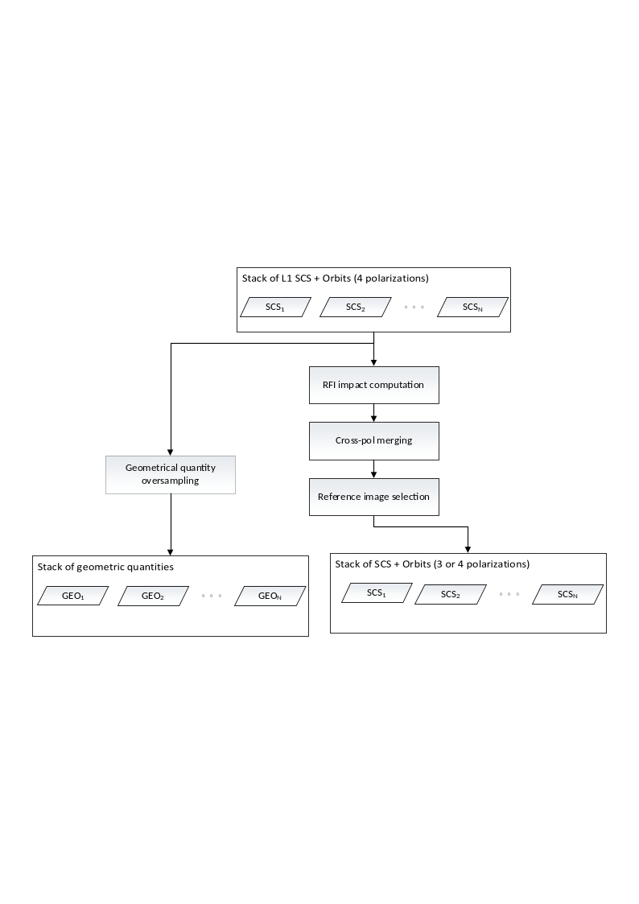
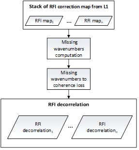
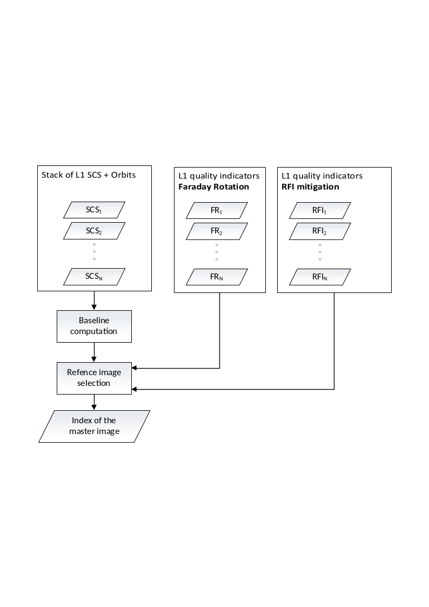

<!-- SPDX-FileCopyrightText: 2026 European Space Agency (ESA) -->
<!-- SPDX-License-Identifier: Apache-2.0 -->

:::{atbd-logo-banner}
:::

(sec:atbd-l1-stack-3)=
# 3. Pre-processing

(fig:atbd-l1-stack-4)=
:::{div} atbd-mermaid-figure

Fig. 4 — Complete flow-chart of the pre-processing processor.

:::

(sec:atbd-l1-stack-3-1)=
### 3.1 RFI-based Data Quality Measure

In this section we describe the algorithm to compute the coherence loss in case of RFI filtering done at L1. The algorithm at L1 uses two approaches for RFI removal: one in time domain and one in the frequency domain. In either cases, the amount of “lost” signal frequencies must be computed in relation to the range signal bandwidth or in relation to the azimuth Doppler bandwidth. We describe here the time-domain case, the frequency domain case is less likely due to BIOMASS operation restrictions in the areas where most of the frequency-domain RFI sources are active.

The quality measure of an interferometric pair after the RFI mitigation can be estimated as the decorrelation due to the spectral overlap reduction generated by the masking of pixels in raw data.

(sec:atbd-l1-stack-3-1-1)=
#### 3.1.1 Overview

The purpose of this step is to deal with the interferences that may impact the images and to compute an indicator of the resulting coherence impact for each image.

(fig:atbd-l1-stack-5)=
:::{div} atbd-mermaid-figure

Fig. 5 — Data quality measure according to RFI pattern.

:::

(sec:atbd-l1-stack-3-1-2)=
#### 3.1.2 Inputs and Outputs

**Inputs**

| Symbol | Name | Origin | Size | Variability | Default | Description |
|---|---|---|---|---|---|---|
| $m_{RFI}$ |   | L1a | M masks of size $[N_{az}\times{}N_{rg}]$ | M=3 (INT) or M=7 (TOM) matrices | - | RFI masks estimated at L1 |

**Outputs**

| Symbol | Name | Destination | Size | Variability | Default | Description |
|---|---|---|---|---|---|---|
| $\gamma_{RFI}$ |   | Primary image selection | M Float values | M=3 (INT) or M=7 (TOM) | - | RFI degradation indices |

(sec:atbd-l1-stack-3-1-3)=
#### 3.1.3 Mathematical Description

(sec:atbd-l1-stack-3-1-3-1)=
##### 3.1.3.1 Theoretical Basis of InSAR RFI Impact

Zeroing a raw data sample is equivalent to suppressing a specific wavenumber of the targets, depending on the sample position, on the fast/slow time domain and target position in the range/azimuth plane.

Let $(t_i,\tau_i)$ be respectively the fast (range) and slow (azimuth) time coordinates of a raw data sample affected by the $i$-th RFI. For a target at $(r,a)$, zeroing the raw data sample at $(t_i,\tau_i)$ is equivalent to suppressing the spectral components

(equation-eq-atbd-l1-stack-3-1)=
\begin{equation}
\begin{aligned}
f_{r,\ i}(t_i,\ \tau_i;r,a)=\frac{2}{c}(f_c+f_{RFI})\bullet\frac{r}{R(\tau_i;r,a)}=\frac{2}{c}(f_c+f_{RFI})\bullet\cos(\psi(\tau_i;r,a)) \\
f_{a,i}(t_i,\ \tau_i;r,a)=\frac{2}{c}(f_c+f_{RFI})\bullet\frac{S_a(\tau_i)-a}{R(\tau_i;r,a)}=\frac{2}{c}(f_c+f_{RFI})\bullet\sin(\psi(\tau_i;r,a))
\end{aligned}
\tag{3.1}
\end{equation}

where:

- $f_c$ is the central (carrier) frequency (i.e. 435 MHz);
- $S_a(\tau_i)$ is the azimuth position of the sensor at slow time $\tau_i$;
- $R(\tau_i;r,a)$ is the distance from the target at $(r,a)$to the sensor at $\tau_i$;
- $\psi(\tau_i;r,a)$ is the squint angle between the target at $(r,a)$ and the sensor at $\tau_i$;
- $f_{RFI}$ is the temporal frequency suppressed by the RFI, which depends on $t_i$and the chirp rate $\alpha$ as follows

$$
f_{RFI}(t_i,\ \tau_i;r,\ a)=\alpha\bullet(t_i-\frac{2}{c}R(\tau_i;r,a))
\tag{3.2}
$$ (eq:atbd-l1-stack-3-2)

For the sake of brevity and without loss of generality, below we will report the explicit derivation of the missing frequency in the $r$ component. The azimuth component can be obtained similarly. The missing wavenumber for each target $(r,a)$ has been defined as the union of all the RFI contributions ($n_I$) affecting the image and belonging to the bandwidth ($B_r$) of the images.

$$
f_{r,miss}(r,a)=(\sum_{i=1}^{n_I}{O(f_{r,i}(t_i,\ \tau_i;r,a),\ B_r)})-f_{r,int}(r,a),
\tag{3.3}
$$ (eq:atbd-l1-stack-3-3)

where:

- $n_I$ is the list of the RFI affecting the image.
- $f_{r,int}(r,a)$ is the sum of the intersections between each RFI:

$$
f_{r,int}(r,a)=\sum_{i=1}^{n_I}{\sum_{j\neq{}i}^{n_I}{O(f_{r,i},\ {f_{r,j},B}_r)}}
\tag{3.4}
$$ (eq:atbd-l1-stack-3-4)

- $O({\overline{v}}_1,\ \ldots{,\overline{v}}_n)$ is defined as follows:

$$
O({\overline{v}}_1,\ \ldots{,\overline{v}}_n)\mathrel{:=}\max{{In({\overline{v}}_1,\ \ldots{,\overline{v}}_n),\ 0}}
\tag{3.5}
$$ (eq:atbd-l1-stack-3-5)

- $In(\ {\overline{v}}_1,\ \ldots{,\overline{v}}_n)$ is defined as follows:

$$
In(\ {\overline{v}}_1,\ \ldots{,\overline{v}}_n)=\min{(\max{({\overline{v}}_1),\ \ldots},\max ({\overline{v}}_n))-}\max (\min{({\overline{v}}_1),\ \ldots},\min ({\overline{v}}_n))
\tag{3.6}
$$ (eq:atbd-l1-stack-3-6)

The RFI impact to the coherence for each image, has been defined as the product of the coherence loss due to the missing spectral components in azimuth and range:

$$
\gamma_{RFI}(r,a)=(1-\frac{f_{a,miss}(r,a)}{B_a})\cdot\ (1-\frac{f_{r,miss}(r,a)}{B_r})
\tag{3.7}
$$ (eq:atbd-l1-stack-3-7)

Where:

- $B_a$ and $B_r$ are the bandwidths inazimuth and range direction respectively.

(sec:atbd-l1-stack-3-1-3-2)=
##### 3.1.3.2 Computation of Coherence Degradation Index

The algorithm to compute the coherence degradation index⁽¹⁾ is based on the theoretical basis described in the previous section, but some simplifications can be performed. Under the assumption that the range migration can be neglected, the impact of RFI on the spectrum can be computed separately on azimuth and range direction as the sum of the pixel values of the masks used to focus a pixel in the SLC. This can be defined as the convolution between the RFI mask and a 2D boxcar filter with the sizes of the focusing kernel, i.e., the synthetic aperture $L_{sa}$ (in azimuth) and the chirp length $L_{chirp}$ (in range):

[1] The coherence degradation index is polarization dependent. Hence, the stack Pre-processor will compute one index per polarization.

(equation-eq-atbd-l1-stack-3-8)=
\begin{equation}
\begin{aligned}
f_r(t,\tau)=\frac{1}{L_{sa}}\sum_{i=0}^{L_{chirp}-1}{\sum_{j=0}^{L_{sa}-1}{m_{RFI}(t-i,\ \tau-j)},} \\
f_a(t,\tau)=\frac{1}{L_{chirp}}\sum_{i=0}^{L_{chirp}-1}{\sum_{j=0}^{L_{sa}-1}{m_{RFI}(t-i,\ \ \tau-j)}},
\end{aligned}
\tag{3.8}
\end{equation}

where:

- $m_{RFI}(r,a)$ is the RFI mask applied by L1 processor.
- $f_r(r,a)$ and $f_a(r,a)$ are respectively the pixel-wise estimations of the RFI impact on the range and azimuth spectra;
- $t$ and $\tau$ are the coordinates in the RFI mask (raw data domain).

Accordingly, the coherence loss can be defined as:

$$
\gamma_{RFI}\mathrel{:=}\frac{1}{L_tL_{\tau}}\sum_{t,\ \tau}^{L_t,L_{\tau}}{\left[ 1-\frac{f_r(t,\ \tau)}{L_{chirp}} \right]}\ \times\ \frac{1}{L_tL_{\tau}}\sum_{t,\ \tau}^{L_t,L_{\tau}}{\left[ 1-\frac{f_a(t,\ \tau)}{L_{sa}} \right]},
\tag{3.9}
$$ (eq:atbd-l1-stack-3-9)

where:

- $L_t$ and $L_{\tau}$ are the range and azimuth sizes of RFI mask applied by L1 processor

Note that the formulation of the RFI coherence degradation index can be further simplified as follows:

$$
\gamma_{RFI}\approx(1-\frac{1}{L_tL_{\tau}}\cdot\sum_{t,\tau}^{L_t,\ \ L_{\tau}}{m_{RFI}(t,\ \tau)})^2.
\tag{3.10}
$$ (eq:atbd-l1-stack-3-10)

(sec:atbd-l1-stack-3-2)=
### 3.2 Cross-pol Merging

This step is devoted to merge in a single cross-pol channel the two cross-pol channels (VH and HV) of the L1a product.

(sec:atbd-l1-stack-3-2-1)=
#### 3.2.1 Overview

For monostatic SAR acquisition focused on natural targets (forest and ice) we can assume that the two cross-pol responses are reciprocal. Accordingly, it is worth to average them in a coherent way to obtain just one cross-pol channel with a higher SNR. Accordingly, the LUT associated to each cross-pol channel will be merged into one. Note that this merging step is optional and can be activated or not by the user via `AUX_PPS`.

(sec:atbd-l1-stack-3-2-2)=
#### 3.2.2 Inputs and Outputs

**Inputs**

| Symbol | Name | Origin | Size | Variability | Default | Description |
|---|---|---|---|---|---|---|
| $m_{RFI}$ |   | L1a | M Boolean masks of size $[{N'}_{az}\times{N'}_{rg}]$ (one per polarization) | M=3 (INT) or M=7 (TOM) matrices | - | RFI masks estimated by `L1_P` |
| $\Sigma_n$ |   | L1a | M Float matrices of size $[{N'}_{az}\times{N'}_{rg}]$ (one per polarization) | M=3 (INT) or M=7 (TOM) matrices | - | Denoising maps estimated by `L1_P` |
| $SCS_n$ |   | L1a | N images of size $[N_{az}\times{}N_{rg}]$ (one per polarization) | M=3 (INT) or M=7 (TOM) matrices | - | SCS images |

**Outputs**

| Symbol | Name | Destination | Size | Variability | Default | Description |
|---|---|---|---|---|---|---|
| $\gamma_{RFI}$ |   | Primary image selection | M Float values | M=3 (INT) or M=7 (TOM) | - | RFI degradation indices |
| $\Sigma_n$ |   | L1a | M Float matrices of size $[{N'}_{az}\times{N'}_{rg}]$ (one per polarization) | M=3 (INT) or M=7 (TOM) matrices | - | Denoising maps with (optionally) merged cross-polarizations |
| $SCS_n$ |   | [BREAKPOINT] Stacking | M images of size $[N_{az}\times{}N_{rg}]$ | M=3 (INT) or M=7 (TOM) | - | The SCS with (optionally) merged cross-polarizations |

(sec:atbd-l1-stack-3-2-3)=
#### 3.2.3 Mathematical description

Given the two cross-pol channels ${SCS}_{HV}$ and $SCS_{VH}$ affected by i.i.d. AWGN, we define the cross-pol merged channel, which we henceforth denote by XX, as the average of the 2 cross-pol channels HV and VH:

$$
SCS_n^{XX}\mathrel{:=}\frac{1}{2}(SCS_n^{HV}+SCS_n^{VH}).
\tag{3.11}
$$ (eq:atbd-l1-stack-3-11)

Note that, owing to the above definition, it follows that

- $\mathbb{E}\left[ SCS_n^{XX} \right]\mathbb{=\ E}\left[ SCS_n^{HV} \right]=\mathbb{E}\left[ SCS_n^{VH} \right]$
- $\sigma\left[ SCS_n^{XX} \right]=\frac{1}{\sqrt{2}}\sigma\left[ SCS_n^{HV} \right]=\frac{1}{\sqrt{2}}\sigma\left[ SCS_n^{VH} \right]$

where $\mathbb{E}$ and $\sigma$ denotes the expected value and the standard deviation. Hence, it is easy to see that the noise contribution is reduced by a factor of $\sqrt{2}$, which results in the SNR being increased by a factor of 2.

RFI masks. Set $m_{{RFI}_{HV}}$ and $m_{{RFI}_{VH}}$ to be the RFI masks corresponding to channels HV and VH and set $m_{RFI_{XX}}$ to be the RFI mask corresponding to the cross-pol merged channel, $m_{RFI_{XX}}$ is obtained by applying a component-wise logical OR ($\vee)$:

$$
m_{{RFI}_{XX}}\mathrel{:=}{}m_{{RFI}_{VH}}\vee{}m_{{RFI}_{VH}}.
\tag{3.12}
$$ (eq:atbd-l1-stack-3-12)

Denoising. From {eq}`Equation|3.11`, the denoising map of the cross-pol merged data can be estimated as follows: Since all noise terms are assumed to be AWGN, it holds that

$$
SCS_n^{XX}\mathrel{:=}\frac{SCS_n^{HV}+SCS_n^{VH}}{2}=\frac{\mathbb{E}\left[ SCS_n^{HV} \right]+w_{HV}+\mathbb{E}\left[ SCS_n^{VH} \right]+w_{VH}}{2}=\mathbb{E}\left[ SCS_n^{XX} \right]+w_{XX}.
\tag{3.13}
$$ (eq:atbd-l1-stack-3-13)

Thus, by evaluating the variance of both sides of {eq}`Equation|3.13` and since the variance of normally distributed independent variables is a quadratic form, the denoising map $\Sigma_n^{XX}$ of the cross-pol merged channel is

(equation-eq-atbd-l1-stack-3-14)=
\begin{equation}
\begin{aligned}
\Sigma_n^{XX}\mathrel{:=}{}Var\left[ SCS_n^{XX} \right]\mathrel{:=}{}Var\left[ \frac{SCS_n^{HV}+SCS_n^{VH}}{2} \right]=\frac{Var\left[ \left\langle SCS_n^{HV} \right\rangle+w_{HV}+\left\langle SCS_n^{VH} \right\rangle+w_{VH} \right]}{4}=\frac{Var\left[ SCS_n^{HV} \right]+Var\left[ SCS_n^{VH} \right]}{4} \\
=\frac{1}{4}(\Sigma_n^{HV}+\Sigma_n^{VH}).
\end{aligned}
\tag{3.14}
\end{equation}

(sec:atbd-l1-stack-3-3)=
### 3.3 Coregistration Primary Image Selection

The L2 processor of BIOMASS works on an interferometric stack, for this reason the selection of the coregistration primary image is an important step of the stacking processor. This step must consider both the geometry that maximizes the valid areas and the quality of the image in order to avoid, for instance, using a reference image affected by e.g. strong ionosphere, which may degrade the quality of the whole stack.

(sec:atbd-l1-stack-3-3-1)=
#### 3.3.1 Overview

The algorithm takes as input the stack of SCS images to be coregistered, the information about the ionospheric characterization from the L1 and the characterization of potential RFI signals in frequency or time domain, again from the L1 processor.

The key task of the coregistration primary image selection step is to define which image will be used as reference grid for the other images.

Besides the “classical” approach of selecting the coregistration primary as the central images with respect to acquisition geometry (baselines), here the idea is that this selection should be based also on the quality of the images as it can be inferred from the auxiliary information already available from the L1 processor.

In interferometric processing, the temporal location of the image is often used (e.g. avoid selection of a too “old” image). According to the BIOMASS mission, this should not be a problem thanks to the short repeat pass which will limit the time span of the whole stack to a worst case of 18 days (7 images with 3-days repeat during the TOM phase). Nevertheless, a temporal selection criterion is also available in the BPS.

In the reminder of this section we will provide general definitions of stack’s normal baselines ({sec}`Section|3.3.3.1`) and temporal baselines ({sec}`Section|3.3.3.2`), and describe how these are used in combination with quality criteria for the selection of the coregistration primary image ({sec}`Section|3.3.3.3`).

(fig:atbd-l1-stack-6)=
:::{div} atbd-mermaid-figure

Fig. 6 — Selection of the coregistration primary image.

:::

(sec:atbd-l1-stack-3-3-2)=
#### 3.3.2 Inputs and Outputs

**Inputs**

| Symbol | Name | Origin | Size | Variability | Default | Description |
|---|---|---|---|---|---|---|
| $SCS_n$ |   | L1a | M stack images of size $[N_{az}\times{}N_{rg}]$ | M=3 (INT) or M=7 (TOM) matrices | - | The input stack |
| $\gamma_{RFI}$ |   | Pre-procesor quality measure | M Float values | M=3 (INT) or M=7 (TOM) | - | The RFI decorrelation indices |
| $\gamma_{far}$ |   | L1a | M Float values | M=3 (INT) or M=7 (TOM) | - | The decorrelation from Faraday rotation coming from L1a |
| $\gamma_{RFI}^{ref}$ |   | `AUX_PPS` | Float | 1 | 0.9 | Threshold on the RFI to discard a coregistration primary candidate |
| $\gamma_{far}^{ref}$ |   | `AUX_PPS` | Float | 1 | 0.9 | Threshold on the FR to discard a coregistration primary candidate |

**Outputs**

| Symbol | Name | Destination | Size | Variability | Default | Description |
|---|---|---|---|---|---|---|
| $n_{ref}$ |   | Stacking and calibration module | Integer value | 1 | - | The index of the coregistration primary image |

(sec:atbd-l1-stack-3-3-3)=
#### 3.3.3 Mathematical Description

(sec:atbd-l1-stack-3-3-3-1)=
##### 3.3.3.1 Spatial Baseline Computation

Given $N>1$ SCS images and their acquisition geometry, we first direct geocode the center of an arbitrarily selected reference image $r$, say, for instance, the first image in the stack, and then perform the inverse geocoding of this point to the sensor positions of each image in the stack (with the exception of the previously selected image). This combination of direct and inverse geocoding allows for retrieving the position of the sensors of the images at the center of their scenes. We refer to {sec}`Section|4.1.3.1` for more details on direct and inverse geocoding. With spatial baseline ${\overrightarrow{B}}_i$, we hereby refer to the sensor position of the $i$-th frame relative to the sensor position of the reference image ${\overrightarrow{S}}_r$(both computed at the center of the scenes). That can be trivially calculated as follows:

$$
{\overrightarrow{B}}_i\mathrel{:=}\ {\overrightarrow{S}}_i-{\overrightarrow{S}}_r,\ \ \ i=1\ldots\ N;\ i\ \neq\ r.
\tag{3.15}
$$ (eq:atbd-l1-stack-3-15)

Accordingly, the normal baseline $B_{i,\bot}$ of the $i$-th image can is defined as the signed magnitude of the projection of the $i$-th spatial baseline vector onto the vector normal to the trajectory, which is the direction normal to both the along-track (tangent) and LOS vectors, using a standard right-handed coordinate system.

(sec:atbd-l1-stack-3-3-3-2)=
##### 3.3.3.2 Temporal Baseline Computation

Given $N>1$ SCS images, the temporal baselines are calculated as time difference between the acquisition start times:

$$
\mathrm{\Delta}T_i=\ T_{0,i}-T_{0,r}\ ,\ \ \ i=1\ldots\ N,
\tag{3.16}
$$ (eq:atbd-l1-stack-3-16)

where $r$ is an arbitrarily chosen reference image, e.g. the first image in the stack.

(sec:atbd-l1-stack-3-3-3-3)=
##### 3.3.3.3 Selection of the Coregistration Primary Image

To select the coregistration primary image, the following criteria are provided and can be chosen by the user via a configurable parameter of the AUX-PPS:

- Temporal criterion (AUX-PPS parameter: “Temporal Baseline”). Given the temporal baselines $\mathbf{\Delta}\boldsymbol{T}\mathrel{:=}(\Delta{}T_1,\ldots,\Delta{}T_n)$ , the primary image is selected as the image with temporal baseline closest to the median temporal baseline, that is, $n^{ref}\mathrel{:=}\argmin_i\left\vert \Delta{}T_i-\left\langle \mathbf{\Delta}\boldsymbol{T} \right\rangle \right\vert$, where $\langle\cdot\rangle$ represents the median operator.
- Normal baseline criterion (AUX-PPS parameter: “Geometry”). Similar to the temporal criterion, but with temporal baselines substituted by the normal baselines: $n^{ref}\mathrel{:=}\argmin_i\vert{}B_{i,\bot}-\left\langle \boldsymbol{B}_{\bot} \right\rangle\vert$, where $\boldsymbol{B}_{\bot}\mathrel{:=}(B_{1,\bot},\ldots,\ B_{n,\bot})$ and $\langle\cdot\rangle$ represents the median operator.
- Normal baseline and RFI quality criterion (AUX-PPS parameters: “Geometry and RFI correction”). This criterion combines the normal baseline criterion with quality indicators from RFI. Set $\gamma_{i,RFI}\in[0,\ 1]$ to be the average of the expected decorrelation map due to RFI patterns in the image, i.e., the average over the image polarizations of the RFI indices described in {eq}`Equation|3.10` (possibly, after cross-pol merging), the coregistration primary is selected as $n^{ref}\mathrel{:=}\argmin_{i\in\Gamma_{RFI}}\ \vert{}B_{i,\bot}-\left\langle \boldsymbol{B}_{\bot} \right\rangle\vert$ , where $\left\langle \boldsymbol{B}_{\bot} \right\rangle$ is defined as in the normal baseline criterion (see above) and ΓRFI≔{i=1,…,N γi,RFI≥γRFIref, that is the subset of images whose RFI indices are above a user defined threshold. In other words, this criterion restricts the normal baseline criterion to the images that have low RFI disturbances.
- Normal baseline and FR quality criterion (AUX-PPS parameters: “Geometry and FR correction”). Similarly to the normal baseline and RFI quality criterion, the normal baseline selection is restricted to the images that have low FR disturbances, that is $n^{ref}\mathrel{:=}\argmin_{i\in\Gamma_{FR}}\ \vert{}B_{i,\bot}-\left\langle \boldsymbol{B}_{\bot} \right\rangle\vert$ , where $\left\langle \boldsymbol{B}_{\bot} \right\rangle$ is defined as in the normal baseline criterion and ΓFR≔{i=1,…,N γi,FR≥γFRref. The Faraday Rotation quality index $\gamma_{i,FR}\in[0,1]$ is defined as the following decorrelation index:

$$
\gamma_{i,FR}\mathrel{:=}\sqrt{\frac{1}{2\sigma_{i,FR}^2+1}},
\tag{3.17}
$$ (eq:atbd-l1-stack-3-17)

with $\sigma_{i,FR}^2$ being the variance of the Faraday Rotation (phase screen) estimated by the L1 processor.

- Normal baseline and RFI & FR quality criterion (AUX-PPS parameters: “Geometry and RFI+FR correction”). Similarly to the normal baseline and the quality criteria above, the normal baseline selection is restricted to the images that have both low RFI disturbances and low FR disturbances, that is $n^{ref}\mathrel{:=}\argmin_{i\in\Gamma_{RFI\land{}FR}}\ \vert{}B_{i,\bot}-\left\langle \boldsymbol{B}_{\bot} \right\rangle\vert$ , where $\left\langle \boldsymbol{B}_{\bot} \right\rangle$ is as in the normal baseline criterion and $\Gamma_{RFI\land{}FR}\mathrel{:=}\Gamma_{RFI}\cap\Gamma_{FR}$, with $\Gamma_{RFI}$ and $\Gamma_{FR}$ defined in previous points.

Note that the selected criteria are also annotated in the stack for quality control, we refer to the `L1_PFD` for more details on how the AUX-PPS parameters map onto the L1c annotations.

(sec:atbd-l1-stack-3-3-4)=
#### 3.3.4 Contingency Handling

Two contingency cases can be encountered by the stack processor in selecting the coregistration primary image:

- No image satisfies the quality criteria based on Faraday Rotation and/or RFI’s (formally, $\Gamma_{RFI}$ and/or $\Gamma_{FR}$ may be empty sets). In such a case, the processor fallbacks to the normal baseline criterion.
- The L1 processor may have processed the input stack with no RFI estimation or no FR estimation (or both). In such cases, images with missing quality indices are treated as images with acceptable RFI or FR disturbances. More formally, if no RFI mask (FR phase screen) is computed for image $i$, $\gamma_{i,RFI}$ ($\gamma_{i,FR}$) is set to 1, hence always above threshold. Note that if the entire stack lacks RFI (FR) estimations, the normal baseline and quality RFI (FR or RFI&FR) criterion is equivalent to the normal baseline criterion.

(sec:atbd-l1-stack-3-4)=
### 3.4 Geometrical Quantity Upsampling

This step reconstructs the height of the scattering surface of the coregistration primary image from a sub-sampled version of Lat-Lon-Height LUTs. Henceforth we will generally refer to the height of the scattering surface as DEM. The DEM will be a 3-channel 2D image containing the ECEF coordinates (1 for channel) in the sampling grid the coregistration primary image.

(sec:atbd-l1-stack-3-4-1)=
#### 3.4.1 Overview

The algorithm takes as input the sub-sampled Lat-Lon-Height LUTs related to the selected primary image, and performs an up-sampling through an interpolation method. After that, the reconstructed DEM is obtained by the conversion from Lat-Lon-Height to XYZ ECEF coordinates.

(sec:atbd-l1-stack-3-4-2)=
#### 3.4.2 Inputs and Outputs

**Inputs**

| Symbol | Name | Origin | Size | Variability | Default | Description |
|---|---|---|---|---|---|---|
|   | latitude | L1a | $[{N'}_{az}\times{N'}_{rg}]$ | 1 | - | The latitude LUT |
|   | longitude | L1a | $[{N'}_{az}\times{N'}_{rg}]$ | 1 | - | The longitude LUT |
|   | height | L1a | $[{N'}_{az}\times{N'}_{rg}]$ | 1 | - | The altitude LUT |
|   | `relativeAzimuthTimeRGC` | L1a | $\left[ 1\times{N^{'}}_{az} \right]$ | 1 | - | The LUT's azimuth time axis |
|   | `slantRangeTimeRGC` | L1a | $\left[ 1\times{N^{'}}_{az} \right]$ | 1 | - | The LUT's range time axis |
|   | `referenceAzimuthTime` | L1a | UTC value | 1 | - | The reference time for all LUTs |

**Outputs**

| Symbol | Name | Destination | Size | Variability | Default | Description |
|---|---|---|---|---|---|---|
|   | latitude | L1c | $[N_{az}\times{}N_{rg}]$ | 1 | - | The latitude LUT upsampled on the grid on the coregistration primary data |
|   | longitude | L1c | $[N_{az}\times{}N_{rg}]$ | 1 | - | The longitude LUT upsampled on the grid on the coregistration primary data |
|   | height | L1c | $[N_{az}\times{}N_{rg}]$ | 1 | - | The altitude LUT upsampled on the grid on the coregistration primary data |
|   | XYZ | [BREAKPOINT] | $\left[ N_{az}\times{}N_{rg} \right]$ | 1 | - | DEM product, i.e. 3 channel product containing a fill resolution upsampled DEM. |

(sec:atbd-l1-stack-3-4-3)=
#### 3.4.3 Mathematical Description

Given an image $I_i$ which axis are $t_{X_i}$ and $t_{Y_i}$ for the columns and rows direction respectively, it is possible to perform an up-sapling though interpolation. The axis of the interpolated image $I$ will be $t_X$ and $t_Y$, which steps will be lower than the steps of $t_{X_i}$ and $t_{Y_i}$, so for each $t_X(k)$ and $t_Y(k)$ the value $I(t_Y(k),t_X(k))$ will be evaluated using a bi-cubic kernel. In image processing, bi-cubic interpolation is often chosen over bilinear or nearest-neighbor interpolation in image resampling; in contrast to bilinear interpolation, which only takes 4 ($2\times\ 2$) pixels into account, bi-cubic interpolation considers 16 pixels (4x4).

Note about the bi-cubic interpolation. Suppose the function $f$ and the derivatives $f_x,\ \ f_y$ and $f_{xy}$ are knownat the four corners $(0,0),\ (1,0),\ (0,1)$ and $(1,1)$ of the unit square. The interpolated surface can be written as

$$
p(x,y)=\sum_{i=0}^3{\sum_{j=0}^3{a_{ij}x^iy^j}}
\tag{3.17}
$$ (eq:atbd-l1-stack-3-17-2)

The interpolation problem consists of determining the 16 coefficients $a_{ij}$; matching $p(x,y)$ with the function values yields four equations:

$$
f(0,0)=p(0,0)=a_{00}
\tag{3.18}
$$ (eq:atbd-l1-stack-3-18)

$$
f(1,0)=p(1,0)=a_{00}+a_{10}+a_{20}+a_{30}
\tag{3.19}
$$ (eq:atbd-l1-stack-3-19)

$$
f(0,1)=p(0,1)=a_{00}+a_{01}+a_{02}+a_{03}
\tag{3.20}
$$ (eq:atbd-l1-stack-3-20)

$$
f(1,1)=p(1,1)=\sum_{i=0}^3{\sum_{j=0}^3{a_{ij}}}
\tag{3.21}
$$ (eq:atbd-l1-stack-3-21)

Likewise, eight equations for the derivatives in the $x$ and $y$ directions:

$$
f_x(0,0)=p_x(0,0)=a_{10}
\tag{3.22}
$$ (eq:atbd-l1-stack-3-22)

$$
f_x(1,0)=p_x(1,0)=a_{10}+2a_{20}+3a_{30}
\tag{3.23}
$$ (eq:atbd-l1-stack-3-23)

$$
f_x(0,1)=p_x(0,1)=a_{10}+a_{11}+a_{12}+a_{13}
\tag{3.24}
$$ (eq:atbd-l1-stack-3-24)

$$
f_x(1,1)=p_x(1,1)=\sum_{i=1}^3{\sum_{j=0}^3{ia_{ij}}}
\tag{3.25}
$$ (eq:atbd-l1-stack-3-25)

$$
f_y(0,0)=p_y(0,0)=a_{01}
\tag{3.26}
$$ (eq:atbd-l1-stack-3-26)

$$
f_y(1,0)=p_y(1,0)=a_{01}+a_{11}+a_{21}+a_{31}
\tag{3.27}
$$ (eq:atbd-l1-stack-3-27)

$$
f_y(0,1)=p_y(0,1)=a_{01}+{2a}_{02}+3a_{03}
\tag{3.28}
$$ (eq:atbd-l1-stack-3-28)

$$
f_y(1,1)=p_y(1,1)=\sum_{i=0}^3{\sum_{j=1}^3{ja_{ij}}}
\tag{3.29}
$$ (eq:atbd-l1-stack-3-29)

And four equations for the $xy$ mixed partial derivative:

$$
f_{xy}(0,0)=p_{xy}(0,0)=a_{11}
\tag{3.30}
$$ (eq:atbd-l1-stack-3-30)

$$
f_{xy}(1,0)=p_{xy}(1,0)=a_{11}+2a_{21}+3a_{31}
\tag{3.31}
$$ (eq:atbd-l1-stack-3-31)

$$
f_{xy}(0,1)=p_{xy}(0,1)=a_{11}+2a_{12}+3a_{13}
\tag{3.32}
$$ (eq:atbd-l1-stack-3-32)

$$
f_{xy}(1,1)=p_{xy}(1,1)=\sum_{i=1}^3{\sum_{j=1}^3{i{ja}_{ij}}}
\tag{3.33}
$$ (eq:atbd-l1-stack-3-33)

This procedure yields a surface $p(x,y)$ on the unit square $\left[ 0,1 \right]\times\left[ 0,1 \right]$ that is continuous and has continuous derivatives; bi-cubic interpolation on an arbitrarily sized regular grid can then be accomplished by patching together such bi-cubic surfaces, ensuring that the derivatives match on the boundaries. Grouping the unknown parameters $a_{ij}$ in a vector

$$
\alpha=\left[ a_{00},a_{10},a_{20},a_{30},a_{01},a_{11},a_{21},a_{31},a_{02},a_{12},a_{22},a_{32},a_{03},a_{13},a_{23},a_{33} \right]^T
\tag{3.34}
$$ (eq:atbd-l1-stack-3-34)

and letting

(equation-eq-atbd-l1-stack-3-35)=
\begin{equation}
\begin{aligned}
b=[f(0,0),f(1,0),f(0,1),f(1,1), \\
f_x(0,0),f_x(1,0),f_x(0,1),f_x(1,1), \\
f_y(0,0),f_y(1,0),f_y(0,1),f_y(1,1), \\
f_{xy}(0,0),f_{xy}(1,0),f_{xy}(0,1),f_{xy}(1,1)]^T
\end{aligned}
\tag{3.35}
\end{equation}

the above system of equations can be reformulated into a matrix for the linear equation

$$
\text{A\ }\text{α}\text{\ =\ b},
\tag{3.36}
$$ (eq:atbd-l1-stack-3-36)

which allows $\text{α}$� to be calculated quickly and easily.
