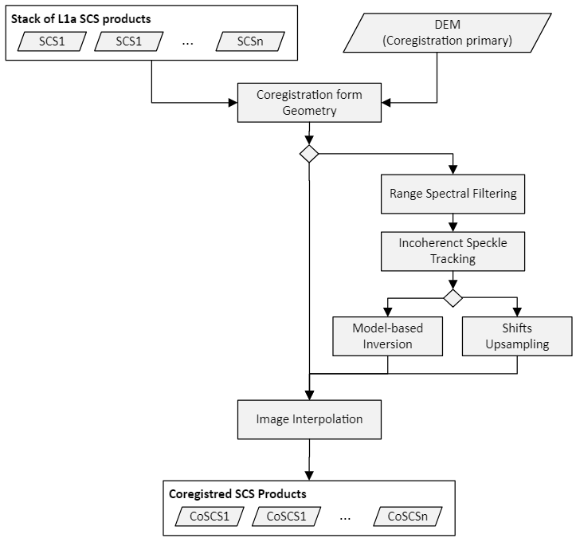
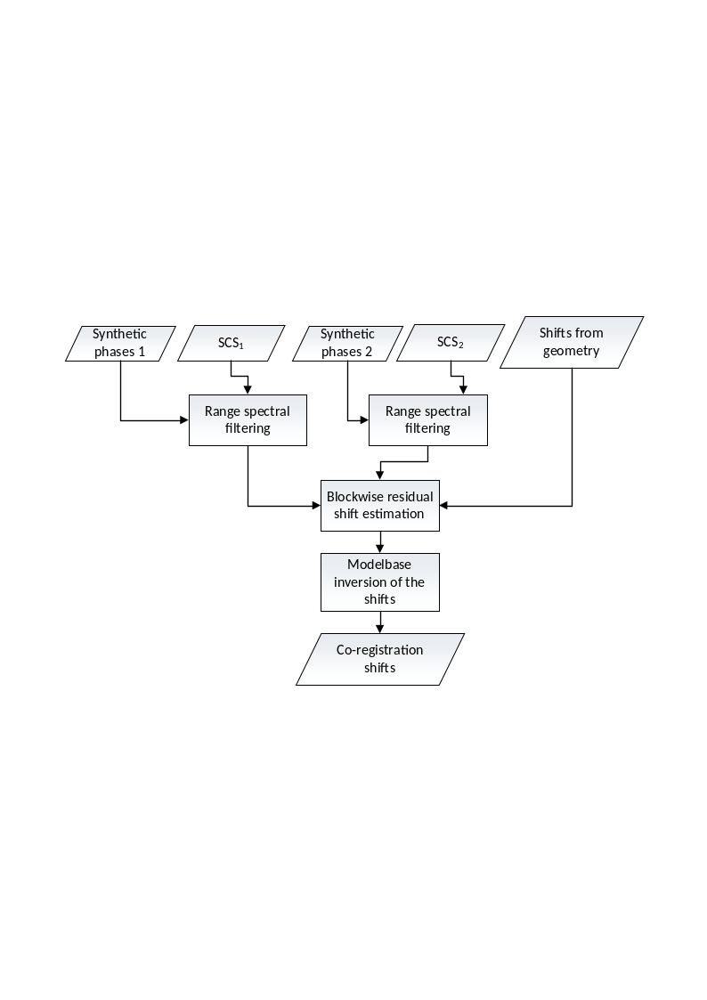

<!-- SPDX-FileCopyrightText: 2026 European Space Agency (ESA) -->
<!-- SPDX-License-Identifier: Apache-2.0 -->

:::{atbd-logo-banner}
:::

(sec:atbd-l1-stack-4)=
# 4. Stacking

In this section we will describe in detail the stacking operation, which consists in aligning both the data and the LUTs of a set of L1a input frames onto a common grid that is chosen to be the grid of the primary frame. The stacking module executes three main steps:

- Estimation of the pixel shifts between the L1a input frame and the coregistration primary L1a frame. This step can be executed by only using the sole information of the frames’ orbits and scattering surface height (coregistration from Geometry), or applying a further refinement using incoherent cross-correlation applied to the actual frame data (coregistration using Geometry and Data)
- Image interpolation, which consists of warping the stack images onto the primary grid by means of the coregistration shifts computed at the previous step (see {fig}`Fig.|7`).
- LUT shifting and interpolation, which, similarly to the image interpolation step, warps the LUTs contained in the L1a input stack onto the common primary LUT grid.

(fig:atbd-l1-stack-7)=
:::{div} atbd-mermaid-figure

Fig. 7 — Complete flow-chart of the coregistration processor.

:::

(sec:atbd-l1-stack-4-1)=
### 4.1 Coregistration from Geometry via Inverse Geocoding

This module is responsible for computing the shifts needed to interpolate an image in input ($SCS_n$) to the grid defined by the geometry acquisition of the coregistration primary image ($SCS_r$) using the information of the height of the scattering surface (DEM) and the orbit information contained in the input L1a products.

(sec:atbd-l1-stack-4-1-1)=
#### 4.1.1 Overview

The algorithm for coregistration from geometric information uses the orbits and a model of the topography, i.e. the world model obtained by upsampling the Lat/Lon/Height LUTs from the L1a input stack (see {sec}`Section|3.4.1`), in order to calculate for each pixel the relative pixel distance or, equivalently, the time difference, between the primary and secondary acquisitions.

(sec:atbd-l1-stack-4-1-2)=
#### 4.1.2 Inputs and outputs

**Inputs**

| Symbol | Name | Origin | Size | Variability | Default | Description |
|---|---|---|---|---|---|---|
| $SCS_n$ |   | Cross-pol merging step | M stack images of size $[N_{az}\times{}N_{rg}]$ | M=3 (INT) or M=7 (TOM) matrices with 3 or 4 polarizations | - | The input stack |
| DEM |   | Upsampling step | 1 image of size $[N_{az}\times{}N_{rg}]$ | M=3 (INT) or M=7 (TOM) single channel matrices | - | Height of scattering surfaces of the input stack |
|   | `flatteningPhaseBiasCompensationFlag` | `AUX_PPS` (`AIX_FMT`) | Bool switch | True/False | False | Optionally, compensate phase residuals due to residuals in DEM upsampling |

**Outputs**

| Symbol | Name | Destination | Size | Variability | Default | Description |
|---|---|---|---|---|---|---|
| $CoSCS_n$ |   | [BREAKPOINT] Stacking and calibration module | M images of size $[N_{az}\times{}N_{rg}]$ | M=3 (INT) or M=7 (TOM) matrices with 3 or 4 polarizations | - | The coregistered images. This is a breakpoint file onky if coreg mode is Geometry. |
| $\tau_{rg}^n$ |   | [BREAKPOINT] Stacking and calibration module | M images of size $[N_{az}\times{}N_{rg}]$ | M=3 (INT) or M=7 (TOM) matrices with 3 or 4 polarizations | - | The coregistration shifts in range component. This is a breakpoint file only if coreg mode is Geometry. |
| $\tau_{az}^n$ |   | [BREAKPOINT] Stacking and calibration module. | M images of size $[N_{az}\times{}N_{rg}]$ | M=3 (INT) or M=7 (TOM) matrices with 3 or 4 polarizations | - | The coregistration shifts in azimuth component. This is a breakpoint file only if coreg mode is Geometry. |
| $\Delta\varphi_n$ |   | [BREAKPOINT] Coregistration Step, L1c, and remainder of the stacking | M of size $[N_{az}\times{}N_{rg}]$ | M=3 (INT) or M=7 (TOM) each with a single channel | - | Synthetic phases from DEM associated to each acquisition. |
| $k_z$ |   | [BREAKPOINT] Calibration and L1c product | M of size $[N_{az}\times{}N_{rg}]$ | M=3 (INT) or M=7 (TOM) each with a single channel | - | Vertical wavenumbers associated to each frame. |

(sec:atbd-l1-stack-4-1-3)=
#### 4.1.3 Mathematical Description

(sec:atbd-l1-stack-4-1-3-1)=
##### 4.1.3.1 Inverse Geocoding

By inverse geocoding, we refer to the procedure of retrieving the azimuth and range time $\tau_{az}$ and $\tau_{rg}$ at which a target point on the Earth is imaged by the sensor. Inverse geocoding is typically associated with the direct geocoding operation, which is the procedure of inferring the ECEF coordinates of a point onto the Earth surface with respect to an elevation model at at the time which the sensor imaged that target point. For more details we refer to {rd}`20`. Note that in the stack processor only inverse geocoding is executed since the results of direct geocoding for the input stack are assumed to be stored as Lat/Lon/Height LUTs in the L1a input products and mapped onto the primary grid data via oversampling as described in {sec}`Section|3.4`.

(sec:atbd-l1-stack-4-1-3-2)=
##### 4.1.3.2 Coregistration Shift’s Estimation

The purpose of this step is to compute the coregistration shifts expected from the acquisition geometry. This result is accomplished via inverse geocoding (see {sec}`Section|4.1.3.1`). More in detail, each pixel of the primary image is associated to its azimuth and range time coordinates:

$$
\left[ \tau_{az},\ \tau_{rg} \right]^r(i,\ j)
\tag{4.1}
$$ (eq:atbd-l1-stack-4-1)

that represent the (i-th, j-th) element of the primary data matrix. Since, each point $\boldsymbol{P}(i,j)$ of the DEM scattering surface (see {sec}`Section|3.4`), is assumed to be obtained by an approximation of the directed geocoded surface computed upstream of the stack processor, the location is inversely geocoded using orbit data of n-th secondary image to obtain azimuth and range times

$$
\left[ \tau_{az},\ \tau_{rg} \right]^n(i,\ j).
\tag{4.2}
$$ (eq:atbd-l1-stack-4-2)

Accordingly, the values of azimuth and range times are converted to pixels accordingly by setting

(equation-eq-atbd-l1-stack-4-3)=
\begin{equation}
\left\{ \begin{matrix} s_{az}^n(i,j)=\frac{(\tau_{az}^n(i,j)-\tau_{az,0}^n)}{\Delta\tau_{az}^n} \\ s_{rg}^n(i,j)=\frac{(\tau_{rg}^n(i,j)-\tau_{rg,0}^n)}{\Delta\tau_{rg}^n} \end{matrix} \right.
\tag{4.3}
\end{equation}

where $\left[ \tau_{az,0},\ \tau_{rg,0} \right]^n$ are the acquisition start times and $\left[ \Delta\tau_{az},\Delta\ \tau_{rg} \right]^n$are the acquisition sampling times of the n-th secondary image. The pixel shifts are then obtained as $s_{az}^n(i,j)-\ s_{az}^r(i,j)$ and $s_{rg}^n(i,j)-s_{rg}^r(i,j)$. Note that all the range times ($\tau_{rg}$) in this section refer to the two-way delay.

(sec:atbd-l1-stack-4-1-3-3)=
##### 4.1.3.3 Synthetic Interferogram Computation and Debiasing

By synthetic interferogram $\Delta\varphi_{syn,n,r}$ (or henceforth DSI), we refer to the difference, expressed as a phase delay, of the absolute LOS distances at 0-Doppler between a ground target and the orbital positions of the RADAR in two acquisitions. The purpose of this step is to provide the geometrical quantities that are necessary to flatten the raw interferograms, that is, to remove all possible contributions of the DEM, and thus to make it easier for the calibration modules to isolate other possible sources of phase delays, such as ionosphere or baseline errors. For this, we use the results of the coregistration shifts as described in {sec}`Section|4.1.3.2`., that is, set $\tau_{rg}^r$ and $\tau_{rg}^n$ to be respectively the range time coordinates of primary and secondary frames, computed via inverse geocoding, it is straightforward to compute the distance between the two sensors and the ground target and accordingly convert it into phase delay by applying the following pixelwise conversion:

$$
{\Delta{}\varphi}_{syn,n,r}(i,j)=\ 2\pi\cdot{}f_c\cdot(\tau_{rg}^n(i,j)-\tau_{rg}^r(i,j))
\tag{4.4}
$$ (eq:atbd-l1-stack-4-4)

where $f_c$ is the central (carrier) frequency. Note that, since the DEM is computed upstream of the stack processor (i.e., on L1a) on a grid that is not necessarily that of the coregistration primary frame, it follows that all inversely geocoded times $\tau_{rg}^n(i,j)$ (including those of the coregistration primary) may reflect the interpolation residuals⁽²⁾ between the directly geocoded Earth surface and the DEM obtained via upsampling the L1a LUTs (see {sec}`Section|3.4`). Nonetheless, it can be observed that such an error is in fact approximately a common bias in all image frames and can be therefore estimated by inversely geocoding the coregistration primary⁽³⁾. Therefore, using as coregistration primary times $\tau_{rg}^r(i,j)$ in {eq}`Equation|4.4` those obtained by inversely geocoding the DEM onto the orbit of the coregistration primary frame, the bias induced by the DEM upsampling can be compensated and the method described in {eq}`Equation|4.6` is still sufficiently accurate and within the scope of the applications of the BPS stack processor. This bias removal can nonetheless be disabled by user via `AUX_PPS`.

[2] Note that the residuals are only due the fact that the input L1a data has been direct geocoded by the `L1_P` on a grid that is not that of the data. `STA_P` always use the same elevation model used by `L1_P`, since the elevation model is stored in the L1a product as a LUT annotation.

[3] As a matter of principle, if the DEM were obtained by directly geocoding the sampling times of the coregistration primary, it would not be necessary to inverse geocode it with respect to the coregistration primary, since direct and inverse geocoding are indeed inverse operations. Hence, that would exactly return the range sampling times of the primary frame.

Note that, owing to {eq}`Equation|4.6`, a “+” convention is required for compensating the contribution of the DEM in a coregistered image. More formally, as

$$
CoSCS(i,\ j)\cdot\exp \left\{ +j\ {\Delta{}\varphi}_{syn,n,r}(i,j) \right\}.
\tag{4.4}
$$ (eq:atbd-l1-stack-4-4-2)

Synthetic interferograms are annotated in the L1c products as the `flatteningPhaseScreen` LUT.

(sec:atbd-l1-stack-4-1-3-4)=
##### 4.1.3.4 Vertical Wavenumber Computation

We compute the vertical wavenumbers $k_z$ for n-th frame as follows:

$$
k_z(i,j)=\frac{4\pi}{\lambda}\cdot\frac{B}{d(i,j)\cdot\sin \vartheta(i,j)}=\frac{4\pi}{\lambda}\cdot\frac{\Delta\theta(i,j)}{\sin{\vartheta(i,j)}},
\tag{4.5}
$$ (eq:atbd-l1-stack-4-5)

where:

- $B$ is normal baseline between the coregistration primary and the n-th image.
- $d(i,j)$ is the 0-Doppler distance of the coregistration primary image.
- $\Delta\theta$ is the off-nadir difference⁽⁴⁾ between the coregistration primary and the n-th image.

[4] Note that $\Delta\theta$ (relative look angle) equals $\Delta\vartheta$, that is, the relative incidence angles between primary and secondary image. Also, note that the $\Delta\theta$ is used as an approximation of the exact value $\sin (\Delta\theta)$ since $\Delta\theta\ll\ 1.$

- $\vartheta$is the incidence angle of the n-th image.

(sec:atbd-l1-stack-4-2)=
### 4.2 Residual Coregistration from Data

The purpose of this step is to estimate the coregistration shifts via data cross-correlation. To obtain local shift estimations using data cross-correlation, the two images are divided into blocks. For each block, range and azimuth shifts are estimated, looking for the amplitude cross-correlation maximum.

(fig:atbd-l1-stack-8)=
:::{div} atbd-mermaid-figure

Fig. 8 — Coregistration from data.

:::

(sec:atbd-l1-stack-4-2-1)=
#### 4.2.1 Incoherent Speckle Tracking

The incoherent speckle tracking step exploits the cross correlation between two SAR images to estimate a refinement of the shifts computed from geometry.

(sec:atbd-l1-stack-4-2-1-1)=
##### 4.2.1.1 Inputs and Outputs

**Inputs**

| Symbol | Name | Origin | Size | Variability | Default | Description |
|---|---|---|---|---|---|---|
| $SCS_{n,m}$ |   | Stacking | 2 stack images of size $[N_{az}\times{}N_{rg}]$ | 2 | - | A stack primary/secondary SCS interferometric pair |
| $\tau_{rg}^{}$ |   | Stacking | 1 image of size $[N_{az}\times{}N_{rg}]$ | 1 | - | The coregistration shifts in range component |
| $\tau_{az}^{}$ |   | Stacking | 1 image of size $[N_{az}\times{}N_{rg}]$ | 1 | - | The coregistration shifts in azimuth component |
|   | `blockQualityThreshold` | `AUX_PPS` (`AUX_FMT`) | Float value | 0 – 1 | 0.0 | Threshold on the block quality estimation to consider the shifts estimated on an estimation block valid. |

**Outputs**

| Symbol | Name | Destination | Size | Variability | Default | Description |
|---|---|---|---|---|---|---|
| $W_{n,m}$ | `coregistrationShiftsQuality` | Stacking | 1 image of size $[{N'}_{az}\times{N'}_{rg}]$ | 1 | - | Matrix of estimation accuracies (all values between [0, 1]). |
| $s_{az}$ | - | [BREAKPOINT] Stacking | 1 image of size $[{N'}_{az}\times{N'}_{rg}]$ | 1 | - | Coregistration shifts in azimuth direction (orbit + cross-correlation) |
| $s_{rg}$ | - | [BREAKPOINT] Stacking | 1 image of size $[{N'}_{az}\times{N'}_{rg}]$ | 1 | - | Coregistration shifts in range direction (orbit + cross-correlation) |

(sec:atbd-l1-stack-4-2-1-2)=
##### 4.2.1.2 Mathematical Description

As well known, cross-correlation is a measure of the similarity of two signals as a function of mutual displacement. If we model the intensity of the blocks of the two images, $B_{n,m}^1$ and $B_{n,m}^2$ as continuous functions of azimuth time $\tau_{az}$ and range time $\tau_{rg}$ (translated by the shifts from geometry), the 2D cross-correlation can be defined as:

$$
XC_{n,m}(a,\ r)=\iint_{-\infty}^{\infty}{B_{n,m}^1({a+\tau}_{az},{r+\tau}_{rg})}\cdot(B_{n,m}^2(\tau_{az},\tau_{rg}))^*d\tau_{az}d\tau_{rg}=\ (B_{n,m}^2(-a,-\ r))^**B_{n,m}^1(a,\ r)
\tag{4.6}
$$ (eq:atbd-l1-stack-4-6)

where $*$ is the symbol for convolution of continuous signals. The equivalent definition in frequency domain is more convenient in terms of implementation:

$$
F(XC_{n,m}(a,\ r))={F(B}_{n,m}^1(a,\ r))\cdot{}F^*(B_{n,m}^2(a,\ r))
\tag{4.7}
$$ (eq:atbd-l1-stack-4-7)

Where $F(\cdots)$ is the Fourier Transform of the data and $(\cdots)^*$ is the complex conjugate operator.

To reduce the aliasing that is inherent in computing cross-correlation on amplitude via Fourier Transform, an oversampling that doubles the number of samples is performed prior to the actual computation of the cross-correlation matrix.

The cross-correlation estimate of the local coregistration shifts is defined as the block displacement that corresponds to the maximum of the cross-correlation matrix:

$$
\left[ s_{az},\ s_{rg} \right](n,m)=\argmax_{a,r} (XC_{n,m}(a,\ r))
\tag{4.8}
$$ (eq:atbd-l1-stack-4-8)

The final coregistration shifts are the sum of the shifts from geometry plus the shifts estimated by the cross-correlation.

To each cross-correlation shift estimate is associated a measure $W(n,m)\in[0,1]$ of the estimation accuracy. Shift estimation accuracy is derived from two quantities: first-to-second cross-correlation peak ratio ($p2p(n,m)$) and SNR ratio between the cross-coregistration power inside the maximum search window and power inside the remaining outer rim of $XC_{n,m}$ ($snr(n,m)$)

$$
W(n,m)=\frac{p2p(n,m)\cdot{}snr(n,m)}{1+\ p2p(n,m)\cdot{}snr(n,m)},
\tag{4.9}
$$ (eq:atbd-l1-stack-4-9)

The shifts estimated in a block are considered valid if $W(n,m)$ is above a quality threshold specified by `AUX_PPS` (`blockQualityThreshold`). The matrix $W(n,m)$ is written in the quality LUTs of the stack.

At this stage, the Stack Processor allow for two possible approaches for estimating the final coregistration shifts from those estimated in {eq}`Equation|4.12`:

- Upsample the coregistration shifts to the primary grid (see {sec}`Section|4.2.3`)
- Use a model-based inversion of the shifts (see {sec}`Section|4.2.4`)

The selection of the method is left to the user and it is configurable via the `AUX_PPS` parameter `modelBasedFitFlag`. By default, Stack Processor uses not model-based inversion.

(sec:atbd-l1-stack-4-2-2)=
#### 4.2.2 Upsampling of the Coregistration Shifts

In this modality, the coregistration shifts in {eq}`Equation|4.12` are filtered with a low-pass filter using either a boxcar or a Gaussian kernel, as specified by the `AUX_PPS` parameter `lowPassFilterType` and then upsampled to the full extent of the coregistration primary grid using a linear interpolation. Since the operation is trivial, we simply report the Inputs and Outputs table in the section below to give an overview of the parameters configurable via `AUX_PPS`.

(sec:atbd-l1-stack-4-2-2-1)=
##### 4.2.2.1 Inputs and Outputs

**Inputs**

| Symbol | Name | Origin | Size | Variability | Default | Description |
|---|---|---|---|---|---|---|
| $s_{az}$ | - | Stacking | 1 image of size $[{N'}_{az}\times{N'}_{rg}]$ | M=3 (INT) or M=7 (TOM) each with a single channel | - | Coregistration shifts in azimuth direction (orbit + cross-correlation) |
| $s_{rg}$ | - | Stacking | 1 image of size $[{N'}_{az}\times{N'}_{rg}]$ | M=3 (INT) or M=7 (TOM) each with a single channel | - | Coregistration shifts in range direction (orbit + cross-correlation) |
|   | `lowPassFilterType` | `AUX_PPS` |   | Average Gaussian | Average | Kernel of the low-pass filter utilized before upsampling. |
|   | `lowPassFilterOrder` | `AUX_PPS` | Integer value | $1-\infty$ | 9 | Window size of the boxcar filter used in case “Average” is selected as low-pass filter method. |
|   | `lowPassFilterStdDev` | `AUX_PPS` | Float value | $0-\infty$ | 0.840892 | Standard deviation of the Gaussian kernel used in case the selected low-pass filter is “Gaussian” |

**Outputs**

| Symbol | Name | Destination | Size | Variability | Default | Description |
|---|---|---|---|---|---|---|
| $\tau_{az}$ |   | [BREAKPOINT] Stacking | M images of size $[N_{az}\times{}N_{rg}]$ | M=3 (INT) or M=7 (TOM) each with a single channel | - | Coregistration shifts |
| $\tau_{rg}$ |   | [BREAKPOINT] Stacking | M images of size $[N_{az}\times{}N_{rg}]$ | M=3 (INT) or M=7 (TOM) each with a single channel | - | Coregistration shifts |

(sec:atbd-l1-stack-4-2-3)=
#### 4.2.3 Model-based Inversion of the Residual Shifts

With this modality, the final shifts are obtained by a model-based inversion of the residual shifts estimated by the incoherent speckle tracking. This may mitigate the effect of artefacts in the data that may result in shifts that are not compatible with the underlying geometry of the acquisition.

(sec:atbd-l1-stack-4-2-3-1)=
##### 4.2.3.1 Inputs and Outputs

**Inputs**

| Symbol | Name | Origin | Size | Variability | Default | Description |
|---|---|---|---|---|---|---|
| $W_{n,m}$ | `coregistrationShiftsQuality` | Stacking | M images of size $[{N'}_{az}\times{N'}_{rg}]$ | M=3 (INT) or M=7 (TOM) each with a single channel | - | Map of mis-registration shifts |
| $M_{az}$ | `azimuthMaxShift` | `AUX_PPS` (`AUX_FMT`) | Float value | 1 | 5 | Maximum coregistration shift magnitude that can be estimated in azimuth direction |
| $M_{rg}$ | `rangeMaxShift` | `AUX_PPS` (`AUX_FMT`) | Float value | 1 | 5 | Maximum coregistration shift magnitude that can be estimated in range direction |
| $s_{az}$ | - | Stacking | 1 image of size $[{N'}_{az}\times{N'}_{rg}]$ | M=3 (INT) or M=7 (TOM) each with a single channel | - | Coregistration shifts in azimuth direction (orbit + cross-correlation) |
| $s_{rg}$ | - | Stacking | 1 image of size $[{N'}_{az}\times{N'}_{rg}]$ | M=3 (INT) or M=7 (TOM) each with a single channel | - | Coregistration shifts in range direction (orbit + cross-correlation) |

**Outputs**

| Symbol | Name | Destination | Size | Variability | Default | Description |
|---|---|---|---|---|---|---|
| $\tau_{az}$ |   | [BREAKPOINT] Stacking | M images of size $[N_{az}\times{}N_{rg}]$ | M=3 (INT) or M=7 (TOM) each with a single channel | - | Coregistration shifts |
| $\tau_{rg}$ |   | [BREAKPOINT] Stacking | M images of size $[N_{az}\times{}N_{rg}]$ | M=3 (INT) or M=7 (TOM) each with a single channel | - | Coregistration shifts |

(sec:atbd-l1-stack-4-2-3-2)=
##### 4.2.3.2 Mathematical Description

The model of the mis-registration shifts both the error in the annotated orbits and the residual fast-time delay, which is due to the possible presence of a background ionosphere.

The model for the mis-registration in range direction reported in the following equation depends on the squint angle ($\psi$), the look angle of the image ($\theta$) and the vector of the baseline error ($[\delta{}B_x,\ \delta{}B_y,\ \delta{}B_z]$):

(equation-eq-atbd-l1-stack-4-10)=
\begin{equation}
\begin{aligned}
s_{rg}(\tau_{az},\psi,\ \theta)=\ sin(\psi)\cdot{}\delta{}B_x(\tau_{az})+ \\
-\cos{(\psi)\cdot\sin (\theta)\cdot\delta{}B_y(\tau_{az})+} \\
+\cos{(\psi)\cdot\cos (\theta)\cdot\delta{}B_z(\tau_{az})+} \\
+\ s_{rg}^{iono}
\end{aligned}
\tag{4.10}
\end{equation}

where $s_{rg}^{iono}$ is the constant residual shift due to the background ionosphere.

Assuming at the most a linear baseline error in the image the general model of the baseline error valid for each component ($x,y$ and $z$) is:

$$
\delta{}B(\tau_{az})=\ \delta{}B_{const}+\tau_{az}\cdot{}\delta{}B_{linear}
\tag{4.11}
$$ (eq:atbd-l1-stack-4-11)

As for the mis-registration in azimuth direction ($S_{az}$), the combination of a constant and a linear error (both in azimuth and in range) will be assumed:

$$
S_{az}(\tau_{az},\ \tau_{rg})=m_{rg}\cdot\tau_{rg}\ +m_{az}\cdot\tau_{az}+s_{az}
\tag{4.12}
$$ (eq:atbd-l1-stack-4-12)

where $m_{rg}$ and $m_{az}$ are respectively the linear terms in range and azimuth directions, and $s_{az}$ is the constant component of the azimuth shifts.

The shifts will be inverted according to the model defined above using as weights the quality matrices $W(n,m)$, by utilizing an SVD approach with a standard cut-off value of $\epsilon\cdot\max (N,\ M)$, where

- $N$ and $M$ are respectively the number of blocks in azimuth and range
- $\epsilon$ is the machine precision of an IEEE-754 compliant 64-bit floating point format.

(sec:atbd-l1-stack-4-2-4)=
#### 4.2.4 Model-based Shift Estimation Quality

The purpose of this step is to provide a quality measure of the model-based residual shifts. To flag images where the coregistration step is not accurate, the average quality of the fitting will be estimated.

(sec:atbd-l1-stack-4-2-4-1)=
##### 4.2.4.1 Inputs and Outputs

**Inputs**

| Symbol | Name | Origin | Size | Variability | Default | Description |
|---|---|---|---|---|---|---|
| $r_{rg}$ |   | Stacking | M images of size $[{N'}_{az}\times{N'}_{rg}]$ | M=3 (INT) or M=7 (TOM) each with a single channel | - | Difference between the fitted model and the shifts estimated from data-based coregistration in range direction (in pixels) for the reference polarization channel |
| $r_{az}$ |   | Stacking | M images of size $[{N'}_{az}\times{N'}_{rg}]$ | M=3 (INT) or M=7 (TOM) each with a single channel | - | Difference between the fitted model and the shifts estimated from data-based coregistration in azimuth direction (in pixels) for the reference polarization channel |
| $M_{az}$ | `azimuthMaxShift` | `AUX_PPS` (`AUX_FMT`) | Float value | 1 | 5 | Maximum coregistration residual shift magnitude that can be estimated in azimuth direction |
| $M_{rg}$ | `rangeMaxShift` | `AUX_PPS` (`AUX_FMT`) | Float value | 1 | 5 | Maximum coregistration residual shift magnitude that can be estimated in range direction |
|   | `fittingQualityThreshold` | `AUX_PPS` (`AUX_FMT`) | Float value | 0.0 – 1.0 | 0.0 | Threshold on the fitting quality index $Q_{shifts}$ to consider a coregistration valid |

**Outputs**

| Symbol | Name | Destination | Size | Variability | Default | Description |
|---|---|---|---|---|---|---|
| $Q_{shifts}$ |   | Stacking | Float value | M=3 (INT) or M=7 (TOM) | - | Coregistration model’s fitting quality |

(sec:atbd-l1-stack-4-2-4-2)=
##### 4.2.4.2 Mathematical Description

The quality of the model-based shifts estimation can be measured using the following fitting quality metric.

$$
Q_{shifts}\mathrel{:=}\ \sqrt{Q_{shifts}^{az}\cdot{}Q_{shifts}^{rg}}
\tag{4.11}
$$ (eq:atbd-l1-stack-4-11-2)

Where:

- $Q_{shifts}^{rg}\mathrel{:=}\max{(}1-\sigma_{r_{rg}}^2/\sigma_{M_{rg}}^2\ ,\ \ 0)$ and $Q_{shifts}^{az}\mathrel{:=}\max{(}1-\sigma_{r_{az}}^2/\sigma_{M_{az}}^2\ ,\ \ 0)$
- $\sigma_M^2$ is the variance of a uniform distribution over the interval $[-\frac{M}{2},\frac{M}{2}]$ (i.e. $M^2/3)$
- $M$ is the maximum allowed coregistration residual between geometry coregistration and model-based fitting, as described in Equation 4.16 (range, or Equation 4.18 for azimuth counterpart). The quantities are expressed in pixels and defaulted to 5 but configurable via `AUX_PPS___` for range and azimuth independently.
- $r_{rg}$ and $r_{az}$ are the difference between the fitted model and the shifts estimated from data-based coregistration in range and azimuth direction respectively (in pixels).

This parameter will be compared with a threshold in the `AUX_PPS` configuration file to identify frames which resulted in poorly estimated coregistration shifts.

(sec:atbd-l1-stack-4-2-4-3)=
##### 4.2.4.3 Automatic Modality

The coregistration module exposes to the user the possibility to let the processor to automatically chose between coregistration from data and coregistration from geometry. We will henceforth call this coregistration modality Automatic mode.

Under Automatic mode, the coregistration model first attempts to the coregister the data using the coregistration with “geometry and data” mode and evaluates the coregistration by checking that the following conditions hold:

- The number of valid coregistration blocks is above a selected threshold. The threshold is specified by the user via `AUX_PPS` as the minimum number of valid blocks.
- $Q_{shifts}$ specified in Equation 4.17 is above a threshold also specified by the user via `AUX_PPS` (`fittingQualityThreshold`).

If one of the two conditions above failed, the coregistration results are discarded and the geometry-based estimated shifts are used as a fallback.

(sec:atbd-l1-stack-4-3)=
### 4.3 Image Interpolation

The aim of this procedure is to interpolate the complex image data onto the coregistration primary image grid, using the mapping information provided by the coregistration shifts.

(sec:atbd-l1-stack-4-3-1)=
#### 4.3.1 Overview

Interpolation on the primary grid is performed in two steps. First, the coregistration primary image grid is divided into blocks and for each block a corresponding block is identified for the image to interpolate, using the mapping provided by coregistration shifts.

(sec:atbd-l1-stack-4-3-2)=
#### 4.3.2 Inputs and Outputs

Inputs:

- Complex image data related to each secondary image
- Coregistration shifts related to each secondary image

Outputs:

- Complex image data of secondary image re-sampled on the same grid of the primary image

(sec:atbd-l1-stack-4-3-3)=
#### 4.3.3 Mathematical Description

The values corresponding to each element of the primary image block are interpolated from the image block via a Global Least Square filter bank {rd}`22`.

The filter bank is an ensemble of interpolating filters, each responsible for a specific sub-sample shift value, with customizable sub-sample precision. For each element of the block in the primary image, the interpolation algorithm chooses the filter in the bank that has the closest outcome to the desired shift.

(sec:atbd-l1-stack-4-4)=
### 4.4 Contingency Handling

In the unlikely event of an unexpected error occurring during stacking, the stack processor discards the secondary frames that resulted in a coregistration failure, and it will not pass them over to the remainder of the calibration chain. To do so, the stack processor re-packs the input stack, including a possible change of the index of the primary image. Although the stack processor attempts continuing its execution as much as possible, whenever stacking fails for all frames or a failure occurs in estimating quantities associated to the coregistration primary (e.g. absolute LOS absolute 0-doppler distances from satellite to ground), the execution of the stack processor terminates gracefully with an error code. Note that failures during stacking will not affect the possibility of resuming the stack processor if interrupted before the natural conclusion of the execution since all information associated with coregistration failures are cached in the stack processor’s working directory.

(sec:atbd-l1-stack-4-5)=
### 4.5 LUT Shifting and Interpolation

The aim of this step is to align the input LUTs in the L1a onto the coregistration primary grid (or a sub-grid thereof) by using the coregistration shifted times output during the coregistration step. In this step, 2 possible output grids are considered:

- The full resolution coregistration primary grid, which is the common grid of all the L1c products output by the stack processor.
- The subsampled primary LUT grid, which is a subsampled version of the full resolution primary grid whose resolution is identical to that of the geometric LUTs (i.e. latitude/longitude/height) of the coregistration primary L1a frame. The default output resolution is approximately 90m x 90m.

Every LUT that will be exported in the L1c product will be shifted onto the subsampled primary grid with the sole exception of those associated to the IOS module (see {sec}`Section|5.4`), which are computed and annotated on a dedicated grid. Moreover, only some LUTs are shifted in full resolution, namely those that are required in some intermediate calibration steps (e.g. the L1 ionospheric phase screen for the IOB, see {sec}`Section|5.2.2.1`). Nonetheless, if such LUTs are also exported into the L1c products (e.g. the elevation angles), they are further subsampled onto the subsampled primary LUT grid before being exported in the L1c.

(sec:atbd-l1-stack-4-5-1)=
#### 4.5.1 Algorithmic Overview

Before detailing the LUT shifting procedure we note that, for lack of a more intuitive word, with shifting we henceforth refer to the process of:

- Applying the coregistration shifts to a LUT in order to align it to the associated coregistrered/warped image.
- Possibly subsampling the aligned LUT to match a desired output resolution.

As it will soon be clear in the remainder of the section, shifting can be executed in a single operation.

Let us assume $L(i,j)$ be a LUT of size ${N'}_{az}\times{N'}_{rg}$, and let $T_{rg}(i,j)$ and $T_{az}(i,j)$ be respectively the $N_{az}\times{}N_{rg}$ matrices containing the adjusted azimuth and range times obtained via coregistration. Moreover, let $t_{az}^L$ and $t_{rg}^L$ be respectively the vectors of the azimuth and range sampling times (of size respectively ${N'}_{az}$ and ${N'}_{rg}$) associated to $L$. Let now $\Gamma[L]$ be an interpolator of $L$, that is:

(equation-eq-atbd-l1-stack-4-12-2)=
\begin{equation}
\begin{aligned}
\Gamma[L]:R\times{}R\rightarrow{}R \\
\Gamma\left[ L \right](t_{\ az}^L(i),t_{rg}^L(j))\mathrel{:=}{}L(i,j),\ \ \forall\ i,j,
\end{aligned}
\tag{4.12}
\end{equation}

and $i^{'},$ $j^{'}$ a possibly regular subsampling of the indices $i$ and $j$. It is trivial to see that, owing to the definition of $T_{rg}$ and $T_{az}$, $L$ can be shifted into a new LUT $L^{\vert{}r}$ , aligned to the grid of the coregistration primary frame $r$, by evaluating $\Gamma[L]$ on the subsampled times, that is

$$
L^{\vert{}r}(i^{'},j^{'})\mathrel{:=}\Gamma\left[ L \right](T_{az}(i^{'},j^{'}),\ T_{rg}(i^{'},j^{'})).
\tag{4.13}
$$ (eq:atbd-l1-stack-4-13)

Accordingly, shifting onto the full resolution coregistration primary grid is achieved by selecting the indices $i=i'$ and $j=j'$. Similarly, we shift onto the target subsampled primary LUT grid by selecting subsampling indices $i^{'}$ and $j'$ that best approximate the target resolution (90m x 90m under default configuration of the L1a products).

In the context of coregistration with Geometry and Data, we only shift pixels that correspond to an estimation accuracy above a user selected threshold (see `AUX_FMT`, Table 67, `residualShiftsQualityThreshold`). For the other pixels, no shift is applied. That is achieved by setting $T_{az}(i,j)\mathrel{:=}{}t_{az}^L(i,\ j)$ and $T_{rg}(i,j)\mathrel{:=}{}t_{rg}^L(i,\ j)$ for each pixel $(i,j)$ so that $Q_{ij}<q_{thres}$.

Finally, note that if a LUT needs to be shifted onto the full resolution coregistration primary grid and later exported onto the subsampled primary LUT grid in the L1c product, the above operation can be performed in 2 separate steps with negligible runtime and memory overhead by first shifting onto the full resolution primary grid, obtaining the matrix $L^{\vert{}r}(i,j)$, and then by directly subsampling that matrix using indices $i'$ and $j^{'}$.

(sec:atbd-l1-stack-4-5-2)=
#### 4.5.2 Axes and Grids

All LUTs are defined over the same sampling grid except for the LUT that contains the fast-ionosphere phase screen and quality (see {sec}`Section|5.4`), henceforth called fast-ionosphere LUTs. The sampling grid for all LUTs except the fast-ionosphere-LUTs will be that of the DEM LUTs of the L1a product used as coregistration primary. Under default configuration of the `L1_P` processor, all stack LUTs, except for fast-ionosphere LUTs, will have a ground resolution of approximately 90m x 90m (range x azimuth), which is the resolution of the DEM used (Copernicus DEM). That is, all LUTs except the fast-ionosphere-LUTs will be defined on a grid obtained by subsampling the primary data grid using range and azimuth steps that best approximate the target resolution for each axis, irrespectively of the resolution of the LUTs in the source L1a products. For more details on LUT grids and axes, we refer to Section 6.3.4.1 of `BPS_L1_PFD`. All available LUTs in the stack are reported in Section 6.3.4 of `BPS_L1_PFD`.
