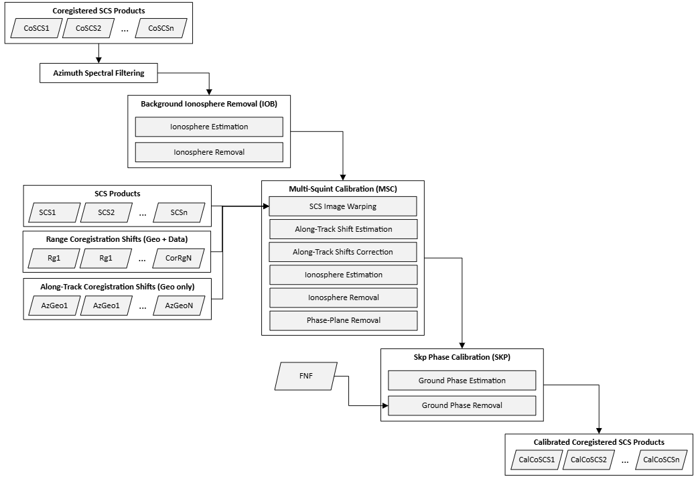
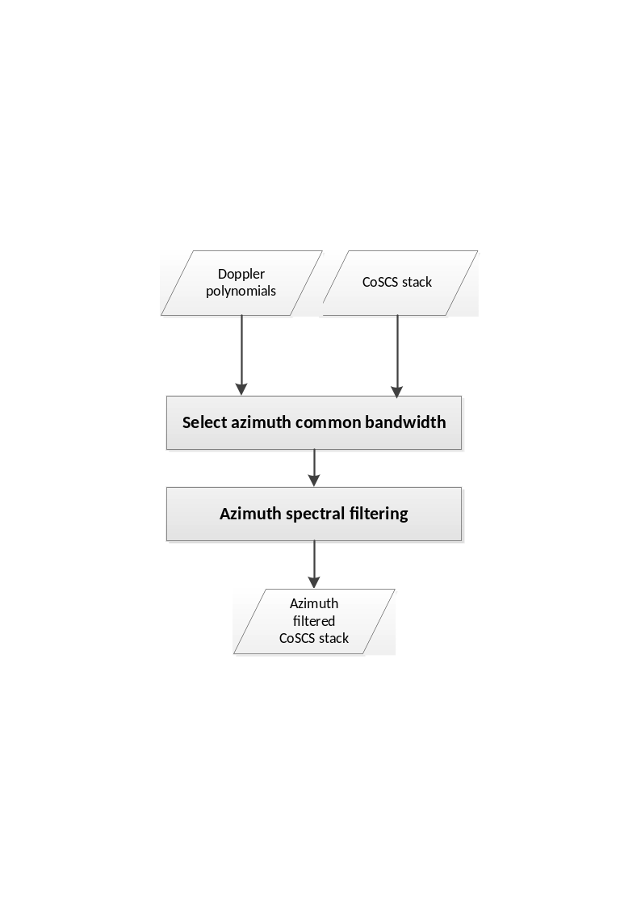
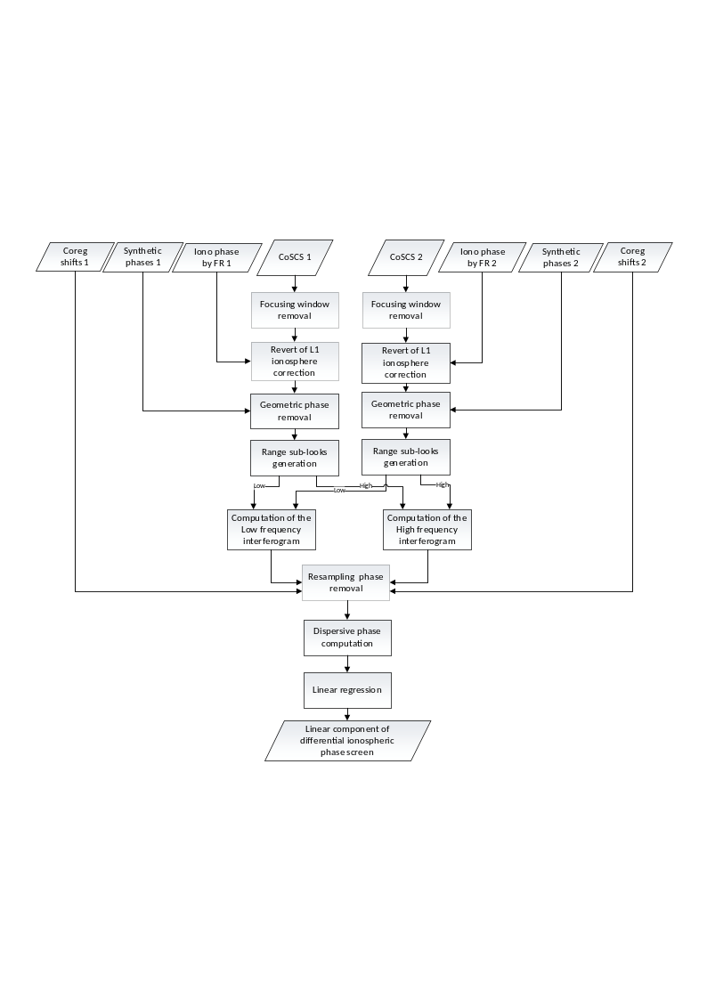
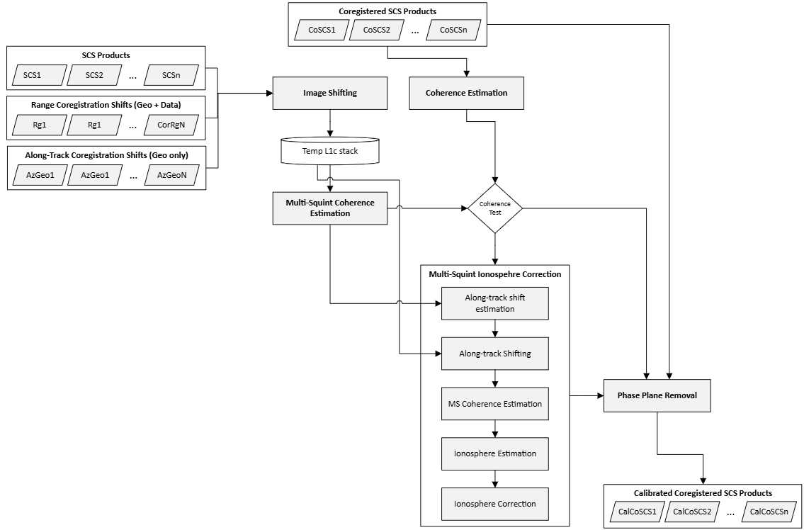
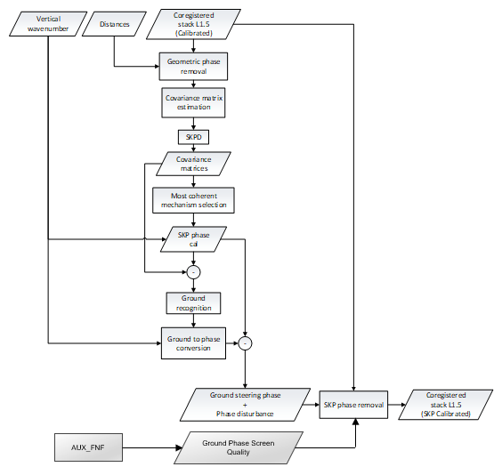
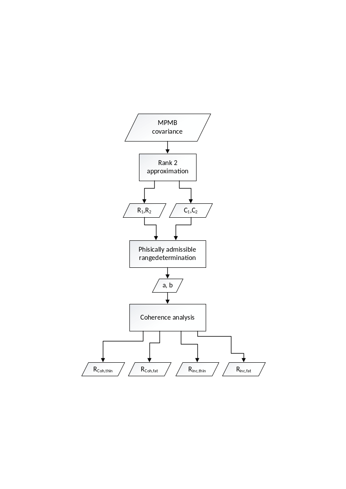
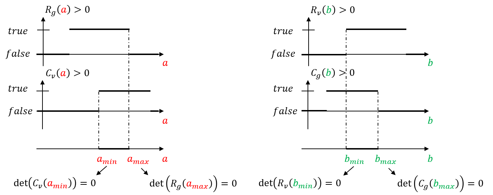

<!-- SPDX-FileCopyrightText: 2026 European Space Agency (ESA) -->
<!-- SPDX-License-Identifier: Apache-2.0 -->

:::{atbd-logo-banner}
:::

(sec:atbd-l1-stack-5)=
# 5. Calibration

The purpose of the Calibration block is to obtain a stack of coregistered images which is self-consistent from the interferometric standpoint.

The key calibration task is to estimate possible residual ionospheric phase screens that may affect the coregistered stack images. To do so, we leverage the difference in sensitivity between Faraday Rotation, which is used by the L1 processor, and the phase component of the stack images, since the former is expected to be weaker compared to the latter.

An overview of the full stack calibration algorithms is reported in {fig}`Figure|11` below. The Stack processor provides 4 calibration modules, namely:

- Common band filtering in azimuth direction, henceforth referred to as AZF. See {sec}`Section|5.1`
- Estimation and removal of the slowly varying residual ionospheric phase screen (see {sec}`Section|5.2`), henceforth referred to as the IOB module. See {sec}`Section|5.2`
- Calibrate the background phase residual via plane fitting and removal. This module is referred to as PPR and described in {sec}`Section|5.3`.
- Estimation and possibly compensation of ground-steering phase screen via the Sum of Kronecker Products (SKP) method. See {sec}`Section|5.4`.

Note that PPR and IOB are proved to be essentially equivalent, with PPR being more robust for larger baselines (e.g. above 35% of CB). The user is therefore recommended to avoid running the Stack Processor with both the module activated.

(fig:atbd-l1-stack-9)=
:::{div} atbd-mermaid-figure

Fig. 9 — Complete flow-chart of the calibration processor. Note that all steps can be optionally enabled/disabled by the user via AUX_PPS.

:::

(sec:atbd-l1-stack-5-1)=
### 5.1 Azimuth Spectral Filtering

Due to the different Doppler centroids and viewing geometries caused by the satellite’s along- and across-track baselines, two acquisitions may have non-overlapping spectral components. Therefore, a filtering operation may be required (as a matter of principle, in both directions) to ensure that the stack calibration processor uses only the common bandwidth. Such a filtering is expected to reduce the spectral decorrelation and prevents it to adversely affect the calibration procedure. Whereas range spectral filtering (see {sec}`4.2.1` for more details) is optionally applied independently in each relevant calibration module, the Azimuth Spectral Filtering (AZF) is provided as a standalone module that is optionally executed at the beginning of the entire calibration pipeline. By default, AZF is enabled but the user will have the option to disable it via configuration file (`AUX_PPS___`). The flow of the AZF is shown in the {fig}`Fig.|12` below and its main steps are described in detail in the remainder of this section.

(fig:atbd-l1-stack-10)=
:::{div} atbd-mermaid-figure

Fig. 10 — The AZF’s flow diagram.

:::

(sec:atbd-l1-stack-5-1-1)=
#### 5.1.1 Inputs and Outputs

**Inputs**

| Symbol | Name | Origin | Size | Variability | Default | Description |
|---|---|---|---|---|---|---|
| $CoSCS$ |   | Coregistration Step or AZF | M acquisition of size $[N_{az}\times{}N_{rg}]$ | M=3 (INT) or M=7 (TOM), each with 3 or 4 polarizations (2CP + 1XP or 2CP + 2XP) | - | Coregistered SCS frames |
| $\Delta\Phi$ |   | Coregistration Step | M of size $[N_{az}\times{}N_{rg}]$ | M=3 (INT) or M=7 (TOM) each with a single channel | - | Synthetic phases from DEM associated to each acquisition |
| $f_D$ |   | Coregistration Step | M of size $[1\times{}N_{rg}]$ | M=3 (INT) or M=7 (TOM) vectors | - | Doppler centroids associated to each acquisition |
|   | `azimuthSpectralFilterFlag` | `AUX_PPS` (`AUX_FMT`) | Boolean switch | True/False | True | Enable the AZF module |
|   | `usePrimarySpectralWeightingFlag` | `AUX_PPS` (`AUX_FMT`) | Boolean switch | True/False | True | Use the azimuth spectral window of the coregistration primary as common spectral window |
| $W_{\alpha}$ | `spectralWeightingWindow` | `AUX_PPS` (`AUX_FMT`) |   | Kaiser/Hamming | Hamming | A user defined common spectral window that is used for azimuth spectral windowing |
| $\alpha$ | `spectralWeightingWindowParameter` | `AUX_PPS` (`AUX_FMT`) |   | $0-\infty$ |   | Parameter assiciated to the user provided window $W_{\alpha}$ |

**Outputs**

| Symbol | Name | Destination | Size | Variability | Default | Description |
|---|---|---|---|---|---|---|
| $CalCoSCS$ |   | Stack Processor (next active module) or L1c output product | M acquisition of size $[N_{az}\times{}N_{rg}]$ | M=3 (INT) or M=7 (TOM), each with 3 or 4 polarizations (2CP + 1XP or 2CP + 2XP) | - | SCS with common bandwidth |
| ${\overline{B}}_{az,\ common}$ | `azimuthCommomBandwidth` | L1c output product | Float value [Hz] | 0.0 -- $\infty$ | - | Common bandwidth estimated by the AZF |
| ${\overline{f}}_{az,center}$ | `azimuthCentralFrequency` | L1c output product | Float value [Hz] | -$\infty$ -- $\infty$ | - | Central frequency in azimuth estimated by the AZF |

(sec:atbd-l1-stack-5-1-2)=
#### 5.1.2 Mathematical description

The AZF consists of two main components: Computing the common azimuth bandwidth and cropping the stack image spectrum to that common bandwidth. We will discuss the two in the following subsections.

(sec:atbd-l1-stack-5-1-2-1)=
##### 5.1.2.1 Estimation of azimuth common bandwidth and central frequency

A range dependent common azimuth bandwidth is computed via

$$
B_{az,common}\left[ r \right]\mathrel{:=}(B^+\left[ r \right]-B^-\left[ r \right]),
\tag{5.1}
$$ (eq:atbd-l1-stack-5-1)

where

$$
B^+\left[ r \right]\mathrel{:=}\min_{i\in{}N} (f_{D,i}\left[ r,\overline{t_{az}} \right]+\frac{B_{az,i}}{2}+\frac{1}{2\pi}\left\langle \frac{\partial({\Delta{}\Phi}_i[t_{az,},r]-{\Delta{}\Phi}_p[t_{az},r])}{\partial{}t_{az}} \right\rangle)
\tag{5.2}
$$ (eq:atbd-l1-stack-5-2)

and

$$
B^-\left[ r \right]\mathrel{:=}\max_{i\in{}N} (f_{D,i}\left[ r,\overline{t_{az}} \right]-\frac{B_{az,i}}{2}+\frac{1}{2\pi}\left\langle \frac{\partial({\Delta{}\Phi}_i[t_{az},r]-{\Delta{}\Phi}_p[t_{az,}r])}{\partial{}t_{az}} \right\rangle),
\tag{5.3}
$$ (eq:atbd-l1-stack-5-3)

with $f_{D,i}$ and $B_{az,i}$respectively the Doppler centroid and the processed azimuth bandwidth of the i-th image, $\overline{t_{az}}$ indicates the median azimuth time, $\lambda$ is the wavelength, c is the speed of light,$\ f_c$ is the RADAR’s central (carrier) frequency, $p$ is the index of the coregistration primary image, $t_{az}$ is the azimuth time with respect to the image acquisition time, $\Delta\Phi_k$ are the synthetic phases of the k-th image, and $\left\langle \ . \right\rangle$ denotes the mean.

Set $\overline{r}$ to be the median range, the stack azimuth common bandwidth and the azimuth central frequency are defined as:

- ${\overline{B}}_{az,\ common}\mathrel{:=}\ B_{az,common}\left[ \overline{r} \right]$.
- ${\overline{f}}_{az,center}\mathrel{:=}\ f_{az,center}[\overline{r}]$.

(sec:atbd-l1-stack-5-1-2-2)=
##### 5.1.2.2 Spectral filtering

The spectral cropping component of the AZF can be summarized in the following steps, which are performed for each range bin of each image frame and for each frame polarization:

1. The azimuth lines of the image are zero-padded by rounding the number of samples to the next power of 2, that is:

(equation-eq-atbd-l1-stack-5-4)=
\begin{equation}
I_i^{zp}(a,r)\ :=\left\{ \begin{matrix} \ {CoSCS}_i(a,r),\ \ \ \ \ \ \ 0\leq{}a<N_{az}\ \ \ \\ 0,\ \ \ \ \ \ \ \ \ \ \ \ \ \ \ \ \ \ N_{az}\leq{}a<\ N_{zp} \end{matrix} \right.
\tag{5.4}
\end{equation}

where $N_{az}$ is the number of the azimuth lines within the processed bandwidth and $N_{zp}$ is the number of zero-padded azimuth lines, defined as

$$
N_{zp}\mathrel{:=}{}round\left[ 2^{\left\lfloor \frac{ln({N)}{}}{\ln (2)} \right\rfloor} \right]
\tag{5.5}
$$ (eq:atbd-l1-stack-5-5)

2. Fourier transform the azimuth line of the image ($I_i$).

$$
Ι_i(f_a,r)\mathrel{:=}{FFT(I}_i^{zp}(a,\ r)).
\tag{5.6}
$$ (eq:atbd-l1-stack-5-6)

4. Multiply the line by the inverse of the azimuth weighting function $W_{foc}(r)$ that was used during image focusing:

$$
\ I_i^w(f_a,r)\mathrel{:=}Ι_i(f_a,r).\frac{1}{W_{foc}(r)}\ \ .
\tag{5.7}
$$ (eq:atbd-l1-stack-5-7)

|   |   |   |
|---|---|---|

5. Roll the common spectral window to centre the spectrum at $f_{az,center}\left[ r \right]\mathrel{:=}{(B}^+\left[ r \right]+B^-[r])/2$, that is

$$
\ I_i^{bb}(f_a;r)=\ I_i^w(f_a+f_{az,center}[r];r),
\tag{5.8}
$$ (eq:atbd-l1-stack-5-8)

6. Multiply the line by the rolled common spectral window $W_c$, which can be either the window $W_{foc}$ used for focusing the data or a user provided window $W_{\alpha}$:

$$
I_i^{cb}(f_a,r)\mathrel{:=}{}I_i^{bb}(f_a,r)\bullet\ W_c(f_a+f_{az,center}[r]),
\tag{5.9}
$$ (eq:atbd-l1-stack-5-9)

7. Apply the inverse Fourier transform:

$$
I_i^{cb}(a;\ r)\mathrel{:=}{}iFFT(I_i^{cb}(f_a;r)),
\tag{5.10}
$$ (eq:atbd-l1-stack-5-10)

8. Remove the 0-padding added at step 1:

$$
{CalCoSCS}_i(a;r)=I_i^{cb}(a;r),\ \ \ \ \ \ \ 0\leq{}a<N_{az}
\tag{5.11}
$$ (eq:atbd-l1-stack-5-11)

(sec:atbd-l1-stack-5-2)=
### 5.2 Slow-Varying Ionosphere Estimation and Removal

The Slow-varying Ionosphere Removal module (IOB) is an interferometric module that is responsible for detecting and correcting the low-pass phase artifacts caused by the interaction of the RADAR signal with the ionosphere, while ignoring other phase components that may derive from other sources of noise including the fast-varying ionosphere or baseline errors. The module consists of an interferometric estimator that executes a sequence of intermediate steps, which are described in detail in the remainder of the section and can be summarized as follows: Given an interferometric image pair,

1. Preprocess the two SCS images by whitening the range spectrum and removing the synthetic phases from DEM,
2. Compute range sub-looks by selecting bands at the extremities of the range spectrum (high/low range sub-looks),
3. Compute the interferometric coherences associated to the upper and lower sub-looks, and their phases,
4. Apply the Split-Spectrum method {rd}`9` on those phases to isolate the dispersive component of the ionosphere from the nondispersive one,
5. Estimate the slow-varying components of the ionosphere via Least-Square (LS) estimation of a phase plane on the entire swath.

It is important to note that at step 5 only a linear approximation of the ionosphere is computed. This descends from the fact that, due to the narrow bandwidth of the BIOMASS’s RADAR system, only linear components of the ionospheric phase screens can be computed by the approach described in the previous steps 1 - 4.

Since the IOB core estimator is defined for an interferometric pair, to define an estimation for each stack image, we provide two (2) modalities, namely:

- Single-baseline: The estimated ionosphere is the ionosphere estimated for the sole interferometric image pair consisting of the image and the calibration reference (see below).
- Multi-baseline (default): Ionospheric phase screens are estimated for each possible image pair whose normal baseline does not exceed a user defined threshold, which is expressed as a percentage of the critical baseline and configurable via `AUX_PPS`. For each image a single phase-screen is defined via an optimality criterion based on least squares (LS). More details in the remainder of the section.

Note that the module is endowed with a set of configurable parameters (as reported in the Input table below or in the `AUX_FMT` document), most of which the reader will find self-explanatory as the method is outlined in detail. Among those, the noticeable non-trivial ones are:

- `latitudeThreshold`: As per physical (and experimental) evidence, slow-varying ionospheric effects are to be expected only at the low latitudes (tropical regions), thus it is reasonable to assume that it is better to skip any correction/estimation of the ionosphere at the high latitudes. This parameter specifies the threshold latitude (North/South) above/below which the IOB estimation is not executed.
- `calibrationPrimaryImage`: Since the module is interferometric, no absolute ionosphere can be estimated for any image. Consequently, to resolve the ambiguity, the existence of a reference ionosphere-free image must be assumed. As it will be described in the details in the next sections, no ionosphere (null phase screen) correction will be performed in any case for such reference image.
- `slowIonosphereQualityThreshold`: This parameter specifies a minimum estimation quality for the ionosphere to be corrected. Ionosphere estimations below this threshold value will be ignored.

Finally, note that since for the Single-baseline modality the slow-varying ionosphere estimator is equivalent to the results of the IOB interferometric estimator, we will identify the two and henceforth call the IOB estimator Single-baseline estimator.

(sec:atbd-l1-stack-5-2-1)=
#### 5.2.1 Inputs and Outputs

**Input**

| Symbol | Name | Origin | Size | Variability | Default | Description |
|---|---|---|---|---|---|---|
| $CoSCS_n$ |   | Coregistration Step or AZF | M acquisition of size $[N_{az}\times{}N_{rg}]$ | M=3 (INT) or M=7 (TOM), each with 3 or 4 polarizations (2CP + 1XP or 2CP + 2XP) | - | Coregistered SCS frames, possibly from previous calibration step (i.e. AZF) |
| $\Delta\Phi_n$ |   | Coregistration Step | M of size $[N_{az}\times{}N_{rg}]$ | M=3 (INT) or M=7 (TOM) each with a single channel | - | Synthetic phases from DEM associated to each acquisition |
| $k_z$ |   | Coregistration Step | M of size $[N_{az}\times{}N_{rg}]$ | M=3 (INT) or M=7 (TOM) each with a single channel |   | Vertical wavenumbers |
| $\Delta\phi_{L1a}$ |   | L1a and Coregistration step | M of size $[N_{az}\times{}N_{rg}]$ | M=3 (INT) or M=7 (TOM) each with a single channel | - | Ionospheric phase screen estimated by L1 processor and shifted onto the primary grid |
| $\delta_{\phi_{L1a}}$ |   | L1a and Coregistration step | M of size $[N_{az}\times{}N_{rg}]$ | M=3 (INT) or M=7 (TOM) each with a single channel |   | Spatial range shifts due to ionosphere estimated by the L1 processor and shifted onto the primary grid |
| $n^*$ | `calibrationReferenceImage` | Job\_Order (ProcParameter – calibration\_primary\_imge) or `AUX_PPS` (`primaryImageFlag`). See {sec}`5.2.3.1` | Integer | 1 – M with M=3 (NT) or M=7 (TOM) | - | Index of the calibration reference image |
|   | `slowIonosphereRemovalFlag` | `AUX_PPS` (`AUX_FMT`) | Boolean switch | True/False | True | Enable/disable the IOB module |
| $B_{sub}$ | `rangeLookBandwidth` | `AUX_PPS` (`AUX_FMT`) | Float value [%] | 0.0 – 1.0 | 0.3 | Percentage of bandwidth when computing the sub-looks |
| $f_{sub}$ | `rangeLookFrequency` | `AUX_PPS` (`AUX_FMT`) | Float value [%] | 0.0 – 0.5 | 0.3 | Percentage of frequency band when computing the sub-looks |
|   | `polarisationUsed`⁽⁵⁾ | `AUX_PPS` (`AUX_FMT`) |   | HH / HV / VH / VV / XX | HH | Reference polarization used in the pre-processing step |
|   | `phaseUnwrappingFlag` | `AUX_PPS` (`AUX_FMT`) | Boolean switch | True/False | True | Unwrap interferogram phase during single baseline estimation |
|   | `latitudeThreshold` | `AUX_PPS` (`AUX_FMT`) | Float value [deg] | 0 - $\infty$ | 40.0 | Latitude (N/S) below (above) which IOB is skipped |
|   | `baselineMethod` | `AUX_PPS` (`AUX_FMT`) | Literal | Multi-Basline, Single-Baseline | Mutli-Baseline | As to whether MB or SB estimation is executed |
|   | `unweightedMulitBaselineEstimation` | `AUX_PPS` (`AUX_FMT`) | Boolean switch | True/False | False | In MB, equally weigh all estimations. If False, use weights from the coherence map |
|   | `compensateL1PhaseScreenFlag` | `AUX_PPS` (`AUX_FMT`) | Boolean switch | True/False | True | Pre-compensate phase screen correction from L1, if set to True |
|   | `sublookWindowAzimuthSize` | `AUX_PPS` (`AUX_FMT`) | Float | 1 - $\infty$ | 201 | Number of looks in azimuth direction for computing the low/high sub-looks |
|   | `sublookWindowRangeSize` | `AUX_PPS` (`AUX_FMT`) | Float | 1 - $\infty$ | 41 | Number of looks in direction range for computing the low/high sub-looks |
|   | `multiBaselineCriticalBaselineThreshold` | `AUX_PPS` (`AUX_FMT`) | Float | 0 – 1 | 0.45 | In MB, Interferometric pairs with baseline exceeding this percentage of the critical baseline are ignored |
| $\theta_{PU}$ | `maxDeltaPhaseUnwrapTest` | `AUX_PPS` (`AUX_FMT`) | Float | 0 - $\infty$ | 0.5 rad | Threshold for the phase unwrapping test |
| $\theta_{\gamma}$ | `minCoherenceThreshold` | `AUX_PPS` (`AUX_FMT`) | Float | 0 – 1 | 0.0 | Threshold on the coherence that specifies which pixels should be used or not for phase-plane fitting. |
| $\theta_{PV}$ | `minUsablePixelRatio` | `AUX_PPS` (`AUX_FMT`) | Float | 0 – 1 | 0.05 | Minimum fraction of valid pixels according to coherence and phase unwrapping test to perform the phase-plane fitting |
|   | `slowIonosphereQualityThreshold` | `AUX_PPS` (`AUX_FMT`) | Float value [%] | 0 – 1 | 0.0 | Estimations with quality below this threshold are ignored |

[5] Note that this parameter is configurable only at the calibration level and not module by module. In other words, the selected value is common to all calibration modules (but not necessarily the same used for coregistration).

**Output**

| Symbol | Name | Destination | Size | Variability | Default | Description |
|---|---|---|---|---|---|---|
| $CalCoSCS_n$ |   | Stack Processor (next active module) or L1c output | M acquisition of size $[N_{az}\times{}N_{rg}]$ | M=3 (INT) or M=7 (TOM), each with 3 or 4 polarizations (2CP + 1XP or 2CP + 2XP) | - | SCS with no slow varying ionosphere phase |
| ${\partial_t}_{az}\phi_n$ | `slowIonosphereAzimuthPhaseScreen` | L1c output product | Float value [rad/s] | M real numbers | - | The azimuth slope of the slow-varying phase screen estimated by the IOB (1 per input frame) |
| $\partial_{t_{rg}}\phi_n$ | `slowIonosphereRangePhaseScreen` | L1c output product | Float value [rad/s] | M real numbers | - | The range slope of the slow-varying phase screen estimated by the IOB (1 per input frame) |
| $q_n$ | `slowIonosphereQuality` | L1c output product | Float value [%] | M values in 0.0 – 1.0 | - | The estimation qualities (1 per input frame) |

(sec:atbd-l1-stack-5-2-2)=
#### 5.2.2 Single-Baseline Estimator

As mentioned in the previous section, the single-baseline estimation is an interferometric approach that relies on the dispersive effects of the ionospheric medium to estimate the linear components of the differential ionospheric phase. Before describing the algorithm in detail, it is worthwhile noting that the pairwise range spectral filtering is not applied as pre-processing of this module because the range sub-looks extraction in the IOB implies restricting the method on the range common band. An overview of the method is reported in {fig}`Fig.|13`.

The main component of the module is based on the Split-Spectrum Method {rd}`9` which exploits the separation properties of the dispersive ($\Delta\phi_{iono}$) and nondispersive ($\Delta\phi_{nd}$) interferometric phases in the range frequency domain. More precisely, the interferometric phase can be modelled as the sum of the dispersive and non-dispersive components: Setting $\Delta\phi$ to be the interferometric phase associated to an SCS image pair and $f_c$ the central (carrier) frequency, then:

(equation-eq-atbd-l1-stack-5-13)=
\begin{equation}
\begin{aligned}
\Delta{}\phi=\frac{4\pi{}f_c}{c}\ \Delta{}r_{nd}-\frac{4\pi{}K}{cf_c}\Delta{}TEC \\
=\Delta\phi_{nd}+\Delta\phi_{iono},
\end{aligned}
\tag{5.13}
\end{equation}

where $c$ is the speed of light, and $\Delta{}TEC,\ \Delta{}r_{nd}$, and $K$ are physical quantities dependent upon the ionosphere scenario and whose characterization lies beyond the scope of this document.

(fig:atbd-l1-stack-11)=
:::{div} atbd-mermaid-figure

Fig. 11 — Block diagram representing the single-baseline IOB estimation.

:::

The range Split-Spectrum leverages the different frequency behavior of the two ionosphere components to decouple them. In the remainder of the section, we will describe each sub-step in detail.

(sec:atbd-l1-stack-5-2-2-1)=
##### 5.2.2.1 Pre-processing

The pre-processing step is applied independently to each coregistered image $CoSCS_n$ on a reference polarization, as specified in the AUX-PPS configuration, to obtain $M$ images $I_n$. The step consists of the following sub-steps:

1. Focus range spectral weighting removal:$\ I_n\leftarrow{Win}_{rg}^{-1}[CoSCS_n]$
2. Removal of the geometric phase screens from DEM: $I_n\leftarrow{}I_n\cdot{}e^{j\Delta\Phi_n}$

(sec:atbd-l1-stack-5-2-2-2)=
##### 5.2.2.2 Range sub-look extraction

The range sub-look generation computes two versions from each coregistered pre-processed input image. More in details, sub-looks are set to be centered within the range common bandwidth of the interferometric image pair and symmetrically with respect of the carrier frequency, that is, $f_L\mathrel{:=}{}f_c-f_{sub}$ and $f_H\mathrel{:=}{}f_c+f_{sub}$, where $f_{sub}$ is a user configurable parameter defaulted to one third (1/3) of the range common bandwidth. Accordingly, the two range sub-looks of the pre-processed image $I_n(a,r)$ are obtained as:

(equation-eq-atbd-l1-stack-5-14)=
\begin{equation}
\begin{aligned}
I_{n,L}(a,r)\mathrel{:=}\left\{ (I_n(a,r)\ \cdot{}e^{-j2\pi{}f_Lr})*h(r) \right\}\cdot{}e^{j2\pi{}f_Lr}, \\
I_{n,H}(a,r)\ :=\left\{ {(I}_n(a,r){\cdot{}e}^{-j2\pi{}f_Hr})*h(r) \right\}{\cdot{}e}^{j2\pi{}f_Hr},
\end{aligned}
\tag{5.14}
\end{equation}

where:

- $*$ denotes the linear convolution operator,
- $h(r')$ is the impulse response of a real-valued low-pass filter corresponding to range bandwidth $B_{sub}$, which is a configurable fraction of the full bandwidth and defaults to one third (1/3) of the range common bandwidth. In the implementation provided, a Gaussian low-pass filter is used.

(sec:atbd-l1-stack-5-2-2-3)=
##### 5.2.2.3 Interferometric phase extraction

Given the interferometric pair of preprocessed sub-looked images $I_{k,X}$ with $k=n,m$ and $X\in{H,L}$, the interferometric phase for each range sub-band is computed as follows:

(equation-eq-atbd-l1-stack-5-15)=
\begin{equation}
\begin{aligned}
\Delta\phi_L\mathrel{:=}\angle{}Coh(I_{n,L\ },I_{m,L}), \\
\Delta\phi_H\mathrel{:=}\angle{}Coh(I_{n,H\ },I_{m,H}),
\end{aligned}
\tag{5.15}
\end{equation}

where $\cdot^*$ denotes the complex conjugation$,$ $\angle$ is the phase extraction operator, and $Coh$ represents the interferometric coherence associated to an image pair

$$
Coh(I_p,I_s)\mathrel{:=}\frac{\left\langle I_s\cdot{}I_p^* \right\rangle}{\sqrt{\left\langle {\vert{}I}_s\left. \right\vert^2 \right\rangle\left\langle {\vert{}I}_p\left. \right\vert^2 \right\rangle}},
\tag{5.16}
$$ (eq:atbd-l1-stack-5-16)

with $\left\langle \cdot \right\rangle$ being a local average operator. in the provided implementation a uniform filter with a default $201\times41$ boxcar kernel, which corresponds to approximately to a 200m x 200m window in azimuth and slant-range directions. The size of the filter is however configurable via `AUX_PPS` (see `sublookWindowAzimuthSize` and `sublookWindowRangeSize` in {sec}`Section|5.2.1`).

(sec:atbd-l1-stack-5-2-2-4)=
##### 5.2.2.4 Split-Spectrum

Owing to Split-Spectrum method {rd}`9`, the following equalities hold and can be exploited to estimate the dispersive and nondispersive phase screens:

(equation-eq-atbd-l1-stack-5-17)=
\begin{equation}
\begin{aligned}
\Delta\phi_L=\Delta\phi_{nd}\frac{f_L}{f_c}+\ \Delta\phi_{iono}\frac{f_c}{f_L} \\
\Delta\phi_H=\Delta\phi_{nd}\frac{f_H}{f_c}+\ \Delta\phi_{iono}\frac{f_c}{f_H}
\end{aligned}
\tag{5.17}
\end{equation}

where $f_c$ is the central (carrier) frequency.

Accordingly, it follows from inverting the linear system in {eq}`Equation|5.16` that the slow-varying ionosphere is

$$
\Delta\phi_{iono}=\frac{f_Lf_H}{f_c(f_H^2-f_L^2)}(\Delta\phi_Lf_H-\ \Delta\phi_Hf_L).
\tag{5.18}
$$ (eq:atbd-l1-stack-5-18)

Although the method described above defines a general approach for discriminating the dispersive ionosphere from the non-dispersive one, it may be affected by biases caused by the different temporal shifts between the coregistration process and the synthetic phase removal. It can be proved (but the proof is not in the scope of this document) that such phase bias can be compensated into the low/high interferogram phases by setting:

(equation-eq-atbd-l1-stack-5-19)=
\begin{equation}
\begin{aligned}
\mathrm{\Delta}\phi_L^{'}\mathrel{:=}\mathrm{\Delta}\phi_L-f_c^{-1}(f_L-f_c)\Delta\phi_{bias}, \\
\mathrm{\Delta}\phi_H^{'}\mathrel{:=}\mathrm{\Delta}\phi_H-f_c^{-1}(f_H-f_c)\Delta\phi_{bias},
\end{aligned}
\tag{5.19}
\end{equation}

with $\Delta\phi_{bias}\mathrel{:=}2\pi{}f_c\tau_{rg}-\Delta\Phi_n+\frac{4\pi}{c}f_c\ \delta_{\phi_{L1a}}-\Delta\phi_{L1a}$, and:

- $\tau_{rg}$ are the range coregistration shifts (time) of the interferometric pair (see {sec}`Section|4`)
- $\Delta\Phi_n$ are the geometric phase screens from the DEM
- $\delta_{\phi_{L1a}}$are the ionospheric spatial range shifts estimated by the L1 processor
- $\Delta\phi_{L1a}$ is the ionosphere phase screen estimated by the L1 processor.

Note that the compensation of the ionosphere phase screen and range shifts from L1 is optional and can be enabled or disabled by the user via `AUX_PPS` (see `compensateL1IonoPhaseScreenFlag`).

The final slow-varying ionosphere $\Delta\phi_{iono}^{'}$ can be computed via {eq}`Equation|5.16` and using the compensated high/low phase screens $\Delta{\phi'}_L$ and $\Delta{\phi'}_H$.

At this stage, phase unwrapping based on {rd}`21` can be optionally applied to $\Delta{\phi'}_L$ and $\Delta{\phi'}_H$ to aid the linear regression. As to whether such phase unwrapping should be performed is the responsibility of the user, which can enable or disable it using a configurable parameter. By default, the phase unwrapping is executed.

If phase unwrapping is performed, the resulting unwrapped phase screens are compared to flag pixels that are affected by possible phase unwrapping errors (see {rd}`25`). For this, the following simple pixelwise check is executed:

$$
T_{PU}\mathrel{:=}\left\vert (\Delta\phi_H-\Delta\phi_L)-\mu_{1/2}(\Delta\phi_H-\Delta\phi_L) \right\vert\geq\theta_{PU},
\tag{5.19}
$$ (eq:atbd-l1-stack-5-19-2)

where $\mu_{1/2}$ represents the median operator over the entire frame. Pixels whose $T_{PU}$ value exceeds a user defined threshold will be ignored in the phase estimation step described in {sec}`Section|5.2.2.5` below.

This test is used to flag which pixels are to be considered valid for the estimation. IOB provides an accessory test based on the coherence, that is, a pixel is considered invalid if the coherence is below a threshold $\theta_{\gamma}$ specified via AUX-PPS. Accordingly, a pixel is considered valid if both the validity tests pass. If the ratio of valid pixel is below a user defined threshold $\theta_{PV}\in[0,\ 1)$, the SB estimation is considered invalid and will be ignored (see {sec}`Section|5.2.5` for more details on contingency cases).

(sec:atbd-l1-stack-5-2-2-5)=
##### 5.2.2.5 Phase screen estimation

Due to the theoretical limitation in estimating the slow-varying ionosphere for the whole swath {rd}`5`, we approximate via weighted Least-Square estimation the linear phase screens (plane). More formally, the estimated phase slopes $\partial_a\phi_{sb}^{p,s}$ and $\partial_r\phi_{sb}^{p.s}$ (and constant intercept $\phi_0$) for an interferometric pair $p,s$ are defined as

(equation-eq-atbd-l1-stack-5-20)=
\begin{equation}
\begin{bmatrix}
\partial_a\phi_{sb}^{p,s} \\
\partial_r\phi_{sb}^{p,s} \\
\phi_0
\end{bmatrix}\mathrel{:=}(F^T\cdot{}W_{sb}\cdot{}F)^{-1}\cdot{}F^T\cdot{}W_{sb}\cdot{}vec(\Delta\phi_{iono}^{'}),
\tag{5.20}
\end{equation}

where $F$ is a $N_{az}N_{rg}\times3$ matrix so that $F_{i0}\mathrel{:=}\left\lfloor i/N_{rg} \right\rfloor$, $F_{i1}\mathrel{:=}{}i\ (\mod\ N_{az})$, and $F_{i2}\mathrel{:=}1$, $W_{sb}$ is the $N_{az}N_{rg}\times{}N_{az}N_{rg}$ diagonal matrix so that $W_{sb,i,i}\mathrel{:=}\gamma_i\cdot{}T_{PU,i}\cdot(\gamma_i\geq\theta_{\gamma})$ with$\ \gamma_i$ the $i$-th pixel’s coherence of the interferometric pair $(p,s)$ computed as in {eq}`Equation|5.15` but with a finer resolution (e.g. using a $5\times5$ boxcar kernel), $T_{PU,i}\in{0,\ 1}$ is the $i$-th pixel’s validity associated to the phase unwrapping test described in {sec}`Section|5.2.2.3`, if applicable, and finally, $vec(\Delta\phi_{iono}^{'})$ is the $N_{az}N_{rg}\times1$ vector obtained by stretching the element of the ionosphere phase screen into a 1D column array.

Note that to convert $\partial_x\phi_n^{p,s}$ into $\partial_{t_x}\phi_n^{p,s}$, i.e. slopes expressed with respect to samples into slopes expressed with respect to time axes, it is enough to normalize the terms by the associated sampling steps.

As final step, the quality of the estimation is defined as:

$$
q_{sb}^{p,s}=\frac{1}{N_{az}N_{rg}}\sum_{a,r}^{}{\sqrt{\frac{1}{2\sigma_{iono}^2+1}}},
\tag{5.21}
$$ (eq:atbd-l1-stack-5-21)

with $\sigma_{iono}$ is the standard deviation of the ionospheric estimation computed as:

$$
\sigma_{iono}\mathrel{:=}\frac{3f_0}{4(f_H-f_L)}\sqrt{\frac{3(1-\gamma^2)}{N\ \gamma^2}},
\tag{5.22}
$$ (eq:atbd-l1-stack-5-22)

where:

- $N$ is the number of average samples,
- $\gamma$ is the absolute value of the interferometric coherence map estimated in azimuth and range directions between the interferometric pair,

If the user has selected the Single-baseline modality, the final estimated dispersive ionosphere components will be set to be

$$
\partial_x\phi_{sb}^n\mathrel{:=}\partial_x\phi_{sb}^{n,n^*}\cdot\boldsymbol{I}_{q_{sb}^{n,n^*}>\ q_{thres}},\ \ \ \ n\neq{}n^*,\ x\in\left\{ r,a \right\},
\tag{5.23}
$$ (eq:atbd-l1-stack-5-23)

where $\boldsymbol{I}_{q_{sb}^{n,n^*}>\ q_{thres}}\boldsymbol{\in{}0,1\boldsymbol{}}$ is the quality indicator that disables the estimation if the quality does not reach the minimum estimation quality threshold, as specified by the user. Also $\partial_x\phi_{sb}^{n^*}\mathrel{:=}0$, i.e. the calibration reference image is set to have no ionosphere components.

(sec:atbd-l1-stack-5-2-3)=
#### 5.2.3 Multi-Baseline

The Multi-baseline modality combines the single-baseline estimations associated to input $K$ interferometric pairs into $M-1$ differential ionospheric phase screens by computing the phase screens that best fit all the single-baseline estimations . Note that, with the Multi-baseline modality, interferometric pairs are selected according to their spatial baseline and only pairs whose spatial baseline does not exceed a user defined threshold are considered for estimation (see `multiBaselineCriticalBaselineThreshold` in {sec}`Section|5.2` and Output Table in {sec}`Section|5.2.1`). By default, the threshold is set to be 45% of the critical baseline.

In the Multi-baseline modality, given the $K$ range slopes and $K$ azimuth slopes associated the selected interferometric pairs in the stack, the ionospheric phase ramps in azimuth will be estimated by solving the following linear system:

(equation-eq-atbd-l1-stack-5-24)=
\begin{equation}
(F^T\cdot{}W_{sb}^l\cdot{}F)\cdot\begin{bmatrix} \partial_l\phi_{mb}^0 \\ \partial_l\phi_{mb}^1 \\ \vdots \end{bmatrix}=(F^T\cdot{}W_{sb}^l)\cdot\begin{bmatrix} \partial_l\phi_{sb}^{0,1} \\ \partial_l\phi_{sb}^{0,2} \\ \vdots \end{bmatrix},
\tag{5.24}
\end{equation}

where:

- $F$ is the $\left[ K\times{}M \right]$multi-baseline matrix so that $F_{ij}\mathrel{:=}\pm1$ if $j$ is respectively the secondary or primary image index of the $i$-th interferometric pair, $0$ otherwise.
- $\partial_x\phi_{sb}^{p,s}$is the single-baseline ionospheric phase ramp in azimuth or range direction $l\in{a,\ r}$ associated to the interferometric pair $p,s$.
- $W_{sb}^l$ is the $\left[ K\times{}K \right]$ diagonal matrix defined as follows (see {rd}`25`):

$$
W_{sb,i,i}^l\mathrel{:=}1/{((C^T\Omega_iC)}^{-1}\left. \right\vert_l)\ ,
$$

with $\left. \right\vert_l$ representing the element of the diagonal associated to the coordinate/direction $l$ and:

$$
\Omega_i\mathrel{:=}\begin{bmatrix}
\sigma_{iono,i}^2(x_1,r_1) & \ldots & 0 \\
\vdots & \ddots & \vdots \\
0 & \ldots & \sigma_{iono,i}^2(x_{N_{az}N_{rg}},r_{N_{az}N_{rg}})
\end{bmatrix}^{-1},
$$

$$
C\mathrel{:=}\ \begin{bmatrix}
x_1 & r_1 & 1 \\
\vdots & \vdots & \vdots \\
x_{N_{az}N_{rg}} & r_{N_{az}N_{rg}} & 1
\end{bmatrix},
$$

where $\sigma_{iono,i}^2$ is the variance of the ionosphere computed as in {eq}`Equation|5.19` for the $i$-th interferometric pair and $x_k$ and $r_k$ are respectively the centered azimuth and centered slant-range position of the look, that is, for $k=1,\ldots,N_{az}N_{rg},$ they are defined as $x_k\mathrel{:=}\left\lfloor k/N_{rg} \right\rfloor\cdot{}dx-\overline{x}$ and $r_k\mathrel{:=}\ k\ (\mod\ N_{az})\cdot{}dr-\overline{r}.$

The linear system at {eq}`Equation|5.21` has rank $M-1$. To resolve the system’s underdetermination, we will assume that all phase ramps will be defined with respect to a fiducial image, that it is known being the least affected by dispersive ionosphere. Accordingly, the final phase ramps will be

$$
\partial_l\phi_n\ :=(\partial_l\phi_{mb}^n-\partial_l\phi_{mb}^{n^*})\cdot\boldsymbol{I}_{q_{mb}^n>q_{thres}}\ ,\ \ l\in{a,r};\ n=1,\ldots\ ,\ M
\tag{5.25}
$$ (eq:atbd-l1-stack-5-25)

where $n^*$ denotes the index of such reference image and again $\boldsymbol{I}_{q_{mb}^n>q_{thres}}\boldsymbol{\in{}0,1\boldsymbol{}}$ is the quality indicator that disables the estimation if the quality does not reach a threshold specified by the user. The quality index of the multi-baseline approach $q_n^{IoB}$ can be estimated from the single-baseline quality indexes $\boldsymbol{q}_{\boldsymbol{sb}}$ solving the following a linear system similarly to that of {eq}`Equation|5.15`:

$$
F^T\cdot{}W_{sb}\cdot{}F\cdot\boldsymbol{q}_{mb}=F^T\cdot{}W_{sb}\cdot\boldsymbol{q}_{\boldsymbol{sb}},
\tag{5.26}
$$ (eq:atbd-l1-stack-5-26)

with $W_{sb}$ defined as the $K\times{}K$ diagonal matrix with the $k$-th diagonal entry containing the quality terms in {eq}`Equation|5.18` associated to the $k$-th interferometric pair.

Note that during Multi-baseline estimation, the weighting term $W_{sb}^l$ and $W_{sb}$ can be optionally substituted by a uniform weighting matrix (i.e. both matrices substituted with the identity matrix) using the related configuration parameter.

(sec:atbd-l1-stack-5-2-3-1)=
##### 5.2.3.1 Reference Image Selection

To select the reference image, the stack processor exposes three (3) options:

1. Manually select the reference via Job Order,
2. Use the coregistration primary image as calibration reference. This is selected via the `primaryImageFlag` tag of the `AUX_PPS` (see `AUX_FMT` for more details). Note that if both 1 and 2 are engaged, 2 is ignored.
3. If neither of the two above are specified, let the stack processor choose the best image according to the Faraday decorrelation indices and RFI indices computed by the L1 processor.

Options 1 and 2 are trivial. As for option 3, we will combine the two metrics simply by setting

$$
n^*\mathrel{:=}\argmax_{n} (\ \gamma_n^{FR}\cdot\gamma_n^{RFI}),
\tag{5.27}
$$ (eq:atbd-l1-stack-5-27)

where:

- $n$ is the index of the image in the stack.
- $\gamma_n^{FR}$ denotes the decorrelation computed from the standard deviation of the residual phase provided by the L1 processor for the ionosphere correction: Setting the Faraday rotation to be $\sigma_{FR,\ n}$:

$$
\gamma_{FR}^n\mathrel{:=}\sqrt{\frac{1}{2\sigma_{FR,\ n}^2+1}},
\tag{5.28}
$$ (eq:atbd-l1-stack-5-28)

- $\gamma_n^{RFI}$ is the expected decorrelation map due to the RFI patterns in the $n$-th image corrected by the RFI mitigation of the L1 processor for the polarization used in the calibration. Details on how to compute the decorrelation from the RFI patterns is available in {sec}`Section|3.1.3.2`.

(sec:atbd-l1-stack-5-2-4)=
#### 5.2.4 Slow-Varying Ionosphere Removal

The slow changing ionosphere removal takes as input the parameters estimated by the previous step and removes the corresponding phase screens from the stack.

The linear components estimated during the previous step are used to compute the phase screen on the grid of the reference image and then removed from the coregistered data $CoSCS_n$ as follows:

$$
CalCoSCS_n\mathrel{:=}{}CoSCS_n\cdot{}e^{-j\phi_{IoB,n}},
\tag{5.29}
$$ (eq:atbd-l1-stack-5-29)

where:

- $n$ is the image index,
- $\phi_{IoB,n}(a,r)$ is the slow changing ionospheric phase screen for that image defined as

$$
\phi_{IoB,n}(a,r)\mathrel{:=}\partial_a\phi_n\cdot(a-\overline{a})+\partial_r\phi_n\cdot(r-\overline{r})\ .
\tag{5.30}
$$ (eq:atbd-l1-stack-5-30)

With $a=1,\ldots,N_{az}$, $r=1,\ldots{}N_{rg}$, and $(\overline{a}$, $\overline{r}$) the central pixel of the image

(sec:atbd-l1-stack-5-2-5)=
#### 5.2.5 Contingency Handling

Within the IOB module the only expected contingency case is the failure of the SB estimator for an interferometric pair. The module handles such a case in the following way:

- If Single-baseline is executed, no failures are accepted. Any failure occurring in the SB estimator will result in the stack exiting gracefully with an error.
- During Multi-baseline, all interferometric combinations that result in a normal baseline below the requested threshold are considered, thus failures are allowed as long as the factor graph defined by the SB (pairwise) estimations is connected. More in detail, let $G\mathrel{:=}(v_n,\varepsilon_{ij})$ be the undirected graph with vertices $v_n$ defined as the estimation states, i.e. the slow-ionosphere phase screen slopes in azimuth (range) direction, and edges $\varepsilon_{ij}$ connecting vertices $v_i$ and $v_j$ if and only if the SB estimation between frames $i$ and $j$ was successful. From an information theory’s standpoint, it is trivial to see that the Multi-baseline problem can be uniquely solved if and only if the graph $G$ is connected⁽⁶⁾. It is a well-known fact that the number of connected components equals the dimension of the null space of the Laplacian matrix $L_G$ of $G$, which can be efficiently computed. Accordingly, the Multi-baseline estimation is executed if and only if $\dim{Ker}(L_G)=1.$ The stack exits gracefully with an error otherwise.

[6] Note that the contingency handling of the Multi-baseline method generalizes that of the Single-baseline method.

(sec:atbd-l1-stack-5-3)=
### 5.3 Multi-Squint Calibration

The Multi-Squint Calibration (MSC) module ports the ionospheric calibration method described in {rd}`27`. MSC is responsible for estimating and correcting the along-track baseline shift and the phase artefacts due to the ionosphere. More in detail, it estimates and corrects:

1. A constant baseline shift in along-track direction
2. A high-pass single- or multi-layer phase screen associated with the ionosphere
3. A phase plane that accounts for residual low-pass phase artifacts

Note that 1- and 2- are optional and can be disabled by the user via `AUX_PPS___`.

In the reminder of this section, we will describe in detail all steps of the algorithm.

(sec:atbd-l1-stack-5-3-1)=
#### 5.3.1 Inputs and Outputs

**Inputs**

| Symbol | Name | Origin | Size | Variability | Default | Description |
|---|---|---|---|---|---|---|
| $CoSCS_n$ |   | Coregistration Step or previous active calibration module | M acquisition of size $[N_{az}\times{}N_{rg}]$ | M=3 (INT) or M=7 (TOM), each with 3 or 4 polarizations (2CP + 1XP or 2CP + 2XP) | - | Coregistered SCS frames, possibly from previous calibration step (i.e. AZF, IOB, BAE, or IOS) |
| $\Delta\Phi_n$ |   | Coregistration Step | M of size $[N_{az}\times{}N_{rg}]$ | M=3 (INT) or M=7 (TOM) each with a single channel | - | Synthetic phases from DEM associated to each acquisition |
| $p$ | `polarisationUsed` | `AUX_PPS` | HH,HV,VH, VV, XX | 1 | HH | Polarization used to estimate the phase screen. |
| $r_{\min}$ |   | `AUX_PPS` | Float | $0-\infty$ | 100,000 | Minimum ionospheric range candidate [m] |
| $r_{\max}$ |   | `AUX_PPS` | Float | $0-\infty$ | 700,000 | Maximum ionospheric range candidate [m] |
| $\rho_{\psi}$ | `multiSquintCoherenceSubbandResolution` | `AUX_PPS` | Float | $0-\infty$ | 300 | Sub-band azimuth resolution for MS coherence [m]. |
| $\rho_a$ | `multiSquintCoherenceHighResAzimuthWindowSize` / `multiSquintCoherenceLowResAzimuthWindowSize` | `AUX_PPS` | Float | $0-\infty$ | 0 / 250 | Filter window size in along-track direction [m] (high/low resolution) |
| $\rho_r$ | `multiSquintCoherenceHighResRangeWindowSize` / `multiSquintCoherenceLowResRangeWindowSize` | `AUX_PPS` | Float | $0-\infty$ | 250 / 300 | Filer window size in slant-range direction [m] (high/low resolution). |

**Outputs**

| Symbol | Name | Destination | Size | Variability | Default | Description |
|---|---|---|---|---|---|---|
| $CalCoSCS_n$ |   | L1c output product | M acquisition of size $[N_{az}\times{}N_{rg}]$ | M=3 (INT) or M=7 (TOM), each with 3 or 4 polarizations (2CP + 1XP or 2CP + 2XP) | - | Calibrated SCS with compensated dominant phase plane |
| $ds$ |   | L1c output product | Float [m] | M float values | - | The constant along-track baseline errors |
| $f_x$ |   | L1c output product | Float [1/m] | M float values | - | The estimated azimuth frequency centroid |
| $\Delta\phi_l$ |   | L1c output product | Float array [rad] | M 3D LUTs | - | The ionospheric phase screens associated to the ionosphere |
| $\partial_{t_{az}}\phi_n$ |   | L1c output product | Float [rad/s] | M float values | - | The slope of the phase plane in along-track direction (1 per input frame) |
| $\partial_{t_{rg}}\phi_n$ |   | L1c output product | Float [rad/s] | M float values | - | The of the phase plane in slant-range direction (1 per input frame) |

(sec:atbd-l1-stack-5-3-2)=
#### 5.3.2 Workflow

At a high level the MSC module consists of three (3) steps: First a pre-processing step executes the following operations on all the secondary stack’s frames:

- First, a pre-processing step warps the input uncalibrated stack $SCS_n$ by applying the coregistration shifts both from orbit and data in range direction, but only the coregistration shifts from orbit in along-track direction, yielding a secondary stack $CoSCS_n^{\#}$. Henceforth we will refer to $CoSCS_n$ and $CoSCS_n^{\#}$ respectively as primary and secondary stacks
- Then, compensate the flattening phases screen in both stacks, that is, update the stacks by setting $CoSCS_n\leftarrow{}CoSCS_n\cdot\exp (j\Delta\Phi_n)$ and $CoSCS_n^{\#}\leftarrow{}CoSCS_n^{\#}\cdot{}exp(j\Delta\Phi_n)$, where $\Delta\Phi_n$ are the flattening phase screens computed during the coregistration steps.

Next, given a calibration pair $(CoSCS_p,CoSCS_s^{\#})$ and a selected polarization:

- Compare the Multi-Squint coherence and the traditional coherence to infer whether the Multi-Squint coherence-based ionosphere calibration needs to be executed or skipped.
- In case the Multi-Squint coherence calibration is required, calibrate $CoSCS_s^{\#}$ by estimating and correcting a constant shift in along-track direction as well as the phase screen due to a single- or multi-layer ionosphere
- Use the calibrated image $CoSCS_s^{\#}$and the primary $CoSCS_p$ to estimate and correct the phase plane associated with the low-pass artifacts and correct $CoSCS_s^{\#}$ accordingly
- Update the primary stack’s secondary image with the calibrated image: $CalCoSCS_s\leftarrow{}CoSCS_s^{\#}$

:::{div} atbd-mermaid-figure

:::

{fig}`Fig|12`. The workflow of the Multi-Squint Calibration Module

In contrast with the IOB module, which provides the Multi-Baseline and Single-Baseline modalities to leverage interferometric pairing during the computation of the ionosphere phase screens, the MSC module uses a different strategy that aims to reduce the computational cost of the algorithm. More in details, instead of computing all possible interferometric pairs and executing independent pairwise estimations that are later combined via least-square approach (Multi-Baseline) into a single one for each frame, or directly estimating the slow-varying ionosphere by pairing secondary images with the calibration reference image (Single-Baseline), MSC estimates baseline errors and ionosphere phase screens on the secondary image of an interferometric pair and then iterates on adjacent pairs assuming that the previous secondary is now calibrated. As an example, assuming a tomographic stack (i.e. 7 frames) and assuming that the coregistration primary image is the central one (i.e. 𝑛′=3): The MSC module will operate on the interferometric pairs as follows:

- 1- First, it operates independently on the pairs (3, 4) and (2, 3), since they are adjacent to the coregistration primary image ($n^{'}=$ 3). It estimates and corrects both baseline shifts and ionosphere phase screens associated to frame 4 and frame 2
- 2- Next, it moves on to pairs (4, 5) and (1, 2) and calibrates frames 5 and 1 independently. Frames 4 and 2 are left untouched in this step since they were corrected in the previous step
- 3- The procedure continues until all images are calibrated. Obviously, the coregistration primary image is not modified

Note that, despite the sequential approach, the estimated baseline shifts and ionosphere phase screens are still defined relatively to the coregistration primary image, since the corrections are applied to the secondary images before the next interferometric pair is considered.

MSC terminates by re-applying the flattening phase screens to the primary calibration stack, that is, $CalCoSCS_n\leftarrow{}CalCoSCS_n\cdot\exp (-j\Delta\Phi_n)$ to revert the primary stack to the base band.

(sec:atbd-l1-stack-5-3-3)=
#### 5.3.3 Multi-Squint Coherence

At the core, the MSC utilizes the Multi-Squint (MS) coherence matrix, which is a 3D array storing the coherence of 2 image frames for a selected sets of squints ${{(\psi}_k)}_{k=1\ldots{}N_{\psi}}$. The Multi-Squint Coherence matrix is computed as follows: Set $\rho_{\psi}>0$ the sub-band (squint) resolution and $I_p$ and $I_q$ two flattened frames, we compute

$$
MSI_p\left[ a,\ldots \right]=I_p\left[ a-\alpha_a:a+\alpha_{az},\ldots \right]\ M_{\psi},
\tag{5.31}
$$ (eq:atbd-l1-stack-5-31)

$$
MSI_q\left[ a,\ldots \right]=I_q\left[ a-\alpha_a:a+\alpha_{az},\ldots \right]{\ M}_{\psi},
\tag{5.32}
$$ (eq:atbd-l1-stack-5-32)

where $\alpha_a\mathrel{:=}\left\lfloor \frac{\rho_{\psi}}{2\ \delta_a} \right\rfloor,$ $\delta_a$ is the azimuth resolution, ${\ M}_{\psi}\mathrel{:=}\exp \left\{ -2\pi{}j\delta_a\boldsymbol{x}_a\otimes\boldsymbol{\psi} \right\}$, with $\otimes$ being the outer tensor product, $\boldsymbol{x}_a\mathrel{:=}[-\alpha_a,-\alpha_a+1,\ldots,\alpha_a-2,\alpha_a-1]$ and $\boldsymbol{\psi}$ the squint axis defined by $\rho_{\psi}$. The Multi-Squint Coherence matrix is computed as

$$
MSCoh\mathrel{:=}\frac{\left\langle MSI_q\cdot{}MSI_p^* \right\rangle}{\sqrt{\left\langle \left\vert MSI_q \right\vert^2 \right\rangle\left\langle \left\vert MSI_p \right\vert^2 \right\rangle}},\ \ \ \ \ \ \ \ \ \ \ \ \ \ \ \ \ \ \ \ \ \ \ \ \ \ \ \ \ \ \ \ \ \ \ \ \ \ \ \ \ \ \ \ \ \ \ \ \ \ \ \ \ \ \ \ \ \ \ \ \ (5.33)
$$

with $\langle\cdot\rangle$ being a local averaging and downsampling operator in slant-range direction and in azimuth direction, whose window is controlled by a user defined parameter $\rho_a$ and $\rho_r$, and $\cdot^{\ *}$ the complex conjugation. The $MSCoh$ matrix is a 3D array of size $N_{\alpha_{a\ }}\times{}N_{B_r}\times{}N_{\psi}$, with $N_{B_r}$ being the number of range blocks defined by the range resolution $\rho_r.$

(sec:atbd-l1-stack-5-3-4)=
#### 5.3.4 Multi-Squint-based Ionosphere Calibration

The Multi-Squint Calibration step is responsible for estimating and correcting both the baseline shifts in along-track direction and the fast-varying phase screen due to the ionosphere. This step is conditional and executed only when the data is expected to be affected by ionosphere. Such condition is detected by the algorithm by comparing the coherence of the image pair of the primary stack with the reference coherence of the same image pair of the secondary stack. More formally given the calibration pair $(p,s)$, the following quantities are compared:

$$
\mu_{Coh}\mathrel{:=}\left\langle Coh(CoSCS_p,CoSCS_s) \right\rangle,
\tag{5.34}
$$ (eq:atbd-l1-stack-5-34)

$$
\mu_{MSCoh}\mathrel{:=}\left\langle \left\langle MSCoh(CoSCS_p,CoSCS_s^{\#}) \right\rangle_{\psi} \right\rangle,
\tag{5.35}
$$ (eq:atbd-l1-stack-5-35)

that is, the average over all pixels of the (traditional) coherence and the average over all pixels of the average over all squints of the Multi-Squint Coherence. The (traditional) coherence is computed as in {eq}`Equation|5.15`, {sec}`Section|5.2.2.3` with user defined averaging window sizes. Note that $CoSCS_p$ is the pair’s primary, which is calibrated at the previous MSC’s calibration step.

The Multi-Squint-based ionosphere calibration step is executed if

$$
{\mu_{MSCoh}-\mu}_{Coh}>\theta_{MS},
\tag{5.36}
$$ (eq:atbd-l1-stack-5-36)

where $\theta_{MS}$ is user-defined parameter specified in the `AUX_PPS`, that is, when the azimuth residual shifts are considered to have corrupted the overall coherence of the stack. The Multi-Squint-based ionosphere calibration described in the reminder of this section is hence executed only upon satisfying the above condition. Conversely, the ionosphere calibration is skipped and the MSC module executes the phase plane calibration step described later in {sec}`Section|5.3.5`.

(sec:atbd-l1-stack-5-3-4-1)=
##### 5.3.4.1 Baseline Shifts Estimation and Correction

As first step of the Multi-Squint ionosphere calibration, we compute the along-track coregistration error introduced by the ionosphere. Set $MSCoh_{ps}$ to be the Multi-Squint Coherence defined in Equation 5.33, we compute its 2D spectrum

$$
S_{MS}\mathrel{:=}\left\langle \left\vert FFT2(\left\langle MSCoh_{ps} \right\rangle_r) \right\vert \right\rangle,
\tag{5.37}
$$ (eq:atbd-l1-stack-5-37)

where $\langle\cdot\rangle$ is a local averaging operator and $\left\langle \cdot \right\rangle_r$ is the mean over the slant-range direction. The baseline shifts are computed from $S_{MS}$ by identifying the maximum of the spectrum (see {rd}`25`) as described below: Setting $\boldsymbol{\delta{}x}$ and $\boldsymbol{d\xi}$ to be search axes around the global maximum of the spectrum $S_{MS}$, we define

$$
(i^*,j^*)\mathrel{:=}\argmax_{ij}\vert{}W_{d\psi}^TS_{MS}W_{dx}\vert,
\tag{5.38}
$$ (eq:atbd-l1-stack-5-38)

where $W_{d\psi}\mathrel{:=}\exp \left\{ -2j\pi\ (\boldsymbol{\delta}\boldsymbol{\psi}\otimes\boldsymbol{\psi}) \right\}$ and $W_{dx}\mathrel{:=}\exp \left\{ -2j\pi\ (\boldsymbol{x}_{\boldsymbol{a}}\otimes\boldsymbol{d}\boldsymbol{x}) \right\}$, with $\otimes$ denoting the outer vector product, $\boldsymbol{d\psi}\boldsymbol{\ }$and $\boldsymbol{dx}$ are respectively the squint and spatial azimuth frequency axes, $\boldsymbol{\psi}$ is the squint axis, and $\boldsymbol{x}_{\boldsymbol{a}}$ is the spatial azimuth axis.

The baseline shift (in pixels) and the azimuth frequency centroid are respectively defined as

(equation-eq-atbd-l1-stack-5-39)=
\begin{equation}
\begin{aligned}
\ ds\mathrel{:=}\frac{\lambda}{2}\boldsymbol{\ \delta}\boldsymbol{\psi}\mathbf{[}i^{\boldsymbol{*}}\boldsymbol{]}\boldsymbol{,} \\
\ f_x\mathrel{:=}\boldsymbol{\delta}\boldsymbol{x}\left[ j^{\mathbf{*}} \right]\boldsymbol{.}
\end{aligned}
\tag{5.39}
\end{equation}

As a final step, the secondary image $CoSCS_s^{\#}$ is corrected as follows:

- First, the baseline shift $ds$ is applied to the image for all polarizations,
- Then, the phase screens are corrected by setting

$$
CoSCS_s^{\#}\leftarrow{}CoSCS_s^{\#}\cdot\exp (-2j\pi{}f_x\boldsymbol{x}_{\boldsymbol{a}}\otimes\boldsymbol{1}_{\mathbf{r}}),
$$

where $\boldsymbol{x}_{\boldsymbol{a}}$ is the spatial axis in along-track direction defined above, $\otimes$ denotes again the outer vector product, and $\boldsymbol{1}_{\mathbf{r}}$ is a$\left[ 1\times{}N_r \right]\boldsymbol{\ }$vector of ones.

(sec:atbd-l1-stack-5-3-4-2)=
##### 5.3.4.2 Ionosphere Layers Estimation

To estimate the ionospheric layers, MSC uses a set of ionospheric layer heights and identifies those that most effectively explain the phase distortions observed in the Multi‑Squint Coherence. The algorithm evaluates a predefined set of range candidates and iteratively selects the most informative ones using a greedy, score‑driven procedure. More in details, given a set of range candidates $R_{iono}\mathrel{:=}(r_{\min},r_{\min}+\delta{}r,r_{\min}+2\delta{}r,\ldots,r_{\max}),$with $r_{\min}$, $r_{max}$ and step $\delta{}r$ tunable by user via `AUX_PPS`, the ionospheric layers $L_{iono}$ are obtained with an iterative procedure as follows: Given a set of test set $R_{test}$of slant-range samples, loop until there are no more candidate left in $R_{iono}$:

- For each $r_{iter}$ in $R_{iono}$
    - Define the test layers $L_{iter}\mathrel{:=}{}L_{iono}\cup\left\{ r_{iter} \right\}$
    - Compute the residuals $\rho_{iono}\mathrel{:=}\mathfrak{R}\langle\sum_{{r\in{}R}_{test}}^{}{MSCoh_{test}\cdot{}e^{-j\Delta\phi_r}}\rangle$, where $\mathfrak{R}$ denotes the real part, $\langle\cdot\rangle$ the average over all entries, $MSCoh_{test}$ is the Multi-Squint Coherence matrix $MSCoh_{ps}$ restricted over the slant-range samples $R_{test}$, and $\Delta\phi_r$ are the phase residual associated to $R_{test}$ and $L_{iter}$ obtained via composite iterative inversion (see Section 5.3.3.4)
    - Define the scores $\alpha(r_{iono})\mathrel{:=}\rho_{iono}/\vert{}R_{test}\vert$
- Select the $r_{iter}^*\mathrel{:=}{}argmax\ \alpha(r_{iter})$
- Move $r_{iter}^*$ from $R_{iono}$ to $L_{iter}$, i.e., $R_{iono}\mathrel{:=}{}R_{iono}\smallsetminus{r_{iter}^*}$ and $L_{iono}\mathrel{:=}{}L_{iono}\cup{r_{iter}^*}$.

The procedure above is prematurely interrupted if one of the following conditions are met:

- A maximum gain is reached, that is, $\alpha(r_{iter}^*)<\alpha(r_{iter-1}^*)+\theta_{ranges}$, for a user selected threshold $\theta_{ranges}$.
- A maximum number of ionospheric layers is reached, i.e., $\left\vert L_{iono} \right\vert\geq{}N_{layers}$, where $N_{layers}$ is a user selected threshold.

The test set $R_{test}$ is selected as follows: Set $\mu_{MSCoh}$ as in {eq}`Equation|5.34`, then

- Select the seed slant-range sample $r_{seed}$ so that $\vert\mu_{MSCoh}\left[ \ldots,r_0 \right]\vert$ contains the largest number of elements above a user selected threshold $\theta_{test}$
- Set $N_{MS,az}$ and $N_{MS,rg}$to be respectively the number of lines and samples of the Mult-Squint Coherence matrix $MSCoh_{ps}$ and $\theta_{test,min}$ being a user selected threshold: If the number of elements of $\mu_{MSCoh}\left[ \ldots,r_0 \right]$whose absolute values exceed $\theta_{test}$ is below $\theta_{test,min}N_{MS,az}$, the previously selected seed is discarded and $r_{seed}$ is set to be the central slant-range sample, i.e., $r_{seed}\mathrel{:=}\lfloor{}N_{MS,rg\ }/\ 2\rfloor$
- Finally, the test set is defined as

$$
R_{test}\mathrel{:=}{(r_{seed}+i\cdot\left\lfloor \frac{N_{MS,rg}}{N_{slices}} \right\rfloor)\mod{}N_{MS,rg\ }\vert\ i=1\ldots{}N_{slices}}
\tag{5.40}
$$ (eq:atbd-l1-stack-5-40)

where $N_{slices}$ is a user selected parameter.

(sec:atbd-l1-stack-5-3-4-3)=
##### 5.3.4.3 Sequential Ionospheric Estimation

Once the ionospheric layers $L_{iono}$ and the seed slant-range sample $r_{seed}$ are estimated as described in {sec}`Section|5.3.4.2`, the MSC module computes the ionosphere phase screens $\mathbf{\Delta}\boldsymbol{\phi}_{\boldsymbol{l}}$ at the ionospheric height and its projection $\boldsymbol{\gamma}_{\boldsymbol{MS}}$ on the grid of the Multi-Squint coherence matrix. To do so, the MSC module first computes the value of $\mathbf{\Delta}\boldsymbol{\phi}_{\boldsymbol{l}}$ and $\boldsymbol{\gamma}_{\boldsymbol{MS}}$ at the slant-range seed sample and then propagates the estimation over the whole extent of the image. Below we describe the approach only for $\mathbf{\Delta}\boldsymbol{\phi}_{\boldsymbol{l}}$, $\boldsymbol{\gamma}_{\boldsymbol{MS}}$ is estimated similarly:

- Compute the ionosphere phase screens $\Delta\boldsymbol{\phi}_{l,seed}$ at the seed slant-range sample via composite iterative inversion (see {sec}`Section|5.3.4.4`)
- Increasingly iterate over the slant-range pixels $r_{curr}=r_{seed}+1,\ldots,N_{MS,rg}$ and $r_{curr}=r_{seed}-1,\ldots,\ 0$ and compute the current ionospheric phase screens by setting $\Delta\boldsymbol{\phi}_{\boldsymbol{l,}\boldsymbol{curr}}\mathrel{:=}\Delta\boldsymbol{\phi}_{\boldsymbol{l,}\boldsymbol{curr-1}}+\Delta\boldsymbol{\phi}_{\boldsymbol{l,}\boldsymbol{inv}}(MSCoh_{pq}\left[ \ldots,r_{curr},\ldots \right])$ , with $\Delta\boldsymbol{\phi}_{\boldsymbol{l,}\boldsymbol{inv}}$ being the integration term obtained via iterative ionospheric inversion (see {sec}`Section|5.3.4.4`).

(sec:atbd-l1-stack-5-3-4-4)=
##### 5.3.4.4 Iterative Model Inversion

In this section we describe the core steps of the Multi-Squint ionosphere calibration steps, namely the iterative model inversion and the composite iterative inversion.

The iterative model inversion consists of iteratively estimating phase screens associated to each layer by conditioning on the other ionospheric layer, which are assumed to be known at each iteration. More formally, given a maximum number of iterations $N_{iter}$ specified by the user, the following iterative approach is executed: Set the iteration counter $n_{iter}=0$, $\Delta\boldsymbol{\phi=0}$,  $\widehat{\boldsymbol{\phi}}\boldsymbol{=0,}$ and $\boldsymbol{\gamma}_{MS}\boldsymbol{=}MSCoh_{pq}[\ldots,r,\ldots]$

while $n_{iter}<N_{iter}$

for each estimated layer $l$

- Compute $\widehat{\boldsymbol{\phi}}(x,\psi)\mathrel{:=}\Sigma_{r_{iono}}{\widehat{\boldsymbol{\phi}}}_{r_l}(x-r_l,\psi)$
- $\boldsymbol{\gamma}_{MS}\mathrel{:=}\ MSCoh_{ps}\left[ \ldots,r,\ldots \right]\cdot{}exp{-j\widehat{\boldsymbol{\phi}}}$
- $\delta{\widehat{\boldsymbol{\phi}}}_{r_l}\boldsymbol{\mathrel{:=}}O_{method}(\boldsymbol{\gamma}_{MS})$
- ${\widehat{\boldsymbol{\phi}}}_{r_l}\boldsymbol{\mathrel{:=}}{\widehat{\boldsymbol{\phi}}}_{r_l}\boldsymbol{+}\delta{\widehat{\boldsymbol{\phi}}}_{r_l}$

where $O_{method}$ is one of the following two estimation operators:

- The azimuth projection operator

(equation-eq-atbd-l1-stack-5-41)=
\begin{equation}
\begin{aligned}
O_{proj}(\boldsymbol{\gamma}_{MS})\mathrel{:=} \\
\angle\left\langle \boldsymbol{\gamma}_{MS}(x+r_l\psi,\psi) \right\rangle_{\psi},
\end{aligned}
\tag{5.41}
\end{equation}

with $\left\langle \cdot \right\rangle_{\psi}$ the averaging over the squint angles

- The ionospheric derivative operator

$$
O_{der}(\boldsymbol{\gamma}_{MS})\mathrel{:=}\int_x^{}{\left\langle \gamma_{MS}^{tr}(x,x^{'}+\Delta{}x')\gamma_{MS}^{tr}(x,x^{'})^* \right\rangle_xdx'}
\tag{5.42}
$$ (eq:atbd-l1-stack-5-42)

where $x'$ represents the along-track spatial coordinate at the ionospheric range, $\boldsymbol{\gamma}_{MS}^{tr}(x,x')\mathrel{:=}\boldsymbol{\gamma}_{MS}(x,(x-x^{'})/r_l)$, $\Delta{}x'$ is the spacing of the $x'$-coordinate, and $\left\langle \cdot \right\rangle_x$ is the averaging operator over the spatial along-track direction.

The user can select which operator to use using the switch parameters provided in the `AUX_PPS`. Also, the user can select threshold gains $\theta_{proj}$ and $\theta_{der}$ to control the convergence of the above methods by checking $\left\langle \delta{{\widehat{\boldsymbol{\phi}}}^{iter}}_{r_l} \right\rangle\boldsymbol{<\ }\left\langle \delta{{\widehat{\boldsymbol{\phi}}}^{iter+1}}_{r_l} \right\rangle\boldsymbol{+}\theta_{method}$.

The composite iterative inversion sequentially uses the azimuth projection as a first estimation step and the ionosphere derivative as a final refinement step.

(sec:atbd-l1-stack-5-3-4-5)=
##### 5.3.4.5 Ionosphere Removal

As final step of the Multi-Squint-based ionospheric calibration, the ionosphere is removed from the input stack. The approach used for removing the ionosphere depends on whether the estimated ionosphere is single-layer or multi-layer.

In case of a single-layer ionosphere, the ionosphere is corrected as follows:

1. First the image is focused at the estimated layer $r_l$ by convolving $CoSCS_s^{\#}$, That is, $DefocCoSCS_s^{\#}\mathrel{:=}{}iFFT_a(FFT_a(CoSCS_s^{\#})\cdot{}k(r_l)))$, with $k$ the focusing kernel
2. Second, the ionosphere is compensated as usual by applying the inverse ionosphere phase screen mask:

$$
DefocCoSCS_s^{\#}\leftarrow\ DefocCoSCS_s^{\#}\cdot{}e^{-j\Delta\phi_l},
\tag{5.43}
$$ (eq:atbd-l1-stack-5-43)

3. Finally, focus the image back at the ground level by inverting the focusing a t step 1, that is $CoSCS_s^{\#}\leftarrow{}iFFT_a(FFT_a(DefocCoSCS_s^{\#})\cdot{}k(r_l)^*)$.

In case of a multi-layer ionosphere, MSC utilizes the following approach: The secondary image ${CoSCS}_s^{\#}$ is first decomposed into sub-band components ${CoSCS}_s^{\#,'}[\ldots,\psi]$, such that

$$
{CoSCS}_s^{\#}\approx\sum_{\psi}^{}{{CoSCS}_s^{\#,'}\left[ \ldots,\psi \right]}.\ \ \ \ \ \ \ \ \ \ \ \ \ \ \ \ \ \ \ \ \ \ \ \ \ \ \ \ \ \ \ \ \ \ \ \ \ \ \ \ \ \ \ \ \ (5.44)
$$

Each sub-band image is then individually corrected using the ionospheric phase estimates obtained from the inversion algorithm. Denoting the corrected sub-bands by $CalCoSCS[\ldots,\psi_n]$ the corrected sub-band, the final high-resolution ionosphere-corrected image is reconstructed by summing the corrected components:

$$
CalCoSCS_s^{\#}\leftarrow\sum_{\psi}^{}{CalCoSCS[\ldots,\psi]}.\ \ \ \ \ \ \ \ \ \ \ \ \ \ \ \ \ \ \ \ \ \ \ \ \ \ \ \ \ \ \ \ \ \ \ \ \ \ \ \ \ \ \ \ \ \ (5.45)
$$

Each calibrated sub-band $CalCoSCS^{\#}$ is compensated in frequency domain using a standard FFT2-based approach and projected phase screens $\angle\boldsymbol{\gamma}_{MS}$ as described above.

(sec:atbd-l1-stack-5-3-5)=
#### 5.3.5 Phase Plane Removal

The final step of the calibration algorithm executes the phase plane removal, that is, as first step we compute the interferogram

$$
\Delta\phi_s\mathrel{:=}\angle{}Coh(CoSCS_p,CalCoCSC_s^{\#}),
\tag{5.46}
$$ (eq:atbd-l1-stack-5-46)

where $Coh$ is defined as in {eq}`Equation|5.14`. To compute the phase slopes, we need to estimate the peak of the 2D spectrum of $\Delta\phi_n$. For that, we first zero-pad $CoCSC_s^{\#}$ to match the shape $\left\lceil N_{az}\ \alpha \right\rceil\times\left\lceil N_{rg}\ \alpha \right\rceil$, where $N_{az}$ and $N_{rg}$ are respectively the stack size in along-track and slant-range direction. Then, we set

$$
F_s\mathrel{:=}{}FFT2(\zeta_{\alpha}(\Delta\phi_s))),
\tag{5.47}
$$ (eq:atbd-l1-stack-5-47)

where $\ \zeta_{\alpha}$ is the zero-padding operation described above. After shifting the zero-frequency component of $F_s$ at the center of the spectrum, we set

$$
i^{'},j^{'}\mathrel{:=}\argmax_{ij}\vert{}F_s(i,j)\vert.
\tag{5.48}
$$ (eq:atbd-l1-stack-5-48)

To refine the peak estimation, we employ a local parabolic approximation around $(i^{'},j^{'})$, of size $w\geq3$. More in detail, we fit a paraboloid of the form

$$
P_2(i,j)\mathrel{:=}\ ai^2+bj^2+cij+\ di+ej+f,
\tag{5.49}
$$ (eq:atbd-l1-stack-5-49)

via least-square estimation and compute the maximum $(\delta{}i,\delta{}j)$ in sub-pixel resolution via analytically solving for the stationary point of $P_2(i,j)$. It is trivial to see that such maximum is

(equation-eq-atbd-l1-stack-5-50)=
\begin{equation}
\begin{bmatrix}
\delta{}i \\
\delta{}j
\end{bmatrix}\mathrel{:=}\begin{bmatrix}
2a & c \\
c & 2b
\end{bmatrix}^{-1}\begin{bmatrix}
d \\
e
\end{bmatrix}.
\tag{5.50}
\end{equation}

Thus, the peak of the 2D spectrum is estimated to be attained at

$$
{(i}^*,j^*)\mathrel{:=}{(i}^{'}+\delta{}i,j^{'}+\delta{}j),
\tag{5.51}
$$ (eq:atbd-l1-stack-5-51)

which can be trivially converted into phase slopes component as follows:

$$
\partial_{t_{az}}\phi_n\mathrel{:=}2\pi(\left\lceil N_{az}\ \alpha \right\rceil\ \Delta{}t_{az})^{-1}({\ i}^*-\frac{\left\lceil N_{az}\ \alpha \right\rceil}{2}),
\tag{5.52}
$$ (eq:atbd-l1-stack-5-52)

$$
\partial_{t_{rg}}\phi_n\mathrel{:=}2\pi(\left\lceil N_{rg}\ \alpha \right\rceil\ \Delta{}t_{rg})^{-1}({\ i}^*-\frac{\left\lceil N_{rg}\ \alpha \right\rceil}{2}),
\tag{5.53}
$$ (eq:atbd-l1-stack-5-53)

where $\Delta{}t_{az}$ and $\Delta{}t_{rg}$ are respectively the sampling steps in along-track and slant-range direction. Finally, to compensate for the estimated phase screen, we set

$$
CalCoSCS_s\left[ t_{az},t_{rg} \right]\mathrel{:=}{}CalCoSCS_s^{\#}\left[ t_{az},\ t_{rg} \right]\cdot{}e^{-j(\partial_{t_{az}}\phi_n\cdot{}t_{az}+\partial_{rg}\phi_n\cdot{}t_{rg})}.
\tag{5.54}
$$ (eq:atbd-l1-stack-5-54)

(sec:atbd-l1-stack-5-4)=
### 5.4 Phase Calibration via SKP

This section deals with the calibration strategy to estimate the ground steering phases. The aim of this procedure is to estimate the phase contributions due to both the ground and the disturbance. This approach cannot separate the contribution of external DEM error ($DTM-DEM_{EXT}$) from the residual phase disturbance. Accordingly, the output is a calibration screen containing both the phase disturbance and the phase contributions of the terrain height at P-band for each pixel.

(fig:atbd-l1-stack-13)=
:::{div} atbd-mermaid-figure

Fig. 13 — Phase calibration by SKP.

:::

(fig:atbd-l1-stack-14)=
:::{div} atbd-mermaid-figure

Fig. 14 — SKP decomposition.

:::

(sec:atbd-l1-stack-5-4-1)=
#### 5.4.1 Inputs and Outputs

**Input**

| Symbol | Name | Origin | Size | Variability | Default | Description |
|---|---|---|---|---|---|---|
| $CoSCS_n$ |   | Coregistration Step or previous active calibration module | M acquisition of size $[N_{az}\times{}N_{rg}]$ | M=3 (INT) or M=7 (TOM), each with 3 or 4 polarizations (2CP + 1XP or 2CP + 2XP) | - | Coregistered SCS frames, possibly from previous calibration step (i.e. AZF, IOB, BAE, or IOS) |
| $\Delta\Phi_n$ |   | Coregistration Step | M of size $[N_{az}\times{}N_{rg}]$ | M=3 (INT) or M=7 (TOM) each with a single channel | - | Synthetic phases from DEM associated to each acquisition |
| $k_z$ |   | Coregistration Step | M of size $[N_{az}\times{}N_{rg}]$ | M=3 (INT) or M=7 (TOM) each with a single channel |   | Vertical wavenumbers |
|   | `skpPhaseEstimationFlag` | `AUX_PPS` (`AUX_FMT`) | Boolean switch | True/False | True | Enable/disable the SKP module |
|   | `phaseCorrection` | `AUX_PPS` (`AUX_FMT`) | Boolean switch | True/False | False | Type of phase correction that needs to be applied by the SKP (“None”, “FlatteningPhaseScreen” or “Ground Phase Screen”) |
| $w_{est}$ | `estimationWindowSize` | `AUX_PPS` (`AUX_FMT`) | Float | 1 -- $\infty$ | 500 | Size of the estimation window [m]. |
|   | `calibrationPhasePostprocessing` | `AUX_PPS` (`AUX_FMT`) | Enumeration | Goldstein Boxcar Median None | None | Whether to post-process the SKP calibration phase screen via Goldstein filter (“Goldstein”), boxcar filter (“Boxcar”), or pivotal median filter (“Median”, see Stack ATBD {sec}`5.4.2.6`), or no filtering ("None"). It defaults to "None". |
| $w_f$ | `postprocessingFilterWindowSize` | `AUX_PPS` (`AUX_FMT`) | Float | 1 -- $\infty$ | 1000 | Size of the filtering window to be used for post-processing the SKP phase screen [m] (Only "Boxcar" and "Median"). Recommended value is 1,000 meters. |
| $w_G$ | `goldsteinFilterWindowSize` | `AUX_PPS` (`AUX_FMT`) | Int | $1-\infty$ | 5 | Size of the filtering frequency window applied to the Golstein filter weights to be used for post-processing the SKP phase screen [px] (only "Goldstein"). Recommended value is 5 pixels (5 frequency bins). |
| $\alpha_G$ | `goldsteinFilterAlpha` | `AUX_PPS` (`AUX_FMT`) | Float | 0-1 | 0.5 | Parameter that controls the filtering level of the Goldstein filter. $0$ is no filterimg, $1$is maximum filtering. Recommended values are between $0.2$ and $1$. |
|   | excludeMPMBPolarizationCrossCovarianceFlag | `AUX_PPS` (`AUX_FMT`) | Boolean Switch | True/False | False | If MPMB coherence matrix should only contain autocovariances. |
|   | `crossPolMergingFlag` | `AUX_PPS` (`AUX_FMT`) | Boolean Switch | True/False | False | If true, merge the cross-polarizations before estimating the SKP calibration phase screen. |
| $q_{thresh}$ | `skpCalibrationPhaseScreenQualityThreshold` | `AUX_PPS` (`AUX_FMT`) | Float value [%] | 0.0 – 1.0 | 0.5 | Apply the phase correction only if the estimated qualities are above this threshold |
| $Q_{thresh}$ | `overallProductQualityThreshold` | `AUX_PPS` (`AUX_FMT`) | Float value [%] | 0.0 – 1.0 |   | If the fraction of valid ionosphere estimation is below this threshold, the fast-ionosphere estimation is flagged as failed |

**Output**

| Symbol | Name | Destination | Size | Variability | Default | Description |
|---|---|---|---|---|---|---|
| $CalCoSCS_n$ |   | L1c output product | M acquisition of size $[N_{az}\times{}N_{rg}]$ | M=3 (INT) or M=7 (TOM), each with 3 or 4 polarizations (2CP + 1XP or 2CP + 2XP) | - | SCS with optionally no ground phase screen (depending on whether phase removal is enabled by `AUX_PPS__`) |
| $\varphi_{skp}$ | `skpCalibrationPhaseScreen` | L1c output product - | M images of size $[N_{az}\times{}N_{rg}]$[rad] | M=3 (INT) or M=7 (TOM), with estimated phase | - | The phase screen that is estimated by the SKP |
| $q_n$ | `skpCalibrationPhaseScreenQuality` | L1c output product | M images of size $[N_{az}\times{}N_{rg}]$ | M=3 (INT) or M=7 (TOM), with the estimation quality | - | The phase quality associated with the FNF map |

(sec:atbd-l1-stack-5-4-2)=
#### 5.4.2 Mathematical Description

(sec:atbd-l1-stack-5-4-2-1)=
##### 5.4.2.1 Geometric Phase Removal

As first step the ground phase contribution will be removed from each image of the stack.

$$
{I_n^{flat}(a,r)=CoSCS}_n(a,r)\cdot{}e^{j{\Delta{}\Phi}_n(a,r)}
\tag{5.55}
$$ (eq:atbd-l1-stack-5-55)

where $d_i$is the distance between the orbit of the image $i$ and the DEM interpolated on the SAR coordinates of the reference image.

(sec:atbd-l1-stack-5-4-2-2)=
##### 5.4.2.2 Multi-polarimetric Multi-baseline Coherence Matrix Estimation

The Covariance estimation block aims to estimate the second order statistics of the data. The size of the spatial averaging window used to estimate the second order statistics must be provided as an input; this depends on the final resolution of the products to be provided. The output of the Covariance estimation block is a 4D array with dimensions: $\left[ N\cdot{}N_{pol}\times{}N\cdot{}N_{pol}\times{}N_{a,subs}\times{}N_{r,subs} \right]$ where $N$ is the number of images, $N_{pol}$ the number of polarizations, and $N_{r,subs}$ and $N_{a,subs}$ are the numbers of range and azimuth samples after subsampling. For each (subsampled) range azimuth position a multi-baseline multi-polarimetric covariance matrix is returned. This is a block matrix made of $N_{pol}\times{}N_{pol}$ matrices of size $N\times{}N$. Each $N\times{}N$ block gathers the covariances estimated by considering each image pair for a fixed polarimetric channel couple. Mathematically, the $pq$-th block (from row $(p-1)N+1$ to row $pN$ and from column $(q-1)N+1$ to column $qN$) can be expressed as:

$$
MPMBCov\left[ (p-1)N+n,\ (q-1)N+m \right]=\frac{1}{N_{\Omega_r}N_{\Omega_x}}\sum_{r\in\Omega_r}^{}{\sum_{x\in\Omega_x}^{}{y_{p,n}(x,r)\cdot{}y_{q,m}^*(x,r)},}
\tag{5.56}
$$ (eq:atbd-l1-stack-5-56)

where $p$ and $q$ denote the $p$-th and $q$-th polarimetric channels respectively; $n$ and $m$ denote the $n$-th and $m$-th images in the stack; $r$ and $a$ denote the range (sample) and azimuth (line) indices; $\Omega_r$ and $\Omega_a$ denote the neighborhood in the range and azimuth directions of the desired position; $y_{p,n}(x,r)$ denotes the pixel value of the $n$-th image in polarimetric channel $p$; $*$ denotes conjugation. A normalized version of the multi-baseline multi-polarization covariance matrix is needed for the subsequent processing steps: the phases are the same, but the absolute value of its element’s ranges from 0 to 1. It is referred to as the multi-baseline multi-polarimetric coherence matrix, $MPMBCoh$, and its elements are defined as follows:

$$
MPMBCoh\left[ (p-1)N+n,\ (q-1)N+m \right]=\frac{\sum_{r\in\Omega_r}^{}{\sum_{x\in\Omega_x}^{}{y_{p,n}(x,r)\cdot{}y_{q,m}^*(x,r)}}}{\sqrt{\sum_{r\in\Omega_r}^{}{\sum_{x\in\Omega_x}^{}{\left\vert y_{p,n}(x,r) \right\vert^2\cdot}}}\sqrt{\sum_{r\in\Omega_r}^{}{\sum_{x\in\Omega_x}^{}{\left\vert y_{q,m}(x,r) \right\vert^2}}}}\ .
\tag{5.57}
$$ (eq:atbd-l1-stack-5-57)

Note that the user can use the parameter excludeMPMBPolarizationCrossCovarianceFlag in the `AUX_PPS` to only consider the auto-correlation terms, i.e. setting to 0 the entries of the $MPMBCoh$ matrix that are associated with cross-polarizations. Depending on which combination polarization method was executed by the Stack pre-processor, the SKP can optionally merge the cross-polarizations before computing the MPMB coherence matrix via `AUX_PPS`. Note that the Stack’s polarizations are not affected. The cross-pol merging executed by SKP does not affect the structure of the stack.

(sec:atbd-l1-stack-5-4-2-3)=
##### 5.4.2.3 SKP Decomposition

The SKPD block implements the Sum of Kronecker Product Decomposition. The main purpose of this processing step is to separate the ground and volume scattering mechanisms so that their vertical structures can be processed separately. The outputs of SKP decomposition are 4 coherence matrices of the structure ($[N\ \ \times\ N\ \ \times\ N_{a,sub}\times\ N_{r,sub}]$) classified according to their average interferometric coherence.

The Rank 2 approximation block of Figure 19 aims to find a set of matrices ${\widetilde{R}}_1,\ {\widetilde{R}}_2,\ldots$ and ${\widetilde{C}}_1,\ {\widetilde{C}}_2,\ldots$ and a set of real-valued positive scalars $\left\{ \lambda_1,\lambda_2,\ldots \right\}$ such that the matrix $MPMBCoh$ (hereafter referred to as $W$ for ease of notation) can be expressed as:

$$
W=\sum_k^{}{\lambda_k\cdot{\widetilde{C}}_k\otimes{\widetilde{R}}_k}\ ,
\tag{5.57}
$$ (eq:atbd-l1-stack-5-57-2)

$$
\widetilde{W}=\lambda_1\cdot{\widetilde{C}}_1\otimes{\widetilde{R}}_1+\lambda_2\cdot{\widetilde{C}}_2\otimes{\widetilde{R}}_2\approx{}W.
\tag{5.58}
$$ (eq:atbd-l1-stack-5-58)

where $\otimes$ denotes the Kronecker product. Among the different possible solutions to this problem the desired solution has the following property: by truncating the summation in {eq}`Equation|5.61` the resulting matrix $\widetilde{W}$ is the best approximation of $W$ given the limited number of Kronecker products being summed together. These constraints are analogous to those defining the SVD decomposition; the only difference is that in the SVD context, the Kronecker products are outer products between vectors. It follows that by rearranging the $W$ matrix so that its blocks become vectors, the standard SVD routine can be used to determine the desired matrix sets. This is how the Rank 2 approximation block implements the search for the sets of matrices ${\widetilde{R}}_1,\ {\widetilde{R}}_2,\ldots$ and ${\widetilde{C}}_1,\ {\widetilde{C}}_2,\ldots$ . By analogy with SVD we can define the subspace spanned by the first two subspaces as the signal subspace. Matrices ${\widetilde{R}}_1$ and ${\widetilde{R}}_2$ identify the subspace in which the interferometric covariance of the scattering mechanisms associated with the ground ($R_g$) and canopy ($R_v$) lies. The $N\times{}N$ interferometric covariance matrix gathers all the second order statistics obtained by considering all possible pairs of images. It also gathers the information associated with the vertical structure of the scattering mechanism, which can be extracted by means of spectral estimation techniques. The same is the case for matrices $C_g$ and $C_v$ that represent the polarimetric signatures of the ground and volume backscattering. Once the signal subspace is identified the polarimetry and structure associated with the two scattering mechanisms can be obtained by a linear combination of the basis matrices; the linear combinations are reported below⁽⁷⁾:

[7] Note that, for the sake of clarity, it is here assumed that parameter $a$ rules the ground structure and the volume polarimetry, but this could be assumed for parameter $b$ instead.

$$
R_g(a)=a\cdot{}R_1+(1-a)\cdot{}R_2\ ,
\tag{5.59}
$$ (eq:atbd-l1-stack-5-59)

$$
R_v(b)=b\cdot{}R_1+(1-b)\cdot{}R_2\ ,
\tag{5.60}
$$ (eq:atbd-l1-stack-5-60)

$$
C_g(b)=\frac{1}{a-b}((1-b)\cdot{}R_1-b\cdot{}R_2),
\tag{5.61}
$$ (eq:atbd-l1-stack-5-61)

$$
C_v(a)=\frac{1}{a-b}(-(1-a)\cdot{}R_1+a\cdot{}R_2).
\tag{5.62}
$$ (eq:atbd-l1-stack-5-62)

The linear combination is ruled by just two real valued parameters, $a$ and $b$. Any value of the two parameters leads to the same matrix $\widetilde{W}$ given by {eq}`Equation|5.59`. However, only a limited subset of values of $a$ and $b$ leads to semi-positive definite matrices, in other words physical consistency of the matrices returned by the decomposition is ensured only within a limited range of values of $a$ and $b$.

The Physically admissible range determination block returns two vectors, associated with $a$ and $b$ respectively, which sample the range of admissibility for the two parameters. At the edges of the admissibility range of the $a$ parameter either $R_1(a)$ or $C_2(a,b)$ is singular, and similarly for the $b$ parameter, as shown in the figure below.

(fig:atbd-l1-stack-12)=
:::{div} atbd-mermaid-figure

Fig. 12 — Schematic representation of the range of admissible values for parameters a and b, i.e., the range of values that ensures that the matrices returned by the decomposition are semi-definite positive matrices.

:::

The Coherence analysis block analyzes the structure matrices returned by the decomposition and classifies them according to their average interferometric coherence. The scattering mechanism that provides the highest coherence is labeled as “coh” and the other as “inc”. The matrices resulting from the extreme values of the parameters giving the highest coherence are labeled as “thin”, the other extreme values lead to the “fat” matrices. These four matrices are the main output of the SKPD block of Figure 19 and are gathered by the MBas covariances block in the same figure.

(sec:atbd-l1-stack-5-4-2-4)=
##### 5.4.2.4 Selection of Most Coherent Mechanism

The aim of this block is to identify the coherence matrix providing the maximum coherence.

The quality of each mechanism for calibration purposes is evaluated by computing the ratio between the largest singular values and their overall sum, and the vector containing the phases associated with the highest quality singular vectors gives the desired calibration phases. The SKP calibration phase is the output of the SKP decomposition exploiting the most coherent mechanism:

$$
\varphi_{cal}=k_z\cdot(z_{unkn}-z_{DEM})+\alpha,
\tag{5.63}
$$ (eq:atbd-l1-stack-5-63)

where $k_z$ is the vector the vertical wavenumbers; $z_{unkn}-z_{DEM}$ is the height of the most coherent mechanism referred to the external DEM; $\alpha$ is the residual noise.

(sec:atbd-l1-stack-5-4-2-5)=
##### 5.4.2.5 Ground Recognition

This step aims to identify which of the 4 coherence matrices calibrated by $\varphi_{cal}$ contains the lowest peak. The ground recognition process is described as follows:

1. Estimation of the vertical power profile (beamforming)
2. Peak selection
3. Lowest peak selection

The elevation of the peaks here refers to $z_{unkn}$:

$$
z_{g,rel}=z_{unkn}-z_g\ .
\tag{5.64}
$$ (eq:atbd-l1-stack-5-64)

(sec:atbd-l1-stack-5-4-2-6)=
##### 5.4.2.6 SKP Ground Phase

The output of the Phase calibration by SKP is thus the $\varphi_{cal}$ minus the $z_{g,rel}$ converted to phase plus the synthetic phase computed by the external DEM:

$$
\varphi_{skp}\mathrel{:=}{}k_z\cdot(z_{unkn}-z_{DEM})-k_z\cdot(-{z_g+\ z}_{unkn})+\alpha\ +{\Delta{}\Phi}_n
\tag{5.65}
$$ (eq:atbd-l1-stack-5-65)

$$
=\ {\Delta{}\Phi}_n+k_z\cdot(z_g-z_{DEM})+\alpha
\tag{5.66}
$$ (eq:atbd-l1-stack-5-66)

Linearizing the synthetic phases around the linearization value $z_{DEM}$ and setting $\Delta\Phi_n^g$ to be the synthetic phases on the ground, we get $\varphi_{skp}\approx\Delta\Phi_n^g$.

Optionally, the user can enable via `AUX_PPS` a post-processing of the estimated SKP phase screen $\varphi_{skp}$ via pivotal median filter, i.e. a median filter with local unwrapping (see {rd}`26`), a standard boxcar filter, or a Goldstein filter⁽⁸⁾. Similarly, the relevant filter parameters can be specified by the user via `AUX_PPS`.

[8] The implemented Goldstein filter performs the following filtering on the estimated phase screen: Set $H\mathrel{:=}{}FFT2(\exp{(j\varphi_{skp})})$, the filtered $\varphi_{skp}$ is defined as $\angle{}iFFT2({\vert\left\langle H \right\rangle_{w_G}\vert}^{\alpha_G}H)$, where $\left\langle \cdot \right\rangle_{w_G}$ is a boxcar smoothing operator, ${0\leq{}\alpha}_G\leq1$ is the filtering parameter, and $\angle$ is the phase operator.

(sec:atbd-l1-stack-5-4-2-7)=
##### 5.4.2.7 SKP Phase Removal

If enabled in the `AUX_PPS` configuration, that is if `phaseCorrection` is set to any of “Flattening Phase Screen” or “Ground Phase Screen”, the SKP phase contribution will be removed from each image of the stack as reported in {eq}`Equation|5.67` below. Setting $\varphi_{cal}$ to be $k_z(z_g-z_{DEM})$ as in the Equation of Section 5.5.2.6 above, we correct the ground phase as follows:

$$
{CalCoSCS_n(a,r)\mathrel{:=}{}CoSCS}_n(a,r)\cdot{}e^{j(\Delta\Phi_n+s\boldsymbol{I}_{a,r}(q_n)\cdot\varphi_{cal})},
\tag{5.67}
$$ (eq:atbd-l1-stack-5-67)

where, as for the IOS, $\boldsymbol{I}(q_n)$ is the indicator matrix so that $\boldsymbol{I}_{\boldsymbol{a,r}}(q_n)=1$ iff $q_{n,a,r}>q_{thresh}$, $0$ otherwise. The switch $s\in{0,1}$ is $0$ if `phaseCorrection` is set to “Flattening Phase Screen”, and it is $1$ if `phaseCorrection` is set to “Ground Phase Screen”. In other words, the correction will always compensate for the synthetic phases from DEM, while the ground phases will be corrected if and only if the user has enabled it via AUX-PPS and the estimation quality is above threshold. Details on how the quality is computed are reported in the next section.

(sec:atbd-l1-stack-5-4-2-8)=
##### 5.4.2.8 SKP Ground Phase Quality

SKP uses the forest/non-forest (FNF) mask provided as auxiliary input via FNF product as a pixel-wise quality indicator (see Section 5.5.2.7). This relies on the fact that the SKP calibration algorithm assumes and requires the presence of both ground and forest in each pixel and thus the SKP is expected to work correctly on forested areas and incorrectly on non-forested ones. Accordingly, the SKP estimation quality map will be defined to contain 1.0 (valid) on pixels covering forested areas and 0.0 (invalid) on those associated to non-forested areas. Moreover, since the forest/non-forest map allows for representing invalid data as well, the pixel associated to invalid FNF data will be treated as invalid (i.e. they will not be used for calibration) and populated using the no-data value specified by the user via `AUX_PPS` (i.e. defaulted to -9999.0).

Finally, note that the FNF mask contained in the FNF product is defined on the WGS84 coordinate system with a latitude-longitude grid spacing of 0.002778°, corresponding to approximately 300m at the Equator and 200m in the mid-latitude (for more details see the `BIO_IODD` {rd}`24`). Hence, it requires to be mapped onto the target grid of the SKP estimated phase screen. For this, we first query the Lat/Lon LUTs of the coregistration primary at the azimuth and slant range times of the target grid, then we query the FNF mask at those Lat/Lon values using a standard nearest neighbor interpolation.

Finally, similarly to Section 5.4.5.1, the estimation is considered successful and accordingly reported in the output product validity index only if the percentage of valid estimation exceeds the overall quality threshold $Q_{thresh}$.

(sec:atbd-l1-stack-5-4-3)=
#### 5.4.3 Contingency Handling

The SKP module separates contingency cases into two categories: blocking and nonblocking. Blocking cases are cases in which the execution of the SKP is prematurely stopped or completely skipped. Conversely, nonblocking contingency cases may or may not stop the execution. If the SKP hit the former case (i.e. the SKP is executed), the situation of hitting a contingency case will be reported in the L1c annotation using the `skpDecompositionIndex` field. The contingency cases handled by the SKP module are the following:

- Small estimation window: SKP requires the estimation window $w_{est}$ to be sufficiently large compared to the DEM resolution of the L1a products. Accordingly, we require the DEM resolution from L1a to be at most 90% of $w_{est}$. Failing such a check is considered a blocking case.
- Missing polarizations: SKP requires at least 2 polarizations. Failing to provide an input stack with at least 2 usable polarizations will result in blocking the SKP execution.
- SKP decomposition failure (Section 5.5.2.3): This is considered a nonblocking contingency case. As a fallback procedure, a white volumetric noise is used as scattering coherence. Note that, in the provided implementation, the volumetric noise is seeded and pre-computed upfront to ensure repeatability across different (multithreaded) executions.
- Most coherence mechanism selection (Section 5.5.2.4): Errors may solely incur during SVD decomposition. Such a case is considered a nonblocking one and $\varphi_{cal}$ is set to 0 (no ground phase).
