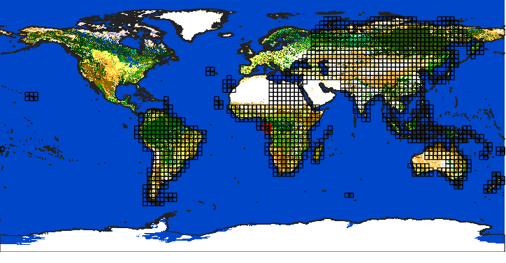
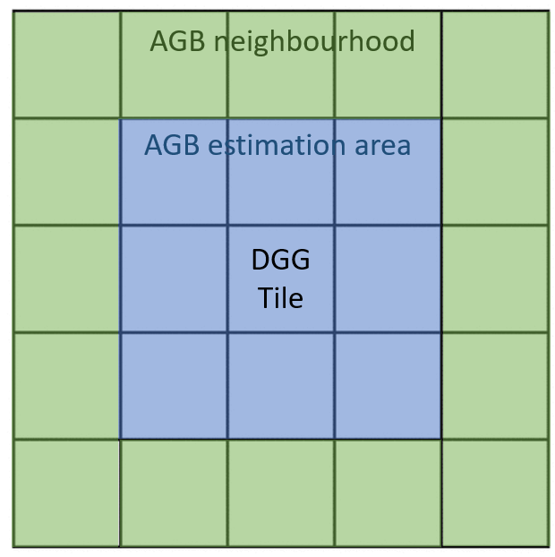
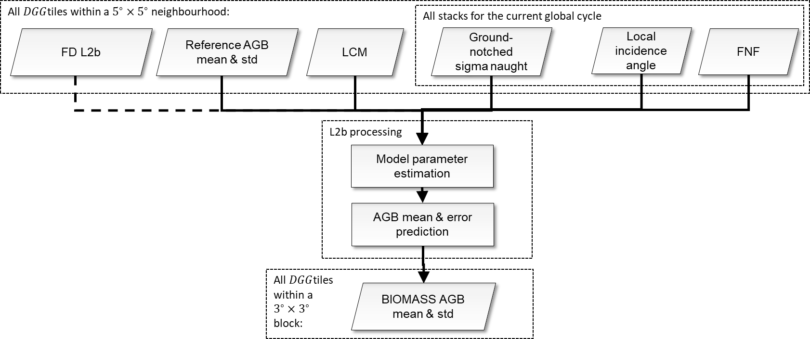
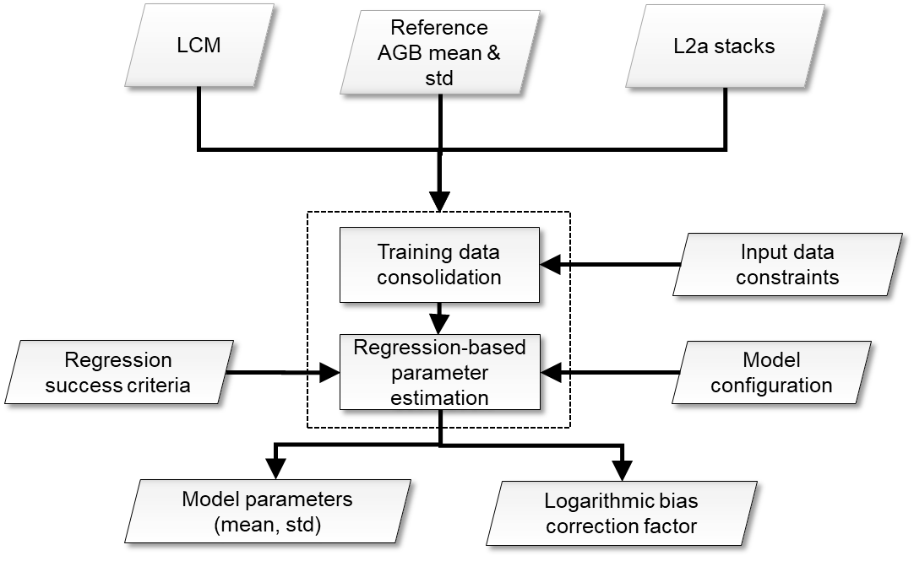
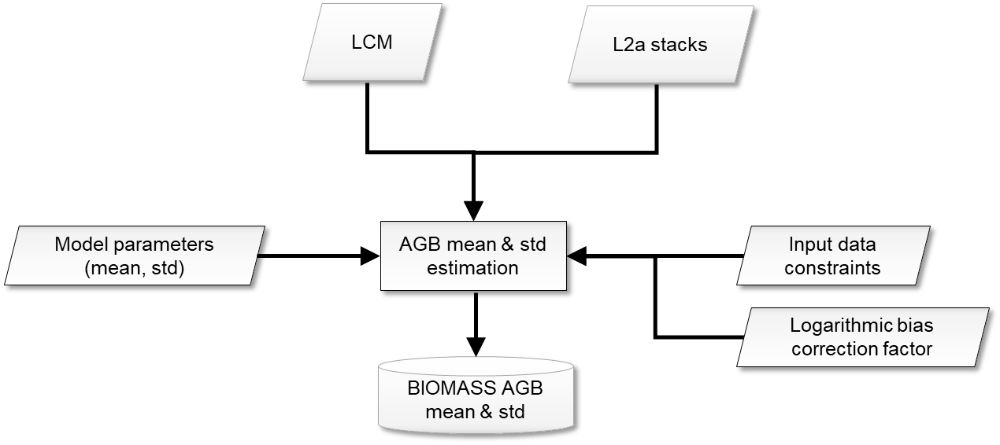

<!-- SPDX-FileCopyrightText: 2026 European Space Agency (ESA) -->
<!-- SPDX-License-Identifier: Apache-2.0 -->

:::{atbd-logo-banner}
:::


(sec:atbd-agb-4)=
# 4. AGB estimation

The overall scheme of the L2b processing is reported in the figure below. The key step is the conversion of multi-stack, ground-notched backscatter coefficients to estimates of AGB mean and standard error. The associated steps are described in detail in the following subsections.

The world is divided into processing blocks covering all forested areas and not overlapping with each other ({fig}`12`, top). This step is run separately for each 3°×3° processing block, where the data for parameter estimation are extracted from a 5°×5° neighbourhood while the estimated AGB mean and standard error maps are only saved for the 3°×3° processing block: the neighbourhood consists of the processing block and includes a 1° buffer zone as shown in {fig}`12`, bottom.

(fig:atbd-agb-processing-blocks)=
:::{div} atbd-mermaid-figure

<div class="atbd-figure-content">





</div>

<p class="atbd-figure-caption"><span class="caption-number">Fig. 12</span><span class="caption-text"> — World covered by 3°x3° processing blocks (top) and 5°x5° neighbourhood for AGB estimation (bottom).</span></p>

:::

The algorithm performs up to two iterations for each processing block. The following approach to orchestration is followed:

1. perform first iteration for all blocks: during first iteration, only external reference AGB mean and standard error are present as input over all the 5°x5° neighbourhood.
    - a. the invalid AGB estimates (where corresponding regression parameters cannot be estimated) are tagged in output at a pixel level AND a flag is raised.
2. perform second iteration only for all blocks where invalid AGB (but still recoverable) estimates are present (based on the flag).The second iteration uses the output from the first iteration as reference (as an addition to external AGB estimates). Only pixels tagged as invalid form first iteration are recomputed.

{fig}`13` shows the flow chart for Level 2b processing for one processing block. Input reference AGB mean and std differs from first and second iteration:

- first iteration: external reference only
- second iteration: external reference + first iteration AGB output

(fig:atbd-agb-l2b-workflow)=
:::{div} atbd-mermaid-figure

<div class="atbd-figure-content">



</div>

<p class="atbd-figure-caption"><span class="caption-number">Fig. 13</span><span class="caption-text"> — Complete flow-chart of the L2b processing.</span></p>

:::

While the tessellation of the world in 3°x3° processing blocks is proposed as a manageable way to assure the expected parameter variability, the algorithm formulation itself allows any possible definition of parameter estimation and AGB estimation manifolds. They both can be as small as 1°x1° tile only: thus, areas on continental borders / land sea interfaces are nicely and implicitly managed (as described in {sec}`section|4.1.4.2`).

(sec:atbd-agb-4-1)=
### 4.1 Model parameter estimation

(sec:atbd-agb-4-1-1)=
#### 4.1.1 Overview and rationale

This step first checks the availability and values of reference AGB data, Level 2a stacks, and forest class map. Subsequently, model parameters are estimated using regression.

{fig}`14` shows the flow chart for this module.

**The step is mandatory.**

(fig:atbd-agb-model-parameter-estimation)=
:::{div} atbd-mermaid-figure

<div class="atbd-figure-content">



</div>

<p class="atbd-figure-caption"><span class="caption-number">Fig. 14</span><span class="caption-text"> — Complete flow-chart of the model parameter estimation module.</span></p>

:::

(sec:atbd-agb-4-1-2)=
#### 4.1.2 Inputs

| Symbol | Name | Origin | Size | Variability | Default | Description |
|---|---|---|---|---|---|---|
| $\sigma_{GN}$ | ground-notched backscatter coefficient | GN L2a products in a 5°×5° neighborhood in a global cycle (`AGB_PFD`) | $\left[ N_{pol}\times{}N_{lat}\times{}N_{lon} \right]^t$ | - | - | ground-notched backscatter coefficient, in linear units |
| $\vartheta$ | local incidence angle | GN L2a products in a 5°×5° neighborhood in a global cycle (`AGB_PFD`) | $\left[ N_{lat}\times{}N_{lon} \right]^t$ | - | - | local incidence angle [deg] |
| $W_r$ | Reference AGB mean | Internal resource (IODD) | $\left[ N_{lat,W}\times{}N_{lon,W} \right]^{t^W}$ | - | - | A map of AGB mean used as reference [t/ha] in a 5°×5° neighborhood |
| $U_r$ | Reference AGB std | Internal resource (IODD) | $\left[ N_{lat,W}\times{}N_{lon,W} \right]^{t^W}$ | - | - | A map of AGB std used as reference [t/ha] in a 5°×5° neighborhood |
| $W_{fc}$ | “First cycle” AGB mean | AGB L2b product in a 5°×5° neighborhood in a global cycle (`AGB_PFD`) | $\left[ N_{lat,W}\times{}N_{lon,W} \right]^{t^W}$ | - | - | A map of AGB mean used as reference [t/ha] in a 5°×5° neighborhood |
| $U_{fc}$ | “First cycle” AGB std | AGB L2b product in a 5°×5° neighborhood in a global cycle (`AGB_PFD`) | $\left[ N_{lat,W}\times{}N_{lon,W} \right]^{t^W}$ | - | - | A map of AGB std used as reference [t/ha] in a 5°×5° neighborhood |
| DGG | DGG | Internal lookup table | - | - | - | DGG tiles in a 5°×5° neighborhood |
| FNF t | FNF | GN L2a products in a 5°×5° neighborhood in a global cycle (`AGB_PFD`) | $\left[ N_{lat}\times{}N_{lon} \right]^t$ | - | - | Annotated forest-non-forest mask |
| CFM | CFM | FD L2b product in a 5°×5° neighborhood in a global cycle (`FD_PFD`) | $\left[ N_{lat,L2b}\times{}N_{lon,L2b} \right]^{t^{L2b}}$ | optional | not provided | Computed Forest Mask |
| - | `forestMaskingFlag` | `AUX_PP2_AGB` (`AUX_FMT`) | bool | - | True | True if forest/non-forest map masking should be performed |
| BB t | Footprint | L2a main product header (`AGB_PFD`) | lat-lon vertices (4 couples) | - | - | The extent of the L2a input data in geographical coordinates in a 5°×5° neighborhood |
| mDGG | `minimumL2aCoverage` | `AUX_PP2_AGB` (`AUX_FMT`) | float value [scalar] | 0.0-100.0 | 10.0 | The minimum [%] tile coverage that triggers the computations |
| `refSel` | `referenceSeelection` | `AUX_PP2_AGB` (`AUX_FMT`) | String | ‘`refOnly`’, ‘`firstIterationOnly`’, ‘`weightedMean`’ | ‘`refOnly`’ | Combinatorial behaviour for multiple reference data at second iteration |
| LCM | Land Cover Map | Internal resource (IODD) | $\left[ N_{lat,LCM}\times{}N_{lon,LCM} \right]$ | Yearly | - | Landcover product classifying the type of land and forest |
| $\Omega_{fcrej}$ | `rejectedLandcover` Classes | `AUX_PP2_AGB` (`AUX_FMT`) | List of integers | - | - | Set of landcover class indices to ignore. LCM description can be found in (IODD) |
| ${\underline{\sigma}}_p^0,\ {\overline{\sigma}}_p^0$ | `backscatterLimits` | `AUX_PP2_AGB` (`AUX_FMT`) | $N_{pol}\times$2 float value [scalar] | $0<{\underline{\sigma}}_p^0<{\overline{\sigma}}_p^0<\infty$ | 0.0001,100 for all polarisations | Lower and upper limits on backscatter in linear units |
| $\underline{\vartheta},\overline{\vartheta}$ | `angleLimits` | `AUX_PP2_AGB` (`AUX_FMT`) | 2 float value [scalar] | $0\leq\underline{\vartheta}<\overline{\vartheta}$$\leq\frac{\pi}{2}$ | 0,π/2 | Lower and upper limits on the local incidence angle in radians |
| $\underline{W},\overline{W}$ | meanAGBLimits | `AUX_PP2_AGB` (`AUX_FMT`) | 2 float value [scalar] | $0\leq\underline{W}<\overline{W}<\infty$ | $10^{-3},10^3$ | Lower and upper limits on the AGB mean in t/ha |
| $\underline{U},\overline{U}$ | stdAGBLimits | `AUX_PP2_AGB` (`AUX_FMT`) | 2 float value [scalar] | $0\leq\underline{U}<\overline{U}<\infty$ | $10^{-3},10^3$ | Lower and upper limits on the AGB std in t/ha |
| $\underline{R},\overline{R}$ | relativeAGBLimits | `AUX_PP2_AGB` (`AUX_FMT`) | 2 float value [scalar] | $0\leq\underline{R}<\overline{R}<\infty$ | 0,0.3 | Lower and upper limits on AGB standard deviation relative AGB mean (coefficient of variability), in linear units |
| indexingL | indexingL | `AUX_PP2_AGB` (`AUX_FMT`) | String | ‘none’, ’p’, ’j’, ’k’, ’pj’, ’pk’, ’jk’, ’pjk’ | ‘pj’ | l parameter variability with polarization ’p’, date ’j’, forest class ’k’. See {sec}`4.1.4.3` for further details. |
| indexingA | indexingA | `AUX_PP2_AGB` (`AUX_FMT`) | String | ‘none’, ’p’, ’j’, ’k’, ’pj’, ’pk’, ’jk’, ’pjk’ | ‘pk’ | a parameter variability with polarization ’p’, date ’j’, forest class ’k’. See {sec}`4.1.4.3` for further details. |
| indexingN | indexingN | `AUX_PP2_AGB` (`AUX_FMT`) | String | ‘none’, ’p’, ’j’, ’k’, ’pj’, ’pk’, ’jk’, ’pjk’ | ‘p’ | n parameter variability with polarization ’p’, date ’j’, forest class ’k’. . See {sec}`4.1.4.3` for further details. |
| `useConstantN` | `useConstantN` | `AUX_PP2_AGB` (`AUX_FMT`) | Boolean [scalar] | - | False | If True, indexingN=p is forced |
| $n_p$ | `valuesConstantN` | `AUX_PP2_AGB` (`AUX_FMT`) | $N_{pol}$floats | (-∞,∞) | (1.0,1.0,1.0) | Values to use if `useConstantN`=True |
| mFV | `minimumPercentageOfFillableVoids` | `AUX_PP2_AGB` (`AUX_FMT`) | float value [scalar] | 0.0-100.0 | 5.0 | The minimum [%] of invalid pixels that triggers a new iteration |
| - | `regressionSolver` | `AUX_PP2_AGB` (`AUX_FMT`) | string | ‘double’, ’float’ | double | Numerical precision of the regression |

(sec:atbd-agb-4-1-3)=
#### 4.1.3 Outputs

| Symbol | Name | Destination | Size | Variability | Default | Description |
|---|---|---|---|---|---|---|
| $\widehat{W}$ | Estimated AGB mean | AGB L2b product (`AGB_PFD`) | $\left[ N_{lat,L2b}\times{}N_{lon,L2b} \right]^{t^{L2b}}$ | - | - | AGB mean map [t/ha] for the 3°×3° processing block |
| $\widehat{\sigma_W}$ | Estimated AGB std | AGB L2b product (`AGB_PFD`) | $\left[ N_{lat,L2b}\times{}N_{lon,L2b} \right]^{t^{L2b}}$ | - | - | AGB std map [t/ha] for the 3°×3° processing block |
| rerun | `agbTileStatus` | AGB L2b product (`AGB_PFD`) | String | ‘Complete’,, “NotComplete’, ‘Partial’ | - | Flag raised when a new iteration is needed |
| HM | heat map | AGB L2b product (`AGB_PFD`) | $3\left[ N_{lat,L2b}\times{}N_{lon,L2b} \right]^{t^{L2b}}$ | 0- | - | heat map (three values (1 float and 2 integers) per pixel) for the 3°×3° processing block |
| `acquisitionIdImage` | `acquisitionIdImage` | AGB L2b product (`AGB_PFD`) | $N_{L2a}\left[ N_{lat,L2b}\times{}N_{lon,L2b} \right]^{t^{L2b}}$ | 0,1 | - | Incidence matrix for the contributing data |

(sec:atbd-agb-4-1-4)=
#### 4.1.4 Algorithm mathematical background

As a first step, the minimum required coverage over L2b DGG tiles in a 5°×5° neighbourhood j is checked to proceed with computations:

$$
TR=\ (100*\frac{A(\left. \bigcup_i^{}{{BB}^i} \right\vert_{DGG}\cap\left. {TT}^j \right\vert_{DGG})}{A(\left. {TT}^j \right\vert_{DGG})}>mDGG)
\tag{4.1}
$$ (eq:model-parameter-estimation-1)

where BBi are the L2a bounding boxes, TTj is the footprint of the current L2b DGG tile collection and A operator computes the area of the corresponding polygon.

(sec:atbd-agb-4-1-4-1)=
##### 4.1.4.1 Definitions

- $j\in\left\{ 1,\ldots,N_{dates} \right\}$ is an acquisition date index. Within the current 5°×5° neighbourhood, all stacks acquired from the same orbit and on the same date will have the same acquisition date index.
- $p\in\left\{ 1,\ldots,N_{pol} \right\}$ is a polarisation index, with $N_{pol}$ being the total number of polarisations
- $k=k(x,y)\in\left\{ 1,\ldots,N_{fclass} \right\}$ is a forest class index. Note that the forest class is defined by the landcover class map LCM, so for each pixel $(x,y)$, there is only one $k$
- $x_0,y_0$ denote longitude and latitude for the centre of the block
- $\Delta{}x_B,\Delta{}y_B,\ \ \Delta{}x_N,\Delta{}y_N$ denote block & neighbourhood width and height in degrees

(sec:training-data-consolidation)=
##### 4.1.4.2 Training data consolidation

This section describes the necessary steps to check the availability of input data and to define which pixels can be used for subsequent model parameter estimation.

The management and provision of 1° tiles and resources (stacks, auxiliary: AGB reference and AGB estimates at previous iteration when available) is dealt by the orchestrator and not described here {ad}`1`. A 3°×3° processing block will be formed by up to 9 tiles and a 5°×5° neighbourhood will be formed by up to 25 tiles. One acquisition is defined as one or more stacks from the same date and orbit. Throughout this part, pixels are identified via their $(x,y)$ coordinates and SAR acquisitions are identified using index $j$, derived using the date-of-acquisition. In the following sections of the document, U and W are defined as the combination of Wr and Wfc, Ur and Ufc, following the selected behaviour described in the note at the end of this section.

Let $\Omega_B$ denote the set of pixel coordinates $(x,y)$ within the current processing block:

$$
\Omega_B=\left\{ (x,y):\ \left\vert x-x_0 \right\vert\leq\frac{\Delta{}x_B}{2}\land\left\vert y-y_0 \right\vert\leq\frac{\Delta{}y_B}{2} \right\}
\tag{4.2}
$$ (eq:model-parameter-estimation-2)

and $\Omega_N$ denote the set of pixel coordinates $(x,y)$ within the current neighbourhood:

$$
\Omega_N=\left\{ (x,y):\ \left\vert x-x_0 \right\vert\leq\frac{\Delta{}x_N}{2}\land\left\vert y-y_0 \right\vert\leq\frac{\Delta{}y_N}{2} \right\}
\tag{4.3}
$$ (eq:model-parameter-estimation-3)

The total SAR data coverage is the set of all pixels covered by at least one acquisition and fulfilling the requirements on backscatter and incidence angle:

$$
\Omega_{SAR}=\Omega_1\cup\ldots\cup\Omega_j\cup\ldots\cup\Omega_{N_{acq}}
\tag{4.4}
$$ (eq:model-parameter-estimation-4)

where

$$
\Omega_j=\left\{ (x,y):\ \vartheta_j(x,y)\in\left[ \underline{\vartheta},\overline{\vartheta} \right]\land(\sigma_{pj}^0(x,y)\in\left[ {\underline{\sigma}}_p^0,{\overline{\sigma}}_p^0 \right]\forall{}p\in\left[ 1,\ldots,N_{pol} \right]) \right\}
\tag{4.5}
$$ (eq:model-parameter-estimation-5)

The reference AGB data coverage is the set of pixels that contain reference AGB data and forest class fulfilling input data requirements:

$$
\Omega_{AGB}=\left\{ (x,y):\ W(x,y)\in\left[ \underline{W},\overline{W} \right]\land{}U(x,y)\in\left[ \underline{U},\overline{U} \right]\land{}R(x,y)\in\left[ \underline{R},\overline{R} \right]\land{}F(x,y)\notin\Omega_{fcrej} \right\}
\tag{4.6}
$$ (eq:model-parameter-estimation-6)

where $R(x,y)=\frac{U(x,y)}{W(x,y)}$ is the AGB coefficient of variation (standard deviation relative mean) and $\Omega_{fcrej}$ is the set of landcover class indices to ignore. The set of landcover classes to ignore shall be made consistent with the input FNF information $\Omega_{fcrej}=\Omega_{fcrej}\cup\left\{ {1-FNF}^t \right\}$ for all t L2a stacks, or CFM in case this is provided $\Omega_{fcrej}=\Omega_{fcrej}\cup\left\{ {1-CFM}^{L2b} \right\}$ for all $t^{L2b}$ L2b stacks.

From the four sets: $\Omega_B$, $\Omega_N$, $\Omega_{SAR}$, and $\Omega_{AGB}$ we compute the following:

- Valid pixels with reference AGB data:

$$
\Omega_{REF}=\Omega_{SAR}\cap\Omega_N\cap\Omega_{AGB}
$$

- Pixels with SAR data but without AGB data (i.e., pixels with potential to-be-mapped):

$$
\Omega_-=(\Omega_{SAR}\cap\Omega_B)\smallsetminus\Omega_{AGB}
$$

The algorithm continues to the parameter estimation sub-step if:

$$
\Omega_{REF}\neq\varnothing
$$

i.e., there are some training data available, and:

$$
\Omega_-\neq\varnothing
$$

i.e., there are some pixels where mapping is needed.

If either of these conditions is not fulfilled, the algorithm returns an error message stating that the mapping cannot be done, either due to the lack of training data ($\Omega_{REF}=\varnothing$) or the lack of need to map ($\Omega_-=\varnothing$).

The process of finding $\Omega_{SAR}$ presented above requires the algorithm to read entire images so that the requirements can be checked (e.g., $\sigma_{pj}^0(x,y)\in\left[ {\underline{\sigma}}_p^0,{\overline{\sigma}}_p^0 \right]$). This check is dealt in two steps: first using only the corner coordinates for each acquisition to find its extents, and then reading the entire images only for the acquisitions that cover the training data.

Finally, we define the set of all pixels for a given acquisition-forest class combination $jk$ as:

$$
\Omega_{jk}=\left\{ (x,y)\in\Omega_j\cap\Omega_N\cap\Omega_{AGB}:F(x,y)=k \right\}
\tag{4.7}
$$ (eq:model-parameter-estimation-7)

Such sets can belong to an area that covers only a subset of the original 3°×3° processing block 5°×5° neighbourhood: continental borders and sea/land interfaces are implicitly dealt within this algorithmic substep.

```{note}
When combining AGB previous estimates and external reference AGB estimates in the second iteration, the behaviour can be selected by user (with parameter ‘`refSel`’) as follows:
```

- `refOnly`: reference estimates are preferred when both data are available at the same pixel (default behaviour)
- `firstIterationOnly`: AGB previously estimated values are preferred when both data are available at the same pixel
- `weightedMean`: a weighted mean (where weights are the inverse of AGB standard deviation U and Ufc) is computed when both data are available at the same pixel

(sec:atbd-agb-4-1-4-3)=
##### 4.1.4.3 Regression-based parameter estimation

The actual number of regression parameters is ruled by the combination of user-selected parameter variability (by input flags indexingL, indexingA, indexing) AND the number of different forest classes, different acquisition dates and valid polarizations in the neighbourhood. Thus, it can differ for each processing block.

All possible choices for indexingL, indexingA, indexing are valid. However, they may lead to invalid regression (thus generating invalid AGB estimates), because of lack of input reference data. The default parameter variability is chosen as:

- backscatter intensity shall depend on specific acquisition conditions, thus the same parameter shall be used for same acquisition date (and polarization);
- AGB reference shall depend on forest class only (and polarization), as different forest classes depend on different allometries;
- incidence angle shall depend on polarization only.

As an example, a different parametrization where all parameters depend only on polarization can be chosen to limit the number of invalid AGB estimates (due to the lack of input data), if in the currently processed area the different forest classes are known to share similar allometries, and the acquisition conditions (i.e. meteorological conditions) are known to be similar even if acquisition dates are different.

The Power Law Model describes the dependence of radar observation σ0pj on AGB W and the local incidence angle θ. It requires three parameters for each unknown group: a scaling factor and two exponents, one for AGB α and one for the incidence angle normalisation n.

$$
\sigma_{pj}^0(x,y)=A_{pj}{\ \bullet{}W(x,y)}^{a_{pk}}\ \bullet{{\cos{\vartheta_j(x,y)}}^{n_p}\ \ }_{}
\tag{4.8}
$$ (eq:model-parameter-estimation-8)

More insights can be found in {rd}`11`. The power law model solution can be expressed as an equivalent linear regression problem in log domain.Thus, as a default, the following forward model is used:

$$
s_{pj}(x,y)=l_{pj}+a_{pk}w(x,y)+n_pc_j(x,y)
\tag{4.9}
$$ (eq:model-parameter-estimation-9)

Where

(equation-eq-model-parameter-estimation-10)=
\begin{equation}
\begin{aligned}
s_{pj}(x,y)=10\lg \left[ \sigma_{pj}^0(x,y) \right] \\
w(x,y)=10\lg \left[ W(x,y) \right] \\
c_j(x,y)=10\lg \left[ \cos{\vartheta_j(x,y)} \right]
\end{aligned}
\tag{4.10}
\end{equation}

Based on this, we define a measurement vector as a complete set of input information for one backscatter value, including coordinates, indices for polarisation, acquisition, forest class, AGB mean and incidence angle data. We formalise it as:

$$
\mathbf{b}_{pj}(x,y)=\begin{bmatrix} x & y & p & j & k(x,y) & w(x,y) & c_j(x,y) & s_{pj}(x,y) \end{bmatrix}
\tag{4.11}
$$ (eq:model-parameter-estimation-11)

We define the complete set of measurement vectors available in the data as:

$$
\mathcal{B}=\left\{ \mathbf{b}_{pj}(x,y)\ \forall(x,y)\in\Omega_{jk},\forall{}k\in\left\{ 1,\ldots,N_{fclass} \right\},\forall{}p\in\left\{ 1,\ldots,N_{pol} \right\},\forall{}j\in\left\{ 1,\ldots,N_{date} \right\} \right\}
\tag{4.12}
$$ (eq:model-parameter-estimation-12)

Where

$$
N_{meas}=n(\mathcal{B})
\tag{4.13}
$$ (eq:model-parameter-estimation-13)

We order the elements of $\mathcal{B}$ in an arbitrary order and then we assign an individual index $r\in\left\{ 1,\ldots,N_{meas} \right\}$ to each element. The $r$th element is defined as:

$$
\mathbf{b}_r=\begin{bmatrix} x_r & y_r & p_r & j_r & k_r & w_r & c_r & s_r \end{bmatrix}
\tag{4.14}
$$ (eq:model-parameter-estimation-14)

We define the training data table as:

(equation-eq-model-parameter-estimation-15)=
\begin{equation}
\left[ \boldsymbol{T} \right]\boldsymbol{=}\begin{bmatrix} \mathbf{b}_1 \\ \boldsymbol{\vdots} \\ \mathbf{b}_r \\ \boldsymbol{\vdots} \\ \mathbf{b}_{N_{meas}} \end{bmatrix}\boldsymbol{=}\begin{bmatrix} \mathbf{x} & \mathbf{y} & \mathbf{p} & \mathbf{j} & \mathbf{k} & \mathbf{w} & \boldsymbol{c} & \mathbf{s} \end{bmatrix}
\tag{4.15}
\end{equation}

Where x,y,p,j,k,w,c and s are vectors containing specific data for all measurements. These data are, in respective order: longitude, latitude, polarisation index, acquisition date index, forest class index, mean reference AGB (in dB), cosine of the local incidence angle (in dB), and the vegetation backscatter coefficient (in dB).

Fitting of the forward model is solved through ordinary least squares and the following equation:

$$
\mathbf{A\beta}=\mathbf{s}
\tag{4.16}
$$ (eq:model-parameter-estimation-16)

where $\mathbf{A}$ is the design matrix and $\mathbf{\beta}$ is the vector of unknown parameters.

The design matrix $\mathbf{A}$ consists of three sub-matrices:

$$
\mathbf{A=}\begin{bmatrix} \boldsymbol{A}_l & \boldsymbol{A}_a & \boldsymbol{A}_n \end{bmatrix}
\tag{4.17}
$$ (eq:model-parameter-estimation-17)

and $\mathbf{\beta}$ consists of three sub-vectors:

(equation-eq-model-parameter-estimation-18)=
\begin{equation}
\mathbf{\beta}\boldsymbol{=}\begin{bmatrix} \mathbf{l} \\ \mathbf{a} \\ \mathbf{n} \end{bmatrix}
\tag{4.18}
\end{equation}

The following describes the generation of the three sub-matrices of $\mathbf{A}$, and the meaning of the three sub-vectors of $\mathbf{\beta}$.

- $\mathbf{A}_l$ is a $N_{meas}\times{}N_l$ design matrix for parameter $l$ and $\mathbf{l}\mathbf{=}\begin{bmatrix}
l_1 & \boldsymbol{\cdots} & l_{N_l}
\end{bmatrix}^T$ is an $N_l$-element vector of its instances, i.e., different values to-be-estimated with least squares and corresponding to each unique combination of $p$ and $j$. Each row of $\boldsymbol{A}_l$ corresponds to a unique measurement and each column to a unique instance for parameter $l$. With $N_{pol}$ polarisations and $N_{date}$ acquisitions,

$$
N_l=N_{pol}N_{date}
$$

can be used (all acquisitions feature all polarisations). For each unique combination of $j$ and $p$, the corresponding instance index $c_l$ (i.e., column in $\mathbf{A}_l$) can be created using:

$$
c_l(j,p)=p+N_{pol}(j-1)\in\left[ 1,\ldots,N_l \right]
$$

($\max (p)=N_{pol}$). The element of $\mathbf{A}_l$ found at row $r$, column $c$ is consequently:

$$
A_l^{(r,c)}=\left\{ \begin{matrix}
1 & c=c_l(j_r,p_r) \\
0 & otherwise
\end{matrix} \right.
$$

where $j_r,p_r$ are the acquisition and polarisation indices for measurement $r$.

- $\mathbf{A}_a$ is a $N_{meas}\times{}N_a$ design matrix for parameter $a$ and $\mathbf{a}\mathbf{=}\begin{bmatrix}
a_1 & \boldsymbol{\cdots} & a_{N_l}
\end{bmatrix}^T$ is an $N_a$-element vector of its instances, i.e., different values to-be-estimated with least squares and corresponding to each unique combination of $p$ and $k$. Each row of $\boldsymbol{A}_a$ corresponds to a unique measurement and each column to a unique instance for parameter $a$. With $N_{pol}$ polarisations and $N_{fclass}$ forest classes,

$$
N_a=N_{pol}N_{fclass}
$$

For each unique combination of $k$ and $p$, the corresponding instance index $c_a$ (i.e., column in $\mathbf{A}_a$) can be created using:

$$
c_a(k,p)=p+N_{pol}(k-1)\in\left[ 1,\ldots,N_a \right]
$$

($\max (p)=N_{pol}$). The element of $\mathbf{A}_a$ found at row $r$, column $c$ is consequently:

$$
A_a^{(r,c)}=\left\{ \begin{matrix}
w_r & c=c_a(k_r,p_r) \\
0 & otherwise
\end{matrix} \right.
$$

where $k_r,p_r$ are the forest class and polarisation indices for measurement $r$.

- $\mathbf{A}_n$ is a $N_{meas}\times{}N_n$ design matrix for parameter $n$ and $\mathbf{n}\mathbf{=}\begin{bmatrix}
n_1 & \boldsymbol{\cdots} & n_{N_n}
\end{bmatrix}^T$ is an $N_n$-element vector of its instances, i.e., different values to-be-estimated with least squares and corresponding to each unique $p$. Each row of $\boldsymbol{A}_n$ corresponds to a unique measurement and each column to a unique instance for parameter $n$. With $N_{pol}$ polarisations,

$$
N_n=N_{pol}
$$

For each unique $p$, the corresponding instance index $c_n$ is simply $p$. The element of $\mathbf{A}_n$ found at row $r$, column $c$ is consequently:

$$
A_n^{(r,c)}=\left\{ \begin{matrix}
c_r & c=p_r \\
0 & otherwise
\end{matrix} \right.
$$

where $p_r$ is the polarisation index for measurement $r$.

Using ordinary least squares, the model parameters can be estimated to:

$$
\widehat{\mathbf{\beta}}=(\mathbf{A}^T\mathbf{A})^{-1}\mathbf{A}^T\mathbf{s}
\tag{4.19}
$$ (eq:model-parameter-estimation-19)

And their standard deviations to:

$$
\widehat{\mathbf{\delta}}=\sqrt{\frac{\left\Vert \mathbf{s}\mathbf{-}\mathbf{A}\widehat{\mathbf{x}} \right\Vert^2}{N_{meas}-N_l-N_a-N_n}\cdot{}diag\left[ (\mathbf{A}^T\mathbf{A})^{-1} \right]}
\tag{4.20}
$$ (eq:model-parameter-estimation-20)

For measurement r, the three parameters can be extracted from vector $\widehat{\mathbf{\beta}}$ using:

(equation-eq-model-parameter-estimation-21)=
\begin{equation}
\begin{aligned}
{\widehat{l}}_r={\widehat{\beta}}_{c_l(j_r,p_r)} \\
{\widehat{a}}_r={\widehat{\beta}}_{N_l+c_a(k_r,p_r)} \\
{\widehat{n}}_r={\widehat{\beta}}_{N_l+N_a+p_r}
\end{aligned}
\tag{4.21}
\end{equation}

where ${\widehat{\beta}}_{\nu}$ is the $\nu$th element of vector $\widehat{\mathbf{\beta}}$.

It must be noted that design matrix A can be rank-deficient (i.e., a column has all zero entries). In this situation, the corresponding regression parameter(s) cannot be solved, and a (subset) of AGB estimates cannot be computed, and will be tagged as invalid data in output.

Now an estimate of $w_r$ for measurement $r$ is obtained using:

$$
{\widehat{w}}_r=\frac{s_r-{\widehat{n}}_rc_r-{\widehat{l}}_r}{{\widehat{a}}_r}
\tag{4.22}
$$ (eq:model-parameter-estimation-22)

Finally, we estimate the logarithmic bias correction as the ratio of the average reference AGB to the average estimated AGB, see {rd}`5`:

$$
\rho=\frac{\sum_{x,y}^{}{10^{0.1w(x,y)}}}{\sum_{x,y}^{}{10^{0.1\widehat{w}(x,y)}}}
\tag{4.23}
$$ (eq:model-parameter-estimation-23)

Where the estimated AGB for pixel $(x,y)$ is calculated from a weighted average of all log-AGB estimates at that location, with the estimated parameter ${\widehat{a}}_r$ used as the weight:

(equation-eq-model-parameter-estimation-24)=
\begin{equation}
\begin{aligned}
\widehat{w}(x,y)=\frac{\sum_{r\mathcal{\in{}R}(x,y)}^{}{w_ra_r^2}}{\sum_{r\mathcal{\in{}R}(x,y)}^{}{a_r^2}} \\
\mathcal{R}(x,y)=\left\{ \forall{}r\in[1,N_{meas}]:(x_r,y_r)=(x,y) \right\}
\end{aligned}
\tag{4.24}
\end{equation}

```{note}
While the description is formally carried out for the default parameter variability, {eq}`4.15`, {eq}`4.16` and {eq}`4.17` are independent of the selected parametrization, and are of general validity. Moreover, the exact cardinality of the regression problems depends also on the specific population (number of acquisitions, number of forest classes) in the current neighbourhood.
```

Moreover, from the implementation side, it must be noted that the least squares model inversion can be split into three orthogonal problems, if and only if all parameters depend on polarization: in this case, the above formulation is completely separable in the polarization domain.

Note that the least square problem can be solved with double (64bit) or single (32bit) precision, based on `regressionSolver` flag.

(sec:atbd-agb-4-1-4-4)=
##### 4.1.4.4 AGB mean and standard error estimation

This step first consolidates the prediction data (Level 2a stacks and forest class map) and extracts pixels that will be mapped. Next, model parameter values are assigned to the extracted pixels. Finally, AGB mean and standard error are estimated for these pixels and a map is saved. The output consists of maps of AGB mean and standard error.

{fig}`15` shows the flow chart for this step.

(fig:atbd-agb-agb-mean-std-estimation)=
:::{div} atbd-mermaid-figure

<div class="atbd-figure-content">



</div>

<p class="atbd-figure-caption"><span class="caption-number">Fig. 15</span><span class="caption-text"> — AGB mean and standard error estimation.</span></p>

:::

Mappable pixels (i.e., those that contain the required SAR data within the block) are defined as:

$$
\Omega_{pred}=\Omega_{SAR}\cap\Omega_B
\tag{4.25}
$$ (eq:model-parameter-estimation-25)

To estimate AGB, we solve for $w(x,y)$:

$$
w(x,y)=\frac{1}{a_{pk}}(s_{pj}(x,y)-n_pc_j(x,y)-l_{pj})
\tag{4.26}
$$ (eq:model-parameter-estimation-26)

Based on this, we define a measurement vector as a complete set of input information for one backscatter value, including coordinates, indices for polarisation, acquisition, and forest class, and incidence angle information. We formalise it as:

$$
\mathbf{d}_{pj}(x,y)=\begin{bmatrix} x & y & p & j & k(x,y) & c_j(x,y) & s_{pj}(x,y) \end{bmatrix}
\tag{4.27}
$$ (eq:model-parameter-estimation-27)

We define the complete set of measurement vectors available in the data as:

$$
\mathcal{D}=\left\{ \mathbf{d}_{pj}(x,y)\ \forall(x,y)\in\Omega_{pred},\forall{}p\in\left\{ 1,\ldots,N_{pol} \right\},\forall{}j\in\left\{ 1,\ldots,N_{date} \right\} \right\}
\tag{4.28}
$$ (eq:model-parameter-estimation-28)

Where

$$
N_{pred}=n(\mathcal{D})
\tag{4.29}
$$ (eq:model-parameter-estimation-29)

We order the elements of $\mathcal{D}$ in the same mapping order described in {sec}`section|4.1.4.3` and then we assign an individual index $u\in\left\{ 1,\ldots,N_{pred} \right\}$ to each element. The $u$th element is defined as:

$$
\mathbf{d}_u=\begin{bmatrix} x_u & y_u & p_u & j_u & k_u & w_u & c_u & s_u \end{bmatrix}
\tag{4.30}
$$ (eq:model-parameter-estimation-30)

We now extract model parameter estimates ${\widehat{l}}_u,{\widehat{a}}_u,{\widehat{n}}_u$ and standard deviations ${\widehat{\sigma_l}}_u,{\widehat{\sigma_a}}_u,{\widehat{\sigma_n}}_u$

for measurement $u$ from vector $\widehat{\mathbf{\beta}}$ and $\widehat{\mathbf{\delta}}$ of equations 4.18/19, using the same mapping mechanism as described in {sec}`section|4.1.4.3`.

Now the mean log-AGB for measurement $u$ can be estimated using:

$$
{\widehat{w}}_u=\frac{s_u-{\widehat{n}}_uc_u-{\widehat{l}}_u}{{\widehat{a}}_u}
\tag{4.31}
$$ (eq:model-parameter-estimation-31)

Now, we want to estimate the standard deviation of the log-AGB estimate above. To do this, we will use the ratio distribution together with the mean and standard deviation estimates from $\widehat{\mathbf{\beta}}$ and $\widehat{\mathbf{\delta}}$. We will assume that both the numerator and denominator are uncorrelated, non-central Gaussian distributed. Under these circumstances, a closed-form expression for the standard deviation can be used if the ratio distribution is approximated as Gaussian.

For the numerator, the mean and standard deviations are (dropping index $u$ for simplicity of the derivation that follows):

(equation-eq-model-parameter-estimation-32)=
\begin{equation}
\begin{aligned}
\mu_{num}=s-\widehat{n}c-\widehat{l} \\
\sigma_{num}=\sqrt{c^2{\widehat{\sigma_n}}^2+{\widehat{\sigma_l}}^2}
\end{aligned}
\tag{4.32}
\end{equation}

And for the denominator:

(equation-eq-model-parameter-estimation-33)=
\begin{equation}
\begin{aligned}
\mu_{den}=\widehat{a} \\
\sigma_{den}=\widehat{\sigma_a}
\end{aligned}
\tag{4.33}
\end{equation}

{rd}`6` states that the ratio distribution can be approximated by a Gaussian distribution with standard deviation

$$
\sigma=\frac{\mu_{num}}{\mu_{den}}\sqrt{\frac{\sigma_{num}^2}{\mu_{num}^2}+\frac{\sigma_{den}^2}{\mu_{den}^2}}
\tag{4.34}
$$ (eq:model-parameter-estimation-34)

if the following requirements are satisfied:

(equation-eq-model-parameter-estimation-35)=
\begin{equation}
\begin{aligned}
\mu_{num}>0 \\
\frac{\sigma_{num}}{\mu_{num}}\leq1 \\
\mu_{den}>0 \\
\frac{\sigma_{den}}{\mu_{den}}\ll1
\end{aligned}
\tag{4.35}
\end{equation}

The standard deviation for ${\widehat{w}}_u$ becomes (with re-introduced index $u$):

$$
{\widehat{\sigma_w}}_u=\frac{1}{{\widehat{a}}_u^2}\sqrt{{\widehat{a}}_u^2(c_u^2{\widehat{\sigma_n}}_u^2+{\widehat{\sigma_l}}_u^2)+{\widehat{\sigma_a}}_u^2(s_u-{\widehat{n}}_uc_u-{\widehat{l}}_u)^2}
\tag{4.36}
$$ (eq:model-parameter-estimation-36)

Now, we average over all measurements with the same pixel to get the pixel-level estimates:

(equation-eq-model-parameter-estimation-37)=
\begin{equation}
\begin{aligned}
\widehat{w}(x,y)=\frac{\sum_{u\in\mathcal{U}(x,y)}^{}{{\widehat{a}}_u^2}{\widehat{w}}_u}{\sum_{u\in\mathcal{U}(x,y)}^{}{{\widehat{a}}_u^2}} \\
\widehat{\sigma_w}(x,y)=\sqrt{\frac{\sum_{u\in\mathcal{U}(x,y)}^{}{{\widehat{a}}_u^2}{\widehat{\sigma_w}}_u^2}{\sum_{u\in\mathcal{U}(x,y)}^{}{{\widehat{a}}_u^2}}} \\
\mathcal{U}(x,y)=\left\{ \forall{}u\in\left[ 1,N_{pred} \right]:(x_u,y_u)=(x,y) \right\}
\end{aligned}
\tag{4.37}
\end{equation}

If we used the natural logarithm to transform AGB, then we could use the lognormal distribution to calculate the back-transformed mean and std from the above. However, we used decibels, so we first need to scale the estimates before we apply the lognormal distribution statistics to estimate the AGB mean and standard deviation estimates:

(equation-eq-model-parameter-estimation-38)=
\begin{equation}
\begin{aligned}
{\widehat{w}}^{'(x,y)}=\frac{\widehat{w}(x,y)}{10\lg e} \\
{\widehat{\sigma_w}}^{'}(x,y)=\frac{\widehat{\sigma_w}(x,y)}{10\lg e}
\end{aligned}
\tag{4.38}
\end{equation}

Subsequently we get the following using the properties of the lognormal distribution:

(equation-eq-model-parameter-estimation-39)=
\begin{equation}
\begin{aligned}
\widehat{W}(x,y)=\rho\exp \left[ {\widehat{w}}^{'}(x,y) \right]\exp \left[ \frac{{{\widehat{\sigma_w}}^{'}}^2(x,y)}{2} \right] \\
\widehat{\sigma_W}(x,y)=\rho\sqrt{\left[ \exp ({{\widehat{\sigma_w}}^{'}}^2(x,y))-1\ \right]\exp (2\widehat{w}'(x,y)+{{\widehat{\sigma_w}}^{'}}^2(x,y))}
\end{aligned}
\tag{4.39}
\end{equation}

(sec:atbd-agb-4-1-4-5)=
##### 4.1.4.5 Invalid pixel management and HeatMap definition

the AGB mean and std are computed over all the processing block (3°x3°), where:

- backscatter data are available;
- corresponding regression parameters have been correctly estimated.

While the first condition cannot be overcome, for the latter condition the availability of enriched reference data in the 5°x5° neighbourhood can help to build a full-rank regression matrix.

Thus, the number of invalid AGB estimates caused by missing regression parameters only shall be counted (i.e., meaning that only AGB estimates that cannot be computed due to lack of valid parameters while solving {eq}`4.30`), and a flag is raised asking to rerun the regression with enriched reference (i.e., second iteration taking advantage of the results of neighbouring processing blocks):

$$
rerun=\ (100\times\frac{invalidEstimateNumber}{totalEstimateNumber})>mFV
\tag{4.40}
$$ (eq:model-parameter-estimation-40)

The orchestration takes advantage of the presence of the rerun flag in the output to trigger a subsequent iteration for AGB estimation step only for processing blocks that can take advantage of it.

In fact, three statuses are identified:

“Complete”: all pixels are correctly processed

“NotComplete”: some pixels are invalid and cannot be recovered by a subsequent iteration (or their number is under the selected threshold in {eq}`4.39`)

“Partial”; corresponding to rerun Boolean flag set to true ({eq}`4.39`): a subsequent iteration is required to fill-up estimation voids.

It must be noted that such approach, while limited to two iterations (that shall be adequate to compute AGB estimates for all processing blocks), can in principle iteratively run for any number of iterations.

The iterative run of `L2B_AGB_P` ends when:

- no rerun flag is set to true for any output tile (that means to string value: “Partial” in Output Product Header)

OR

- The maximum number of iterations (currently set to 2) has been reached.

The denominator of {eq}`4.36` is saved as the first layer of the HeatMap HM:

$$
HM(x,y)=\sum_{u\in\mathcal{U}(x,y)}^{}{{\widehat{a}}_u^2}
\tag{4.41}
$$ (eq:model-parameter-estimation-41)

Two additional layers will store in the HeatMap HM, at each pixel location:

- how many times reference data are used for the current regressions
- how many times additional reference data (i.e., belonging to a set previously solved by regression) are used for the current regressions

Moreover, the full traceability of the source data (i.e. L2a’s contributing for L2b data at the pixel level) is assured with the `acquisitionIdImage`, a volume having the following features:

- the number of layers corresponds number of contributing L2a data, where i-th refers to the referred to the i-th L2a contributing data
- for each pixel and layer, it assumes 0 value if the i-th L2a selected image did not contribute to the j-th pixel of the L2b product, 1 otherwise.

(sec:atbd-agb-4-1-4-6)=
##### 4.1.4.6 Notes on further developments

Default parametrization may be subject to updates, depending on analysis of preliminary results on real data. In particular, as (due to the limited extent of angles for satellite acquisition geometries) the regression terms l and n are highly correlated, it may be safe to assume a fixed value (n=2) for the third regression term (for all polarizations), and solve a simplified problem.

The current error model formulation prevents the analysis and use of covariances (i.e. off-diagonal terms in the covariance matrix). A possible alternative solution (that however presents some drawbacks) is to express the regression forward problem as a function of AGB w(x,y) known values.

With such a formulation, not only the error model can easily take into account the full covariance matrix, but also the variable error on AGB known values can be easily accounted for. However, l,a,n regression parameters always depend on polarization, date and forest class (that may lead to unsolvable unknowns because of lack of apriori knowledge). Biomes may be clustered in biome classes to reduce the unsolvable areas.

It must be noted that the regression problem is not generally separable (it is separable only for specific choices of parametrization, where the same dependency appear for all l,a,n regression parameters)

Some notable examples are:

- pj,pk,none → Regression cannot be be separated in smaller problems
- pj,pk,p → Regression can be separated in 3 smaller problems of dimension (Nj+Nk+1) x M/3 (where M is ther number of prior entries for regression, and priors are equally present for each polarization)
- pjk, pjk, pjk → Regression can be separated in Np\*Nj\*Nk problems of variable dimension 3 x M' (where M' depends on the distribution of priors)

The suggested way to lower memory requirements is taking advantage of the sparse (while unstructured) nature of incidence matrix A, and directly create the regression terms ATA, ATs, Ax ({eq}`4.19`, {eq}`4.20`) without explicitly building incidence matrix A.
