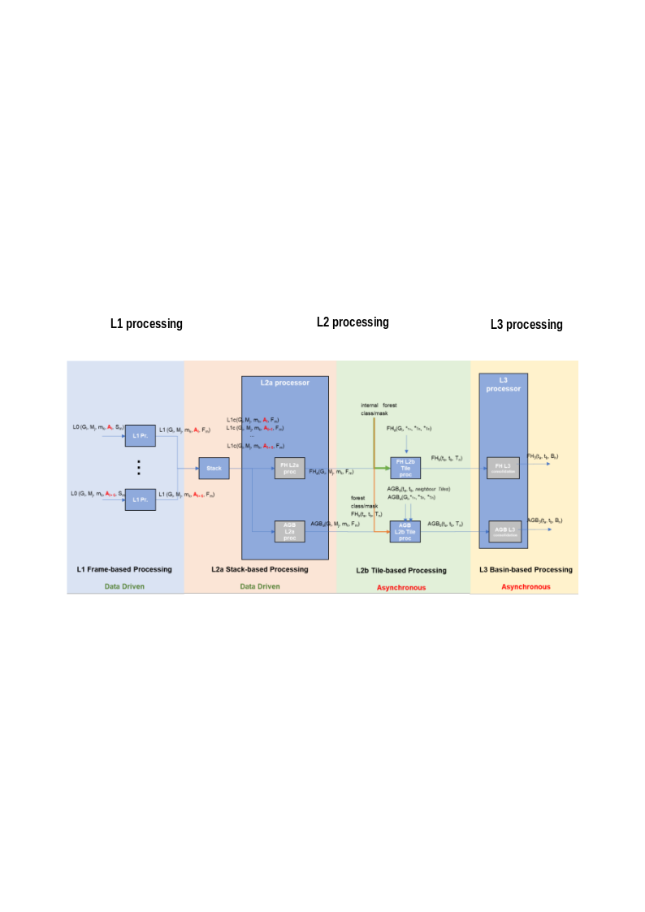
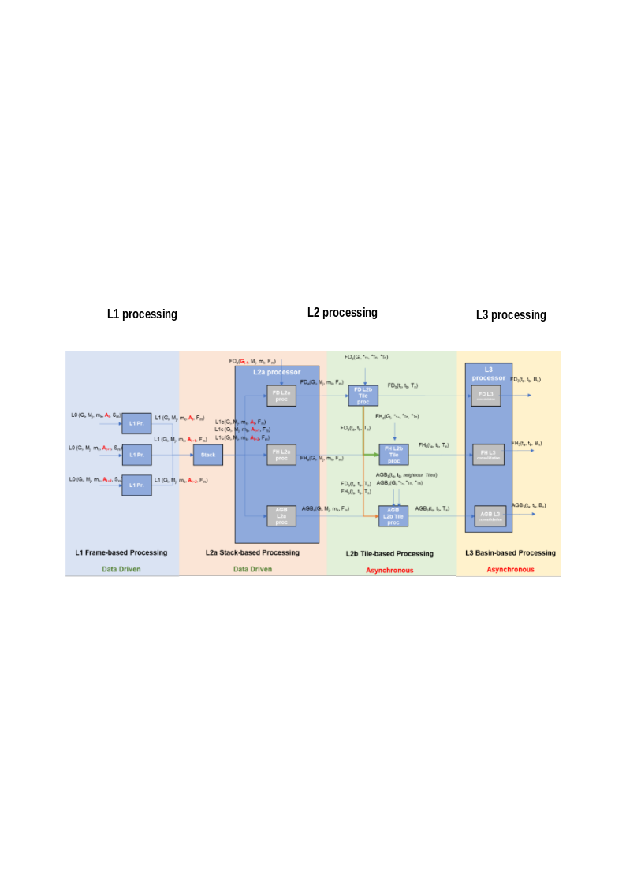
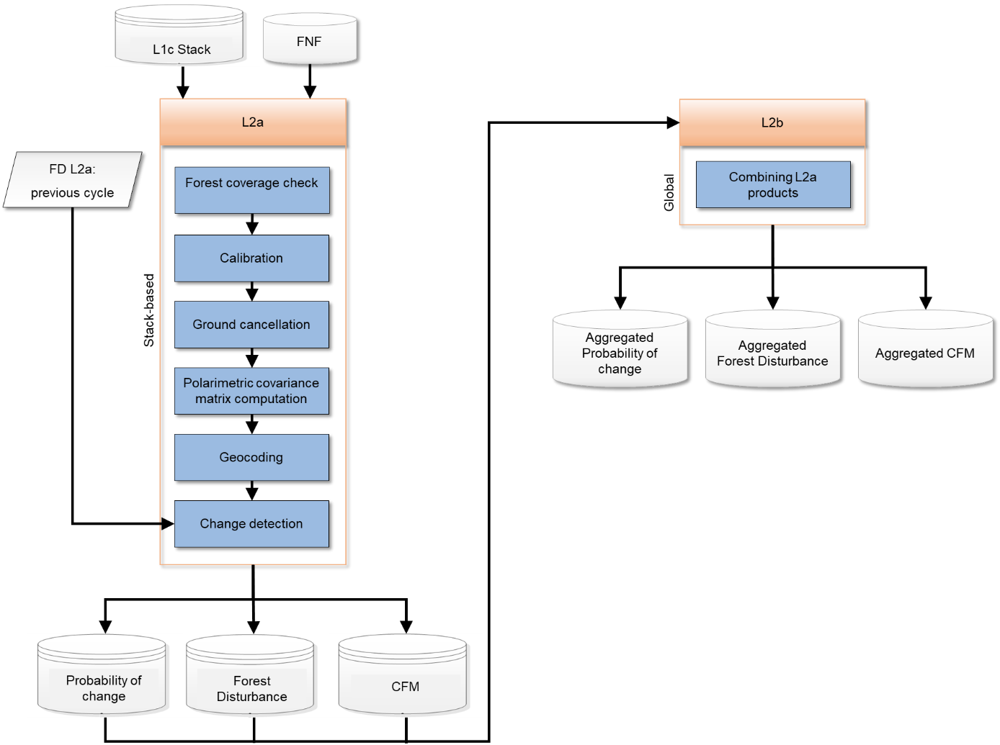

<!-- SPDX-FileCopyrightText: 2026 European Space Agency (ESA) -->
<!-- SPDX-License-Identifier: Apache-2.0 -->

:::{atbd-logo-banner}
:::


(sec:atbd-fd-2)=
# 2. BPS and FD Processing Overview

(sec:atbd-fd-2-1)=
### 2.1 BPS Overview

The BIOMASS Processing Suite (BPS) is in charge of processing BIOMASS Level-0 data up to Level-3, generating a wide set of products. Product generation scheme is depicted in the following two figures respectively for the TOM phase and INT phase. The processing foresees the following steps:

- L1 processing: the BIOMASS image formation step, taking as input 1 L0 slice and generating as output N\>=1 L1 frames;
- Stack Processing: the coregistration and stacking processing step that will define the required 7-images Tomographic stacks or the 3-images Interferometric stacks. It includes stack phase calibration;
- L2a Processing: processing step for each stack that provides the inputs to the further products Tile Generation performed by the L2b processors. For one global cycle the number of stacks varies mainly with latitude, approximately from a minimum of two at the Equator (ascending/descending) to about six at higher latitudes (three ascending/descending pairs);
- L2b Processing: processing that aggregates all the stack-based L2a products insisting on the same location on ground (Tile) in the same time interval and generates a single BIOMASS L2b product. A different number of stacks may be available for each DGG tile {rd}`8`, based on tile dimensions and swath coverage (which is not related to DGG tiling pattern);
- L3 Processing: consolidation processing removing discontinuities in L2b products.

(fig:atbd-fd-1)=
::::{div} atbd-mermaid-figure atbd-drawn-figure

<div class="atbd-figure-content">

```{mermaid}
%%{init: {"class": {"useMaxWidth": false}, "theme": "default", "layout": "elk", "elk": {"nodePlacementStrategy": "NETWORK_SIMPLEX"}, "flowchart": {"useMaxWidth": false, "diagramPadding": 4, "subGraphTitleMargin": {"top": 2, "bottom": 2}}}}%%
flowchart TB
  accTitle: Biomass high-level processing scheme from L0 data to L3 products, TOM phase.
  accDescr: Three stages, L1, L2 and L3 processing, in four lanes drawn side by side from left to right in the original and here from top to bottom. L1 Frame-based Processing (Data Driven): each L0 frame (G_i, M_j, m_k, A_l, S_m) up to A_l+6 goes through an L1 Pr. step, giving L1 (G_i, M_j, m_k, A_l, F_m) to A_l+6. L2a Stack-based Processing (Data Driven): the L1 frames are stacked; the stack, L1c(G_i, M_j, m_k, A_l, F_m) to A_l+6, feeds the FH L2a proc and AGB L2a proc steps of the L2a processor. L2b Tile-based Processing (Asynchronous): FH_a(G_i, M_j, m_k, F_m) and FH_a(G_i, *Tn, *Tn, *Tn) feed the FH L2b Tile proc, which also takes the internal forest class/mask; AGB_a(G_i, M_j, m_k, F_m), AGB_b(t_a, t_b, neighbour Tiles), AGB_a(G_i, *Tn, *Tn, *Tn) and the forest class/mask with FH_b(t_a, t_b, T_n) feed the AGB L2b Tile proc. L3 Basin-based Processing (Asynchronous): FH_b(t_a, t_b, T_n) and AGB_b(t_a, t_b, T_n) go to the FH L3 and AGB L3 consolidation steps of the L3 processor, which output FH_3(t_a, t_b, B_n) and AGB_3(t_a, t_b, B_n).

  %% Colours of the original figure. Each class sets its text colour too, so it
  %% stays readable with the light and the dark site themes.
  %%   step:  processing step (blue box, white text)
  %%   proc:  step inside a processor (grey box, white text)
  %%   data:  input or output label (text only, on the lane colour)
  %%   red A: the acquisition index that changes from frame to frame
  classDef step fill:#8faadc,stroke:#1f1f1f,color:#ffffff,font-weight:bold
  classDef proc fill:#a6a6a6,stroke:#1f1f1f,color:#ffffff,font-weight:bold
  classDef data fill:none,stroke:none,color:#000000
  classDef dots fill:none,stroke:none,color:#000000,font-weight:bold

  subgraph L1["<b>L1 processing</b><br/>L1 Frame-based Processing<br/><span style='color:#548235'>Data Driven</span>"]
    in1["L0 (G<sub>i</sub>, M<sub>j</sub>, m<sub>k</sub>, <b style='color:#e00000'>A<sub>l</sub></b>, S<sub>m</sub>)"]:::data
    l1a["L1 Pr."]:::step
    more["⋮"]:::dots
    in2["L0 (G<sub>i</sub>, M<sub>j</sub>, m<sub>k</sub>, <b style='color:#e00000'>A<sub>l+ 6</sub></b>, S<sub>m</sub>)"]:::data
    l1b["L1 Pr."]:::step
  end

  subgraph L2P["<b>L2 processing</b>"]
    subgraph L2A["L2a Stack-based Processing<br/><span style='color:#548235'>Data Driven</span>"]
      stack["Stack"]:::step
      subgraph L2AP["L2a processor"]
        fha["FH L2a<br/>proc"]:::proc
        agba["AGB<br/>L2a<br/>proc"]:::proc
      end
    end
    subgraph L2B["L2b Tile-based Processing<br/><span style='color:#e00000'>Asynchronous</span>"]
      mask["internal forest<br/>class/mask"]:::data
      fhin["FH<sub>a</sub>(G<sub>i</sub>, *<sub>Tn</sub>, *<sub>Tn</sub>, *<sub>Tn</sub>)"]:::data
      agbinb["AGB<sub>b</sub>(t<sub>a</sub>, t<sub>b</sub>, <i>neighbour Tiles</i>)"]:::data
      agbina["AGB<sub>a</sub>(G<sub>i</sub>,*<sub>Tn</sub>, *<sub>Tn</sub>, *<sub>Tn</sub>)"]:::data
      fhb["FH L2b<br/>Tile<br/>proc"]:::step
      agbb["AGB<br/>L2b Tile<br/>proc"]:::step
    end
  end

  subgraph L3["<b>L3 processing</b><br/>L3 Basin-based Processing<br/><span style='color:#e00000'>Asynchronous</span>"]
    subgraph L3PR["L3<br/>processor"]
      fh3["FH L3<br/><small>consolidation</small>"]:::proc
      agb3["AGB L3<br/><small>consolidation</small>"]:::proc
    end
    fhout["FH<sub>3</sub>(t<sub>a</sub>, t<sub>b</sub>, B<sub>n</sub>)"]:::data
    agbout["AGB<sub>3</sub>(t<sub>a</sub>, t<sub>b</sub>, B<sub>n</sub>)"]:::data
  end

  in1 --> l1a
  in2 --> l1b
  in1 ~~~ more
  l1a -- "L1 (G<sub>i</sub>, M<sub>j</sub>, m<sub>k</sub>, <b style='color:#e00000'>A<sub>l</sub></b>, F<sub>m</sub>)" --> stack
  l1b -- "L1 (G<sub>i</sub>, M<sub>j</sub>, m<sub>k</sub>, <b style='color:#e00000'>A<sub>l+ 6</sub></b>, F<sub>m</sub>)" --> stack
  stack -- "L1c(G<sub>i</sub>, M<sub>j</sub>, m<sub>k</sub>, <b style='color:#e00000'>A<sub>l</sub></b>, F<sub>m</sub>)<br/>L1c (G<sub>i</sub>, M<sub>j</sub>, m<sub>k</sub>, <b style='color:#e00000'>A<sub>l+1</sub></b>, F<sub>m</sub>)<br/>…<br/>L1c(G<sub>i</sub>, M<sub>j</sub>, m<sub>k</sub>, <b style='color:#e00000'>A<sub>l+ 6</sub></b>, F<sub>m</sub>)" --> fha
  stack --> agba
  fha -- "FH<sub>a</sub>(G<sub>i</sub>, M<sub>j</sub>, m<sub>k</sub>, F<sub>m</sub>)" --> fhb
  agba -- "AGB<sub>a</sub>(G<sub>i</sub>, M<sub>j</sub>, m<sub>k</sub>, F<sub>m</sub>)" --> agbb
  fhin --> fhb
  agbinb --> agbb
  mask ==> fhb
  mask -- "forest<br/>class/mask<br/>FH<sub>b</sub>(t<sub>a</sub>, t<sub>b</sub>, T<sub>n</sub>)" --> agbb
  fhb -- "FH<sub>b</sub>(t<sub>a</sub>, t<sub>b</sub>, T<sub>n</sub>)" --> fh3
  agbb -- "AGB<sub>b</sub>(t<sub>a</sub>, t<sub>b</sub>, T<sub>n</sub>)" --> agb3
  fh3 --> fhout
  agb3 --> agbout
  agbina --> agbb

  %% lane colours (fill and text colour: readable in both site themes)
  style L2P fill:none,stroke:none,color:#000000
  style L1 fill:#dae3f3,stroke:#dae3f3,color:#000000
  style L2A fill:#fbe5d6,stroke:#fbe5d6,color:#000000
  style L2B fill:#e2f0d9,stroke:#e2f0d9,color:#000000
  style L3 fill:#fff2cc,stroke:#fff2cc,color:#000000
  style L2AP fill:#8faadc,stroke:#1f1f1f,color:#ffffff
  style L3PR fill:#8faadc,stroke:#1f1f1f,color:#ffffff
  %% links 11 and 12: internal forest class/mask (green, then orange)
  linkStyle 11 stroke:#70ad47,stroke-width:3px
  linkStyle 12 stroke:#ed7d31,stroke-width:2px
```

:::{dropdown} Original figure (DOCX)

:::

</div>

<p class="atbd-figure-caption"><span class="caption-number">Fig. 1</span><span class="caption-text"> — Biomass high-level processing scheme from L0 data to L3 products, TOM phase.</span></p>

::::

(fig:atbd-fd-2)=
:::{div} atbd-mermaid-figure

<div class="atbd-figure-content">



</div>

<p class="atbd-figure-caption"><span class="caption-number">Fig. 2</span><span class="caption-text"> — Biomass high-level processing scheme from L0 data to L3 products, INT phase.</span></p>

:::

(sec:atbd-fd-2-2)=
### 2.2 FD Processing Overview

The FD processing runs during INT phase only and has as main goal the generation of maps of high-intensity change between successive temporal cycles due to deforestation (logging, fire etc.) at a spatial resolution roughly equivalent to ~50 m x 50 m (i.e. 0.25 ha) at the Equator {rd}`9`. It receives as input a stack of BIOMASS Level-1c images (SCS co-registered and calibrated stack), including its relevant annotated data {ad}`3`. The FD processing is divided into three levels:

- L2a, generates a map of the probability of change from each L1c stack based on statistical hypothesis testing algorithm, as well as a forest disturbance map and a Computed Forest Mask (CFM), accounting for the cumulative disturbance updates;
- L2b, generates a forest disturbance map merging all the L2a products on a geographic grid tile, as well as an aggregated probability of change map and CFM;
- L3, consolidates the result removing discontinuities in L2b products.

The production model foresees the additional optional possibility of having an FD product also from TOM phase {ad}`1`. In this case the product would contain only average covariance information (ACM) to be used during the first INT cycle for the computation of disturbance ({sec}`Section|3.7.4.3`).

```{note}
L3 processing currently does not entail any additional step with respect to L2b. This will be confirmed/reassessed at future milestones. For the moment L3 is kept as a placeholder for eventual future evolutions. Eventually, L2b can be an empty container and the product will be copied to L3.
```

```{note}
Provided that FD algorithm proper validation will only be possible with BIOMASS in orbit, the strategy proposed to deal with FH/AGB dependency on FD is to initially input to FH/AGB a forest/non-forest mask generated outside of BPS {ad}`1` {ad}`2`. After testing FD performance with BIOMASS in orbit, FD dependency can be switched on again, provided it has a satisfactory performance. The diagram of {fig}`Fig.|2` reports nonetheless FD input for completeness.
```

```{note}
L2 processor receives from Stack processor L1c products with two co-polarization (CP) channels and one cross-polarization (XP) channel. Details on the aggregation of XP channels into one XP are reported in {rd}`1`.
```

```{note}
Regarding stack images cardinality, their number can vary (not always 3 or 7) due to contingency reasons and it can go up to 8 in TOM phase.
```

(sec:atbd-fd-2-3)=
### 2.3 FD Processing Workflow and Algorithmic Overview

The main steps of FD processing workflow are depicted in the following figure and described in detail in the following sub-sections. This algorithm is an enhancement of the one described in {rd}`9`.

(fig:atbd-fd-3)=
::::{div} atbd-mermaid-figure atbd-drawn-figure

<div class="atbd-figure-content">

```{mermaid}
%%{init: {"flowchart": {"useMaxWidth": false}, "class": {"useMaxWidth": false}, "theme": "default", "layout": "elk"}}%%
flowchart TB
  accTitle: FD processing detailed workflow.
  accDescr: The L1c Stack and FNF feed L2a. In L2a, stack-based steps run in sequence: Forest coverage check, Calibration, Ground cancellation, Polarimetric covariance matrix computation, Geocoding and Change detection, which also takes FD L2a: previous cycle. L2a outputs Probability of change, Forest Disturbance and CFM. These three products feed L2b, which holds Combining L2a products (Global). L2b outputs Aggregated Probability of change, Aggregated Forest Disturbance and Aggregated CFM.

  %% Colours of the original figure. Each class sets its text colour too.
  %%   prod:  product or input dataset (cylinder, light grey)
  %%   prev:  input from the previous cycle (parallelogram, light grey)
  %%   step:  processing step (blue box)
  classDef prod fill:#f2f2f2,stroke:#a6a6a6,color:#000000
  classDef prev fill:#f2f2f2,stroke:#7f7f7f,color:#000000
  classDef step fill:#9dc3e6,stroke:#5b7fa6,color:#000000

  l1c[("L1c Stack")]:::prod
  fnf[("FNF")]:::prod
  prevc[/"FD L2a:<br/>previous cycle"/]:::prev

  subgraph L2a["L2a"]
    subgraph sb["Stack-based"]
      fcc["Forest coverage check"]:::step
      cal["Calibration"]:::step
      gc["Ground cancellation"]:::step
      pcm["Polarimetric covariance<br/>matrix computation"]:::step
      geo["Geocoding"]:::step
      cd["Change detection"]:::step
    end
  end

  poc[("Probability of<br/>change")]:::prod
  fd[("Forest<br/>Disturbance")]:::prod
  cfm[("CFM")]:::prod

  subgraph L2b["L2b"]
    subgraph gl["Global"]
      comb["Combining L2a<br/>products"]:::step
    end
  end

  apoc[("Aggregated<br/>Probability of<br/>change")]:::prod
  afd[("Aggregated<br/>Forest Disturbance")]:::prod
  acfm[("Aggregated CFM")]:::prod

  style L2a fill:#ffffff,stroke:#f4b183,color:#000000
  style L2b fill:#ffffff,stroke:#f4b183,color:#000000
  style sb fill:#ffffff,stroke:#ffffff,color:#000000
  style gl fill:#ffffff,stroke:#ffffff,color:#000000

  l1c --> L2a
  fnf --> L2a
  fcc --> cal --> gc --> pcm --> geo --> cd
  prevc --> cd
  L2a --> poc
  L2a --> fd
  L2a --> cfm
  poc --> L2b
  fd --> L2b
  cfm --> L2b
  L2b --> apoc
  L2b --> afd
  L2b --> acfm
```

:::{dropdown} Original figure (DOCX)

:::

</div>

<p class="atbd-figure-caption"><span class="caption-number">Fig. 3</span><span class="caption-text"> — FD processing detailed workflow.</span></p>

::::

(sec:atbd-fd-2-3-1)=
#### 2.3.1 Change detection (L2A\_P)

The main steps of the stack-based L2a block are:

- forest coverage check: predetermine which input data (as a whole image) should need to be processed;
- calibration: application of phase calibration and ground steering (terrain at zero elevation) screens to the stack;
- ground cancellation: removes the contribution of the ground scattering from the stack;
- polarimetric covariance matrix computation: computes the polarimetric covariance matrix from ground cancelled data;
- geocoding: projects the processed data on a geographic map, accounting for the different forest point locations with respect to the reference DEM;
- change detection: computes the probability of change from hypothesis testing between the covariance of the current and previous cycles and computes disturbance maps from L2a probabilities of change for each stack.

(sec:atbd-fd-2-3-2)=
#### 2.3.2 Change detection aggregation (L2B\_FD\_P)

The main steps of the L2b block are:

- combining: fusion of L2a estimates at map level.

(sec:atbd-fd-2-3-3)=
#### 2.3.3 Note on interpretation of inputs and outputs tables

Inputs and outputs for each processing sub-step are summarized in specific subsections (two subsections for each substep). A specific tabular format is defined to improve the access to the document. The meaning of each column is exemplified in the following table.

| Symbol | Name | Origin/ Destination | Size | Variability | Default | Description |
|---|---|---|---|---|---|---|
| Mathematical symbol of the quantity appearing in formulas. | Name of the quantity as related to other BPS documentation (e.g., `AUX_FMT`, L1 ATBDs, …) | BPS document name describing the origin of the quantity or processing step of origin/destination or BPS product of destination. | Dimensions of the quantity. | Range of values or update rate of an internal resource. | Default value for configuration parameters. | Verbal description of the quantity and its characteristics (e.g. measure units, …) |
