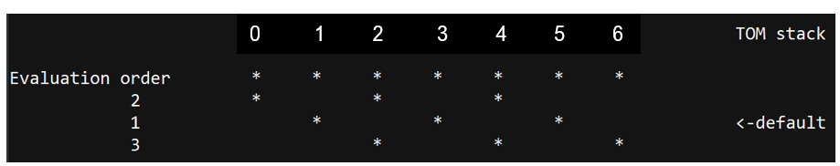
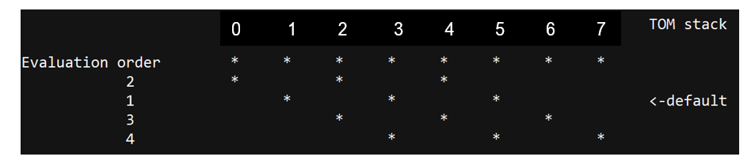
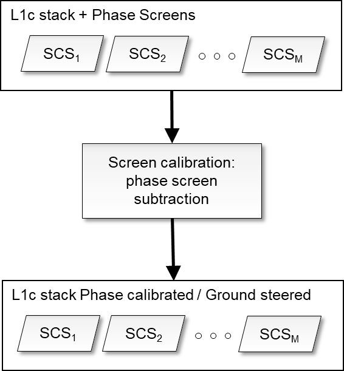
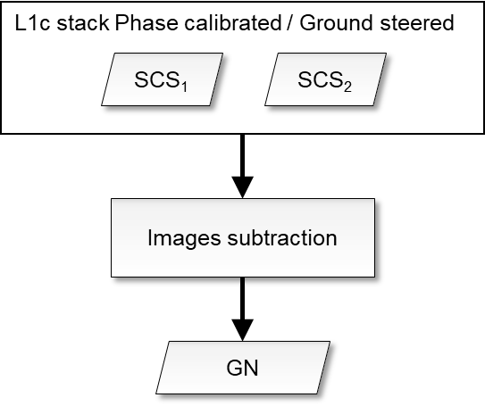
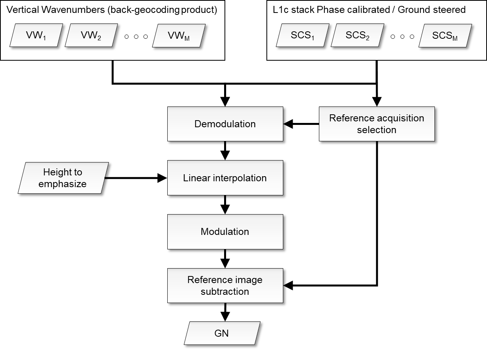
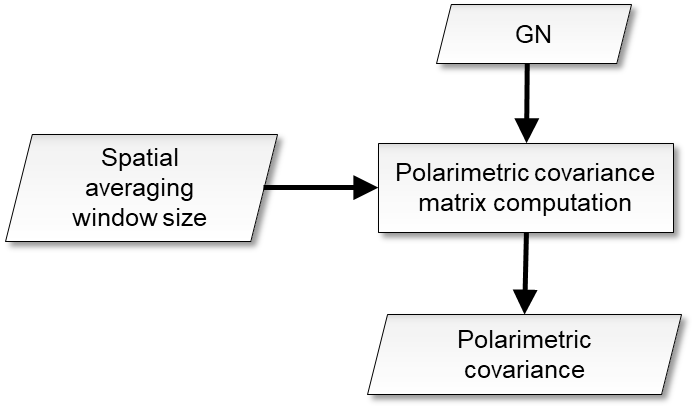
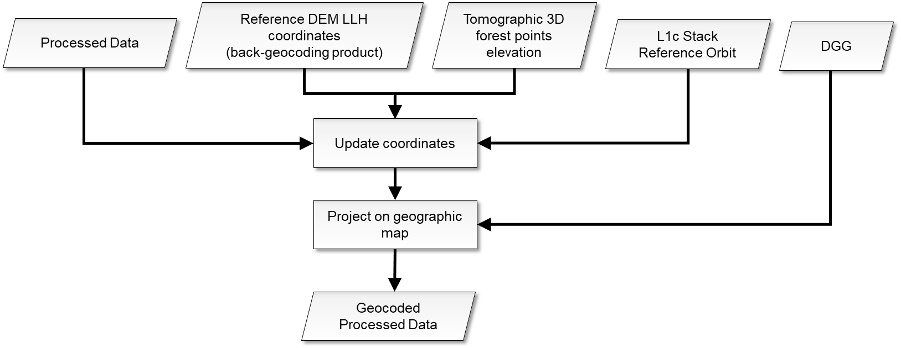
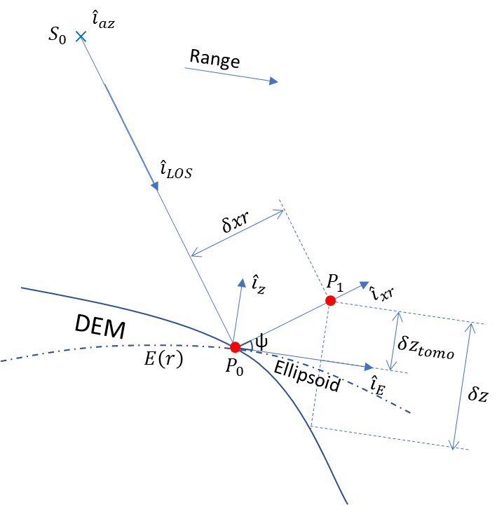
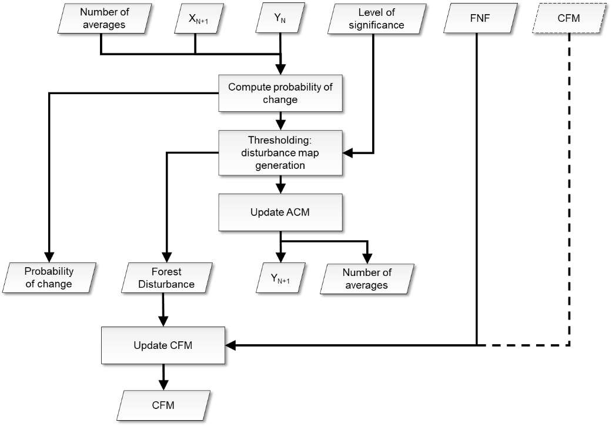
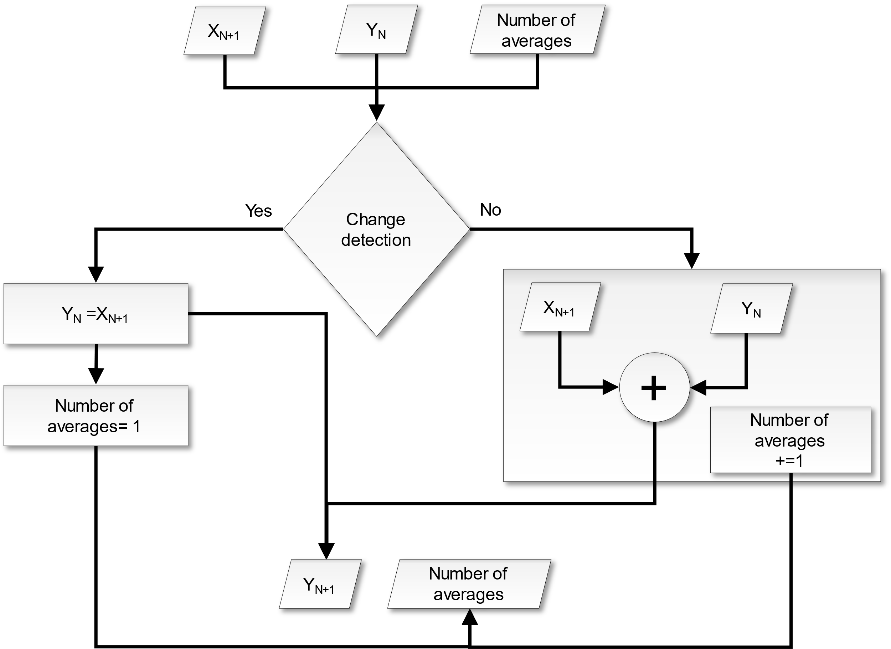

<!-- SPDX-FileCopyrightText: 2026 European Space Agency (ESA) -->
<!-- SPDX-License-Identifier: Apache-2.0 -->

:::{atbd-logo-banner}
:::


(sec:atbd-fd-3)=
# 3. Change detection

The overall scheme of the L2a processing is reported in {fig}`Fig.|3`.

The key steps are ground cancellation and the change computation. These steps are described in detail in the following subsections.

(sec:atbd-fd-3-1)=
### 3.1 Forest Coverage Check

(sec:atbd-fd-3-1-1)=
#### 3.1.1 Overview and rationale

The availability of a general FNF map allows to predetermine which input data (as a whole image) should need to be processed. A threshold (mF) must be set as input parameter to select the minimum forest coverage (as a percentage of the whole area covered by the images) to start or skip computation.

**The step is optional. If unset, change detection computation is always performed for all the data elements.**

(sec:atbd-fd-3-1-2)=
#### 3.1.2 Inputs

| Symbol | Name | Origin | Size | Variability | Default | Description |
|---|---|---|---|---|---|---|
| FNF | FNF | Internal resource (IODD) | $\left[ N_{lat,FNF}\times{}N_{lon,FNF} \right]$ | Yearly | - | A global forest-non-forest mask given as input |
| mF | `forestCoverageThreshold` | `AUX_PP2_2` A (`AUX_FMT`) | float value [scalar] | 0.0-100.0 | 5.0 | The minimum [%] relative forest coverage that triggers the computations |
| BB | Footprint | L1c main product header (`L1_PFD`) | lat-lon vertices [4 couples] | - | - | The extent of the L1c input data in geographical coordinates |

(sec:atbd-fd-3-1-3)=
#### 3.1.3 Outputs

| Symbol | Name | Destination | Size | Variability | Default | Description |
|---|---|---|---|---|---|---|
| TR | trigger | Next steps | Boolean [scalar] | - | True | Allows to trigger (True) the computation of the change detection |

(sec:atbd-fd-3-1-4)=
#### 3.1.4 Algorithm mathematical background

The values of the FNF mask that lie within the area covered by the image, defined by the bounding box BB, are extracted from the global FNF mask. The relative number of forested pixels is compared to the required minimum threshold mF to trigger any subsequent computation.

$$
TR=\ (100*\frac{\left. ForestedArea \right\vert_{BB}}{\left. TotalArea \right\vert_{BB}}>mF)
\tag{3.1}
$$ (eq:atbd-fd-3-1)

(sec:atbd-fd-3-1-5)=
#### 3.1.5 Notes on implementation

The substep should be as fast as possible, as its unique role is to avoid any un-useful computation. Thus, comparison is carried on at the original FNF mask spatial sampling (i.e. no reprojection needed), as any resampling does not have any impact on the relative percentage of forested area with respect to the total covered area.

It must be noted that any `noValue` pixel in FNF is treated as ForestedArea sample to avoid skipping computation because of the presence of `noValues` in FNF.

Details on the derivation of external FNF are reported in {rd}`10`.

(sec:atbd-fd-3-2)=
### 3.2 INT subsetting (TOM only)

(sec:atbd-fd-3-2-1)=
#### 3.2.1 Overview and rationale

The algorithm applies only to TOM stacks and subsets the stack in order to select the acquisitions to operate as in INT phase. The only rule applicable at the moment follows a geometric criterion. Other rules could be defined post-launch.

**This step is mandatory for TOM only.**

(sec:atbd-fd-3-2-2)=
#### 3.2.2 Inputs

| Symbol | Name | Origin | Size | Variability | Default | Description |
|---|---|---|---|---|---|---|
| SCS | L1c | Stack processor (`L1_PFD`) | M, each acquisition$\left[ N_{rg}\times{}N_{az} \right]$ | M=7/8 acquisitions (TOM phase), with two CP and one XP | - | L1c stack |
| - | `subsettingRule` | `AUX_PP2_2A` (`AUX_FMT`) | String | - | “geometry” | Select 3 acquisitions from the 7/8 of TOM phase, choosing, with a geometrical rule, the baselines corresponding to the ones of INT phase. |

(sec:atbd-fd-3-2-3)=
#### 3.2.3 Outputs

| Symbol | Name | Destination | Size | Variability | Default | Description |
|---|---|---|---|---|---|---|
| SCS | L1c | Calibration step | M, each acquisition$\left[ N_{rg}\times{}N_{az} \right]$ | M=3 acquisitions, with two CP and one XP | - | L1c stack |

(sec:atbd-fd-3-2-4)=
#### 3.2.4 Algorithm mathematical background

(sec:atbd-fd-3-2-4-1)=
##### 3.2.4.1 Geometry criterion

The "geometry" criterion for subsetting selects among the seven/eight TOM stack the three acquisitions that give nominally consistent baselines with INT phase. As different combinations are possible, see {fig}`Fig.|4`, the default rule is to select the central combination, which is corresponding to exactly the same nominal situation as INT. In case this combination presents a missing acquisition, the rule is to then evaluate remaining combinations in sequential order until a three-acquisitions combination is found. If no combination of three exists, the minimum required is two and the maximum baseline is equivalent to double TOM spacing. The contingency case with eight TOM acquisitions is reported in {fig}`Fig.|5`.

(fig:atbd-fd-4)=
:::{div} atbd-mermaid-figure

<div class="atbd-figure-content">



</div>

<p class="atbd-figure-caption"><span class="caption-number">Fig. 4</span><span class="caption-text"> — Selection for seven TOM.</span></p>

:::

(fig:atbd-fd-5)=
:::{div} atbd-mermaid-figure

<div class="atbd-figure-content">



</div>

<p class="atbd-figure-caption"><span class="caption-number">Fig. 5</span><span class="caption-text"> — Selection for eight TOM (contingency).</span></p>

:::

(sec:atbd-fd-3-3)=
### 3.3 Calibration

(sec:atbd-fd-3-3-1)=
#### 3.3.1 Overview and rationale

The calibration algorithm makes use of the L1c annotation {ad}`3` to apply phase calibration to L1c necessary for the L2a processing.

(fig:atbd-fd-6)=
:::{div} atbd-mermaid-figure

<div class="atbd-figure-content">



</div>

<p class="atbd-figure-caption"><span class="caption-number">Fig. 6</span><span class="caption-text"> — Calibration.</span></p>

:::

**The step is mandatory. If disabled for debug, default rule is to copy inputs as step output.**

(sec:atbd-fd-3-3-2)=
#### 3.3.2 Inputs

| Symbol | Name | Origin | Size | Variability | Default | Description |
|---|---|---|---|---|---|---|
| SCS | L1c | Stack processor, or INT subsetting step | M, each acquisition$\left[ N_{rg}\times{}N_{az} \right]$ | M=3 acquisitions, with two CP and one XP | - | L1c stack |
| $\varphi_{skp}$ | `skpCalibrationPhasesScreen` | L1c reference acquisition ADS (`L1_PFD`) | M, each$\left[ N_{rg,\varphi}\times{}N_{az,\varphi} \right]$ (zero for reference acquisition) | - | - | SKP calibration phase screens [rad] |
| $\varphi_{flattening}$ | `flatteningPhasesScreen` | L1c reference acquisition ADS (`L1_PFD`) | M, each$\left[ N_{rg,\varphi}\times{}N_{az,\varphi} \right]$ (zero for reference acquisition) | - | - | Ground steering (flattening) geometry phase screens [rad] |
| - | `applyCalibrationScreen` | `AUX_PP2_2` A (`AUX_FMT`) | string | ‘skp’, ‘geometry’, ‘none’ | skp | Choose the phase calibration to be performed: skp or geometry if phase screens calibration should be applied, none otherwise. |

(sec:atbd-fd-3-3-3)=
#### 3.3.3 Outputs

| Symbol | Name | Destination | Size | Variability | Default | Description |
|---|---|---|---|---|---|---|
| SCS | L1c | Ground cancellation processing step | M, each acquisition$\left[ N_{rg}\times{}N_{az} \right]$ | M=3 acquisitions, with two CP and one XP | - | Phase calibrated and ground steered (terrain at zero level) L1c stack |

(sec:atbd-fd-3-3-4)=
#### 3.3.4 Algorithm mathematical background

This step aims to remove all the phase disturbances from the L1c stack and set terrain phase at zero height (i.e., subtract DTM phase). Each polarization channel is processed independently. The SCS L1c stack provided as input contains a set of calibration and ground steering phase screens (SKP calibration screens and flattening phases screens described in {rd}`1`). Depending on `applyCalibrationScreen` configuration, the used screen is:

$\varphi=\ \varphi_{skp}+\varphi_{flattening}$ if `applyCalibrationScreen`= “skp”

$\varphi=\ \varphi_{flattening}$ if `applyCalibrationScreen`= “geometry”

The operation implemented in the calibration step of the L2 processor is simply the subtraction of the selected calibration phase screens from the input image stack phase. The operation can be expressed as:

$$
SCS(r,\ a,\ n)\ =\ SCS(r,\ a,\ n)e^{+j\varphi(r,a,n)}
\tag{3.2}
$$ (eq:atbd-fd-3-2)

where 𝜑(𝑟,𝑎,𝑛) is the phase screen accounting for all the disturbance terms and terrain topography relative to the baseline 𝑛 for each pixel in azimuth 𝑎, slant-range 𝑟. In the case of the reference acquisition, no compensation is done (zero baseline). If the phase screens have a lower resolution than the SCSs then a preliminary interpolation step is needed. The operation can be expressed as:

$$
\varphi(r,a,n)\ =\left. \ f\left[ \left. \varphi(r,a,n) \right\vert_{(rg,\varphi,az,\varphi)} \right] \right\vert_{(rg,az)}
\tag{3.3}
$$ (eq:atbd-fd-3-3)

where f is a bilinear interpolant function. Other alternate interpolating function are detailed in {rd}`11`.

(sec:atbd-fd-3-4)=
### 3.4 Ground cancellation

(sec:atbd-fd-3-4-1)=
#### 3.4.1 Overview and rationale

Ground cancellation {rd}`4` is the interferometric combination of two or more images so that the backscattered echo coming from the ground level is cancelled. This processing step can be carried out starting from the calibrated and ground steered stack of SAR images (so that the phase of the ground contribution is aligned in the images). Consequently, the radar signal coming from a particular elevation gets emphasized. This specific elevation depends on the spatial baseline characterizing the interferometric system, depending on the geometry of acquisition, and cannot usually be chosen when processing the data. However, the availability of more than two interferometric images allows this specific elevation to be selected. This is referred to as interpolated ground cancellation, which is the default setting. The processing steps are described in the following, for two images and with several images.

**The step is mandatory. If disabled for debug, default rule is to set $I_{GN}$ (see {sec}`section|3.4.3`) to primary image acquisition.**

(sec:atbd-fd-3-4-2)=
#### 3.4.2 Inputs

| Symbol | Name | Origin | Size | Variability | Default | Description |
|---|---|---|---|---|---|---|
| SCS | L1c | Calibration processing step | M, each acquisition$\left[ N_{rg}\times{}N_{az} \right]$ | M=3 acquisitions, with two CP and one XP | - | Phase calibrated and ground steered (terrain at zero level) L1c stack |
| $k_z$ | Wavenumber | L1c Stack ADS (`L1_PFD`) | M, each$\left[ N_{rg,k}\times{}N_{az,k} \right]$ (zero for reference acquisition) | - | - | Vertical wavenumbers [rad/m] computed with respect to incidence on inflated ellipsoid |
| $z_0$ | `emphasizedForestHeight` | `AUX_PP2_2` A (`AUX_FMT`) | float value [scalar] | Global single value\* for all polarizations and all pixels | 30.0 | Desired elevation emphasized from ground cancellation, meters [m] |
| - | `disableGroundCancellationFlag` | `AUX_PP2_2` A (`AUX_FMT`) | Boolean [scalar] | - | False | True to disable ground cancellation: for debug. |
| - | `operationalMode` | `AUX_PP2_2A` (`AUX_FMT`) | String | - | “single reference” | Choose the Ground Cancellation method to use |
| - | `imagesPairSelection` | `AUX_PP2_2A` (`AUX_FMT`) | List of integers | - | - | Optional, needed only when `operationMode`=”`insarPair`” and more than 2 images are available |

```{note}
Analysis can be carried out post-launch to assess whether this value can be made forest-class dependent.
```

The default operation mode of ground cancellation is `operationalMode`="single reference" with full INT stack {rd}`7`. To operate with a single pair configuration must be set to “insar pair” and the pair can be selected through `imagesPairSelection`. In case of only two images available, the `operationalMode` is automatically set to “insar pair”.

(sec:atbd-fd-3-4-3)=
#### 3.4.3 Outputs

| Symbol | Name | Destination | Size | Variability | Default | Description |
|---|---|---|---|---|---|---|
| $I_{GN}$ | - | Polarimetric covariance matrix computation | $\left[ N_{rg}\times{}N_{az} \right]$ | Two CP and one XP (independent from M) | - | Ground cancelled complex image |

(sec:atbd-fd-3-4-4)=
#### 3.4.4 Algorithm mathematical background

The flowcharts of the ground cancellation algorithm are shown in {fig}`Fig.|7`, {fig}`Fig.|8`. Each polarization channel is processed independently. A preliminary interpolation step is needed to bring wavenumbers onto the same L1c grid, in similar fashion as for the calibration screens ({sec}`Section|3.3.4`).

(fig:atbd-fd-7)=
:::{div} atbd-mermaid-figure

<div class="atbd-figure-content">



</div>

<p class="atbd-figure-caption"><span class="caption-number">Fig. 7</span><span class="caption-text"> — Ground cancellation algorithm with two images.</span></p>

:::

(fig:atbd-fd-8)=
:::{div} atbd-mermaid-figure

<div class="atbd-figure-content">



</div>

<p class="atbd-figure-caption"><span class="caption-number">Fig. 8</span><span class="caption-text"> — Ground cancellation algorithm with more than two images.</span></p>

:::

(sec:atbd-fd-3-4-4-1)=
##### 3.4.4.1 Case of two images

The processing for just two images is a simple subtraction of the second image from the first, as represented by

$$
I_{GN}(r,\ a)\ =\ SCS(r,\ a,\ 1)\ -\ SCS(r,\ a,\ 2)
\tag{3.4}
$$ (eq:atbd-fd-3-4)

which holds for each polarization channel, for pixel in azimuth 𝑎, slant-range 𝑟. The first image is not required to be the reference acquisition, as symmetrical quantities, such as the covariance matrix or impulse response function of the ground cancellation (absolute value) are not affected by the order chosen for subtraction {rd}`4`.

(sec:atbd-fd-3-4-4-2)=
##### 3.4.4.2 Interpolated ground cancellation single reference

For a stack of coherent ground steered SCS images (M\>2) a further degree of freedom is available: a given elevation above the ground level can be chosen and emphasized together with removal of the ground echo. The desired elevation $z_0$ must be converted into a wavenumber before feeding it to the routine, using the relation:

$$
k_{z_0}=\frac{\pi}{z_0}
\tag{3.5}
$$ (eq:atbd-fd-3-5)

A synthetic SCS associated with the desired wavenumber can be produced by linearly interpolating the stack. To ensure that the backscattering contribution associated with the desired elevation is not distorted by the interpolation process the stack is demodulated so that the desired elevation is steered around 0 m; the elevation to be demodulated coincides with half of the desired elevation. The demodulation is expressed by

$$
\ I_{k_z}(r,\ a,\ n)=SCS(r,\ a,\ n)e^{-jk_z(r,a,n)\frac{z_0}{2}}
\tag{3.6}
$$ (eq:atbd-fd-3-6)

The linear interpolation algorithm must recognize the previous ${\ k}_z^-(r,\ a)=\max\left\{ k_z(r,\ a,\ n)\epsilon\left[ k_z(r,\ a,\ n)<k_{z_0} \right] \right\}$ and the next ${\ k}_z^+(r,\ a)=\min\left\{ k_z(r,\ a,\ n)\epsilon\left[ k_z(r,\ a,\ n)>k_{z_0} \right] \right\}$ sampled wavenumbers of the stack and then implement

$$
I_{k_{z_0}}(r,\ a)\ \ =\ {I_{k_z}^-}_{\ }(r,\ a)+\left[ I_{k_z}^+(r,\ a)-I_{k_z}^-(r,\ a) \right]\frac{k_{z_0}-{\ k}_z^-(r,\ a)}{{k_z}^+(r,\ a)-{\ k}_z^-(r,\ a)}
\tag{3.7}
$$ (eq:atbd-fd-3-7)

where $I_{k_z}^-$ and $I_{k_z}^+$ are the SCS images associated with the wavenumbers $k_Z^-$ and $k_Z^+$

respectively. After interpolation the spectrum is shifted back.

$$
\ I_{k_{z_0}}(r,\ a)=I_{k_{z_0}}(r,\ a)e^{jk_{z_0}\frac{z_0}{2}}
\tag{3.8}
$$ (eq:atbd-fd-3-8)

The synthetic image (independent from M) is then subtracted from the reference image

$$
I_{GN}(r,\ a)\ \ =\ I_{ref}(r,\ a)\ -\ I_{k_{z_0}}(r,\ a)
\tag{3.9}
$$ (eq:atbd-fd-3-9)

(sec:atbd-fd-3-4-4-2-1)=
###### 3.4.4.2.1 Reference acquisition selection

In this case the reference acquisition $I_{ref}$ should be chosen as the one guaranteeing the widest scene coverage where interpolation can be performed, around the desired value $k_{z_0}$

$$
I_{ref}=\max_{{SCS}_n}\sum_{r,\ a}^{}{({k_z}_{\min}^n\ (r,\ a)<\ k_{z_0})(k_{z_0}\ <\ {k_z}_{\max}^n(r,\ a))}
\tag{3.10}
$$ (eq:atbd-fd-3-10)

where ${k_z}_{\min}^n$and ${k_z}_{\max}^n$ are the maximum and minimum wavenumbers of the set $k_z(r,a,n)-\ k_z(r,a,ref)$ assuming ${SCS}_n$ as $I_{ref}$.

The reference acquisition selection is performed in a fully automatic way by the algorithm and requires no configuration inputs or others. The aim of this step is to set the reference acquisition to the one guaranteeing correct scene coverage and avoid gaps. The reference selected by this step is not necessarily corresponding to the original L1c reference of the stack. Anyway, the change of reference computed by this step is valid only for the purpose of ground cancellation computation and does not imply any change of reference outside the scope of this step. This step applies only to the interpolated single reference case, since in the two images case there is no need to specify a reference acquisition as described in {sec}`3.4.4.1`).

(sec:atbd-fd-3-5)=
### 3.5 Polarimetric covariance matrix computation

(sec:atbd-fd-3-5-1)=
#### 3.5.1 Overview and rationale

The polarimetric covariance estimation block aims to estimate the second order statistics of the ground cancelled complex data.

**The step is mandatory.**

(fig:atbd-fd-9)=
:::{div} atbd-mermaid-figure

<div class="atbd-figure-content">



</div>

<p class="atbd-figure-caption"><span class="caption-number">Fig. 9</span><span class="caption-text"> — Polarimetric covariance estimation.</span></p>

:::

(sec:atbd-fd-3-5-2)=
#### 3.5.2 Inputs

| Symbol | Name | Origin | Size | Variability | Default | Description |
|---|---|---|---|---|---|---|
| $I_{GN}$ | - | Ground cancellation processing step | $\left[ N_{rg}\times{}N_{az} \right]$ | Two CP and one XP (independent from M acquisitions) | - | Ground cancelled complex image |
| `pRes` | `productResolution` | `AUX_PP2_2` A (`AUX_FMT`) | float value [scalar] | - | 50.0 | Value in [m] to be used as the resolution on ground range map and also to perform the covariance averaging in radar coordinates |
| - | `upsamplingFactor` | `AUX_PP2_2A` (`AUX_FMT`) | int value [scalar] | - | 2 | upsampling factor, that modules the overall decimation in multilooking within covariance computation |
| $\theta$ | `incidenceAngle` | L1c reference acquisition ADS (`L1_PFD`) | $\left[ N_{rg,\theta}\times{}N_{az,\theta} \right]$ | - | - | L1c stack reference acquisition incidence angle (on inflated ellipsoid) annotation [deg] |
| $B_r$ | L1c range- bandwidth | L1c reference acquisition ADS (`L1_PFD`) | - | - | - | L1c range bandwidth [Hz] |
| $B_a$ | L1c azimuth bandwidth | L1c reference acquisition ADS (`L1_PFD`) | - | - | - | L1c range bandwidth [Hz] |
| $v_a$ | L1c velocity annotation | L1c reference acquisition ADS (`L1_PFD`) | - | - | - | Average azimuth velocity [m/s] |
| $\Delta_r$ | L1c range- sampling step | L1c reference acquisition ADS (`L1_PFD`) | - | - | - | L1c range sampling step [s] |
| $\Delta_a$ | L1c azimuth sampling step | L1c reference acquisition ADS (`L1_PFD`) | - | - | - | L1c azimuth sampling step [s] |

(sec:atbd-fd-3-5-3)=
#### 3.5.3 Outputs

| Symbol | Name | Destination | Size | Variability | Default | Description |
|---|---|---|---|---|---|---|
| $Cov$ | - | Geocoding | $\left[ N_{pol}\times{}N_{pol}\times{}N_{rg,subs}\times{}N_{az,subs} \right]$ | - | - | Polarimetric covariance of the ground cancelled complex data of current stack |
| L | - | Change detection processing step | integer value [scalar] | - | - | Number of looks [adimensional] |

(sec:atbd-fd-3-5-4)=
#### 3.5.4 Algorithm mathematical background

The polarimetric covariance estimation block aims to estimate the second order statistics of the ground cancelled complex data. The size of the spatial averaging window used to estimate the second order statistics depends on the final resolution of the products to be provided as an input. The output of the covariance estimation block is a 4D array with dimensions: $\left[ N_{pol}\times{}N_{pol}\times{}N_{rg,subs}\times{}N_{az,subs} \right]$ where $N_{pol}$ the number of polarizations, and $N_{rg,subs}$ and $N_{az,subs}$ are the numbers of slant-range and azimuth samples after subsampling (half window size, well complying with the Nyquist-Shannon sampling theorem). For each (subsampled) range-azimuth position a $N_{pol}\times{}N_{pol}$ multi-polarimetric covariance matrix is returned. Mathematically:

$$
Cov\left[ p,\ q \right]=\frac{1}{N_{\Omega_r}N_{\Omega_a}}\sum_{r\in\Omega_r}^{}{\sum_{a\in\Omega_a}^{}{{I_{GN}}_p(r,a)\cdot{I_{GN}}_q^*(r,a)}}
\tag{3.11}
$$ (eq:atbd-fd-3-11)

where $p$ and $q$ denote the $p$-th and $q$-th polarimetric channels respectively; $r$ and $a$ denote the slant-range and azimuth indices; $\Omega_r$ and $\Omega_a$ denote the neighborhood in the slant-range and azimuth directions of the desired position; ${I_{GN}}_p(r,a)$ denotes the pixel value of ground cancelled complex image in polarimetric channel $p$; $*$ denotes conjugation. The averaging window size is computed as:

$$
\left\vert \Omega_r \right\vert=\left\lceil \frac{pRes}{\rho_r}\sin{\theta_m}(\Delta_rB_r)^{-1} \right\rceil
\tag{3.12}
$$ (eq:atbd-fd-3-12)

$$
\left\vert \Omega_a \right\vert=\left\lceil \frac{pRes}{\rho_a}(\Delta_aB_a)^{-1} \right\rceil
$$

where $\rho_r=\frac{c}{2B_r}$ and $\rho_a=\frac{v_a}{B_a}$ denote the L1c resolution computed from system bandwidth, Lightspeed c, average azimuth velocity $v_a$, `pRes` is the L2 resolution, $\theta_m=\frac{1}{N_rN_a}\sum_{r,a}^{}{\theta(r,a)}$ is the average incidence angle across the swath, while the terms $(\Delta_iB_i)^{-1},\ i=r,a$ represent the oversampling factor. SCS invalid pixels will not be used during processing. The presence of an invalid SCS pixel causes the generation of an invalid covariance sample. The number of looks L {rd}`6` is computed as:

$$
L=\left\lceil \frac{pRes^2}{\rho_r\rho_a}\sin{\theta_m} \right\rceil
\tag{3.13}
$$ (eq:atbd-fd-3-13)

(sec:atbd-fd-3-5-5)=
#### 3.5.5 Notes on implementation

It should be noted that, as implied by the equations above, multilooking is implicitly performed while computing polarimetric covariance. The ratio of subsampling of the final covariance matrix (i.e., the step where full matrix is sampled) is ruled by the “`upsamplingFactor`” parameter: when the assumed value is 1, full subsampling is applied (Nrg|az,subs = Nrg|az / NΩr|az), while when its value is higher, the final output covariance matrix will be bigger (Nrg|az,subs = Nrg|az / NΩr|az \* `upsamplingFactor`).

(sec:atbd-fd-3-6)=
### 3.6 Geocoding

(sec:atbd-fd-3-6-1)=
#### 3.6.1 Overview and rationale

The purpose of this step is to project the processed data onto a geographic map, accounting for the different forest points location with respect to reference DEM.

```{note}
It should be noted that the use of the BIOMASS DTM {rd}`3` is to be preferred to other DEM since it represents the true terrain level at P-band, necessary for correct geocoding.
```

```{note}
This functionality is used by all three AGB, FD, FH processors with different I/O. mathematical formulation is described highlighting the mapping of the different processors I/O to geocoding formulas in each processor document. The functionality relies on L1c ADS {rd}`1` and not on the L1 geocoding tool {rd}`2`.
```

**The step is mandatory.**

(fig:atbd-fd-10)=
:::{div} atbd-mermaid-figure

<div class="atbd-figure-content">



</div>

<p class="atbd-figure-caption"><span class="caption-number">Fig. 10</span><span class="caption-text"> — Geocoding.</span></p>

:::

(sec:atbd-fd-3-6-2)=
#### 3.6.2 Inputs

| Symbol | Name | Origin | Size | Variability | Default | Description |
|---|---|---|---|---|---|---|
| $Cov\rightarrow{}Rd$ | - | Polarimetric covariance matrix computation | $\left[ N_{pol}\times{}N_{pol}\times{}N_{rg,subs}\times{}N_{az,subs} \right]$ | - | - | Processed data, in this case the polarimetric covariance of the ground cancelled complex data of current stack |
| (𝑙𝑎𝑡,𝑙𝑜𝑛,$z_{P_0}$) | latitude longitude height | L1c reference acquisition ADS (`L1_PFD`) | 3x $\left[ N_{rg,llh}\times{}N_{az,llh} \right]$ | - | - | Reference DEM latitude-longitude-height coordinates |
| $z_0\rightarrow\delta{}z_{tomo}$ | `emphasizedForestHeight` | `AUX_PP2_2` A (`AUX_FMT`) | float value [scalar] | Global single value (see previous note) for all polarizations and all pixels | 30.0 | Tomographic 3D forest points elevation [m], in this case the desired elevation emphasized from ground cancellation |
| DGG | DGG | Internal lookup table | - | - | - | DGG sampling |
| ${\widehat{i}}_{az}$ | Orbit ADS | L1c reference acquisition ADS | - | - | - | L1c stack reference acquisition orbit annotation |

(sec:atbd-fd-3-6-3)=
#### 3.6.3 Outputs

| Symbol | Name | Destination | Size | Variability | Default | Description |
|---|---|---|---|---|---|---|
| $Rd\boldsymbol{\rightarrow{}X}$ | - | Change detection processing step | $\left[ N_{pol}\times{}N_{pol}\times{}N_{lat}\times{}N_{lon} \right]$ | - | - | Polarimetric covariance of the ground cancelled complex data of current stack projected onto a geographic map |

(sec:atbd-fd-3-6-4)=
#### 3.6.4 Algorithm mathematical background

(sec:atbd-fd-3-6-4-1-1)=
###### 3.6.4.1.1 Update reference DEM coordinates

(fig:atbd-fd-11)=
:::{div} atbd-mermaid-figure

<div class="atbd-figure-content">



</div>

<p class="atbd-figure-caption"><span class="caption-number">Fig. 11</span><span class="caption-text"> — Determining the elevation of one forest point. The picture represents a lateral section for one sensor azimuth position. Details of the represented quantities are given in the text description.</span></p>

:::

This step aims to account for the different forest points location with respect to reference DEM. A preliminary interpolation step is needed to bring DEM latitude-longitude-height onto the same L1c grid, in similar fashion as for the calibration screens ({sec}`Section|3.3.4`). Determining the elevation of one forest point is shown in {fig}`Fig.|11`:

- (𝑙𝑎𝑡,𝑙𝑜𝑛,$z_{P_0}$) is the reference DEM for the point $\boldsymbol{P}_0$ , which can be converted to Cartesian coordinates ($X_{P_0}$, $Y_{P_0}$, $Z_{P_0}$)
- 𝑧 is normal direction to ellipsoid reported to DEM at point $\boldsymbol{P}_0$, i.e., given the tangent plane to ellipsoid 𝑎 X + 𝑏 Y + 𝑐 Z + 𝑑 = 0 then ${\widehat{i}}_z=\left[ a,b,\ c\ \right]$
- ${\widehat{i}}_{az}$ is the azimuth sensor direction, determined from reference orbit annotation
- ${\widehat{i}}_{LOS}=\frac{\boldsymbol{P}_0-\boldsymbol{S}_0}{\left\vert \boldsymbol{P}_0-\boldsymbol{S}_0 \right\vert}$ is line of sight vector, $\boldsymbol{S}_0$ is the sensor position for the considered azimuth
- ${\widehat{i}}_{xr}={\widehat{i}}_{az}\times{\widehat{i}}_{LOS}$ is the cross range vector
- the ellipsoid direction at reference DEM is ${\widehat{i}}_E\cdot{\widehat{i}}_z=0$, i.e., ${\widehat{i}}_E=\frac{d\left[ \boldsymbol{E}(r) \right]}{dr}$ and $\boldsymbol{E}(r)=\left[ X_E(r),\ Y_E(r),\ Z_E(r) \right]$ are ellipsoid coordinates as a function of range
- 𝛿𝑧𝑡𝑜𝑚𝑜 is one tomographic forest point elevation, in this case the desired elevation emphasized from ground cancellation
- 𝛿𝑧 is the elevation of point P1 versus DEM (with respect to WGS84 geodetic system). Note that while this is represented for completeness in {fig}`Fig.|11`, it is not explicitly needed to compute P1 [x,y,z] position in the following {eq}`eq|3.15`

Then

$$
\delta{}xr=\frac{\delta{}z_{tomo}}{\left\vert {\widehat{i}}_{xr}\times{\widehat{i}}_E \right\vert}=\frac{\delta{}z_{tomo}}{\sin(\psi)}
\tag{3.14}
$$ (eq:atbd-fd-3-14)

The geographic position of the forest point is:

$$
\boldsymbol{P}_1=\boldsymbol{P}_0+{\widehat{i}}_{xr}\cdot\delta{}xr
\tag{3.15}
$$ (eq:atbd-fd-3-15)

(sec:atbd-fd-3-6-4-1-2)=
###### 3.6.4.1.2 Projection onto a geographic map

Once the updated coordinates of the points are computed, interpolation of each raster layer to regular map coordinates projects the processed data onto a geographic map. In this case each $\left[ N_{pol}\times{}N_{pol} \right]$ raster layer with dimensions $\left[ N_{rg,subs}\times{}N_{az,subs} \right]$ of the polarimetric covariance of the ground cancelled complex data of current stack (being the matrix symmetric only $N_{pol}\times(N_{pol}-1)/2{+N}_{pol}$ layers describe the matrix, i.e. upper or lower triangular). The covariance layers $Rd=Cov$ are geocoded using the effective forest height represented (for all pixels) by $\delta{}z_{tomo}=z_0$. Geocoding is done in a way that the products are sampled the same way onto the DGG sampling {rd}`8`. The operation can be expressed as:

$$
Rd(lat,lon,z)\ =\left. \ f\left[ \left. Rd(lat,lon,z) \right\vert_{\boldsymbol{P}_1} \right] \right\vert_{DGG}
\tag{3.16}
$$ (eq:atbd-fd-3-16)

where f is a bilinear interpolant a function, Rd is each raster layer to be interpolated.

(sec:atbd-fd-3-7)=
### 3.7 Change detection

(sec:atbd-fd-3-7-1)=
#### 3.7.1 Overview and rationale

The disturbance processing is concerned with providing maps of high-intensity change between successive temporal cycles under the implicit hypothesis of occurred deforestation (logging, fire etc.). This assumption is further detailed in the {sec}`section|3.7.4.5`. The chosen methodology is by hypothesis testing {rd}`6` {rd}`5` on geocoded polarimetric covariance estimate of the ground cancelled complex data, where the null hypothesis is that in a time series of polarimetric data no change has occurred (at a given position and up to a given time). If this hypothesis fails at a given level of significance (assuming a Wishart distribution for the complex covariance data), then it is assumed a change has occurred. This is closely related to the Constant False Alarm Rate approach to target detection {rd}`5`, in which the probability that an undisturbed pixel is incorrectly classified as disturbed is fixed. As a first step, the probability of change for each latitude-longitude pixel will be estimated, which is by itself a quality measure. Change detection to compute disturbance maps from L2a probabilities of change for each stack is applied by null hypothesis rejection at a given level of significance.

**The step is mandatory.**

(fig:atbd-fd-12)=
:::{div} atbd-mermaid-figure

<div class="atbd-figure-content">



</div>

<p class="atbd-figure-caption"><span class="caption-number">Fig. 12</span><span class="caption-text"> — Change detection.</span></p>

:::

(sec:atbd-fd-3-7-2)=
#### 3.7.2 Inputs

| Symbol | Name | Origin | Size | Variability | Default | Description |
|---|---|---|---|---|---|---|
| $\boldsymbol{X}$ | - | Geocoding | $\left[ N_{pol}\times{}N_{pol}\times{}N_{lat}\times{}N_{lon} \right]$ | - | - | Polarimetric covariance of the ground cancelled complex data of current stack projected onto a geographic map |
| $\boldsymbol{Y}$ | ACM | FD L2a product of previous cycle (`FD_PFD`) | $\left[ N_{pol}\times{}N_{pol}\times{}N_{lat}\times{}N_{lon} \right]$ | - | - | Average Covariance Matrix of previous cycles |
| q | `significanceLevel` | `AUX_PP2_2A` (`AUX_FMT`) | float value [scalar] | 0.0-100.0 | 1.0 | Significance [%] level to be applied in the change detection algorithm |
| CFM | CFM | FD L2a product of previous cycle (`FD_PFD`) | $\left[ N_{lat}\times{}N_{lon} \right]$ | - | - | Computed Forest Mask |
| L | - | Polarimetric covariance computation | integer value [scalar] | - | - | Number of looks |
| N | `numberOfAverages` | FD L2a product of previous cycle (`FD_PFD`) | $\left[ N_{lat}\times{}N_{lon} \right]$ | lower bound=1 | - | Number of averages in ACM computation |
| FNF | FNF | Internal resource | $\left[ N_{lat,FNF}\times{}N_{lon,FNF} \right]$ | Yearly | - | A global forest-non-forest mask given as input |
| fMIT | `forestMaskInterpolationThreshold` | `AUX_PP2_2` A (`AUX_FMT`) | float value [scalar] | 0.0-1.0 | 0.5 | Threshold to fix rounding of pixels with decimal values originated from binary FNF interpolation onto L2a grid |
| `detLimit` | `numericalDeterminatLimit` | `AUX_PP2_2` A (`AUX_FMT`) | float value [scalar] | \>0.0 | 1.0e-12 | Lower Threshold to avoid numerical errors when computing pol covariance matrices determinants |

(sec:atbd-fd-3-7-3)=
#### 3.7.3 Outputs

| Symbol | Name | Destination | Size | Variability | Default | Description |
|---|---|---|---|---|---|---|
| CFM | CFM | FD L2a product of current cycle (`FD_PFD`) | $\left[ N_{lat}\times{}N_{lon} \right]$ | - | - | Update of CFM |
| $P_c$ | Probability of change | FD L2a product of current cycle (`FD_PFD`) | $\left[ N_{lat}\times{}N_{lon} \right]$ | - | - | Probability of change map of current stack |
| ${FD}_{map}$ | Forest Disturbance | FD L2a product of current cycle (`FD_PFD`) | $\left[ N_{lat}\times{}N_{lon} \right]$ | - | - | Forest Disturbance map of current stack |
| $\boldsymbol{Y}$ | ACM | FD L2a product of current cycle (`FD_PFD`) | $\left[ N_{pol}\times{}N_{pol}\times{}N_{lat}\times{}N_{lon} \right]$ | - | - | Update of ACM |
| N | `numberOfAverages` | FD L2a product of current cycle (`FD_PFD`) | $\left[ N_{lat}\times{}N_{lon} \right]$ | lower bound=1 | - | Update of number of averages in ACM computation |

(sec:atbd-fd-3-7-4)=
#### 3.7.4 Algorithm mathematical background

(sec:atbd-fd-3-7-4-1)=
##### 3.7.4.1 Hypothesis testing

Each pixel is processed independently. For each pixel of the geocoded ground cancelled polarimetric covariance matrix at current global cycle “N+1” multiplied by a factor L (corresponding the number of looks {rd}`6`) $\boldsymbol{X}_{N+1}=L\boldsymbol{X}$, the likelihood ratio statistic is calculated to test the null hypothesis that it is the same as that of the previous N cycles (N= `numberOfAverages`) Average Covariance Matrix $\boldsymbol{Y}_N=\ \sum_{i=0}^N{\boldsymbol{X}_i}$

(equation-eq-atbd-fd-3-17)=
\begin{equation}
\begin{aligned}
R_{N+1}=\left\{ \frac{(N+1)^{(N+1)p}}{N^{Np}}\frac{\left\vert \boldsymbol{Y}_N \right\vert^N\ \left\vert \boldsymbol{X}_{N+1} \right\vert}{\left\vert \sum_{i=0}^{N+1}{\boldsymbol{X}_i} \right\vert^{N+1}} \right\}^L= \\
=\left\{ \frac{(N+1)^{(N+1)p}}{N^{Np}}\frac{\left\vert \boldsymbol{Y}_N \right\vert^N\ \left\vert \boldsymbol{X}_{N+1} \right\vert}{\left\vert \boldsymbol{Y}_N+\boldsymbol{X}_{N+1} \right\vert^{N+1}} \right\}^L
\end{aligned}
\tag{3.17}
\end{equation}

From {sec}`Section|3.5.4` L is the number of looks, |..| denotes determinant, and p is the polarimetric dimension of the data matrix (L=6 and p=3 as per BIOMASS requirements {rd}`9`). The polarimetric covariance matrices are (by definition) Hermitian and semi-positive definite: their determinant is real-valued. However, determinant calculation can be ill-posed as its value approaches zero (as numerical errors may arise). It has been chosen to set a lower limit (optional user defined parameter `numericalDeterminantLimit`) to deal with numerical errors and avoid any problems in subsequent equations.

To calculate the probability of rejecting the null hypothesis if all the covariance matrices are the same, the following auxiliary variables are calculated {rd}`6` {rd}`5`:

$$
f=p^2
\tag{3.18}
$$ (eq:atbd-fd-3-18)

$$
\rho_{N+1}=1-\frac{2f-1}{6pL}(1+\frac{1}{N(N+1)})
$$

$$
\omega_{2(N+1)}=-\frac{f}{4}(1-\frac{1}{\rho_{N+1}})^2+\frac{1}{24L^2}f(f-1)(1+\frac{2N+1}{N^2{(N+1)}^2})\frac{1}{\rho_{N+1}^2}
$$

Under the null hypothesis the probability of change is calculated as:

$$
P_c=P({-2\rho}_{N+1}\ \ln{\ R}_{N+1}\leq{}z)\approx{}P\left\{ \chi^2(f)\leq{}z \right\}+\omega_{2(N+1)}\left[ P\left\{ \chi^2(f+4)\leq{}z \right\}-P\left\{ \chi^2(f)\leq{}z \right\} \right]
\tag{3.19}
$$ (eq:atbd-fd-3-19)

where $z=-2\rho_{N+1\ }\ln{r_{N+1}}$, $r_{N+1}$ is the measured value of the statistic $R_{N+1}$ and $\chi^2(..)$ is the chi-squared function. Hence, we can assign a probability to the observed value of $r_{N+1}$ occurring if $\boldsymbol{X}_{N+1}$ is the same as all the previous $\boldsymbol{X}_i$, and hence attach a level of significance to the failure of the null hypothesis.

(sec:atbd-fd-3-7-4-2)=
##### 3.7.4.2 Disturbance map generation

If the null hypothesis is rejected at a given level of significance q, the pixel is assumed to have undergone significant disturbance and so has been deforested between times N and N+1. FD map generation for each pixel of the current stack is obtained by thresholding the probability of change as:

$$
{FD}_{map}=\left\{ 1-P_c \right\}<q
\tag{3.20}
$$ (eq:atbd-fd-3-20)

(sec:atbd-fd-3-7-4-3)=
##### 3.7.4.3 ACM update mechanism

History of previous N cycles is represented by an Average Covariance Matrix $\boldsymbol{Y}_N$ (equivalent to current Covariance Matrix $\boldsymbol{X}_{N+1}$ as for dimensions and data type), which consists of the stacking of covariance matrices from previous cycles, in case no change occurred. When detection is computed between current CM $\boldsymbol{X}_{N+1}$ and the ACM $\boldsymbol{Y}_N$ for a given pixel, in case of no change current CM is added to ACM to be used in the subsequent cycle (ACM is updated to be the average over the whole series where no change has occurred). In case of change, instead, this ACM is reset to current CM for subsequent cycles and FD will report an indication of change for the corresponding pixels in the disturbance layer. The `numberOfAverages` of the previous N cycles, which is a measure of how many objects are averaged in the current ACM, is also reset to 1. The update mechanism is reported in {fig}`Fig.|13` for the ACM $\boldsymbol{Y}_N$.

(fig:atbd-fd-13)=
:::{div} atbd-mermaid-figure

<div class="atbd-figure-content">



</div>

<p class="atbd-figure-caption"><span class="caption-number">Fig. 13</span><span class="caption-text"> — Update mechanism for Average Covariance Matrix.</span></p>

:::

(sec:atbd-fd-3-7-4-4)=
##### 3.7.4.4 ACM computed in TOM

To have a FD map in the first INT global coverage ACM computed in TOM can be fed (however this option is initially set off). This does not require processing modifications but the generation of an FD product empty but for the ACM. This can be computed by choosing the same baselines of the INT Phase, see {sec}`3.2`. Otherwise, detection is possible from the second global cycle after the beginning of the Interferometric Phase or at second iteration when the algorithm is started the very first time in case of off-line reprocessing. This is due to the fact that the first cycle is needed to compute first ACM.

(sec:atbd-fd-3-7-4-5)=
##### 3.7.4.5 Computed Forest Mask

A Computed Forest Mask is also generated, accounting for the incremental FD information. At the first cycle this is equal to external FNF. A preliminary FNF interpolation step is needed to bring FNF onto the same FD grid, in the same fashion as for the calibration screens ({sec}`Section|3.3.4`). Since interpolation generates border effects a threshold fMIT to fix rounding of pixels with decimal values is applied:

$$
FNF=FNF>fMIT
\tag{3.21}
$$ (eq:atbd-fd-3-21)

The CFM update rule from the second global cycle is then:

$$
CFM=\left\{ 1-{FD}_{map} \right\}\land{}CFM
\tag{3.22}
$$ (eq:atbd-fd-3-22)

where $\land$ is the logical and operator.

It is worth noting that the current implementation cannot differentiate between the sources of the changes that have occurred (i.e., the disturbances detected as per {sec}`section|3.7.4.2`). This means that each disturbed pixel will always be mapped as a ‘Non-Forest’ class in the output CFM.

At the time of the ATBD formulation, this simplified assumption was considered acceptable due to the anticipated application with BIOMASS data (i.e., the nominal production of an FD product between two global coverages). The reliability of the CFM product should be carefully evaluated if the FD algorithm is applied over more extended time ranges.
