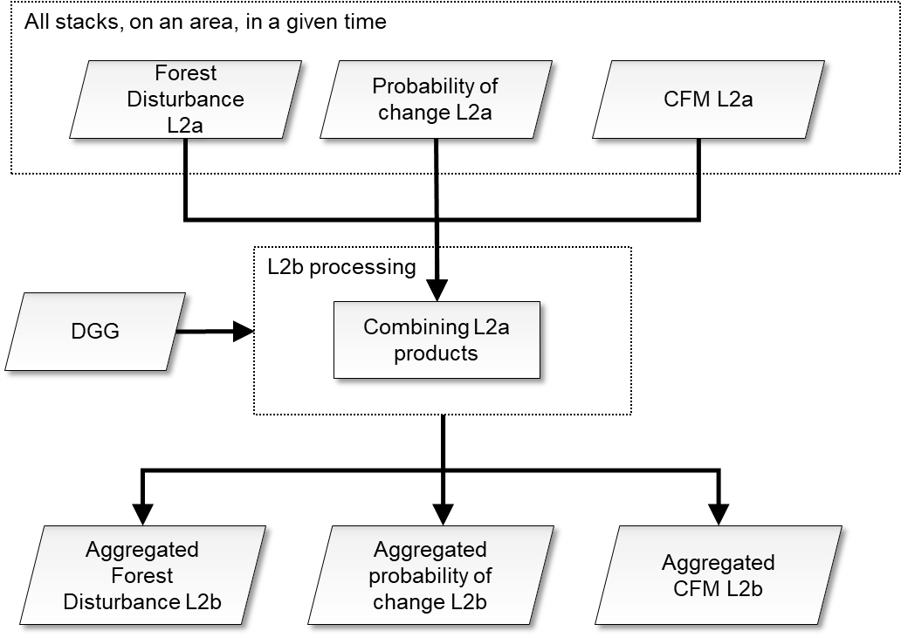
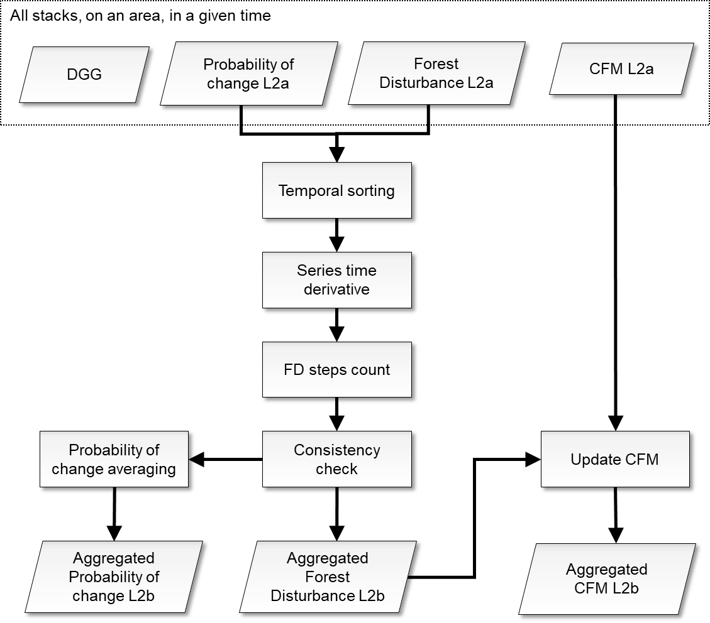
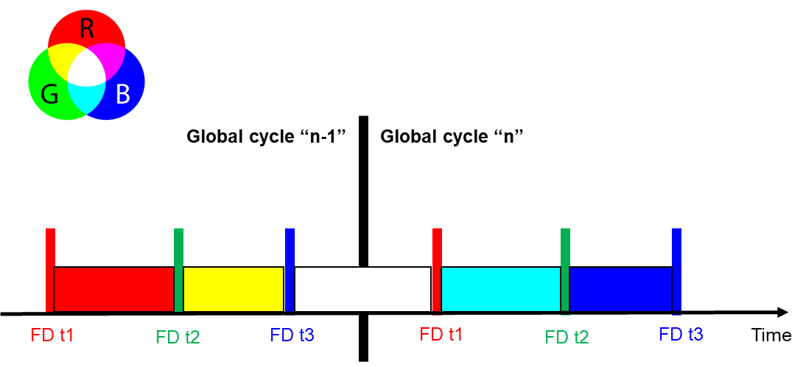

<!-- SPDX-FileCopyrightText: 2026 European Space Agency (ESA) -->
<!-- SPDX-License-Identifier: Apache-2.0 -->

:::{atbd-logo-banner}
:::

(sec:atbd-fd-4)=
# 4. Change detection aggregation

The overall scheme of the L2b processing is reported in figure below.

The key step is fusion of L2a estimates at map level. These steps are described in detail in the following subsections.

**The step is mandatory.**

(fig:atbd-fd-14)=
:::{div} atbd-mermaid-figure

Fig. 14 — Complete flow-chart of the L2b processing.

:::

(sec:atbd-fd-4-1)=
### 4.1 Fusion of L2a products on a Tile within a fixed timespan

(sec:atbd-fd-4-1-1)=
#### 4.1.1 Overview and rationale

The disturbance maps allow the combination of different acquisitions in a simple and efficient pixelwise way. L2a products falling onto the same L2b tile within a global cycle are retrieved through geospatial query of information (tile IDs and time tags) in the Main Product Header of the product.

From the disturbance map combined, the extraction of the combined CFM is obtained by a simple logical and operator.

(fig:atbd-fd-15)=
:::{div} atbd-mermaid-figure

Fig. 15 — L2a FD fusion.

:::

(sec:atbd-fd-4-1-2)=
#### 4.1.2 Inputs

| Symbol | Name | Origin | Size | Variability | Default | Description |
|---|---|---|---|---|---|---|
| ${{FD}_{map}}^{t^i}$ | Forest Disturbance | FD L2a products in a DGG tile in a global cycle (`FD_PFD`) | $\left[ N_{lat}\times{}N_{lon} \right]^{t^i}$ | - | - | Forest Disturbance map |
| ${CFM}^{t^i}$ | CFM | FD L2a products in a DGG tile in a global cycle (`FD_PFD`) | $\left[ N_{lat}\times{}N_{lon} \right]^{t^i}$ | - | - | CFM |
| ${P_c}^{t^i}$ | Probability of change | FD L2a products in a DGG tile in a global cycle (`FD_PFD`) | $\left[ N_{lat}\times{}N_{lon} \right]^{t^i}$ | - | - | Probability of change map |
| DGG | DGG | Internal lookup table | - | - | - | DGG tile |
| BBi | Footprint | L2a main product header (`FD_PFD`) | lat-lon vertices (4 couples) | - | - | The extent of the L2a input data in geographical coordinates |
| mDGG | `minimumL2aCoverage` | `AUX_PP2_` FD (`AUX_FMT`) | float value [scalar] | 0.0-100.0 | 10.0 | The minimum [%] tile coverage that triggers the computations |

(sec:atbd-fd-4-1-3)=
#### 4.1.3 Outputs

| Symbol | Name | Destination | Size | Variability | Default | Description |
|---|---|---|---|---|---|---|
| ${{FD}_{map}}^{aggregated}$ | Forest Disturbance | FD L2 b product (`FD_PFD`) | $\left[ N_{lat,L2b}\times{}N_{lon,L2b} \right]$ | - | - | Forest Disturbance map aggregated |
| ${CFM}^{aggregated}$ | CFM | FD L2 b product (`FD_PFD`) | $\left[ N_{lat,L2b}\times{}N_{lon,L2b} \right]$ | - | - | CFM aggregated |
| ${P_c}^{aggregated}$ | Probability of change | FD L2 b product (`FD_PFD`) | $\left[ N_{lat,L2b}\times{}N_{lon,L2b} \right]$ | - | - | Probability of change map aggregated |
| HM | heat map | FD L2b product (`FD_PFD`) | $2\left[ N_{lat,L2b}\times{}N_{lon,L2b} \right]$ | 0- | - | heat map (couple of integer values per pixel) |

(sec:atbd-fd-4-1-4)=
#### 4.1.4 Algorithm mathematical background

As a first step, the minimum required coverage over L2b DGG tile j is checked to proceed with computations:

$$
TR=\ (100*\frac{A(\left. \bigcup_i^{}{{BB}^i} \right\vert_{DGG}\cap\left. {TT}^j \right\vert_{DGG})}{A(\left. {TT}^j \right\vert_{DGG})}>mDGG)
\tag{4.1}
$$ (eq:atbd-fd-4-1)

where BBi are the L2a bounding boxes, TTj is the footprint of the current L2b DGG tile and A operator computes the area of the corresponding polygon.

The aggregation at pixel map level of the various L2a disturbance maps is done by examining the consistency of the time series of detections. First, the series of detection is temporally sorted, both ascending and descending orbits:

$$
{{FD}_{series}}^{sorted}(t)=\left\{ {{FD}_{map}}^{t^1},...,{{FD}_{map}}^{t^i}\ \right\}
\tag{4.2}
$$ (eq:atbd-fd-4-2)

$\left\{ t^1<...<t^i\ \right\}$ being the different times at which each product is acquired in a global cycle. Then the derivative of the sorted time series is computed with respect to time and thresholded

$$
{{FD}_{series}}^{steps}=\left\vert \frac{d\left[ {{FD}_{series}}^{sorted}(t) \right]}{dt} \right\vert>0
\tag{4.3}
$$ (eq:atbd-fd-4-3)

Finally, the number of transitions in the derivative vector is counted

$$
{{FD}_{steps}}^{count}=\sum_i^{}{{{FD}_{series}}^{steps}(i)}
\tag{4.4}
$$ (eq:atbd-fd-4-4)

If the sum is odd, detection is assumed, and the resulting probability of change is the average of the different probabilities pixel-wise for detection only. Otherwise, the resulting probability of change and FD map is set to zero. If the sum is zero, detection is assumed only if all the acquisitions show detection. The rationale is that change is assumed only if all the acquisitions detecting it are simultaneously consistent. The situation is depicted in {fig}`Fig.|16` for the example of three acquisitions and the corresponding truth table is reported in {ref}`Tab.1 <tab:atbd-fd-1>`.

(fig:atbd-fd-16)=
:::{div} atbd-mermaid-figure

Fig. 16 — Time of validity for each acquisition among two global cycles, with overlaps shown in RGB colours. The FD relative to various acquisition times within the global cycle are reported. See also Tab.1.

:::

(tab:atbd-fd-1)=
:::{div} atbd-table

Table 1 — Truth table for the example of three FDs. The color coding for FD t1/3 is the same of Fig.16, where black is the absence of validity.

| FD t1 | FD t2 | FD t3 | FD steps count | FD map aggregated | HM: contributing | HM: agreeing |
|---|---|---|---|---|---|---|
| 0 | 0 | 0 | 0 | 0 | 3 | 3 |
| 0 | 0 | 1 | 1 | 1 | 3 | 1 |
| 0 | 1 | 0 | 2 | 0 | 3 | 2 |
| 1 | 0 | 0 | 1 | 1 | 3 | 1 |
| 1 | 1 | 0 | 1 | 1 | 3 | 2 |
| 1 | 0 | 1 | 2 | 0 | 3 | 1 |
| 0 | 1 | 1 | 1 | 1 | 3 | 2 |
| 1 | 1 | 1 | 0 | 1 | 3 | 3 |

:::

A heat map HM is also stored representing at pixel level:

- the total number of acquisitions contributing to the decision, as reported in {ref}`Tab.1 <tab:atbd-fd-1>` – column 6
- the number of acquisitions agreeing to the decision, as reported in {ref}`Tab.1 <tab:atbd-fd-1>` – column 7

From the disturbance map combined, the extraction of the forest mask is obtained by a simple update to the initial forest mask.

$$
{CFM}^{aggregated}=\left\{ 1-{{FD}_{map}}^{aggregated} \right\}\land\left\{ \cup_{t^i}{CFM}^{t^i} \right\}
\tag{4.5}
$$ (eq:atbd-fd-4-5)

$\left\{ t^1<...<t^i\ \right\}$ being the different times at which each product is acquired in a global cycle, where $\cup$ is the union operator.
