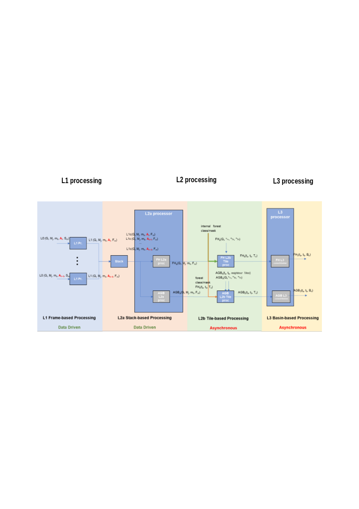
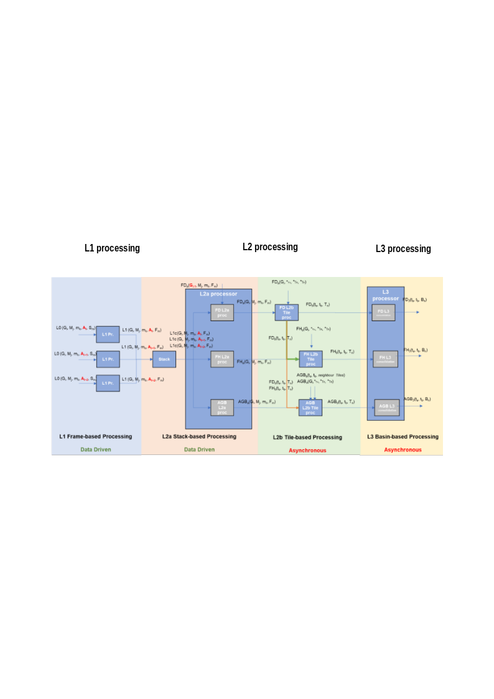
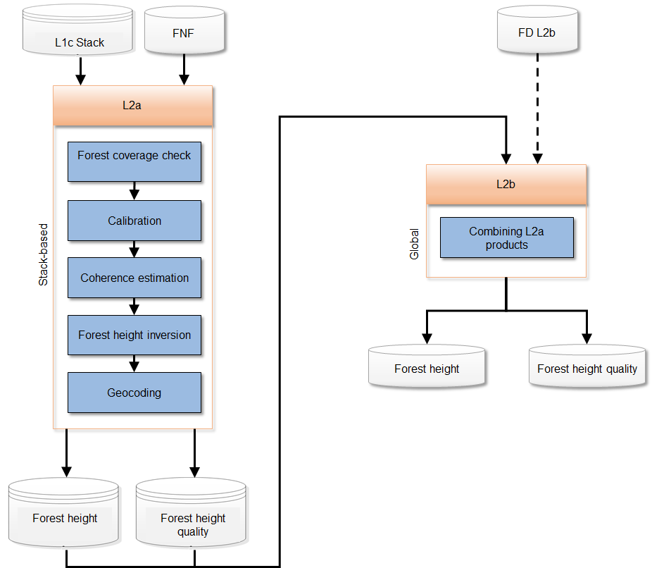

<!-- SPDX-FileCopyrightText: 2026 European Space Agency (ESA) -->
<!-- SPDX-License-Identifier: Apache-2.0 -->

:::{atbd-logo-banner}
:::


(sec:atbd-fh-2)=
# 2. BPS and FH Processing Overview

(sec:atbd-fh-2-1)=
### 2.1 BPS Overview

The BIOMASS Processing Suite (BPS) is in charge of processing BIOMASS Level-0 data up to Level-3, generating a wide set of products. Product generation scheme is depicted in the following two figures respectively for the TOM phase and INT phase. The processing foresees the following steps:

- L1 processing: the BIOMASS image formation step, taking in input 1 L0 slice and generating in output N\>=1 L1 frames;
- Stack Processing: the coregistration and stacking processing step that will define the required 7-images Tomographic stacks or the 3-images Interferometric stacks. It includes stack phase calibration;
- L2a Processing: processing step for each stack that provides the inputs to the further products Tile Generation performed by the L2b processors. For one global cycle the number of stacks varies mainly with latitude, approximately from a minimum of two at the Equator (ascending/descending) to about six at higher latitudes (three ascending/descending pairs);
- L2b Processing: processing that aggregates all the stack-based L2a products insisting on the same location on ground (Tile) in the same time interval and generates a single BIOMASS L2b product. A different number of stacks may be available for each DGG tile {rd}`8`, based on tile dimensions and swath coverage (which is not related to DGG tiling pattern);
- L3 Processing: consolidation processing removing discontinuities in L2b products.

(fig:atbd-fh-1)=
:::{div} atbd-mermaid-figure

<div class="atbd-figure-content">



</div>

<p class="atbd-figure-caption"><span class="caption-number">Fig. 1</span><span class="caption-text"> — Biomass high-level processing scheme from L0 data to L3 products, TOM phase.</span></p>

:::

(fig:atbd-fh-2)=
:::{div} atbd-mermaid-figure

<div class="atbd-figure-content">



</div>

<p class="atbd-figure-caption"><span class="caption-number">Fig. 2</span><span class="caption-text"> — Biomass high-level processing scheme from L0 data to L3 products, INT phase.</span></p>

:::

(sec:atbd-fh-2-2)=
### 2.2 FH Processing Overview

The FH processing has as main goal the generation of maps of forest height at a spatial resolution roughly equivalent to ~200 m x 200 m (i.e. 4 ha) at the Equator {rd}`5`. It receives as input a stack of BIOMASS Level-1c images (SCS co-registered and calibrated stack), including its relevant annotated data {ad}`2`. Same algorithms are envisaged to generate the same product in INT and TOM phases. The FH processing is divided into three levels:

- L2a, generates a map of forest height from each L1c stack based on model inversion algorithm, as well as a quality map;
- L2b, generates a forest height map merging all the L2a products on a geographic grid tile, as well as an updated quality map;
- L3, consolidates the result removing discontinuities in L2b products.

```{note}
L3 processing currently does not entail any additional step with respect to L2b. This will be confirmed/reassessed at future milestones. For the moment L3 is kept as a placeholder for eventual future evolutions. Eventually, L2b can be an empty container and the product will be copied to L3.
```

```{note}
Provided that FD algorithm proper validation will only be possible with BIOMASS in orbit, the strategy proposed to deal with FH/AGB dependency on FD is to initially input to FH/AGB a forest/non-forest mask generated outside of BPS {ad}`1` {ad}`3`. After testing FD performance with BIOMASS in orbit, FD dependency can be switched on again, provided it has a satisfactory performance. The diagram of {fig}`Fig.|2` reports nonetheless FD input for completeness.
```

```{note}
L2 processor receives from Stack processor L1c products with two co-polarization (CP) channels and one cross-polarization (XP) channel. Details on the aggregation of XP channels into one XP are reported in {rd}`1`.
```

```{note}
Regarding stack images cardinality, their number can vary (not always 3 or 7) due to contingency reasons and it can go up to 8 in TOM phase.
```

(sec:atbd-fh-2-3)=
### 2.3 FH Processing Workflow and Algorithmic Overview

The main steps of FH processing workflow are depicted in the following figure and described in detail in the following sub-sections.

(fig:atbd-fh-3)=
:::{div} atbd-mermaid-figure

<div class="atbd-figure-content">



</div>

<p class="atbd-figure-caption"><span class="caption-number">Fig. 3</span><span class="caption-text"> — FH processing detailed workflow.</span></p>

:::

(sec:atbd-fh-2-3-1)=
#### 2.3.1 Forest height (L2A\_P)

The main steps of the stack-based L2a block are:

- forest coverage check: predetermine which input data (as a whole image) should need to be processed;
- calibration: application of phase calibration and ground steering (terrain at zero elevation) screens to the stack;
- coherence estimation: computes the polarimetric-interferometric coherence matrix from data and compensates non-volumetric decorrelation;
- forest height inversion: fit of the model to computed coherences, generates a map of forest height as well as a quality map;
- geocoding: projects the processed data on geographic map, accounting for the different forest points location with respect to reference DEM.

(sec:atbd-fh-2-3-2)=
#### 2.3.2 Forest height aggregation (L2B\_FH\_P)

The main steps of the L2b block are:

- combining: fusion of L2a estimates at map level.

(sec:atbd-fh-2-3-3)=
#### 2.3.3 Note on interpretation of inputs and outputs tables

Inputs and outputs for each processing sub-step are summarized in specific subsections (two subsections for each substep). A specific tabular format is defined to improve the access to the document. The meaning of each column is exemplified in the following table.

| Symbol | Name | Origin/ Destination | Size | Variability | Default | Description |
|---|---|---|---|---|---|---|
| Mathematical symbol of the quantity appearing in formulas. | Name of the quantity as related to other BPS documentation (e.g., `AUX_FMT`, L1 ATBDs, …) | BPS document name describing the origin of the quantity or processing step of origin/destination or BPS product of destination. | Dimensions of the quantity. | Range of values or update rate of an internal resource. | Default value for configuration parameters. | Verbal description of the quantity and its characteristics (e.g. measure units, …) |
