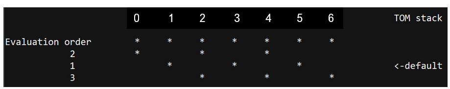
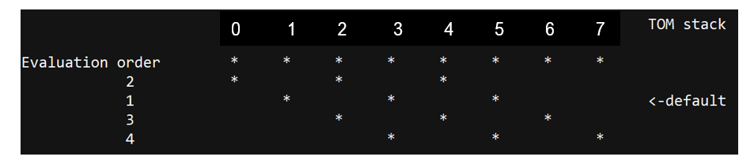
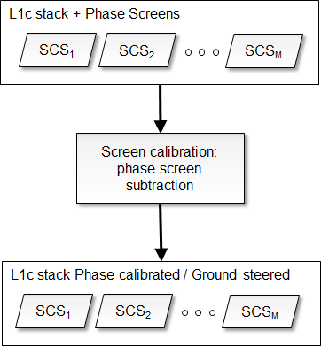
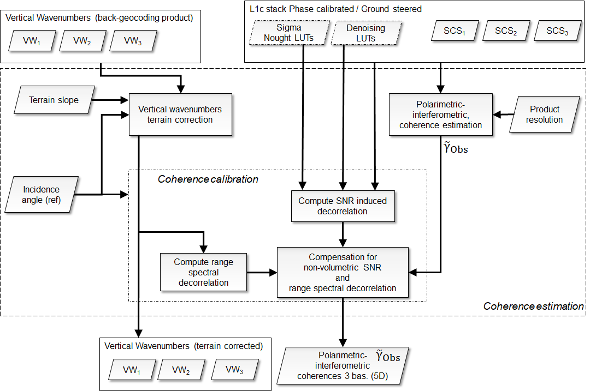
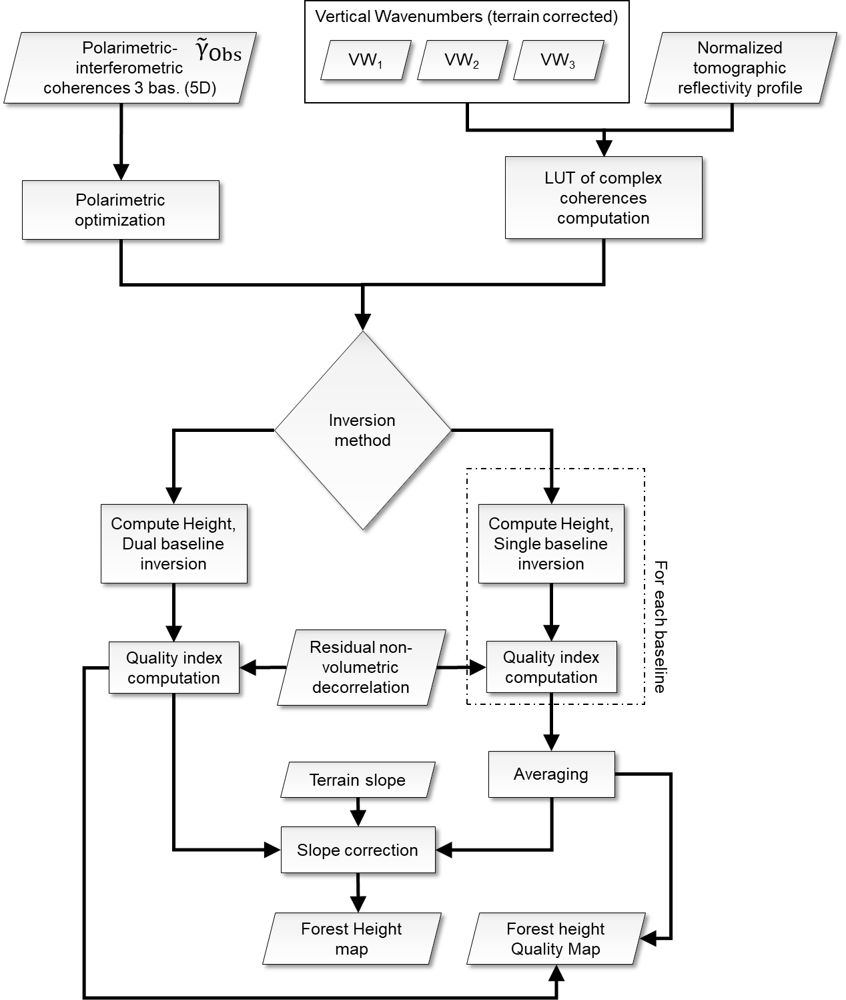
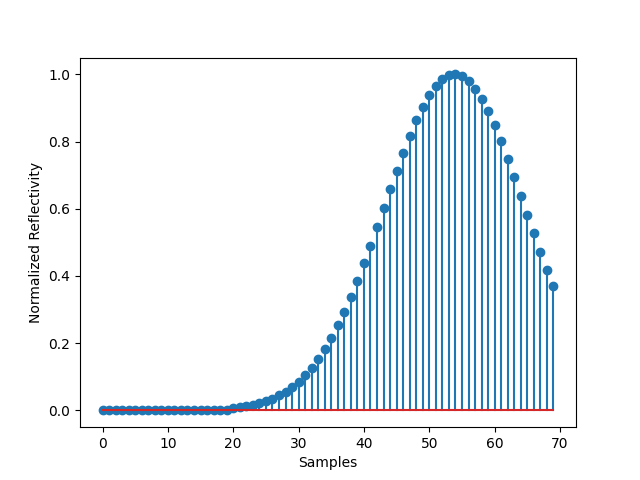
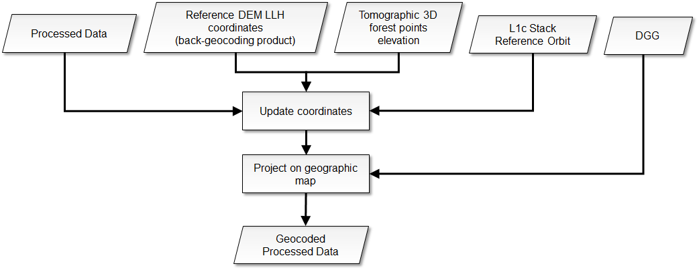
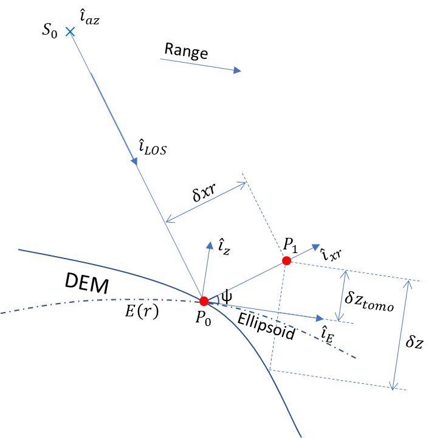

<!-- SPDX-FileCopyrightText: 2026 European Space Agency (ESA) -->
<!-- SPDX-License-Identifier: Apache-2.0 -->

:::{atbd-logo-banner}
:::


(sec:atbd-fh-3)=
# 3. Forest height

The overall scheme of the L2a processing is reported in {fig}`Fig.|3`.

The key steps are coherence estimation and the forest height inversion. These steps are described in detail in the following subsections.

(sec:atbd-fh-3-1)=
### 3.1 Forest Coverage Check

(sec:atbd-fh-3-1-1)=
#### 3.1.1 Overview and rationale

The availability of a general FNF map allows to predetermine which input data (as a whole image) should need to be processed. A threshold (mF) must be set as input parameter to select the minimum forest coverage (as a percentage of the whole area covered by the images) to start or skip computation.

**The step is optional.**

(sec:atbd-fh-3-1-2)=
#### 3.1.2 Inputs

| Symbol | Name | Origin | Size | Variability | Default | Description |
|---|---|---|---|---|---|---|
| FNF | FNF | Internal resource (IODD) | $\left[ N_{lat,FNF}\times{}N_{lon,FNF} \right]$ | Yearly | - | A global forest-non-forest mask given as input |
| mF | `forestCoverageThreshold` | `AUX_PP2_2A` (`AUX_FMT`) | float value [scalar] | 0.0-100.0 | 5.0 | The minimum [%] relative forest coverage that triggers the computations |
| BB | Footprint | L1c main product header (`L1_PFD`) | lat-lon vertices (4 couples) | - | - | The extent of the L1c input data in geographical coordinates |

(sec:atbd-fh-3-1-3)=
#### 3.1.3 Outputs

| Symbol | Name | Destination | Size | Variability | Default | Description |
|---|---|---|---|---|---|---|
| TR | trigger | Next steps | Boolean [scalar] | - | True | Allows to trigger (True) the computation of the change detection |

(sec:atbd-fh-3-1-4)=
#### 3.1.4 Algorithm mathematical background

The values of the FNF mask that lie within the area covered by the image, defined by the bounding box BB, are extracted from the global FNF mask. The relative number of forested pixels is compared to the required minimum threshold mF to trigger any subsequent computation.

$$
TR=\ (100*\frac{\left. ForestedArea \right\vert_{BB}}{\left. TotalArea \right\vert_{BB}}>mF)
\tag{3.1}
$$ (eq:atbd-fh-3-1)

(sec:atbd-fh-3-1-5)=
#### 3.1.5 Notes on implementation

The substep should be as fast as possible, as its unique role is to avoid any un-useful computation. Thus, comparison is carried on at the original FNF mask spatial sampling (i.e. no reprojection needed), as any resampling does not have any impact on the relative percentage of forested area with respect to the total covered area. It must be noted that any `noValue` pixel in FNF is treated as ForestedArea sample to avoid skipping computation because of the presence of `noValues` in FNF.

Details on the derivation of external FNF are reported in {rd}`13`.

(sec:atbd-fh-3-2)=
### 3.2 INT subsetting (TOM only)

(sec:atbd-fh-3-2-1)=
#### 3.2.1 Overview and rationale

The algorithm applies only to TOM stacks and subsets the stack in order to select the acquisitions to operate as in INT phase. The only rule applicable at the moment follows a geometric criterion. Other rules could be defined post-launch.

**This step is mandatory for TOM only.**

(sec:atbd-fh-3-2-2)=
#### 3.2.2 Inputs

| Symbol | Name | Origin | Size | Variability | Default | Description |
|---|---|---|---|---|---|---|
| SCS | L1c | Stack processor (`L1_PFD`) | M, each acquisition$\left[ N_{rg}\times{}N_{az} \right]$ | M=7/8 acquisitions (TOM phase), with two CP and one XP | - | L1c stack |
| - | `subsettingRule` | `AUX_PP2_2A` (`AUX_FMT`) | String | - | “geometry” | Select 3 acquisitions from the 7/8 of TOM phase, choosing, with a geometrical rule, the baselines corresponding to the ones of INT phase. |

(sec:atbd-fh-3-2-3)=
#### 3.2.3 Outputs

| Symbol | Name | Destination | Size | Variability | Default | Description |
|---|---|---|---|---|---|---|
| SCS | L1c | Calibration step | M, each acquisition$\left[ N_{rg}\times{}N_{az} \right]$ | M=3 acquisitions, with two CP and one XP | - | L1c stack |

(sec:atbd-fh-3-2-4)=
#### 3.2.4 Algorithm mathematical background

(sec:atbd-fh-3-2-4-1)=
##### 3.2.4.1 Geometry criterion

The "geometry" criterion for subsetting selects among the seven/eight TOM stack the three acquisitions that give nominally consistent baselines with INT phase. As different combinations are possible, see {fig}`Fig.|4`, the default rule is to select the central combination, which is corresponding to exactly the same nominal situation as INT. In case this combination presents a missing acquisition, the rule is to then evaluate remaining combinations in sequential order until a three-acquisitions combination is found. If no combination of three exists, the minimum required is two and the maximum baseline is equivalent to double TOM spacing. The contingency case with eight TOM acquisitions is reported in {fig}`Fig.|5`.

(fig:atbd-fh-4)=
:::{div} atbd-mermaid-figure

<div class="atbd-figure-content">



</div>

<p class="atbd-figure-caption"><span class="caption-number">Fig. 4</span><span class="caption-text"> — Selection for seven TOM.</span></p>

:::

(fig:atbd-fh-5)=
:::{div} atbd-mermaid-figure

<div class="atbd-figure-content">



</div>

<p class="atbd-figure-caption"><span class="caption-number">Fig. 5</span><span class="caption-text"> — Selection for eight TOM (contingency).</span></p>

:::

(sec:atbd-fh-3-3)=
### 3.3 Calibration

(sec:atbd-fh-3-3-1)=
#### 3.3.1 Overview and rationale

The calibration algorithm makes use of the L1c annotation {ad}`2` to apply phase calibration to L1c necessary for the L2a processing.

(fig:atbd-fh-6)=
:::{div} atbd-mermaid-figure

<div class="atbd-figure-content">



</div>

<p class="atbd-figure-caption"><span class="caption-number">Fig. 6</span><span class="caption-text"> — Calibration.</span></p>

:::

**The step is mandatory. If disabled for debug, default rule is to copy inputs as step output.**

(sec:atbd-fh-3-3-2)=
#### 3.3.2 Inputs

| Symbol | Name | Origin | Size | Variability | Default | Description |
|---|---|---|---|---|---|---|
| SCS | L1c | Stack processor, or INT subsetting step | M, each acquisition$\left[ N_{rg}\times{}N_{az} \right]$ | M=3\* acquisitions with two CP and one XP | - | L1c stack |
| $\varphi_{skp}$ | `skpCalibrationPhasesScreen` | L1c reference acquisition ADS (`L1_PFD`) | M, each$\left[ N_{rg,\varphi}\times{}N_{az,\varphi} \right]$ (zero for reference acquisition) | - | - | SKP calibration phase screens [rad] |
| $\varphi_{flattening}$ | `flatteningPhasesScreen` | L1c reference acquisition ADS (`L1_PFD`) | M, each$\left[ N_{rg,\varphi}\times{}N_{az,\varphi} \right]$ (zero for reference acquisition) | - | - | Ground steering (flattening) geometry phase screens [rad] |
| - | `applyCalibrationScreen` | `AUX_PP2_2` A (`AUX_FMT`) | string | ‘skp’, ‘geometry’, ‘none’ | skp | Choose the phase calibration to be performed: skp or geometry if phase screens calibration should be applied, none otherwise. |

\*The nominal case is M=3 acquisitions, but the algorithm works also in contingency case when M=2

(sec:atbd-fh-3-3-3)=
#### 3.3.3 Outputs

| Symbol | Name | Destination | Size | Variability | Default | Description |
|---|---|---|---|---|---|---|
| SCS | L1c | Ground cancellation processing step | M, each acquisition$\left[ N_{rg}\times{}N_{az} \right]$ | M=3 acquisitions with two CP and one XP | - | Phase calibrated and ground steered (terrain at zero level) L1c stack |

(sec:atbd-fh-3-3-4)=
#### 3.3.4 Algorithm mathematical background

This step aims to remove all the phase disturbances from the L1c stack and set terrain phase at zero height (i.e., subtract DTM phase). Each polarization channel is processed independently. The SCS L1c stack provided as input contains a set of calibration and ground steering phase screens (SKP calibration screens and flattening phases screens described in {rd}`1`). Depending on `applyCalibrationScreen` configuration, the used screen is:

$\varphi=\ \varphi_{skp}+\varphi_{flattening}$ if `applyCalibrationScreen`= “skp”

$\varphi=\ \varphi_{flattening}$ if `applyCalibrationScreen`= “geometry”

The operation implemented in the calibration step of the L2 processor is simply the subtraction of the selected calibration phase screens from the input image stack phase. The operation can be expressed as:

$$
SCS(r,\ a,\ n)\ =\ SCS(r,\ a,\ n)e^{+j\varphi(r,a,n)}
\tag{3.2}
$$ (eq:atbd-fh-3-2)

where 𝜑(𝑟,𝑎,𝑛) is the phase screen accounting for all the disturbance terms and terrain topography relative to the baseline 𝑛 for each pixel in azimuth 𝑎, slant-range 𝑟. In the case of the reference acquisition, no compensation is done (zero baseline). If the phase screens have a lower resolution than the SCSs then a preliminary interpolation step is needed. The operation can be expressed as:

$$
\varphi(r,a,n)\ =\left. \ f\left[ \left. \varphi(r,a,n) \right\vert_{(rg,\varphi,az,\varphi)} \right] \right\vert_{(rg,az)}
\tag{3.3}
$$ (eq:atbd-fh-3-3)

where f is a bilinear interpolant a function. Other alternate interpolating function are detailed in {rd}`15`.

(sec:atbd-fh-3-4)=
### 3.4 Coherence estimation

(sec:atbd-fh-3-4-1)=
#### 3.4.1 Overview and rationale

The coherence estimation block aims to estimate the second order polarimetric-interferometric statistics of phase calibrated and ground steered (terrain at zero level) L1c stack and compensate non-volumetric decorrelation. In the following its implementation in the context of the INT Phase, i.e., by means of the three fully polarimetric images acquired in a repeat-pass mode with a spatial baseline between consecutive orbits is defined. This is applied also in the TOM Phase by choosing the same baselines of the INT Phase, see {sec}`3.2`. The flowchart of the algorithm is shown in the figure below.

**The step is mandatory.**

(fig:atbd-fh-7)=
:::{div} atbd-mermaid-figure

<div class="atbd-figure-content">



</div>

<p class="atbd-figure-caption"><span class="caption-number">Fig. 7</span><span class="caption-text"> — Coherence estimation algorithm (INT/TOM Phase).</span></p>

:::

(sec:atbd-fh-3-4-2)=
#### 3.4.2 Inputs

| Symbol | Name | Origin | Size | Variability | Default | Description |
|---|---|---|---|---|---|---|
| SCS | L1c | Calibration step | M, each acquisition$\left[ N_{rg}\times{}N_{az} \right]$ | M=3 acquisitions with two CP and one XP | - | Phase calibrated and ground steered (terrain at zero level) L1c stack |
| - | `spectralDecorrelationCompensationFlag` | `AUX_PP2_2` A (`AUX_FMT`) | Boolean [scalar] | - | True | True (default value) if range spectral decorrelation compensation has to be performed, False otherwise |
| - | SNRDecorrelationCompensationFlag | `AUX_PP2_2` A (`AUX_FMT`) | Boolean [scalar] | - | True | True (default value) if SNR decorrelation compensation has to be performed, False otherwise |
| `pRes` | ProductResolution | `AUX_PP2_2A` (`AUX_FMT`) | float value [scalar] | - | 200.0 | Value in [m] to be used as the resolution on ground grange map and also to perform the coherence averaging in radar coordinates |
| - | `upsamplingFactor` | `AUX_PP2_2A` (`AUX_FMT`) | int value [scalar] | - | 2 | upsampling factor, that modules the overall decimation in multilooking within coherence computation |
| $\sigma_{LUT}^{noise}$ | denoising | L1c Stack ADS (`L1_PFD`) | M, each acquisition$\left[ N_{rg,noise}\times{}N_{az,noise} \right]$ | - | - | denoising LUT |
| $\sigma_{LUT}^0$ | `sigmaNought` | L1c Stack ADS (`L1_PFD`) | M, each acquisition$\left[ N_{rg,sigma}\times{}N_{az,sigma} \right]$ | - | - | `sigmaNought` LUT |
| $\alpha$ | `terrainSlope` | L1c reference acquisition ADS (`L1_PFD`) | $\left[ N_{rg,\alpha}\times{}N_{az,\alpha} \right]$ | - | - | Terrain slope [rad] |
| $\theta_0$ | `incidenceAngle` | L1c reference acquisition ADS (`L1_PFD`) | $\left[ N_{rg,\theta}\times{}N_{az,\theta} \right]$ | - | - | L1c stack reference acquisition incidence angle [deg] (on inflated ellipsoid) annotation |
| $k_z$ | wavenumber | L1c Stack ADS (`L1_PFD`) | M, each$\left[ N_{rg,k}\times{}N_{az,k} \right]$ (zero for reference acquisition) | - | - | Vertical wavenumbers [rad/m] computed with respect to incidence on inflated ellipsoid |
| $B_r$ | L1c range- bandwidth | L1c reference acquisition ADS (`L1_PFD`) | - | - | - | L1c range bandwidth [Hz] |
| $B_a$ | L1c azimuth bandwidth | L1c reference acquisition ADS (`L1_PFD`) | - | - | - | L1c range bandwidth [Hz] |
| $v_a$ | L1c velocity annotation | L1c reference acquisition ADS (`L1_PFD`) | - | - | - | Average azimuth velocity [m/s] |
| $\Delta_r$ | L1c range- sampling step | L1c reference acquisition ADS (`L1_PFD`) | - | - | - | L1c range sampling step [s] |
| $\Delta_a$ | L1c azimuth sampling step | L1c reference acquisition ADS (`L1_PFD`) | - | - | - | L1c azimuth sampling step [s] |
|   | `correctTerrainSlopesFlag` | `AUX_PP2_2` A (`AUX_FMT`) | bool | - | True | True if terrain slope correction must been applied, False otherwise |

(sec:atbd-fh-3-4-3)=
#### 3.4.3 Outputs

| Symbol | Name | Destination | Size | Variability | Default | Description |
|---|---|---|---|---|---|---|
| ${\widetilde{\gamma}}_{Obs}$ | - | Forest height inversion step | $\left[ N_{pol}\times{}N_{pol}\times{}N_{bas}\times{}N_{rg,subs}\times{}N_{az,subs} \right]$ | - | - | Polarimetric-interferometric coherence for three spatial baselines |
| $k_z$ | wavenumber | Forest height inversion step | M, each$\left[ N_{rg,k}\times{}N_{az,k} \right]$ (zero for reference acquisition) | - | - | Terrain corrected vertical wavenumbers [rad/m] computed with respect to incidence on inflated ellipsoid |

(sec:atbd-fh-3-4-4)=
#### 3.4.4 Algorithm mathematical background

(sec:atbd-fh-3-4-4-1)=
##### 3.4.4.1 Polarimetric-interferometric coherence estimation

The size of the spatial averaging window used to estimate the second order statistics depends on the final resolution of the products to be provided as an input. The output is a 5D array with dimensions: $\left[ N_{pol}\times{}N_{pol}\times{}N_{bas}\times{}N_{rg,subs}\times{}N_{az,subs} \right]$ where $N_{pol}$ is the number of polarizations, $N_{bas}$ the number of unique spatial baselines, and $N_{rg,subs}$ and $N_{az,subs}$ are the numbers of range and azimuth samples after subsampling (half window size, well complying with the Nyquist-Shannon sampling theorem). For each (subsampled) range-azimuth position a $N_{pol}\times{}N_{pol}$ multi-polarimetric coherence matrix is returned for each unique spatial baseline, i.e., $n\neq{}m\land{}nm=mn$. Mathematically for each (subsampled) range-azimuth position (notation is simplified omitting range-azimuth indexes for the sake of clarity):

$$
{\widetilde{\gamma}}_{Obs}({k_z}^{nm},w^{pq})=\frac{\sum_{r\in\Omega_r}^{}{\sum_{a\in\Omega_a}^{}{y_{p,n}(r,a)\cdot{}y_{q,m}^*(r,a)}}}{\sqrt{\sum_{r\in\Omega_r}^{}{\sum_{a\in\Omega_a}^{}{y_{p,n}(r,a)\cdot{}y_{p,n}^*(r,a)}}}\sqrt{\sum_{r\in\Omega_r}^{}{\sum_{a\in\Omega_a}^{}{y_{q,m}(r,a)\cdot{}y_{q,m}^*(r,a)}}}}
\tag{3.4}
$$ (eq:atbd-fh-3-4)

where $w^{pq}$ denote the $p$-th and $q$-th polarimetric channels respectively; $r$ and $a$ denote the range and azimuth indices; $\Omega_r$ and $\Omega_a$ denote the neighborhood in the range and azimuth directions of the desired position; $y_{p,n}(r,a)$ denotes the complex pixel value in SCS polarimetric channel $p$ for acquisition $n$; ${k_z}^{nm}=k_z(r,a,m)-k_z(r,a,n)$ is the $nm$ interferometric pair vertical wavenumber depending on baseline; $*$ denotes conjugation . The averaging window size is computed as:

$$
\left\vert \Omega_r \right\vert=\left\lceil \frac{pRes}{\rho_r}\sin{\theta_m}(\Delta_rB_r)^{-1} \right\rceil
\tag{3.5}
$$ (eq:atbd-fh-3-5)

$$
\left\vert \Omega_a \right\vert=\left\lceil \frac{pRes}{\rho_a}(\Delta_aB_a)^{-1} \right\rceil
$$

where $\rho_r=\frac{c}{2B_r}$ and $\rho_a=\frac{v_a}{B_a}$ denote the L1c resolution computed from system bandwidth, Lightspeed c, average azimuth velocity $v_a$, `pRes` is the L2 resolution, $\theta_m=\frac{1}{N_rN_a}\sum_{r,a}^{}{\theta_0(r,a)}$ is the average incidence angle across the swath, while the terms $(\Delta_iB_i)^{-1},\ i=r,a$ represent the oversampling factor.. SCS invalid pixels will not be used during processing. The presence of an invalid SCS pixel causes the generation of an invalid coherence sample.

(sec:atbd-fh-3-4-4-2)=
##### 3.4.4.2 Vertical wavenumbers terrain correction

(fig:atbd-fh-8)=
:::{div} atbd-mermaid-figure

<div class="atbd-figure-content">


</div>

<p class="atbd-figure-caption"><span class="caption-number">Fig. 8</span><span class="caption-text"> — Acquisition geometry with terrain slope α [RD6]. (a) Positive terrain slope. (b) Negative terrain slope. BH is the horizontal baseline, H is the flight height, θ0 the incidence angle between radar beam and the local normal to the inflated ellipsoid (tangent plane to ellipsoid represented by horizontal line), Δθ the angle difference induced by the baseline, hV the height of the volume and HF the height of the forest.</span></p>

:::

Terrain slopes in range direction (indicated by α in {fig}`Fig.|8`) modify locally the incidence angle θ0 of reference acquisition to θ=θ0-α and as a consequence the vertical wavenumbers must be corrected as:

$$
k_z(r,a,n)=k_z(r,a,n)\frac{\sin \left[ \theta_0(r,a) \right]}{\sin \left[ \theta_0(r,a)-\alpha(r,a) \right]}
\tag{3.6}
$$ (eq:atbd-fh-3-6)

where $r$ and $a$ denote the range and azimuth indices for acquisition $n$. A preliminary interpolation step is needed to bring wavenumbers, slope, angle onto the same coherence grid, in similar fashion as for the calibration screens ({sec}`Section|3.3.4`). The correction above is performed only when `correctTerrainSlopesFlag` is set to true.

(sec:atbd-fh-3-4-4-3)=
##### 3.4.4.3 Coherence calibration

Non-volumetric SNR ${\widetilde{\gamma}}_{SNR}$ and range spectral decorrelation ${\widetilde{\gamma}}_{Rg}$ are compensated (each subsampled range-azimuth position is processed separately; notation is simplified omitting range-azimuth indexes for the sake of clarity)

$$
{\widetilde{\gamma}}_{Obs}({k_z}^{nm},w^{pq})=\frac{{\widetilde{\gamma}}_{Obs}({k_z}^{nm},w^{pq})}{{\widetilde{\gamma}}_{Rg}({k_z}^{nm}){\widetilde{\gamma}}_{SNR}({k_z}^{nm},w^{pq})}
\tag{3.7}
$$ (eq:atbd-fh-3-7)

where

$$
{\widetilde{\gamma}}_{Rg}({k_z}^{nm})=1-\frac{\rho_r}{\frac{2\pi}{{k_z}^{nm}}}
\tag{3.8}
$$ (eq:atbd-fh-3-8)

where $\rho_r$ is the bandwidth limited range resolution and ${k_z}^{nm}$ is the $nm$ interferometric pair vertical wavenumber depending on baseline. The SNR induced decorrelation ${\widetilde{\gamma}}_{SNR}({k_z}^{nm},w^{pq})$ in the corresponding interferogram acquired by two different polarimetric channels $p$ and $q$ is obtained as {rd}`9`

$$
{\widetilde{\gamma}}_{SNR}({k_z}^{nm},w^{pq})=\frac{1}{\sqrt{\left[ 1+\frac{1}{SNR(p,n)} \right]\left[ 1+\frac{1}{SNR(q,m)} \right]}}
\tag{3.9}
$$ (eq:atbd-fh-3-9)

where

$$
SNR(p,n)=\frac{\beta^0(p,n){\sigma_{LUT}^0(p,n)-\sigma}_{LUT}^{noise}(p,n)}{\sigma_{LUT}^{noise}(p,n)}
\tag{3.10}
$$ (eq:atbd-fh-3-10)

where $\beta^0(p,n)=\frac{1}{N_{\Omega_r}N_{\Omega_a}}\sum_{r\in\Omega_r}^{}{\sum_{a\in\Omega_a}^{}{y_{p,n}(r,a)\cdot{}y_{p,n}^*(r,a)}}$ is the backscattering coefficient (see {sec}`3.4.4.1` for notation), $\sigma_{LUT}^0(p,n)$ is the sigma Nought conversion factor from two-dimensional LUT for acquisition $n$ and $\sigma_{LUT}^{noise}(p,n)$ is the noise equivalent sigma zero from two-dimensional LUT for acquisition $n$ {ad}`2`. Multi-look $\Omega_r$ and $\Omega_a$ applied to obtain SNR decorrelation must be consistent with that of polarimetric-interferometric coherence estimation. Being sigma and noise defined over a coarsely sub-sampled grid with respect to the SAR image, a bilinear interpolation of the LUT is required before its application on the data. The operation can be expressed as:

$$
\sigma_{LUT}^{noise}(p,n)\ =\left. \ f\left[ \left. \sigma_{LUT}^{noise}(p,n) \right\vert_{(rg,noise,az,noise)} \right] \right\vert_{(rg,subs,az,subs)}
\tag{3.11}
$$ (eq:atbd-fh-3-11)

$$
\sigma_{LUT}^0(p,n)\ =\left. \ f\left[ \left. \sigma_{LUT}^0(p,n) \right\vert_{(rg,sigma,az,sigma)} \right] \right\vert_{(rg,subs,az,subs)}
$$

where f is a bilinear interpolant a function.

(sec:atbd-fh-3-4-5)=
#### 3.4.5 Notes on implementation

It should be noted that, as implied by the equations above, multilooking is implicitly performed while computing coherence. The ratio of subsampling of the final coherence image (i.e., the step where full matrix is sampled) is ruled by the “`upsamplingFactor`” parameter: when the assumed value is 1, full subsampling is applied (Nrg|az,subs = Nrg|az / NΩr|az),while when its value is higher, the final output coherence will be bigger (Nrg|az,subs = Nrg|az / NΩr|az \* `upsamplingFactor`).

(sec:atbd-fh-3-5)=
### 3.5 Forest height inversion

(sec:atbd-fh-3-5-1)=
#### 3.5.1 Overview and rationale

The forest height inversion algorithm aims to generate maps of forest upper canopy height (H100 Standard) by means of a model-based inversion based on the so-called Random Volume over Ground (RVoG) model accounting for a polarization invariant vertical volume reflectivity function, a 3D polarimetric ground scattering component and a scalar temporal decorrelation of the volume layer. The implementation here described relies on the use of a modeled or tomographically derived volume-only reflectivity profile normalized to unit height, following the approach {rd}`10`. The default forest height inversion method is dual-baseline, the alternative method is single-baseline, the flowchart of the algorithm is shown in figure below. The following processing applies to each subsampled range-azimuth position. The notation is simplified omitting range-azimuth indexes for the sake of clarity.

(fig:atbd-fh-9)=
:::{div} atbd-mermaid-figure

<div class="atbd-figure-content">



</div>

<p class="atbd-figure-caption"><span class="caption-number">Fig. 9</span><span class="caption-text"> — Forest height inversion.</span></p>

:::

**The step is mandatory.**

(sec:atbd-fh-3-5-2)=
#### 3.5.2 Inputs

| Symbol | Name | Origin | Size | Variability | Default | Description |
|---|---|---|---|---|---|---|
| ${\widetilde{\gamma}}_{Obs}$ | - | Coherence estimation step | $\left[ N_{pol}\times{}N_{pol}\times{}N_{bas}\times{}N_{rg,subs}\times{}N_{az,subs} \right]$ | - | - | Polarimetric-interferometric coherence for three spatial baselines |
| $k_z$ | wavenumber | Coherence estimation step | M, each$\left[ N_{rg,k}\times{}N_{az,k} \right]$ (zero for reference acquisition) | - | - | Terrain corrected vertical wavenumbers [rad/m] computed with respect to incidence on inflated ellipsoid |
| ${\widetilde{\gamma}}_{deco}$ | `residualDecorrelation` | `AUX_PP2_2` A (`AUX_FMT`) | float value [scalar] | Global single value for all pixels ranging 0.0-1.0 | 0.97 | Residual non-volumetric decorrelation to be used in error model computation |
| $P_V$ | `verticalReflectivityDefaultProfile` | `AUX_PP2_2A` (`AUX_FMT`) | $N_h$ | deterministic and fixed for all the globe | - | Modeled tomographic volume-only reflectivity profile normalized to unit height |
| - | `verticalReflectivityOption` | `AUX_PP2_2` A (`AUX_FMT`) | string | - | “default profile” | Specify which vertical reflectivity profile to use: default modelled profile or tomographic profile (out of BPS scope) |
| - | `modelInversion` | `AUX_PP2_2` A (`AUX_FMT`) | string | - | “dual baseline” | Model inversion algorithm to be used among single or dual baseline |
| $\alpha$ | `terrainSlope` | L1c reference acquisition ADS (`L1_PFD`) | $\left[ N_{rg,\alpha}\times{}N_{az,\alpha} \right]$ | - | - | Terrain slope [deg] |
| $h$ | `normalisedHeightEstimationRange` | `AUX_PP2_2` A (`AUX_FMT`) | 2 float value `minMax` | - | [0.0, 1.0] | Range of normalized height values where the canopy height estimation process has to be performed |
| $k_h$ | `normalisedWavenumberEstimationRange` | `AUX_PP2_2` A (`AUX_FMT`) | 32 float, 1 int `minMax` Num$=N_{k_h}$ | - | [0.0, 2π, 125.0] | Range of normalized wavenumbers values where the canopy height estimation process has to be performed: Num to set sensitivity of 1 [m] for smaller $k_z$ value of 0.05 [1/m] |
| $m$ | `groundToVolumeRatioRange` | `AUX_PP2_2` A (`AUX_FMT`) | 2 float , 1 int `minMax` Num$=N_m$ | - | [-20.0, 20.0, 30] | Range of ground to volume ratio values to be used as valid ones [dB] |
| $\gamma_{TempV}$ | `temporalDecorrelationEstimationRange` | `AUX_PP2_2` A (`AUX_FMT`) | 2 float, 1 int `minMax` Num${=N}_{TempV}$ | - | [0.3, 1.0, 30] | Range of temporal decorrelation values to be used as valid ones |
| $R_{TempGV}$ | `temporalDecorrelationGroundToVolumeRatio` | `AUX_PP2_2` A (`AUX_FMT`) | float value [scalar] | 0.0, 1.0 | 1.0 | Ratio of temporal decorrelation between ground and volume (0.0 means no temporal decorrelation for ground, while 1.0 means ground and volume are equally impacted by temporal decorrelation) |
| - | `uncertaintyValidvaluesLimits` | `AUX_PP2_2` A (`AUX_FMT`) | 2 float value | - | [0.0%, 100.0%] | Uncertainty valid values limits: FH estimates are put to no data when corresponding uncertainty values are out of these limits |
| - | `verticalWavenumberValidvaluesLimits` | `AUX_PP2_2` A (`AUX_FMT`) | 2 float value | - | [0.01, 0.19] | Vertical wavenumber valid values limits in [1/m]: FH estimates are put to no data when corresponding wavenumber values are out of these limits |
| - | `lowerHeightLimit` | `AUX_PP2_2` A (`AUX_FMT`) | 1 float value | - | 0.0 | FH estimates lower this limit [m] are discarded and set to no data value |
|   | `correctTerrainSlopesFlag` | `AUX_PP2_2` A (`AUX_FMT`) | bool | - | True | True if terrain slope correction must been applied, False otherwise |

The default operation mode is `modelInversion`="dual baseline" with full INT stack {rd}`7`. To operate with a single pair configuration must be set to “single baseline”. In case of only two images available, the `modelInversion` is automatically set to “single baseline”.

A default constant modeled profile is provided as a configuration {rd}`7`. It can be substituted with profile derived from TOM data (out of BPS scope).

The default modeled vertical reflectivity in configuration is provided by DLR and represents Gaussian fit of real average tomographic reflectivity over AfriSAR Lope test site {rd}`5`. The fit is done on volume only reflectivity (excluding terrain) and the function is normalized by the peak value, so as to be scaled from 0 to 1. The resulting vector has size $N_h=$ 70 samples, chosen so as to be correspondent to 1m sampling over the non-normalized reflectivity. The vertical sampling choice is conservative and allows the model to better account for terrain Dirac delta. This function represents a realistic forest reflectivity shape and corresponds to the choice of fixing a shape/extinction parameter {rd}`9`, it is used as a default choice globally (the algorithm scales in any case the reflectivity function within the normalized height range, which is then mapped to real height range through the wavenumber within the algorithm). The default modeled vertical reflectivity is shown in {fig}`Fig.|10`.

(fig:atbd-fh-10)=
:::{div} atbd-mermaid-figure

<div class="atbd-figure-content">



</div>

<p class="atbd-figure-caption"><span class="caption-number">Fig. 10</span><span class="caption-text"> — Modeled vertical reflectivity.</span></p>

:::

The TOM-derived reflectivity is out of BPS scope. The post-launch activities will be devoted to analysing TOM acquisitions so as to derive a vertical reflectivity basis representative of the forest types on global scale, through algebraic decomposition such as in {rd}`10`. The same peak normalization can be applied to TOM reflectivity, the vertical sampling is in this case oriented to 5m from project requirements {rd}`12`. Interpolation to 1m can be done subsequently.

(sec:atbd-fh-3-5-3)=
#### 3.5.3 Outputs

| Symbol | Name | Destination | Size | Variability | Default | Description |
|---|---|---|---|---|---|---|
| $H_F$ | forest height | Geocoding step | $\left[ N_{rg,subs}\times{}N_{az,subs} \right]$ | - | - | Forest height map |
| $h_b$ | forest height quality | Geocoding step | $\left[ N_{rg,subs}\times{}N_{az,subs} \right]$ | - | - | Quality index indicating the inversion performance |

(sec:atbd-fh-3-5-4)=
#### 3.5.4 Algorithm mathematical background

(sec:atbd-fh-3-5-4-1-1)=
###### 3.5.4.1.1 Polarimetric optimization

The availability of fully-polarimetric data allows the implementation of coherence optimization as a pre-processing step. The aim of this step is to exploit the polarisation diversity to improve the inversion performance. This optimization may be performed for each spatial baseline individually by means of computing the centre of mass (Trace coherence) of polarimetric coherence region, which is, in terms of the Frobenius norm, the best approximation, of the coherence region by a single point {rd}`11`. Mathematically:

$$
{\widetilde{\gamma}}_c({k_z}^{nm})=\left. \frac{trace({\widetilde{\gamma}}_{Obs}({k_z}^{nm},w^{pq}))}{3} \right\vert_{w^{pq}}
\tag{3.12}
$$ (eq:atbd-fh-3-12)

where ${\widetilde{\gamma}}_{Obs}({k_z}^{nm},w^{pq})$ denote calibrated coherence as in {sec}`section|3.4.4.3` and trace is computed by the polarimetric axes $w^{pq}$. Result has dimension $\left[ N_{bas} \right]$ at each subsampled range-azimuth position.

(sec:atbd-fh-3-5-4-1-2)=
###### 3.5.4.1.2 LUT of complex coherences computation

The inversion relies on the generation of a look-up table containing forward modelled coherence for each value of normalized vertical wavenumber $k_h=k_zz$, scalar temporal decorrelation $\gamma_{TempV}$ (ancillary parameter) and ground-to-volume ratio $m$ (ancillary parameter converted between decibels and a linear scale). Mathematically:

$$
{\widetilde{\gamma}}_{VolT}(k_h,\gamma_{TempV},m)=\frac{\gamma_{TempV}{\ \widetilde{\gamma}}_{V0}(k_h)+m-R_{TempGV}(1-\gamma_{TempV})m}{1+m}
\tag{3.13}
$$ (eq:atbd-fh-3-13)

where

$$
{\widetilde{\gamma}}_{V0}(k_h)=\frac{\sum_{N_h}^{}{P_V(h)\exp(ik_h\ h)}}{\sum_{N_h}^{}{P_V(h)}}
\tag{3.14}
$$ (eq:atbd-fh-3-14)

where from default configuration $h\in\left[ 0,1 \right]$, $k_h\in\left[ 0,2\pi \right]$, $m\in\left[ 0.01,100 \right]$, $\gamma_{TempV}\in\left[ 0.3,1 \right]$, $P_V(h)$ is the volume-only tomographic reflectivity profile normalised to unit height, $N_h$ the number of height samples (ruling also $h$ vectors size). The parameter intervals are sampled to generate the LUT with dimensions: $\left[ N_{k_h}\times{}N_{TempV}\times{}N_m \right]$. For single baseline case the LUT assumes $m=0$, ${\widetilde{\gamma}}_{VolT}=1$, the LUT has dimension: $\left[ N_{k_h} \right]$.

(sec:atbd-fh-3-5-4-1-3)=
###### 3.5.4.1.3 Dual-baseline inversion

The default forest height inversion method is dual-baseline {rd}`6`,{rd}`9`, where the two baselines are chosen from the set $\left\{ {k_z}^{nm} \middle| n\neq{}m\land{}nm=mn \right\}$ and by default equal to ${k_z}^{\max}=max\left\{ {k_z}^{nm} \middle| n\neq{}m\land{}nm=mn \right\}$ and ${k_z}^{\min}=min\left\{ {k_z}^{nm} \middle| n\neq{}m\land{}nm=mn \right\}$. The cost function minimized is:

$$
\min_{k_h,{{\gamma_{TempV}}^{\min},\gamma_{TempV}}^{\max},m}\left\{ \left\Vert {\widetilde{\gamma}}_{VolT}(k_h,{\gamma_{TempV}}^{\max},m)-{\widetilde{\gamma}}_c({k_z}^{\max}) \right\Vert_{\mathbf{2}}^{\mathbf{2}}+\left\Vert {\widetilde{\gamma}}_{VolT}(k_h,{\gamma_{TempV}}^{\min},m)-{\widetilde{\gamma}}_c({k_z}^{\min}) \right\Vert_{\mathbf{2}}^{\mathbf{2}} \right\}
\tag{3.15}
$$ (eq:atbd-fh-3-15)

where ${\widetilde{\gamma}}_c$ denote optimized coherence as in {sec}`section|3.5.4.1.1`. and ${\widetilde{\gamma}}_{VolT}$ denote forward modelled coherence as in {sec}`section|3.5.4.1.2`. The model is inverted by fitting the same ${\widetilde{\gamma}}_{VolT}$ LUT to computed coherences for the min and max baselines and a value of $\gamma_{TempV}$ is estimated for the max and min baselines ${\gamma_{TempV}}^{\max}$, ${\gamma_{TempV}}^{\min}$. The two cost functions are computed to the same parameter and height sampling reference e.g., that of ${k_z}^{\max}$ . It means that $k_h$ axis of ${\widetilde{\gamma}}_{VolT}$ has a range of $k_h\in\left[ 0,2\pi \right]$ for ${k_z}^{\max}$ and a range of $k_h\in\left[ 0,2\pi \right]\frac{{k_z}^{\min}}{{k_z}^{\max}}$ for ${k_z}^{\min}$. Volume height is finally calculated as:

$$
h_V=\frac{\widetilde{k_h}}{\left\vert {k_z}^{\max} \right\vert}
\tag{3.16}
$$ (eq:atbd-fh-3-16)

where $\widetilde{k_h}$ results from cost function minimization.

(sec:atbd-fh-3-5-4-1-4)=
###### 3.5.4.1.4 Notes on efficient implementation

Relation 3.15 implies the minimization of a compound cost function (sum of two real-valued semi-positive terms) in a 4-dimensional space: $k_h,{{\gamma_{TempV}}^{\min},\gamma_{TempV}}^{\max},m$. The chosen inversion strategy is based on a brute-force approach (note that the terms that depend on the parameters to be minimized are precomputed and available in a LUT, relation 3.13).

As the minimum of any sum of semi-positive real functions is equivalent to the sum of the minima, the minimization problem can be re-expressed as a separable two-stage linear search, each one in a 3-dimensional space: $k_h,\gamma_{TempV},\ m$.

Nonetheless, the original formulation requires $\left[ N_{k_h}\times{}N_{TempV}\times\ N_{TempV}\ \times{}N_m \right]$ evaluations of the cost function, while the separable one requires only $\left[ {2\ \times{}N}_{k_h}\times{}N_m \right]$ minimizations of 1D arrays of size $N_{TempV}$, followed by a minimization over a 2D array of size $\left[ N_{k_h}\times{}N_m \right]$.

As an example, with a LUT of size $\left[ N_{k_h}=125,\ \ N_{TempV}=20,\ \ N_m=21 \right]$, the original formulation requires 1050000 evaluations of the cost function, while the separable one is roughly equivalent to a linear search over an array of 107625 elements (1/10th of the original problem size).

(sec:atbd-fh-3-5-4-1-5)=
###### 3.5.4.1.5 Single-baseline inversion

The alternative forest height inversion method is single-baseline {rd}`6` {rd}`9`, inversion is computed for each baseline. For each baseline cost function minimized is:

$$
\min_{k_h}\left\vert t\left[ {\widetilde{\gamma}}_{VolT}(k_h,\gamma_{TempV}=1,m=0) \right]-t\left[ {\widetilde{\gamma}}_c({k_z}^{nm}) \right] \right\vert
\tag{3.17}
$$ (eq:atbd-fh-3-17)

$$
t\left[ \gamma \right]=\tan^{-1} \left\{ \frac{1-Real\left[ \gamma \right]}{Imag\left[ \gamma \right]} \right\}
$$

where ${\widetilde{\gamma}}_c$ denote optimized coherence as in {sec}`section|3.5.4.1.1` and ${\widetilde{\gamma}}_{VolT}$ denote forward modelled coherence as in {sec}`section|3.5.4.1.2`. Volume height is calculated as:

$$
h_V=\frac{\widetilde{k_h}}{\left\vert {k_z}^{nm} \right\vert}
\tag{3.18}
$$ (eq:atbd-fh-3-18)

where $\widetilde{k_h}$ results from cost function minimization.

Estimates are finally combined by performing an average, using quality information $h_b^i$ computed as in {sec}`section|3.5.4.1.6`:

$$
h_V=\frac{\sum_i^{}{\frac{1}{{\varepsilon+h}_b^i}{h_V}^i}}{\sum_i^{}{\frac{1}{{\varepsilon+h}_b^i}}}
\tag{3.19}
$$ (eq:atbd-fh-3-19)

$$
h_b=\frac{\sum_i^{}{\frac{1}{{\varepsilon+h}_b^i}h_b^i}}{\sum_i^{}{\frac{1}{{\varepsilon+h}_b^i}}}
$$

where $\varepsilon=0.01$ is an adjustment factor.

(sec:atbd-fh-3-5-4-1-6)=
###### 3.5.4.1.6 Quality index computation

The theoretical forward modelled volume-only coherence after applying a residual non-volumetric decorrelation is calculated for normalized vertical wavenumber $\widetilde{k_h}$ resulting from estimation described in {sec}`3.5.4.1.3` for dual-baseline and in {sec}`3.5.4.1.5` for each single-baseline, as

$$
{{\widetilde{\gamma}}_{VolTdeco}=\widetilde{\gamma}}_{VolT}(\widetilde{k_h}\ ,\gamma_{TempV}=1,m=0){\widetilde{\gamma}}_{deco}
\tag{3.20}
$$ (eq:atbd-fh-3-20)

where ${\widetilde{\gamma}}_{deco}\in(0,1)$ is a configuration parameter and ${\widetilde{\gamma}}_{VolT}$ denotes forward modelled coherence as in {sec}`section|3.5.4.1.2`. ${\widetilde{\gamma}}_{VolTdeco}$ is inverted following the single-baseline approach in {sec}`3.5.4.1.5` and ${k_h}^b$ results from cost function minimization:

$$
\min_{k_h}\left\vert t\left[ {\widetilde{\gamma}}_{VolT}(k_h,\gamma_{TempV}=1,m=0) \right]-t\left[ {\widetilde{\gamma}}_{VolTdeco} \right] \right\vert
\tag{3.21}
$$ (eq:atbd-fh-3-21)

$$
t\left[ \gamma \right]=\tan^{-1} \left\{ \frac{1-Real\left[ \gamma \right]}{Imag\left[ \gamma \right]} \right\}
$$

Percentage bias as a quality index is finally calculated as:

$$
h_b=\left\vert \frac{{k_h}^b-\widetilde{k_h}}{\widetilde{k_h}} \right\vert\cdot100
\tag{3.22}
$$ (eq:atbd-fh-3-22)

This quality index can be estimated for each forest height inversion as in section 3.3.3.1.4 or {sec}`section|3.5.4.1.3`.

(sec:atbd-fh-3-5-4-1-7)=
###### 3.5.4.1.7 Correction of terrain slope

The resulting volume heights hV are transferred into a forest height HF as in {fig}`Fig.|8`. Mathematically, for sloped terrain it results (each subsampled range-azimuth position is processed separately):

$$
H_F=\frac{h_V}{\cos \alpha}
\tag{3.23}
$$ (eq:atbd-fh-3-23)

where α denote terrain slope.This correction is performed only when `correctTerrainSlopesFlag` is set to true.

(sec:atbd-fh-3-5-4-1-8)=
###### 3.5.4.1.8 Valid values thresholding

The resulting forest height HF and quality estimates out of `uncertaintyValidvaluesLimits`, `verticalWavenumberValidvaluesLimits`, `lowerHeightLimit` are discarded and set to no data value. Note: the FNF is not updated instead.

(sec:atbd-fh-3-6)=
### 3.6 Geocoding

(sec:atbd-fh-3-6-1)=
#### 3.6.1 Overview and rationale

The purpose of this step is to project the processed data onto a geographic map, accounting for the different forest points location with respect to reference DEM.

```{note}
It should be noted that the use of the BIOMASS DTM {rd}`3` is to be preferred to other DEM since it represents the true terrain level at P-band, necessary for correct geocoding.
```

```{note}
This functionality is used by all three AGB, FD, FH processors with different I/O. mathematical formulation is described highlighting the mapping of the different processors I/O to geocoding formulas in each processor document. The functionality relies on L1c ADS {rd}`1` and not on the L1 geocoding tool {rd}`2`.
```

**The step is mandatory.**

(fig:atbd-fh-11)=
:::{div} atbd-mermaid-figure

<div class="atbd-figure-content">



</div>

<p class="atbd-figure-caption"><span class="caption-number">Fig. 11</span><span class="caption-text"> — Geocoding.</span></p>

:::

(sec:atbd-fh-3-6-2)=
#### 3.6.2 Inputs

| Symbol | Name | Origin | Size | Variability | Default | Description |
|---|---|---|---|---|---|---|
| $H_F,\ h_b\rightarrow{}Rd$ | - | Forest height inversion step | 2x $\left[ N_{rg,subs}\times{}N_{az,subs} \right]$ | - | - | Processed data, in this case forest height map and quality index of current stack |
| (𝑙𝑎𝑡,𝑙𝑜𝑛,$z_{P_0}$) | latitude longitude height | L1c reference acquisition ADS (`L1_PFD`) | 3x $\left[ N_{rg,llh}\times{}N_{az,llh} \right]$ | - | - | Reference DEM latitude-longitude-height coordinates |
| $H_F\rightarrow\delta{}z_{tomo}$ | - | Forest height inversion step | $\left[ N_{rg,subs}\times{}N_{az,subs} \right]$ | - | - | Tomographic 3D forest points elevation [m], in this case forest height map |
| DGG | DGG | Internal lookup table | - | - | - | DGG sampling |
| ${\widehat{i}}_{az}$ | Orbit ADS | L1c reference acquisition ADS (`L1_PFD`) | - | - | - | L1c stack reference acquisition orbit annotation |

(sec:atbd-fh-3-6-3)=
#### 3.6.3 Outputs

| Symbol | Name | Destination | Size | Variability | Default | Description |
|---|---|---|---|---|---|---|
| $Rd$ | - | FNF annotation step | 2x $\left[ N_{lat}\times{}N_{lon} \right]$ | - | - | forest height map and quality index of current stack projected onto a geographic map |

(sec:atbd-fh-3-6-4)=
#### 3.6.4 Algorithm mathematical background

(sec:atbd-fh-3-6-4-1-1)=
###### 3.6.4.1.1 Update reference DEM coordinates

(fig:atbd-fh-12)=
:::{div} atbd-mermaid-figure

<div class="atbd-figure-content">



</div>

<p class="atbd-figure-caption"><span class="caption-number">Fig. 12</span><span class="caption-text"> — Determining the elevation of one forest point. The picture represents a lateral section for one sensor azimuth position. Details of the represented quantities are given in the text description.</span></p>

:::

This step aims to account for the different forest points location with respect to reference DEM. A preliminary interpolation step is needed to bring DEM latitude-longitude-height onto the same forest height range-azimuth grid, in similar fashion as for the calibration screens ({sec}`Section|3.3.4`). Determining the elevation of one forest point is shown in {fig}`Fig.|12`:

- (𝑙𝑎𝑡,𝑙𝑜𝑛,$z_{P_0}$) is the reference DEM for the point $\boldsymbol{P}_0$ , which can be converted to Cartesian coordinates ($X_{P_0}$, $Y_{P_0}$, $Z_{P_0}$)
- 𝑧 is normal direction to ellipsoid reported to DEM at point $\boldsymbol{P}_0$, i.e., given the tangent plane to ellipsoid 𝑎 X + 𝑏 Y + 𝑐 Z + 𝑑 = 0 then ${\widehat{i}}_z=\left[ a,b,\ c\ \right]$
- ${\widehat{i}}_{az}$ is the azimuth sensor direction, determined from reference orbit annotation
- ${\widehat{i}}_{LOS}=\frac{\boldsymbol{P}_0-\boldsymbol{S}_0}{\left\vert \boldsymbol{P}_0-\boldsymbol{S}_0 \right\vert}$ is line of sight vector, $\boldsymbol{S}_0$ is the sensor position for the considered azimuth
- ${\widehat{i}}_{xr}={\widehat{i}}_{az}\times{\widehat{i}}_{LOS}$ is the cross range vector
- the ellipsoid direction at reference DEM is ${\widehat{i}}_E\cdot{\widehat{i}}_z=0$, i.e., ${\widehat{i}}_E=\frac{d\left[ \boldsymbol{E}(r) \right]}{dr}$ and $\boldsymbol{E}(r)=\left[ X_E(r),\ Y_E(r),\ Z_E(r) \right]$ are ellipsoid coordinates as a function of range
- 𝛿𝑧𝑡𝑜𝑚𝑜 is one tomographic forest point elevation, in this case the point forest height
- 𝛿𝑧 is the elevation of point P1 versus DEM (with respect to WGS84 geodetic system). Note that while this is represented for completeness in {fig}`Fig.|12`, it is not explicitly needed to compute P1 [x,y,z] position in the following {eq}`eq|3.25`.

Then

$$
\delta{}xr=\frac{\delta{}z_{tomo}}{\left\vert {\widehat{i}}_{xr}\times{\widehat{i}}_E \right\vert}=\frac{\delta{}z_{tomo}}{\sin(\psi)}
\tag{3.24}
$$ (eq:atbd-fh-3-24)

The geographic position of the forest point is:

$$
\boldsymbol{P}_1=\boldsymbol{P}_0+{\widehat{i}}_{xr}\cdot\delta{}xr
\tag{3.25}
$$ (eq:atbd-fh-3-25)

(sec:atbd-fh-3-6-4-1-2)=
###### 3.6.4.1.2 Projection onto a geographic map

Once the updated coordinates of the points are computed, interpolation of each raster layer to regular map coordinates projects the processed data onto a geographic map. In this case the information layers forest height and quality $Rd=H_F,\ h_b$ are both geocoded using the effective forest height represented (for each pixel) by $\delta{}z_{tomo}=H_F$. Geocoding is done in a way that the products are sampled the same way onto the DGG sampling {rd}`8`. The operation can be expressed as:

$$
Rd(lat,lon,z)\ =\left. \ f\left[ \left. Rd(lat,lon,z) \right\vert_{\boldsymbol{P}_1} \right] \right\vert_{DGG}
\tag{3.26}
$$ (eq:atbd-fh-3-26)

where f is a bilinear interpolant a function, Rd is each raster layer to be interpolated.

(sec:atbd-fh-3-7)=
### 3.7 FNF annotation

(sec:atbd-fh-3-7-1)=
#### 3.7.1 Overview and rationale

The purpose of this step is to annotate the FNF in the L2a product.

**The step is mandatory.**

(sec:atbd-fh-3-7-2)=
#### 3.7.2 Inputs

| Symbol | Name | Origin | Size | Variability | Default | Description |
|---|---|---|---|---|---|---|
| FNF | FNF | Internal resource (IODD) | $\left[ N_{lat,FNF}\times{}N_{lon,FNF} \right]$ | Yearly | - | A global forest-non-forest mask given as input |
| fMIT | `forestMaskInterpolationThreshold` | `AUX_PP2_2` A (`AUX_FMT`) | float value [scalar] | 0.0-1.0 | 0.5 | Threshold to fix rounding of pixels with decimal values originated from binary FNF interpolation onto L2a grid |
| $Rd$ | - | Geocoding step | 2x $\left[ N_{lat}\times{}N_{lon} \right]$ | - | - | forest height map and quality index of current stack projected onto a geographic map |

(sec:atbd-fh-3-7-3)=
#### 3.7.3 Outputs

| Symbol | Name | Destination | Size | Variability | Default | Description |
|---|---|---|---|---|---|---|
| $Rd$ | - | FH L2a product of current cycle (`FH_PFD`) | 2x $\left[ N_{lat}\times{}N_{lon} \right]$ | - | - | forest height map and quality index of current stack projected onto a geographic map |
| FNF | FNF | FH L2a product of current cycle (`FH_PFD`) | $\left[ N_{lat}\times{}N_{lon} \right]$ | - | - | Annotated forest-non-forest mask |

(sec:atbd-fh-3-7-4)=
#### 3.7.4 Algorithm mathematical background

The operation can be expressed as:

$$
FNF(lat,lon)\ =\left. \ f\left[ \left. FNF(lat,lon) \right\vert_{FNF} \right] \right\vert_{Rd}
\tag{3.27}
$$ (eq:atbd-fh-3-27)

where f is a bilinear interpolant a function. Since interpolation generates border effects a threshold fMIT to fix rounding of pixels with decimal values is applied:

$$
FNF=FNF>fMIT
\tag{3.28}
$$ (eq:atbd-fh-3-28)
