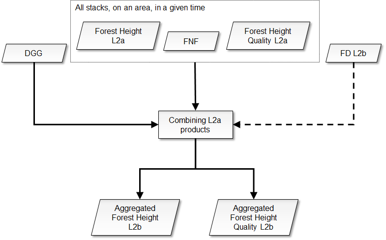
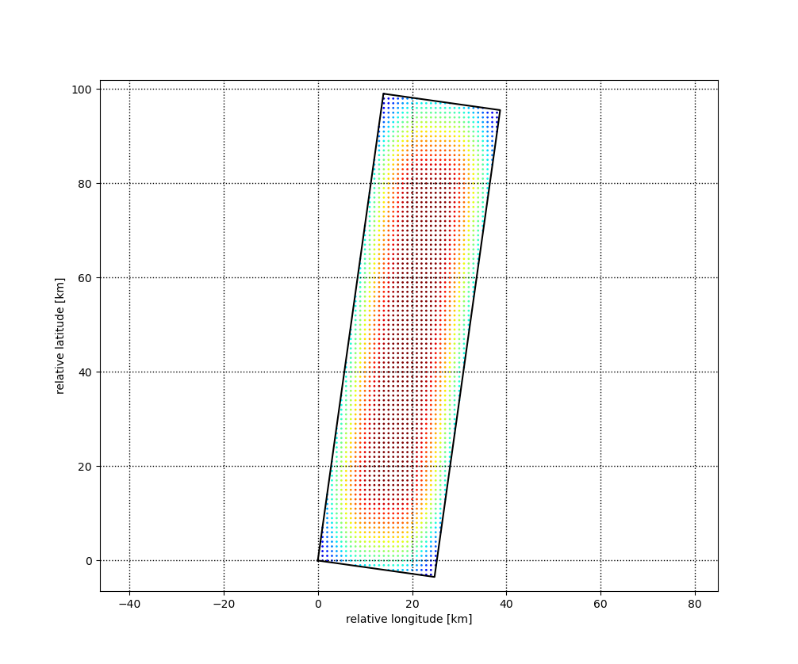

<!-- SPDX-FileCopyrightText: 2026 European Space Agency (ESA) -->
<!-- SPDX-License-Identifier: Apache-2.0 -->

:::{atbd-logo-banner}
:::

(sec:atbd-fh-4)=
# 4. Forest height aggregation

The overall scheme of the L2b processing is reported in figure below.

The key step is fusion of L2a estimates at map level. These steps are described in detail in the following subsections.

(sec:atbd-fh-4-1)=
### 4.1 L2a FH fusion

(sec:atbd-fh-4-1-1)=
#### 4.1.1 Algorithm overview and rationale

The forest height and quality maps allow the combination of different acquisitions in a simple and efficient pixelwise way. L2a products falling onto the same L2b tile within a global cycle are retrieved through geospatial query of information (tile IDs and time tags) in the Main Product Header of the product.

(fig:atbd-fh-13)=
:::{div} atbd-mermaid-figure

Fig. 13 — Complete flow-chart of the L2b processing.

:::

**The step is mandatory.**

(sec:atbd-fh-4-1-2)=
#### 4.1.2 Inputs

| Symbol | Name | Origin | Size | Variability | Default | Description |
|---|---|---|---|---|---|---|
| FNF i | FNF | FH L2a products in a DGG tile in a global cycle (`FH_PFD`) | $\left[ N_{lat}\times{}N_{lon} \right]^i$ | - | - | Annotated forest-non-forest mask |
| $H_F^i$ | forest height | FH L2a products in a DGG tile in a global cycle (`FH_PFD`) | $\left[ N_{lat}\times{}N_{lon} \right]^i$ | - | - | Forest height map |
| $h_b^i$ | forest height quality | FH L2a products in a DGG tile in a global cycle (`FH_PFD`) | $\left[ N_{lat}\times{}N_{lon} \right]^i$ | - | - | Quality index indicating the inversion performance |
| CFM | CFM | FD L2b product in a DGG tile in a global cycle (`FD_PFD`) | $\left[ N_{lat,L2b}\times{}N_{lon,L2b} \right]$ | optional | not provided | Computed Forest Mask |
| - | `forestMaskingFlag` | `AUX_PP2_FH` (`AUX_FMT`) | bool | - | True | True if forest/non-forest map masking should be performed |
| DGG | DGG | Internal lookup table | - | - | - | DGG tile |
| BBi | Footprint | L2a main product header (`FH_PFD`) | lat-lon vertices (4 couples) | - | - | The extent of the L2a input data in geographical coordinates |
| $\beta_A$ | `rollOffFactorAzimuth` | `AUX_PP2_FH` (`AUX_FMT`) | float value [scalar] | 0.0-1.0 | 0.1 | Feathering roll-off factor |
| $\beta_R$ | `rollOffFactorRange` | `AUX_PP2_FH` (`AUX_FMT`) | float value [scalar] | 0.0-1.0 | 0.1 | Feathering roll-off factor |
| mDGG | `minimumL2aCoverage` | `AUX_PP2_FH` (`AUX_FMT`) | float value [scalar] | 0.0-100.0 | 10.0 | The minimum [%] tile coverage that triggers the computations |

(sec:atbd-fh-4-1-3)=
#### 4.1.3 Outputs

| Symbol | Name | Destination | Size | Variability | Default | Description |
|---|---|---|---|---|---|---|
| $H_F$ | forest height | FH L2b product | $\left[ N_{lat,L2b}\times{}N_{lon,L2b} \right]$ | - | - | forest height aggregated |
| $h_b$ | forest height quality | FH L2b product | $\left[ N_{lat,L2b}\times{}N_{lon,L2b} \right]$ | - | - | forest height quality aggregated |
| HM | heat map | FH L2b product | $\left[ N_{lat,L2b}\times{}N_{lon,L2b} \right]$ | - | - | heat map |

(sec:atbd-fh-4-1-4)=
#### 4.1.4 Algorithm mathematical background

As a first step, the minimum required coverage over L2b DGG tile j is checked to proceed with computations:

$$
TR=\ (100*\frac{A(\left. \bigcup_i^{}{{BB}^i} \right\vert_{DGG}\cap\left. {TT}^j \right\vert_{DGG})}{A(\left. {TT}^j \right\vert_{DGG})}>mDGG)
\tag{4.1}
$$ (eq:atbd-fh-4-1)

where BBi are the L2a bounding boxes, TTj is the footprint of the current L2b DGG tile and A operator computes the area of the corresponding polygon.

(sec:atbd-fh-4-1-4-1)=
##### 4.1.4.1 Feathering weights

Each L2a forest height map is weighted on its border (as defined by its footprint BBi) by applying raised cosine weights and accounting for transitions between swaths {rd}`14`.

Thus, the two feathering weights $w_a^i(d)w_r^i(d)$ are computed in the swath tilted domain, as defined by the footprint BBi:

(4.2)

$$
w_{a,r}^i(d)=\left\{ \ \ \begin{matrix}
1\ \ \ \ \ \ \ \ \ \ \ \ \ \ \ \ \ \ \ \ \ \ \ \ \ \ \ \ \ \ \ \ \ \ \ \ \ \ \ \ \ \ \ \ \ \ \ \ \ \ \ \ \ \ \ \ \ \ \ \ \ \ \ \ \ \ \ \ & \left\vert d \right\vert\leq\frac{1-\beta}{s_w}\ \ \ \ \ \ \ \ \ \ \ \ \ \ \ \ \ \ \ \ \\
\frac{1}{2}\left[ 1+\cos (\frac{\pi{}s_w}{2\beta}\left[ \left\vert d \right\vert-\frac{1-\beta}{s_w} \right]) \right]\ \ \ \ \ \ \ \ \ \ & \frac{1-\beta}{s_w}<\left\vert d \right\vert\leq\frac{1+\beta}{s_w}\ \ \ \\
\ 0\ \ \ \ \ \ \ \ \ \ \ \ \ \ \ \ \ \ \ \ \ \ \ \ \ \ \ \ \ \ \ \ \ \ \ \ \ \ \ \ \ \ \ \ \ \ \ \ \ \ \ \ \ \ \ \ \ \ \ \ \ \ \ \ \ \ \ \ \ & otherwise\ \ \ \ \ \ \ \ \ \ \ \ \ \ \ \ \ \ \ \ \ \ \
\end{matrix} \right.
$$

where $s_w=s_{w,A},s_{w,R}$ is swath width along azimuth or range direction (computed from swath footprint BBi), $d$ is distance from swath border (computed in the tilted domain) and $\beta=\beta_A,\ \beta_R$ is the roll-off factor.

(fig:atbd-fh-14)=
:::{div} atbd-mermaid-figure

Fig. 14 — Feathering weights example. The product of range and azimuth weights is represented colour-coded.

:::

(sec:atbd-fh-4-1-4-2)=
##### 4.1.4.2 Aggregation rule

The aggregation at pixel map level of the various L2a forest height maps is done by performing an average weighted by quality information represented by the percentage bias $h_b^i$, computed in {sec}`3.5.4.1.6`. The estimation quality $h_b^i$ allows the combination of K different estimates $H_F^i$ in a simple and efficient way to generate a global $H_F$estimate. A heat map HM is also stored as representing the sum of weights used in computation (including feathering weights). Two different sets of relations are proposed, depending on the availability of FD L2b product as input. When FD L2b product is not present, annotated forest/non-forest map is used to remove deforested areas:

$$
H_F=\frac{\sum_{i=1}^K{\frac{1}{{\varepsilon+h}_b^i}w_a^i(d)w_r^i(d)H_F^i{FNF}^i}}{\sum_{i=1}^K{\frac{1}{{\varepsilon+h}_b^i}}w_a^i(d)w_r^i(d)}
\tag{4.3}
$$ (eq:atbd-fh-4-3)

$$
h_b=\frac{\sum_{i=1}^K{\frac{1}{{\varepsilon+h}_b^i}w_a^i(d)w_r^i(d)h_b^i{FNF}^i}}{\sum_{i=1}^K{\frac{1}{{\varepsilon+h}_b^i}}w_a^i(d)w_r^i(d)}
$$

$$
HM=\sum_{i=1}^K{\frac{1}{{\varepsilon+h}_b^i}w_a^i(d)w_r^i(d){FNF}^i}
$$

where $\varepsilon=0.01$ is an adjustment factor.

If the FD L2b product is provided as input, CFM supersedes FNF, and the rule is instead:

$$
H_F=CFM\ \frac{\sum_{i=1}^K{\frac{1}{{\varepsilon+h}_b^i}w_a^i(d)w_r^i(d)H_F^i}}{\sum_{i=1}^K{\frac{1}{{\varepsilon+h}_b^i}}w_a^i(d)w_r^i(d)}
\tag{4.4}
$$ (eq:atbd-fh-4-4)

$$
h_b=CFM\ \frac{\sum_{i=1}^K{\frac{1}{{\varepsilon+h}_b^i}w_a^i(d)w_r^i(d)h_b^i}}{\sum_{i=1}^K{\frac{1}{{\varepsilon+h}_b^i}}w_a^i(d)w_r^i(d)}
$$

$$
HM=CFM\sum_{i=1}^K{\frac{1}{{\varepsilon+h}_b^i}w_a^i(d)w_r^i(d)}
$$

It must be noted that previous relations are actually computed only where at least one FH L2A input is present.
