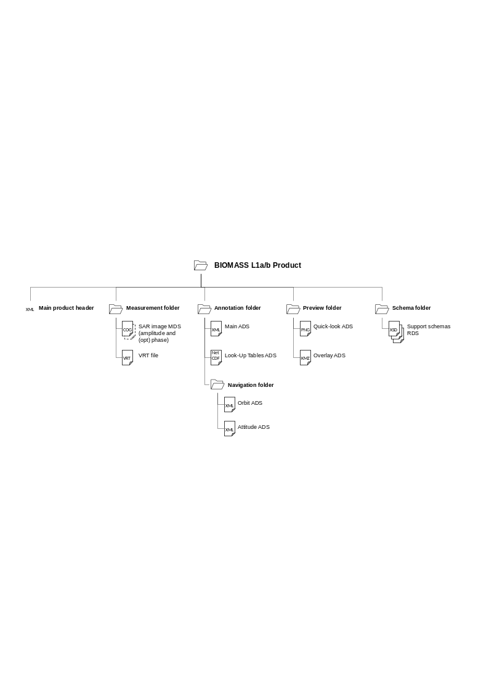

<!-- SPDX-FileCopyrightText: 2026 European Space Agency (ESA) -->
<!-- SPDX-License-Identifier: Apache-2.0 -->

:::{atbd-logo-banner}
:::

(sec:pfd-l1-3)=
# 3. L1a/b Products Format Overview

The BIOMASS L1a or L1b product is a folder containing a collection of information, grouped together into files referred to as data sets, and data sets are collected and grouped into several sub-folders in order to achieve a physical tree forming a complete product.

These products contain 3 kinds of datasets:

- the Measurement Data Sets (MDS), containing images derived from instrument data;
- the Annotation Data Sets (ADS), containing metadata that describes the properties and characteristics of the measurement data or how the measurement data was generated;
- the Representation Data Sets (RDS), containing information about the format or syntax of the measurement and annotation data sets and can be used to validate and exploit these data.

The declination and customisation of this format structure for BIOMASS L1a and L1b products is summarised in the following figure and table. In particular, a typical product contains:

- a main product header, an XML file including high-level information about the product origin, structure and main metadata (see {sec}`4.1`);
- SAR image MDS, including the SAR image binary raster data for all the four BIOMASS polarisations, organised in two Cloud Optimized GeoTIFF (COG) files, one for amplitude and one for phase (only for L1a products) components (see {sec}`4.2`);
- main annotation ADS, including the properties and characteristics of the measurement data or how the measurement data was generated, stored in a single XML file (see {sec}`4.3.1`);
- Look-Up Table (LUT) ADS, including those metadata being too voluminous to be coded efficiently in an XML file (i.e., Look-Up Tables) and requiring a binary NetCDF file (see. {sec}`4.3.2`);
- orbit and attitude ADS, including orbit and attitude information in dedicated XML files (see {sec}`4.3.3`);
- quick-look and overlay ADS, including an averaged and decimated preview of the SAR image data set and information about its geographic coverage (see {sec}`4.3.4` and {sec}`4.3.5`);
- XML schemas RDS, including the schemas needed for all the XML files included in the product.

(fig:pfd-l1-1)=
:::{div} atbd-mermaid-figure

Fig. 1 — L1a/b products structure

:::

(tab:pfd-l1-1)=
:::{div} atbd-table

Table 1 — L1a/b products structure

| File / Folder | Cardinality | Format | Description / Content |
|---|---|---|---|
| BIOMASS L1a/b Product |   | Folder |   |
| ∟ main product header | 1 | XML | Main product header |
| ∟ measurement |   | Folder |   |
| ∟ sar image | 1 or 2 | COG | SAR image MDS 2 files = 1 for amplitude + 1 for phase (only for L1a products) 4 components each (1 per polarization) |
| ∟ sar image | 0 or 1 | VRT | SAR image MDS (support) Present only for L1a products |
| ∟ annotation |   | Folder |   |
| ∟ main | 1 | XML | Main ADS, including: - Acquisition information DSR - SAR image DSR - Instrument parameters DSR - RAW data analysis DSR - Processing parameters DSR - Internal calibration DSR - RFI mitigation DSR - Doppler parameters DSR - Radiometric calibration DSR - Polarimetric distortion DSR - Ionosphere correction DSR - Geometry DSR - Quality DSR - Annotation LUT DSR |
| ∟ lut | 1 | NetCDF | Look-Up Tables ADS, including: - RFI time-domain masks DSR (one per polarisation) - RFI frequency-domain masks DSR (one per polarisation) - Radiometric calibration DSR (sigma-nought and gamma-nought maps) - Ionosphere correction DSR (FR, phase screen, TEC, range and azimuth shifts and autofocus phase screen maps) - Denoising DSR (one per polarisation) - Geometry DSR (latitude/longitude/height maps, incidence and elevation angles maps) |
| ∟ navigation |   | Folder |   |
| ∟ orbit | 1 | XML (EOF) | Orbit DSR |
| ∟ attitude | 1 | XML (EOF) | Attitude DSR |
| ∟ preview |   | Folder |   |
| ∟ quicklook | 1 or 2 | PNG | Quick-look ADS L1a can have 2 files (Pauli decomposition and HSV representation) or just 1 (selected between these two) L1b has 1 file (Lexicographic representation) |
| ∟ overlay | 1 | KML | Overlay ADS |
| ∟ schema |   | Folder |   |
| ∟ main `annotation.xsd` | 1 | XSD | RDS |
| ∟ `orbit.xsd` | 1 | XSD | RDS |
| ∟ `attitude.xsd` | 1 | XSD | RDS |
| ∟ `overlay.xsd` | 1 | XSD | RDS |
| ∟ common `types.xsd` | 1 | XSD | RDS |

:::

(sec:pfd-l1-3-1)=
### 3.1 Product format definition guidelines

The BIOMASS L1a/b products format here described has been defined following a set of guidelines and principles, being the main ones:

- follow a structure and an organization into datasets (MDS, ADS and RDS) already adopted with success in other SAR mission (Sentinel-1 above all) and already known to the users;
- rely on existing ESA conventions wherever possible (main product header OGC-compliant, orbit and attitude files in EOF format, …);
- rely on existing and known-to-the-users standards and formats (COG and NetCDF format for binary files, XML format and corresponding XSD schemas for annotation files, PNG and KML format for quick-looks and overlays, …).

Starting from this consolidated “background”, several new features, aimed at improving in particular the products usability, have been introduced, in particular:

- the way SAR data are stored, with one COG file for amplitudes and one for phase values (with one component for each of the four data polarisation), differently from the standard approach based on real and imaginary parts. This choice presents a wide set of advantages for the users, as described in {sec}`4.2`);
- only one file for all the annotations instead of one per polarization, reducing as much as possible information duplication and spreading into several positions;
- only one file for all the LUTs, reducing annotation file dimensions and easing their access, management and applicability to SAR data.

In the end, the L1a/b products format has been defined together with L1c one, following the same guidelines and trying to identify a structure that can be applied to both with the minimum changes, easing even more their access to the users.

(sec:pfd-l1-3-2)=
### 3.2 Differences between L1a and L1b products

The structure described in the previous section is valid both for L1a and L1b products, with the following differences:

- SAR image MDS is composed by two files for L1a products (amplitude and phase components) and by just one file for L1b ones (amplitude component);
- Main ADS includes the same DSR for both L1a and L1b products, but some specific fields (e.g., `rangeCoordinateConversion`, …) will be filled only for L1a or L1b ones. Single cases are detailed in format specification, described in the next section.

Note that all L1a products share the same format, then both SCS and SCS-CAL ones. They can be distinguished through their product type, as defined in {sec}`3.4`.

(sec:pfd-l1-3-3)=
### 3.3 L1M products

As described above, L1M products are a “light” version of L1S ones, to be used for monitoring purposes.

It has to be noted that L1M products are generated by L1 processor in the same flow of L1S ones, without the need of specific processing. In addition, they are generated only alongside L1a and not L1b ones.

L1M products are identical to L1S ones except for SAR image MDS (and ‘measurement’ sub-folder), which is present only in L1S products.

(sec:pfd-l1-3-4)=
### 3.4 Naming convention

The BIOMASS L1a/b product and all data sets files naming are addressed and described in details in {ad}`2`.

Recalling the main points, the naming of the products directories is the following:

`<MMM>_<TTTTTTTTTT>_<yyyymmddThhmmss>_<YYYYMMDDTHHMMSS>_
_G<CC>_M<NN>_C<nn>_T<TTT>_F<FFF>_<BB>_<DDDDDD>`

where:

- `<MMM>`: Satellite ID;
- `<TTTTTTTTTT>`: Product Type/File Type, i.e.:
    - `S[1,2,3]_SCS__1S`: Stripmap L1 Single-look Complex Slant - Standard product;
    - `S[1,2,3]_SCS[1,2,X,Y]_1S`: Stripmap L1 Single-look Complex Slant Calibration (`1: Gt1, 2:Gt2, X, Y`) - Standard product;
    - `S[1,2,3]_DGM__1S`: Stripmap L1 Detected Ground Multi-look - Standard product;
    - `S[1,2,3]_SCS__1M`: Stripmap L1 Single-look Complex Slant - Monitoring Product;
- `<yyyymmddThhmmss>`: UTC start date and time (acquisition Zero Doppler Time);
- `<YYYYMMDDTHHMMSS>`: UTC stop date and time (acquisition Zero Doppler Time);
- `
`: Mission phase identifier;
- `<CC>`: Global Coverage identifier;
- `<NN>`: Major Cycle identifier;
- `<nn>`: Repeat Cycle identifier;
- `<TTT>`: Track number of the product;
- `<FFF>`: Frame/slice number of the product;
- `<BB>`: Baseline Identifier;
- `<DDDDDD>`: Compact creation date.

The internal files in the L1 product inherit the same naming convention, with the following changes:

- capital letters conversion to lowercase;
- “Baseline Identifier and “Compact Creation Date” naming parts removal, except for Main Product Header file;
- addition of a dataset type depending suffix and extension, i.e.:
    - `*.xml` for main product header;
    - `*_i_[abs,phase].tiff` for SAR image MDS;
    - `*_i.vrt` for VRT file;
    - `*_annot.xml` for main ADS;
    - `*_lut.nc` for Look-Up Tables ADS;
    - `*_orb.xml` for orbit ADS;
    - `*_att.xml` for attitude ADS;
    - `*_ql_pauli.png` for quick-look ADS with Pauli decomposition;
    - `*_ql_hsv.png` for quick-look ADS with HSV representation;
    - `*_ql_lexicographic.png` for quick-look ADS with Lexicographic representation;
    - `*_map.kml` for overlay ADS;
    - `*.xsd` for support schemas RDS.
