<!-- SPDX-FileCopyrightText: 2026 European Space Agency (ESA) -->
<!-- SPDX-License-Identifier: Apache-2.0 -->

:::{atbd-logo-banner}
:::


(sec:pfd-l1-4)=
# 4. L1a/b Products Format Specification

(sec:pfd-l1-4-1)=
### 4.1 Main product header

The Main Product Header (MPH) is an XML file present in all the BIOMASS L1 products. BIOMASS L1 products are folder based and the MPH is top level leaf of the product tree.

The MPH main scope is to provide all the information related to the:

- Genesis of the product;
- Identification of the product for example for cataloguing purposes;
- Product consistency (filesize).

For the detailed description of the MPH content and format refer to {ad}`3`. Here just a schematic representation is reported.

bio:EarthObservation Root element of metadata representation tailored for BIOMASS SAR products

om:`phenomenonTime` Time coverage of the product

gml:TimePeriod Time coverage of the product as a period

gml:`beginPosition` Start date and time of the product

gml:`endPosition` Stop date and time of the product

om:`resultTime` Time when the sensing data has become available

gml:TimeInstant Identifiable position in time

gml:`timePosition` Date and time of data availability

om:`validTime` Time validity of the product

gml:TimePeriod Time validity of the product as a period

gml:`beginPosition` Validity start date and time of the product

gml:`endPosition` Validity stop date and time of the product

om:procedure Procedure used to sense the data

eop:EarthObservationEquipment Equipment used to sense the data

eop:platform Platform description

eop:Platform Nested element for platform description

eop:`shortName` Satellite name

eop:instrument Instrument description

eop:Instrument Nested element for instrument description

eop:`shortName` Sensor name

eop:sensor Sensor description

eop:Sensor Nested element for sensor description

eop:`sensorType` Sensor type

eop:`operationalMode` Sensor operational mode

eop:`swathIdentifier` Swath identifier

eop:`acquisitionParameters` Acquisition parameters

bio:Acquisition Acquisition description

eop:`orbitNumber` Acquisition orbit number (orbit start)

eop:`lastOrbitNumber` Last orbit number (orbit stop)

eop:`orbitDirection` Orbit direction

eop:`wrsLongitudeGrid` Track number

eop:`wrsLatitudeGrid` Frame number

eop:`ascendingNodeDate` Date and time of ANX

eop:`startTimeFromAscendingNode` Start time from ANX

eop:`completionTimeFromAscendingNode` Stop time from ANX

sar:`polarisationMode` SAR Polarisation mode

sar:`polarisationChannels` SAR Polarisation channels

sar:`antennaLookDirection` SAR antenna look direction

bio:`missionPhase` BIOMASS mission phase

bio:`instrumentConfID` BIOMASS instrument configuration identifier

bio:`dataTakeID` BIOMASS data take identifier

bio:`orbitDriftFlag` BIOMASS orbit drift flag

bio:`globalCoverageID` BIOMASS global coverage identifier

bio:`majorCycleID` BIOMASS major cycle identifier

bio:`repeatCycleID` BIOMASS repeat cycle identifier

om:`observedProperty` Observed property (empty)

om:`featureOfInterest` Observed area

eop:Footprint Footprint description

eop:`multiExtentOf` Footprint representation structure, coordinates in `posList`

gml:MultiSurface

gml:`surfaceMember`

gml:Polygon

gml:exterior

gml:LinearRing

gml:`posList` Footprint points, i.e. 4 corner coordinates of the scene starting with the first-right in flight direction and proceeding CCW (first point to be added as fifth point to close the polygon)

eop:`centerOf` Acquisition centre representation structure

gml:Point

gml:pos Coordinates of the centre of the acquisition

om:result Observation result

eop:EarthObservationResult

eop:browse

eop:BrowseInformation

eop:type Browse type

eop:`referenceSystemIdentifier` Coordinate reference system name

eop:`fileName`

ows:ServiceReference Browse Image filename

ows:RequestMessage download request (empty)

eop:product

bio:ProductInformation

eop:`fileName`

ows:ServiceReference Product filename

ows:RequestMessage download request (empty)

eop:version Product baseline

eop:product (list)

bio:ProductInformation

eop:`fileName`

ows:ServiceReference Product filename (internal files)

ows:RequestMessage download request (empty)

eop:size Product size

bio:rds Representation data file related to xml product

eop:`metaDataProperty` Observation metadata

bio:EarthObservationMetaData

eop:identifier Product identifier

eop:doi Digital Object Identifier

eop:`acquisitionType` Type of acquisition

eop:`productType` Product type

eop:status Status of the product

eop:`downlinkedTo` Downlink information

eop:DownlinkInformation

eop:`acquisitionStation` Acquisition station

eop:`acquisitionDate` Downlink date time

eop:processing Data processing information

bio:ProcessingInformation

eop:`processingCenter` Processing centre

eop:`processingDate` Processing date and time

eop:`processorName` Processor name

eop:`processorVersion` Processor version

eop:`processingLevel` Processing level

eop:`auxiliaryDataSetFileName` Auxiliary DS file name

eop:`processingMode` File Class

bio:`sourceProduct` BIOMASS source product identifier

bio:TAI-UTC Difference between TAI and UTC times of product

bio:`numOfTFs` Number of transfer frames

bio:`numOfTFsWithErrors` Number of transfer frames with errors

bio:`numOfCorruptedTFs` Number of corrupted transfer frames

bio:`numOfISPs` Number of instrument source packets

bio:`numOfISPsWithErrors` Number of instrument source packets with errors

bio:`numOfCorruptedISPs` Number of corrupted instrument source packets

bio:`numOfLines` Number of L0 lines

bio:`numOfMissingLines` Number of L0 missing lines

bio:`numOfCorruptedLines` Number of L0 corrupted lines

bio:`incompleteSlice` Incomplete L0 slice flag

bio:`partialSlice` Partial L0 slice flag

bio:`framesList` List of L1 frames contained in L0

bio:`incompleteFrame` Incomplete L1 frame flag

bio:`partialFrame` Partial L1 frame flag

bio:`refDoc` Reference document

*Main product header (metadata schematic representation)*

(sec:pfd-l1-4-2)=
### 4.2 Measurement data sets (MDS)

(sec:pfd-l1-4-2-1)=
#### 4.2.1 SAR image MDS

The SAR image MDS is used to store the SAR image binary raster data as generated by the L1 processor for all the foreseen BIOMASS data polarisations (HH, HV, VH, VV).

The format used to store the SAR image MDS is the Cloud Optimized GeoTIFF {rd}`1`.

A Cloud Optimized GeoTIFF (COG) is a regular GeoTIFF file, aimed at being hosted on a HTTP file server, with an internal organization that enables more efficient workflows on the cloud. It does this by leveraging the ability of clients issuing ​HTTP GET range requests to ask for just the parts of a file they need.

The COG format is natively supported by GDAL library {rd}`2` {rd}`3` and by libraries and tools based on GDAL library (Dask and Rasterio packages for Python, …).

Differently from other SAR missions (and from the standard way of storing SAR data), for the BIOMASS mission SAR data are stored separating amplitude and phase values of each pixel instead of its real and imaginary parts. In particular, the SAR image MDS will be composed by two files:

- one COG file with the amplitude values (square root of beta-nought quantity, absolute calibration constant applied, linear scale) of each pixel;
- one COG file with the phase values (radians) of each pixel.

For both the files, four separated components will be used, one for each BIOMASS data polarisation in lexicographic order (i.e., HH, HV, VH, VV). It must be noted that all the four polarisations of BIOMASS L1 products will be sampled over the same sampling grid, allowing an easy access through the different components.

Obviously for L1b products (DGM) only the first file with the amplitude values will be included in the product, being the data already detected and not complex.

The main rationale behind this choice stands in the products usability. Amplitude and phase representation has in fact several advantages from the users’ point of view:

- ease image visualization on a map, either using a data browser on a cloud computing platform or through a GIS software on a local PC, and the generation of overviews;
- run applications that exploit the amplitude only;
- run fast workflows on a cloud computing platform on a custom subset of data;
- speed-up applications working on all the polarisations together;

and more.

**Compression strategy**

The separation of amplitude and phase parts allows to introduce with benefit a set of different strategies for data compression. Making use of native LibTIFF libraries capabilities {rd}`4`, it is possible to adopt:

- 32bits/pixel + GeoTIFF `LERC_ZSTD` compression (`MAX_Z_ERROR`=0.0001) for amplitude part;
- 32bits/pixel + GeoTIFF `LERC_ZSTD` compression (`MAX_Z_ERROR`=0.001) for phase part.

This approach will allow to achieve a considerable compression factor (~2x with an error of 0.06dB on amplitude @-37dB and of 0.001rad / 0.0572deg on phase).

**VRT – GDAL Virtual Format**

The VRT driver is a format driver for GDAL that allows a virtual GDAL dataset to be composed from other GDAL datasets with repositioning, and algorithms potentially applied as well as various kinds of metadata altered or added.

For the sake of “retro-compatibility” and to ease the management of BIOMASS data by those SAR processing applications designed to work on real and imaginary parts, it is foreseen to include in BIOMASS L1a products a VRT file (XML format). The scope is to describe how to pass from the amplitude and phase representation (stored on disk) to the real and imaginary parts one. VRT files are natively managed by GDAL library allowing to perform this transcoding on-the-fly directly during the access to the data stored on disk, so that the whole process is transparent for the user.

Here below a sample VRT file is reported:

\<\<?xml version="1.0" encoding="utf-8"?\>

\<VRTDataset rasterXSize="1380" rasterYSize="21265"\>

\<GCPList Projection="GEOGCRS[&amp;quot;WGS 84&amp;quot;,ENSEMBLE[&amp;quot;World Geodetic System 1984 ensemble&amp;quot;,MEMBER[&amp;quot;World Geodetic System 1984 (Transit)&amp;quot;],MEMBER[&amp;quot;World Geodetic System 1984 (G730)&amp;quot;],MEMBER[&amp;quot;World Geodetic System 1984 (G873)&amp;quot;],MEMBER[&amp;quot;World Geodetic System 1984 (G1150)&amp;quot;],MEMBER[&amp;quot;World Geodetic System 1984 (G1674)&amp;quot;],MEMBER[&amp;quot;World Geodetic System 1984 (G1762)&amp;quot;],MEMBER[&amp;quot;World Geodetic System 1984 (G2139)&amp;quot;],ELLIPSOID[&amp;quot;WGS 84&amp;quot;,6378137,298.257223563,LENGTHUNIT[&amp;quot;metre&amp;quot;,1]],ENSEMBLEACCURACY[2.0]],PRIMEM[&amp;quot;Greenwich&amp;quot;,0,ANGLEUNIT[&amp;quot;degree&amp;quot;,0.0174532925199433]],CS[ellipsoidal,3],AXIS[&amp;quot;geodetic latitude (Lat)&amp;quot;,north,ORDER[1],ANGLEUNIT[&amp;quot;degree&amp;quot;,0.0174532925199433]],AXIS[&amp;quot;geodetic longitude (Lon)&amp;quot;,east,ORDER[2],ANGLEUNIT[&amp;quot;degree&amp;quot;,0.0174532925199433]],AXIS[&amp;quot;ellipsoidal height (h)&amp;quot;,up,ORDER[3],LENGTHUNIT[&amp;quot;metre&amp;quot;,1]],USAGE[SCOPE[&amp;quot;Geodesy. Navigation and positioning using GPS satellite system.&amp;quot;],AREA[&amp;quot;World.&amp;quot;],BBOX[-90,-180,90,180]],ID[&amp;quot;EPSG&amp;quot;,4979]]"\>

\<GCP Id="1" Info="GCP1" Pixel="0" Line="0" X="2.766610117165289" Y="40.867629249542226" Z="47.44995130971074"/\>

\<GCP Id="2" Info="GCP2" Pixel="0" Line="2000" X="2.7229108886640847" Y="40.9850029875603" Z="47.6954053286463"/\>

\<!-- omissis --\>

\<GCP Id="46" Info="GCP46" Pixel="1379" Line="18000" X="1.7056110678368939" Y="41.777702020736534" Z="527.1823539100587"/\>

\<GCP Id="47" Info="GCP47" Pixel="1379" Line="20000" X="1.657004737026843" Y="41.8941560464991" Z="652.2788440166041"/\>

\<GCP Id="48" Info="GCP48" Pixel="1379" Line="21264" X="1.6270188350235635" Y="41.96792825220514" Z="688.6636372571811"/\>

\</GCPList\>

\<Metadata\>

\<MDIType key="`AREA_OR_POINT`"\>Area\</MDIType\>

\<MDIType key="`MATRIX_REPRESENTATION`"\>SCATTERING\</MDIType\>

\<MDIType key="`ABS_MAX_Z_ERROR`"\>0.0001\</MDIType\>

\<MDIType key="`PHASE_MAX_Z_ERROR`"\>0.001\</MDIType\>

\<MDIType key="PolarisationsSequence"\>HH HV VH VV\</MDIType\>

\<MDIType key="Swath"\>S2\</MDIType\>

\<MDIType key="DATETIME"\>2024-05-31T13:19:44.034802\</MDIType\>

\<MDIType key="IMAGEDESCRIPTION"\>BIOMASS L1\</MDIType\>

\<MDIType key="SOFTWARE"\>BPS-Biomass L1 Processor-2.2.3\</MDIType\>

\</Metadata\>

\<VRTRasterBand `dataType`="CFloat32" band="1" `subClass`="VRTDerivedRasterBand"\>

\<Description\>HH\</Description\>

\<NoDataValue\>-9999.0\</NoDataValue\>

\<Metadata\>

\<MDIType key="`POLARIMETRIC_INTERP`"\>HH\</MDIType\>

\</Metadata\>

\<ColorInterp\>Gray\</ColorInterp\>

\<SimpleSource\>

\<SourceFilename `relativeToVRT`="1"\>`bio_s2_scs__1s_20170111t050609_20170111t050630_i_g03_m03_c03_t010_f001_i_abs.tiff`\</SourceFilename\>

\<SourceBand\>1\</SourceBand\>

\<SourceProperties RasterXSize="1380" RasterYSize="21265"/\>

\</SimpleSource\>

\<SimpleSource\>

\<SourceFilename `relativeToVRT`="1"\>`bio_s2_scs__1s_20170111t050609_20170111t050630_i_g03_m03_c03_t010_f001_i_phase.tiff`\</SourceFilename\>

\<SourceBand\>1\</SourceBand\>

\<SourceProperties RasterXSize="1380" RasterYSize="21265"/\>

\</SimpleSource\>

\<PixelFunctionType\>polar\</PixelFunctionType\>

\<SourceTransferType\>Float32\</SourceTransferType\>

\<PixelFunctionArguments amplitude\_type="AMPLITUDE"/\>

\</VRTRasterBand\>

\<VRTRasterBand `dataType`="CFloat32" band="2" `subClass`="VRTDerivedRasterBand"\>

\<Description\>HV\</Description\>

\<NoDataValue\>-9999.0\</NoDataValue\>

\<Metadata\>

\<MDIType key="`POLARIMETRIC_INTERP`"\>HV\</MDIType\>

\</Metadata\>

\<ColorInterp\>Gray\</ColorInterp\>

\<SimpleSource\>

\<SourceFilename `relativeToVRT`="1"\>`bio_s2_scs__1s_20170111t050609_20170111t050630_i_g03_m03_c03_t010_f001_i_abs.tiff`\</SourceFilename\>

\<SourceBand\>2\</SourceBand\>

\<SourceProperties RasterXSize="1380" RasterYSize="21265"/\>

\</SimpleSource\>

\<SimpleSource\>

\<SourceFilename `relativeToVRT`="1"\>`bio_s2_scs__1s_20170111t050609_20170111t050630_i_g03_m03_c03_t010_f001_i_phase.tiff`\</SourceFilename\>

\<SourceBand\>2\</SourceBand\>

\<SourceProperties RasterXSize="1380" RasterYSize="21265"/\>

\</SimpleSource\>

\<PixelFunctionType\>polar\</PixelFunctionType\>

\<SourceTransferType\>Float32\</SourceTransferType\>

\<PixelFunctionArguments amplitude\_type="AMPLITUDE"/\>

\</VRTRasterBand\>

\<VRTRasterBand `dataType`="CFloat32" band="3" `subClass`="VRTDerivedRasterBand"\>

\<Description\>VH\</Description\>

\<NoDataValue\>-9999.0\</NoDataValue\>

\<Metadata\>

\<MDIType key="`POLARIMETRIC_INTERP`"\>VH\</MDIType\>

\</Metadata\>

\<ColorInterp\>Gray\</ColorInterp\>

\<SimpleSource\>

\<SourceFilename `relativeToVRT`="1"\>`bio_s2_scs__1s_20170111t050609_20170111t050630_i_g03_m03_c03_t010_f001_i_abs.tiff`\</SourceFilename\>

\<SourceBand\>3\</SourceBand\>

\<SourceProperties RasterXSize="1380" RasterYSize="21265"/\>

\</SimpleSource\>

\<SimpleSource\>

\<SourceFilename `relativeToVRT`="1"\>`bio_s2_scs__1s_20170111t050609_20170111t050630_i_g03_m03_c03_t010_f001_i_phase.tiff`\</SourceFilename\>

\<SourceBand\>3\</SourceBand\>

\<SourceProperties RasterXSize="1380" RasterYSize="21265"/\>

\</SimpleSource\>

\<PixelFunctionType\>polar\</PixelFunctionType\>

\<SourceTransferType\>Float32\</SourceTransferType\>

\<PixelFunctionArguments amplitude\_type="AMPLITUDE"/\>

\</VRTRasterBand\>

\<VRTRasterBand `dataType`="CFloat32" band="4" `subClass`="VRTDerivedRasterBand"\>

\<Description\>VV\</Description\>

\<NoDataValue\>-9999.0\</NoDataValue\>

\<Metadata\>

\<MDIType key="`POLARIMETRIC_INTERP`"\>VV\</MDIType\>

\</Metadata\>

\<ColorInterp\>Gray\</ColorInterp\>

\<SimpleSource\>

\<SourceFilename `relativeToVRT`="1"\>`bio_s2_scs__1s_20170111t050609_20170111t050630_i_g03_m03_c03_t010_f001_i_abs.tiff`\</SourceFilename\>

\<SourceBand\>4\</SourceBand\>

\<SourceProperties RasterXSize="1380" RasterYSize="21265"/\>

\</SimpleSource\>

\<SimpleSource\>

\<SourceFilename `relativeToVRT`="1"\>`bio_s2_scs__1s_20170111t050609_20170111t050630_i_g03_m03_c03_t010_f001_i_phase.tiff`\</SourceFilename\>

\<SourceBand\>4\</SourceBand\>

\<SourceProperties RasterXSize="1380" RasterYSize="21265"/\>

\</SimpleSource\>

\<PixelFunctionType\>polar\</PixelFunctionType\>

\<SourceTransferType\>Float32\</SourceTransferType\>

\<PixelFunctionArguments amplitude\_type="AMPLITUDE"/\>

\</VRTRasterBand\>

\</VRTDataset\>

**Metadata**

The TIFF and GeoTIFF tags used to annotate SAR image MDS are described in the following table. For the complete description of each tag refer to official TIFF format documentation {rd}`5`.

(tab:pfd-l1-2)=
:::{div} atbd-table

<p class="atbd-table-caption"><span class="caption-number">Table 2</span><span class="caption-text"> — SAR image MDS – TIFF and GeoTIFF tags</span></p>

| Tag Name | Code | Value | Description |
|---|---|---|---|
| ImageWidth | 256 | Variable | Number of columns in the image, i.e. the number of pixels per row. |
| ImageLength | 257 | Variable | Number of rows of pixels in the image. |
| BitsPerSample | 258 | 32 or 16 | Number of bits per component. |
| Compression | 259 | 32946 (DEFLATE), 34887 (LERC), 50000 (ZSTD) | Compression scheme used on the image data. |
| LercParameters | 50674 | Variable | LERC compression parameters: version, additional compression. e.g. 4,2 for LERC v4 with ZSTD |
| PhotometricInterpretation | 262 | 1 | Colour space of the image. Always set to 1 (minimum value is black). |
| ImageDescription | 270 | Variable | A string that describes the image. Examples: “BIOMASS L1a” and “BIOMASS L1b”. |
| SamplesPerPixel | 277 | 3, 4 | The number of components per pixel. Always set to 4 for L1a/b, i.e., one per polarisation in the order defined by PolarisationsSequence, can be 3 or 4 for L1c. |
| PlanarConfiguration | 284 | 2 | How the components of each pixel are stored. Always set to 2 (separate). |
| Software | 305 | Variable | Software name and version that created the image. |
| DateTime | 306 | Variable | Date and time of image creation in the format: YYYY:MM:DD HH:MM:SS |
| TileWidth | 322 | Variable | The tile width in pixels. This is the number of columns in each tile. |
| TileLength | 323 | Variable | The tile length (height) in pixels. This is the number of rows in each tile. |
| TileOffsets | 324 | Variable | For each tile, the byte offset of that tile, as compressed and stored on disk. |
| TileByteCounts | 325 | Variable | For each tile, the number of (compressed) bytes in that tile. |
| SampleFormat | 339 | 3 or 1 | Specifies how to interpret each data sample in a pixel. Set to 3 (IEEE floating point data) or 1 (unsigned integer data). |
| ModelTiePointTag | 33922 | N \* (pixel, line, lat, long, h) | Maps image pixels to geographic coordinates, where N is the number of tie points in the scene, i.e.: - 5 tie points along range direction - 1 tie point each 10 seconds along azimuth direction Note: values have been computed in order to have an overall accuracy not worse than 100m (above ellipsoid). |
| GeoKeyDirectoryTag | 34735 | Variable | Contains the value of all GeoTIFF keys of type SHORT and the location of the values for GeoTIFF keys of other types. |
| `GDAL_METADATA` | 42112 | Variable | Contains GDAL metadata (see table below) |
| `GDAL_NODATA` | 42113 | Variable | ASCII encoded nodata or background pixel value. |

:::

The `GDAL_METADATA` tag content is listed in the following table

(tab:pfd-l1-3)=
:::{div} atbd-table

<p class="atbd-table-caption"><span class="caption-number">Table 3</span><span class="caption-text"> — SAR image MDS – GDAL_METADATA tiff tag content</span></p>

| Tag Name | Value | Description |
|---|---|---|
| Swath | S1,S2,S3 | Image swath: S1,S2,S3 |
| PolarisationsSequence | Variable | String: list of polarisations associated to the raster bands in the corresponding order. For esample: “HH HV VH VV” means that band 1 corresponds to the HH polarization, band 2 to the HV polarization band 3 to the VH polarization and band 4 to the VV polarization |
| `MAX_Z_ERROR` | Variable | Maximum compression error threshold. Used only in case compression scheme is LERC, `LERC_DEFLATE` or `LERC_ZSTD`. |
| `MATRIX_REPRESENTATION` | SCATTERING or `SYMMETRIZED_SCATTERING` | SCATTERING is used for l1a/l1b product. SYMMETRIZED SCATTERING is used for l1c products when the cross-polarisations are combined. |
| `POLARIMETRIC_INTERP` | Variable | This metadata is associated to the GDAL raster band. For each raster band it specifies which polarization the band is associated to. Possible values are “HH”, “HV”, “VH”, “VV” |

:::

**Overviews**

The usage of amplitude and phase representation together with the exploitation of GDAL library allows to easily add to amplitude COG file one or more overviews of the SAR image.

Overviews are sub-sampled versions of a SAR image. Adding one or more overviews at different resolution levels allows to use pyramidal viewers directly on SAR image amplitude file, without the need of transcoding operations or of further processing.

The following (minimum) number of overviews is foreseen:

- for L1a products:
    1. multi-look factors (range x azimuth): 2x2 (ground resolution ~ 100x17m)
    2. multi-look factors (range x azimuth): 5x5 (ground resolution ~ 250x42m)
    3. multi-look factors (range x azimuth): 10x10 (ground resolution ~ 500x83m)
    4. multi-look factors (range x azimuth): 20x20 (ground resolution ~ 1kmx167m)
- for L1b products:
    5. multi-look factors (range x azimuth): 2x2 (ground resolution ~ 100x100m)
    6. multi-look factors (range x azimuth): 5x5 (ground resolution ~ 250x250m)
    7. multi-look factors (range x azimuth): 10x10 (ground resolution ~ 500x500m)
    8. multi-look factors (range x azimuth): 20x20 (ground resolution ~ 1x1km)

(sec:pfd-l1-4-3)=
### 4.3 Annotation data sets (ADS)

(sec:pfd-l1-4-3-1)=
#### 4.3.1 Main ADS

This section describes in details the content of main ADS and of all its DSR.

An overview is provided by figure and table below.

(fig:pfd-l1-3)=
:::{div} atbd-mermaid-figure

<div class="atbd-figure-content">

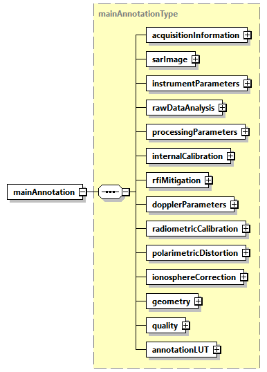

</div>

<p class="atbd-figure-caption"><span class="caption-number">Fig. 3</span><span class="caption-text"> — Main ADS</span></p>

:::

(tab:pfd-l1-4)=
:::{div} atbd-table

<p class="atbd-table-caption"><span class="caption-number">Table 4</span><span class="caption-text"> — Main ADS</span></p>

| Name | Description | Data Type | Cardinality |
|---|---|---|---|
| `acquisitionInformation` | Acquisition information DSR. This DSR contains information that applies to the entire data set. | `acquisitionInformationType` | 1 |
| `sarImage` | SAR image DSR. This DSR contains all the necessary information to exploit the measurement data set (i.e. SAR images). | `sarImageType` | 1 |
| `instrumentParameters` | Instrument parameters DSR. This DSR contains the main instrument settings at the time of imaging. | `instrumentParametersType` | 1 |
| `rawDataAnalysis` | RAW data analysis DSR. This DSR contains the main elements related to the RAW data consolidation and analysis performed by the processor. | `rawDataAnalysisType` | 1 |
| `processingParameters` | Processing parameters DSR. This DSR contains the exhaustive list of static SAR processing parameters and of corrections applied. | `processingParametersType` | 1 |
| `internalCalibration` | Internal calibration DSR. This DSR contains the results of the internal calibration analysis performed by the processor. | `internalCalibrationType` | 1 |
| `rfiMitigation` | Radio Frequency Interference mitigation DSR. This DSR contains information on detected RFI and on their mitigation. | `rfiMitigationType` | 1 |
| `dopplerParameters` | Doppler parameters DSR. This DSR contains the Doppler Centroid (DC) and Frequency Modulation rate (FM) parameters estimated and used during processing. | `dopplerParametersType` | 1 |
| `radiometricCalibration` | Radiometric calibration DSR. This DSR contains all the necessary information to absolutely calibrate the data pixels. | `radiometricCalibrationType` | 1 |
| `polarimetricDistortion` | Polarimetric distortion DSR. This DSR contains the necessary information e.g. receive and transmit polarisation distortion matrix, allowing users to correct for them if not applied at processing level. | `polarimetricDistortionType` | 1 |
| `ionosphereCorrection` | Ionosphere correction DSR. This DSR contains the results of the ionosphere correction estimated and applied by the processor. | `ionosphereCorrectionType` | 1 |
| geometry | Geometry DSR. This DSR contains all the necessary information to understand the Earth model/geometry used in the image and its geolocation. | `geometryType` | 1 |
| quality | Quality DSR. This DSR contains in a single DSR quality flags and thresholds for basic quality assessment done at processing level. | `qualityType` | 1 |
| annotationLUT | Annotation LUT DSR. This DSR contains the list of Look-Up Tables (LUTs) complementing product main annotations. | `layerListType` | 1 |

:::

The content of each DSR is described making use of tables as the one here above. All the tables share the same structure and are filled following the same conventions, i.e.:

- Name: defines the name of the element or attribute;
- Description: describes the purpose of the element or attribute including the units (if applicable). The absence of a unit designation for string data types implies a string literal and for numerical data types (integers, floats, etc…) the absence of a unit designation implies an absolute number;
- Data Type: defines the data type of the element or attribute;
- Cardinality: for elements, this column defines the number of occurrences of the element in the form `minOccurs..maxOccurs`; for attributes, “optional” means the attribute may or may not be present and “required” means the presence of the attribute is mandatory.

In general, elements are displayed in normal font, attributes are displayed in italics.

Data types requiring a dedicated definition table are underlined, for all the others the common reference is {sec}`7.1.1`.

(sec:pfd-l1-4-3-1-1)=
##### 4.3.1.1 Acquisition information DSR

This DSR contains information that applies to the entire data set.

(fig:pfd-l1-4)=
:::{div} atbd-mermaid-figure

<div class="atbd-figure-content">

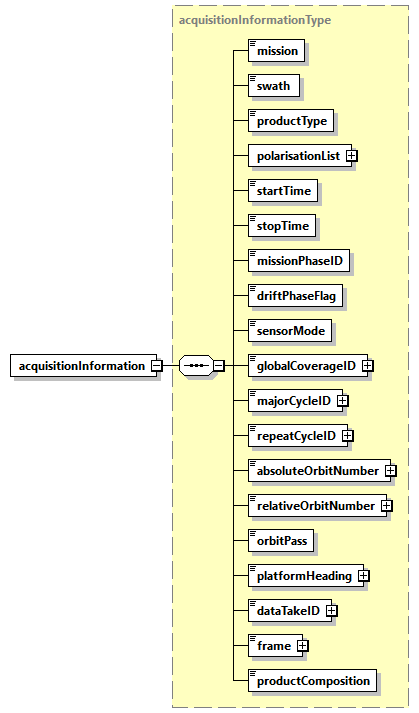

</div>

<p class="atbd-figure-caption"><span class="caption-number">Fig. 4</span><span class="caption-text"> — Acquisition information DSR (acquisitionInformationType)</span></p>

:::

(tab:pfd-l1-5)=
:::{div} atbd-table

<p class="atbd-table-caption"><span class="caption-number">Table 5</span><span class="caption-text"> — Acquisition information DSR (acquisitionInformationType)</span></p>

| Name | Description | Data Type | Cardinality |
|---|---|---|---|
| mission | Mission (BIOMASS). | `missionType` | 1 |
| swath | Swath (S1, S2, S3). | `swathType` | 1 |
| `productType` | Product type (SCS, DGM). | `productType` | 1 |
| `polarisationList` | List of polarisations. | `polarisationListType` | 1 |
| `startTime` | Zero Doppler start time of the image [UTC]. | `timeType` | 1 |
| `stopTime` | Zero Doppler stop time of the image [UTC]. | `timeType` | 1 |
| `missionPhaseID` | Mission phase identifier (COM, TOM, INT). | `missionPhaseIDType` | 1 |
| `driftPhaseFlag` | True if in drift phase, False otherwise. | bool | 1 |
| `sensorMode` | Sensor mode (Measurement, RX Only, External Calibration). | `sensorModeType` | 1 |
| `globalCoverageID` | Global coverage identifier. | `xsd:unsignedShort` | 1 |
| `majorCycleID` | Major cycle identifier. | `xsd:unsignedShort` | 1 |
| `repeatCycleID` | Repeat cycle identifier. | `xsd:unsignedShort` | 1 |
| `absoluteOrbitNumber` | Absolute orbit number at data set start time. | `xsd:unsignedShort` | 1 |
| `relativeOrbitNumber` | Relative orbit number (track) at data set start time. | `xsd:unsignedShort` | 1 |
| `orbitPass` | Orbit pass (Ascending, Descending). | `orbitPassType` | 1 |
| `platformHeading` | Platform heading relative to North [deg]. | `doubleWithUnit` | 1 |
| `dataTakeID` | Data take identifier. | `xsd:unsignedInt` | 1 |
| frame | Frame identifier. This value is considered unique per beam. In case the product is non-framed, this field is empty. In case the product has been obtained from the merging of two frames, this number corresponds to the longer one. | `xsd:unsignedShort` | 1 |
| `productComposition` | Product composition indicator, where the valid values are: “Nominal”, to indicate a framed product of nominal length; “Merged”, if the product is resulting from the merging of a “short” frame with the contiguous one; “Partial”, if the product length is not nominal, but it is not merged to a contiguous one since it is “long enough”; “Incomplete”, if the product length is not nominal due to contingency (e.g., data loss); “Not Framed”, if the product is not framed, i.e., as long as input L0 one. | `productCompositionType` | 1 |

:::

(tab:pfd-l1-6)=
:::{div} atbd-table

<p class="atbd-table-caption"><span class="caption-number">Table 6</span><span class="caption-text"> — Acquisition information DSR (polarisationListType)</span></p>

| Name | Description | Data Type | Cardinality |
|---|---|---|---|
| count |   | `xsd:unsignedInt` | required |
| polarisation | Polarisation (HH, HV, VH, VV). | `polarisationType` | 1 .. 4 |

:::

(sec:pfd-l1-4-3-1-2)=
##### 4.3.1.2 SAR image DSR

This DSR contains all the necessary information to exploit the measurement data set (i.e. SAR images).

(fig:pfd-l1-5)=
:::{div} atbd-mermaid-figure

<div class="atbd-figure-content">

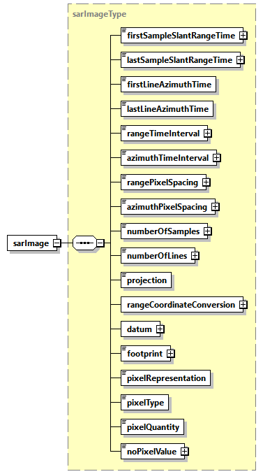

</div>

<p class="atbd-figure-caption"><span class="caption-number">Fig. 5</span><span class="caption-text"> — SAR image DSR (sarImageType)</span></p>

:::

(tab:pfd-l1-7)=
:::{div} atbd-table

<p class="atbd-table-caption"><span class="caption-number">Table 7</span><span class="caption-text"> — SAR image DSR (sarImageType)</span></p>

| Name | Description | Data Type | Cardinality |
|---|---|---|---|
| `firstSampleSlantRangeTime` | Two-way slant range time to first sample of the image [s]. | `doubleWithUnit` | 1 |
| `lastSampleSlantRangeTime` | Two-way slant range time to last sample of the image [s]. | `doubleWithUnit` | 1 |
| `firstLineAzimuthTime` | Zero Doppler azimuth time of the first line of the image [UTC]. | `timeType` | 1 |
| `lastLineAzimuthTime` | Zero Doppler azimuth time of the last line of the image [UTC]. | `timeType` | 1 |
| `rangeTimeInterval` | Time spacing between range samples of the image [s]. For L1a products, this value is the inverse of the range sampling frequency. For L1b products, this value is obtained dividing `rangePixelSpacing` for half the speed of light. | `doubleWithUnit` | 1 |
| `azimuthTimeInterval` | Time spacing between azimuth lines of the image [s]. | `doubleWithUnit` | 1 |
| `rangePixelSpacing` | Pixel spacing between range samples [m]. | `floatWithUnit` | 1 |
| `azimuthPixelSpacing` | Nominal pixel spacing between azimuth lines [m]. | `floatWithUnit` | 1 |
| `numberOfSamples` | Total number of samples in the image (image width). | `xsd:unsignedInt` | 1 |
| `numberOfLines` | Total number of lines in the image (image length). | `xsd:unsignedInt` | 1 |
| projection | Projection of the image, either Slant Range or Ground Range. | `projectionType` | 1 |
| `rangeCoordinateConversion` | List of `coordinateConversion` records that describe conversion between the slant range and ground range coordinate systems. The list contains an entry for each 10 seconds. This list applies to and is filled in only for DGM products and therefore has a length of zero for SCS products. | `coordinateConversionListType` | 1 |
| datum | Datum used during processing. | `datumType` | 1 |
| footprint | Image footprint, expressed as a list of latitude and longitude values separated by spaces [deg]. Values are specified for each of the 4 corner coordinates of the scene quicklook, starting with the first-right in flight direction and proceeding CCW (same convention used in MPH and overlay ADS). | `floatArrayWithUnits` | 1 |
| `pixelRepresentation` | Representation of the image pixels within the image MDS (I Q, Abs Phase, Abs, Pow Phase, Pow). | `pixelRepresentationType` | 1 |
| `pixelType` | Data type of output pixels within the image MDS. | `pixelTypeType` | 1 |
| `pixelQuantity` | Physical quantity stored in output data (Beta-Nought, Sigma-Nought or Gamma-Nought). | `pixelQuantityType` | 1 |
| `noDataValue` | Pixel value in case of invalid data. | `xsd:float` | 1 |

:::

(tab:pfd-l1-8)=
:::{div} atbd-table

<p class="atbd-table-caption"><span class="caption-number">Table 8</span><span class="caption-text"> — SAR image DSR (coordinateConversionListType)</span></p>

| Name | Description | Data Type | Cardinality |
|---|---|---|---|
| count | Number of coordinate conversion records within the list. | `xsd:unsignedInt` | required |
| `coordinateConversion` | Polynomial used to convert image pixels between slant range and ground range. The coefficients used on range lines between updates are found by linear interpolation between the updated and previous values. Considering the worst case (entire slice processed non-framed, one entry each 10 seconds), list `maxOccurs` is set to 15. | `coordinateConversionType` | 0 .. 15 |

:::

(fig:pfd-l1-6)=
:::{div} atbd-mermaid-figure

<div class="atbd-figure-content">

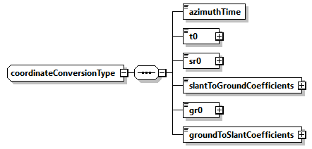

</div>

<p class="atbd-figure-caption"><span class="caption-number">Fig. 6</span><span class="caption-text"> — SAR image DSR (coordinateConversionType)</span></p>

:::

(tab:pfd-l1-9)=
:::{div} atbd-table

<p class="atbd-table-caption"><span class="caption-number">Table 9</span><span class="caption-text"> — SAR image DSR (coordinateConversionType)</span></p>

| Name | Description | Data Type | Cardinality |
|---|---|---|---|
| `azimuthTime` | Zero Doppler azimuth time corresponding to the start of the current polynomial validity area [UTC]. | `timeType` | 1 |
| t0 | Two-way slant range time origin for coordinate conversion polynomial [s]. | `doubleWithUnit` | 1 |
| sr0 | Slant range origin used for ground range calculation [m]. | `doubleWithUnit` | 1 |
| `slantToGroundCoefficients` | Coefficients to convert from slant range to ground range. `Ground range = g0 + g1(sr-sr0) + g2(sr-sr0)^2 + g3(sr-sr0)^3 + g4(sr-sr0)^4 + ... + gN(sr-sr0)^N` where `sr` is the slant range distance to the desired pixel and `N` is the number of coefficients in the array minus one. | `doubleArray` | 1 |
| gr0 | Ground range origin used for slant range calculation [m]. | `doubleWithUnit` | 1 |
| `groundToSlantCoefficients` | Coefficients to convert from ground range to slant range coefficients. `Slant range = s0 + s1(gr-gr0) + s2(gr-gr0)^2 + s3(gr-gr0)^3 + s4(gr-gr0)^4 + ... + sN(gr-gr0)^N` where `gr` is the ground range distance to the desired pixel and `N` is the number of coefficients in the array minus one. | `doubleArray` | 1 |

:::

(sec:pfd-l1-4-3-1-3)=
##### 4.3.1.3 Instrument parameters DSR

This DSR contains the main instrument settings at the time of imaging.

(fig:pfd-l1-7)=
:::{div} atbd-mermaid-figure

<div class="atbd-figure-content">

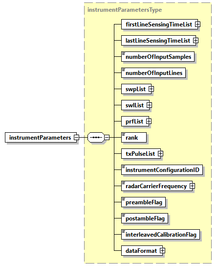

</div>

<p class="atbd-figure-caption"><span class="caption-number">Fig. 7</span><span class="caption-text"> — Instrument parameters DSR (instrumentParametersType)</span></p>

:::

(tab:pfd-l1-10)=
:::{div} atbd-table

<p class="atbd-table-caption"><span class="caption-number">Table 10</span><span class="caption-text"> — Instrument parameters DSR (instrumentParametersType)</span></p>

| Name | Description | Data Type | Cardinality |
|---|---|---|---|
| `firstLineSensingTimeList` | Sensing time of first line of the input RAW data for all the polarisations [UTC]. | `firstLineSensingTimeListType` | 1 |
| `lastLineSensingTimeList` | Sensing time of last line of the input RAW data for all the polarisations [UTC]. | `lastLineSensingTimeListType` | 1 |
| `numberOfInputSamples` | Number of samples of the input RAW data. | `xsd:unsignedInt` | 1 |
| `numberOfInputLines` | Number of lines of the input RAW data. | `xsd:unsignedInt` | 1 |
| `swpList` | List of Sampling Window Position changes (SWP) [s]. The list contains an entry for each on-board SWP update. | `swpListType` | 1 |
| `swlList` | List of Sampling Window Length changes (SWL) [s]. The list contains an entry for each on-board SWL update. | `swlListType` | 1 |
| `prfList` | List of Pulse Repetition Frequency changes (PRF) [Hz]. The list contains an entry for each on-board PRF update. | `prfListType` | 1 |
| rank | Number of PRIs between transmitted pulse and received echo. | `xsd:unsignedShort` | 1 |
| `txPulseList` | List of transmitted pulses. The list contains an entry for each on-board transmitted pulse update. | `txPulseListType` | 1 |
| `instrumentConfigurationID` | Instrument configuration identifier. | `xsd:unsignedInt` | 1 |
| `radarCarrierFrequency` | Radar carrier frequency [Hz]. | `doubleWithUnit` | 1 |
| `rxGainList` | RX gain list. | `rxGainListType` | 1 |
| `preambleFlag` | True if input RAW data contain preamble sequence, False otherwise. | bool | 1 |
| `postambleFlag` | True if input RAW data contain postamble sequence, False otherwise. | bool | 1 |
| `interleavedCalibrationFlag` | True if input RAW data contain interleaved calibration sequences, False otherwise. | bool | 1 |
| `dataFormat` | Data format for instrument samples. There is one element corresponding to the data format for each packet type in the segment. | `dataFormatType` | 1 |

:::

(tab:pfd-l1-11)=
:::{div} atbd-table

<p class="atbd-table-caption"><span class="caption-number">Table 11</span><span class="caption-text"> — Instrument parameters DSR (firstLineSensingTimeListType)</span></p>

| Name | Description | Data Type | Cardinality |
|---|---|---|---|
| count |   | `xsd:unsignedInt` | required |
| `firstLineSensingTime` | Sensing time of first line of the input RAW data for the current polarisation [UTC]. | `timeTypeWithPolarisation` | 1 .. 4 |

:::

(tab:pfd-l1-12)=
:::{div} atbd-table

<p class="atbd-table-caption"><span class="caption-number">Table 12</span><span class="caption-text"> — Instrument parameters DSR (lastLineSensingTimeListType)</span></p>

| Name | Description | Data Type | Cardinality |
|---|---|---|---|
| count |   | `xsd:unsignedInt` | required |
| `lastLineSensingTime` | Sensing time of last line of the input RAW data for the current polarisation [UTC]. | `timeTypeWithPolarisation` | 1 .. 4 |

:::

(tab:pfd-l1-13)=
:::{div} atbd-table

<p class="atbd-table-caption"><span class="caption-number">Table 13</span><span class="caption-text"> — Instrument parameters DSR (swpListType)</span></p>

| Name | Description | Data Type | Cardinality |
|---|---|---|---|
| count | Number of SWP records within the list. | `xsd:unsignedInt` | required |
| swp | SWP record [s]. This record holds the SWP for the given Zero Doppler azimuth time. Considering the worst case (entire slice processed non-framed, one change each 10 seconds), list `maxOccurs` is set to 15. | `stateType` | 1.. 15 |

:::

(tab:pfd-l1-14)=
:::{div} atbd-table

<p class="atbd-table-caption"><span class="caption-number">Table 14</span><span class="caption-text"> — Instrument parameters DSR (swlListType)</span></p>

| Name | Description | Data Type | Cardinality |
|---|---|---|---|
| count | Number of SWL records within the list. | `xsd:unsignedInt` | required |
| swl | SWL record [s]. This record holds the SWL for the given Zero Doppler azimuth time. Considering the worst case (entire slice processed non-framed, one change each 10 seconds), list `maxOccurs` is set to 15. | `stateType` | 1.. 15 |

:::

(tab:pfd-l1-15)=
:::{div} atbd-table

<p class="atbd-table-caption"><span class="caption-number">Table 15</span><span class="caption-text"> — Instrument parameters DSR (prfListType)</span></p>

| Name | Description | Data Type | Cardinality |
|---|---|---|---|
| count | Number of PRF records within the list. | `xsd:unsignedInt` | required |
| prf | PRF record [Hz]. This record holds the PRF for the given Zero Doppler azimuth time. List `maxOccurs` is set to 5, considered as worst case. | `stateType` | 1.. 5 |

:::

(tab:pfd-l1-16)=
:::{div} atbd-table

<p class="atbd-table-caption"><span class="caption-number">Table 16</span><span class="caption-text"> — Instrument parameters DSR (txPulseListType)</span></p>

| Name | Description | Data Type | Cardinality |
|---|---|---|---|
| count | Number of transmitted pulse records within the list. | `xsd:unsignedInt` | required |
| `txPulse` | Transmitted pulse record. This record holds the nominal transmitted pulse information for the given Zero Doppler azimuth time. List `maxOccurs` is set to 5, considered as worst case. | `txPulseType` | 1.. 5 |

:::

(fig:pfd-l1-8)=
:::{div} atbd-mermaid-figure

<div class="atbd-figure-content">

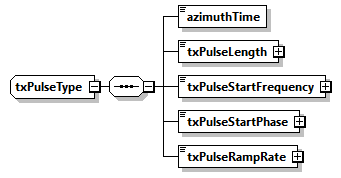

</div>

<p class="atbd-figure-caption"><span class="caption-number">Fig. 8</span><span class="caption-text"> — Instrument parameters DSR (txPulseType)</span></p>

:::

(tab:pfd-l1-17)=
:::{div} atbd-table

<p class="atbd-table-caption"><span class="caption-number">Table 17</span><span class="caption-text"> — Instrument parameters DSR (txPulseType)</span></p>

| Name | Description | Data Type | Cardinality |
|---|---|---|---|
| `azimuthTime` | Zero Doppler azimuth time of transmitted pulse change [UTC]. | `timeType` | 1 |
| `txPulseLength` | Transmit pulse length [s]. | `doubleWithUnit` | 1 |
| `txPulseStartFrequency` | Starting frequency of the transmit pulse [Hz]. | `doubleWithUnit` | 1 |
| `txPulseStartPhase` | Starting phase of the transmit pulse [rad]. | `doubleWithUnit` | 1 |
| `txPulseRampRate` | The linear rate at which the frequency changes over the pulse duration [Hz/s]. | `doubleWithUnit` | 1 |

:::

(fig:pfd-l1-9)=
:::{div} atbd-mermaid-figure

<div class="atbd-figure-content">

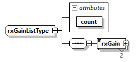

</div>

<p class="atbd-figure-caption"><span class="caption-number">Fig. 9</span><span class="caption-text"> — Instrument parameters DSR (rxGainListType)</span></p>

:::

(tab:pfd-l1-18)=
:::{div} atbd-table

<p class="atbd-table-caption"><span class="caption-number">Table 18</span><span class="caption-text"> — Instrument parameters DSR (rxGainListType)</span></p>

| Name | Description | Data Type | Cardinality |
|---|---|---|---|
| `rxGain` | RX gain, extracted from RAS control message. | `floatWithPolarisation` | 2 |

:::

(fig:pfd-l1-10)=
:::{div} atbd-mermaid-figure

<div class="atbd-figure-content">

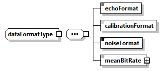

</div>

<p class="atbd-figure-caption"><span class="caption-number">Fig. 10</span><span class="caption-text"> — Instrument parameters DSR (dataFormatType)</span></p>

:::

(tab:pfd-l1-19)=
:::{div} atbd-table

<p class="atbd-table-caption"><span class="caption-number">Table 19</span><span class="caption-text"> — Instrument parameters DSR (dataFormatType)</span></p>

| Name | Description | Data Type | Cardinality |
|---|---|---|---|
| `echoFormat` | Data format of echo packets. | `dataFormatModeType` | 1 |
| `calibrationFormat` | Data format of calibration packets. | `dataFormatModeType` | 1 |
| `noiseFormat` | Data format of noise packets. | `dataFormatModeType` | 1 |
| `meanBitRate` | The calculated mean bit rate for the segment provide as input to the processor [Mbps]. | `doubleWithUnit` | 1 |

:::

(sec:pfd-l1-4-3-1-4)=
##### 4.3.1.4 RAW data analysis DSR

This DSR contains the main elements related to the RAW data consolidation and analysis performed by the processor.

(fig:pfd-l1-11)=
:::{div} atbd-mermaid-figure

<div class="atbd-figure-content">

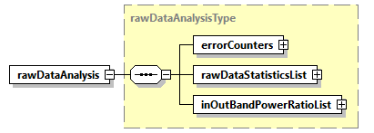

</div>

<p class="atbd-figure-caption"><span class="caption-number">Fig. 11</span><span class="caption-text"> — RAW data analysis DSR (rawDataAnalysisType)</span></p>

:::

(tab:pfd-l1-20)=
:::{div} atbd-table

<p class="atbd-table-caption"><span class="caption-number">Table 20</span><span class="caption-text"> — RAW data analysis DSR (rawDataAnalysisType)</span></p>

| Name | Description | Data Type | Cardinality |
|---|---|---|---|
| `errorCounters` | Error counters computed starting from input Instrument Source Packets stream. | `errorCountersType` | 1 |
| `rawDataStatisticsList` | Extracted RAW data I and Q channels statistics for all the polarisations. | `rawDataStatisticsListType` | 1 |
| `inOutBandPowerRatioList` | In/out-of-band power ratio list. This element contains lists of in/out-of-band power ratio measurements. The list contains an entry for each measurement made along azimuth and it is organised per polarisation. | `inOutBandPowerRatioListType` | 1 |

:::

(fig:pfd-l1-12)=
:::{div} atbd-mermaid-figure

<div class="atbd-figure-content">

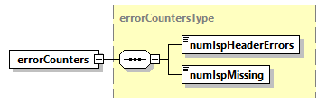

</div>

<p class="atbd-figure-caption"><span class="caption-number">Fig. 12</span><span class="caption-text"> — RAW data analysis DSR (errorCountersType)</span></p>

:::

(tab:pfd-l1-21)=
:::{div} atbd-table

<p class="atbd-table-caption"><span class="caption-number">Table 21</span><span class="caption-text"> — RAW data analysis DSR (errorCountersType)</span></p>

| Name | Description | Data Type | Cardinality |
|---|---|---|---|
| `numIspHeaderErrors` | Total number of errors detected in ISP headers. | `xsd:unsignedInt` | 1 |
| `numIspMissing` | Total number of missing ISP. | `xsd:unsignedInt` | 1 |

:::

(tab:pfd-l1-22)=
:::{div} atbd-table

<p class="atbd-table-caption"><span class="caption-number">Table 22</span><span class="caption-text"> — RAW data analysis DSR (rawDataStatisticsListType)</span></p>

| Name | Description | Data Type | Cardinality |
|---|---|---|---|
| count |   | `xsd:unsignedInt` | required |
| `rawDataStatistics` | Extracted RAW data I and Q channels statistics for the current polarisation. | `rawDataStatisticsType` | 1 .. 4 |

:::

(fig:pfd-l1-13)=
:::{div} atbd-mermaid-figure

<div class="atbd-figure-content">

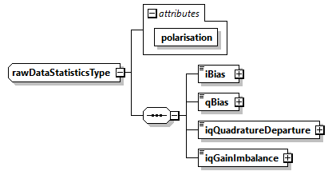

</div>

<p class="atbd-figure-caption"><span class="caption-number">Fig. 13</span><span class="caption-text"> — RAW data analysis DSR (rawDataStatisticsType)</span></p>

:::

(tab:pfd-l1-23)=
:::{div} atbd-table

<p class="atbd-table-caption"><span class="caption-number">Table 23</span><span class="caption-text"> — RAW data analysis DSR (rawDataStatisticsType)</span></p>

| Name | Description | Data Type | Cardinality |
|---|---|---|---|
| polarisation |   | `polarisationType` | required |
| `iBias` | Calculated I bias. | `xsd:double` | 1 |
| `qBias` | Calculated Q bias. | `xsd:double` | 1 |
| `iqQuadratureDeparture` | Calculated I/Q quadrature departure. | `xsd:double` | 1 |
| `iqGainImbalance` | Calculated I/Q gain imbalance. | `xsd:double` | 1 |

:::

(tab:pfd-l1-24)=
:::{div} atbd-table

<p class="atbd-table-caption"><span class="caption-number">Table 24</span><span class="caption-text"> — RAW data analysis DSR (inOutBandPowerRatioListType)</span></p>

| Name | Description | Data Type | Cardinality |
|---|---|---|---|
| count |   | `xsd:unsignedInt` | required |
| `powerRatioList` | In/out-of-band power ratio measurements for the current polarisation. | `powerRatioListType` | 1 .. 4 |

:::

(tab:pfd-l1-25)=
:::{div} atbd-table

<p class="atbd-table-caption"><span class="caption-number">Table 25</span><span class="caption-text"> — RAW data analysis DSR (powerRatioListType)</span></p>

| Name | Description | Data Type | Cardinality |
|---|---|---|---|
| polarisation |   | `polarisationType` | required |
| count | Number of in/out-of-band power ratio measurements for the current polarisation within the list. | `xsd:unsignedInt` | required |
| `powerRatio` | In/out-of-band power ratio measurements. Considering the worst case (entire slice processed non-framed, one entry each 5 seconds), list `maxOccurs` is set to 30. | `powerRatioType` | 1 .. 30 |

:::

(fig:pfd-l1-14)=
:::{div} atbd-mermaid-figure

<div class="atbd-figure-content">


</div>

<p class="atbd-figure-caption"><span class="caption-number">Fig. 14</span><span class="caption-text"> — RAW data analysis DSR (powerRatioType)</span></p>

:::

(tab:pfd-l1-26)=
:::{div} atbd-table

<p class="atbd-table-caption"><span class="caption-number">Table 26</span><span class="caption-text"> — RAW data analysis DSR (powerRatioType)</span></p>

| Name | Description | Data Type | Cardinality |
|---|---|---|---|
| `azimuthTime` | Zero Doppler azimuth time of the in/out-of-band power ratio measurement [UTC]. | `timeType` | 1 |
| value | In/out-of-band power ratio measurement. | `xsd:float` | 1 |

:::

(sec:pfd-l1-4-3-1-5)=
##### 4.3.1.5 Processing parameters DSR

This DSR contains the exhaustive list of static SAR processing parameters and of corrections applied.

(fig:pfd-l1-15)=
:::{div} atbd-mermaid-figure

<div class="atbd-figure-content">

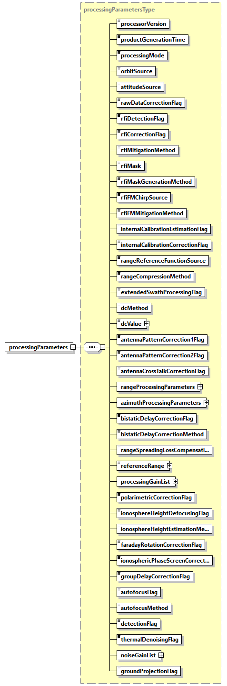

</div>

<p class="atbd-figure-caption"><span class="caption-number">Fig. 15</span><span class="caption-text"> — Processing parameters DSR (processingParametersType)</span></p>

:::

(tab:pfd-l1-27)=
:::{div} atbd-table

<p class="atbd-table-caption"><span class="caption-number">Table 27</span><span class="caption-text"> — Processing parameters DSR (processingParametersType)</span></p>

| Name | Description | Data Type | Cardinality |
|---|---|---|---|
| `processorVersion` | Version of the processor used to generate the product. | `xsd:string` | 1 |
| `productGenerationTime` | Product generation time [UTC]. | `timeType` | 1 |
| `processingMode` | Processing mode (Nominal, PARC). | `processingModeType` | 1 |
| `orbitSource` | Source of the orbit data used during processing. Set to “Extracted” if the orbit information extracted from source packets is used during processing. Set to “Auxiliary” if the orbit information from an input auxiliary file is used during processing. | `orbitAttitudeSourceType` | 1 |
| `attitudeSource` | Source of the attitude data used during processing. Set to “Extracted” if the attitude information extracted from source packets is used during processing. Set to “Auxiliary” if the attitude information from an input auxiliary file is used during processing. | `orbitAttitudeSourceType` | 1 |
| `rawDataCorrectionFlag` | True if raw data correction was performed, False otherwise. | bool | 1 |
| `rfiDetectionFlag` | True if RFI detection was performed, False otherwise. | bool | 1 |
| `rfiCorrectionFlag` | True if RFI correction was performed, False otherwise. Implies activation of `rfiDetectionFlag`. | bool | 1 |
| `rfiMitigationMethod` | Domain where the RFI mitigation step was performed (Time, Frequency, Time and Frequency, Frequency and Time). | `rfiMitigationMethodType` | 1 |
| `rfiMask` | RFI mask used for mitigation. Valid values are: "Single", to use the same mask for all the polarizations; "Multiple", to use a dedicated mask for each polarization. | `rfiMaskType` | 1 |
| `rfiMaskGenerationMethod` | Polarization-dependent RFI masks combination method (AND, OR). Used only in case `rfiMask` is set to Single. | `rfiMaskGenerationMethodType` | 1 |
| rfiFMChirpSource | Chirp source for Frequency Domain detection. | `rangeReferenceFunctionType` | 1 |
| rfiFMMitigationMethod | Frequency Domain mitigation method. | rfiFMMitigationMethodType | 1 |
| `internalCalibrationEstimationFlag` | True if internal calibration estimation was performed, False otherwise. | bool | 1 |
| `internalCalibrationCorrectionFlag` | True if internal calibration correction was performed, False otherwise. | bool | 1 |
| `rangeReferenceFunctionSource` | Chirp source to be used for range compression (Nominal, Replica or Internal). | `rangeReferenceFunctionType` | 1 |
| `rangeCompressionMethod` | Range compression method used during processing (Matched Filter or Inverse Filter). | `rangeCompressionMethodType` | 1 |
| `extendedSwathProcessingFlag` | True if processing was extended in the range direction including samples not having the full phase history, False otherwise. | bool | 1 |
| `dcMethod` | Doppler Centroid estimation method used during processing (Geometry, Combined, Fixed). | `dcMethodType` | 1 |
| `dcValue` | Doppler centroid value used during processing [Hz]. Used only in case `dcMethod` is set to Fixed. | `doubleWithUnit` | 1 |
| `antennaPatternCorrection1Flag` | True if antenna pattern correction (first step) was applied, False otherwise. | bool | 1 |
| `antennaPatternCorrection2Flag` | True if antenna pattern correction (second step) was applied, False otherwise. | bool | 1 |
| `antennaCrossTalkCorrectionFlag` | True if antenna cross-talk correction was applied, False otherwise. | bool | 1 |
| `rangeProcessingParameters` | Parameters used during range processing. | `spectrumProcessingParametersType` | 1 |
| `azimuthProcessingParameters` | Parameters used during azimuth processing. | `spectrumProcessingParametersType` | 1 |
| `bistaticDelayCorrectionFlag` | True if bistatic delay correction was applied, False otherwise. | bool | 1 |
| `bistaticDelayCorrectionMethod` | Method used for bistatic delay correction (Bulk or Full). | `bistaticDelayCorrectionMethodType` | 1 |
| `rangeSpreadingLossCompensationFlag` | True if range spreading loss compensation was performed, False otherwise. | bool | 1 |
| `referenceRange` | Range spreading loss reference slant range [m]. The range spreading loss is compensated by amplitude scaling each range sample by `1/Grsl(R)`, where: - `Grsl(R) = cuberoot(rRef/R)` - `R` = slant range of sample. | `doubleWithUnit` | 1 |
| `processingGainList` | Processing gain computed and applied multiplicatively to the image during processing for all the polarisations. | `processingGainListType` | 1 |
| `polarimetricCorrectionFlag` | True if polarimetric correction has been performed, False otherwise. | bool | 1 |
| `ionosphereHeightDefocusingFlag` | True if defocusing at ionosphere height has been performed, False otherwise. | bool | 1 |
| `ionosphereHeightEstimationMethod` | Ionosphere height estimation method (Automatic, Feature Tracking, Squint Sensitivity, Model, Fixed). | `ionosphereHeightEstimationMethodType` | 1 |
| `faradayRotationCorrectionFlag` | True if Faraday Rotation correction has been performed, False otherwise. | bool | 1 |
| `ionosphericPhaseScreenCorrectionFlag` | True if ionospheric phase screen correction has been performed, False otherwise. | bool | 1 |
| `groupDelayCorrectionFlag` | True if group delay correction has been performed, False otherwise. | bool | 1 |
| `autofocusFlag` | True if autofocus has been performed, False otherwise. | bool | 1 |
| `autofocusMethod` | Autofocus method used during processing (Map Drift). | `autofocusMethodType` | 1 |
| `detectionFlag` | True if detection has been performed, False otherwise. | bool | 1 |
| `thermalDenoisingFlag` | True if thermal denoising has been performed, False otherwise. | bool | 1 |
| `noiseGainList` | Processing gain computed and applied multiplicatively to the thermal noise level before using it during denoising step for all the polarisations. | `noiseGainListType` | 1 |
| `groundProjectionFlag` | True if slant range to ground range conversion has been performed, False otherwise. | bool | 1 |

:::

(fig:pfd-l1-16)=
:::{div} atbd-mermaid-figure

<div class="atbd-figure-content">

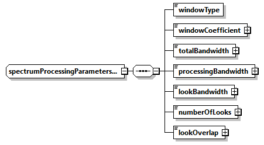

</div>

<p class="atbd-figure-caption"><span class="caption-number">Fig. 16</span><span class="caption-text"> — Processing parameters DSR (spectrumProcessingParametersType)</span></p>

:::

(tab:pfd-l1-28)=
:::{div} atbd-table

<p class="atbd-table-caption"><span class="caption-number">Table 28</span><span class="caption-text"> — Processing parameters DSR (spectrumProcessingParametersType)</span></p>

| Name | Description | Data Type | Cardinality |
|---|---|---|---|
| `windowType` | Name of the weighting window type used during processing. | `weightingWindowType` | 1 |
| `windowCoefficient` | Value of the weighting window coefficient used during processing. | `xsd:double` | 1 |
| `totalBandwidth` | Total available bandwidth [Hz]. | `doubleWithUnit` | 1 |
| `processingBandwidth` | Bandwidth used during processing [Hz]. | `doubleWithUnit` | 1 |
| `lookBandwidth` | Bandwidth for each look used during processing [Hz]. | `doubleWithUnit` | 1 |
| `numberOfLooks` | Number of looks. | `xsd:unsignedInt` | 1 |
| `lookOverlap` | Overlap between looks [Hz]. | `doubleWithUnit` | 1 |

:::

(tab:pfd-l1-29)=
:::{div} atbd-table

<p class="atbd-table-caption"><span class="caption-number">Table 29</span><span class="caption-text"> — Processing parameters DSR (processingGainListType)</span></p>

| Name | Description | Data Type | Cardinality |
|---|---|---|---|
| count |   | `xsd:unsignedInt` | required |
| `processingGain` | Processing gain computed and applied multiplicatively to the image during processing for the current polarisation. | `floatWithPolarisation` | 1 .. 4 |

:::

(tab:pfd-l1-30)=
:::{div} atbd-table

<p class="atbd-table-caption"><span class="caption-number">Table 30</span><span class="caption-text"> — Processing parameters DSR (noiseGainListType)</span></p>

| Name | Description | Data Type | Cardinality |
|---|---|---|---|
| count |   | `xsd:unsignedInt` | required |
| `noiseGain` | Processing gain computed and applied multiplicatively to the thermal noise level before using it during denoising step for the current polarisation. | `floatWithPolarisation` | 1 .. 4 |

:::

(sec:pfd-l1-4-3-1-6)=
##### 4.3.1.6 Internal calibration DSR

This DSR contains the results of the internal calibration analysis performed by the processor.

(fig:pfd-l1-17)=
:::{div} atbd-mermaid-figure

<div class="atbd-figure-content">

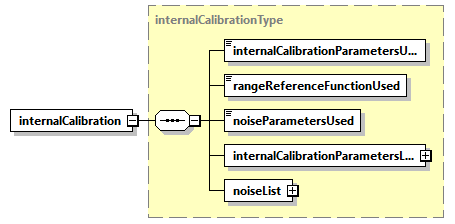

</div>

<p class="atbd-figure-caption"><span class="caption-number">Fig. 17</span><span class="caption-text"> — Internal calibration DSR (internalCalibrationType)</span></p>

:::

(tab:pfd-l1-31)=
:::{div} atbd-table

<p class="atbd-table-caption"><span class="caption-number">Table 31</span><span class="caption-text"> — Internal calibration DSR (internalCalibrationType)</span></p>

| Name | Description | Data Type | Cardinality |
|---|---|---|---|
| `internalCalibrationParametersUsed` | Internal calibration parameters effectively used during processing (Model or Extracted). | `internalCalibrationSourceType` | 1 |
| `rangeReferenceFunctionUsed` | Chirp source effectively used for range compression (Nominal, Replica or Internal). Can be different from `rangeReferenceFunctionSource`. | `rangeReferenceFunctionType` | 1 |
| `noiseParametersUsed` | Noise parameters used during processing (Model or Extracted). | `internalCalibrationSourceType` | 1 |
| `internalCalibrationParametersList` | Internal calibration parameters list. This element contains lists of internal calibration parameters calculated from the calibration pulses extracted from the downlink. The list contains an entry for each calibration sequence contained in the input data and it is organised per polarisation. If the list is empty, the nominal parameters values in the instrument auxiliary data file will be used instead. | `internalCalibrationParametersListType` | 1 |
| `noiseList` | Noise list. This element contains lists of noise parameters derived from the noise ISPs. The list contains an entry for each noise sequence contained in the input data and it is organised per polarisation. If the list is empty, the nominal noise value in the instrument auxiliary data file will be used instead. | `noiseListType` | 1 |

:::

(tab:pfd-l1-32)=
:::{div} atbd-table

<p class="atbd-table-caption"><span class="caption-number">Table 32</span><span class="caption-text"> — Internal calibration DSR (internalCalibrationParametersListType)</span></p>

| Name | Description | Data Type | Cardinality |
|---|---|---|---|
| count |   | `xsd:unsignedInt` | required |
| `internalCalibrationSequenceList` | Internal calibration parameters derived from the calibration pulses for the current polarisation. | `internalCalibrationSequenceListType` | 1 .. 4 |

:::

(tab:pfd-l1-33)=
:::{div} atbd-table

<p class="atbd-table-caption"><span class="caption-number">Table 33</span><span class="caption-text"> — Internal calibration DSR (internalCalibrationSequenceListType)</span></p>

| Name | Description | Data Type | Cardinality |
|---|---|---|---|
| polarisation |   | `polarisationType` | required |
| count | Number of internal calibration sequences for the current polarisation within the list. | `xsd:unsignedInt` | required |
| `internalCalibrationSequence` | Internal calibration parameters derived from the calibration pulses. Considering the worst case (10 minutes datatake, one entry each 10 seconds), list `maxOccurs` is set to 60. | `internalCalibrationSequenceType` | 0 .. 60 |

:::

(fig:pfd-l1-18)=
:::{div} atbd-mermaid-figure

<div class="atbd-figure-content">

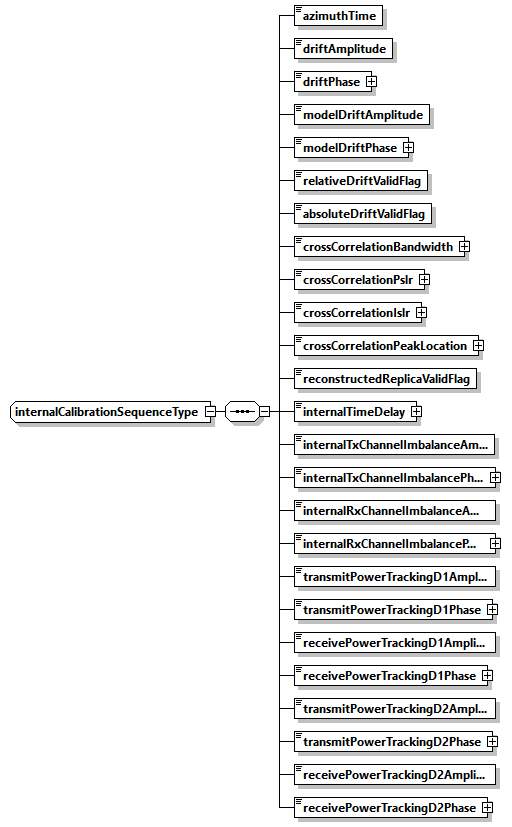

</div>

<p class="atbd-figure-caption"><span class="caption-number">Fig. 18</span><span class="caption-text"> — Internal calibration DSR (internalCalibrationSequenceType)</span></p>

:::

(tab:pfd-l1-34)=
:::{div} atbd-table

<p class="atbd-table-caption"><span class="caption-number">Table 34</span><span class="caption-text"> — Internal calibration DSR (internalCalibrationSequenceType)</span></p>

| Name | Description | Data Type | Cardinality |
|---|---|---|---|
| `azimuthTime` | Zero Doppler azimuth time in azimuth at which internal calibration parameters applies [UTC]. | `timeType` | 1 |
| `driftAmplitude` | Amplitude drift for the current power gain product (PGP). | `xsd:float` | 1 |
| `driftPhase` | Phase drift for the current power gain product (PGP) [rad]. | `floatWithUnit` | 1 |
| `modelDriftAmplitude` | Amplitude drift derived from model. | `xsd:float` | 1 |
| `modelDriftPhase` | Phase drift derived from model [rad]. | `floatWithUnit` | 1 |
| `relativeDriftValidFlag` | Indicates if the current amplitude and phase drifts are valid (within the configured threshold) when compared to the mean and standard deviation of all the amplitude and phase drifts. | bool | 1 |
| `absoluteDriftValidFlag` | Indicates if the current amplitude and phase drifts are valid (within the configured threshold) when compared to the value of the model. | bool | 1 |
| `crossCorrelationBandwidth` | 3-dB pulse width of chirp replica cross-correlation function between the reconstructed replica and the nominal replica [Hz]. | `floatWithUnit` | 1 |
| `crossCorrelationPslr` | Peak Side Lobe Ratio (PSLR) of replica cross-correlation function between the reconstructed replica and the nominal replica [dB]. | `floatWithUnit` | 1 |
| `crossCorrelationIslr` | Integrated Side Lobe Ratio (ISLR) of cross-correlation function between the reconstructed replica and the nominal replica [dB]. | `floatWithUnit` | 1 |
| `crossCorrelationPeakLocation` | Peak location of cross-correlation function between the reconstructed replica and the nominal replica [samples]. | `floatWithUnit` | 1 |
| `reconstructedReplicaValidFlag` | Indicates if the cross-correlation between the nominal replica and this extracted replica resulted in a valid peak location. | bool | 1 |
| `internalTimeDelay` | Internal time delay [s] representing the calculated deviation of the location of this replica from the location of the transmitted pulse, i.e. the nominal replica. | `floatWithUnit` | 1 |
| `internalTxChannelImbalanceAmplitude` | Amplitude of instrument internal transmit channel imbalance. | `xsd:float` | 1 |
| `internalTxChannelImbalancePhase` | Phase of instrument internal transmit channel imbalance [rad]. | `floatWithUnit` | 1 |
| `internalRxChannelImbalanceAmplitude` | Amplitude of instrument internal receive channel imbalance. | `xsd:float` | 1 |
| `internalRxChannelImbalancePhase` | Phase of instrument internal receive channel imbalance [rad]. | `floatWithUnit` | 1 |
| `transmitPowerTrackingD1Amplitude` | Amplitude of transmit power tracking for doublet D1. | `xsd:float` | 1 |
| `transmitPowerTrackingD1Phase` | Phase of transmit power tracking for doublet D1 [rad]. | `floatWithUnit` | 1 |
| `receivePowerTrackingD1Amplitude` | Amplitude of receive power tracking for doublet D1. | `xsd:float` | 1 |
| `receivePowerTrackingD1Phase` | Phase of receive power tracking for doublet D1 [rad]. | `floatWithUnit` | 1 |
| `transmitPowerTrackingD2Amplitude` | Amplitude of transmit power tracking for doublet D2. | `xsd:float` | 1 |
| `transmitPowerTrackingD2Phase` | Phase of transmit power tracking for doublet D2 [rad]. | `floatWithUnit` | 1 |
| `receivePowerTrackingD2Amplitude` | Amplitude of receive power tracking for doublet D2. | `xsd:float` | 1 |
| `receivePowerTrackingD2Phase` | Phase of receive power tracking for doublet D2 [rad]. | `floatWithUnit` | 1 |

:::

(tab:pfd-l1-35)=
:::{div} atbd-table

<p class="atbd-table-caption"><span class="caption-number">Table 35</span><span class="caption-text"> — Internal calibration DSR (noiseListType)</span></p>

| Name | Description | Data Type | Cardinality |
|---|---|---|---|
| count |   | `xsd:unsignedInt` | required |
| `noiseSequenceList` | Noise parameters derived from the noise packets for the current polarisation. | `noiseSequenceListType` | 1 .. 4 |

:::

(tab:pfd-l1-36)=
:::{div} atbd-table

<p class="atbd-table-caption"><span class="caption-number">Table 36</span><span class="caption-text"> — Internal calibration DSR (noiseSequenceListType)</span></p>

| Name | Description | Data Type | Cardinality |
|---|---|---|---|
| polarisation |   | `polarisationType` | required |
| count | Number of noise sequences for the current polarisation within the list. | `xsd:unsignedInt` | required |
| `noiseSequence` | Noise parameters derived from noise packets. List `maxOccurs` is set to 2 considering one entry for preamble and one for postamble noise sequences. | `noiseSequenceType` | 0 .. 2 |

:::

(fig:pfd-l1-19)=
:::{div} atbd-mermaid-figure

<div class="atbd-figure-content">

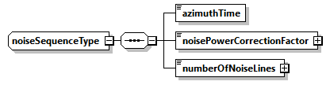

</div>

<p class="atbd-figure-caption"><span class="caption-number">Fig. 19</span><span class="caption-text"> — Internal calibration DSR (noiseSequenceType)</span></p>

:::

(tab:pfd-l1-37)=
:::{div} atbd-table

<p class="atbd-table-caption"><span class="caption-number">Table 37</span><span class="caption-text"> — Internal calibration DSR (noiseSequenceType)</span></p>

| Name | Description | Data Type | Cardinality |
|---|---|---|---|
| `azimuthTime` | Zero Doppler azimuth time of the noise measurement [UTC]. | `timeType` | 1 |
| `noisePowerCorrectionFactor` | Noise power correction factor. | `xsd:float` | 1 |
| `numberOfNoiseLines` | Number of noise lines used to calculate noise correction factor. | `xsd:unsignedInt` | 1 |

:::

(sec:pfd-l1-4-3-1-7)=
##### 4.3.1.7 Radio Frequency Interference mitigation DSR

This DSR contains information on detected RFI and on their mitigation.

(fig:pfd-l1-20)=
:::{div} atbd-mermaid-figure

<div class="atbd-figure-content">

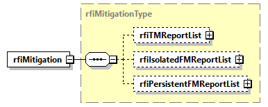

</div>

<p class="atbd-figure-caption"><span class="caption-number">Fig. 20</span><span class="caption-text"> — Radio Frequency Interference mitigation DSR (rfiMitigationType)</span></p>

:::

(tab:pfd-l1-38)=
:::{div} atbd-table

<p class="atbd-table-caption"><span class="caption-number">Table 38</span><span class="caption-text"> — Radio Frequency Interference mitigation DSR (rfiMitigationType)</span></p>

| Name | Description | Data Type | Cardinality |
|---|---|---|---|
| rfiTMReportList | Time-domain RFI mitigation report list. This element is present only if time-domain RFI mitigation is performed. | rfiTMReportListType | 0 .. 1 |
| `rfiIsolatedFMReportList` | Frequency-domain isolated RFI mitigation report list. This element is present only if frequency-domain RFI mitigation is performed. | `rfiIsolatedFMReportListType` | 0 .. 1 |
| `rfiPersistentFMReportList` | Frequency-domain persistent RFI mitigation report list. This element is present only if frequency-domain RFI mitigation is performed. | `rfiPersistentFMReportListType` | 0 .. 1 |

:::

(tab:pfd-l1-39)=
:::{div} atbd-table

<p class="atbd-table-caption"><span class="caption-number">Table 39</span><span class="caption-text"> — Radio Frequency Interference mitigation DSR (rfiTMReportListType)</span></p>

| Name | Description | Data Type | Cardinality |
|---|---|---|---|
| count |   | `xsd:unsignedInt` | required |
| rfiTMReport | Time-domain RFI mitigation report. | rfiTMReportType | 1 .. 4 |

:::

(fig:pfd-l1-21)=
:::{div} atbd-mermaid-figure

<div class="atbd-figure-content">

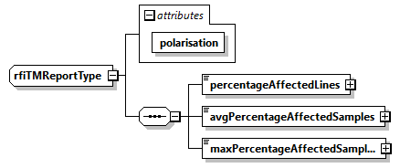

</div>

<p class="atbd-figure-caption"><span class="caption-number">Fig. 21</span><span class="caption-text"> — Radio Frequency Interference mitigation DSR (rfiTMReportType)</span></p>

:::

(tab:pfd-l1-40)=
:::{div} atbd-table

<p class="atbd-table-caption"><span class="caption-number">Table 40</span><span class="caption-text"> — Radio Frequency Interference mitigation DSR (rfiTMReportType)</span></p>

| Name | Description | Data Type | Cardinality |
|---|---|---|---|
| polarisation |   | `polarisationType` | required |
| `percentageAffectedLines` | Percentage of input RAW data lines affected by RFI. | `xsd:float` | 1 |
| `avgPercentageAffectedSamples` | Average percentage of affected input RAW data samples in the lines containing RFI. | `xsd:float` | 1 |
| `maxPercentageAffectedSamples` | Maximum percentage of input RAW data samples affected by RFI in the same line. | `xsd:float` | 1 |

:::

(tab:pfd-l1-41)=
:::{div} atbd-table

<p class="atbd-table-caption"><span class="caption-number">Table 41</span><span class="caption-text"> — Radio Frequency Interference mitigation DSR (rfiIsolatedFMReportListType)</span></p>

| Name | Description | Data Type | Cardinality |
|---|---|---|---|
| count |   | `xsd:unsignedInt` | required |
| `rfiIsolatedFMReport` | Frequency-domain isolated RFI mitigation report. | `rfiIsolatedFMReportType` | 1 .. 4 |

:::

(fig:pfd-l1-22)=
:::{div} atbd-mermaid-figure

<div class="atbd-figure-content">

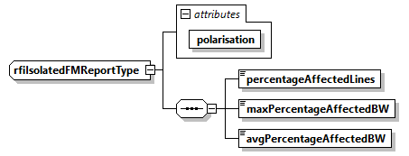

</div>

<p class="atbd-figure-caption"><span class="caption-number">Fig. 22</span><span class="caption-text"> — Radio Frequency Interference mitigation DSR (rfiIsolatedFMReportType)</span></p>

:::

(tab:pfd-l1-42)=
:::{div} atbd-table

<p class="atbd-table-caption"><span class="caption-number">Table 42</span><span class="caption-text"> — Radio Frequency Interference mitigation DSR (rfiIsolatedFMReportType)</span></p>

| Name | Description | Data Type | Cardinality |
|---|---|---|---|
| polarisation |   | `polarisationType` | required |
| `percentageAffectedLines` | Percentage of input RAW data lines affected by isolated RFI. | `xsd:float` | 1 |
| `maxPercentageAffectedBW` | Max percentage of bandwidth affected by isolated RFI in a single line. | `xsd:float` | 1 |
| `avgPercentageAffectedBW` | Average percentage of bandwidth affected by isolated RFI | `xsd:float` | 1 |

:::

(tab:pfd-l1-43)=
:::{div} atbd-table

<p class="atbd-table-caption"><span class="caption-number">Table 43</span><span class="caption-text"> — Radio Frequency Interference mitigation DSR (rfiPersistentFMReportListType)</span></p>

| Name | Description | Data Type | Cardinality |
|---|---|---|---|
| count |   | `xsd:unsignedInt` | required |
| `rfiPersistentFMReport` | Frequency-domain persistent RFI mitigation report. | `rfiPersistentFMReportType` | 1 .. 4 |

:::

(fig:pfd-l1-23)=
:::{div} atbd-mermaid-figure

<div class="atbd-figure-content">

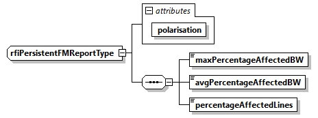

</div>

<p class="atbd-figure-caption"><span class="caption-number">Fig. 23</span><span class="caption-text"> — Radio Frequency Interference mitigation DSR (rfiPersistentFMReportType)</span></p>

:::

(tab:pfd-l1-44)=
:::{div} atbd-table

<p class="atbd-table-caption"><span class="caption-number">Table 44</span><span class="caption-text"> — Radio Frequency Interference mitigation DSR (rfiPersistentFMReportType)</span></p>

| Name | Description | Data Type | Cardinality |
|---|---|---|---|
| polarisation |   | `polarisationType` | required |
| `maxPercentageAffectedBW` | Max percentage of bandwidth affected by persistent RFI. | `xsd:float` | 1 |
| `avgPercentageAffectedBW` | Average percentage of bandwidth affected by persistent RFI. | `xsd:float` | 1 |
| `percentageAffectedLines` | Percentage of lines affected by persistent RFI. | `xsd:float` | 1 |

:::

(sec:pfd-l1-4-3-1-8)=
##### 4.3.1.8 Doppler parameters DSR

This DSR contains the Doppler Centroid (DC) and Frequency Modulation rate (FM) parameters estimated and used during processing.

(fig:pfd-l1-24)=
:::{div} atbd-mermaid-figure

<div class="atbd-figure-content">

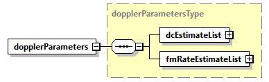

</div>

<p class="atbd-figure-caption"><span class="caption-number">Fig. 24</span><span class="caption-text"> — Doppler parameters DSR (dopplerParametersType)</span></p>

:::

(tab:pfd-l1-45)=
:::{div} atbd-table

<p class="atbd-table-caption"><span class="caption-number">Table 45</span><span class="caption-text"> — Doppler parameters DSR (dopplerParametersType)</span></p>

| Name | Description | Data Type | Cardinality |
|---|---|---|---|
| `dcEstimateList` | List of Doppler Centroid estimates that have been calculated during image processing. The list contains an entry for each Doppler Centroid estimate made along azimuth, i.e., each N seconds, where N is configurable. | `dcEstimateListType` | 1 |
| `fmRateEstimateList` | List of Frequency Modulation rate estimates that have been calculated during image processing. The list contains an entry for each Frequency Modulation rate estimate made along azimuth, i.e., each N seconds, where N is configurable. | `fmRateEstimatesListType` | 1 |

:::

(tab:pfd-l1-46)=
:::{div} atbd-table

<p class="atbd-table-caption"><span class="caption-number">Table 46</span><span class="caption-text"> — Doppler parameters DSR (dcEstimateListType)</span></p>

| Name | Description | Data Type | Cardinality |
|---|---|---|---|
| count | Number of `dcEstimate` records within the list. | `xsd:unsignedInt` | required |
| `dcEstimate` | Doppler Centroid estimate record which contains the Doppler Centroid calculated from geometry and estimated from the data, associated signal-to-noise ratio values and indicates which DCE method was used by the IPF during image processing. Considering the worst case (entire slice processed non-framed, one entry each 1 second), list `maxOccurs` is set to 150. | `dcEstimateType` | 1.. 150 |

:::

(fig:pfd-l1-25)=
:::{div} atbd-mermaid-figure

<div class="atbd-figure-content">

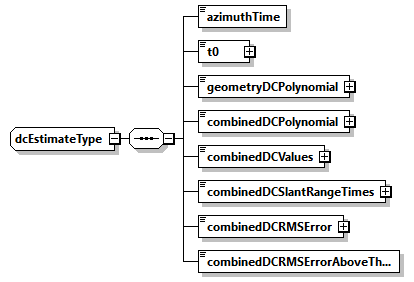

</div>

<p class="atbd-figure-caption"><span class="caption-number">Fig. 25</span><span class="caption-text"> — Doppler parameters DSR (dcEstimateType)</span></p>

:::

(tab:pfd-l1-47)=
:::{div} atbd-table

<p class="atbd-table-caption"><span class="caption-number">Table 47</span><span class="caption-text"> — Doppler parameters DSR (dcEstimateType)</span></p>

| Name | Description | Data Type | Cardinality |
|---|---|---|---|
| `azimuthTime` | Zero Doppler azimuth time corresponding to the start of the current polynomial validity area [UTC]. | `timeType` | 1 |
| t0 | Two-way slant range time origin for polynomial [s]. | `doubleWithUnit` | 1 |
| geometryDCPolynomial | Doppler Centroid estimated from orbit and attitude, expressed as the following polynomial (assuming 5 coefficients): `DC = d0 + d1(tSR-t0) + d2(tSR-t0)^2 + d3(tSR-t0)^3 + d4(tSR-t0)^4` where `tSR` is the two-way slant range time. | `floatArray` | 1 |
| combinedDCPolynomial | Doppler Centroid estimated from both orbit and attitude and data, expressed as the following polynomial (assuming 5 coefficients): `DC = d0 + d1(tSR-t0) + d2(tSR-t0)^2 + d3(tSR-t0)^3 + d4(tSR-t0)^4` where `tSR` is the two-way slant range time. | `floatArray` | 1 |
| combinedDCValues | Combined Doppler Centroid estimates [Hz]. Each estimate represents the Doppler Centroid frequency at the slant range time specified by combinedDCSlantRangeTimes, estimated within the current block. The values are averaged on all the polarisations used for estimation. | `doubleArrayWithUnits` | 1 |
| combinedDCSlantRangeTimes | Two-way slant range times combinedDCValues are referred to [s]. | `doubleArrayWithUnits` | 1 |
| combinedDCRMSError | The RMS error of the Doppler Centroid estimate [Hz]. It is calculated as the average of the individual RMS residual errors between input fine Doppler Centroid estimates and the fitted polynomial. If the Doppler Centroid was not estimated with combined approach, this is set to 0. | `doubleWithUnit` | 1 |
| combinedDCRMSErrorAboveThreshold | False if the RMS error is below the acceptable threshold for the Doppler Centroid estimated with combined approach. True if the RMS error is greater than or equal to the acceptable threshold. | bool | 1 |

:::

(tab:pfd-l1-48)=
:::{div} atbd-table

<p class="atbd-table-caption"><span class="caption-number">Table 48</span><span class="caption-text"> — Doppler parameters DSR (fmRateEstimatesListType)</span></p>

| Name | Description | Data Type | Cardinality |
|---|---|---|---|
| count | Number of `fmRateEstimate` records within the list. | `xsd:unsignedInt` | required |
| `fmRateEstimate` | Frequency Modulation rate estimate record. Considering the worst case (entire slice processed non-framed, one entry each 1 second), list `maxOccurs` is set to 150. | `slantRangePolynomialType` | 1.. 150 |

:::

(sec:pfd-l1-4-3-1-9)=
##### 4.3.1.9 Radiometric calibration DSR

This DSR contains all the necessary information to absolutely calibrate the data pixels.

(fig:pfd-l1-26)=
:::{div} atbd-mermaid-figure

<div class="atbd-figure-content">


</div>

<p class="atbd-figure-caption"><span class="caption-number">Fig. 26</span><span class="caption-text"> — Radiometric calibration DSR (radiometricCalibrationType)</span></p>

:::

(tab:pfd-l1-49)=
:::{div} atbd-table

<p class="atbd-table-caption"><span class="caption-number">Table 49</span><span class="caption-text"> — Radiometric calibration DSR (radiometricCalibrationType)</span></p>

| Name | Description | Data Type | Cardinality |
|---|---|---|---|
| `absoluteCalibrationConstantList` | Absolute calibration constant. Already applied to the image during processing for all the polarisations. | `calibrationConstantListType` | 1 |

:::

(tab:pfd-l1-50)=
:::{div} atbd-table

<p class="atbd-table-caption"><span class="caption-number">Table 50</span><span class="caption-text"> — Radiometric calibration DSR (calibrationConstantListType)</span></p>

| Name | Description | Data Type | Cardinality |
|---|---|---|---|
| count |   | `xsd:unsignedInt` | required |
| `absoluteCalibrationConstant` | Absolute calibration constant applied multiplicatively to the image during processing for the current polarisation. | `floatWithPolarisation` | 1 .. 4 |

:::

(sec:pfd-l1-4-3-1-10)=
##### 4.3.1.10 Polarimetric distortion DSR

This DSR contains the necessary information e.g. receive and transmit polarisation distortion matrix, allowing users to correct for them if not applied at processing level.

(fig:pfd-l1-27)=
:::{div} atbd-mermaid-figure

<div class="atbd-figure-content">

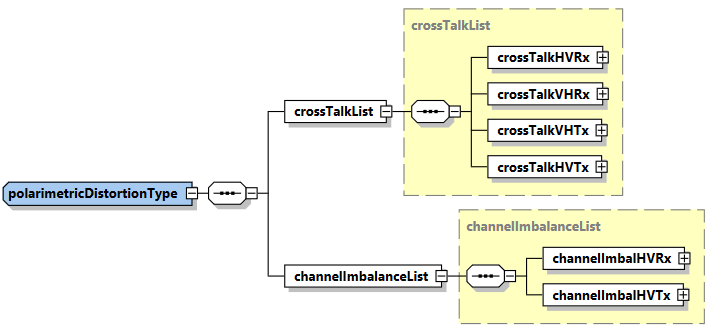

</div>

<p class="atbd-figure-caption"><span class="caption-number">Fig. 27</span><span class="caption-text"> — Polarimetric distortion DSR (polarimetricDistortionType)</span></p>

:::

(tab:pfd-l1-51)=
:::{div} atbd-table

<p class="atbd-table-caption"><span class="caption-number">Table 51</span><span class="caption-text"> — Polarimetric distortion DSR (polarimetricDistortionType)</span></p>

| Name | Description | Data Type | Cardinality |
|---|---|---|---|
| `crossTalkList` | System cross-talk values. | `crossTalkList` | 1 |
| `channelImbalanceList` | System channel imbalance values. | `channelImbalanceList` | 1 |

:::

(tab:pfd-l1-52)=
:::{div} atbd-table

<p class="atbd-table-caption"><span class="caption-number">Table 52</span><span class="caption-text"> — Polarimetric distortion DSR (crossTalkList)</span></p>

| Name | Description | Data Type | Cardinality |
|---|---|---|---|
| `crossTalkHVTx` | H to V system cross-talk on transmit values, $\delta_4$. | complex | 1 |
| `crossTalkVHTx` | V to H system cross-talk on transmit values, $\delta_3$. | complex | 1 |
| `crossTalkHVRx` | H to V system cross-talk on receive values, $\delta_1$. | complex | 1 |
| `crossTalkVHRx` | V to H system cross-talk on receive values, $\delta_2$. | complex | 1 |

:::

(tab:pfd-l1-53)=
:::{div} atbd-table

<p class="atbd-table-caption"><span class="caption-number">Table 53</span><span class="caption-text"> — Polarimetric distortion DSR (channelImbalanceList)</span></p>

| Name | Description | Data Type | Cardinality |
|---|---|---|---|
| `channelImbalHVTx` | H to V system channel imbalance on transmit values, $f_2$. | complex | 1 |
| `channelImbalHVRx` | H to V system channel imbalance on receive values, $f_1$. | complex | 1 |

:::

(sec:pfd-l1-4-3-1-11)=
##### 4.3.1.11 Ionosphere correction DSR

This DSR contains the results of the ionosphere correction estimated and applied by the processor.

(fig:pfd-l1-28)=
:::{div} atbd-mermaid-figure

<div class="atbd-figure-content">

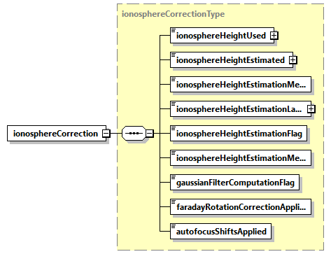

</div>

<p class="atbd-figure-caption"><span class="caption-number">Fig. 28</span><span class="caption-text"> — Ionosphere correction DSR (ionosphereCorrectionType)</span></p>

:::

(tab:pfd-l1-54)=
:::{div} atbd-table

<p class="atbd-table-caption"><span class="caption-number">Table 54</span><span class="caption-text"> — Ionosphere correction DSR (ionosphereCorrectionType)</span></p>

| Name | Description | Data Type | Cardinality |
|---|---|---|---|
| `ionosphereHeightUsed` | Ionosphere height used for processing [m] (-1 if not available). | `floatWithUnit` | 1 |
| `ionosphereHeightEstimated` | Ionosphere height estimated using Feature Tracking or Squint Sensitivity method, if selected via configuration [m] (-1 if not available). | `floatWithUnit` | 1 |
| `ionosphereHeightEstimationMethodSelected` | Ionosphere height estimation method selected for ionospheric processing, between Feature Tracking and Squint Sensitivity, when `ionosphereHeightEstimationMethod` is set to Automatic (NA if not available). | `ionosphereHeightEstimationMethodType` | 1 |
| `ionosphereHeightEstimationLatitudeValue` | Latitude value used to select ionosphere height estimation method between Feature Tracking and Squint Sensitivity, when `ionosphereHeightEstimationMethod` is set to Automatic [deg]. | `floatWithUnit` | 1 |
| `ionosphereHeightEstimationFlag` | True if ionosphere height estimation is completed successfully, False otherwise. | bool | 1 |
| `ionosphereHeightEstimationMethodUsed` | ` `Ionosphere height estimation method effectively used for ionospheric processing. Can be different from `ionosphereHeightEstimationMethod` and `ionosphereHeightEstimationMethodSelected`. (NA if not available) | `ionosphereHeightEstimationMethodType` | 1 |
| `gaussianFilterComputationFlag` | True if computed filter dimensions are below maximum allowed values, False otherwise. | bool | 1 |
| `faradayRotationCorrectionApplied` | Flag indicating if Faraday Rotation correction has been effectively applied or not. Can be different from `faradayRotationCorrectionFlag`. | bool | 1 |
| `autofocusShiftsApplied` | Flag indicating if correction of azimuth shift estimated through autofocus has been effectively applied or not. Can be different from `autofocusFlag`. | bool | 1 |

:::

(sec:pfd-l1-4-3-1-12)=
##### 4.3.1.12 Geometry DSR

This DSR contains all the necessary information to understand the Earth model/geometry used in the image and its geolocation.

(fig:pfd-l1-29)=
:::{div} atbd-mermaid-figure

<div class="atbd-figure-content">

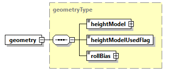

</div>

<p class="atbd-figure-caption"><span class="caption-number">Fig. 29</span><span class="caption-text"> — Geometry DSR (geometryType)</span></p>

:::

(tab:pfd-l1-55)=
:::{div} atbd-table

<p class="atbd-table-caption"><span class="caption-number">Table 55</span><span class="caption-text"> — Geometry DSR (geometryType)</span></p>

| Name | Description | Data Type | Cardinality |
|---|---|---|---|
| `heightModel` | Digital Elevation Model (DEM) commanded for usage during processing (with version as attribute). | `heightModelType` | 1 |
| `heightModelUsedFlag` | True if the DEM effectively used during processing is the commanded one reported in `heightModel`, False otherwise (i.e. ellipsoid has been used for contingency handling). | bool | 1 |
| `rollBias` | Bias added to roll estimated from attitude to offset it [deg]. | `floatWithUnit` | 1 |

:::

(sec:pfd-l1-4-3-1-13)=
##### 4.3.1.13 Quality DSR

This DSR contains in a single DSR quality flags and thresholds for basic quality assessment done at processing level.

(fig:pfd-l1-30)=
:::{div} atbd-mermaid-figure

<div class="atbd-figure-content">

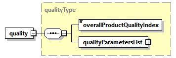

</div>

<p class="atbd-figure-caption"><span class="caption-number">Fig. 30</span><span class="caption-text"> — Quality DSR (qualityType)</span></p>

:::

(tab:pfd-l1-56)=
:::{div} atbd-table

<p class="atbd-table-caption"><span class="caption-number">Table 56</span><span class="caption-text"> — Quality DSR (qualityType)</span></p>

| Name | Description | Data Type | Cardinality |
|---|---|---|---|
| `overallProductQualityIndex` | Overall product quality index. This annotation is calculated based on specific quality parameters and gives an overall quality value to the product. | `xsd:unsignedInt` | 1 |
| `qualityParametersList` | Quality parameters list. The list contains an entry for each polarisation. | `qualityParametersListType` | 1 |

:::

(tab:pfd-l1-57)=
:::{div} atbd-table

<p class="atbd-table-caption"><span class="caption-number">Table 57</span><span class="caption-text"> — Quality DSR (qualityParametersListType)</span></p>

| Name | Description | Data Type | Cardinality |
|---|---|---|---|
| count |   | `xsd:unsignedInt` | required |
| `qualityParameters` | Quality parameters for the current polarisation. | `qualityParametersType` | 1 .. 4 |

:::

(fig:pfd-l1-31)=
:::{div} atbd-mermaid-figure

<div class="atbd-figure-content">

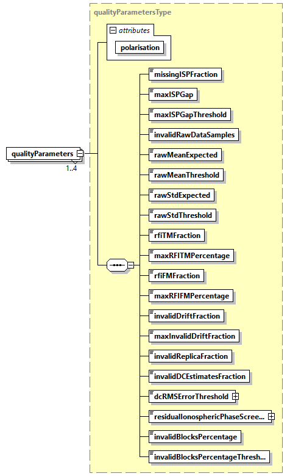

</div>

<p class="atbd-figure-caption"><span class="caption-number">Fig. 31</span><span class="caption-text"> — Quality DSR (qualityParametersType)</span></p>

:::

(tab:pfd-l1-58)=
:::{div} atbd-table

<p class="atbd-table-caption"><span class="caption-number">Table 58</span><span class="caption-text"> — Quality DSR (qualityParametersType)</span></p>

| Name | Description | Data Type | Cardinality |
|---|---|---|---|
| polarisation |   | `polarisationType` | required |
| missingISPFraction | Number of missing ISP, expressed as a normalized fraction of the total number of ISP. | `xsd:float` | 1 |
| maxISPGap | Maximum number of gaps between science data ISPs. | `xsd:unsignedInt` | 1 |
| maxISPGapThreshold | Threshold on maxISPGap. If maxISPGap exceeds this parameter, the processing will not continue. | `xsd:unsignedInt` | 1 |
| `invalidRawDataSamples` | Number of invalid raw data samples (according to their mean and standard deviation), expressed as a normalized fraction of the total number of samples. | `xsd:float` | 1 |
| `rawMeanExpected` | This parameter specifies the expected mean of the samples in the extracted raw data. | `xsd:float` | 1 |
| `rawMeanThreshold` | This is the value X such that the measured mean must fall between the `rawMeanExpected`-X and `rawMeanExpected`+X. | `xsd:float` | 1 |
| `rawStdExpected` | This parameter specifies the expected standard deviation of the samples in the extracted raw data. | `xsd:float` | 1 |
| `rawStdThreshold` | This is the value X such that the measured standard deviation must fall between the `rawStdExpected`-X and `rawStdExpected`+X. | `xsd:float` | 1 |
| rfiTMFraction | Normalized fraction of image pixels impacted by time-domain RFI. | `xsd:float` | 1 |
| maxRFITMPercentage | Maximum normalized percentage of image pixels impacted by time-domain RFI. If the percentage exceeds this parameter, the processing will not continue. | `xsd:float` | 1 |
| rfiFMFraction | Normalized fraction of image spectrum impacted by frequency-domain RFI. | `xsd:float` | 1 |
| maxRFIFMPercentage | Maximum normalized percentage of image spectrum impacted by frequency-domain RFI. If the percentage exceeds this parameter, the processing will not continue. | `xsd:float` | 1 |
| `invalidDriftFraction` | Number of invalid drift values, expressed as a normalized fraction of the total number of drifts. | `xsd:float` | 1 |
| `maxInvalidDriftFraction` | Maximum number of invalid drift values allowed, expressed as a normalized fraction of the total number of drifts. If the percentage of the invalid drifts does not exceed this value, then the invalid drifts will be discarded and only the valid ones will be further used in the processing. Otherwise, all the calculated drift values will be discarded and replaced with the corresponding model values. | `xsd:float` | 1 |
| `invalidReplicaFraction` | Number of invalid replicas, expressed as a normalized fraction of the total number of replicas extracted. | `xsd:float` | 1 |
| invalidDCEstimatesFraction | Number of invalid DC estimated, expressed as a normalized fraction of the total number of DC estimates. | `xsd:float` | 1 |
| dcRMSErrorThreshold | Doppler Centroid estimation root mean squared (RMS) error threshold [Hz]. If the RMS error of the Doppler Centroid combined estimates is above this threshold they are not used during processing; instead, the Doppler Centroid calculated from geometry is used. | `floatWithUnit` | 1 |
| `residualIonosphericPhaseScreenStd` | Quality measure of the ionospheric phase estimated by Faraday Rotation, expressed as standard deviation of the residual ionospheric phase screen [rad]. | `xsd:float` | 1 |
| `invalidBlocksPercentage` | Normalized fraction of image blocks that need to have estimated an azimuth shift higher than the maximum allowed one, used to consider an autofocus estimation valid or not. | `xsd:float` | 1 |
| `invalidBlocksPercentageThreshold` | Minimum normalized percentage of blocks within the image that need to have estimated an azimuth shift smaller than the `maxValidShift` threshold. If the minimum percentage is not met, no correction based on the azimuth shift estimates will be applied. | `xsd:float` | 1 |

:::

(sec:pfd-l1-4-3-1-13-1)=
###### 4.3.1.13.1 Overall Product Quality Index

As mentioned in {ref}`Tab. 54 <tab:pfd-l1-54>`, the `overallProductQualityIndex` is an unsigned integer value (i.e. a 32-bit integer ranging from 0 to 232 – 1) that summarizes the execution history of the L1 Processor. The L1’s `overallProductQualityIndex` is the decimal representation of a 32-bit array that is defined as follows:

| Bit # | Module/Sub-step | Bit-Flipping Condition |
|---|---|---|
| 0 | Input products and auxiliary files ingestion | - Intentionally left blank, i.e. 0 - |
| 1 |   | - Intentionally left blank, i.e. 0 - |
| 2 |   | - Intentionally left blank, i.e. 0 - |
| 3 |   | - Intentionally left blank, i.e. 0 - |
| 4 | RAW data analysis | RAW data statistics out of boundaries (set to 1 if `invalidRawDataSamples`\>0, otherwise set to 0) |
| 5 |   | - Intentionally left blank, i.e. 0 - |
| 6 |   | - Intentionally left blank, i.e. 0 - |
| 7 |   | - Intentionally left blank, i.e. 0 - |
| 8 | Internal calibration | Invalid calibration sequences above threshold (set to 1 if `invalidDriftFraction`\>0 or if `invalidReplicaFraction`\>0, otherwise set to 0) |
| 9 |   | - Intentionally left blank, i.e. 0 - |
| 10 |   | - Intentionally left blank, i.e. 0 - |
| 11 |   | - Intentionally left blank, i.e. 0 - |
| 12 | RFI mitigation | - Intentionally left blank, i.e. 0 - |
| 13 |   | - Intentionally left blank, i.e. 0 - |
| 14 |   | - Intentionally left blank, i.e. 0 - |
| 15 |   | - Intentionally left blank, i.e. 0 - |
| 16 | Doppler Centroid estimation | Doppler Centroid estimation fallback from Combined method to Geometry method activated (set to 1 if activated, otherwise set to 0) |
| 17 |   | Doppler Centroid estimation root mean squared (RMS) error above threshold (set to 1 if invalidDCEstimatesFraction\>0, otherwise set to 0) |
| 18 |   | - Intentionally left blank, i.e. 0 - |
| 19 |   | - Intentionally left blank, i.e. 0 - |
| 20 | Range and azimuth compression | - Intentionally left blank, i.e. 0 - |
| 21 |   | - Intentionally left blank, i.e. 0 - |
| 22 |   | - Intentionally left blank, i.e. 0 - |
| 23 |   | - Intentionally left blank, i.e. 0 - |
| 24 | Polarimetric and ionospheric corrections | Ionosphere height estimation failing (set to 1 if `ionosphereHeightEstimationFlag`==False, otherwise set to 0) |
| 25 |   | IRI model used (set to 1 if IRI model is used as fallback solution, due to failure of ionosphere height estimation, or set to 0 if it is used on purpose or not used) |
| 26 |   | Gaussian filter size out of boundaries (set to 1 if `gaussianFilterComputationFlag`==False, otherwise set to 0) |
| 27 |   | Inconsistent `phaseScreen` and `rangeShifts` LUTs (see {sec}`4.3.2` and L1 ATBD Sec. 4.10.3.5) (set to 1 in case of inconsistency, otherwise set to 0) |
| 28 |   | Geomagnetic equator crossing fallback activated, i.e., phase screen and group delay corrections not applied (set to 1 if activated, otherwise set to 0) |
| 29 |   | - Intentionally left blank, i.e. 0 - |
| 30 | Autofocus | Number of failing estimations above threshold (set to 1 if `autofocusShiftsApplied`==False, otherwise set to 0) |
| 31 |   | - Intentionally left blank, i.e. 0 - |

Note that some bits are intentionally left blank to support user-defined custom information. The quality index bits aim at providing the user with hints for tracing possible problems in case of failures in the processing.

(sec:pfd-l1-4-3-1-14)=
##### 4.3.1.14 Annotation LUT DSR

This DSR contains the list of Look-Up Tables (LUTs) complementing product main annotations.

(fig:pfd-l1-32)=
:::{div} atbd-mermaid-figure

<div class="atbd-figure-content">

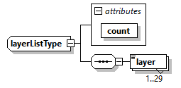

</div>

<p class="atbd-figure-caption"><span class="caption-number">Fig. 32</span><span class="caption-text"> — Annotation LUT DSR (layerListType)</span></p>

:::

(tab:pfd-l1-59)=
:::{div} atbd-table

<p class="atbd-table-caption"><span class="caption-number">Table 59</span><span class="caption-text"> — Annotation LUT DSR (layerListType)</span></p>

| Name | Description | Data Type | Cardinality |
|---|---|---|---|
| count | Number of layers. | `unsignedInt` | required |
| layer | LUT layer content. | `layerType` | 1 .. 30 |

:::

(sec:pfd-l1-4-3-2)=
#### 4.3.2 Look-Up Tables (LUT) ADS

This section describes in details the content of Look-Up Tables (LUT) ADS.

This ADS complements the Main ADS one, including all those annotations that can be represented as 2D maps of values. This approach has been chosen in order to avoid worsening the Main ADS readability and handling, and also to provide an easier access to such information.

The name (LUT ADS) comes from the fact that this ADS contains a set of components, each of which:

- is defined over a sampling grid which is a sub-sampled version of the grid over which the SAR image MDS is defined;
- provides additional details about the domain over which the SAR image MDS is defined (latitude/longitude/height maps, …), or
- provides layers of correction that have been already applied to the SAR image MDS during L1 processing (RFI mitigation masks, …) or that can be applied directly by the user on L1 data (denoising maps, …).

The format adopted for LUT ADS is NetCDF one {rd}`6`. Thanks to the flexibility provided by this format, all the components of this ADS are stored in the same file. In this way, considering that some layers are dedicated to geocoding information (latitude/longitude/height maps), it will be possible to directly place all the other maps on a geographical grid.

The LUT ADS file is organised as follows:

- a series of root level attributes, containing all those global attributes referring to the file as a whole;
- a dimensions group, where names and lengths of the dimensions used when creating data arrays (variables) are defined;
- a series of coordinate variables, containing special variables to store the axes data values for each dimension in the dimensions group;
- a series of components, each one composed by a group of variables which can be divided in:
    - the data arrays, storing the annotation Look-Up Tables themselves. A variable represents an array of values of the same data type and it is defined over two or more dimensions from the dimensions group;
    - ancillary scalar variables containing other useful metadata to complete the data definition.

Note that the LUT are defined over different sampling grids, depending on their specific definition, on the point in the processing chain where they have been computed (e.g., RFI masks are defined over a sub-sampled version of the RAW data sampling grid) and on the configured decimation factors.

**Compression strategy**

The NetCDF file used for LUT ADS will be in general a compressed one.

It must be noticed that considering that (see also {sec}`4.3.2.3`):

- a L1a frame is a raster of 1500x30000 pixels (range x azimuth, worst-case in terms of data size);
- the decimation ratio for a LUT is of a factor 20x120, except for geometry-based LUT for which a factor 2x12 is used;

```{note}
Factor 2x12 allows to get a sampling close to DEM posting, i.e., ~90m for Copernicus DEM;
```

- LUT are typically (except `rfiTimeMask`\*, `rfiFreqMask`\*, latitude, longitude and height ones) stored using float precision;
- the LUT ADS contains a maximum of 30 components;

the LUT ADS will have a size \<80MB.

In order to reduce this size, a compression is applied. In particular, a zlib (LSD=None) compression is used with compression level equals 2. This level combines good compression (~2x) with a small increase in compression/decompression time.

(sec:pfd-l1-4-3-2-1)=
##### 4.3.2.1 Attributes

The attributes contain the same list of parameters described in {sec}`4.3.1.1` for the Acquisition information DSR. For all the details about these parameters refer to this section.

In addition, those included in the following table are added.

(tab:pfd-l1-60)=
:::{div} atbd-table

<p class="atbd-table-caption"><span class="caption-number">Table 60</span><span class="caption-text"> — LUT ADS additional attributes</span></p>

| Name | Description | Data Type | Cardinality |
|---|---|---|---|
| `noDataValueBool` | Pixel value in case of LUT invalid data. Used for Boolean LUT (RFI masks). | bool | 1 |
| `noDataValueFloat` | Pixel value in case of LUT invalid data. Used for float and double LUT. | float | 1 |
| `referenceAzimuthTime` | Reference azimuth time to be used together with LUT relative azimuth time axes [UTC]. | `timeType` | 1 |

:::

(sec:pfd-l1-4-3-2-2)=
##### 4.3.2.2 Dimensions / Coordinate variables

The table below describes the dimensions and coordinate variables.

(tab:pfd-l1-61)=
:::{div} atbd-table

<p class="atbd-table-caption"><span class="caption-number">Table 61</span><span class="caption-text"> — LUT ADS dimensions and coordinate variables</span></p>

| Name | Description | Data Type | Cardinality |
|---|---|---|---|
| `slantRangeTimeRAW` | Slant range time axis for LUT defined on RAW data sampling grid [s]. | float | 1 |
| `rangeFreqRAW` | Range frequency axis for LUT defined on RAW data sampling grid [Hz]. | float | 1 |
| `relativeAzimuthTimeRAW` | Azimuth relative time axis for LUT defined on RAW data sampling grid [s]. Reference is `referenceAzimuthTime` value in attributes. | float | 1 |
| `slantRangeTimeRGC` | Slant range time axis for LUT defined on range compressed data sampling grid [s]. | double | 1 |
| `relativeAzimuthTimeRGC` | Azimuth relative time axis for LUT defined on range compressed data sampling grid [s]. Reference is `referenceAzimuthTime` value in attributes. | double | 1 |
| `slantRangeTimeSLC` | Slant range time axis for LUT defined on azimuth compressed data sampling grid [s]. | float | 1 |
| `relativeAzimuthTimeSLC` | Azimuth relative time axis for LUT defined on azimuth compressed data sampling grid [s]. Reference is `referenceAzimuthTime` value in attributes. | float | 1 |

:::

(sec:pfd-l1-4-3-2-3)=
##### 4.3.2.3 Groups of variables

The table below describes the groups of variables. It shall be kept into account that the list of variables present in a given product can be just a subset of this one, depending on the configuration of L1 processing chain generating it (e.g., if the RFI mitigation step is deactivated, the `rfiTimeMask`\* and the `rfiFreqMask`\* variables won’t be present in the LUT ADS).

(tab:pfd-l1-62)=
:::{div} atbd-table

<p class="atbd-table-caption"><span class="caption-number">Table 62</span><span class="caption-text"> — LUT ADS groups of variables</span></p>

| Name | Description | Data Type | Cardinality |
|---|---|---|---|
| group: `rfiMitigation` variables: `rfiTimeMaskHH`, `rfiTimeMaskHV`, `rfiTimeMaskVH`, `rfiTimeMaskVV` | Two-dimensional masks covering the whole SAR image and describing the areas where RFI time-domain mitigation has been applied (ones) or not (zeros) during L1 processing. One mask per polarisation is foreseen (by default, 4 in total). `AUX_FMT` LUT group: RFI based LUT | matrix (bool) | 4 (only if RFI mitigation step is activated) |
| group: `rfiMitigation` variables: `rfiFreqMaskHH`, `rfiFreqMaskHV`, `rfiFreqMaskVH`, `rfiFreqMaskVV` | Two-dimensional masks covering the whole SAR image and describing the areas where RFI frequency-domain mitigation has been applied (ones) or not (zeros) during L1 processing. One mask per polarisation is foreseen (by default, 4 in total). `AUX_FMT` LUT group: RFI based LUT | matrix (bool) | 4 (only if RFI mitigation step is activated) |
| group: radiometry variable: `sigmaNought` | Two-dimensional map covering the whole SAR image and describing the conversion factor to translate the beta-nought values into sigma-nought ones. The conversion shall be performed in the following way:$\sigma^0=\beta^0\bullet\sigma_{LUT}^0$where:$\beta^0$ are the values stored in the SAR image MDS (amplitudes) squared;$\sigma_{LUT}^0$ is this LUT (amplitudes) squared;$\sigma^0$ are the sigma-nought values after the conversion. Being this LUT defined over a sub-sampled grid with respect to the SAR image, a bilinear interpolation of the LUT is required before its application on the data. `AUX_FMT` LUT group: DEM based LUT | matrix (float) | 1 |
| group: radiometry variable: `gammaNought` | As the sigma-nought map, but to translate the beta-nought values into gamma-nought ones. `AUX_FMT` LUT group: DEM based LUT | matrix (float) | 1 |
| group: `ionosphereCorrection` variable: `faradayRotationPlane` | Two-dimensional map covering the whole SAR image and describing the Faraday Rotation plane computed during L1 ionospheric processing. Values are expressed in [rad]. `AUX_FMT` LUT group: Image based LUT | matrix (float) | 1 (only if ionospheric correction step is activated) |
| group: `ionosphereCorrection` variable: `faradayRotation` | Two-dimensional map covering the whole SAR image and describing the Faraday Rotation (final one, including plane) computed during L1 ionospheric processing. Values are expressed in [rad]. `AUX_FMT` LUT group: Image based LUT | matrix (float) | 1 (only if ionospheric correction step is activated) |
| group: `ionosphereCorrection` variable: `faradayRotationStd` | Two-dimensional map covering the whole SAR image and describing the Faraday Rotation expected standard deviation. Values are expressed in [rad]. `AUX_FMT` LUT group: Image based LUT | matrix (float) | 1 (only if ionospheric correction step is activated) |
| group: `ionosphereCorrection` variable: `phaseScreen` | Two-dimensional map covering the whole SAR image and describing the phase screen computed during L1 ionospheric processing. Values are expressed in [rad]. `AUX_FMT` LUT group: Image based LUT | matrix (float) | 1 (only if ionospheric correction step is activated) |
| group: `ionosphereCorrection` variable: tec | Two-dimensional map covering the whole SAR image and describing the TEC map computed during L1 ionospheric processing. Values are expressed in [TECU]. `AUX_FMT` LUT group: Image based LUT | matrix (float) | 1 (only if ionospheric correction step is activated) |
| group: `ionosphereCorrection` variable: `rangeShifts` | Two-dimensional map covering the whole SAR image and describing the range shifts computed during L1 ionospheric processing. Values are expressed in [m]. `AUX_FMT` LUT group: Image based LUT | matrix (float) | 1 (only if ionospheric correction step is activated) |
| group: `ionosphereCorrection` variable: `azimuthShifts` | Two-dimensional map covering the whole SAR image and describing the azimuth shifts computed during L1 ionospheric processing. Values are expressed in [m]. `AUX_FMT` LUT group: Image based LUT | matrix (float) | 1 (only if ionospheric correction step is activated) |
| group: `ionosphereCorrection` variable: `autofocusPhaseScreen` | Two-dimensional map covering the whole SAR image and describing the autofocus phase screen computed during L1 ionospheric processing. Values are expressed in [rad]. `AUX_FMT` LUT group: Image based LUT | matrix (float) | 1 (only if autofocus step is activated) |
| group: `ionosphereCorrection` variable: `autofocusPhaseScreenStd` | Two-dimensional map covering the whole SAR image and describing the autofocus phase screen standard deviation based on the WLS double integration. Values are expressed in [rad]. `AUX_FMT` LUT group: Image based LUT | matrix (float) | 1 (only if autofocus step is activated) |
| group: denoising variables: denoisingHH, denoisingHV, denoisingVH, denoisingVV | Two-dimensional maps covering the whole SAR image and describing the conversion factor to translate the SAR image values into denoised values. Note that, depending on the quantity the denoising shall be applied to (beta/sigma/gamma-nought), the denoising map shall be previously converted to the same quantity. This can be done applying the conversion above described for the sigma-nought map, considering that denoising map values are to be interpreted as powers instead of amplitudes. The denoising operation shall be performed in the following way (assuming sigma-nought quantity is used):$\widetilde{\sigma^0}=\sigma^0-\sigma_{LUT}^{noise}$where:$\sigma^0$ are the values stored in the SAR image MDS squared and converted into sigma-nought through the dedicated LUT;$\sigma_{LUT}^{noise}$ is this LUT;$\widetilde{\sigma^0}$ are the sigma-nought powers after the conversion. Being this LUT defined over a sub-sampled grid with respect to the SAR image, a bilinear interpolation of the LUT is required before its application on the data. One mask per polarisation is foreseen (by default, 4 in total). `AUX_FMT` LUT group: Image based LUT | matrix (float) | 4 |
| group: geometry variable: latitude | Two-dimensional map covering the whole SAR image and describing the latitude coordinates of each (sub-sampled) pixel. Values are expressed in [deg]. `AUX_FMT` LUT group: DEM based LUT | matrix (double) | 1 |
| group: geometry variable: longitude | Two-dimensional map covering the whole SAR image and describing the longitude coordinates of each (sub-sampled) pixel. Values are expressed in [deg]. `AUX_FMT` LUT group: DEM based LUT | matrix (double) | 1 |
| group: geometry variable: height | Two-dimensional map covering the whole SAR image and describing the height coordinates of each (sub-sampled) pixel, derived from the Digital Elevation Model (DEM) used during processing. Values are expressed in [m], with the same reference of the used DEM. `AUX_FMT` LUT group: DEM based LUT | matrix (double) | 1 |
| group: geometry variable: `incidenceAngle` | Two-dimensional map covering the whole SAR image and describing the incidence angle of each (sub-sampled) pixel. Values are computed during L1 processing considering an average height. Values are expressed in [deg]. `AUX_FMT` LUT group: DEM based LUT | matrix (float) | 1 |
| group: geometry variable: `elevationAngle` | Two-dimensional map covering the whole SAR image and describing the elevation angle of each (sub-sampled) pixel. Values are computed during L1 processing considering an average height. Values are expressed in [deg]. `AUX_FMT` LUT group: DEM based LUT | matrix (float) | 1 |
| group: geometry variable: `rangeTerrainSlope` | Two-dimensional map covering the whole SAR image and describing the local terrain slopes along range direction computed using the Digital Elevation Model (DEM). Values are expressed in [deg]. `AUX_FMT` LUT group: DEM based LUT | matrix (float) | 1 |
| group: geometry variable: `azimuthTerrainSlope` | Two-dimensional map covering the whole SAR image and describing the local terrain slopes along azimuth direction computed using the Digital Elevation Model (DEM). Values are expressed in [deg]. `AUX_FMT` LUT group: DEM based LUT | matrix (float) | 1 |

:::

As mentioned above, LUT are defined over different sampling grids.

By default, these sampling grids are set to have a ground resolution of 1x1km (range x azimuth), except for geometry-based LUTs for which a resolution close to DEM one is kept, i.e., 90x90m. This means that the default down-sampling factors with respect to SAR image MDS sampling grid are:

- 20x120 for L1a products (2x12 for geometry-based LUTs);
- 20x20 for L1b products (2x2 for geometry-based LUTs).

These parameters are configurable.

Here below a sample LUT ADS is reported (obtained with ncdump command).

netcdf bio\_s2\_scs\_\_1s\_20170111t050609\_20170111t050630\_i\_g03\_m03\_c03\_t010\_f001\_lut {

dimensions:

`slantRangeTimeRAW` = 87 ;

`relativeAzimuthTimeRAW` = 322 ;

`rangeFreqRAW` = 87 ;

`slantRangeTimeRGC` = 72 ;

`relativeAzimuthTimeRGC` = 214 ;

`slantRangeTimeSLC` = 69 ;

`relativeAzimuthTimeSLC` = 180 ;

variables:

float `slantRangeTimeRAW`(`slantRangeTimeRAW`) ;

`slantRangeTimeRAW`:units = "s" ;

float `relativeAzimuthTimeRAW`(`relativeAzimuthTimeRAW`) ;

`relativeAzimuthTimeRAW`:units = "s" ;

float `rangeFreqRAW`(`rangeFreqRAW`) ;

`rangeFreqRAW`:units = "Hz" ;

double `slantRangeTimeRGC`(`slantRangeTimeRGC`) ;

`slantRangeTimeRGC`:units = "s" ;

double `relativeAzimuthTimeRGC`(`relativeAzimuthTimeRGC`) ;

`relativeAzimuthTimeRGC`:units = "s" ;

float `slantRangeTimeSLC`(`slantRangeTimeSLC`) ;

`slantRangeTimeSLC`:units = "s" ;

float `relativeAzimuthTimeSLC`(`relativeAzimuthTimeSLC`) ;

`relativeAzimuthTimeSLC`:units = "s" ;

// global attributes:

:mission = "BIOMASS" ;

:swath = "S2" ;

:`productType` = "SCS" ;

string :`polarisationList` = "H/H", "H/V", "V/H", "V/V" ;

:`startTime` = "2017-01-11T05:06:09.332291" ;

:`stopTime` = "2017-01-11T05:06:30.423772" ;

:`missionPhaseID` = "INT" ;

:`driftPhaseFlag` = "False" ;

:`sensorMode` = "Measurement" ;

:`globalCoverageID` = 3US ;

:`majorCycleID` = 3US ;

:`repeatCycleID` = 3US ;

:`absoluteOrbitNumber` = 10US ;

:`relativeOrbitNumber` = 10US ;

:`orbitPass` = "Ascending" ;

:`platformHeading` = 0. ;

:`dataTakeID` = 1234US ;

:frame = 1US ;

:`productComposition` = "Nominal" ;

:`noDataValueBool` = "False" ;

:`noDataValueFloat` = -9999. ;

:`referenceAzimuthTime` = "2017-01-11T05:06:09.332291" ;

:\_NCProperties = "version=2,netcdf=4.9.0,hdf5=1.12.2" ;

group: `rfiMitigation` {

variables:

ubyte `rfiTimeMaskHH`(`relativeAzimuthTimeRAW`, `slantRangeTimeRAW`) ;

`rfiTimeMaskHH`:\_FillValue = 0UB ;

`rfiTimeMaskHH`:description = "RFI Time Domain Mask H/H" ;

ubyte `rfiTimeMaskHV`(`relativeAzimuthTimeRAW`, `slantRangeTimeRAW`) ;

`rfiTimeMaskHV`:\_FillValue = 0UB ;

`rfiTimeMaskHV`:description = "RFI Time Domain Mask H/V" ;

ubyte `rfiTimeMaskVH`(`relativeAzimuthTimeRAW`, `slantRangeTimeRAW`) ;

`rfiTimeMaskVH`:\_FillValue = 0UB ;

`rfiTimeMaskVH`:description = "RFI Time Domain Mask V/H" ;

ubyte `rfiTimeMaskVV`(`relativeAzimuthTimeRAW`, `slantRangeTimeRAW`) ;

`rfiTimeMaskVV`:\_FillValue = 0UB ;

`rfiTimeMaskVV`:description = "RFI Time Domain Mask V/V" ;

ubyte `rfiFreqMaskHH`(`relativeAzimuthTimeRAW`, `rangeFreqRAW`) ;

`rfiFreqMaskHH`:\_FillValue = 0UB ;

`rfiFreqMaskHH`:description = "RFI Frequency Domain Mask H/H" ;

ubyte `rfiFreqMaskHV`(`relativeAzimuthTimeRAW`, `rangeFreqRAW`) ;

`rfiFreqMaskHV`:\_FillValue = 0UB ;

`rfiFreqMaskHV`:description = "RFI Frequency Domain Mask H/V" ;

ubyte `rfiFreqMaskVH`(`relativeAzimuthTimeRAW`, `rangeFreqRAW`) ;

`rfiFreqMaskVH`:\_FillValue = 0UB ;

`rfiFreqMaskVH`:description = "RFI Frequency Domain Mask V/H" ;

ubyte `rfiFreqMaskVV`(`relativeAzimuthTimeRAW`, `rangeFreqRAW`) ;

`rfiFreqMaskVV`:\_FillValue = 0UB ;

`rfiFreqMaskVV`:description = "RFI Frequency Domain Mask V/V" ;

} // group `rfiMitigation`

group: `ionosphereCorrection` {

variables:

float `phaseScreen`(`relativeAzimuthTimeSLC`, `slantRangeTimeSLC`) ;

`phaseScreen`:\_FillValue = -9999.f ;

`phaseScreen`:description = "Phase Screen (Bickel & Bates)" ;

`phaseScreen`:units = "rad" ;

float `faradayRotationPlane`(`relativeAzimuthTimeSLC`, `slantRangeTimeSLC`) ;

`faradayRotationPlane`:\_FillValue = -9999.f ;

`faradayRotationPlane`:description = "Faraday Rotation Plane" ;

`faradayRotationPlane`:units = "rad" ;

float `faradayRotation`(`relativeAzimuthTimeSLC`, `slantRangeTimeSLC`) ;

`faradayRotation`:\_FillValue = -9999.f ;

`faradayRotation`:description = "Faraday Rotation" ;

`faradayRotation`:units = "rad" ;

float `faradayRotationStd`(`relativeAzimuthTimeSLC`, `slantRangeTimeSLC`) ;

`faradayRotationStd`:\_FillValue = -9999.f ;

`faradayRotationStd`:description = "Faraday Rotation Std" ;

`faradayRotationStd`:units = "rad" ;

float tec(`relativeAzimuthTimeSLC`, `slantRangeTimeSLC`) ;

tec:\_FillValue = -9999.f ;

tec:description = "TEC" ;

tec:units = "TECU" ;

float `rangeShifts`(`relativeAzimuthTimeSLC`, `slantRangeTimeSLC`) ;

`rangeShifts`:\_FillValue = -9999.f ;

`rangeShifts`:description = "Range Shifts" ;

`rangeShifts`:units = "m" ;

float `azimuthShifts`(`relativeAzimuthTimeSLC`, `slantRangeTimeSLC`) ;

`azimuthShifts`:\_FillValue = -9999.f ;

`azimuthShifts`:description = "Azimuth Shifts" ;

`azimuthShifts`:units = "m" ;

float `autofocusPhaseScreen`(`relativeAzimuthTimeSLC`, `slantRangeTimeSLC`) ;

`autofocusPhaseScreen`:\_FillValue = -9999.f ;

`autofocusPhaseScreen`:description = "Phase Screen (Autofocus)" ;

`autofocusPhaseScreen`:units = "rad" ;

float `autofocusPhaseScreenStd`(`relativeAzimuthTimeSLC`, `slantRangeTimeSLC`) ;

`autofocusPhaseScreenStd`:\_FillValue = -9999.f ;

`autofocusPhaseScreenStd`:description = "Phase Screen Std (Autofocus)" ;

`autofocusPhaseScreenStd`:units = "rad" ;

} // group `ionosphereCorrection`

group: denoising {

variables:

float denoisingHH(`relativeAzimuthTimeSLC`, `slantRangeTimeSLC`) ;

denoisingHH:\_FillValue = -9999.f ;

denoisingHH:description = "Denoising H/H" ;

float denoisingHV(`relativeAzimuthTimeSLC`, `slantRangeTimeSLC`) ;

denoisingHV:\_FillValue = -9999.f ;

denoisingHV:description = "Denoising H/V" ;

float denoisingVH(`relativeAzimuthTimeSLC`, `slantRangeTimeSLC`) ;

denoisingVH:\_FillValue = -9999.f ;

denoisingVH:description = "Denoising V/H" ;

float denoisingVV(`relativeAzimuthTimeSLC`, `slantRangeTimeSLC`) ;

denoisingVV:\_FillValue = -9999.f ;

denoisingVV:description = "Denoising V/V" ;

} // group denoising

group: geometry {

variables:

double latitude(`relativeAzimuthTimeRGC`, `slantRangeTimeRGC`) ;

latitude:\_FillValue = -9999. ;

latitude:description = "Latitude" ;

latitude:units = "deg" ;

double longitude(`relativeAzimuthTimeRGC`, `slantRangeTimeRGC`) ;

longitude:\_FillValue = -9999. ;

longitude:description = "Longitude" ;

longitude:units = "deg" ;

double height(`relativeAzimuthTimeRGC`, `slantRangeTimeRGC`) ;

height:\_FillValue = -9999. ;

height:description = "Height" ;

height:units = "m" ;

float `incidenceAngle`(`relativeAzimuthTimeRGC`, `slantRangeTimeRGC`) ;

`incidenceAngle`:\_FillValue = -9999.f ;

`incidenceAngle`:description = "Incidence Angle" ;

`incidenceAngle`:units = "deg" ;

float `elevationAngle`(`relativeAzimuthTimeRGC`, `slantRangeTimeRGC`) ;

`elevationAngle`:\_FillValue = -9999.f ;

`elevationAngle`:description = "Elevation Angle" ;

`elevationAngle`:units = "deg" ;

float `rangeTerrainSlope`(`relativeAzimuthTimeRGC`, `slantRangeTimeRGC`) ;

`rangeTerrainSlope`:\_FillValue = -9999.f ;

`rangeTerrainSlope`:description = "Range Terrain Slope" ;

float `azimuthTerrainSlope`(`relativeAzimuthTimeRGC`, `slantRangeTimeRGC`) ;

`azimuthTerrainSlope`:\_FillValue = -9999.f ;

`azimuthTerrainSlope`:description = "Azimuth Terrain Slope" ;

} // group geometry

group: radiometry {

variables:

float `sigmaNought`(`relativeAzimuthTimeRGC`, `slantRangeTimeRGC`) ;

`sigmaNought`:\_FillValue = -9999.f ;

`sigmaNought`:description = "Sigma Nought" ;

float `gammaNought`(`relativeAzimuthTimeRGC`, `slantRangeTimeRGC`) ;

`gammaNought`:\_FillValue = -9999.f ;

`gammaNought`:description = "Gamma Nought" ;

} // group radiometry

}

(sec:pfd-l1-4-3-3)=
#### 4.3.3 Orbit and attitude ADS

The Orbit and Attitude ADS will be included as dedicated files in L1a/b products.

Their format is the EO Mission CFI SW Format Specification, as mentioned in {ad}`4` and described in {ad}`5`. This is the same format of the auxiliary orbit and attitude files taken input by the L1 processor. For what concern their content, in principle it will be the same too, unless the L1 processor performs any interpolation, extrapolation, … operation. In this case the modified orbit and attitude information are annotated in these two ADS.

(sec:pfd-l1-4-3-4)=
#### 4.3.4 Quick-look ADS

The Quick-look ADS is a lower resolution version of the SAR image MDS. It is stored in PNG file format and it is always included with any BIOMASS L1 product.

The following rules and properties apply to Quick-look ADS:

- for L1a products, quick-looks are a power detected, averaged and decimated version of the full SAR image;
- for L1b products, quick-looks are a squared averaged and decimated version of the full SAR image.

BIOMASS products can contain one or two quick-look images, depending on the product type and on the selected colour coding method, which are a combination of the imagery from all the four polarisation channels. This is done exploiting the three Red-Green-Blue (RGB) channels of the PNG image and the Pauli decomposition colour coding scheme, i.e.:

- Red channel: $\left\vert HH-VV \right\vert$ (double bounce);
- Green channel: $\left\vert HV+VH \right\vert$ (volume scattering);
- Blue channel: $\left\vert HH+VV \right\vert$ (surface scattering).

or the HSV one, i.e. (see also https://en.wikipedia.org/wiki/HSL\_and\_HSV):

- H: hue values;
- S: saturation values;
- V: brightness values.

for L1a products and the Lexicographic one for L1b products, i.e.:

- Red channel: $\left\vert HH \right\vert$;
- Green channel: $\frac{1}{2}\sqrt{{HV}^2+{VH}^2}$;
- Blue channel: $\left\vert VV \right\vert$.

(sec:pfd-l1-4-3-5)=
#### 4.3.5 Overlay ADS

The Overlay ADS is a Keyhole Markup Language (KML) file that describes the product coverage area and is suitable for viewing the Quick-look ADS in any application that supports KML format (like, e.g., Google Earth or GIS applications). Its structure is described in the following figure and tables.

(fig:pfd-l1-33)=
:::{div} atbd-mermaid-figure

<div class="atbd-figure-content">

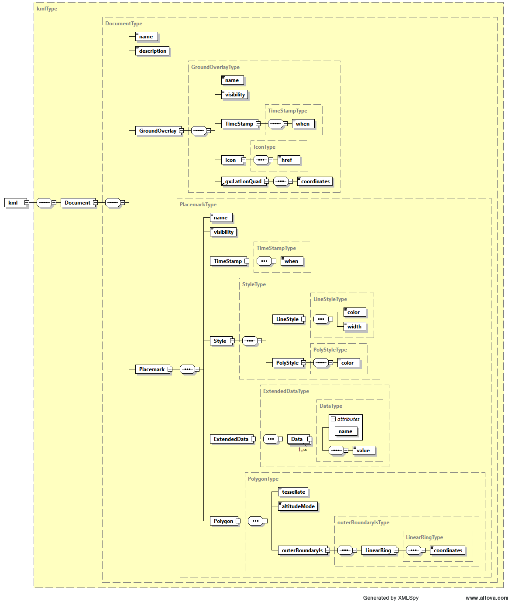

</div>

<p class="atbd-figure-caption"><span class="caption-number">Fig. 33</span><span class="caption-text"> — Overlay ADS</span></p>

:::

(tab:pfd-l1-63)=
:::{div} atbd-table

<p class="atbd-table-caption"><span class="caption-number">Table 63</span><span class="caption-text"> — Overlay ADS</span></p>

| Name | Description | Data Type | Cardinality |
|---|---|---|---|
| Document | Document container for KML components. | DocumentType | 1 |

:::

(tab:pfd-l1-64)=
:::{div} atbd-table

<p class="atbd-table-caption"><span class="caption-number">Table 64</span><span class="caption-text"> — Overlay ADS (DocumentType)</span></p>

| Name | Description | Data Type | Cardinality |
|---|---|---|---|
| name | Name of the document. | `xsd:string` | 1 |
| description | Description of the document. | `xsd:string` | 1 |
| GroundOverlay | Contains the parameters required to specify the footprint of the image and overlay the quicklook image on a map. | GroundOverlayType | 1 |
| Placemark | Contains the metadata associated to the overlay. | PlacemarkType | 1 |

:::

(tab:pfd-l1-65)=
:::{div} atbd-table

<p class="atbd-table-caption"><span class="caption-number">Table 65</span><span class="caption-text"> — Overlay ADS (GroundOverlayType)</span></p>

| Name | Description | Data Type | Cardinality |
|---|---|---|---|
| name | Name of the ground overlay. | `xsd:string` | 1 |
| visibility | Specifies whether the feature is drawn in the 3D viewer when it is initially loaded (0: not visible, 1: visible). | `xsd:unsignedInt` | 1 |
| TimeStamp | Structure containing the time stamp of the overlay that can be used for dynamic visualizations over time. | TimeStampType | 1 |
| Icon | Structure describing the image file used on the map overlay. | IconType | 1 |
| LatLonQuad | Structure containing the latitude and longitude coordinates used to position the image overlay on the map. | LatLonQuadType | 1 |

:::

(tab:pfd-l1-66)=
:::{div} atbd-table

<p class="atbd-table-caption"><span class="caption-number">Table 66</span><span class="caption-text"> — Overlay ADS (TimeStampType)</span></p>

| Name | Description | Data Type | Cardinality |
|---|---|---|---|
| when | Overlay time stamp in ISO 8601 format (YYYY-MM-DDThh:mm:ss). | `xsd:string` | 1 |

:::

(tab:pfd-l1-67)=
:::{div} atbd-table

<p class="atbd-table-caption"><span class="caption-number">Table 67</span><span class="caption-text"> — Overlay ADS (IconType)</span></p>

| Name | Description | Data Type | Cardinality |
|---|---|---|---|
| href | A local file specification or URL used to load the desired image and overlay it on the map. | `xsd:string` | 1 |

:::

(tab:pfd-l1-68)=
:::{div} atbd-table

<p class="atbd-table-caption"><span class="caption-number">Table 68</span><span class="caption-text"> — Overlay ADS (LatLonQuadType)</span></p>

| Name | Description | Data Type | Cardinality |
|---|---|---|---|
| coordinates | A string of 5 lon,lat coordinate pairs which describe the corners of the image. The string is of the form: lon,lat lon,lat lon,lat lon,lat lon,lat The coordinates must appear in the following order: last line first pixel, last line last pixel, first line last pixel, first line first pixel, last line first pixel | `xsd:string` | 1 |

:::

(tab:pfd-l1-69)=
:::{div} atbd-table

<p class="atbd-table-caption"><span class="caption-number">Table 69</span><span class="caption-text"> — Overlay ADS (PlacemarkType)</span></p>

| Name | Description | Data Type | Cardinality |
|---|---|---|---|
| Name | Name of the placemark. | `xsd:string` | 1 |
| visibility | Specifies whether the feature is drawn in the 3D viewer when it is initially loaded (0: not visible, 1: visible). | `xsd:unsignedInt` | 1 |
| TimeStamp | Structure containing the time stamp of the placemark that can be used for dynamic visualizations over time | TimeStampType | 1 |
| Style | Structure describing the stype used to display the placemark. | StyleType | 1 |
| ExtendedData | Structure containing the metadata associated to the overlay. | ExtendedDataType | 1 |
| Polygon | Structure containing the latitude and longitude coordinates used to position the image overlay on the map. | PolygonType | 1 |

:::

(tab:pfd-l1-70)=
:::{div} atbd-table

<p class="atbd-table-caption"><span class="caption-number">Table 70</span><span class="caption-text"> — Overlay ADS (StyleType)</span></p>

| Name | Description | Data Type | Cardinality |
|---|---|---|---|
| LyneStyle | Line style. | LyneStyleType | 1 |
| PolyStyle | Polygon style. | PolyStyleType | 1 |

:::

(tab:pfd-l1-71)=
:::{div} atbd-table

<p class="atbd-table-caption"><span class="caption-number">Table 71</span><span class="caption-text"> — Overlay ADS (LyneStyleType)</span></p>

| Name | Description | Data Type | Cardinality |
|---|---|---|---|
| color | Line color in 32 bit hex format (AABBGGRR order). | `xsd:string` | 1 |
| width | Line width. | `xsd:unsignedInt` | 1 |

:::

(tab:pfd-l1-72)=
:::{div} atbd-table

<p class="atbd-table-caption"><span class="caption-number">Table 72</span><span class="caption-text"> — Overlay ADS (PolyStyleType)</span></p>

| Name | Description | Data Type | Cardinality |
|---|---|---|---|
| color | Polygon color in 32 bit hex format (AABBGGRR order). | `xsd:string` | 1 |

:::

(tab:pfd-l1-73)=
:::{div} atbd-table

<p class="atbd-table-caption"><span class="caption-number">Table 73</span><span class="caption-text"> — Overlay ADS (ExtendedDataType)</span></p>

| Name | Description | Data Type | Cardinality |
|---|---|---|---|
| Data | Metadata. | DataType | 1..inf |

:::

(tab:pfd-l1-74)=
:::{div} atbd-table

<p class="atbd-table-caption"><span class="caption-number">Table 74</span><span class="caption-text"> — Overlay ADS (DataType)</span></p>

| Name | Description | Data Type | Cardinality |
|---|---|---|---|
| value | Metadata value. | `xsd:string` | 1 |

:::

(tab:pfd-l1-75)=
:::{div} atbd-table

<p class="atbd-table-caption"><span class="caption-number">Table 75</span><span class="caption-text"> — Overlay ADS ()</span></p>

| Name | Description | Data Type | Cardinality |
|---|---|---|---|
| tessellate | Tessellate option. | `xsd:unsignedInt` | 1 |
| `altitudeMode` | Altitude mode option. | `xsd:string` | 1 |
| `outerBoundaryIs` | Polygon outer boundary description. | `outerBoundaryIsType` | 1 |

:::

(tab:pfd-l1-76)=
:::{div} atbd-table

<p class="atbd-table-caption"><span class="caption-number">Table 76</span><span class="caption-text"> — Overlay ADS (outerBoundaryIsType)</span></p>

| Name | Description | Data Type | Cardinality |
|---|---|---|---|
| LinearRing | Linear ring description. | LinearRingType | 1 |

:::

(tab:pfd-l1-77)=
:::{div} atbd-table

<p class="atbd-table-caption"><span class="caption-number">Table 77</span><span class="caption-text"> — Overlay ADS (LinearRingType)</span></p>

| Name | Description | Data Type | Cardinality |
|---|---|---|---|
| coordinates | A string of 5 lon,lat,height coordinate tuples which describe the corners of the image. The string is of the form: lon,lat,height lon,lat,height lon,lat,height lon,lat,height lon,lat,height The coordinates must appear in the following order: last line first pixel, last line last pixel, first line last pixel, first line first pixel, last line first pixel | `xsd:string` | 1 |

:::
