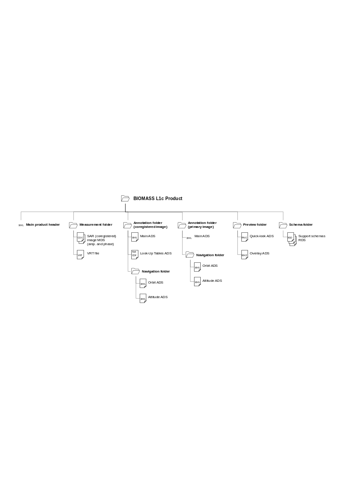

<!-- SPDX-FileCopyrightText: 2026 European Space Agency (ESA) -->
<!-- SPDX-License-Identifier: Apache-2.0 -->

:::{atbd-logo-banner}
:::

(sec:pfd-l1-5)=
# 5. L1c Products Format Overview

The BIOMASS L1c product, as well as L1a and L1b ones, is a folder containing a collection of information, grouped together into files referred to as data sets, and data sets are collected and grouped into several sub-folders in order to achieve a physical tree forming a complete product. Differently from L1a and L1b products, L1c ones contain both information related to primary and to the coregistered SAR images.

The kinds of datasets are the same of L1a and L1b products, i.e., the Measurement Data Sets (MDS), the Annotation Data Sets (ADS) and the Representation Data Sets (RDS).

The declination and customisation of this format structure for BIOMASS L1c product is summarised in the following table. In particular, a typical product contains:

- a main product header, an XML file including high-level information about the product origin, structure and main metadata (see {sec}`6.1`);
- SAR (coregistered) image MDS, including the coregistered image binary raster data for the three or four BIOMASS polarisations (depending on configuration), organised in two Cloud Optimized GeoTIFF (COG) files, one for amplitude and one for phase components (see {sec}`6.2`);
- primary image main annotation ADS, a copy of the primary image L1a product main ADS XML file, including only relevant DSR (see {sec}`6.3.1`);
- coregistered image main annotation ADS, a copy of the secondary image L1a product main ADS XML file, with DSR content updated where needed and new DSR, specific for the coregistration process, added (see {sec}`6.3.3`);
- coregistered image Look-Up Table (LUT) ADS, including those metadata being too voluminous to be coded efficiently in an XML file (i.e., Look-Up Tables) and requiring a binary NetCDF file (see. {sec}`6.3.4`), i.e.:
    - copy of secondary image L1a product LUT radiometric calibration and denoising DSR, resampled over coregistration grid;
    - new coregistration (range and azimuth coregistration shifts and quality index maps) and InSAR DSR (RFI impact, residual fast-varying ionospheric phase and ground calibration phase maps, plus related quality indexes maps)
    - copy of primary image L1a product LUT geometry DSR;
- orbit and attitude ADS, including orbit and attitude information, both for primary and coregistered images, in dedicated XML files (see {sec}`6.3.2` and {sec}`6.3.5` respectively);
- quick-look and overlay ADS, including an averaged and decimated preview of the coregistered SAR image data set and information about its geographic coverage (see {sec}`6.3.6` and {sec}`6.3.7`);
- XML schemas RDS, including the schemas needed for all the XML files included in the product.

(fig:pfd-l1-34)=
:::{div} atbd-mermaid-figure

Fig. 34 — L1c products structure

:::

(tab:pfd-l1-78)=
:::{div} atbd-table

Table 78 — L1c product structure

| File / Folder | Cardinality | Format | Description / Content |
|---|---|---|---|
| BIOMASS L1c Product |   | Folder |   |
| ∟ main product header | 1 | XML | Main product header |
| ∟ measurement |   | Folder |   |
| ∟ sar image | 2 | COG | SAR (coregistered) image MDS 2 files = 1 for amplitude + 1 for phase 3 or 4 components each (1 per polarization) |
| ∟ sar image | 1 | VRT | SAR (coregistered) image MDS (support) |
| ∟ annotation\_primary |   | Folder |   |
| ∟ main | 1 | XML | Primary image main ADS Copy of primary image L1a product main ADS, including only relevant DSR |
| ∟ navigation |   | Folder |   |
| ∟ orbit | 1 | XML (EOF) | Orbit DSR |
| ∟ attitude | 1 | XML (EOF) | Attitude DSR |
| ∟ annotation\_coregistered |   | Folder |   |
| ∟ main | 1 | XML | Coregistered image main ADS Copy of secondary image L1a product main ADS, with DSR content updated where needed + - STA processing parameters DSR - STA coregistration parameters DSR - STA InSAR parameters DSR - STA quality DSR |
| ∟ lut | 1 | NetCDF | Coregistered image Look-Up Tables ADS: - Copy of secondary image L1a product LUT DSR, resampled over coregistration grid: - Radiometric calibration DSR (sigma-nought and gamma-nought maps) - Denoising DSR (one per polarisation) - Copy of primary image L1a product LUT DSR: - Geometry DSR (latitude/longitude/height maps, incidence and elevation angles maps) Additionally: - Coregistration DSR (range and azimuth coregistration shifts and quality index maps, wavenumbers, flattening phase screens) - For secondary images only, Interferometric quantities (coherence and interferogram with respect to the coregistration primary). - Optionally, SKP DSR (SKP calibration phase screen and quality indicators) - Optionally, Multi-Squint Calibration DSR (ionospheric phase screens) |
| ∟ navigation |   | Folder |   |
| ∟ orbit | 1 | XML (EOF) | Orbit DSR |
| ∟ attitude | 1 | XML (EOF) | Attitude DSR |
| ∟ preview |   | Folder |   |
| ∟ quicklook | 1 to 4 | PNG | Quick-look ADS L1c can have up to 4 quick-look files: - At least 1 of Pauli and HSV decomposition - Optionally, and for secondary images only, the coherence vs primary - Optionally, and for secondary images only, the flattened interferogram vs primary |
| ∟ overlay | 1 to 4 | KML | Overlay ADS. 1 overlay per quick-look file. |
| ∟ schema |   | Folder |   |
| ∟ main `annotation.xsd` | 1 | XSD | RDS |
| ∟ `orbit.xsd` | 1 | XSD | RDS |
| ∟ `attitude.xsd` | 1 | XSD | RDS |
| ∟ `overlay.xsd` | 1 | XSD | RDS |
| ∟ common `types.xsd` | 1 | XSD | RDS |

:::

(sec:pfd-l1-5-1)=
### 5.1 Product format definition guidelines

Refer to {sec}`3.1`.

(sec:pfd-l1-5-2)=
### 5.2 L1M products

As described above, L1M products are a “light” version of L1S ones, to be used for monitoring purposes.

It has to be noted that L1M products are generated by STA processor in the same flow of L1S ones, without the need of specific processing.

L1M products are identical to L1S ones except for SAR image MDS (and ‘measurement’ sub-folder), which is present only in L1S products.

(sec:pfd-l1-5-3)=
### 5.3 Naming convention

The naming convention for the BIOMASS L1c products and their related data are described in details in {ad}`2` and briefly recalled in {sec}`Section|3.4`. In summary, L1c product names differs from L1a/b products names in what follows:

- `<TTTTTTTTTT>`: Product Type/File Type:
    - `S[1,2,3]_STA__1S`: Stripmap L1 Coregistered stack - Standard product;
    - `S[1,2,3]_STA__1M`: Stripmap L1 Coregistered stack - Monitoring Product;
- `<yyyymmddThhmmss>`: UTC start date and time after coregistration;
- `<YYYYMMDDTHHMMSS>`: UTC stop date and time after coregistation.

Note that start and end times of L1c products do not necessarily coincide with those of the source L1a products since L1c products are coregistered on the primary image grid (see Stack ATBD, {sec}`Section|4`). Consequently, start and end times are updated according to the azimuth coregistration shifts estimated by the stack.
