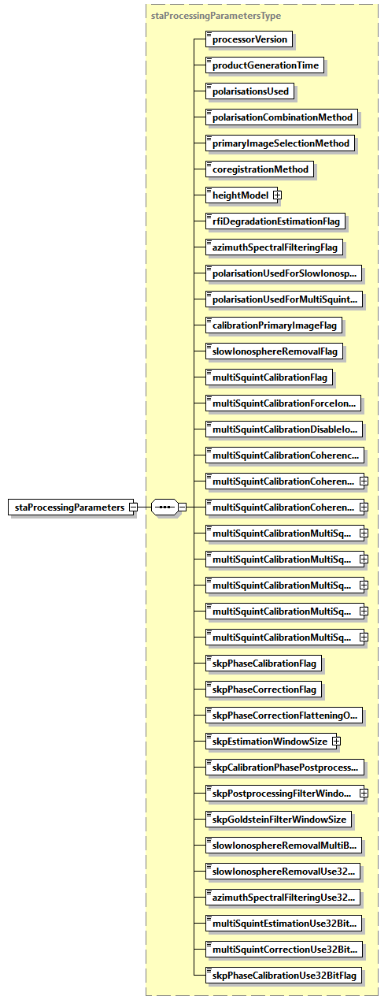
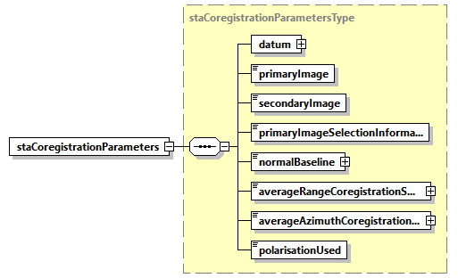
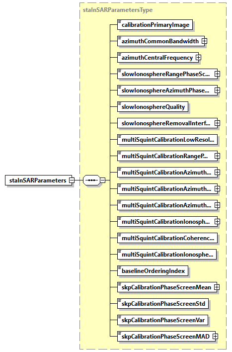
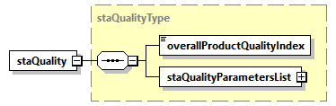
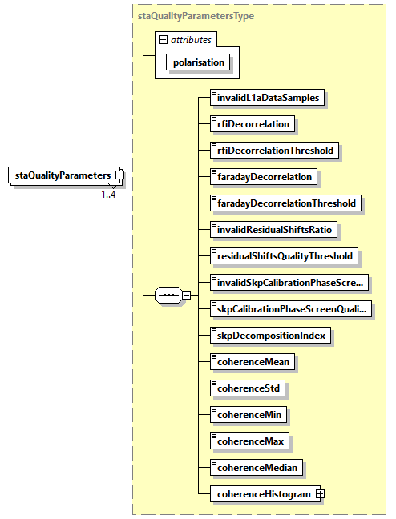

<!-- SPDX-FileCopyrightText: 2026 European Space Agency (ESA) -->
<!-- SPDX-License-Identifier: Apache-2.0 -->

:::{atbd-logo-banner}
:::

(sec:pfd-l1-6)=
# 6. L1c Products Format Specification

(sec:pfd-l1-6-1)=
### 6.1 Main product header

The Main Product Header (MPH) is an XML file present in all the BIOMASS L1 products. BIOMASS L1 products are folder based and the MPH is top level leaf of the product tree.

The MPH main scope is to provide all the information related to the:

- Genesis of the product;
- Identification of the product for example for cataloguing purposes;
- Product consistency (file size).

For the detailed description of the MPH content and format refer to {ad}`3`. For a schematic representation see {sec}`4.1`.

(sec:pfd-l1-6-2)=
### 6.2 Measurement data sets (MDS)

(sec:pfd-l1-6-2-1)=
#### 6.2.1 SAR (coregistered) image MDS

The SAR image MDS is used to store the SAR image binary raster data as generated by the Stack processor for all the foreseen BIOMASS data polarisations (HH, HV, VH, VV). This image is the coregistered version of the secondary image received in input by the Stack processor from the L1 processor (L1a product). It is resampled over the same sampling grid of the primary image, with the following conventions:

- the coregistered image pixels exceeding the primary one extent are thrown away;
- the primary image pixels not overlapping the coregistered one will be represented as invalid data.

The format used to store the SAR (coregistered) image MDS is again the Cloud Optimized GeoTIFF (COG) {rd}`1`.

All the details about COG format and about its usage to store SAR image MDS already explained in {sec}`4.2.1` for L1a products (compression strategy, usage of VRT files, metadata, overviews, …) apply as well to L1c products.

(sec:pfd-l1-6-3)=
### 6.3 Annotation data sets (ADS)

(sec:pfd-l1-6-3-1)=
#### 6.3.1 Primary image main ADS

This ADS is an exact copy of the main ADS included in the L1a product (primary one) received in input by the Stack processor..

(sec:pfd-l1-6-3-2)=
#### 6.3.2 Primary image orbit and attitude ADS

The primary image Orbit and Attitude ADS will be included as dedicated files in L1c products.

These files are also a exact copies of the homonymous files included in the L1a product (primary one) received in input by the Stack processor and described in {sec}`4.3.3`.

(sec:pfd-l1-6-3-3)=
#### 6.3.3 Coregistered image main ADS

This ADS is a copy of the main ADS included in the L1a product (secondary one) received in input by the Stack processor with some modifications. Details are reported in the following table, taking as reference the similar list described in {sec}`4.3.1`.

(tab:pfd-l1-79)=
:::{div} atbd-table

Table 79 — Coregistered image main ADS

| Name | Description | Differences between L1a and L1c |
|---|---|---|
| `acquisitionInformation` | Acquisition information DSR. This DSR contains information that applies to the entire data set. | Updated fields: `productType` becomes STA `startTime` and `stopTime` updated after coregistration `polarisationList` will cointain the output polarization |
| `sarImage` | SAR image DSR. This DSR contains all the necessary information to exploit the measurement data set (i.e. SAR images). | Copied from primary image main ADS (considering that the coregistered image is resampled over the same sampling grid of the primary image and a different `noDataValue` can be selected) |
| `instrumentParameters` | Instrument parameters DSR. This DSR contains the main instrument settings at the time of imaging. | No differences |
| `rawDataAnalysis` | RAW data analysis DSR. This DSR contains the main elements related to the RAW data consolidation and analysis performed by the processor. | No differences |
| `processingParameters` | Processing parameters DSR. This DSR contains the exhaustive list of static SAR processing parameters and of corrections applied. | No differences |
| `internalCalibration` | Internal calibration DSR. This DSR contains the results of the internal calibration analysis performed by the processor. | No differences |
| `rfiMitigation` | Radio Frequency Interference mitigation DSR. This DSR contains information on detected RFI and on their mitigation. | No differences |
| `dopplerParameters` | Doppler parameters DSR. This DSR contains the Doppler Centroid (DC) and Frequency Modulation rate (FM) parameters estimated and used during processing. | No differences |
| `radiometricCalibration` | Radiometric calibration DSR. This DSR contains all the necessary information to absolutely calibrate the data pixels. | No differences |
| `polarimetricDistortion` | Polarimetric distortion DSR. This DSR contains the necessary information e.g. receive and transmit polarisation distortion matrix, allowing users to correct for them if not applied at processing level. | No differences |
| `ionosphereCorrection` | Ionosphere correction DSR. This DSR contains the results of the ionosphere correction estimated and applied by the processor. | No differences |
| geometry | Geometry DSR. This DSR contains all the necessary information to understand the Earth model/geometry used in the image and its geolocation. | No differences |
| quality | Quality DSR. This DSR contains in a single DSR quality flags and thresholds for basic quality assessment done at processing level. | No differences |
| annotationLUT | Annotation LUT DSR. This DSR contains the list of Look-Up Tables (LUTs) complementing product main annotations. | Content updated with the list of layers included in the coregistered image LUT ADS |
| `staProcessingParameters` | Stack processing parameters DSR. This DSR contains the exhaustive list of static stack processing parameters and of corrections applied. | New |
| `staCoregistrationParameters` | Stack coregistration parameters DSR. This DSR contains high-level information about data coregistration step. | New |
| `staInSARParameters` | Stack InSAR parameters DSR. This DSR contains high-level information about calibration steps. | New |
| `staQuality` | Stack quality DSR. This DSR contains in a single DSR quality flags and thresholds for basic quality assessment done at processing level. | New |

:::

The content of the new DSR is described in the following sections.

(sec:pfd-l1-6-3-3-1)=
##### 6.3.3.1 STA processing parameters DSR

This DSR contains the exhaustive list of static stack processing parameters and of corrections applied.

(fig:pfd-l1-35)=
:::{div} atbd-mermaid-figure

Fig. 35 — STA processing parameters DSR (staProcessingParametersType)

:::

(tab:pfd-l1-80)=
:::{div} atbd-table

Table 80 — STA processing parameters DSR (staProcessingParametersType)

| Name | Description | Data Type | Cardinality |
|---|---|---|---|
| `processorVersion` | Version of the processor used to generate the product. | `xsd:string` | 1 |
| `productGenerationTime` | Product generation time [UTC]. | `timeType` | 1 |
| `polarisationsUsed` | Number of polarisations used for processing (3 or 4). | `xsd:unsignedInt` | 1 |
| `polarisationCombinationMethod` | Polarisations combination method: “HV” or “VH”, if just one of the two is selected (in addition to HH and VV ones); “Average”, if the average of HV and VH is computed and used; “None” if no combination is performed (all the four polarizations are used). | `polarisationCombinationMethodType` | 1 |
| `primaryImageSelectionMethod` | Coregistration primary image selection method (Geometry, Geometry and Quality, Temporal Baseline). | `primaryImageSelectionMethodType` | 1 |
| `coregistrationMethod` | Coregistration method (Geometry, Geometry and Data). | `coregistrationMethodType` | 1 |
| `heightModel` | Digital Elevation Model (DEM) used during coregistration (with version as attribute). This field is taken from the L1a input product. | `heightModelType` | 1 |
| `rfiDegradationEstimationFlag` | True if estimation of degradation due to RFI filtering was performed, False otherwise. | bool | 1 |
| `azimuthSpectralFilteringFlag` | True if azimuth spectral filtering was performed, False otherwise. | bool | 1 |
| `polarisationUsedForSlowIonosphereRemoval` | Polarisation used for the Slow-Ionosphere Removal (IOB) step. | `polarisationType` | 1 |
| `polarisationUsedForMultiSquintCalibration` | Polarisation used for estimation in the Multi-Squint Calibration (MSC) step. | `polarisationType` | 1 |
| `calibrationPrimaryImageFlag` | True if image used as primary for multi-baseline calibration steps is the same as the one used for coregistration, False otherwise. | bool | 1 |
| `slowIonosphereRemovalFlag` | True if slow-varying ionospheric phase screen estimation and removal was performed, False otherwise. | bool | 1 |
| `multiSquintCalibrationFlag` | True if Multi-Squint calibration module was enabled, False otherwise. | bool | 1 |
| `multiSquintCalibrationForceIonosphereCorrectionFlag` | True if Multi-Squint ionosphere calibration step was forcefully executed by user, False otherwise. | bool | 1 |
| `multiSquintCalibrationDisableIonosphereCorrectionFlag` | True if Multi-Squint ionosphere calibration step was forcefully executed by user, False otherwise. | bool | 1 |
| `multiSquintCalibrationCoherenceImprovementThreshold` | Threshold on the coherence gian that was used to trigger the Multi-Squint ionosphere calibration step. | `xsd:float` | 1 |
| `multiSquintCalibrationCoherenceAzimuthWindowSize` | The multi-looking window in along-track direction used for estimating the standard coherence (coherence test) [m]. | `floatWithUnit` | 1 |
| `multiSquintCalibrationCoherenceRangeWindowSize` | The multi-looking window in slant-range direction used for estimating the standard coherence (coherence test) [m]. | `floatWithUnit` | 1 |
| `multiSquintCalibrationMultiSquintCoherenceSubBandResolution` | The squint axis resolution of the Multi-Squint coherence matrix [m]. | `floatWithUnit` | 1 |
| `multiSquintCalibrationMultiSquintHighResCoherenceRangeWindowSize` | The high resolution multi-look window in slant-range direction for the Multi-Squint cohrence matrix [m]. | `floatWithUnit` | 1 |
| `multiSquintCalibrationMultiSquintHighResCoherenceAzimuthWindowSize` | The high resolution multi-look window in along-track direction for the Multi-Squint cohrence matrix [m]. | `floatWithUnit` | 1 |
| `multiSquintCalibrationMultiSquintLowResCoherenceAzimuthWindowSize` | The low resolution multi-look window in along-track direction for the Multi-Squint cohrence matrix [m]. | `floatWithUnit` | 1 |
| `multiSquintCalibrationMultiSquintLowResCoherenceRangeWindowSize` | The low resolution multi-look window in slant-range direction for the Multi-Squint cohrence matrix [m]. | `floatWithUnit` | 1 |
| `skpPhaseCalibrationFlag` | True if ground steering phases estimation was performed, False otherwise. | bool | 1 |
| `skpPhaseCorrectionFlag` | True if either the ground steering phases or the flattening phases were corrected, False otherwise. | bool | 1 |
| `skpPhaseCorrectionFlatteningOnlyFlag` | True if only the flattening phases was corrected (and hence no SKP calibration phase). False otherwise. | bool | 1 |
| `skpEstimationWindowSize` | Estimation window size [m]. Note that this window size must be larger than the LUT resolution grid in both range and azimuth. | `floatWithUnit` | 1 |
| `skpCalibrationPhasePostprocessing` | Postprocessing applied to the SKP calibration phase screens. | `skpPhaseCalibrationPostprocessingType` | 1 |
| `skpPostprocessingFilterWindowSize` | Filter window size used in SKP postprocessing in case of "Boxcar" or "Median" filter [m]. | `floatWithUnit` | 1 |
| `skpGoldsteinFilterWindowSize` | Filter window size applied to the spectrum (in frequency bins), used in SKP postprocessing in case of "Goldstein" filter [px]. | `xsd:unsignedInt` | 1 |
| `slowIonosphereRemovalMultiBaselineThreshold` | Threshold used for selecting the interferometric pair for baseline error correction (IOB) as fraction of of the critical baseline. | `xsd:float` | 1 |
| `azimuthSpectralFilteringUse32BitFlag` | True if AZF was run with 32-bit precision. | bool | 1 |
| `slowIonosphereRemovalUse32BitFlag` | True if IOB was run with 32-bit precision. | bool | 1 |
| `multiSquintEstimationUse32BitFlag` | True if the estimation step of the MSC was run with 32-bit precision. | bool | 1 |
| `multiSquintCorrectionUse32BitFlag` | True if the ionosphere correction step of the MSC was run with 32-bit precision. | bool | 1 |
| `skpPhaseCalibrationUse32BitFlag` | True if SKP was run with 32-bit precision. | bool | 1 |

:::

(sec:pfd-l1-6-3-3-2)=
##### 6.3.3.2 STA coregistration parameters DSR

This DSR contains high-level information about data coregistration step.

(fig:pfd-l1-36)=
:::{div} atbd-mermaid-figure

Fig. 36 — STA processing parameters DSR (staCoregistrationParametersType)

:::

(tab:pfd-l1-81)=
:::{div} atbd-table

Table 81 — STA processing parameters DSR (staCoregistrationParametersType)

| Name | Description | Data Type | Cardinality |
|---|---|---|---|
| datum | Datum used during coregistration. | `datumType` | 1 |
| `primaryImage` | Product name of coregistration primary image. | `xsd:string` | 1 |
| `secondaryImage` | Product name of coregistration secondary image. | `xsd:string` | 1 |
| `primaryImageSelectionInformation` | Information used to select coregistration primary image (Geometry, Geometry and RFI Correction, Geometry and FR Correction, Geometry and RFI+FR Corrections, Temporal Baseline). | `primaryImageSelectionInformationType` | 1 |
| `normalBaseline` | Normal baseline between primary and secondary images [m]. | `floatWithUnit` | 1 |
| `averageRangeCoregistrationShift` | Average coregistration shift along range direction [m]. | `floatWithUnit` | 1 |
| `averageAzimuthCoregistrationShift` | Average coregistration shift along azimuth direction [m]. | `floatWithUnit` | 1 |
| `polarisationUsed` | Polarization used for shift estimation. | `polarisationType` | 1 |

:::

(sec:pfd-l1-6-3-3-3)=
##### 6.3.3.3 STA InSAR parameters DSR

This DSR contains high-level information about calibration steps.

(fig:pfd-l1-37)=
:::{div} atbd-mermaid-figure

Fig. 37 — STA processing parameters DSR (staInSARParametersType)

:::

(tab:pfd-l1-82)=
:::{div} atbd-table

Table 82 — STA processing parameters DSR (staInSARParametersType)

| Name | Description | Data Type | Cardinality |
|---|---|---|---|
| `calibrationPrimaryImage` | Product name of multi-baseline calibration steps primary image (or, simply, calibration primary image). | `xsd:string` | 1 |
| `azimuthCommonBandwidth` | Azimuth bandwidth in common with primary image after azimuth spectral filtering step [Hz]. | `floatWithUnit` | 1 |
| `azimuthCentralFrequency` | Azimuth central frequency after azimuth spectral filtering step [Hz]. | `floatWithUnit` | 1 |
| `slowIonosphereRangePhaseScreen` | Estimated slope of background ionosphere in range direction [rad/s]. | `floatWithUnit` | 1 |
| `slowIonosphereAzimuthPhaseScreen` | Estimated slope of background ionosphere in azimuth direction [rad/s]. | `floatWithUnit` | 1 |
| `slowIonosphereQuality` | Quality of the background ionosphere estimation. The value is between 0 (bad quality) and 1 (good quality). | `xsd:float` | 1 |
| `slowIonosphereRemovalInterferometricPairs` | Interferometric pairs used to estimate the slow-varying ionosphere calibration. | `interferometricPairListType` | 1 |
| `multiSquintCalibrationLowResolutionFlag` | True if Multi-Squint calibration was executed in low resolution modality, False otherwise. | bool | 1 |
| `multiSquintCalibrationRangePhaseSlope` | Phase plane slope estimated by the Multi-Squint Calibration module, in slant-range direction [rad/s]. | `floatWithUnit` | 1 |
| `multiSquintCalibrationAzimuthPhaseSlope` | Phase plane slope estimated by Multi-Squint Calibration module, in along-track direction [rad/s]. | `floatWithUnit` | 1 |
| `multiSquintCalibrationAzimuthShift` | Constant shift in along-track direction estimated from spectral analysis on the Multi-Squint coherence [m]. | `floatWithUnit` | 1 |
| `multiSquintCalibrationAzimuthFrequencyCentroid` | Spatial (along-track) frequency centroid from spectral analysis on the Multi-Squint coherence [1/m]. | `floatWithUnit` | 1 |
| `multiSquintCalibrationIonosphericLayerAltitudes` | Altitude of the ionospheric layers estimated by the Multi-Squint Calibration module [m]. | `floatArrayWithUnits` | 1 |
| `multiSquintCalibrationCoherenceCheckValue` | Coherence improvement used during the coherence check of the Multi-Squint Calibration module. | `xsd:float` | 1 |
| `multiSquintCalibrationIonosphereCorrectionFlag` | True if the Multi-Squint Calibration module executed the ionosphere correction. False otherwise. | `xsd:bool` | 1 |
| `baselineOrderingIndex` | Index in of the product with respect to the baseline-based ordering. | `xsd:unsignedInt` | 1 |
| `skpCalibrationPhaseScreenMean` | Circular mean of SKP calibration phase screen [rad]. | `floatWithUnit` | 1 |
| `skpCalibrationPhaseScreenStd` | Circular standard deviation of SKP calibration phase screen. | `xsd:float` | 1 |
| `skpCalibrationPhaseScreenVar` | Circular dispersion of SKP calibration phase screen. | `xsd:float` | 1 |
| `skpCalibrationPhaseScreenMAD` | Mean absolute deviation of SKP calibration phase screen [rad]. | `floatWithUnit` | 1 |

:::

(tab:pfd-l1-83)=
:::{div} atbd-table

Table 83 — STA processing parameters DSR (interferometricPairListType)

| Name | Description | Data Type | Cardinality |
|---|---|---|---|
| count |   | `xsd:unsignedInt` | required |
| `interferometricPairListType` | List of interferometric pairs expressed as indices. | `interferometricPairType` | $\geq$0 |

:::

(sec:pfd-l1-6-3-3-4)=
##### 6.3.3.4 STA quality DSR

This DSR contains in a single DSR quality flags and thresholds for basic quality assessment done at processing level.

(fig:pfd-l1-38)=
:::{div} atbd-mermaid-figure

Fig. 38 — STA quality DSR (staQualityType)

:::

(tab:pfd-l1-84)=
:::{div} atbd-table

Table 84 — STA quality DSR (staQualityType)

| Name | Description | Data Type | Cardinality |
|---|---|---|---|
| `overallProductQualityIndex` | Overall product quality index. This annotation is calculated based on specific quality parameters and gives an overall quality value for the product. | `xsd:unsignedInt` | 1 |
| `staQualityParametersList` | Quality parameters list. The list contains an entry for each output product’s polarisation. | `staQualityParametersListType` | 1 |

:::

(tab:pfd-l1-85)=
:::{div} atbd-table

Table 85 — STA quality DSR (staQualityParametersListType)

| Name | Description | Data Type | Cardinality |
|---|---|---|---|
| count |   | `xsd:unsignedInt` | required |
| `staQualityParameters` | Quality parameters for the current polarisation. | `staQualityParametersType` | 1 .. 4 |

:::

(fig:pfd-l1-39)=
:::{div} atbd-mermaid-figure

Fig. 39 — STA quality DSR (staQualityParametersType)

:::

(tab:pfd-l1-86)=
:::{div} atbd-table

Table 86 — STA quality DSR (staQualityParametersType)

| Name | Description | Data Type | Cardinality |
|---|---|---|---|
| polarisation |   | `polarisationType` | required |
| `invalidL1aDataSamples` | Number of invalid L1a data samples (according to their mean and standard deviation), expressed as a normalized fraction of the total number of samples. The value is between 0 and 1. | `xsd:float` | 1 |
| `rfiDecorrelation` | Decorrelation factor due to RFI strength. The value is between 0 and 1. | `xsd:float` | 1 |
| `rfiDecorrelationThreshold` | Maximum decorrelation factor due to RFI strength admissible to use the image as the primary image. The value is between 0 and 1 and copied from the AUX-PPS. | `xsd:float` | 1 |
| `faradayDecorrelation` | Decorrelation factor due to Faraday residual. The value is between 0 and 1. | `xsd:float` | 1 |
| `faradayDecorrelationThreshold` | Maximum decorrelation factor due to Faraday residual admissible to use the image as the primary image. The value is between 0 and 1 and copied from AUX-PPS. | `xsd:float` | 1 |
| `invalidResidualShiftsRatio` | Ratio of invalid residual coregistration shifts with respect to the number of pixels of the coregistration reference image. The value is between 0 and 1. | `xsd:float` | 1 |
| `residualShiftsQualityThreshold` | Threshold on residual coregistration shifts quality. The value is between 0 and 1 and copied from AUX-PPS. Residual shifts with a quality lower than this threshold are not used for processing. | `xsd:float` | 1 |
| `iinvalidSkpCalibrationPhaseScreenRatio` | Ratio between invalid SKP calibration phase estimations and the size of the SKP phase screen. The value is between 0 and 1. | `xsd:float` | 1 |
| `skpCalibrationPhasesScreenQualityThreshold` | Threshold on the SKP calibration phase screen estimation quality. The value is between 0 and 1 and copied from the AUX-PPS. Estimates with a quality lower than this threshold are not corrected. Used only in case `skpPhaseCorrectionFlag` is set to True. | `xsd:float` | 1 |
| `skpDecompositionIndex` | Error code for the SKP decomposition. Positive if the SKP decomposition hit a nonblocking contingency case (e.g. SVD decomposition failure etc.) and the exported SKP-related LUTs contain values obtained from a contingency handling procedure. 0 otherwise. | `xsd:unsignedInt` | 1 |
| `coherenceMean` | Mean coherence (amplitude) of the calibrated L1c frame with respect to the coregistration primary. | `xsd:float` | 1 |
| `coherenceStd` | Standard deviation of the coherence (amplitude) of the calibrated L1c frame with respect to the coregistration primary. | `xsd:float` | 1 |
| `coherenceMin` | Minimum coherence (amplitude) of the calibrated L1c frame with respect to the coregistration primary. | `xsd:float` | 1 |
| `coherenceMax` | Maximum coherence (amplitude) of the calibrated L1c frame with respect to the coregistration primary. | `xsd:float` | 1 |
| `coherenceMedian` | Median coherence (amplitude) of the calibrated L1c frame with respect to the coregistration primary. | `xsd:float` | 1 |
| `coherenceHistogram` | Coherence distribution of the calibrated L1c frame with respect to the coregistration primary. | `histogramType` | 1 |

:::

(tab:pfd-l1-87)=
:::{div} atbd-table

Table 87 — The histogramType.

| Name | Description | Data Type | Cardinality |
|---|---|---|---|
| bins | The bins of the histogram | `floatArray` | 1 |
| `pdfValues` | The PDF values of the histograms | `floatArray` | 1 |

:::

(sec:pfd-l1-6-3-3-4-1)=
###### 6.3.3.4.1 Overall Product Quality Index

As mentioned in {ref}`Tab. 72 <tab:pfd-l1-72>`, the `overallProductQualityIndex` is an unsigned integer value (i.e. a 32-bit integer ranging from 0 to 232 – 1) that summarizes the execution history of the Stack Processor as well as a high-level information on the quality of the input stack. Similarly to that of the `L1_P` processor, the Stack’s `overallProductQualityIndex` is the decimal representation of a 32-bit array that is defined as follows:

| Bit # | Module/Sub-step | Bit-Flipping Condition |
|---|---|---|
| 0 | L1a input | Nonzero if the `overallQualityIndex` is nonzero for the source L1a input⁽¹⁾ product (see {sec}`4.3.1.13.1`) |
| 1 | Pre-processor | At least 1 expected LUT is missing from the source L1a input product (e.g. FR LUT is missing, and primary selection uses FR index) |
| 2 |   | Source L1a input product has a non-nominal set of polarizations (i.e. it’s not a quad-pol HH,HV,VH,VV) |
| 3 |   | Source L1a input product has non-nominal swath duration, i.e. not between 20.5s and 21.5s |
| 4 |   | Source L1a input product has inconsistent `phaseScreen` and `rangeShifts` LUTs (see {sec}`4.3.2`, and L1 ATBD Section 4.10.3.5) |
| 5 | Coregistrator | Coregistration from data failed due to fitting quality index below `fittingQualityThreshold` (Automatic mode only, see Stack ATBD Section 4.2.4.3 and `AUX_FMT` {ref}`Table 84 <tab:pfd-l1-84>`) |
| 6 |   | Shift accuracy below `residualShiftsQualityThreshold` for at least 1 pixel (Geometry and Data mode only, see Stack ATBD Section 4.5.1 and `AUX_FMT` {ref}`Table 84 <tab:pfd-l1-84>`) |
| 7 |   | - Intentionally left blank, i.e. 0 - |
| 8 |   | - Intentionally left blank, i.e. 0 - |
| 9 | AZF | - Intentionally left blank, i.e. 0 - |
| 10 |   | - Intentionally left blank, i.e. 0 - |
| 11 | IOB | `phaseScreen` and/or `rangeShifts` LUTs (see {sec}`4.3.2.3`) are missing from the source L1a input product and `compensateIonoPhaseScreenFlag` is set to true in `AUX_PPS` (see `AUX_FMT` {ref}`Table 88 <tab:pfd-l1-88>`) |
| 12 |   | Estimation quality below `slowIonosphereQualityThreshold` (see `AUX_FMT` {ref}`Table 88 <tab:pfd-l1-88>`) |
| 13 |   | Failed Single-baseline estimation for at least 1 interferometric pair containing the current frame (Multi-baseline mode only, see Stack ATBD Section 5.2.5)⁽²⁾ |
| 14 |   | Current frame outside of region affected by slow-varying ionosphere, that is, above `latitudeThreshold` (see Stack ATBD {sec}`5.2` and `AUX_FMT` {ref}`Table 88 <tab:pfd-l1-88>`) |
| 15 | MSC | - Intentionally left blank, i.e. 0 - |
| 16 |   | - Intentionally left blank, i.e. 0 - |
| 17 |   | - Intentionally left blank, i.e. 0 - |
| 18 |   | - Intentionally left blank, i.e. 0 - |
| 19 |   | - Intentionally left blank, i.e. 0 - |
| 20 |   | - Intentionally left blank, i.e. 0 - |
| 21 |   | - Intentionally left blank, i.e. 0 - |
| 22 |   | - Intentionally left blank, i.e. 0 - |
| 23 | SKP | DEM resolution too coarse with respect to the selected `estimationWindowSize` (see `AUX_FMT`, {ref}`Table 90 <tab:pfd-l1-90>`) |
| 24 |   | SKP estimation failure, i.e. it failed to compute the SKP decomposition or failed to compute the scattering mechanisms (e.g. due to invalid SVD decomposition or inadmissible ranges, see Stack ATBD Section 5.5.2.3 and Section 5.4.2.4). |
| 25 |   | SKP correction failure, i.e. the same failures reported in Bit #24 occurred and `phaseCorrection` is not “None” (see `AUX_FMT` {ref}`Table 90 <tab:pfd-l1-90>`). |
| 26 |   | Fraction of SKP valid phase screen estimations, i.e. above `groundPhasesScreenQualityThreshold`, is below `overallProductQualityThreshold` (see Stack ATBD Section 5.4.2.8 and `AUX_FMT` {ref}`Table 90 <tab:pfd-l1-90>`) |
| 27 |   | Invalid number of polarizations (i.e. neither 3 nor 4) |
| 28 |   | - Intentionally left blank, i.e. 0 - |
| 29 | Stack | Coregistration primary L1a product had nonzero `overallQualityIndex`  (see {sec}`4.3.1.13.1`) |
| 30 |   | Calibration reference L1a product had nonzero `overallQualityIndex` (see {sec}`4.3.1.13.1`) |
| 31 |   | At least 1 L1a input product other than the source L1a input product had nonzero `overallQualityIndex` (see {sec}`4.3.1.13.1`) |

[1] By source L1a input product, we refer to the L1a product from which the L1c product is generated, and similarly for coregistration primary and calibration reference L1a products.

[2] The calibration reference image is not updated; thus, this bit will be always populated with a 0 even if a SB estimation failed for a pair containing the calibration reference index. This is to prevent the user or L2 processor to consider this a potentially faulty product.

Note that some bits are intentionally left blank to support user-defined custom information. The stack’s bits aim at providing the user with hints for tracing possible problems in case of failures in the processing. Bit #29 stores high-level information on the quality of the coregistration primary (if the coregistration primary has low quality, the entire stack may have been affected). Bit #30 can be useful since most estimated phase screens are defined with respect to the calibration reference. Finally, Bit #31 provides control on the other L1a input frames, which may be valuable information in the case of modules that use Multi-Baseline estimations.

(sec:pfd-l1-6-3-4)=
#### 6.3.4 Coregistered image Look-Up Tables (LUT) ADS

This section describes in details the content of Coregistered image Look-Up Tables (LUT) ADS.

Adopting the same strategy described in {sec}`4.3.2` for L1a/b products, this ADS complements the Main ADS one, including all those annotations that can be represented as 2D maps of values. We chose this approach in order to avoid worsening the Main ADS readability and handling, and to provide an easier access to such information.

This ADS is a copy of the LUT ADS included in the L1a product (secondary one) received in input by the Stack processor with some modifications that mostly affect variable groups and grids (see {sec}`Section|6.3.4.1`). A detailed description of the content of the LUTs are reported in the following table.

(tab:pfd-l1-88)=
:::{div} atbd-table

Table 88 — Coregistered image LUT ADS variables

| Name | Description | Differences between L1a and L1c |
|---|---|---|
| `rfiTimeMaskHH` `rfiTimeMaskHV` `rfiTimeMaskVH` `rfiTimeMaskVV` | Binary masks (one per polarisation) describing where RFI time-domain mitigation has been / has not been applied. | Not copied |
| `rfiFreqMaskHH` `rfiFreqMaskHV` `rfiFreqMaskVH` `rfiFreqMaskVV` | Binary masks (one per polarisation) describing where RFI frequency-domain mitigation has been / has not been applied. | Not copied |
| `sigmaNought` | Two-dimensional map describing the conversion factor to translate the beta-nought values into sigma-nought ones. | Copied from secondary image LUT ADS and resampled over the primary image sampling grid but downsampled to the resolution of the grid of the geometric LUTs of the coregistration primary L1a product. Consequently, this LUT may have a different decimation factor than that of the source L1a product (see {sec}`6.3.4.1`). |
| `gammaNought` | Two-dimensional map describing the conversion factor to translate the beta-nought values into gamma-nought ones. | Copied from secondary image LUT ADS and resampled over the primary image sampling grid but downsampled to the resolution of the grid of the geometric LUTs of the coregistration primary L1a product. Consequently, this LUT may have a different decimation factor than that of the source L1a product (see {sec}`6.3.4.1`) |
| `faradayRotationPlane` | Two-dimensional map describing the Faraday Rotation plane computed during L1 ionospheric processing. | Not copied |
| `faradayRotation` | Two-dimensional map describing the Faraday Rotation (final one, including plane) computed during L1 ionospheric processing. | Not copied |
| `faradayRotationStd` | Two-dimensional map describing the Faraday Rotation expected standard deviation computed during L1 ionospheric processing. | Not copied |
| `phaseScreen` | Two-dimensional map describing the phase screen computed during L1 ionospheric processing. | Not copied |
| tec | Two-dimensional map describing the TEC map computed during L1 ionospheric processing. | Not copied |
| `rangeShifts` | Two-dimensional map describing the range shifts computed during L1 ionospheric processing. | Not copied |
| `azimuthShifts` | Two-dimensional map describing the azimuth shifts computed during L1 ionospheric processing. | Not copied |
| `autofocusPhaseScreen` | Two-dimensional map describing the autofocus phase screen computed during L1 ionospheric processing. | Not copied |
| `autofocusPhaseScreenStd` | Two-dimensional map describing the autofocus phase screen standard deviation computed during L1 ionospheric processing. | Not copied |
| denoisingHH denoisingXX denoisingHV denoisingVH denoisingVV | Two-dimensional maps (one per polarisation) describing the conversion factor to translate the SAR image values into denoised values. | Copied from secondary image LUT ADS and resampled over the primary image sampling grid but downsampled to the resolution of the grid of the geometric LUTs of the coregistration primary L1a product. Consequently, this LUT may have a different decimation factor than that of the source L1a product (see {sec}`6.3.4.1`). The denoising maps reflect the output polarization of the stack (e.g. if cross-pol merging is active, the LUT will contain a denoising term for X/X but not for H/V and V/H). |
| latitude | Two-dimensional map describing the latitude coordinates of each (sub-sampled) pixel. | Copied from secondary image LUT ADS and resampled over the primary image sampling grid but down-sampled to the resolution of the grid of the geometric LUTs of the coregistration primary L1a product. These LUTs have the same decimation factors as those of the source L1a product (see {sec}`6.3.4.1`) |
| longitude | Two-dimensional map describing the longitude coordinates of each (sub-sampled) pixel. |   |
| height | Two-dimensional map describing the height coordinates of each (sub-sampled) pixel, derived from the Digital Elevation Model (DEM) used during processing. |   |
| `incidenceAngle` | Two-dimensional map describing the incidence angle of each (sub-sampled) pixel. |   |
| `elevationAngle` | Two-dimensional map describing the elevation angle of each (sub-sampled) pixel. |   |
| `rangeTerrainSlope` | Two-dimensional map describing the local terrain slopes in slant-range direction. |   |
| `azimuthTerrainSlope` | Two-dimensional map describing the local terrain slopes in along-track direction. |   |
| `waveNumbers` | Two-dimensional map describing the wavenumbers computed w.r.t. the incidence angles map. | New |
| `flatteningPhaseScreen` | Two-dimensional map containing the estimated phase contributions due to the topography. | New |
| `rangeCoregistrationShifts` | Two-dimensional map describing the coregistration shifts in slant-range direction. This LUT contains the shifts applied to the image. | New |
| `rangeOrbitCoregistrationShifts` | Two-dimensional map describing the coregistration shfits in slant-range direction obtained only from orbit and scene geometry (see {sec}`4.1` of the Stack ATBD) | New |
| `azimuthCoregistrationShifts` | Two-dimensional map describing the coregistration shifts in azimuth direction. This LUT contains the shifts applied to the image. | New |
| `azimuthOrbitCoregistrationShifts` | Two-dimensional map descrbing the coregistration shifts in azimuth direction obtained only from orbit and scene geometry (see {sec}`4.1` of the Stack ATBD) | New |
| `coregistrationShiftsQuality` | Two-dimensional map describing the quality of residual coregistration shifts estimated from data. | New |
| coherence | Two-dimensional map storing the coherence of secondary images with respect to the coregistration primary. | New |
| Interferogram | Two-dimensional map storing the interferometric phases with respect to the coregistration primary. | New |
| `ionospherePhaseScreens` | Stack of one (single-layer) or more (multi-layer) two-dimensional map that stores the estimated ionospheric phase screens. | New |
| `skpCalibrationPhaseScreen` | Two-dimensional map containing the estimated phase contributions due to the (forest) disturbance. | New |
| `skpCalibrationPhaseScreenQuality` | Two-dimensional map describing the quality of estimated phase screen (i.e., the FNF mask). | New |

:::

In the following table the new variables are described in detail. Note that the components in a L1c product can also be a subset of this one, depending on the selected processing configuration. Nonetheless, for completeness and to aid operators interested in evaluating the quality/performance of the stack, each product contains all the LUTs possibly generated by the stack with the provided configuration, even when their content is expected to be trivial or redundant (e.g. under nominal circumstances, `flatteningPhaseScreen` must be all 0’s when the L1c product is a coregistration primary).

(tab:pfd-l1-89)=
:::{div} atbd-table

Table 89 — Coregistered image LUT ADS new components variables with their groups. Variables inherited from L1a LUTs will preserve their original group.

| Name | Description | Data Type | Cardinality |
|---|---|---|---|
| group: coregistration `rangeCoregistrationShifts` | Two-dimensional map covering the whole SAR image and describing the coregistration shifts along range direction. These shifts are the sum of those estimated from geometry and, if available, of the residual ones estimated from data. Values are expressed in [m]. | matrix (float) | 1 |
| group: coregistration `rangeOrbitCoregistrationShfits` | Two-dimensional map covering the whole SAR image and describing the coregistration shifts in slan-range direction obtained only from orbit and scene geometry (see {sec}`4.1` of the Stack ATBD). Values are expressed in [m]. | matrix (float) | 1 |
| group: coregistration `azimuthCoregistrationShifts` | Two-dimensional map covering the whole SAR image and describing the coregistration shifts along azimuth direction. These shifts are the sum of those estimated from geometry and, if available, of the residual ones estimated from data. Values are expressed in [m]. | matrix (float) | 1 |
| group: coregistration `azimuthOrbitCoregistrationShifts` | Two-dimensional map covering the whole SAR image and describing the coregistration shifts in azimuth direction obtained only from orbit and scene geometry (see {sec}`4.1` of the Stack ATBD). Values are expressed in [m]. | matrix(float) | 1 |
| group: coregistration `flatteningPhaseScreen` | Two-dimensional map covering the whole SAR image and representing the sole phase contribution due to the DEM. As per `STA_P` convention, the DEM phase compensation shall be executed using the ‘+’ convention, that is, as $CoSCS\cdot{}e^{+j\Delta\phi_{flat}}$, where $\Delta\phi_{flat}$ is the content of this LUT (converted into radians). Values are expressed in [rad]. | matrix (float) | 1 |
| group: coregistration `waveNumbers` | Two-dimensional map covering the whole SAR image and representing the vertical wavenumbers. Values are expressed in [rad/m]. | matrix (float) | 1 |
| group: interferometry coherence | Two-dimensional map covering the whole SAR image and storing the coherence with respect to the coregistration primary. | matrix(float) | 1 (only for secondary images) |
| group: interferometry interferogram | Two-dimensional map covering the whole SAR image and storing the interferometric phases with respect to the coregistration primary. Values are expressed in [rad]. | matrix(float) | 1 (only for secondary images) |
| group: `multiSquintCalibration` `ionospherePhaseScreens` | Stack of one (single-layer) or more (multi-layer) two-dimensional map that stores the onospheric phase screens estimated by the Multi-Squint Calibration module (MSC). Values are expressed in [rad]. | 3d array (float) | 1 (only if the MSC’s ionosphere correction is activated) |
| group: `skpPhaseCalibration` `skpCalibrationPhaseScreen` | Two-dimensional map covering the whole SAR image and describing the estimated phase contributions due to both the foreste disturbance. As per `STA_P` convention, the removal of the SKP phase screen shall be executed using the ‘+‘ convention, that is, as $CoSCS\cdot{}e^{+j{(\Delta\phi_{flat}+\ \phi}_{skp})}$, where $\phi_{skp}$ is the content of this LUT (converted into radians) and $\Delta\phi_{flat}$ are the geometric phases from DEM in radians (see e.g. the `flatteningPhaseScreen` LUT). Values are expressed in [rad]. | matrix (float) | 1 (only if the SKP module is successfully executed) |
| group: `skpPhaseCalibration` `skpCalibrationPhaseScreenQuality` | Two-dimensional map covering the whole SAR image and describing the quality of the estimated phase screen. Values are normalized between 0 (worst quality) and 1 (best quality). Invalid data (from FNF) are set to `noDataValue` (see `AUX_FMT`). | matrix (float) | 1 (only if the SKP module is successfully executed) |

:::

(sec:pfd-l1-6-3-4-1)=
##### 6.3.4.1 Grids and Axes

Except for the `ionospherePhaseScreens` LUT, the sampling grid for all LUTs is that of the geometric LUTs of the L1a product used as coregistration primary. Under default configuration of the `L1_P` processor, that sampling grid has a ground resolution of approximately 90m x 90m (range x azimuth), which is the resolution of the DEM used (Copernicus DEM). More in details, it’s the grid obtained by subsampling the primary data grid using range and azimuth subsampling steps that best approximate the target resolution for each axis. The `ionospherePhaseScreens` LUT is defined on the ionosphere estimation grid, which is the along-track azimuth axis of the Multi-Squint coherence matrix at a ionosphere reference altitude, inflated by the squint aperture of the RADAR, and the slant-range axis of the Multi-Squint coherence matrix, which is a subsampling of the SAR slant-range axis. Size and resolution of the `ionospherePhaseScreen` LUTs ultimately depends on the estimation parameters selected by the user in the `AUX_PPS___`.

Note that since the L1a product provides different subsampling factors for geometric LUTs and for all other LUTs, L1c denoising\*, `gammaNought`, and `sigmaNought` LUTs may have different subsampling factors than those of the source L1a products, even for the coregistration primary image. Conversely, geometric LUTs are expected to have the same subsampling step as the L1a coregistration primary image.

(sec:pfd-l1-6-3-4-2)=
##### 6.3.4.2 Dimension / Coordinate Variables

The following table reports the dimensions and coordinate variables, which are similar (but not identical) to those in the L1a/b LUT.

| Name | Description | Data Type | Cardinality |
|---|---|---|---|
| `slantRangeTime` | LUT slant range time axis associated to the stack sampling step (i.e. approximately 90m under default configuration). Values are expressed in [s]. | double | 1 |
| `relativeAzimuthTime` | LUT azimuth relative time axis associated to the stack sampling step (i.e. approximately 90m under default configuration). As for L1a/b, the reference UTC time is `firstLineAzimuthTime` value in SAR image DSR. Values are expressed in [s]. | double | 1 |
| `ionosphereSlantRangeTime` | Slant-range axis associate to the `ionospherePhaseScrens` LUT. This corresponds to the slant-range axis of the Multi-Squint coherence matrix. Values are expressed in [s]. | float | 1 |
| `ionosphereRelativeAzimuthTime` | Along-track axis associated to the `ionospherePhaseScreens` LUT. This corresponds to the inflated along-track axis of the Multi-Squint coherence at the reference ionospheric altitude. As for the `relativeAzimuthTimeAxis`, the reference UTC time is `firstLineAzimuthTime` in the SAR image DSR. Values are expressed in [s]. | float | 1 |
| `ionosphereLayers` | A dimension that refers to the ionosphere layers, used to define the three-dimensional array of the `ionospherePhaseScreens` LUT. | N/A | 1 |

(sec:pfd-l1-6-3-4-3)=
##### 6.3.4.3 Attributes

The L1c LUT annotation will contain the same attributes as in the L1a LUT with the sole exception of containing a common float `noDataValue` instead of `noDataValueFloat` and `noDataValueBool`, which are no longer present in the L1c LUT annotation file.

(sec:pfd-l1-6-3-4-4)=
##### 6.3.4.4 Example

Below a sample LUT ADS is reported (obtained with ncdump command).

netcdf bio\_s3\_sta\_\_1s\_20170225t094535\_20170225t094556\_i\_g01\_m02\_c01\_t017\_f001\_lut {

dimensions:

`relativeAzimuthTime` = 1785 ;

`slantRangeTime` = 818 ;

`ionosphereRelativeAzimuthTime` = 1320 ;

`ionosphereSlantRangeTime` = 261 ;

`ionosphereLayers` = 4 ;

variables:

double `relativeAzimuthTime`(`relativeAzimuthTime`) ;

`relativeAzimuthTime`:units = "s" ;

double `slantRangeTime`(`slantRangeTime`) ;

`slantRangeTime`:units = "s" ;

float `ionosphereRelativeAzimuthTime`(`ionosphereRelativeAzimuthTime`) ;

`ionosphereRelativeAzimuthTime`:units = "s" ;

float `ionosphereSlantRangeTime`(`ionosphereSlantRangeTime`) ;

`ionosphereSlantRangeTime`:units = "s" ;

// global attributes:

:mission = "BIOMASS" ;

:swath = "S3" ;

:`productType` = "STA" ;

string :`polarisationList` = "H/H", "X/X", "V/V" ;

:`startTime` = "2017-02-25T09:45:35.071893" ;

:`stopTime` = "2017-02-25T09:45:56.095647" ;

:`referenceAzimuthTime` = "2017-02-25T09:45:35.071893" ;

:`missionPhaseID` = "INT" ;

:`driftPhaseFlag` = "False" ;

:`sensorMode` = "Measurement" ;

:`globalCoverageID` = 1US ;

:`majorCycleID` = 2US ;

:`repeatCycleID` = 1US ;

:`absoluteOrbitNumber` = 809US ;

:`relativeOrbitNumber` = 17US ;

:`orbitPass` = "Ascending" ;

:`platformHeading` = 0. ;

:`dataTakeID` = 13518US ;

:frame = 1US ;

:`productComposition` = "Nominal" ;

:`noDataValue` = -9999. ;

group: radiometry {

variables:

float `sigmaNought`(`relativeAzimuthTime`, `slantRangeTime`) ;

`sigmaNought`:\_FillValue = -9999.f ;

`sigmaNought`:description = "Sigma Nought" ;

float `gammaNought`(`relativeAzimuthTime`, `slantRangeTime`) ;

`gammaNought`:\_FillValue = -9999.f ;

`gammaNought`:description = "Gamma Nought" ;

} // group radiometry

group: denoising {

variables:

float denoisingHH(`relativeAzimuthTime`, `slantRangeTime`) ;

denoisingHH:\_FillValue = -9999.f ;

denoisingHH:description = "Denoising H/H" ;

float denoisingXX(`relativeAzimuthTime`, `slantRangeTime`) ;

denoisingXX:\_FillValue = -9999.f ;

denoisingXX:description = "Denoising X/X" ;

float denoisingVV(`relativeAzimuthTime`, `slantRangeTime`) ;

denoisingVV:\_FillValue = -9999.f ;

denoisingVV:description = "Denoising V/V" ;

} // group denoising

group: geometry {

variables:

double latitude(`relativeAzimuthTime`, `slantRangeTime`) ;

latitude:\_FillValue = -9999. ;

latitude:description = "Latitude" ;

latitude:units = "deg" ;

double longitude(`relativeAzimuthTime`, `slantRangeTime`) ;

longitude:\_FillValue = -9999. ;

longitude:description = "Longitude" ;

longitude:units = "deg" ;

double height(`relativeAzimuthTime`, `slantRangeTime`) ;

height:\_FillValue = -9999. ;

height:description = "Height" ;

height:units = "m" ;

float `incidenceAngle`(`relativeAzimuthTime`, `slantRangeTime`) ;

`incidenceAngle`:\_FillValue = -9999.f ;

`incidenceAngle`:description = "Incidence Angle" ;

`incidenceAngle`:units = "deg" ;

float `elevationAngle`(`relativeAzimuthTime`, `slantRangeTime`) ;

`elevationAngle`:\_FillValue = -9999.f ;

`elevationAngle`:description = "Elevation Angle" ;

`elevationAngle`:units = "deg" ;

float `rangeTerrainSlope`(`relativeAzimuthTime`, `slantRangeTime`) ;

`rangeTerrainSlope`:\_FillValue = -9999.f ;

`rangeTerrainSlope`:description = "Range Terrain Slope" ;

`rangeTerrainSlope`:units = "deg" ;

float `azimuthTerrainSlope`(`relativeAzimuthTime`, `slantRangeTime`) ;

`azimuthTerrainSlope`:\_FillValue = -9999.f ;

`azimuthTerrainSlope`:description = "Azimuth Terrain Slope" ;

`azimuthTerrainSlope`:units = "deg" ;

} // group geometry

group: coregistration {

variables:

float `azimuthCoregistrationShifts`(`relativeAzimuthTime`, `slantRangeTime`) ;

`azimuthCoregistrationShifts`:\_FillValue = -9999.f ;

`azimuthCoregistrationShifts`:description = "Azimuth Coregistration Shifts" ;

`azimuthCoregistrationShifts`:units = "m" ;

float `azimuthOrbitCoregistrationShifts`(`relativeAzimuthTime`, `slantRangeTime`) ;

`azimuthOrbitCoregistrationShifts`:\_FillValue = -9999.f ;

`azimuthOribtCoregistrationShifts`:description = "Azimuth Coregistration Shifts from Orbit" ;

`azimuthOrbitCoregistrationShifts`:units = "m" ;

float `rangeCoregistrationShifts`(`relativeAzimuthTime`, `slantRangeTime`) ;

`rangeCoregistrationShifts`:\_FillValue = -9999.f ;

`rangeCoregistrationShifts`:description = "Range Coregistration Shifts" ;

`rangeCoregistrationShifts`:units = "m" ;

float `rangeOrbitCoregistrationShifts`(`relativeAzimuthTime`, `slantRangeTime`) ;

`rangeOrbitCoregistrationShifts`:\_FillValue = -9999.f ;

`rangeOribtCoregistrationShifts`:description = "Range Coregistration Shifts from Orbit" ;

`rangeOrbitCoregistrationShifts`:units = "m" ;

float `coregistrationShiftsQuality`(`relativeAzimuthTime`, `slantRangeTime`) ;

`coregistrationShiftsQuality`:\_FillValue = -9999.f ;

`coregistrationShiftsQuality`:description = "Coregistration Shifts Quality" ;

float `waveNumbers`(`relativeAzimuthTime`, `slantRangeTime`) ;

`waveNumbers`:\_FillValue = -9999.f ;

`waveNumbers`:description = "Vertical Wave Numbers (Kz)" ;

`waveNumbers`:units = "rad/m" ;

float `flatteningPhaseScreen`(`relativeAzimuthTime`, `slantRangeTime`) ;

`flatteningPhaseScreen`:\_FillValue = -9999.f ;

`flatteningPhaseScreen`:description = "Flattening Phases Screen (DSI)" ;

`flatteningPhaseScreen`:units = "rad" ;

} // group coregistration

group: interferometry{

variables:

float coherence(`relativeAzimuthTime`, `slantRangeTime`) ;

coherence:\_FillValue = -9999.f ;

coherence:description = "Interferometric coherence" ;

float interferogram(`relativeAzimuthTime`, `slantRangeTime`) ;

interferogram:\_FillValue = -9999.f ;

interferogram:description = "Interferometric phases" ;

interferogram:units = "rad" ;

} // group interferometry

group: `multiSquintCalibration` {

variables:

float `ionospherePhaseScreens`(`ionosphereRelativeAzimuthTime`, `ionosphereSlantRangeTime`, `ionosphereLayers`) ;

`ionospherePhaseScreens`:\_FillValue = -9999.f ;

`ionospherePhaseScreens`:units = "rad" ;

`ionospherePhaseScreens`:description = "Ionosphere Phase Screens [rad]" ;

} // group `multiSquintCalibration`

group: `skpPhaseCalibration` {

variables:

float `skpCalibrationPhaseScreen`(`relativeAzimuthTime`, `slantRangeTime`) ;

`skpCalibrationPhaseScreen`:\_FillValue = -9999.f ;

`skpCalibrationPhaseScreen`:description = "SKP Calibration Phases" ;

`skpCalibrationPhaseScreen`:units = "rad" ;

float `skpCalibrationPhaseScreenQuality`(`relativeAzimuthTime`, `slantRangeTime`) ;

`skpCalibrationPhaseScreenQuality`:\_FillValue = -9999.f ;

`skpCalibrationPhaseScreenQuality`:description = "SKP Estimation Quality" ;

} // group `skpPhaseCalibration`

}

(sec:pfd-l1-6-3-5)=
#### 6.3.5 Coregistered image orbit and attitude ADS

The coregistered image Orbit and Attitude ADS will be included as dedicated files in L1c products.

These files are an exact copy of the homonymous files included in the L1a product (secondary one) received in input by the Stack processor and described in {sec}`4.3.3`.

(sec:pfd-l1-6-3-6)=
#### 6.3.6 Quick-look ADS

The Quick-look ADS is a lower resolution version of the SAR (coregistered) image MDS and, optionally, the coherence and the interferogram with respect to the coregistration primary. Coherence and interferogram are exported only for secondary images, since for coregistration primary they are trivial.

As for the coregistered SAR image, Quick-look ADS are identical to those of L1a products; therefore we refer to {sec}`Section|4.3.4` for more details on the color coding. Note that, in cases where cross-polarizations are combined, the conversion to RGB is identical to that described in {sec}`Section|4.3.4`, setting $HV\mathrel{:=}2\cdot{}XX$ and $VH\mathrel{:=}0$ in case of the Pauli and $HV\mathrel{:=}{}XX$ in case of HSV. Pixels with missing data are shown in black.

As for the interferometric Quick-Looks, the coherence image is a grayscale image with the same size of the SAR image Quick-Look ADS. The color scheme maps linearly the 0-1 (min/max coherence) interval onto black/white. The interferogram uses OpenCV’s JET color scheme⁽³⁾ with boundaries $(-\pi,\pi)$, $-\pi$ being blue and $\pi$ being red. Similarly to the coregistered Quick-Look ADS, missing data is shown in black.

[3] See https://docs.opencv.org/4.x/d3/d50/group\_\_imgproc\_\_colormap.html

(sec:pfd-l1-6-3-7)=
#### 6.3.7 Overlay ADS

All the details about Overlay ADS already explained in {sec}`4.3.5` for L1a products apply as well to L1c products for all Quick-Look ADS.
