<!-- SPDX-FileCopyrightText: 2026 European Space Agency (ESA) -->
<!-- SPDX-License-Identifier: Apache-2.0 -->

:::{atbd-logo-banner}
:::

(sec:pfd-agb-4)=
# 4. L2a Products Format Specification

(sec:pfd-agb-4-1)=
### 4.1 Main Product Header

The Main Product Header (MPH) is an XML file present in all the BIOMASS L2 products.

BIOMASS L2 products are folder based and the MPH is top level leaf of the product tree.

The MPH main scope is to provide all the information related to the:

- Genesis of the product;
- Identification of the product for example for cataloguing purposes;
- Product consistency (filesize).

It must be noted that, while the footprint is inherited from lower level products (thus vertices represent the extent of the acquired data), DGG tiles (`tileId` list) are related to the full extent of L2a product (that is geocoded).

For the detailed description of the MPH content and format refer to {ad}`3`. Here just a

schematic representation is reported, where this notation is applicable:

This is a container of other elements

This element or block of elements can occur more than one time (i.e. it is a list)

**This is a container of actual metadata**

This is a mandatory element for the standard which is left empty by this specification

This element or block of elements is optional

bio:EarthObservation Root element of metadata representation tailored for BIOMASS SAR products

om:`phenomenonTime` Time coverage of the product

gml:TimePeriod Time coverage of the product as a period

**gml:`beginPosition` Start date and time of the product**

**gml:`endPosition` Stop date and time of the product**

om:`resultTime` Time when the sensing data has become available

gml:TimeInstant Identifiable position in time

**gml:`timePosition` Date and time of data availability**

om:`validTime` Time validity of the product

gml:TimePeriod Time validity of the product as a period

**gml:`beginPosition` Validity start date and time of the product**

**gml:`endPosition` Validity stop date and time of the product**

om:procedure Procedure used to sense the data

eop:EarthObservationEquipment Equipment used to sense the data

eop:platform Platform description

eop:Platform Nested element for platform description

**eop:`shortName` Satellite name**

eop:instrument Instrument description

eop:Instrument Nested element for instrument description

**eop:`shortName` Sensor name**

eop:sensor Sensor description

eop:Sensor Nested element for sensor description

**eop:`sensorType` Sensor type**

**eop:`operationalMode` Sensor operational mode**

**eop:`swathIdentifier` Swath identifier**

eop:`acquisitionParameters` Acquisition parameters

bio:Acquisition Acquisition description

**eop:`orbitDirection` Orbit direction**

**eop:`wrsLongitudeGrid` Track number**

**eop:`wrsLatitudeGrid` Frame number**

**sar:`antennaLookDirection` SAR antenna look direction**

**bio:`missionPhase` BIOMASS mission phase**

**bio:`globalCoverageID` BIOMASS global coverage identifier**

**bio:`majorCycleID` BIOMASS major cycle identifier**

**bio:tileID List of DGG geographic cell (tile) identifiers**

**bio:basinID Retrieval basin identifier**

om:`observedProperty` Observed property (empty)

om:`featureOfInterest` Observed area eop:Footprint Footprint description

eop:`multiExtentOf` Footprint representation structure, coordinates in `posList`

gml:MultiSurface

gml:`surfaceMember`

gml:Polygon

gml:exterior

gml:LinearRing

**gml:`posList` Footprint points in NE,SE,SW,NW,NE order**

eop:`centerOf` Acquisition centre representation structure

gml:Point

**gml:pos Coordinates of the centre of the acquisition**

om:result Observation result

eop:EarthObservationResult

eop:product

bio:ProductInformation

eop:`fileName`

**ows:ServiceReference Product filename**

ows:RequestMessage download request (empty)

**eop:version Product baseline**

eop:product (list)

bio:ProductInformation

eop:`fileName`

**ows:ServiceReference Product filename (internal files)**

ows:RequestMessage download request (empty)

**eop:size Product size**

**bio:rds Product Schema**

eop:`metaDataProperty` Observation metadata

bio:EarthObservationMetaData

**eop:identifier Product identifier**

**eop:doi Digital Object Identifier**

**eop:`acquisitionType` Type of acquisition**

**eop:`productType` Product type**

**eop:status Status of the product**

eop:processing Data processing information

bio:ProcessingInformation

**eop:`processingCenter` Processing centre code**

**eop:`processingDate` Processing date and time**

**eop:`processorName` Processor name**

**eop:`processorVersion` Processor version**

**eop:`processingLevel` Processing level**

**eop:`auxiliaryDataSetFileName` Auxiliary DS filename**

**eop:`processingMode` File Class**

**bio:`sourceProduct` BIOMASS source product identifier**

**bio:`refDoc` Reference document**

**bio:`agbTileStatus` Flag raised when a new iteration is needed (l2b only)**

*Main product header L2a (metadata schematic representation)*

(sec:pfd-agb-4-2)=
### 4.2 Measurement Data Sets (MDS)

The MDS of the L2a product is constituted by the ground cancelled calibrated backscatter for all polarizations (HH/VH/VV), organized as a single Cloud Optimized GeoTIFF (COG) file with three layers, each containing image binary raster for one of the polarizations; coded using a 4-byte float per pixel, float32 (each product consists of real values only).

A Cloud Optimized GeoTIFF (COG) is a regular GeoTIFF file, aimed at being hosted on a

HTTP file server, with an internal organization that enables more efficient workflows on the

cloud. It does this by leveraging the ability of clients issuing HTTP GET range requests to ask for just the parts of a file they need.

The COG format is natively supported by GDAL library {rd}`2` {rd}`3` and by libraries and tools based on GDAL library (Dask and Rasterio packages for Python, …).

The MDS layers ground coverage are corresponding to the geocoded spatial stack coverage of inputs L1c used to compute L2a products: the L2a MDS are geocoded to the minimum required latitude-longitude coverage to accommodate for the product on ground, following the same sampling requirements specified in {rd}`9`, ensuring a ground sampling always better than the resolution.

**Compression strategy**

The MDS images are composed by real values: it is possible to introduce with benefit a strategy for data compression, making use of native LibTIFF libraries capabilities {rd}`4`, adopting a GeoTIFF LERC+ZSTD compression, where:

- LERC compression algorithm can be configured to decide how lossy the compression will be, through the “`MAX_Z_ERROR`” option (loss-less only if set to zero);
- ZSTD is a loss-less compression algorithm with a configurable compression level from 0 to 9, where zero means no compression.

Both set by configuration. More details in {sec}`4.3.1.4`.

**Metadata**

The TIFF and GeoTIFF tags used to annotate the MDS files are described in the following table. For the complete description of each tag refer to official TIFF format documentation {rd}`5` and official GeoTIFF documentation {rd}`11`

(tab:pfd-agb-2)=
:::{div} atbd-table

Table 2 — MDS – TIFF and GeoTIFF tags

| Tag Name | Code | Value | Description |
|---|---|---|---|
| ImageWidth | 256 | Variable | Number of columns in the image, i.e. the number of pixels per row. |
| ImageLength | 257 | Variable | Number of rows of pixels in the image. |
| BitsPerSample | 258 | 32 | Number of bits per component. |
| Compression | 259 | 34887, 34926 | Compression scheme used for the image data (LERC and ZSTD) |
| PhotometricInterpretation | 262 | 1 | Colour space of the image. Always set to 1 (minimum value is black). |
| ImageDescription | 270 | Variable | A string that describes the image. |
| SamplesPerPixel | 277 | 1 or 3 | The number of components per pixel. It is 3 for the L2a MDS (three polarizations in the same COG file), and 1 for all the L2b MDS. |
| PlanarConfiguration | 284 | 1 | How the components of each pixel are stored. Always set to 1 (contiguous). |
| Software | 305 | Variable | Software name and version that created the image. |
| DateTime | 306 | Variable | Date and time of image creation in the format: YYYY:MM:DD HH:MM:SS |
| TileWidth | 322 | Variable | The tile width in pixels. This is the number of columns in each tile. |
| TileLength | 323 | Variable | The tile length (height) in pixels. This is the number of rows in each tile. |
| TileOffsets | 324 | Variable | For each tile, the byte offset of that tile, as compressed and stored on disk. |
| TileByteCounts | 325 | Variable | For each tile, the number of (compressed) bytes in that tile. |
| SampleFormat | 339 | 3 or 1 | Specifies how to interpret each data sample in a pixel. Set to 3 (IEEE floating point data) |
| ModelPixelScaleTag | 33550 | Variable | List of doubles, (ScaleX, ScaleY, ScaleZ) where ScaleX and ScaleY give the horizontal and vertical spacing of raster pixels. The ScaleZ is zero. |
| ModelTiePointTag | 33922 | N \* (pixel, line, 0, lat, long, 0) | Maps image pixels to geographic coordinates, where N is the number of tie points in the scene. |
| GeoKeyDirectoryTag | 34735 | Variable | Contains the value of all GeoTIFF keys of type SHORT and the location of the values for GeoTIFF keys of other types. |
| GeoDoubleParamsTag | 34736 | Variable | Contains the value of all GeoTIFF keys of type DOUBLE. |
| GeoAsciiParamsTag | 34737 | Variable | Contains the value of all GeoTIFF keys of type ASCII. |
| `GDAL_METADATA` | 42112 | Variable | Contains GDAL metadata (see table below) |
| `GDAL_NODATA` | 42113 | “-9999.0” or “255” | Pixel value used in case of invalid data. ASCII string encoded value. (See 3) |
| LercParameters | 50674 | Variable | LERC compression parameters: version, additional compression. e.g. 4,2 for LERC v4 with ZSTD |

:::

The `GDAL_METADATA` tag content is listed in the following table

(tab:pfd-agb-3)=
:::{div} atbd-table

Table 3 — MDS – GDAL_METADATA tiff tag content

| Tag Name | Value | Description |
|---|---|---|
| basinID | list of strings | List of DGG basin identifiers (for querying purposes). More than one ID in case of tile covering more than one geographic location. Private Tag code. |
| `MATRIX_REPRESENTATION` | string | Representation of the matrix, always “SCATTERING”. Private Tag code. (L2A only) |
| `MAX_Z_ERROR` | float | Absolute maximum error present in the image data, due to LERC compression. Private Tag code. |
| PolarisationsSequence | string | Sequence of polarisations, always “HH VH VV”. Private Tag code. (L2A only) |
| Swath | string | Image swath. Private Tag code (L2A only) |
| tileID | list of strings | List of DGG geographic cell (tile) identifiers (for querying purposes). Private Tag code. |
| `POLARIMETRIC_INTERP` | string | Those are three polarization tags, this is always “HH”. (L2A only) |
| `POLARIMETRIC_INTERP` | string | Those are three polarization tags, this is always “VH”. (L2A only) |
| `POLARIMETRIC_INTERP` | string | Those are three polarization tags, this is always “HVV”. (L2A only) |

:::

**Overviews**

The exploitation of GDAL library allows to easily add to COG file one or more overviews of the L2 image.

Overviews are sub-sampled versions of an L2 image. Adding one or more overviews at different resolution levels allows to use pyramidal viewers directly on L2 image file, without the need of transcoding operations or of further processing.

The following (minimum) number of overviews is foreseen:

- multi-look factors (latitude x longitude) of 2x2.
- multi-look factors (latitude x longitude) of 4x4.

(sec:pfd-agb-4-3)=
### 4.3 Annotation data sets (ADS)

(sec:pfd-agb-4-3-1)=
#### 4.3.1 Main ADS

This section describes in detail the content of main ADS for L2a products.

An overview is provided by figure and table below.

(fig:pfd-agb-3)=
:::{div} atbd-mermaid-figure

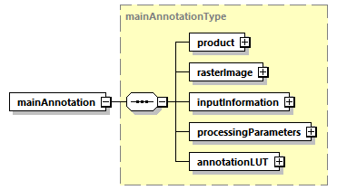

Fig. 3 — Main L2a ADS

:::

(tab:pfd-agb-4)=
:::{div} atbd-table

Table 4 — Main L2a ADS

| Name | Description | Data Type | Cardinality |
|---|---|---|---|
| product | Product L2a DSR. This DSR contains the L2a product information. | `productL2aType` | 1 |
| `rasterImage` | Raster image DSR. This DSR contains all the necessary information to exploit the L2a product raster images. | `rasterImageType` | 1 |
| InputInformation | Input Information L2a DSR. This DSR contains the necessary information to identify the input data set to the L2a processing. | InputInformationL2aType | 1 |
| `processingParameters` | Processing parameters DSR. This DSR contains the description of L2a processing parameters. | `processingParametersL2aType` | 1 |
| annotationLUT | Annotation LUT DSR. This DSR contains the list of Look-Up Tables (LUTs) complementing product main annotations. | `layerListType` | 1 |

:::

The content of each DSR is described making use of tables as the one here above. All the tables share the same structure and are filled following the same conventions, i.e.:

- Name: defines the name of the element or attribute;
- Description: describes the purpose of the element or attribute including the units (if applicable). The absence of a unit designation for string data types implies a string literal and for numerical data types (integers, floats, etc.…) the absence of a unit designation implies an absolute number;
- Data Type: defines the data type of the element or attribute;
- Cardinality: for elements, this column defines the number of occurrences of the element in the form `minOccurs..maxOccurs`; for attributes, “optional” means the attribute may or may not be present and “required” means the presence of the attribute is mandatory.

In general, elements are displayed in normal font, attributes are displayed in italics.

Data types requiring a dedicated definition table are underlined, for all the others the common reference is {sec}`7.1.1`.

(sec:pfd-agb-4-3-1-1)=
##### 4.3.1.1 Product L2a DSR

This DSR contains the parameters to describe the L2a product.

An overview is provided by figure and table below.

(fig:pfd-agb-4)=
:::{div} atbd-mermaid-figure

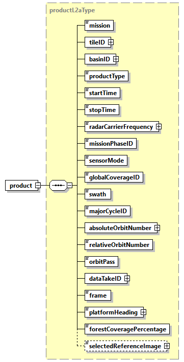

Fig. 4 — Product L2a DSR (productL2aType)

:::

(tab:pfd-agb-5)=
:::{div} atbd-table

Table 5 — Product L2a DSR (productL2Type)

| Name | Description | Data Type | Cardinality |
|---|---|---|---|
| mission | Mission (BIOMASS). | `missionType` | 1 |
| tileID | List of DGG geographic cell (tile) identifiers. | `stringListType` | 1 |
| basinID | List of DGG Basin identifiers. | `stringListType` | 1 |
| `productType` | Product type (“`GN_L2A`”). | `productType` | 1 |
| `startTime` | Start time of the product image [UTC]. | `timeType` | 1 |
| `stopTime` | Stop time of the product image [UTC]. | `timeType` | 1 |
| `radarCarrierFrequency` | Radar carrier frequency [Hz]. | `doubleWithUnit` | 1 |
| `missionPhaseID` | Mission phase identifier. | `missionPhaseIDType` | 1 |
| `sensorMode` | Sensor mode (always Measurement). | `sensorModeType` | 1 |
| `globalCoverageID` | Global coverage identifier. | `xsd:unsignedShort` | 1 |
| swath | Swath (S1, S2, S3). | `swathType` | 1 |
| `majorCycleID` | Major cycle identifier. | `xsd:unsignedShort` | 1 |
| `absoluteOrbitNumber` | List of absolute orbit numbers at start time (one for each input L1c). | `integerListType` | 1 |
| `relativeOrbitNumber` | Relative orbit number (track) at start time | `xsd:unsignedShort` | 1 |
| `orbitPass` | Orbit pass (Ascending, Descending). | `orbitPassType` | 1 |
| `dataTakeID` | List of data take identifiers (one for each input L1c). | `integerListType` | 1 |
| frame | Frame identifier. | `xsd:unsignedShort` | 1 |
| `platformHeading` | Platform heading relative to North [deg]. | `doubleWithUnit` | 1 |
| `forestCoveragePercentage` | Forest coverage of the input STA products, compute as a percentage of all the pixels in the STA footprint. | double | 1 |
| `selectedReferenceImage` | Index of the input STA acquisition selected as optimal reference image (guaranteeing the widest scene coverage),used during ground cancellation. Optional element, present only when ground cancellation is performed (FD, GN) and `operationalMode` configuration has been set to “single reference” | `selectedReferenceImageType` | 0,1 |

:::

(tab:pfd-agb-6)=
:::{div} atbd-table

Table 6 — stringListType

| Name | Description | Data Type | Cardinality |
|---|---|---|---|
| ID | Tile identifier string | string | 1 .. unbounded |

:::

(tab:pfd-agb-7)=
:::{div} atbd-table

Table 7 — integerListType

| Name | Description | Data Type | Cardinality |
|---|---|---|---|
| val | Integer value | uint32 | 1 .. unbounded |

:::

(tab:pfd-agb-8)=
:::{div} atbd-table

Table 8 — selectedReferenceImageType

| Name | Description | Data Type | Cardinality |
|---|---|---|---|
| acquisitionID | Acquisition folder name, to better identify the input image referred by the integer value. | `xsd:string` | 1 |
| `selectedReferenceImage` | Zero based Integer value of the selected reference image, based on the image reading order. | `xsd:unsignedByte` | 1 |

:::

(sec:pfd-agb-4-3-1-2)=
##### 4.3.1.2 Raster Image DSR

This DSR contains all the necessary information to exploit the raster images of the product. An overview is provided by figure and table below.

(fig:pfd-agb-5)=
:::{div} atbd-mermaid-figure

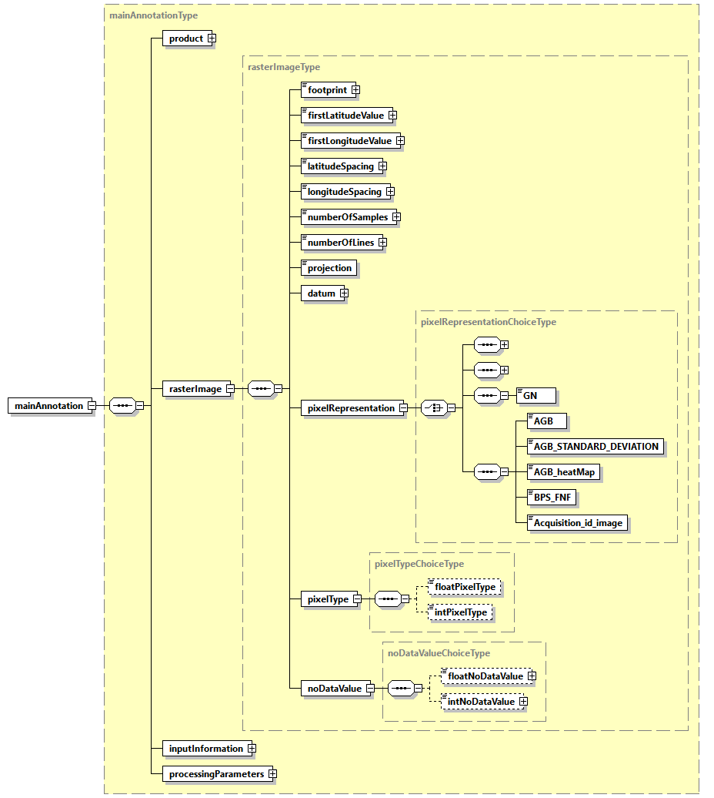

Fig. 5 — Raster image DSR (rasterImageType)

:::

(tab:pfd-agb-10)=
:::{div} atbd-table

Table 10 — Raster image DSR (rasterImageType)

| Name | Description | Data Type | Cardinality |
|---|---|---|---|
| footprint | Image footprint, expressed as a list of latitude, longitude tuples in NE, SE, SW, NW order [deg]. | `floatArrayWithUnits` | 1 |
| `firstLatitudeValue` | First latitude value of the image [deg]. | `floatWithUnit` | 1 |
| `firstLongitudeValue` | First longitude value of the image [deg]. | `floatWithUnit` | 1 |
| `latitudeSpacing` | Latitude spacing between samples [deg]. | `floatWithUnit` | 1 |
| `longitudeSpacing` | Longitude spacing between samples [deg]. | `floatWithUnit` | 1 |
| numberOSamples | Total number of samples in the image. | `xsd:unsignedInt` | 1 |
| `numberOfLines` | Total number of lines in the image. | `xsd:unsignedInt` | 1 |
| projection | Projection of the image: latitude longitude based on DGG. | `projectionType` | 1 |
| datum | Datum used during processing. | `datumType` | 1 |
| `pixelRepresentation` | Representation of the image pixels within the image MDS. | `pixelRepresentationChoiceType` | 1 |
| `pixelType` | Data type of output pixels within the image MDS. | `pixelTypeChoiceType` | 1 |
| `noDataValue` | Pixel value in case of invalid data. The value is always set to -9999.0 float32 or 255 ubyte, depending on data type, see {sec}`3`. | `noDataValueChoiceType` | 1 |

:::

(tab:pfd-agb-11)=
:::{div} atbd-table

Table 11 — pixelRepresentationChoiceType (only L2a GN choice described here)

| Name | Description | Data Type | Cardinality |
|---|---|---|---|
| GN | Representation of the image pixels within the image MDS: Ground Cancelled Backscatter | `pixelRepresentationType` | 1 |
| AGB | Representation of the image pixels within the image MDS: AGB (only L2b) | `pixelRepresentationType` | 1 |
| `AGB_STANDARD_DEVIATION` | Representation of the image pixels within the image MDS: AGB Standard deviation (only L2b) | `pixelRepresentationType` | 1 |
| `AGB_heatMap` | Representation of the image pixels within the image MDS: AGB heat map (only L2b) | `pixelRepresentationType` | 1 |
| `BPS_FNF` | Representation of the image pixels within the image MDS: BPS forest mask (only L2b) | `pixelRepresentationType` | 1 |
| Acquisition\_id\_image | Representation of the image pixels within the image MDS: acquisition id image (only L2b) | `pixelRepresentationType` | 1 |

:::

(tab:pfd-agb-12)=
:::{div} atbd-table

Table 12 — pixelTypeChoiceType

| Name | Description | Data Type | Cardinality |
|---|---|---|---|
| `floatPixelType` | Data type of output pixels within the image MDS: 32 bit Float | `pixelTypeType` | 1 |
| `intPixelType` | Integer data type of output pixels within the image MDS: 8 bit Unsigned Integer (L2b only) | `pixelTypeType` | 0,1 |

:::

(tab:pfd-agb-13)=
:::{div} atbd-table

Table 13 — noDataValueChoiceType

| Name | Description | Data Type | Cardinality |
|---|---|---|---|
| `floatNoDataValue` | Pixel value in case of invalid data. The value is always set to -9999.0 | `xsd:float` | 1 |
| `intNoDataValue` | Pixel value in case of invalid data. The value is always set to +255 (L2b only) | `xsd:unsignedByte` | 0,1 |

:::

(sec:pfd-agb-4-3-1-3)=
##### 4.3.1.3 Input Information DSR

This DSR contains information about the L1c acquisitions in input to the L2a processor.

An overview is provided by figures and tables below.

(fig:pfd-agb-6)=
:::{div} atbd-mermaid-figure

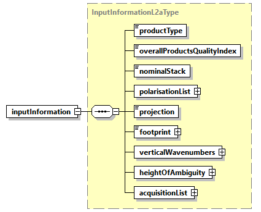

Fig. 6 — Input Information DSR (InputInformationL2aType)

:::

(fig:pfd-agb-7)=
:::{div} atbd-mermaid-figure

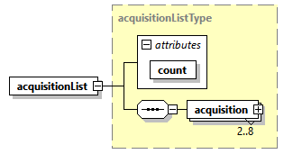

Fig. 7 — Input Information DSR, acquisition list detail (acquisitionListType)

:::

(fig:pfd-agb-8)=
:::{div} atbd-mermaid-figure

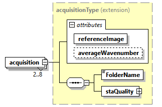

Fig. 8 — Input Information DSR, acquisition detail (acquisitionType)

:::

(fig:pfd-agb-9)=
:::{div} atbd-mermaid-figure

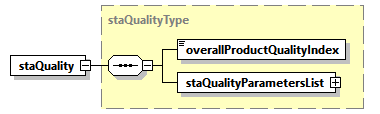

Fig. 9 — Input information DSR, staQualityType

:::

(fig:pfd-agb-10)=
:::{div} atbd-mermaid-figure

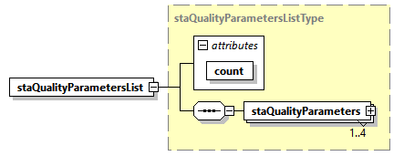

Fig. 10 — Input information DSR, staQualityParametersListType

:::

(fig:pfd-agb-11)=
:::{div} atbd-mermaid-figure

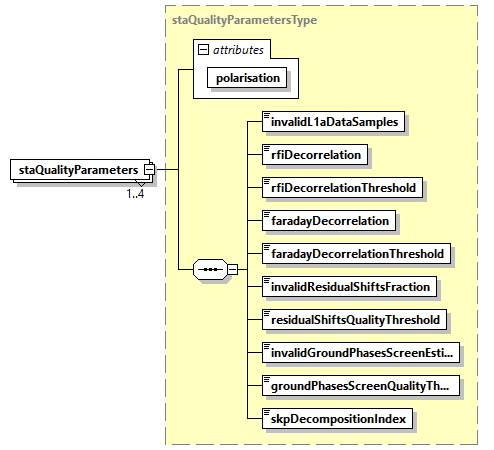

Fig. 11 — Input information DSR, staQualityParametersType

:::

(tab:pfd-agb-14)=
:::{div} atbd-table

Table 14 — Input Information DSR (InputInformationL2aType)

| Name | Description | Data Type | Cardinality |
|---|---|---|---|
| `productType` | Input product type: always “STA” (L1c STA) | `productType` | 1 |
| `overallProductsQualityIndex` | Quality index based on the "`overallProductQualityIndex`" of the single STA input data, giving a qualitative overall idea of the input stack. Equal to "0" if all STA feature "`overallProductQualityIndex`"=False and to "1" if at least one is degraded. | `xsd:unsignedByte` | 1 |
| `nominalStack` | True if it is a nominal stack (3 STA products for INT phase or 7 STA products for TOM phase), False otherwise | bool | 1 |
| `polarisationList` | List of polarisations composing input L1c data: for each polarisation it is also specified, with an attribute, the decorrelation factors due to RFI strength. | `polarisationListType` | 1 |
| projection | Projection of the input acquisitions, always “Slant Range”. | `projectionType` | 1 |
| footprint | Image footprint of all the acquisitions composing the stack, expressed as a list of latitude, longitude tuples in NE, SE, SW, NW order [deg]. | `floatArrayWithUnits` | 1 |
| `verticalWavenumbers` | Minimum and maximum values of the vertical wavenumbers [rad/m] in the read and used Input STA products. | `minMaxTypeWithUnit` | 1 |
| `heightOfAmbiguity` | Minimum and maximum values of the height of ambiguity (HoA) [m], computed from the vertical wavenumbers in the read and used Input STA products. | `minMaxTypeWithUnit` | 1 |
| `acquisitionsList` | Info of each acquisition composing the stack, in input to L2a. | `acquisitionListType` | 1 |

:::

The `acquisitionListType` is composed by 2 to 8 entries, where each entry is an L1c acquisition folder name string, as defined in {rd}`10` (or a couple of images for the images pair selection for ground cancellation, 4.3.1.4)

(tab:pfd-agb-15)=
:::{div} atbd-table

Table 15 — Input information DSR (acquisitionListType)

| Name | Description | Data Type | Cardinality |
|---|---|---|---|
| count | Number of acquisitions. | `unsignedInt` | required |
| acquisition | Info about acquisition of the stack. | `acquisitionType` | 2..8 |

:::

(tab:pfd-agb-16)=
:::{div} atbd-table

Table 16 — Input information DSR (acquisitionType)

| Name | Description | Data Type | Cardinality |
|---|---|---|---|
| `referenceImage` | Flag to indicate if this is the reference image or not. | bool | 1 |
| `averageWavenumber` | Optional Average Wavenumber, it is not used in GN (only in L2A FD) | `xsd:float` | 0 |
| FolderName | Folder name which univocally identifies an acquisition of the stack. | `xsd:string` | 1 |
| `staQuality` | Folder name which univocally identifies an acquisition of the stack, as defined in {rd}`10` | `staQualityType` | 1 |

:::

(tab:pfd-agb-17)=
:::{div} atbd-table

Table 17 — Input information DSR (staQualityType)

| Name | Description | Data Type | Cardinality |
|---|---|---|---|
| `overallProductQualityIndex` | Overall product quality index. This annotation is calculated based on specific quality parameters and gives an overall quality value to the product. Equal to 0 for valid products and to 1 for invalid ones. | `xsd:unsignedInt` | 1 |
| `staQualityParametersList` | Quality parameters list. The list contains an entry for each output product’s polarisation. | `staQualityParametersListType` | 1 |

:::

(tab:pfd-agb-18)=
:::{div} atbd-table

Table 18 — STA quality DSR (staQualityParametersListType)

| Name | Description | Data Type | Cardinality |
|---|---|---|---|
| count |   | `xsd:unsignedInt` | required |
| `staQualityParameters` | Quality parameters for the current polarisation. | `staQualityParametersType` | 1 .. 4 |

:::

(tab:pfd-agb-19)=
:::{div} atbd-table

Table 19 — STA quality DSR (staQualityParametersType)

| Name | Description | Data Type | Cardinality |
|---|---|---|---|
| polarisation |   | `polarisationType` | required |
| `invalidL1aDataSamples` | Number of invalid L1a data samples (according to their mean and standard deviation), expressed as a normalized fraction of the total number of samples. The value is between 0 and 1. | `xsd:float` | 1 |
| `rfiDecorrelation` | Decorrelation factor due to RFI strength. The value is between 0 and 1. | `xsd:float` | 1 |
| `rfiDecorrelationThreshold` | Maximum decorrelation factor due to RFI strength admissible to use the image as the primary image. The value is between 0 and 1 and copied from the AUX-PPS. | `xsd:float` | 1 |
| `faradayDecorrelation` | Decorrelation factor due to Faraday residual. The value is between 0 and 1. | `xsd:float` | 1 |
| `faradayDecorrelationThreshold` | Maximum decorrelation factor due to Faraday residual admissible to use the image as the primary image. The value is between 0 and 1 and copied from AUX-PPS. | `xsd:float` | 1 |
| `invalidResidualShiftsFraction` | Number of invalid residual coregistration shifts, expressed as a normalized fraction of the total number of residual coregistration shifts. The value is between 0 and 1. | `xsd:float` | 1 |
| `residualShiftsQualityThreshold` | Threshold on residual coregistration shifts quality. The value is between 0 and 1 and copied from AUX-PPS. Residual shifts with a quality lower than this threshold are not used for processing. | `xsd:float` | 1 |
| `invalidGroundPhasesScreenEstimatesFraction` | Number of invalid ground phase screen estimates, expressed as a normalized fraction of the total number of ground phase screen estimates. The value is between 0 and 1. | `xsd:float` | 1 |
| `groundPhasesScreenQualityThreshold` | Threshold on ground phase screen estimation quality. The value is between 0 and 1 and copied from the AUX-PPS. Estimates with a quality lower than this threshold are not corrected. Used only in case `skpPhaseCorrectionFlag` is set to True. | `xsd:float` | 1 |
| `skpDecompositionIndex` | Error code for the SKP decomposition. Positive if the SKP decomposition hit a nonblocking contingency case (e.g. SVD decomposition failure etc.) and the exported SKP-related LUTs contain values obtained from a contingency handling procedure. 0 otherwise. | `xsd:unsignedInt` | 1 |

:::

(tab:pfd-agb-20)=
:::{div} atbd-table

Table 20 — Input information DSR (polarisationListType)

| Name | Description | Data Type | Cardinality |
|---|---|---|---|
| count |   | `xsd:unsignedInt` | required |
| polarisation | Polarisation (HH, VH, VV). | `polarisationType` | 3 |

:::

(sec:pfd-agb-4-3-1-4)=
##### 4.3.1.4 Processing parameters L2a DSR

This DSR contains the exhaustive list of L2a processing parameters applied (ground cancellation). An overview is provided by figure and table below.

(fig:pfd-agb-12)=
:::{div} atbd-mermaid-figure

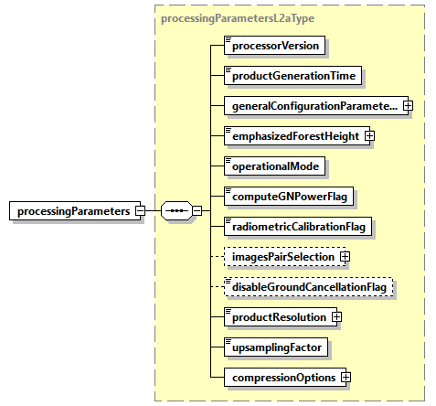

Fig. 12 — Processing parameters L2a DSR (processingparametersL2aType)

:::

(tab:pfd-agb-21)=
:::{div} atbd-table

Table 21 — Processing parameters L2a DSR (processingparametersL2aType)

| Name | Description | Data Type | Cardinality |
|---|---|---|---|
| `processorVersion` | Version of the processor used to generate the product. | `xsd:string` | 1 |
| `productGenerationTime` | Product generation time [UTC]. | `timeType` | 1 |
| `generalConfigurationParameters` | General processing flags (not specific to the ground cancellation processing). | `generalConfigurationParametersType` | 1 |
| `emphasizedForestHeight` | Single value of the height [m] for all the pixels and polarizations, which has been emphasized during ground cancellation {ad}`8`. | `floatWithUnit` | 1 |
| `operationalMode` | Ground Cancellation method used between the followings. “multi reference”: multiple data computation using each image as reference, followed by data averaging. or “insar pair”: debug operational mode, perform computation with only the two images specified in the optional element `imagesPairSelection`. Note: in case of only two images available, the `operationalMode` is automatically set to “insar pair” (without the need of `imagesPairSelection` element). | `operationalModeType` | 1 |
| computeGNPowerFlag | True if the returned GN L2a image is an absolute squared value (power), False if it is the complex value. The flag is ineffective in case of multi reference operational mode (in this case the result is real only) | bool | 1 |
| `radiometricCalibrationFlag` | True if the incidence angle radiometric calibration has been applied, False otherwise. | bool | 1 |
| `imagesPairSelection` | Optional: if `operationalMode` is “insar pair” and if this element is present, this means that ground cancellation has being performed using only the two images specified here. | `acquisitionListType` | 0..1 |
| `disableGroundCancellationFlag` | False, if the ground cancellation has been performed. True, if ground cancellation has been disabled. Optional, default is False. | bool | 0..1 |
| `productResolution` | Multi-look windows size in [m] (product resolution), used after ground cancellation. | `floatWithUnit` | 1 |
| `upsamplingFactor` | Upsampling factor used. | `xsd:unsignedByte` | 1 |
| `compressionOptions` | Configurable compression options for the L2a MDS COG and ADS NetCDF LUT variables (see 4.3.2 for LUT “ZLIB” compression details). | `compressionOptionsL2aType` | 1 |

:::

(fig:pfd-agb-13)=
:::{div} atbd-mermaid-figure

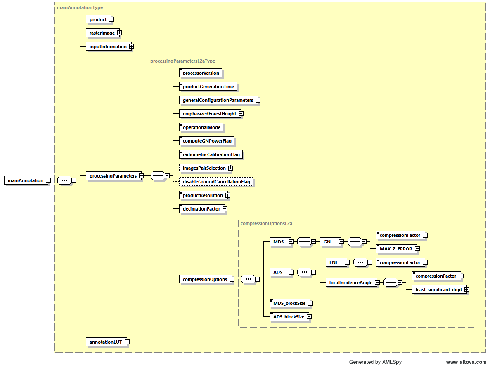

Fig. 13 — Processing parameters L2a DSR (compressionOptionsL2aType)

:::

(tab:pfd-agb-22)=
:::{div} atbd-table

Table 22 — Processing parameters L2a DSR (compressionOptionsL2aType)

| Name | Description | Data Type | Cardinality |
|---|---|---|---|
| MDS à GN àcompressionFactor | ZSTD algorithm compression factor for the ground cancelled backscatter images MDS. From 0 to 9, where zero means no compression. | `xsd:unsignedByte` | 1 |
| MDS à GN àMAX\_Z\_ERROR | For the ground cancelled backscatter images MDS, define exactly how lossy the LERC compression algorithm is allowed to be, specifying the absolute maximum error admitted. Zero means loss-less compression. | `xsd:float` | 1 |
| ADS àFNF à `compressionFactor` | ZLIB algorithm compression factor for the FNF ADS. From 0 to 9, where zero means no compression. | `xsd:unsignedByte` | 1 |
| `MDS_blockSize` | MDS COG blocking algorithm size. Same value is used for both data array dimensions. | `xsd:unsignedByte` | 1 |
| `ADS_blockSize` | ADS NetCDF chunking algorithm size. Same value is used for both data array dimensions. | `xsd:unsignedByte` | 1 |
| ADS à `localIncidenceAngle` à `compressionFactor` | ZLIB algorithm compression factor for the local incidence angle ADS. From 0 to 9, where zero means no compression. | `xsd:unsignedByte` | 1 |
| ADS à `localIncidenceAngle` à least\_significant\_digit | For the local incidence angle ADS, define exactly how lossy the ZLIB compression algorithm is allowed to be, specifying the power of ten of the smallest decimal place in the data that is a reliable value. | `xsd:unsignedByte` | 1 |

:::

(fig:pfd-agb-14)=
:::{div} atbd-mermaid-figure

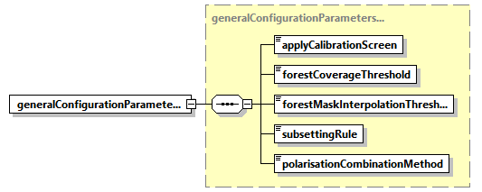

Fig. 14 — Processing parameters L2a DSR (generalConfigurationParametersType)

:::

(tab:pfd-agb-23)=
:::{div} atbd-table

Table 23 — Processing parameters L2a DSR (generalConfigurationParametersType)

| Name | Description | Data Type | Cardinality |
|---|---|---|---|
| `applyCalibrationScreen` | Phase calibration performed: “none”: no phase screen has been applied “geometry”: only flattening phase screen has been applied (i.e., as computed from acquisition geometry) “skp”: complete phase screen has been applied (default) | `calibrationScreenType` | 1 |
| `forestCoverageThreshold` | Minimum percentage forest coverage in L2a product footprint, used to trigger L2a processing. | `xsd:float` | 1 |
| `forestMaskInterpolationThreshold` | This parameter is a threshold which has been used to fix rounding of pixels with decimal values originated from binary FNF interpolation onto L2a grid. This created a safety buffer around forest border. | `xsd:float` | 1 |
| `subsettingRule` | In case of more than three acquisitions the user selected subsetting rule is here annotated (“geometry” or “maintain all”) | `subsettingRuleType` | 1 |
| `polarisationCombinationMethod` | Polarisations combination method: “HV” or “VH”, if just one of the two is selected (in addition to HH and VV ones); “Average”, if the average of HV and VH is computed and used; “None” if no combination is performed (all the four polarizations are used). | `polarisationCombinationMethodType` | 1 |

:::

(sec:pfd-agb-4-3-1-5)=
##### 4.3.1.5 Annotation LUT DSR

This DSR contains the list of Look-Up Tables (LUTs) complementing product main annotations. An overview is provided by figure and table below.

(fig:pfd-agb-15)=
:::{div} atbd-mermaid-figure

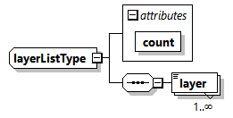

Fig. 15 — Annotation LUT DSR (layerListType)

:::

(tab:pfd-agb-24)=
:::{div} atbd-table

Table 24 — Annotation LUT DSR (layerListType)

| Name | Description | Data Type | Cardinality |
|---|---|---|---|
| count | Number of layers. | `xsd:string` | required |
| layer | LUT layer content. | `layerType` | 1 .. unbounded |

:::

(sec:pfd-agb-4-3-2)=
#### 4.3.2 Look-Up Tables (LUT) ADS

This section describes in details the content of Look-Up Tables (LUT) ADS.

This ADS complements the Main ADS one, including those annotations that can be represented as 2D maps of values. This approach has been chosen in order to avoid worsening the Main ADS readability and handling, and also to provide an easier access to such information.

The format adopted for LUT ADS is NetCDF {rd}`6` and in particular the used implementation is the Python NetCDF4 {rd}`7`. Thanks to the flexibility provided by this format, all the components of this ADS are stored in the same file.

The LUT ADS provides the FNF generated outside of BPS from aggregated C3S LCM {ad}`6` {ad}`7` {ad}`8` {ad}`9` and the incidence angle image, which takes into account terrain local slope.

{fig}`Fig.|16` provides a schematic representation of the LUT ADS structure. Note that an XSD diagram has been used for this purpose, even if there is no link between the two formats. The ADS is organised as follows:

- a series of root level Attributes, containing all those global parameters referring to the product as a whole;
- a Dimensions group, where names and lengths of the dimensions used when creating data arrays are here defined;
- a series of Coordinate variables, special variables to store the axis data values, for each dimension in the Dimensions group;
- a series of components (group of variables), one for each LUT stored in the ADS. Each component is composed by a group of variables which can be divided in:
    - the data arrays, storing the annotation Look-Up Tables themselves. A variable represents an array of values of the same data type and it is defined over two or more dimensions from the Dimensions group;
    - ancillary scalar variables containing other useful metadata to complete the LUT definition.

(fig:pfd-agb-16)=
:::{div} atbd-mermaid-figure

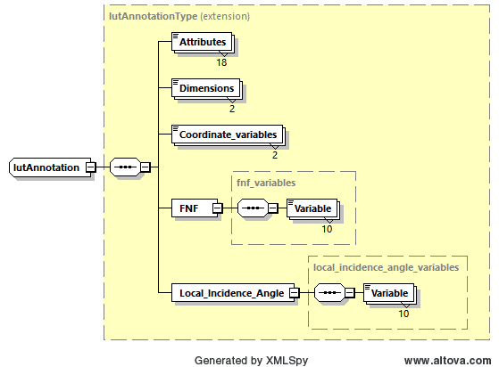

Fig. 16 — Look-Up Tables (LUT) ADS

:::

**Compression strategy**

One LUT ADS data variable is composed by real values, the other is a binary one: it is possible to introduce with benefit a strategy for data compression making use of native Python NetCDF4 capabilities {rd}`7` depending on the data type, using a ZLIB compression, featuring:

- for the binary FNF, a compression level from 0 to 9 (loss-less), where zero means no compression;
- for the real data variable (incidence angle) a compression level from 0 to 9, where zero means no compression and an additional option “least\_significant\_digit” to decide how lossy the compression will be.

All set by configuration, more details in {sec}`4.3.1.4`.

(sec:pfd-agb-4-3-2-1)=
##### 4.3.2.1 Look-Up tables detailed content

The content of L2a LUT ADS is reported hereafter, where:

- the series of Attributes contain the same list of parameters described in {sec}`4.3.1.1` for the Product L2a DSR (for all the details about these parameters refer to this section)
- the Dimensions group is composed by Latitude and Longitude, as the data array variable is defined in the Latitude Longitude based on DGG projection
- this notation is applicable:
    - this is the attribute or variable name
    - this is the actual content of constant values over the mission
    - this is a description of values content which depends on the processing

LUT ADS Attributes:

mission: “BIOMASS”

tileID: [string] json encoded list of DGG geographic tile identifiers

basinID: [string] json encoded list of DGG Basin identifiers

`productType`: “FP\_GN\_\_L2A”

`startTime`: [str: YYYY-MM-DD hh:mm:ss.ppp] Start time of the product image, UTC

`stopTime`: [str: YYYY-MM-DD hh:mm:ss.ppp] Stop time of the product image, UTC

`radarCarrierFrequency`: [float32] Radar carrier frequency [Hz]

`missionPhaseID`: [str: COM, TOM or INT] Mission phase identifier

`sensorMode`: “Measurement”

`globalCoverageID`: [uint16] Global coverage identifier

swath: [str: S1, S2 or S3] BIOMASS swath identifier

`majorCycleID`: [uint16] Major cycle identifier

`absoluteOrbitNumber`: [list of uint32] List of absolute orbit numbers at start time (one for each input L1c)

`relativeOrbitNumber`: [uint16] Relative orbit number (track) at start time

`orbitPass`: [str: Ascending or Descending] Orbit pass

`dataTakeID`: [string] json encoded list of data take identifiers (one for each input L1c)

frame: [uint16] Frame identifier

platform\_heading: [float32] Platform heading relative to North, deg

forest\_coverage\_percentage: [float32] Forest coverage of the input STA products, compute as a percentage of all the pixels in the STA footprint

selected\_reference\_image Optional [uint16] Index of the input STA acquisition selected as optimal reference image (guaranteeing the widest scene coverage), used during ground cancellation. Optional element, present only when ground cancellation is performed (FD, GN) and `operationalMode` configuration has been set to “single reference”

acquisition\_id\_reference\_image Optional [str] Acquisition folder name, to better identify the input image referred by the `selectedReferenceImage`

LUT ADS Dimensions / Coordinate variables:

Name: Latitude

size: [int] size

type: dtype(float32)

units: deg

description: LUTs latitude axis

Name: Longitude

size: [int] size

type: dtype(float32)

units: deg

description: LUTs longitude axis

LUT ADS group of variables:

Group Name: FNF

FNF group contents:

Name: FNF

dimensions: (Longitude, Latitude)

shape: ([int] x shape, [int] y shape)

type: dtype(ubyte)

description: Forest/Non-Forest mask {ad}`6` {ad}`1` {ad}`8` {ad}`9`: this is an external image, defined outside of BPS from aggregated C3S LCM, representing the initial two-dimensional mask, defined in the latitude-longitude based on DGG projection, cropped to have a coverage containing the L2a Ground cancelled backscatter image product boundaries. It defines, for each geographical pixel, the presence or absence of forest.

Name: `firstSample`

shape: (1, 1)

type: dtype(uint32)

description: Product image MDS sample the first LUT sample corresponds to

Name: `firstLine`

shape: (1, 1)

type: dtype(uint32)

description: Product image MDS line the first LUT line corresponds to

Name: `samplesInterval`

shape: (1, 1)

type: dtype(uint32)

description: Number of product image MDS samples one LUT sample corresponds to

Name: `linesInterval`

shape: (1, 1)

type: dtype(uint32)

description: Number of product image MDS lines one LUT line corresponds to

Name: `pixelType`

shape: (1, 1)

type: \<class str\>

description: Data type of output LUT pixels

Name: `noDataValue`

shape: (1, 1)

type: dtype(ubyte)

description: Pixel value in case of invalid data. The value is always set to 255. (See 3)

Name: projection

shape: (1, 1)

type: \<class str\>

description: LUT projection, is the latitude-longitude based on DGG

Name: `coordinateReferenceSystem`

shape: (1, 1)

type: \<class str\>

description: Coordinate reference systems, as per WKT representation {rd}`7`

Name: `geodeticReferenceFrame`

shape: (1, 1)

type: \<class str\>

description: Geodetic reference frame

Group Name: `localIncidenceAngle`

Local Incidence Angle group contents:

Name: `localIncidenceAngle`

dimensions: (Longitude, Latitude)

shape: ([int] x shape, [int] y shape)

type: dtype(float32)

description: Local incidence angle image in radiants, which takes into account terrain local slope and defined in the latitude-longitude based on DGG projection, cropped to have a coverage containing the L2a Ground cancelled backscatter image product boundaries.

units: rad

Name: `firstSample`

shape: (1, 1)

type: dtype(uint32)

description: Product image MDS sample the first LUT sample corresponds to

Name: `firstLine`

shape: (1, 1)

type: dtype(uint32)

description: Product image MDS line the first LUT line corresponds to

Name: `samplesInterval`

shape: (1, 1)

type: dtype(uint32)

description: Number of product image MDS samples one LUT sample corresponds to

Name: `linesInterval`

shape: (1, 1)

type: dtype(uint32)

description: Number of product image MDS lines one LUT line corresponds to

Name: `pixelType`

shape: (1, 1)

type: \<class str\>

description: Data type of output LUT pixels

Name: `noDataValue`

shape: (1, 1)

type: dtype(float32)

description: Pixel value in case of invalid data. The value is always set to -9999.0. (See 3)

Name: projection

shape: (1, 1)

type: \<class str\>

description: LUT projection, DGG, as described in {rd}`8`

Name: `coordinateReferenceSystem`

shape: (1, 1)

type: \<class str\>

description: Coordinate reference systems, as per WKT representation {rd}`7`

Name: `geodeticReferenceFrame`

shape: (1, 1)

type: \<class str\>

description: Geodetic reference frame

Name: least\_significant\_digit

shape: (1, 1)

type: `unsignedByte`

description: Power of ten of the smallest decimal place in the data that is a reliable value, adopted to the data during ZLIB compression.

(sec:pfd-agb-4-3-1-6)=
#### 4.3.1 Quick-look ADS

The Quick-look ADS is composed by lower resolution version of the GN data image; it is stored in PNG file format, and it is always included with any BIOMASS L2 product.

The quantities are composed by real values, so the images are generated without any other processing than averaging and decimation.

L2a GN product, being full-polarisation (one cross polarization, with HV=VH), contain only one quick-look image which is a combination of the imagery from all the three polarisation channels. This is done exploiting the three Red-Green-Blue (RGB) channels of the PNG image and the Pauli decomposition colour coding scheme for L2a products, i.e.:

- Red channel: $\left\vert HH-VV \right\vert$ (double bounce);
- Green channel: $\left\vert HV+VH \right\vert$ (volume scattering);
- Blue channel: $\left\vert HH+VV \right\vert$ (surface scattering).

and the Lexicographic one for L1b products, i.e.:

- Red channel: $\left\vert HH \right\vert$;
- Green channel: $\frac{1}{2}\sqrt{{HV}^2+{VH}^2}$;
- Blue channel: $\left\vert VV \right\vert$.

(sec:pfd-agb-4-3-2-2)=
#### 4.3.2 Overlay ADS

The Overlay ADS is a Keyhole Markup Language (KML) file that describes the product coverage area and is suitable for viewing the Quick-look ADS in any application that supports KML format (like, e.g., Google Earth or GIS applications).

Its structure is described in the following figure and tables.

(fig:pfd-agb-17)=
:::{div} atbd-mermaid-figure

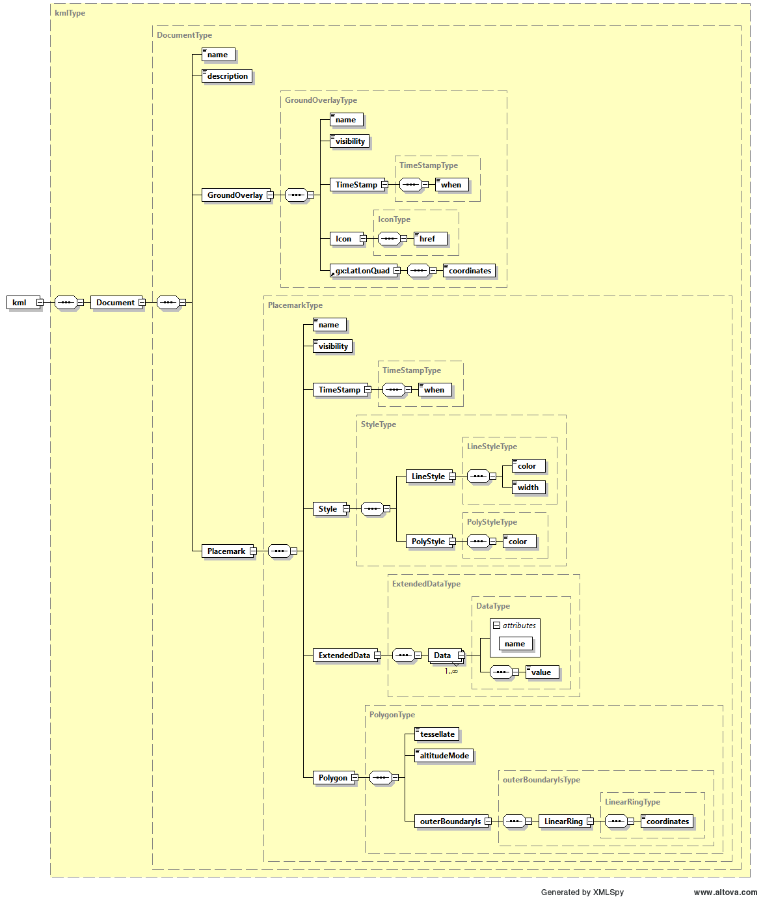

Fig. 17 — Overlay ADS

:::

(tab:pfd-agb-25)=
:::{div} atbd-table

Table 25 — Overlay ADS

| Name | Description | Data Type | Cardinality |
|---|---|---|---|
| Document | Document container for KML components. | DocumentType | 1 |

:::

(tab:pfd-agb-26)=
:::{div} atbd-table

Table 26 — Overlay ADS (DocumentType)

| Name | Description | Data Type | Cardinality |
|---|---|---|---|
| name | Name of the document. | `xsd:string` | 1 |
| description | Description of the document. | `xsd:string` | 1 |
| GroundOverlay | Contains the parameters required to specify the footprint of the image and overlay the quicklook image on a map. | GroundOverlayType | 1 |
| Placemark | Contains the metadata associated to the overlay. | PlacemarkType | 1 |

:::

(tab:pfd-agb-27)=
:::{div} atbd-table

Table 27 — Overlay ADS (GroundOverlayType)

| Name | Description | Data Type | Cardinality |
|---|---|---|---|
| name | Name of the ground overlay. | `xsd:string` | 1 |
| visibility | Specifies whether the feature is drawn in the 3D viewer when it is initially loaded (0: not visible, 1: visible). | `xsd:unsignedInt` | 1 |
| TimeStamp | Structure containing the time stamp of the overlay that can be used for dynamic visualizations over time. | TimeStampType | 1 |
| Icon | Structure describing the image file used on the map overlay. | IconType | 1 |
| LatLonQuad | Structure containing the latitude and longitude coordinates used to position the image overlay on the map. | LatLonQuadType | 1 |

:::

(tab:pfd-agb-28)=
:::{div} atbd-table

Table 28 — Overlay ADS (TimeStampType)

| Name | Description | Data Type | Cardinality |
|---|---|---|---|
| when | Overlay time stamp in ISO 8601 format (YYYY-MM-DDThh:mm:ss). | `xsd:string` | 1 |

:::

(tab:pfd-agb-29)=
:::{div} atbd-table

Table 29 — Overlay ADS (IconType)

| Name | Description | Data Type | Cardinality |
|---|---|---|---|
| href | A local file specification or URL used to load the desired image and overlay it on the map. | `xsd:string` | 1 |

:::

(tab:pfd-agb-30)=
:::{div} atbd-table

Table 30 — Overlay ADS (LatLonQuadType)

| Name | Description | Data Type | Cardinality |
|---|---|---|---|
| coordinates | A string of 5 lon,lat coordinate pairs which describe the corners of the image. The string is of the form: lon,lat lon,lat lon,lat lon,lat lon,lat The coordinates must appear in the following order: last line first pixel, last line last pixel, first line last pixel, first line first pixel, last line first pixel | `xsd:string` | 1 |

:::

(tab:pfd-agb-31)=
:::{div} atbd-table

Table 31 — Overlay ADS (PlacemarkType)

| Name | Description | Data Type | Cardinality |
|---|---|---|---|
| Name | Name of the placemark. | `xsd:string` | 1 |
| visibility | Specifies whether the feature is drawn in the 3D viewer when it is initially loaded (0: not visible, 1: visible). | `xsd:unsignedInt` | 1 |
| TimeStamp | Structure containing the time stamp of the placemark that can be used for dynamic visualizations over time | TimeStampType | 1 |
| Style | Structure describing the stype used to display the placemark. | StyleType | 1 |
| ExtendedData | Structure containing the metadata associated to the overlay. | ExtendedDataType | 1 |
| Polygon | Structure containing the latitude and longitude coordinates used to position the image overlay on the map. | PolygonType | 1 |

:::

(tab:pfd-agb-32)=
:::{div} atbd-table

Table 32 — Overlay ADS (StyleType)

| Name | Description | Data Type | Cardinality |
|---|---|---|---|
| LyneStyle | Line style. | LyneStyleType | 1 |
| PolyStyle | Polygon style. | PolyStyleType | 1 |

:::

(tab:pfd-agb-33)=
:::{div} atbd-table

Table 33 — Overlay ADS (LyneStyleType)

| Name | Description | Data Type | Cardinality |
|---|---|---|---|
| color | Line color in 32 bit hex format (AABBGGRR order). | `xsd:string` | 1 |
| width | Line width. | `xsd:unsignedInt` | 1 |

:::

(tab:pfd-agb-34)=
:::{div} atbd-table

Table 34 — Overlay ADS (PolyStyleType)

| Name | Description | Data Type | Cardinality |
|---|---|---|---|
| color | Polygon color in 32 bit hex format (AABBGGRR order). | `xsd:string` | 1 |

:::

(tab:pfd-agb-35)=
:::{div} atbd-table

Table 35 — Overlay ADS (ExtendedDataType)

| Name | Description | Data Type | Cardinality |
|---|---|---|---|
| Data | Metadata. | DataType | 1..inf |

:::

(tab:pfd-agb-36)=
:::{div} atbd-table

Table 36 — Overlay ADS (DataType)

| Name | Description | Data Type | Cardinality |
|---|---|---|---|
| value | Metadata value. | `xsd:string` | 1 |

:::

(tab:pfd-agb-37)=
:::{div} atbd-table

Table 37 — Overlay ADS ()

| Name | Description | Data Type | Cardinality |
|---|---|---|---|
| tessellate | Tessellate option. | `xsd:unsignedInt` | 1 |
| `altitudeMode` | Altitude mode option. | `xsd:string` | 1 |
| `outerBoundaryIs` | Polygon outer boundary description. | `outerBoundaryIsType` | 1 |

:::

(tab:pfd-agb-38)=
:::{div} atbd-table

Table 38 — Overlay ADS (outerBoundaryIsType)

| Name | Description | Data Type | Cardinality |
|---|---|---|---|
| LinearRing | Linear ring description. | LinearRingType | 1 |

:::

(tab:pfd-agb-39)=
:::{div} atbd-table

Table 39 — Overlay ADS (LinearRingType)

| Name | Description | Data Type | Cardinality |
|---|---|---|---|
| coordinates | A string of 5 lon,lat,height coordinate tuples which describe the corners of the image. The string is of the form: lon,lat,height lon,lat,height lon,lat,height lon,lat,height lon,lat,height The coordinates must appear in the following order: last line first pixel, last line last pixel, first line last pixel, first line first pixel, last line first pixel | `xsd:string` | 1 |

:::
