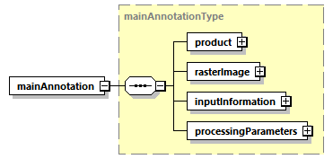
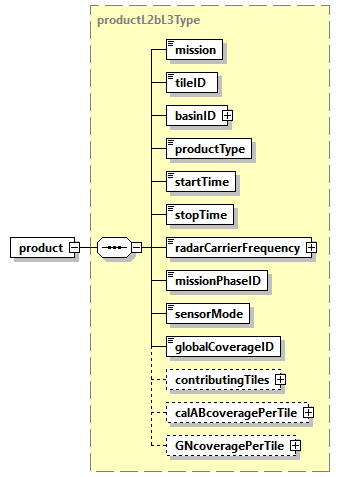
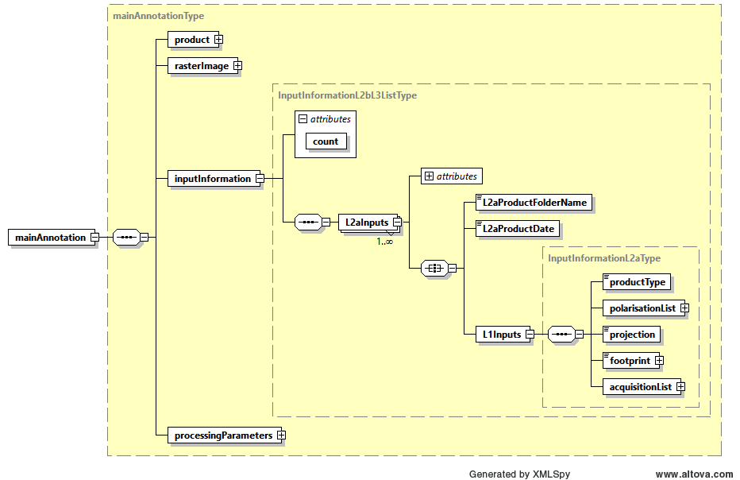
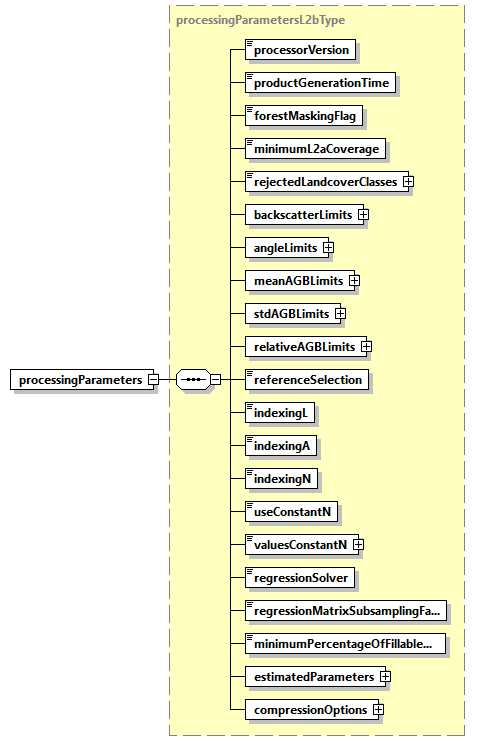
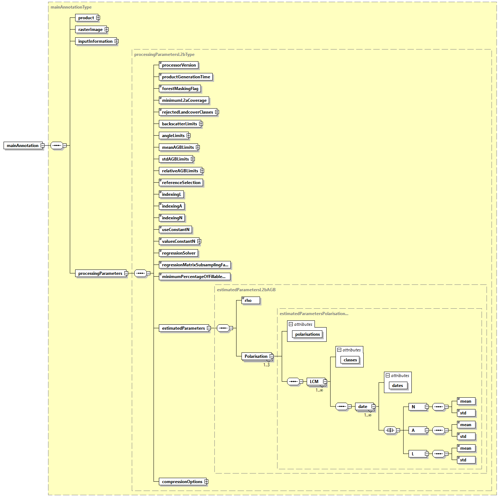
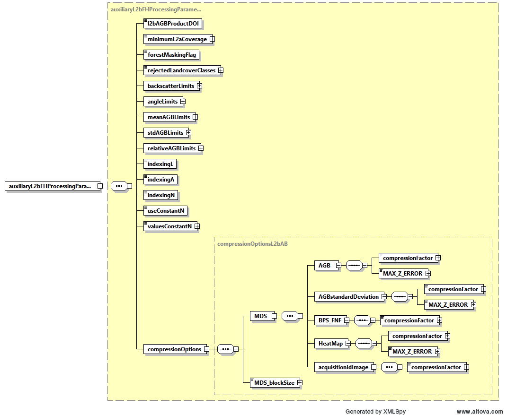

<!-- SPDX-FileCopyrightText: 2026 European Space Agency (ESA) -->
<!-- SPDX-License-Identifier: Apache-2.0 -->

:::{atbd-logo-banner}
:::

(sec:pfd-agb-6)=
# 6. L2b Products Format Specification

(sec:pfd-agb-6-1)=
### 6.1 Main Product header

The Main Product Header (MPH) is an XML file present in all the BIOMASS L2 products.

BIOMASS L2 products are folder based and the MPH is top level leaf of the product tree.

The MPH main scope is to provide all the information related to the:

- Genesis of the product;
- Identification of the product for example for cataloguing purposes;
- Product consistency (filesize).

For the detailed description of the MPH content and format refer to {ad}`3`. It is very similar to the one described in 4.1, without following fields, which are not present in L2b:

- eop:`swathIdentifier` Swath identifier
- eop:`orbitDirection` Orbit direction
- eop:`wrsLongitudeGrid` Track number
- eop:`wrsLatitudeGrid` Frame number
- sar:`antennaLookDirection` SAR antenna look direction

Instead, it has a new field “`agbTileStatus`” (see the “l2b only” comment reported also in 4.1), the field is under eop:`metaDataProperty`/bio:EarthObservationMetaData as:

eop:`metaDataProperty` Observation metadata

bio:EarthObservationMetaData

[…] (see 4.1)

**bio:`agbTileStatus` Flag raised when a new iteration is needed (l2b only)**

**bio:`agbTileIteration` iteration index (integer value, starting form 1) (l2b only)**

The field is a string, with following possible values ‘Complete’,, “NotComplete’, ‘Partial’ {ad}`10`

(sec:pfd-agb-6-2)=
### 6.2 Measurement data sets (MDS)

The MDS of the L2b products is constituted by following quantities:

- the dry weight of above ground biomass image binary raster data layer;
- a layer of quality indication for each of the above ground biomass image pixel;
- `BPS_FNF`: this is the annotation of Forest mask which defines, for each geographical pixel, the presence or absence of forest and which is used to discard invalid forest regions during aggregation of L2a in L2b products.

If the L2b FD product is provided as input, this MDS is the CFM pre-computed contained in L2b FD product, otherwise it is the FNF from L2a annotation LUT.

- a Heat Map annotation of integer numbers (ubyte) which stores, pixel wise, how many L1c images have been used to compute each pixel (this information is completed with the list of all L1c images used by the processor, see input information DSR 6.3.1.3).
- Acquisition ID Image: a multilayer image (COG format) where each contributing L2a input incidence map is stored (as a binary map); the number of layers is equal to the number of L2a inputs and their order is the same with respect to the L2a inputs ().

For all the images, following considerations are the same.

All the L2b image products are geocoded to specific BIOMASS tiling latitude-longitude geographic DGG, described in {rd}`9`, ensuring a ground sampling always better than the resolution.

In particular, we have that L2b images are aggregations of the L2a products insisting on the same location on ground (a single tile of the above DGG); a different number of L2a products may be available for the MDS geographic grid tile, based on tile dimensions and swath coverage.

The format used to store the L2b images is again the Cloud Optimized GeoTIFF (COG) {rd}`1`.

Details about COG format and its usage to store images are already explained in {sec}`4.2` for L2a products and apply as well to L2b products;

**Metadata**

Metadata is the same of the L2a one, already described in {sec}`4.2` and {ref}`Tab.2 <tab:pfd-agb-2>`. the only difference is the absence of “`MATRIX_REPRESENTATION`”, “PolarisationsSequence”, “Swath”, and “`POLARIMETRIC_INTERP`” metadata in L2b.

**Overviews**

Same considerations already explained in 4.2

(sec:pfd-agb-6-3)=
### 6.3 Annotation data sets (ADS)

(sec:pfd-agb-6-3-1)=
#### 6.3.1 Main ADS

This section describes in detail the content of main ADS for L2b products. Differences from L2b products are in the description, where needed.

An overview is provided by the two figures below and by the table which describes all the elements, both for L2b.

(fig:pfd-agb-19)=
:::{div} atbd-mermaid-figure

Fig. 19 — main L2b ADS

:::

(tab:pfd-agb-41)=
:::{div} atbd-table

Table 41 — Main L2b ADS

| Name | Description | Data Type | Cardinality |
|---|---|---|---|
| product | Product L2b DSR. This DSR contains the L2b product information. | `productL2bType` | 1 |
| `rasterImage` | Raster image DSR. This DSR contains all the necessary information to exploit the L2b raster images. | `rasterImageType` | 1 |
| InputInformation | Input Information L2b DSR. This DSR contains the necessary information to identify the L2a products in input to L2b processor and also a list of all the L1c acquisitions used to generate those L2a products. | InputInformationL2bL3ListType | 1 |
| `processingParameters` | Processing parameters DSR. This DSR contains the description of L2b processing parameters. | `processingParametersL2bType` | 1 |

:::

(sec:pfd-agb-6-3-1-1)=
##### 6.3.1.1 Product L2b DSR

This DSR contains the parameters to describe the L2b product.

An overview is provided by figures and table below.

(fig:pfd-agb-20)=
:::{div} atbd-mermaid-figure

Fig. 20 — product L2b DSR

:::

(tab:pfd-agb-42)=
:::{div} atbd-table

Table 42 — Product L2b DSR (productL2Type)

| Name | Description | Data Type | Cardinality |
|---|---|---|---|
| mission | Mission (BIOMASS). | `missionType` | 1 |
| tileID | DGG geographic cell (tile) identifier (one element list). | `xsd:string` | 1 |
| basinID | List of DGG basin identifiers. | `stringListType` | 1 |
| `productType` | Product type (`AGB_L2B`). | `productType` | 1 |
| `startTime` | Start time of the image [UTC]. | `timeType` | 1 |
| `stopTime` | Stop time of the image [UTC]. | `timeType` | 1 |
| `radarCarrierFrequency` | Radar carrier frequency [Hz]. | `doubleWithUnit` | 1 |
| `missionPhaseID` | Mission phase identifier. | `missionPhaseIDType` | 1 |
| `sensorMode` | Sensor mode (always Measurement). | `sensorModeType` | 1 |
| `globalCoverageID` | Global coverage identifier. | `xsd:unsignedShort` | 1 |
| `contributingTiles` | List of all the DGG tiles in the input neighbourhood, contributing for AGB parameter estimation (5x5 neighbourhood). Mandatory only in L2B AGB products. | `stringListType` | 0,1 |
| calABcoveragePerTile | `CAL_AB` coverage per tile [% and absolute numbers], for each of the tiles in the input neighbourhood for AGB parameter estimation (5x5 neighbourhood). Mandatory only in L2B AGB products. | calABcoverageTilesListType | 0,1 |
| GNcoveragePerTile | Input GN products coverage per tile [% and absolute numbers], for each of the tiles in the input neighbourhood for AGB parameter estimation (5x5 neighbourhood). Mandatory only in L2B AGB products. | GNcoverageTilesListType | 0,1 |

:::

(tab:pfd-agb-43)=
:::{div} atbd-table

Table 43 — Product L2b DSR (calABcoverageTilesListType)

| Name | Description | Data Type | Cardinality |
|---|---|---|---|
| ID | Tile ID | `xsd:string` | 1 |
| tile | `CAL_AB` coverage per tile [% and absolute numbers], for each of the tiles in the input neighbourhood for AGB parameter estimation | calABcoverageType | 0..25 |

:::

(tab:pfd-agb-44)=
:::{div} atbd-table

Table 44 — Product L2b DSR (calABcoverageType)

| Name | Description | Data Type | Cardinality |
|---|---|---|---|
| `originalCoverage` | `CAL_AB` original coverage, percentage and number of pixel values | `percentPixelsType` | 1 |
| `filteredCoverage` | `CAL_AB` filtered coverage, percentage and number of pixel values after each filtering. [RD] `BPS_AGB_ATBD` v3.1.2, equation 4.6 | calABfilteredCoverageType | 1 |

:::

(tab:pfd-agb-45)=
:::{div} atbd-table

Table 45 — Product L2b DSR (calABfilteredCoverageType)

| Name | Description | Data Type | Cardinality |
|---|---|---|---|
| `afterGlobalFiltering` | `CAL_AB` filtered coverage, percentage and number of pixel values after all filtering concatenated.[RD] `BPS_AGB_ATBD` v3.1.2, equation 4.6 | `percentPixelsType` | 1 |
| afterAGBvalueFiltering | `CAL_AB` filtered coverage, disaggregated percentage and number of pixel values after filtering only for mean AGB values limits. [RD] `BPS_AGB_ATBD` v3.1.2, equation 4.6 | `percentPixelsType` | 1 |
| afterAGBstdFiltering | `CAL_AB` filtered coverage, disaggregated percentage and number of pixel values after filtering only for AGB STD limits. [RD] `BPS_AGB_ATBD` v3.1.2, equation 4.6 | `percentPixelsType` | 1 |
| afterAGBrelativeStdFiltering | `CAL_AB` filtered coverage, disaggregated percentage and number of pixel values after filtering only for AGB relative STD limits. [RD] `BPS_AGB_ATBD` v3.1.2, equation 4.6 | `percentPixelsType` | 1 |
| afterLCMClassFiltering | `CAL_AB` filtered coverage, disaggregated percentage and number of pixel values after filtering only for LCM class. [RD] `BPS_AGB_ATBD` v3.1.2, equation 4.6, | `percentPixelsType` | 1 |

:::

(tab:pfd-agb-46)=
:::{div} atbd-table

Table 46 — Product L2b DSR (GNcoverageTilesListType)

| Name | Description | Data Type | Cardinality |
|---|---|---|---|
| ID | Tile ID | `xsd:string` | 1 |
| tile | Input GN products coverage, for each tile | GNcoverageListType | 0..25 |

:::

(tab:pfd-agb-47)=
:::{div} atbd-table

Table 47 — Product L2b DSR (GNcoverageListType)

| Name | Description | Data Type | Cardinality |
|---|---|---|---|
| acquisitionID | GN product acquisition ID | `xsd:string` | 1 |
| GN | Input GN product coverage, for each input GN (unbounded) and current tile | GNcoverageType | 1 unbounded |

:::

(tab:pfd-agb-48)=
:::{div} atbd-table

Table 48 — Product L2b DSR (GNcoverageType)

| Name | Description | Data Type | Cardinality |
|---|---|---|---|
| `originalCoverage` | Input GN product original coverage (current GN and current tile) percentage and number of pixel values | `percentPixelsType` | 1 |
| `filteredCoverage` | Input GN product filtered (current GN and current tile) percentage and number of pixel values after each filtering.[RD] `BPS_AGB_ATBD` v3.1.2, equation 4.5 | GNfilteredCoverageType | 1 |

:::

(tab:pfd-agb-49)=
:::{div} atbd-table

Table 49 — Product L2b DSR (GNfilteredCoverageType)

| Name | Description | Data Type | Cardinality |
|---|---|---|---|
| `afterGlobalFiltering` | Input GN product filtered coverage, percentage and number of pixel values after all filtering concatenate.[RD] `BPS_AGB_ATBD` v3.1.2, equation 4.5 | `percentPixelsType` | 1 |
| `afterSigmaFiltering` | Input GN product filtered coverage, disaggregated percentage and number of pixel values after filtering only for GN Sigma (backscatter) values limits. [RD] `BPS_AGB_ATBD` v3.1.2, equation 4.5, σ\_p^0 | `percentPixelsType` | 1 |
| `afterAngleFiltering` | Input GN product filtered coverage, disaggregated percentage and number of pixel values after filtering only for GN Incidence Angle values limits. [RD] `BPS_AGB_ATBD` v3.1.2, equation 4.5, ϑ | `percentPixelsType` | 1 |

:::

(tab:pfd-agb-50)=
:::{div} atbd-table

Table 50 — Product L2b DSR (percentPixelType)

| Name | Description | Data Type | Cardinality |
|---|---|---|---|
| percentage | Coverage in percentage of the whole Tile | `xsd:float` | 1 |
| pixels | Coverage in number of pixels of the whole Tile | `xsd:unsignedInt` | 1 |

:::

(sec:pfd-agb-6-3-1-2)=
##### 6.3.1.2 Raster Image L2b DSR

This DSR contains all the necessary information to exploit the raster images of all the L2b MDS, it is already described in {fig}`Fig.|4`, {ref}`Tab.10 <tab:pfd-agb-10>`, {ref}`Tab.11 <tab:pfd-agb-11>`, {ref}`Tab.12 <tab:pfd-agb-12>`, {ref}`Tab.13 <tab:pfd-agb-13>`, the differences are:

- the projection which here is the specific “DGG” described in {rd}`9`.
- {ref}`Tab.11 <tab:pfd-agb-11>` is replaced by {ref}`Tab.51 <tab:pfd-agb-51>` for the L2b AGB choice

(tab:pfd-agb-51)=
:::{div} atbd-table

Table 51 — pixelRepresentationChoiceType (only L2b AGB choice described here)

| Name | Description | Data Type | Cardinality |
|---|---|---|---|
| AGB | Representation of the image pixels within the image MDS: Above Ground Biomass [t/ha] | `pixelRepresentationType` | 1 |
| `AGB_STANDARD_DEVIATION` | Representation of the image pixels within the image MDS: Above Ground Biomass quality [t/ha] | `pixelRepresentationType` | 1 |
| `AGB_heatMap` | Representation of the image pixels within the image MDS: Heat Map | `pixelRepresentationType` | 1 |
| `BPS_FNF` | Representation of the image pixels within the image MDS: `BPS_FNFN` | `pixelRepresentationType` | 1 |
| Acquisition\_id\_image | Representation of the image pixels within the image MDS: Acquisition ID image | `pixelRepresentationType` | 1 |

:::

(sec:pfd-agb-6-3-1-3)=
##### 6.3.1.3 Input Information L2b DSR

This DSR contains, for each of the L2a Product in input to L2b processor:

- the folder name of L2a product;
- the L1c acquisitions used to generate that L2a product; it is an InputInformationL2aType, see description in 4.3.1.3 and {ref}`Tab.14 <tab:pfd-agb-14>`, {ref}`Tab.15 <tab:pfd-agb-15>`.

An overview is provided by figure below and in the table below for the L2inputs.

(fig:pfd-agb-21)=
:::{div} atbd-mermaid-figure

Fig. 21 — Input information L2b DSR (InputInformationL2bL3ListType)

:::

(tab:pfd-agb-52)=
:::{div} atbd-table

Table 52 — Input information L2b DSR (InputInformationL2bL3ListType )

| Name | Description | Data Type | Cardinality |
|---|---|---|---|
| count | XML attribute. | `xsd:unsignedInt` | required |
| L2aInputs | One entry for each L2a product in input to L2b. Each entry contains two elements: L2aProductFolderName and L1inputs. | L2aInputsType | 1..N |

:::

(tab:pfd-agb-53)=
:::{div} atbd-table

Table 53 — Input information L2b DSR (L2aInputsType)

| Name | Description | Data Type | Cardinality |
|---|---|---|---|
| L2aProductFolderName | Folder name of each L2a product, as defined in {sec}`3.2` (One string for each “L2aInputs" entry). | `xsd:string` | 1 |
| L2aProductDate | Product date for each L2a product | `xsd:string` | 1 |
| L1inputs | L1c acquisitions used to generate the L2a product. See 4.3.1.3 and {ref}`Tab.14 <tab:pfd-agb-14>`, {ref}`Tab.15 <tab:pfd-agb-15>`, {ref}`Tab.20 <tab:pfd-agb-20>`. (One element for each “L2aInputs" entry). | InputInformationL2aType | 1 |

:::

(sec:pfd-agb-6-3-1-4)=
##### 6.3.1.4 Processing parameters L2b DSR

This DSR contains the exhaustive list of L2b processing parameters applied. An overview is provided by figures and table below.

(fig:pfd-agb-22)=
:::{div} atbd-mermaid-figure

Fig. 22 — processing parameters L2b DSR

:::

(tab:pfd-agb-54)=
:::{div} atbd-table

Table 54 — Processing parameters L2b DSR

| Name | Description | Data Type | Cardinality |
|---|---|---|---|
| `processorVersion` | Version of the processor used to generate the product. | `xsd:string` | 1 |
| `productGenerationTime` | Product generation time [UTC]. | `timeType` | 1 |
| `forestMaskingFlag` | True if Forest/Non-Forest map masking has been performed during L2a products merging, false otherwise. | bool | 1 |
| `minimumL2aCoverage` | The minimum percentage of tile coverage used to trigger the computation. | `xsd:float` | 1 |
| `rejectedLandcoverClasses` | Set of landcover class indices ignored | `intArray` | 1 |
| `backscatterLimits` | Lower and upper limits on backscatter in linear units. Default values are 0.0001,100 for all polarisations) | BackscatterLimitsType | 1 |
| `angleLimits` | Used lower and upper limits on the local incidence angle [rad]. | `minMaxTypeWithUnit` | 1 |
| meanAGBLimits | Used lower and upper limits on the AGB mean in [t/ha]. | `minMaxTypeWithUnit` | 1 |
| stdAGBLimits | Used lower and upper limits on the AGB std in [t/ha] | `minMaxTypeWithUnit` | 1 |
| relativeAGBLimits | Used lower and upper limits on AGB standard deviation relative AGB mean (coefficient of variability), in linear units. | `minMaxType` | 1 |
| `referenceSelection` | Selection of reference data (second iteration only). String with following possible values: ‘`refOnly`’, ‘`firstIterationOnly`’, ‘`weightedMean`’ | `referenceSelectionType` | 1 |
| indexingL | Used “L” parameter variability with polarization ’p’, date ’j’, forest class ’k’ | `agbIndexingType` | 1 |
| indexingA | Used “a” parameter variability with polarization ’p’, date ’j’, forest class ’k’. | `agbIndexingType` | 1 |
| indexingN | Used “n” parameter variability with polarization ’p’, date ’j’, forest class ’k’. | `agbIndexingType` | 1 |
| `useConstantN` | If True, indexingN=p has been forced (for all polarisations). | bool | 1 |
| `valuesConstantN` | Values used if `useConstantN`=True. | `floatArray` | 1 |
| `regressionSolver` | Computational complexity used for the regression: “double” “float” | `xsd:string` | 1 |
| `regressionMatrixSubsamplingFactor` | Subsampling factor used during AGB regression, computed live basing on available RAM remaining (starting from job order Amount\_of\_RAM) | `xsd:unsignedByte` | 1 |
| `minimumPercentageOfFillableVoids` | The minimum percentage of invalid pixels which triggered a new iteration. | `xsd:float` | 1 |
| `estimatedParameters` | L2B AGB algorithm estimated inversion parameters “N”, “A”, “L”: the parameters can have variability along polarisations, LCM classes and temporal dates. | `estimatedParametersL2bAGBType` | 1 |
| `compressionOptions` | Configurable compression options for all the L2b MDS COG. | `compressionOptionsL2bType` | 1 |

:::

(tab:pfd-agb-55)=
:::{div} atbd-table

Table 55 — BackscatterLimitsType L2b DSR

| Name | Description | Data Type | Cardinality |
|---|---|---|---|
| BackscatterLimitsType | Used lower and upper limits on backscatter in linear units: three enumerates elements “HH”, “VH”, “VV”, each of MinMaxType | MinMaxType | 3…3 |

:::

(fig:pfd-agb-23)=
:::{div} atbd-mermaid-figure

Fig. 23 — Processinc parameters L2b DSR (estimatedParametersL2bAGBType)

:::

(tab:pfd-agb-56)=
:::{div} atbd-table

Table 56 — Processing parameters L2b DSR (estimatedParametersL2bAGBType)

| Name | Description | Data Type | Cardinality |
|---|---|---|---|
| rho | AGB estimation Rho value: logarithmic bias correction as the ratio of the average reference AGB to the average estimated AGB | `xsd:float` | 1 |
| polarisations | Attribute of beow described “Polarisation” element; possible values: “HH”, “VH”, “VV”, “HH VH VV” | `xsd:string` | 1 |
| Polarisation | Parameters estimated during AGB processing | `estimatedParametersPolarisationType` | 1 or 3 |

:::

**Note on `estimatedParametersPolarisationType`**

It is a unique complex type (see {fig}`Fig.|23`), containing an `xsd:sequence` of “LCM” elements, which contains an `xsd:sequence` of “date” elements, which contains `xsd:all` “N”, “A”, and “L” elements, each of them each composed by the final `xsd:sequence` with “mean” and “std” elementary “`xsd:float`” elements)

(tab:pfd-agb-57)=
:::{div} atbd-table

Table 57 — Processing parameters L2b DSR (estimatedParametersPolarisationType )

| Name | Description | Data Type | Cardinality |
|---|---|---|---|
| classes | String with integers separated by spaces, indicating group of LCM classes, i.e. “1 2 3” | `xsd:string` | required |
| LCM | Sequence of “LCM” elements. Each LCM in the sequence collects, for each date, the “N”, “A”, “L” estimated parameters variability for the LCM classes specified in the attribute. | `xsd:complexType` (LCM) | 1..unbounded |

:::

(tab:pfd-agb-58)=
:::{div} atbd-table

Table 58 — Processing parameters L2b DSR (xsd:complexType (LCM))

| Name | Description | Data Type | Cardinality |
|---|---|---|---|
| dates | String containing two dates (in the `timeType` format), separated by a space: start and stop date to describe an interval. | `xsd:string` | required |
| date | Sequence of “date” elements. Each “date” collects the “N”, “A”, “L” estimated parameters variability inside the dates interval specified in the attribute. | `xsd:complexType` (date) | 1..unbounded |

:::

(tab:pfd-agb-59)=
:::{div} atbd-table

Table 59 — Processing parameters L2b DSR ((sd:complexType (date))

| Name | Description | Data Type | Cardinality |
|---|---|---|---|
| N | AGB inversion algorithm estimated parameter “N” for a specific polarisation group, LCM classes group and specified dates interval. | `xsd:complexType` (N, A, L) | 1 |
| A | AGB inversion algorithm estimated parameter “A” for a specific polarisation group, LCM classes group and specified dates interval. | `xsd:complexType` (N, A, L) | 1 |
| L | AGB inversion algorithm estimated parameter “L” for a specific polarisation group, LCM classes group and specified dates interval. | `xsd:complexType` (N, A, L) | 1 |

:::

(tab:pfd-agb-60)=
:::{div} atbd-table

Table 60 — Processing parameters L2b DSR (xsd:complexType (N, A, L))

| Name | Description | Data Type | Cardinality |
|---|---|---|---|
| mean | Mean value for the estimated regression parameter | `xsd:float` | 1 |
| std | Standard deviation value for the estimated regression parameter | `xsd:float` | 1 |

:::

(fig:pfd-agb-24)=
:::{div} atbd-mermaid-figure

Fig. 24 — Processing parameters L2b DSR (compressionOptionsL2bType)

:::

(tab:pfd-agb-61)=
:::{div} atbd-table

Table 61 — Processing parameters L2b DSR (compressionOptionsL2bType)

| Name | Description | Data Type | Cardinality |
|---|---|---|---|
| MDS à AGB à `compressionFactor` MDS à AGBstandardDeviation à `compressionFactor` MDS àBPS\_FNF à `compressionFactor` MDS à HeatMap à `compressionFactor` MDS à `acquisitionIdImage` à `compressionFactor` | ZSTD algorithm compression factors used for all the images MDS. From 0 to 9, where zero means no compression. | `xsd:unsignedByte` | 1 |
| MDS à AGB à `MAX_Z_ERROR` MDS à AGBstandardDeviation à `MAX_Z_ERROR` MDS à HeatMap à `MAX_Z_ERROR` | Used absolute maximum error admitted (which defines exactly how lossy has been the LERC compression algorithm). Zero means loss-less compression. | `xsd:float` | 1 |
| `MDS_blockSize` | MDS COG blocking algorithm size. Same value is used for both data array dimensions. | `xsd:unsignedByte` | 1 |

:::

(sec:pfd-agb-6-3-1-5)=
##### 6.3.1.5 Annotation LUT DSR

This has no difference respect to the one already described in 4.3.2.

(sec:pfd-agb-6-3-1-6)=
#### 6.3.1 Quick-look ADS

The Quick-look ADS is composed by lower resolution versions of all the MDS images.

The details about Quick-look ADS already explained in {sec}`4.3.1` for L2a products apply as well to L2b products.

(sec:pfd-agb-6-3-2)=
#### 6.3.2 Overlay ADS

The Overlay ADS is a Keyhole Markup Language (KML) file that describes the product coverage area and is suitable for viewing the Quick-look ADS in any application that supports KML format (like, e.g., Google Earth or GIS applications).

The details about Quick-look ADS already explained in {sec}`4.3.2` for L2a products apply as well to L2b products.
