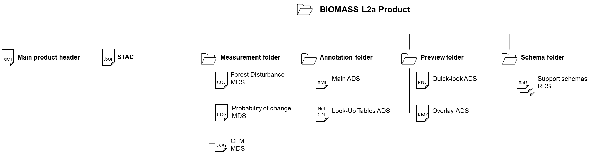

<!-- SPDX-FileCopyrightText: 2026 European Space Agency (ESA) -->
<!-- SPDX-License-Identifier: Apache-2.0 -->

:::{atbd-logo-banner}
:::

(sec:pfd-fd-3)=
# 3. L2a Products Format Overview

The BIOMASS Forest Disturbance L2a product is a folder containing a collection of information, grouped together into files referred to as data sets, and data sets are collected and grouped into several sub-folders in order to achieve a physical tree forming a complete product.

These products contain 3 kinds of datasets:

- the Measurement Data Sets (MDS), containing probability of change and forest disturbance images derived from processing of L1c data and CFM image derived from disturbance;
- the Annotation Data Sets (ADS), containing metadata that describes the properties and characteristics of the measurement data or how the measurement data was generated;
- the Representation Data Sets (RDS), containing information about the format or syntax of the measurement and annotation data sets and can be used to validate and exploit these data.

The declination and customisation of this format structure for BIOMASS Forest Disturbance L2a products is summarised in the following figure and table. In particular, a typical product contains:

- a main product header (MPH), an XML file including high-level information about the product origin, structure and main metadata;
- STAC metadata: the SpatioTemporal Asset Catalog specification (https://stacspec.org/en) provides a common structure for describing and cataloging spatiotemporal assets (it is a file that represents information about the earth captured in a certain space and time);
- the MDS images, consisting of a raster with probability of change, one with the forest disturbance, and the CFM mask, stored in three Cloud Optimized GeoTIFF (COG) files;
- main annotation ADS, including the properties and characteristics of the measurement data or how the measurement data was generated, stored in a single XML file;
- Look-Up Table (LUT) ADS, including those metadata being too voluminous to be coded efficiently in an XML file (i.e., Look-Up Tables) and requiring a binary file;
- quick-look ADS, including an averaged and decimated previews of measurement MDS;
- Overlay ADS, for viewing the Quick-look ADS in any application that supports KML format (like, e.g., Google Earth or GIS applications);
- XML schemas RDS, including the schemas needed for all the XML files included in the product.

**No Data Value**

L2a Data Sets pixels will have a no data value of -9999.0 (float32) or 255 (ubyte) depending on data type, where the input L1c pixels are invalid and for each pixel discarded by the algorithm. The value is reported in the MDS COG metadata (`GDAL_NODATA` tag, see {ref}`Tab.2 <tab:pfd-fd-2>`), in the Raster Image DSR (`noDataValue` element, see {ref}`Tab.9 <tab:pfd-fd-9>`) and in all the LUT ADS images (`noDataValue` variable, see 4.3.2.1).

(fig:pfd-fd-1)=
:::{div} atbd-mermaid-figure

Fig. 1 — Forest Disturbance L2a products structure

:::

(tab:pfd-fd-1)=
:::{div} atbd-table

Table 1 — Forest Disturbance L2a products structure

| File / Folder | Cardinality | Format | Description / Content |
|---|---|---|---|
| BIOMASS Forest Disturbance L2a Product |   | Folder |   |
| ∟ main product header | 1 | XML | Main product header |
| ∟ STAC | 1 | JSON | STAC (https://stacspec.org) metadata. |
| ∟ measurement |   | Folder |   |
| ∟ Forest Disturbance | 1 | COG | Forest Disturbance image MDS |
| ∟ Probability of change | 1 | COG | Probability of forest change image MDS |
| ∟ CFM | 1 | COG | Computed Forest Mask image MDS. |
| ∟ annotation |   | Folder |   |
| ∟ main | 1 | XML | Main ADS, including: Product DSR Raster image DSR Input information DSR Processing parameters DSR Annotation LUT DSR |
| ∟ lut | 1 | NetCDF | Look-Up Tables ADS, including: ACM matrix (all polarimetric layers) {ad}`8` `numberOfAverages` matrix {ad}`8` FNF, generated outside BPS |
| ∟ preview |   | Folder |   |
| ∟ quicklook | 3 | PNG | Quick-look ADS, for each measurement |
| ∟ overlay | 3 | KML | Overlay ADS, for each quicklook |
| ∟ schema |   | Folder |   |
| ∟ main `annotation.xsd` | 1 | XSD | RDS |
| ∟ L2a, L2b common `annotation.xsd` | 1 | XSD | RDS |
| ∟ common `types.xsd` | 1 | XSD | RDS |
| ∟ `fd-proc-annotations.xsd` | 1 | XSD | RDS |

:::

(sec:pfd-fd-3-1)=
### 3.1 Product format definition guidelines

The BIOMASS Forest Disturbance L2a products format here described has been defined following a set of guidelines and principles, being the main ones:

- follow a structure and an organization into datasets (MDS, ADS and RDS) already adopted with success in other SAR mission (Sentinel-1 above all) and already known to the users;
- rely on existing ESA conventions wherever possible (main product header OGC-compliant,…);
- rely on existing and known-to-the-users standards and formats (COG and NetCDF format for binary files, XML format and corresponding XSD schemas for annotation files, PNG for quick-looks, KML for overlays).

Starting from this consolidated “background”, in order to improve the products usability, LUTs have been introduced: stored in a single file, reducing annotation file dimensions and easing their access, management and applicability.

In the end, the L2a products format has been defined together with L2b one, following the same guidelines and trying to identify a structure that can be applied to both with the minimum changes, easing even more their access to the users.

(sec:pfd-fd-3-2)=
### 3.2 Naming convention

The BIOMASS L2a product and all data sets files naming are addressed and described in detail in {ad}`2`.

The naming of the products directories is here proposed following the main points in {ad}`2`:

`<MMM>_<TTTTTTTTTT>_<yyyymmddThhmmss>_<YYYYMMDDTHHMMSS>_
_G<CC>_M<NN>_C<___>_T<TTT>_F<FFF>_<BB>_<DDDDDD>`

where:

- `<MMM>`: Satellite ID;
- `<TTTTTTTTTT>`: Product Type/File Type, i.e.:
    - `FP_FD__L2A`: Forest Disturbance L2a product;
- `<yyyymmddThhmmss>`: UTC start date and time (min time validity of the stack);
- `<YYYYMMDDTHHMMSS>`: UTC stop date and time (max time validity of the stack);
- `
`: Mission phase identifier;
- `<CC>`: Global Coverage identifier;
- `<NN>`: Major Cycle identifier;
- `<___> `Repeat Cycle identifier, set to special value (not used in L2 products);
- `<TTT>`: Track number of the product;
- `<FFF>`: Frame/slice number of the product;
- `<BB>:` Baseline Identifier;
- `<DDDDDD>`: Compact creation date.

The internal files in the product inherit the same naming convention, with the following changes:

- capital letters conversion to lowercase;
- “Baseline Identifier” and “Compact Creation Date” naming parts removal, except for Main Product Header file;
- addition of a dataset type depending suffix and extension, i.e.:
    - `*.xml` for main product header;
    - `*_i_[fd|probability|cfm].tiff` for image MDS;
    - `*_annot.xml` for main ADS;
    - `*_lut.nc` for Look-Up Tables ADS;
    - `*_[fd|probability|cfm]_ql.png` for quick-look ADS
    - `*_[fd|probability|cfm]_map.kml` for overlay ADS
    - `*.xsd` for support schemas RDS.
    - `*.json` for STAC
