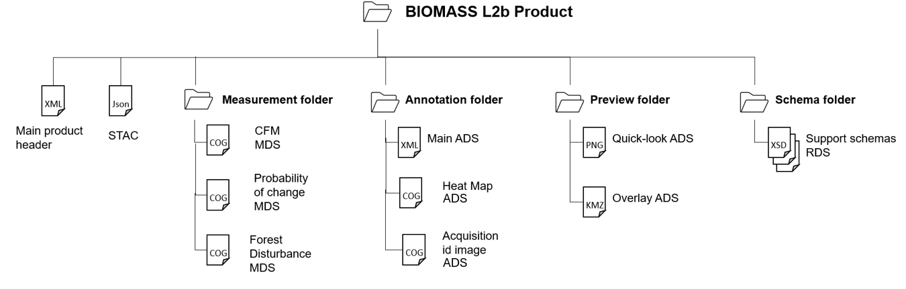

<!-- SPDX-FileCopyrightText: 2026 European Space Agency (ESA) -->
<!-- SPDX-License-Identifier: Apache-2.0 -->

:::{atbd-logo-banner}
:::

(sec:pfd-fd-5)=
# 5. L2b Products Format Overview

The BIOMASS Forest Disturbance L2b product is a folder containing a collection of information, grouped together into files referred to as data sets, and data sets are collected and grouped into several sub-folders in order to achieve a physical tree forming a complete product.

The kinds of datasets are the same of L2a products, i.e., the Measurement Data Sets (MDS), the Annotation Data Sets (ADS) and the Representation Data Sets (RDS); the only difference from L2a is the absence of a “Measurement folder” in order to keep the output structure simpler and the consequent presence of MDS images and additional annotations at root level, together with the main product header.

The declination and customisation of this format structure for BIOMASS Forest Disturbance L2b product is summarised in the following table. A typical product contains:

- a main product header (MPH), an XML file including high-level information about the product origin, structure and main metadata;
- the main images MDS, including the Forest Disturbance binary raster data, the computed CFM mask and the probability of change, all aggregated in L2b tiles and organised in three Cloud Optimized GeoTIFF (COG) files;
- the aggregated Heat Map annotation, two maps of integers which store, pixel wise, how many L1c images contribute to the L2b pixel (first layer) and how many L1c images contribute to the decision, in a Cloud Optimized GeoTIFF (COG) file;
- main annotation ADS, including the properties and characteristics of the measurement data or how the measurement data was generated, stored in a single XML file;
- STAC metadata ADS (see description in {sec}`section|3`);
- quick-look ADS, including an averaged and decimated previews of measurement MDS;
- Overlay ADS, for viewing the Quick-look ADS in any application that supports KML format (like, e.g., Google Earth or GIS applications);
- XML schemas RDS, including the schemas needed for all the XML files included in the product.

No need for Look-Up Tables (LUT) ADS in L2b products.

**No Data Value**

L2b Data Sets pixels will have a no data value of -9999.0 (float32) or 255 (ubyte) depending on data type, where the input L2a pixels are invalid and for each pixel discarded by the algorithm.

The value is reported in all the MDS COG metadata (`GDAL_NODATA` tag, see {ref}`Tab.2 <tab:pfd-fd-2>`) and in the Raster Image DSR (`noDataValue` element, see 6.3.1.2).

(fig:pfd-fd-18)=
:::{div} atbd-mermaid-figure

Fig. 18 — Forest Disturbance L2b products structure

:::

(tab:pfd-fd-39)=
:::{div} atbd-table

Table 39 — Forest Disturbance L2b products structure

| File / Folder | Cardinality | Format | Description / Content |
|---|---|---|---|
| BIOMASS Forest Disturbance L2b Product |   | Folder |   |
| ∟ main product header | 1 | XML | Main product header |
| ∟ STAC | 1 | JSON | STAC (https://stacspec.org) metadata. |
| ∟ measurement |   | Folder |   |
| ∟ Forest Disturbance | 1 | COG | Forest Disturbance image MDS |
| ∟ Probability of change | 1 | COG | Probability of forest change MDS |
| ∟ CFM | 1 | COG | Computed Forest Mask MDS |
| ∟ annotation |   | Folder |   |
| ∟ main | 1 | \| | Main ADS, including: Product DSR Raster Image DSR Input information DSR Processing parameters DSR |
| ∟ Heat Map | 2 | COG | Pixel wise agreeing and contributing L1c counters |
| ∟ acquisition id image | 1 | COG | Pixel wise binary indicator of contributing images |
| ∟ preview |   | Folder |   |
| ∟ quicklook | 3 | PNG | Quick-look ADS for: Forest Disturbance (from measurement) Probability Of Change (from measurement) CFM (from measurement) Heat Map agreeing (from annotations) Heat Map contributing (from annotations) |
| ∟ overlay | 3 | KML | Overlay ADS, for each quicklook |
| ∟ schema |   | Folder |   |
| ∟ main `annotation.xsd` | 1 | XSD | RDS |
| ∟ L2a, L2b common `annotation.xsd` | 1 | XSD | RDS |
| ∟ common `types.xsd` | 1 | XSD | RDS |
| ∟ `fd-proc-annotations.xsd` | 1 | XSD | RDS |

:::

(sec:pfd-fd-5-1)=
### 5.1 Product format definition guidelines

Refer to {sec}`3.1`.

(sec:pfd-fd-5-2)=
### 5.2 Naming convention

The BIOMASS L2b product and all data sets files naming are addressed and described in details in {ad}`2`.

The naming of the products directories is here proposed following the main points in {ad}`2`:

`<MMM>_<TTTTTTTTTT>_
_G<CC>_T< TTTTTTT>_B<BBB>_<BB>_<DDDDDD>`

where:

- `<MMM>`: Satellite ID;
- `<TTTTTTTTTT>`: Product Type/File Type, i.e.:
    - `FP_FD__L2B`: Forest Disturbance L2b product;
- `
`: Mission phase identifier;
- `<CC>`: Global Coverage identifier;
- `<TTTTTTT>`: Tile number of the product, the seven digits are `[N|S]aa[E|W]bbb`, where:
    - `N|S:` stands for North or South;
    - `aa:` latitude in two digits padded with zeros (at 0º N or S are both valid);
    - `E|W:` stands for East or West;
    - `bbb:` longitude over 3 digits padded with zeros ( at 0º E or W are both valid);
- `<BBB>`: Basin literal identifier of the product (string);
- `<BB>:` Baseline Identifier;
- `<DDDDDD>`: Compact creation date.

The internal files in the product inherit the same naming convention, with the following changes:

- capital letters conversion to lowercase;
- “Baseline Identifier” and “Compact Creation Date” naming parts removal, except for Main Product Header file;
- addition of a dataset type depending suffix and extension, i.e.:
    - `*.xml` for main product header;
    - `*_i_[fd|probability|cfm].tiff` for image MDS;
    - `*_annot.xml` for main ADS;
    - `*_i_[acquisition_id_image|heatmap].tiff` for images in annotations;
    - `*_[fd|probability|cfm|hmagreeing|hmcontrib]_ql.png` for quick-look ADS;
    - `*_[fd|probability|cfm|hmagreeing|hmcontrib]_map.kml` for overlay ADS;
    - `*.xsd` for support schemas RDS.
    - `*.json` for STAC

For basins, the following notation is used:

- • South America tropical: 100
- • South America temperate: 200
- • Africa tropical/temperate: 300
- • Asia temperate: 400
- • Asia tropical: 500
- • Oceania tropical/temperate: 600
- • Exclusion zone: 700
