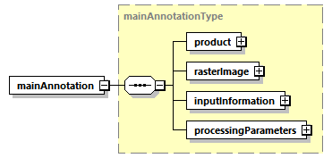
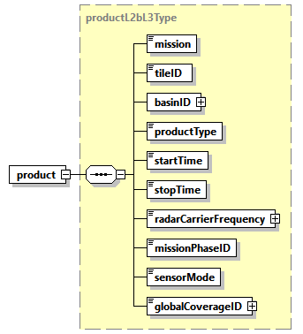
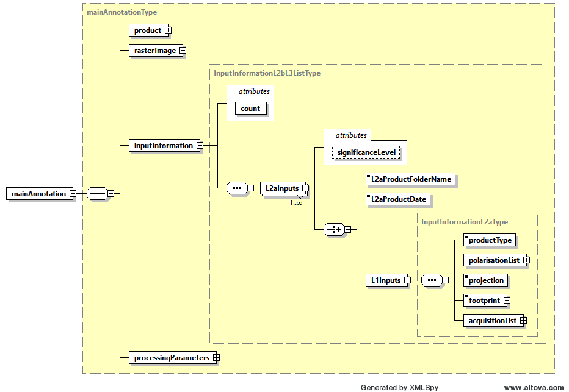
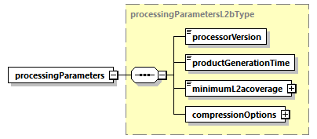
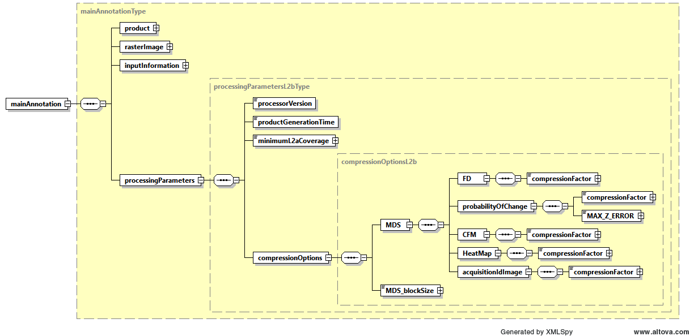

<!-- SPDX-FileCopyrightText: 2026 European Space Agency (ESA) -->
<!-- SPDX-License-Identifier: Apache-2.0 -->

:::{atbd-logo-banner}
:::

(sec:pfd-fd-6)=
# 6. L2b Products Format Specification

(sec:pfd-fd-6-1)=
### 6.1 Main Product header

The Main Product Header (MPH) is an XML file present in all the BIOMASS L2 products.

BIOMASS L2 products are folder based and the MPH is top level leaf of the product tree.

The MPH main scope is to provide all the information related to the:

- Genesis of the product;
- Identification of the product for example for cataloguing purposes;
- Product consistency (filesize).

For the detailed description of the MPH content and format refer to {ad}`3`. It is very similar to the one described in 4.1, without following fields, which are not present in L2b:

- eop:`swathIdentifier` Swath identifier
- eop:`orbitDirection` Orbit direction
- eop:`wrsLongitudeGrid` Track number
- eop:`wrsLatitudeGrid` Frame number
- sar:`antennaLookDirection` SAR antenna look direction

(sec:pfd-fd-6-2)=
### 6.2 Measurement data sets (MDS)

The MDS of the L2b products is constituted by the same quantities of L2a, together with Heat Map annotation:

- Forest Disturbance is the main MDS consisting on the binary classification image, showing where forest changes occurred at the given Global cycle;
- probability of change, which is the quality layer MDS;
- CFM image, the mask accounting for the cumulative disturbance updates;
- Heat Map of integer numbers (ubyte) which stores, pixel wise, two maps, with the number of L1c images contributing to the L2b pixel (first layer) and the number of L1c images contributing to the final decision. (this information is completed with the list of all L1c images used by the processor, see input information DSR 6.3.1.3).
- Acquisition ID Image: a multilayer image (COG format) where each contributing L2a input incidence map is stored (as a binary map); the number of layers is equal to the number of L2a inputs and their order is the same with respect to the L2a inputs ({ref}`Tab.43 <tab:pfd-fd-43>`).

For all the images, following considerations are the same.

All the L2b images are geocoded to specific BIOMASS tiling latitude-longitude geographic DGG, described in {rd}`9`, ensuring a ground sampling always better than the resolution.

In particular, we have that L2b images are aggregations of the L2a products insisting on the same location on ground (a single tile of the above DGG); a different number of L2a products may be available for the MDS geographic grid tile, based on tile dimensions and swath coverage.

The format used to store the L2b images is again the Cloud Optimized GeoTIFF (COG) {rd}`1`.

Details about COG format and its usage to store images are already explained in {sec}`4.2` for L2a product and apply as well to L2b products.

**Metadata**

Metadata is the same of the L2a one, already described in {sec}`4.2` and {ref}`Tab.2 <tab:pfd-fd-2>`. the only difference is the absence of “Swath” metadata in L2b.

**Overviews**

Same considerations already explained in 4.2

(sec:pfd-fd-6-3)=
### 6.3 Annotation data sets (ADS)

(sec:pfd-fd-6-3-1)=
#### 6.3.1 Main ADS

This section describes in details the content of main ADS for L2b products. Differences from L2b are in the description, where needed.

An overview is provided by the two figures below and by the table which describes all the elements, both for L2b.

(fig:pfd-fd-19)=
:::{div} atbd-mermaid-figure

Fig. 19 — main L2b ADS

:::

(tab:pfd-fd-40)=
:::{div} atbd-table

Table 40 — Main L2b ADS

| Name | Description | Data Type | Cardinality |
|---|---|---|---|
| product | Product L2b DSR. This DSR contains the L2b product information. | `productL2bType` | 1 |
| `rasterImage` | Raster image DSR. This DSR contains all the necessary information to exploit the L2b raster images. | `rasterImageType` | 1 |
| InputInformation | Input Information L2b DSR. This DSR contains the necessary information to identify the L2a products in input to L2b processor and also a list of all the L1c acquisitions used to generate those L2a products. | InputInformationL2bL3ListType | 1 |
| `processingParameters` | Processing parameters DSR. This DSR contains the description of L2b processing parameters. | `processingParametersL2bType` | 1 |

:::

(sec:pfd-fd-6-3-1-1)=
##### 6.3.1.1 Product L2b DSR

This DSR contains the parameters to describe the L2b product.

An overview is provided by figures and table below.

(fig:pfd-fd-20)=
:::{div} atbd-mermaid-figure

Fig. 20 — product L2b DSR

:::

(tab:pfd-fd-41)=
:::{div} atbd-table

Table 41 — Product L2b DSR (productL2bType and productType)

| Name | Description | Data Type | Cardinality |
|---|---|---|---|
| mission | Mission (BIOMASS). | `missionType` | 1 |
| tileID | DGG geographic cell (tile) identifier (one element list). | `xsd:string` | 1 |
| basinID | List of DGG basin identifiers. | `stringListType` | 1 |
| `productType` | Product type (“`FD_L2B`”). | `productType` | 1 |
| `startTime` | Start time of the image [UTC]. | `timeType` | 1 |
| `stopTime` | Stop time of the image [UTC]. | `timeType` | 1 |
| `radarCarrierFrequency` | Radar carrier frequency [Hz]. | `doubleWithUnit` | 1 |
| `missionPhaseID` | Mission phase identifier. | `missionPhaseIDType` | 1 |
| `sensorMode` | Sensor mode (always Measurement). | `sensorModeType` | 1 |
| `globalCoverageID` | Global coverage identifier. | `xsd:unsignedShort` | 1 |

:::

(sec:pfd-fd-6-3-1-2)=
##### 6.3.1.2 Raster Image L2b DSR

This DSR contains all the necessary information to exploit the raster images of forest disturbance, probability of change, CFM and Heat Map it is already described in {fig}`Fig.|5`, {ref}`Tab.9 <tab:pfd-fd-9>`, {ref}`Tab.10 <tab:pfd-fd-10>`, {ref}`Tab.11 <tab:pfd-fd-11>`, {ref}`Tab.12 <tab:pfd-fd-12>` with the differences are:

- the projection which here is the specific “DGG” described in {rd}`9`.
- The `FD_heatMap` is present, as described in in {ref}`Tab.10 <tab:pfd-fd-10>`

(sec:pfd-fd-6-3-1-3)=
##### 6.3.1.3 Input Information L2b DSR

This DSR contains, for each of the L2a Product in input to L2b processor:

- the folder name of L2a product;
- the L1c acquisitions used to generate that L2a product; it is an InputInformationL2aListType, see description in 4.3.1.3 and {ref}`Tab.13 <tab:pfd-fd-13>`, {ref}`Tab.14 <tab:pfd-fd-14>`, {ref}`Tab.19 <tab:pfd-fd-19>`.

An overview is provided by figure below and in the table below for the L2inputs.

(fig:pfd-fd-21)=
:::{div} atbd-mermaid-figure

Fig. 21 — Input information L2b DSR (InputInformationL2bL3ListType )

:::

(tab:pfd-fd-42)=
:::{div} atbd-table

Table 42 — Input information L2b DSR (InputInformationL2bL3ListType )

| Name | Description | Data Type | Cardinality |
|---|---|---|---|
| count | XML attribute. | `xsd:unsignedInt` | required |
| L2aInputs | One entry for each L2a product in input to L2b. Each entry contains two elements: L2aProductFolderName and L1inputs. | L2aInputsType | 1..N |

:::

(tab:pfd-fd-43)=
:::{div} atbd-table

Table 43 — Input information L2b DSR (L2aInputsType)

| Name | Description | Data Type | Cardinality |
|---|---|---|---|
| `significanceLevel` | XML attribute: level of significance used for the disturbance computation (single value from configuration). (One value for each “L2aInputs" entry). | `xsd:float` | 1 |
| L2aProductFolderName | Folder name of each L2a product, as defined in {sec}`3.2` (One string for each “L2aInputs" entry). | `xsd:string` | 1 |
| L2aProductDate | Product date for each L2a product | `xsd:string` | 1 |
| L1inputs | L1c acquisitions used to generate the L2a product. See 4.3.1.3 and {ref}`Tab.13 <tab:pfd-fd-13>`, {ref}`Tab.14 <tab:pfd-fd-14>`, {ref}`Tab.19 <tab:pfd-fd-19>`. (One element for each “L2aInputs" entry). | InputInformationL2axsdType | 1 |

:::

(sec:pfd-fd-6-3-1-4)=
##### 6.3.1.4 Processing parameters L2b DSR

This DSR contains the list of L2b processing parameters applied. An overview is provided by figures and table below.

(fig:pfd-fd-22)=
:::{div} atbd-mermaid-figure

Fig. 22 — processing parameters L2b DSR

:::

(tab:pfd-fd-44)=
:::{div} atbd-table

Table 44 — Processing parameters L2b DSR

| Name | Description | Data Type | Cardinality |
|---|---|---|---|
| `processorVersion` | Version of the processor used to generate the product. | `xsd:string` | 1 |
| `productGenerationTime` | Product generation time [UTC]. | `timeType` | 1 |
| `minimumL2aCoverage` | The minimum percentage of tile coverage used to trigger the computation. | `xsd:float` | 1 |
| `compressionOptions` | Configurable compression options for all the L2b MDS. | `compressionOptionsL2bType` | 1 |

:::

(fig:pfd-fd-23)=
:::{div} atbd-mermaid-figure

Fig. 23 — Processing parameters L2b DSR (compressionOptionsL2bType)

:::

(tab:pfd-fd-45)=
:::{div} atbd-table

Table 45 — Processing parameters L2b DSR (compressionOptionsL2bType)

| Name | Description | Data Type | Cardinality |
|---|---|---|---|
| MDS à FD à `compressionFactor` MDS à `probabilityOfChange` à `compressionFactor` MDS àCFM à `compressionFactor` MDS à HeatMap à `compressionFactor` MDS à `acquisitionIdImage` à `compressionFactor` | ZSTD algorithm compression factor for all the MDS. From 0 to 9, where zero means no compression. | `xsd:unsignedByte` | 1 |
| MDS à `probabilityOfChange` à `MAX_Z_ERROR` | For the probability of change image MDS, define exactly how lossy the LERC compression algorithm is allowed to be, specifying the absolute maximum error admitted. Zero means loss-less compression. | `xsd:float` | 1 |
| `MDS_blockSize` | MDS COG blocking algorithm size. Same value is used for both data array dimensions. | `xsd:unsignedByte` | 1 |

:::

(sec:pfd-fd-6-3-2)=
#### 6.3.2 Quick-look ADS

The Quick-look ADS is composed by lower resolution versions of all the MDS images.

The details about Quick-look ADS already explained in {sec}`4.3.3` for L2a products apply as well to L2b products.

(sec:pfd-fd-6-3-3)=
#### 6.3.3 Overlay ADS

The Overlay ADS is a Keyhole Markup Language (KML) file that describes the product coverage area and is suitable for viewing the Quick-look ADS in any application that supports KML format (like, e.g., Google Earth or GIS applications).

The details about Quick-look ADS already explained in {sec}`4.3.4` for L2a products apply as well to L2b products.
